# in-toto-attestation-v1 — protocol model

FX-1 pass 1 (extract), protocol and state-machine agent, claude-opus-5-5, effort max, from the source only (blind to summary.md and the other lanes). Source: the in-toto Attestation Framework at commit `df02077bf97218a8860a5c534eff1f1381f56984` (tag v1.2.0), archive `.cache/in-toto-attestation-v1.bin` sha256 `c66cbb44b115cd0745e0f22dfedb069729a081a7f56372e3fca8ead667795d91`, quoted from the 12-file rendering `.cache/in-toto-attestation-v1.txt` (sha256 `87260bf00f01cbbe4e9c85795f29043ffc8801416958a8bde232139cb1ed13d0`, built by `distilled/render-source.py`). The data is in `protocol.yaml` and `state-machine.yaml`; this file is written from them by the same script, so a later edit to either owes the same edit here. Every quotation below is a `<!-- q -->` marker whose words `bin/check-quotes --render` wrote from the source.

## Applicability

Applicable, as a production-and-consumption model with no exchange. The framework defines four data layers (Predicate, Statement, Envelope, Bundle) and no protocol: no request, response, session, transport binding, acknowledgement or error message passes between producer and consumer, and nothing travels back. It does define (a) what a producer puts in a Statement and how it wraps and signs it in an Envelope (§3 to §8); (b) one consumer procedure with reject outcomes, the validation model of docs/validation.md (§12), which spec/README.md links as its validation model; (c) how attestations are grouped into a Bundle and how a consumer must process one (§9.1, §9.3); (d) file naming and storage media types (§8.3, §8.4, §9.2, §9.3); (e) a worked CI/CD example in which several producers add to one Bundle and a policy engine consumes it (§9.4); and (f) version-compatibility rules a consumer applies when parsing (§2.2, §11). Every flow below is one party building or holding an object, a storage or delivery step the source does not define, and the receiving party processing it alone; every on_error is local to the role that meets the failure. The validation model is pseudocode outside spec/, carries no BCP 14 keyword, covers one artifact and one attestation (L1120), and as written rejects every attestation (SD-01); its links to Bundles and to the policy engine are inferred here and marked so.

**FR-01.** Four layers, independent but designed to work together; the Envelope is the only one that authenticates.

<!-- q L13 -->
> It has four layers that are independent but designed to work together:

<!-- q L15-16 "[Predicate]" .. "schema." -->
> [Predicate]: Contains arbitrary metadata about a subject artifact, with a type-specific schema.

<!-- q L17-18 "[Statement]" .. "predicate." -->
> [Statement]: Binds the attestation to a particular subject and unambiguously identifies the types of the predicate.

<!-- q L19 "[Envelope]" .. "serialization." -->
> [Envelope]: Handles authentication and serialization.

<!-- q L20 "[Bundle]" .. "together." -->
> [Bundle]: Defines a method of grouping multiple attestations together.

**FR-02.** The consumers the source has in mind are automated policy engines.

<!-- q L10-11 "The intended consumers" .. "[Binary Authorization]." -->
> The intended consumers are automated policy engines, such as [in-toto-verify] and [Binary Authorization].

**FR-03.** The one procedure is pseudocode in docs/, for one artifact and one attestation, and it ends by feeding a policy engine.

<!-- q L28-29 "The [validation model]" .. "together." -->
> The [validation model] provides pseudocode showing how these layers fit together.

<!-- q L1116-1118 "The following pseudocode" .. "policy engine." -->
> The following pseudocode shows how to verify and extract metadata about a single artifact from a single attestation. The expectation is that consumers will feed the resulting metadata into a policy engine.

<!-- q L1120 "Explain how" .. "attestations." -->
> Explain how to process multiple artifacts and/or multiple attestations.

**FR-04.** Authentication is per attestation, never per Bundle.

<!-- q L864-868 "The Bundle is not authenticated" .. "without being detected." -->
> The Bundle is not authenticated as a whole. Instead each individual attestation is authenticated using signature formats like [DSSE]. As such, an attacker might be able to delete valid attestations, replay obsolete attestations, and/or inject invalid or irrelevant attestations in a Bundle without being detected.

**FR-05.** Subjects are matched by digest alone.

<!-- q L208-209 "IMPORTANT: Subject artifacts" .. "content type." -->
> IMPORTANT: Subject artifacts are matched purely by digest, regardless of > content type.

**FR-06.** The envelope format and its signing protocol are delegated to DSSE v1.0, or to any ITE-5 format.

<!-- q L748 -->
> The RECOMMENDED format and protocol for Envelopes are defined per [DSSE v1.0].

<!-- q L749-750 "Producers MAY use" .. "specification:" -->
> Producers MAY use other signature methods and formats that meet the [ITE-5] specification:

## Reading `protocol.yaml` and `state-machine.yaml`

| key | what it holds |
|---|---|
| `source`, `applicability`, `conventions` | digests and file map; why the artifact applies; quoting, status, locator, basis, id, message, step-number and role rules |
| `framing` | 6 statements of what kind of document this is, each quoted |
| `roles` | 11 roles: 4 parties, 1 component, 1 store, 5 participants of the §9.4 example |
| `message_names_used` | the 6 spec structure names the steps use, with step counts, and the steps that move none |
| `flows` | 11 flows, 71 steps (10 inferred); on_error_basis stated 16, unspecified 51, inferred 4 |
| `error_paths` | 16 failures with the role that meets them, the steps, the machine transition and the outcome |
| `source_defects_and_tensions` | 18 entries: 9 defects, 7 tensions, 2 gaps, recorded and not repaired |
| `not_defined` | 10 things an implementer will not find in this source |
| `state-machine.yaml` | 6 machines, 35 states (6 error), 39 transitions (6 inferred), 14 triggers |

## Roles

| role | kind | source names | plays |
|---|---|---|---|
| `producer` | party | Producers, producer, producers, attestation producer, functionaries, functionary | — |
| `consumer` | party | consumers, Consumers, consumer, verifier, Consumer, verifiers | — |
| `policy-engine` | component | policy engines, policy engine | — |
| `storage` | store | storage systems | — |
| `predicate-author` | party | Users | — |
| `maintainers` | party | maintainers | — |
| `fooly-builder` | example | — | producer |
| `vulnerability-scanner` | example | — | producer |
| `ci-cd-system` | example | — | producer, consumer |
| `app-store` | example | — | none (deployment target) |
| `website` | example | — | storage |

Every role's description and quotes are in `protocol.yaml`. The policy engine is separated from the consumer because §12 hands its output from one to the other; the source also calls the policy engines the consumers (FR-02).

## Flows

Each arrow is one `protocol.yaml` step in order, labelled with its number and a short form of its action. A self-arrow is local processing; `opt` blocks are the failure outcomes the source states; `[inferred]` marks a step the source does not state. Mermaid reads a semicolon as a line break, so labels use none.

### F01 statement-production

Producer builds a Statement about one or more subject artifacts. Local to the producer. The source fixes what a Statement contains (§3), what each subject ResourceDescriptor and DigestSet must carry (§4, §5) and how a predicate is identified and extended (§2.2, §6.2, §7); it defines no producer-side check or failure. A defect in what is produced surfaces only when a consumer validates it (F03), and most such defects do not surface even there, because §12 checks only the signatures, payloadType, _type and the subject digests.

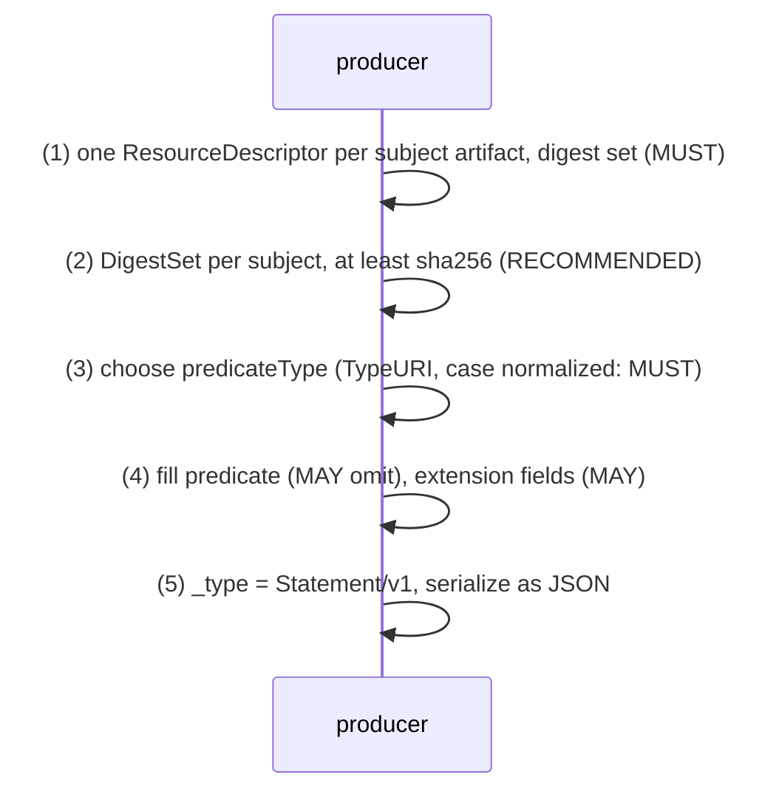

<!-- q L190-191 "Set of software artifacts" .. "`digest` set." -->
> Set of software artifacts that the attestation applies to. Each element > represents a single software artifact. Each element MUST have `digest` set.

| n | from → to | message | kind | on error |
|---|---|---|---|---|
| 1 | producer → producer | ResourceDescriptor | stated | unspecified by source (§3.2, §4.2): no producer-side check; a subject whose digest does not match the artifact surfaces at the consumer as an empty matchedSubjects (F03 step S5) (unspecified) |
| 2 | producer → producer | DigestSet | stated | unspecified by source (§5.2): an entry the consumer does not accept is ignored there (F03 step S4, R-0032), so a set holding only unaccepted algorithms matches nothing (unspecified) |
| 3 | producer → producer | Predicate | stated | unspecified by source (§7.2, §6.2) (unspecified) |
| 4 | producer → producer | Predicate | stated | unspecified by source (§3.2, §2.2, §4.2) (unspecified) |
| 5 | producer → producer | Statement | stated | unspecified by source (§3.2, §2.2) (unspecified) |

### F02 envelope-signing

Producer wraps the Statement in an Envelope and signs it. The Envelope layer handles serialization and authentication. DSSE v1.0 is the RECOMMENDED format; any other format meeting ITE-5 MAY be used. §8.2 fixes the general fields (signatures, keyid, payload, payloadType) and the DSSE-specific values (payloadType, a base64 payload). What bytes are signed is DSSE's, not this source's (step 4a, inferred). Delivery to a consumer is not defined (step 6, inferred).

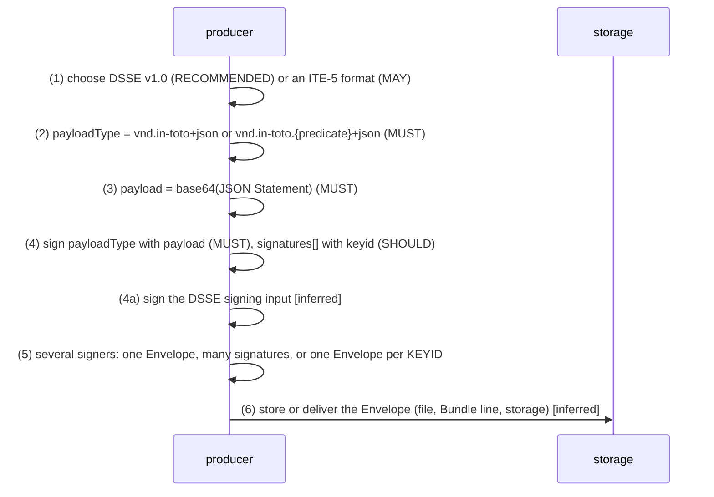

<!-- q L785-786 "`payloadType` MUST be set" .. "`application/vnd.in-toto+json`." -->
> `payloadType` MUST be set to `application/vnd.in-toto.<predicate>+json` or to `application/vnd.in-toto+json`.

| n | from → to | message | kind | on error |
|---|---|---|---|---|
| 1 | producer → producer | Envelope | stated | unspecified by source (§8.1, §8.1.1) (unspecified) |
| 2 | producer → producer | Envelope | stated | unspecified by source (§8.2); a consumer running §12 rejects at F03 step S1, which as written rejects every value (SD-01) (unspecified) |
| 3 | producer → producer | Envelope | stated | unspecified by source (§8.2) (unspecified) |
| 4 | producer → producer | Envelope | stated | unspecified by source (§8.2) (unspecified) |
| 4a | producer → producer | Envelope | inferred | unspecified by source (§8.1, §8.2) (unspecified) |
| 5 | producer → producer | Envelope | stated | unspecified by source (§8.1, §8.3) (unspecified) |
| 6 | producer → storage | Envelope | inferred | unspecified by source (§8.3, §8.4, §9.1) (unspecified) |

### F03 attestation-validation

Consumer validates one attestation about one artifact (docs/validation.md, as written). The only procedure in the source, §12, modelled step for step and not repaired. Step numbers follow the pseudocode's own nesting: E for the Envelope layer, I for the intermediate state, S for the Statement layer, O for the output; 0 is the inputs, and S2a is the one step this model adds (inferred). Every failure is a reject that ends validation with no output; nothing is sent back to the producer. As written, step S1 rejects every attestation (SD-01) and step S3 tests a field named type that a conforming Statement spells _type (SD-02); state-machine.yaml M01 records both readings. The pseudocode is in docs/, outside spec/, and carries no BCP 14 keyword, so constrained_by names the §5 and §8 requirements each step enforces.

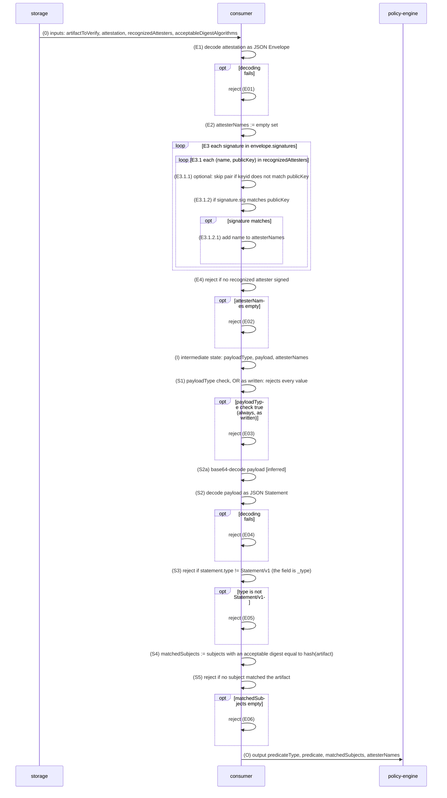

<!-- q L1116-1118 "The following pseudocode" .. "policy engine." -->
> The following pseudocode shows how to verify and extract metadata about a single artifact from a single attestation. The expectation is that consumers will feed the resulting metadata into a policy engine.

| n | from → to | message | kind | on error |
|---|---|---|---|---|
| 0 | storage → consumer | Envelope | stated | unspecified by source (§12 L1122-1128) (unspecified) |
| E1 | consumer → consumer | Envelope | stated | reject: validation ends with no output (stated) |
| E2 | consumer → consumer | Envelope | stated | none: an assignment (stated) |
| E3 | consumer → consumer | Envelope | stated | none: a loop (stated) |
| E3.1 | consumer → consumer | Envelope | stated | none: a loop (stated) |
| E3.1.1 | consumer → consumer | Envelope | stated | skip the pair, when the option is taken. How a keyid is compared with a publicKey, and what happens when keyid is absent (keyid is only a SHOULD), are not stated (stated) |
| E3.1.2 | consumer → consumer | Envelope | stated | a signature that does not match adds no name and validation continues: the If has no else branch; the failure, if every pair fails, is E4's (stated) |
| E3.1.2.1 | consumer → consumer | Envelope | stated | none: an insertion into a set (stated) |
| E4 | consumer → consumer | Envelope | stated | reject: no recognized attester signed the Envelope (stated) |
| I | consumer → consumer | Envelope | stated | none: a hand-off (stated) |
| S1 | consumer → consumer | Envelope | stated | reject; as written, for every input (stated) |
| S2a | consumer → consumer | Envelope | inferred | reject, as a decoding failure of S2 (inferred) (inferred) |
| S2 | consumer → consumer | Statement | stated | reject: validation ends with no output (stated) |
| S3 | consumer → consumer | Statement | stated | reject (stated) |
| S4 | consumer → consumer | ResourceDescriptor | stated | none: an empty result is S5's failure (stated) |
| S5 | consumer → consumer | Statement | stated | reject: the attestation is not about this artifact (stated) |
| O | consumer → policy-engine | Predicate | stated | unspecified by source (§12): the hand-off has no failure (unspecified) |

### F04 policy-evaluation

Policy engine decides on the validated metadata. The source's intended consumers are automated policy engines, and §12 ends by feeding its output to one. The policy language, the decision format and how a decision is returned are not defined. What is defined is what a policy may rely on (predicateType, not the media type), what it must ignore (unrecognized fields), what it may use (extension fields, subject names, annotations) and how it should be shaped (monotonic).

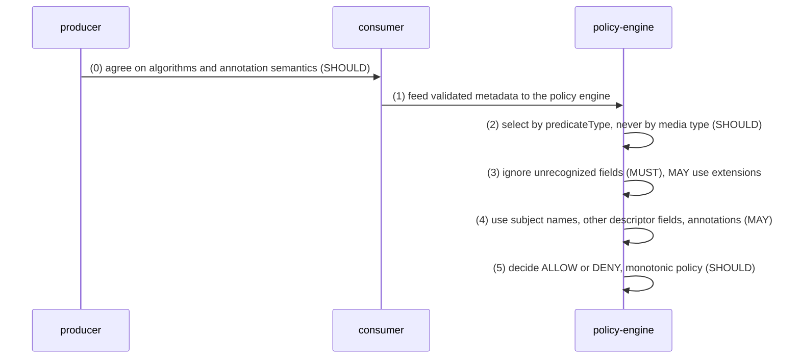

<!-- q L134-137 "A policy is considered monotonic" .. "is monotonic." -->
> A policy is considered monotonic if ignoring an attestation, or a field within an attestation, will never turn a DENY decision into an ALLOW. A predicate or field follows the monotonic principle if the expected policy that consumes it is monotonic.

| n | from → to | message | kind | on error |
|---|---|---|---|---|
| 0 | producer → consumer | DigestSet | stated | unspecified by source (§4.2) (unspecified) |
| 1 | consumer → policy-engine | Predicate | stated | unspecified by source (§12 L1117-1118, §1) (unspecified) |
| 2 | policy-engine → policy-engine | Predicate | stated | unspecified by source (§8.2, §8.4) (unspecified) |
| 3 | policy-engine → policy-engine | Predicate | stated | unspecified by source (§2.2) (unspecified) |
| 4 | policy-engine → policy-engine | ResourceDescriptor | stated | unspecified by source (§3.2, §4.2, §4.3) (unspecified) |
| 5 | policy-engine → policy-engine | Predicate | stated | unspecified by source (§2.2): no decision format, no error and no response to the producer is defined (unspecified) |

### F05 bundle-assembly

Producers group attestations into a Bundle and store it. A Bundle is a JSON Lines file, one Envelope per line, named for the file the attestations are relevant to. The source names no assembling role: in §9.4 the builder creates the file and the CI/CD system appends to it and filters it, so the steps name producer. The Bundle is not authenticated as a whole, so every change to it after the fact (including the filtering of step 5) is invisible to a consumer, and so are deletion, replay and injection by an attacker (EP-11).

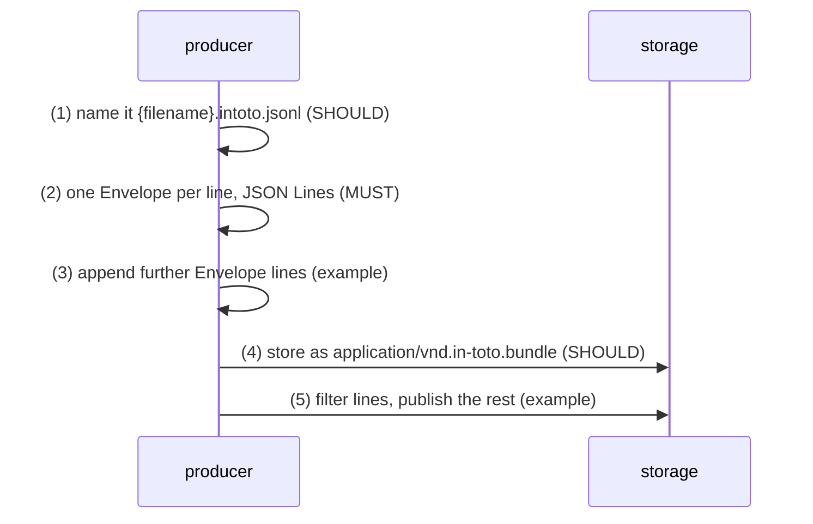

<!-- q L876 -->
> Attestation Bundles use [JSON Lines] to store multiple attestations.

| n | from → to | message | kind | on error |
|---|---|---|---|---|
| 1 | producer → producer | Bundle | stated | unspecified by source (§9.2) (unspecified) |
| 2 | producer → producer | Bundle | stated | unspecified by source (§9.1, §9.2) (unspecified) |
| 3 | producer → producer | Bundle | stated | unspecified by source (§9.4.2, §9.4.3) (unspecified) |
| 4 | producer → storage | Bundle | stated | unspecified by source (§9.3) (unspecified) |
| 5 | producer → storage | Bundle | stated | unspecified by source (§9.4.5) (unspecified) |

### F06 bundle-consumption

Consumer processes a Bundle line by line. Every Bundle rule binds the consumer: parse each line separately, ignore what is not recognized, never depend on line order. Ignoring is the only outcome the source gives; a Bundle as a whole is never rejected. The validation model covers one attestation and says multiple attestations are not yet explained (L1120), so running it per line and handing the surviving outputs to the policy engine is this model's (steps 4 and 7, inferred). §9.5's grep and jq example is a person reading a Bundle, not a consumer procedure.

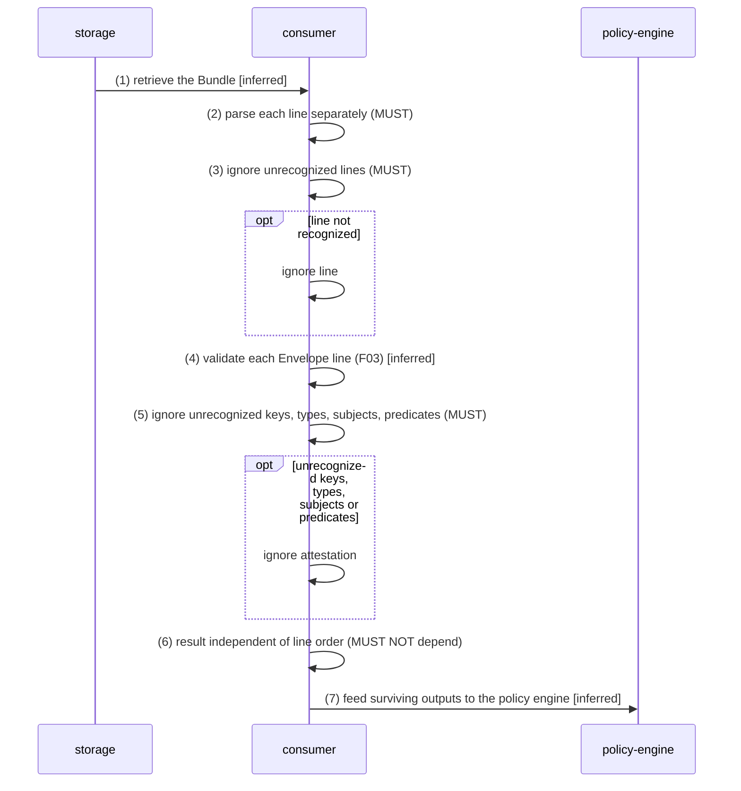

<!-- q L882-883 "Consumers MUST ignore attestations" .. "or predicates." -->
> Consumers MUST ignore attestations with unrecognized keys, types, subjects, or predicates.

| n | from → to | message | kind | on error |
|---|---|---|---|---|
| 1 | storage → consumer | Bundle | inferred | unspecified by source (§9.3) (unspecified) |
| 2 | consumer → consumer | Bundle | stated | unspecified by source (§9.3) (unspecified) |
| 3 | consumer → consumer | Bundle | stated | ignore the line; the Bundle is not rejected (stated) |
| 4 | consumer → consumer | Envelope | inferred | a line F03 rejects is ignored, not a Bundle failure (inferred from step 5's rule) (inferred) |
| 5 | consumer → consumer | Envelope | stated | ignore the attestation (stated) |
| 6 | consumer → consumer | Bundle | stated | unspecified by source (§9.1) (unspecified) |
| 7 | consumer → policy-engine | Predicate | inferred | unspecified by source (§9.4.4) (unspecified) |

### F07 envelope-storage

A single Envelope stored as a file or in a storage system, and read back. Naming and labelling conventions for an Envelope stored on its own. The file name follows the supply chain step, or an agreed name, plus the truncated KEYID when several functionaries sign separately; in a storage system the media type names the predicate. Neither is authenticated: the consumer SHOULD NOT rely on the media type and MUST verify the payload (step 4).

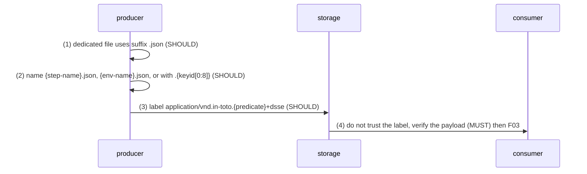

<!-- q L827-828 "To obtain predicate information" .. "`signatures`." -->
> To obtain predicate information that is authenticated, consumers MUST parse the Envelope's `payload`, and verify it against its `signatures`.

| n | from → to | message | kind | on error |
|---|---|---|---|---|
| 1 | producer → producer | Envelope | stated | unspecified by source (§8.3) (unspecified) |
| 2 | producer → producer | Envelope | stated | unspecified by source (§8.3) (unspecified) |
| 3 | producer → storage | Envelope | stated | unspecified by source (§8.4, §8.4.1) (unspecified) |
| 4 | storage → consumer | Envelope | stated | unspecified by source (§8.4) (unspecified) |

### F08 fooly-pipeline

The §9.4 example: build, scan, SBOM, policy check, deploy, publish. The source's one end-to-end scenario, non-normative. Three producers add Envelopes to one Bundle; a policy engine checks the artifact against the whole Bundle before deployment and ignores a predicate type it does not understand; a filtered copy is published. It is the only scenario in the source with several parties acting in turn, and the only place it shows a Bundle changing over time (state-machine.yaml M03). The scanner's Envelope is not an in-toto Statement, which §12 would reject (SD-16).

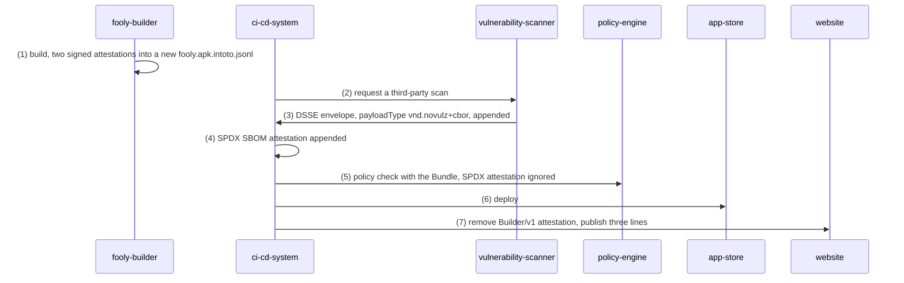

<!-- q L917-919 "The Fooly app has a CI/CD system" .. "app store." -->
> The Fooly app has a CI/CD system which builds the application from source, runs a NoVulnz vulnerability scan on the results, produces an SPDX SBOM, and then deploys the app to an app store.

| n | from → to | message | kind | on error |
|---|---|---|---|---|
| 1 | fooly-builder → fooly-builder | Bundle | stated | unspecified by source (§9.4.1) (unspecified) |
| 2 | ci-cd-system → vulnerability-scanner | none | stated | unspecified by source (§9.4.2) (unspecified) |
| 3 | vulnerability-scanner → ci-cd-system | Envelope | stated | unspecified by source (§9.4.2) (unspecified) |
| 4 | ci-cd-system → ci-cd-system | Bundle | stated | unspecified by source (§9.4.3) (unspecified) |
| 5 | ci-cd-system → policy-engine | Bundle | stated | unspecified by source (§9.4.4) (unspecified) |
| 6 | ci-cd-system → app-store | none | stated | unspecified by source (§9.4.4) (unspecified) |
| 7 | ci-cd-system → website | Bundle | stated | unspecified by source (§9.4.5) (unspecified) |

### F09 version-tolerant-parsing

Consumer parses a type of another minor version. The versioning rules of §2.2 and §11 as a consumer applies them. The TypeURI carries only the major version and is compared as an opaque string; within a major version every message parses correctly as every other minor version; a different major version is a different TypeURI. The rules apply to the Statement and to predicates that opt in. state-machine.yaml M04 and M05 hold the same rules as lifecycles.

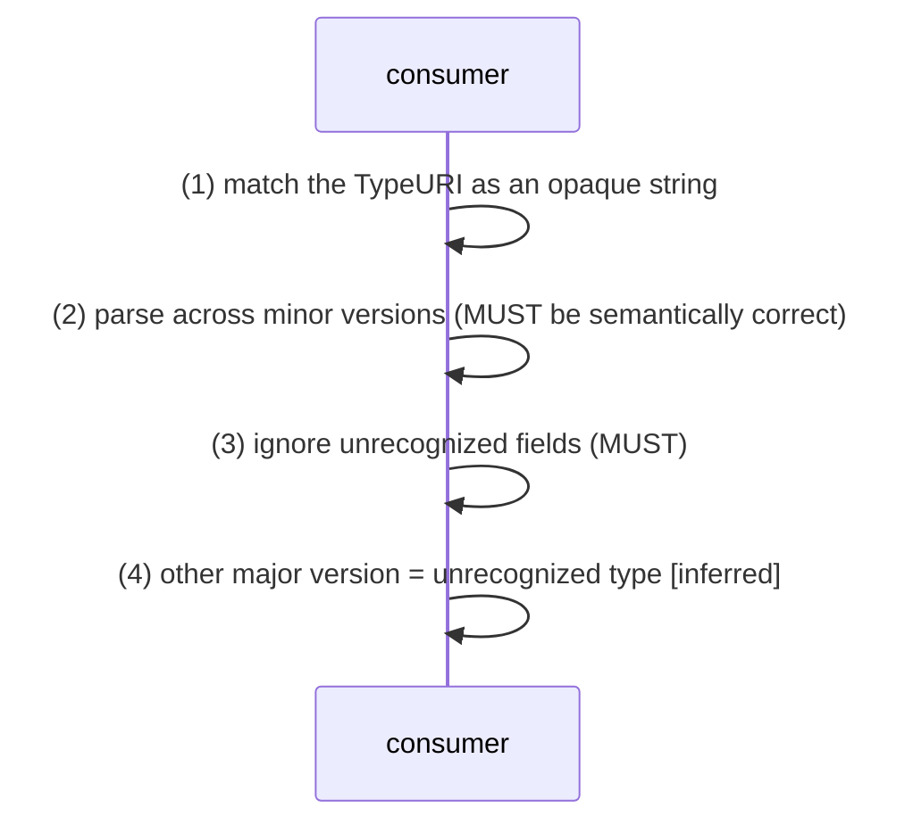

<!-- q L1076-1077 "Any message MUST" .. "same major number." -->
> Any message MUST be semantically correct when parsed as any other version with the same major number.

| n | from → to | message | kind | on error |
|---|---|---|---|---|
| 1 | consumer → consumer | Statement | stated | unspecified by source (§2.2, §11.2) (unspecified) |
| 2 | consumer → consumer | Statement | stated | unspecified by source (§11.2) (unspecified) |
| 3 | consumer → consumer | Statement | stated | unspecified by source (§2.2) (unspecified) |
| 4 | consumer → consumer | Statement | inferred | reject (Statement, §12) or ignore (Bundle, §9.1) (inferred) |

### F10 type-governance

Predicate types and extension fields: choosing, vetting, documenting, versioning. The only steps in which a party addresses the in-toto attestation maintainers. Both are MAY: vetting a new predicate type and documenting extension fields. TypeURIs are not registered; URI namespacing prevents collisions. Versioning a type is a decision the predicate author takes under §11's rules (state-machine.yaml M04).

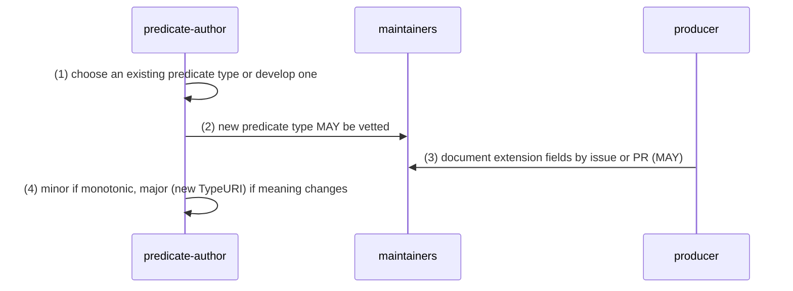

<!-- q L725-726 "Users are expected" .. "no existing one satisfies." -->
> Users are expected to choose an [existing predicate type] that fits their needs, or develop a new one if no existing one satisfies.

| n | from → to | message | kind | on error |
|---|---|---|---|---|
| 1 | predicate-author → predicate-author | Predicate | stated | unspecified by source (§7.2) (unspecified) |
| 2 | predicate-author → maintainers | Predicate | stated | unspecified by source (§7.2, §6.2) (unspecified) |
| 3 | producer → maintainers | none | stated | unspecified by source (§2.2) (unspecified) |
| 4 | predicate-author → predicate-author | Predicate | stated | unspecified by source (§2.2, §11.3) (unspecified) |

### F11 descriptor-resolution

Producer points at or inlines a resource; consumer resolves it and checks its digest. A ResourceDescriptor either points at a resource (uri, downloadLocation) or carries it (content). The source makes downloadLocation resolvable so that consumers can download automatically, and calls uri and mediaType hints for parsing content, so a consumer that follows a descriptor is implied; the download itself and the digest check after it are not described (steps 3 and 4, inferred). The §4.4 example points at another attestation, which a consumer would validate in turn (step 5, inferred).

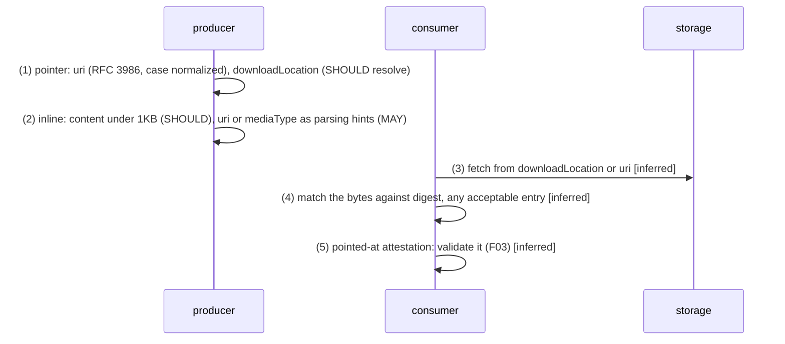

<!-- q L306-307 "To enable automated downloads" .. "be resolvable." -->
> To enable automated downloads by consumers, the specified location SHOULD > be resolvable.

| n | from → to | message | kind | on error |
|---|---|---|---|---|
| 1 | producer → producer | ResourceDescriptor | stated | unspecified by source (§4.2, §4.3, §6.1) (unspecified) |
| 2 | producer → producer | ResourceDescriptor | stated | unspecified by source (§4.2) (unspecified) |
| 3 | consumer → storage | ResourceDescriptor | inferred | unspecified by source (§4.2, §6.1) (unspecified) |
| 4 | consumer → consumer | DigestSet | inferred | unspecified by source; by this model's reading a mismatch means the bytes are not the described resource (inferred) (inferred) |
| 5 | consumer → consumer | Envelope | inferred | unspecified by source (§4.4) (unspecified) |

## Error paths

| id | failure | met by | steps | outcome |
|---|---|---|---|---|
| EP-01 | attestation is not a JSON-encoded Envelope | consumer | F03.E1 | reject (stated) |
| EP-02 | no signature matches a recognized attester | consumer | F03.E4 | reject (stated) |
| EP-03 | payloadType fails the Statement layer's check (as written: every payloadType) | consumer | F03.S1 | reject (stated) |
| EP-04 | payload is not base64 or not a JSON-encoded Statement | consumer | F03.S2a, F03.S2 | reject (base64 part inferred) (stated) |
| EP-05 | Statement type is not https://in-toto.io/Statement/v1 | consumer | F03.S3 | reject (stated) |
| EP-06 | no subject has an acceptable digest equal to the artifact's | consumer | F03.S5 | reject (stated) |
| EP-07 | a Bundle line is not recognized | consumer | F06.3 | ignore the line (stated) |
| EP-08 | an attestation in a Bundle has unrecognized keys, types, subjects or predicates | consumer | F06.5, F08.5 | ignore the attestation (stated) |
| EP-09 | a field is unrecognized | consumer, policy-engine | F03.S2, F04.3, F09.3 | ignore the field, unless the predicate specification says otherwise (stated) |
| EP-10 | a DigestSet entry uses an unrecognized or unaccepted algorithm | consumer | F03.S4 | ignore the entry (stated) |
| EP-11 | a Bundle line is deleted, an obsolete attestation replayed, or an invalid or irrelevant one injected | nobody | F05.5, F06.6 | undetected; only monotonic predicates are said to be safe from deletion (stated) |
| EP-12 | a TypeURI of another major version | consumer | F09.4 | reject (Statement, §12) or ignore (Bundle); elsewhere unstated (inferred) |
| EP-13 | anything wrong in what a producer builds, names or labels | producer | F01.1, F02.2, F05.1, F07.3 | unspecified by source: no producer-side check exists; only §12's checks can catch it (unspecified) |
| EP-14 | the media type of an attestation misstates its predicate type | consumer | F04.2, F07.4 | harmless if the consumer relies only on predicateType, as it SHOULD (stated) |
| EP-15 | a descriptor's uri or downloadLocation does not resolve | consumer | F11.3 | unspecified by source: a ResourceURI MAY be unresolvable (unspecified) |
| EP-16 | a fetched resource does not match the descriptor's digest | consumer | F11.4 | unspecified by source; read here as not the described resource (inferred) |

No failure is reported to anyone: a reject ends a validation with no output, an ignore drops a line, field or attestation, and EP-11 is not detected at all.

## Source defects and tensions

Local numbering (SD-01 to SD-18, this file and protocol.yaml only). Each entry in protocol.yaml carries `normative_sd`, its place in normative.md's canonical list (SD-1 to SD-27), and normative.md's Crosswalk maps all four lanes' lists; for example this file's SD-01 is normative SD-2, and messages.yaml's SD-01 is another defect (normative SD-4).

Recorded, not repaired. A defect is a statement the source gets wrong on its own terms; a tension, two statements that pull apart; a gap, something the source says it leaves open.

**SD-01** (defect, §12 L1146). The Statement layer's first check rejects when payloadType != 'application/vnd.in-toto+json' or not matches(payloadType, '`application/vnd.in-toto.<predicate>+json`'). No value both equals the first and matches the second, so one clause is always true and every attestation is rejected. §8.2 allows both values, so the evident intent is AND. Modelled as written in F03.S1 and M01.T09/T10, with the intended guard beside it. Plausibly introduced when v1.2 added the predicate-specific value (L1035-1036); not checked against an earlier tag.

<!-- q L1146 "Reject if" .. "`application/vnd.in-toto.<predicate>+json`)" -->
> Reject if (`envelope.payloadType` != `application/vnd.in-toto+json` OR `envelope.payloadType` does not match `application/vnd.in-toto.<predicate>+json`)

<!-- q L785-786 "`payloadType` MUST be set" .. "`application/vnd.in-toto+json`." -->
> `payloadType` MUST be set to `application/vnd.in-toto.<predicate>+json` or to `application/vnd.in-toto+json`.

**SD-02** (defect, §12 L1149). The pseudocode tests statement.type; the Statement's field is _type (§3.1, §3.2). Read against the JSON the pseudocode says it decodes, a Statement carrying only §3's fields has no field type and is rejected. The repository's protobuf binding names the field type with JSON name _type (protos/in_toto_attestation/v1/statement.proto line 17 at df02077, outside the 12 rendered files, read only to characterize this), the likely origin. Modelled as written with the _type reading as intended_guard.

<!-- q L1149 "Reject if" .. "Statement/v1`" -->
> Reject if `statement.type` != `https://in-toto.io/Statement/v1`

<!-- q L165 -->
> "_type": "https://in-toto.io/Statement/v1",

<!-- q L183 -->
> `_type` _string ([TypeURI]), required_

**SD-03** (defect, §12 L1133). The Envelope layer's first step is a list item at column 0, a sibling of Envelope layer rather than its child, so the following steps at column 4 nest under it and Envelope layer has no children. Its continuation line at column 8 and the column-4 siblings suggest column 4 was meant. The order of operations is unaffected.

Columns of the list markers: L1132 0, L1133 0, L1134 8, L1135 4, L1136 4, L1137 8, L1138 8, L1139 12, L1140 12, L1141 16, L1142 4.

<!-- q L1132-1134 "Envelope layer:" .. "decoding fails" -->
> Envelope layer: - `envelope` := decode `attestation` as a JSON-encoded [Envelope]; reject if decoding fails

**SD-04** (defect, §12 L1137-1141). The optional keyid skip (L1138) is at the same column as the inner loop over recognizedAttesters (L1137), so the signature check (L1140) nests under the skip and the inner loop has an empty body, leaving name and publicKey unbound where they are used. The only coherent reading puts L1138-1141 in the inner loop's body, which needs L1138-1139 indented one level deeper and L1140-1141 left where they are; F03 and M01 model that reading.

Columns of the list markers: L1132 0, L1133 0, L1134 8, L1135 4, L1136 4, L1137 8, L1138 8, L1139 12, L1140 12, L1141 16, L1142 4.

<!-- q L1137-1141 "For each (`name`" .. "`attesterNames`" -->
> For each (`name`, `publicKey`) in `recognizedAttesters`: - Optional: skip if `signature.keyid` does not match `publicKey` - If `signature.sig` matches `publicKey`: - Add `name` to `attesterNames`

**SD-05** (tension, §12 L1154; §5.2.1.2, §5.2.1.3, §5.2.2). Subject matching compares hash(alg, artifactToVerify) with hexDecode(value). That fits the named standard hash algorithms. For gitBlob and its siblings the hash is over a typed header and the content, for dirHash over a file tree, and a new algorithm may encode its value other than in hex; the pseudocode does not say hash(alg, ·) is algorithm-specific. Its input list scopes acceptableDigestAlgorithms to cryptographic hash algorithms, which excludes the non-cryptographic identifiers of §5.2.3 but not the git ones. A typical hexDecode also accepts uppercase hex, which the lowercase encoding rule never produces.

<!-- q L1154 "`hash(alg" .. "`hexDecode(value)`" -->
> `hash(alg, artifactToVerify)` == `hexDecode(value)`

<!-- q L521 -->
> This hash is computed over `<type> SP <size> NUL <content>`, where:

<!-- q L455-456 "Equivalent to extracting" .. "that directory:" -->
> Equivalent to extracting the archive to an empty directory and running the following command in that directory:

<!-- q L560-561 "New algorithms MUST" .. "etc." -->
> New algorithms MUST document how the value is encoded, e.g. URL-safe base64, lowercase hex, etc.

<!-- q L1127-1128 -->
> - `acceptableDigestAlgorithms`: collection of acceptable cryptographic hash algorithms (usually just `sha256`)

**SD-06** (defect, §8.2 L779-780 vs L785-786). The general Envelope requirement says payloadType MUST take the form `application/vnd.in-toto+<encoding>`; the first DSSE-specific requirement says it MUST be `application/vnd.in-toto.<predicate>+json` or application/vnd.in-toto+json. The predicate-specific value does not take the general form. The v1.2 change widened only the DSSE list.

<!-- q L779-780 "It MUST take the form" .. "format." -->
> It MUST take the form `application/vnd.in-toto+<encoding>` to indicate an in-toto [Statement] payload and its serialized `<encoding>` format.

<!-- q L785-786 "`payloadType` MUST be set" .. "`application/vnd.in-toto+json`." -->
> `payloadType` MUST be set to `application/vnd.in-toto.<predicate>+json` or to `application/vnd.in-toto+json`.

<!-- q L1035-1036 "Expanded the allowed values" .. "[Envelope Fields]." -->
> Expanded the allowed values for the envelope's `payloadType` field to `application/vnd.in-toto.<predicate>+json`. See [Envelope Fields].

**SD-07** (defect, §9.4.5 L984, L986 vs §9.4.3 L960, L963). Publishing is described as removing one attestation, yet the provenance line a... changes payloadType from application/vnd.in-toto.provenance+json to application/vnd.in-toto+json and the SBOM line d... from application/vnd.in-toto.spdx+json to application/vnd.in-toto+json, with the same signature placeholders. payloadType MUST be signed with the payload, so changed lines would verify only if re-signed, which the text never says. Plausibly the lines were written before v1.2 and only partly updated.

<!-- q L960 -->
> { "payloadType": "application/vnd.in-toto.provenance+json", "payload": "a...", "signatures": [w...] }

<!-- q L963 -->
> { "payloadType": "application/vnd.in-toto.spdx+json", "payload": "d...", "signatures": [y...] }

<!-- q L984 -->
> { "payloadType": "application/vnd.in-toto+json", "payload": "a...", "signatures": [w...] }

<!-- q L986 -->
> { "payloadType": "application/vnd.in-toto+json", "payload": "d...", "signatures": [y...] }

<!-- q L778 "`payloadType` (or equivalent) MUST" .. "the `payload`." -->
> `payloadType` (or equivalent) MUST be signed along with the `payload`.

**SD-08** (defect, §8.4.1 L835, §9.4.3 L963). `<predicate>` MUST be the predicate specification's filename without extension, but the SPDX examples use spdx. At df02077 spec/predicates holds spdx2.md and spdx3.md and no spdx.md (archive listing, filenames only; the predicates are out of scope), and L956 links spdx3.md for the same attestation. provenance and vsa do name existing files.

<!-- q L835 -->
> - SPDX: `application/vnd.in-toto.spdx+dsse`

<!-- q L963 -->
> { "payloadType": "application/vnd.in-toto.spdx+json", "payload": "d...", "signatures": [y...] }

<!-- q L956 -->
> [`predicateType=https://spdx.dev/Document`](https://github.com/in-toto/attestation/blob/main/spec/predicates/spdx3.md)

<!-- q L821-822 "The `<predicate>` MUST match" .. "file extension." -->
> The `<predicate>` MUST match the [predicate specification filename] without the file extension.

**SD-09** (defect, §9.4.2 L944). The attestation appended after the vulnerability scan is called the TestResult; the section describes a vulnerability scan result in a custom payload, not a test result.

<!-- q L944 -->
> The TestResult is then appended to the contents of `fooly.apk.intoto.jsonl`

<!-- q L937-938 "The CI/CD system then requests" .. "`fooly.apk`." -->
> The CI/CD system then requests a third-party vulnerability scan on `fooly.apk`.

**SD-10** (gap, §12 L1120). The validation model's own note says processing multiple artifacts or attestations is unexplained, so §9's Bundle rules have no procedure behind them; F06 and M02 connect the two by inference.

<!-- q L1120 "Explain how" .. "attestations." -->
> Explain how to process multiple artifacts and/or multiple attestations.

**SD-11** (gap, §12; §3.2 L191, L212). §12 never checks that predicateType is present or that every subject has a digest, both required by §3.2, so its output may carry an absent predicateType.

<!-- q L212 -->
> `predicateType` _string ([TypeURI]), required_

<!-- q L190-191 "Set of software artifacts" .. "`digest` set." -->
> Set of software artifacts that the attestation applies to. Each element > represents a single software artifact. Each element MUST have `digest` set.

<!-- q L1159 -->
> - `statement.predicateType`

**SD-12** (tension, §12 L1125, L1138-1140 vs §8.1.1 L763-764). §8 admits non-DSSE envelopes such as COSE_Sign; §12 takes a JSON-encoded Envelope and reads signature.sig and signature.keyid, the field names of DSSE's JSON envelope (record secure-systems-lab-dsse), so it does not cover them.

<!-- q L1125 -->
> - `attestation`: JSON-encoded [Envelope]

<!-- q L763-764 "The [COSE_Sign] structure" .. "NOT compliant." -->
> The [COSE_Sign] structure is [ITE-5] compliant, whereas the `COSE_Sign1` format that supports only one signer is NOT compliant.

**SD-13** (tension, §8.2 L776-777 vs L798; §12 L1147). In the general requirements payload is a SHOULD, which admits an Envelope without one; the DSSE requirement makes it a MUST and §12 decodes it unconditionally. Processing of an Envelope without payload is undefined.

<!-- q L776-777 "`payload` (or equivalent) SHOULD" .. "was signed." -->
> `payload` (or equivalent) SHOULD be included and contain the in-toto [Statement] that was signed.

<!-- q L798 "`payload` MUST be" .. "[Statement]." -->
> `payload` MUST be a base64-encoded JSON [Statement].

<!-- q L1147-1148 "`statement` := decode" .. "decoding fails" -->
> `statement` := decode `envelope.payload` as a JSON-encoded [Statement]; reject if decoding fails

**SD-14** (tension, §12 L1138-1139; §8.3 L813). The optional skip compares signature.keyid with a publicKey; how a KEYID is derived from a key is defined only by reference to the in-toto specification (L844), and a missing keyid (keyid is a SHOULD) is not addressed.

<!-- q L1138-1139 "Optional: skip" .. "`publicKey`" -->
> Optional: skip if `signature.keyid` does not match `publicKey`

<!-- q L774 "A `keyid`" .. "signing key used." -->
> A `keyid` (or equivalent) SHOULD be included for each signing key used.

**SD-15** (tension, §1.1 L36-37; §10.1 L1035-1036). MINOR releases are backwards-compatible semantic updates, yet v1.2 widened the allowed payloadType values under the same Statement/v1. A v1.2 envelope with a predicate-specific payloadType is new to any consumer built to the earlier single value, which the CHANGELOG implies was the only one before v1.2.

<!-- q L36-37 "Backwards-compatible semantic updates" .. "MINOR version releases." -->
> Backwards-compatible semantic updates to the spec (except predicates) are indicated through new tagged MINOR version releases.

<!-- q L1035-1036 "Expanded the allowed values" .. "[Envelope Fields]." -->
> Expanded the allowed values for the envelope's `payloadType` field to `application/vnd.in-toto.<predicate>+json`. See [Envelope Fields].

**SD-16** (tension, §9.4.2 L938-940, §9.4.4 L968-971). The scanner's Envelope carries a custom non-in-toto payloadType, which §12 rejects and §9.1 says to ignore if unrecognized, yet the example's policy check is meant to establish that the app may be published, with no word on how it reads the scan. The example's consumer goes beyond the validation model.

<!-- q L938-940 "The vulnerability scanner" .. "[DSSE] envelope." -->
> The vulnerability scanner doesn't use in-toto Statements but instead uses their own custom `payloadType=application/vnd.novulz+cbor`, which they put in a [DSSE] envelope.

<!-- q L968-971 "Just prior to deployment" .. "so it is ignored." -->
> Just prior to deployment the CI/CD system checks `fooly.apk` with a policy engine (providing `fooly.apk.intoto.jsonl` as it does so) to ensure the app is safe to publish. The policy engine used doesn't understand `predicateType=https://spdx.dev/Document`, so it is ignored.

**SD-17** (tension, §3.2 L208-210). Subject matching ignores content type: the source states that as the rule and points anyone it matters to at a GitHub issue (#28, L210); §12 matches by digest only accordingly.

<!-- q L208-210 "IMPORTANT: Subject artifacts" .. "issues/28)" -->
> IMPORTANT: Subject artifacts are matched purely by digest, regardless of > content type. If this matters to you, please comment on > [GitHub Issue #28](https://github.com/in-toto/attestation/issues/28)

**SD-18** (defect, §5.2.1.2 L450, L464). The algorithm is headed dirHash, but its worked example keys the DigestSet dirHash1. A consumer accepting dirHash would not match the example's subject. Outside this artifact's scope except through F03.S4; noted for the messages and examples lanes.

<!-- q L464 -->
> `{"dirHash1": "2a1bb6127fb481c60f67692e22285fb306f3c6ffe62075e0ccf674d7c3adcb8f"}`.

## State machines

| machine | run by | states | transitions (inferred) | status |
|---|---|---|---|---|
| M01 validation-model | consumer | 14 | 16 (1) | docs-pseudocode |
| M02 bundle-line-processing | consumer | 7 | 8 (4) | spec |
| M03 bundle-file-lifecycle | producer, storage | 4 | 6 (0) | example |
| M04 type-version-lifecycle | predicate-author | 3 | 4 (0) | spec |
| M05 consumer-version-handling | consumer | 3 | 2 (1) | spec |
| M06 framework-release-lifecycle | maintainers | 4 | 3 (0) | spec |

### M01 validation-model

The pseudocode of §12 as a machine, every guard and action in the source's order and nothing repaired. Two guards are defective as written (SD-01 at T09/T10, SD-02 at T13/T14); each carries the source's guard in guard and this model's reading in intended_guard (inferred). The signature loop is one state with self-transitions per (signature, recognized attester) pair, in the nesting SD-04 says the source meant. Every error state is a reject: validation ends, nothing is output, nothing is sent to anyone.

Reachable as written: S01 to S04 and E01, E02, E03. Every attestation that survives the Envelope layer ends in E03, so the machine as written never produces output. With T09/T10's intended_guard alone, a Statement carrying only §3's fields reaches E05 at T13, because it has no field type; only with both intended guards does such a Statement reach S08.

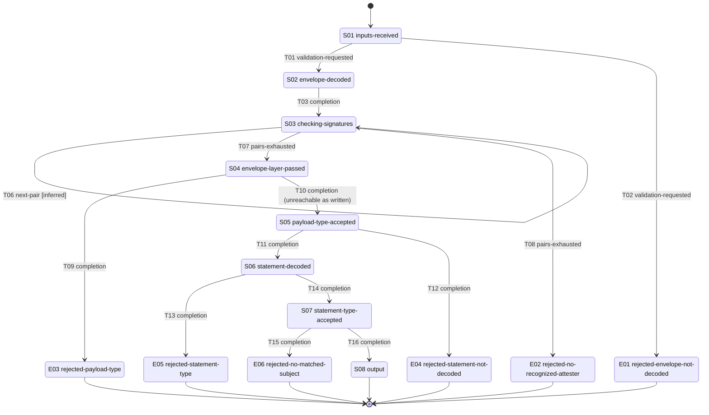

### M02 bundle-line-processing

One instance per line of a Bundle, all independent. The Bundle rules give only two outcomes for a line, processed or ignored; there is no error state, because nothing in §9 fails a Bundle. Running M01 per Envelope line, and mapping its rejects onto the four kinds of unrecognized attestation that §9.1 says to ignore, are this model's (marked inferred): §12 covers a single attestation and leaves multiple ones unexplained.

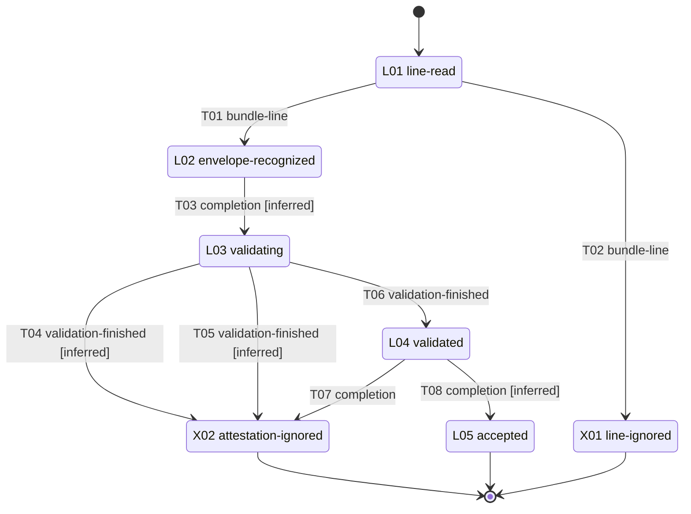

### M03 bundle-file-lifecycle

The only lifecycle the source shows for a stored object, and it shows it in a non-normative example. Every legitimate transition adds or removes whole lines; none is visible to a consumer, because nothing signs the Bundle as a whole. The adversarial transitions of T06 are stated as a risk in §9 and have the same shape as the legitimate ones.

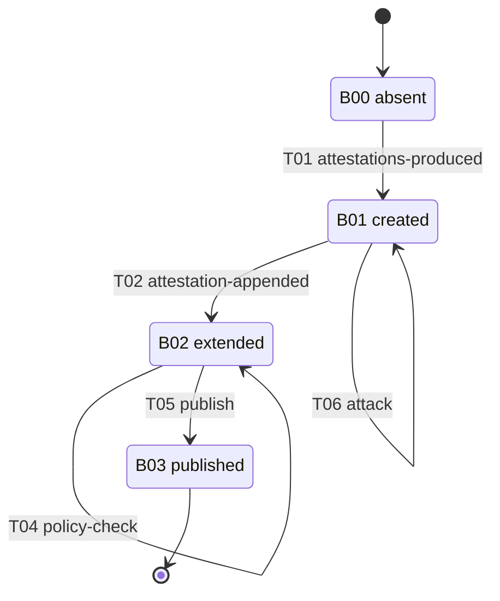

M04 to M06 are three-to-four-state version lifecycles; their guards are in `state-machine.yaml`.

## Not defined

- Transport, delivery or retrieval of an Envelope, a Bundle or a resource a descriptor points to; no request, response, acknowledgement or error message.
- How a consumer obtains recognizedAttesters or acceptableDigestAlgorithms, or distributes keys.
- The policy language, the policy engine's inputs beyond §12's output, and the decision format.
- Processing multiple artifacts or multiple attestations (§12 L1120).
- The signing input: delegated to DSSE v1.0 or the chosen ITE-5 format.
- Freshness, expiry or revocation of an attestation; replay of obsolete attestations is acknowledged (§9 L866-867) and no freshness mechanism is defined.
- Integrity of a Bundle as a whole.
- Validation of non-DSSE envelopes, and of Envelopes without payload.
- The vetting process for new predicate types and its outcome.
- What becomes of the original Bundle when a filtered copy is published.
