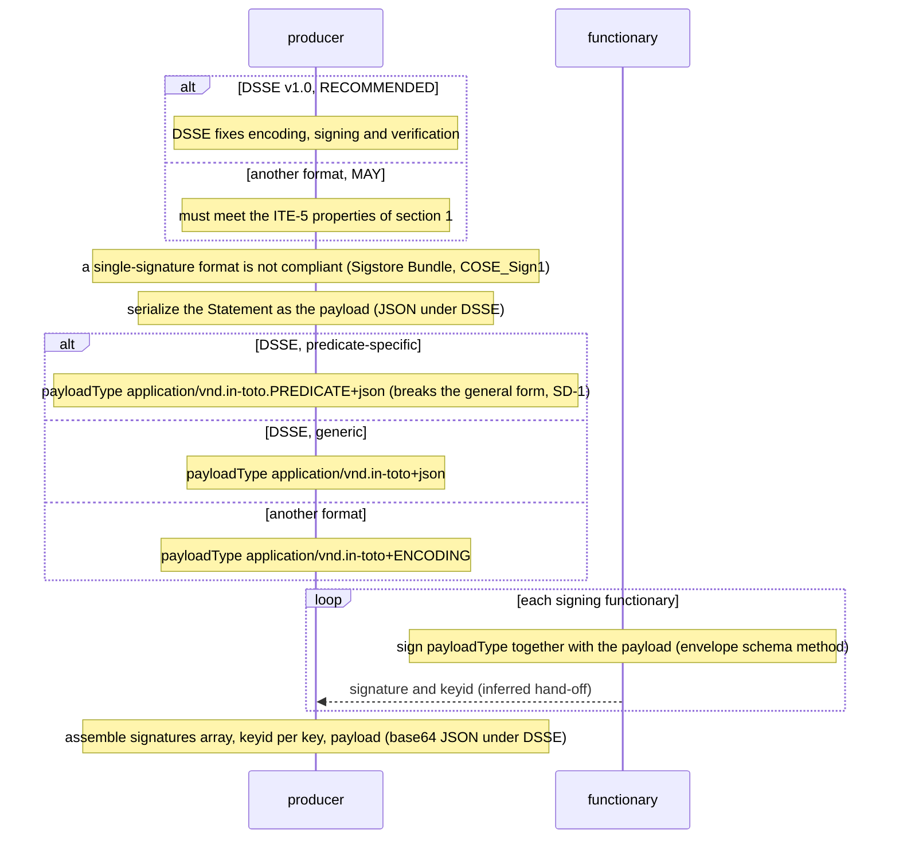
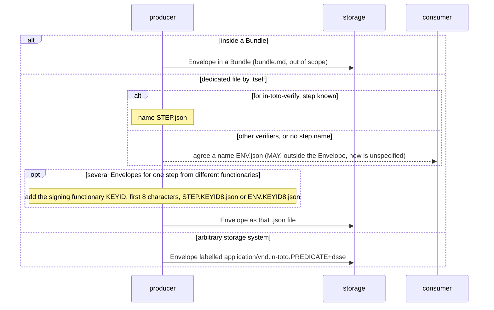
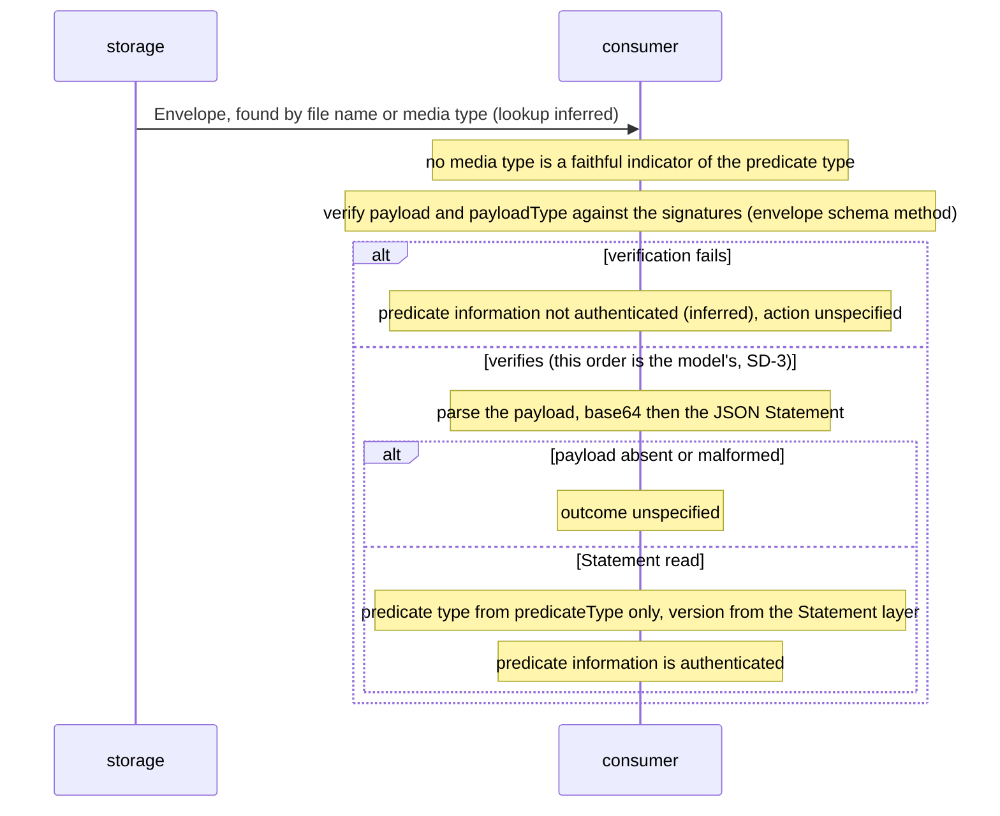

# in-toto Envelope v1: protocol model

`protocol.yaml` is the machine-readable model: 4 roles, 3 flows, 20 steps (2 of them inferred:
F01.7, F03.1), 11 error paths, source defects SD-1, SD-2, SD-3, SD-5, SD-6, SD-9 and SD-11, and
open issues OI-01 to OI-07. SD-n are the canonical ids of normative.md's Source defects, which
holds the crosswalk from this lane's pass-1 SD-01 to SD-07. No
state machine applies; `state-machine.yaml` holds the measurement behind that verdict. Every
quotation here is a marker rendered from `.cache/in-toto-envelope-v1.txt` by `bin/check-quotes
--render`, and nothing between the markers was typed. Requirement ids were emitted by script from
the id table of `requirements.yaml`; the prose here cites skeleton ids R-0001 to R-0029 only, and
`protocol.yaml` also carries the ids pass 2 wired from the requirements lane's additions.

## What kind of protocol this is

envelope.md is a format profile with two roles' obligations attached, not an exchange. Counted over
its 110 lines as whole words, case-insensitively, exchange, request, response, send, receive,
message, client, server, party, role, error, fail, failure, reject and invalid occur 0 times each.
The word protocol occurs once, and only to recommend DSSE's:

<!-- q L8 -->
> The RECOMMENDED format and protocol for Envelopes are defined per [DSSE v1.0].

What the document adds is a store-and-forward hand-off. A producer builds an Envelope, has it
signed, and leaves it somewhere: as a file named by the §3 convention, inside a Bundle, or in a
storage system that labels it with the §4 media type. A consumer later picks it up and has to
authenticate it before relying on anything it says about its predicate. The two never talk, except
that they may agree on a file name. Three flows model this: F01 (produce), F02 (name and store) and
F03 (consume). DSSE's encoding, signing and verification appear in them only as opaque steps; they
are DSSE v1.0's and out of scope here. The layer's own one-line definition:

<!-- q L3-4 -->
> The Envelope is the outermost layer of the attestation, handling serialization and authentication (via digital signatures).

## Roles

| role | who | source |
|---|---|---|
| producer | builds the Envelope, has it signed, names and stores it; may agree a file name with the consumer | §1 L9-10, §3 L69-70 |
| functionary | a signer for one supply chain step, identified by its public key; a functionary producing its own Envelope is also its producer | §3 L71-74 |
| storage | the medium between the two: a dedicated file, a Bundle, or a storage system that labels objects with a media type. A medium, not a party: a role in this model only (inferred) | §3 L62, §4 L78-79 |
| consumer | finds, verifies and reads the Envelope; the source's verifier, in-toto-verify and the other verifiers are consumers | §1 L16, §2 L51-55, §3 L65-70, §4 L84-88 |

## Reading the diagrams

A solid arrow hands the Envelope, or a name for it, from one role to another. A dashed arrow is a
hand-off the model infers, or an agreement made outside the Envelope by means the source does not
describe; each is labelled. A note is a local step. `alt` blocks are the source's branches, `opt` a
branch that applies on top of another, `loop` a step done once per functionary. Placeholders are
written in capitals because Mermaid drops angle brackets: PREDICATE for `<predicate>`, ENCODING for
`<encoding>`, STEP for `<step-name>`, ENV for `<env-name>`, KEYID8 for `<keyid[0:8]>`. Error paths
are drawn where the source names a branch and are listed in full below and in `protocol.yaml`.

## F01 produce-envelope (§1, §1.1, §2)

The first choice is the format. DSSE v1.0 is recommended (in-toto-envelope-v1#R-0001); any other
signature method and format is allowed if it meets ITE-5, whose properties §1 restates
(in-toto-envelope-v1#R-0002, then in-toto-envelope-v1#R-0003 to in-toto-envelope-v1#R-0008).

<!-- q L9-10 -->
> Producers MAY use other signature methods and formats that meet the [ITE-5] specification:

A format that can hold only one signature fails the first property, and §1.1 names two such formats:
the Sigstore Bundle, even though it can carry DSSE, and `COSE_Sign1`. `COSE_Sign` passes.

<!-- q L21-22 "The [Sigstore Bundle]" .. "envelope.[^1]" -->
> The [Sigstore Bundle], while [supporting DSSE], is not currently [ITE-5] compliant because it requires a _single signature_ in the envelope.[^1]

<!-- q L23-24 "The [COSE_Sign] structure" .. "NOT compliant." -->
> The [COSE_Sign] structure is [ITE-5] compliant, whereas the `COSE_Sign1` format that supports only one signer is NOT compliant.

The Statement is serialized as the payload (JSON under DSSE) and payloadType is fixed before anyone
signs, because what is signed is the two together (in-toto-envelope-v1#R-0013). Since §2 demands
that of every Envelope, §1's property that a format should carry an authenticated payload type is a
must in practice (SD-2). How a signature is computed, and how its bytes are encoded, is the
envelope schema's business.

<!-- q L38 "`payloadType` (or equivalent)" .. "along with the `payload`." -->
> `payloadType` (or equivalent) MUST be signed along with the `payload`.

<!-- q L32-33 "The encoding of the signature bytes" .. "envelope schema." -->
> The encoding of the signature bytes is determined by the envelope schema.

payloadType has two rules that do not agree. The general rule for every Envelope
(in-toto-envelope-v1#R-0014) and the DSSE rule (in-toto-envelope-v1#R-0015, with
in-toto-envelope-v1#R-0016 for the predicate name) both apply to a DSSE Envelope, and the DSSE
rule's predicate-specific value does not have the general form. Only `application/vnd.in-toto+json`
satisfies both (SD-1).

<!-- q L39-40 -->
> It MUST take the form `application/vnd.in-toto+<encoding>` to indicate an in-toto [Statement] payload and its serialized `<encoding>` format.

<!-- q L45-46 "`payloadType` MUST be set to" .. "`application/vnd.in-toto+json`." -->
> `payloadType` MUST be set to `application/vnd.in-toto.<predicate>+json` or to `application/vnd.in-toto+json`.

Then the Envelope is assembled: a `signatures` array (required), a `keyid` per signing key (should,
and the envelope schema may nest it in the signature array), and the payload, which under DSSE is a
base64-encoded JSON Statement (in-toto-envelope-v1#R-0009, in-toto-envelope-v1#R-0010,
in-toto-envelope-v1#R-0011, in-toto-envelope-v1#R-0012, in-toto-envelope-v1#R-0020). How several
functionaries' signatures reach one Envelope is not described, so step 7 is inferred (OI-03).

## F02 name-and-store-envelope (§3, §4, §4.1)

Where the Envelope goes decides how it is named. In a Bundle, the Bundle's rules apply (bundle.md,
out of scope). As a file by itself it takes the `.json` suffix (in-toto-envelope-v1#R-0021) and a
name that depends on who will verify it: the step name for in-toto-verify
(in-toto-envelope-v1#R-0022), or, for any other verifier or when no step name is to hand, a name
producer and consumer agree on (in-toto-envelope-v1#R-0023). When several functionaries each produce
an Envelope for the same step, the signer's truncated KEYID goes into the name
(in-toto-envelope-v1#R-0024).

<!-- q L62-63 -->
> If stored in a dedicated file by itself, and not as part of a [Bundle], an Envelope SHOULD use the suffix `.json`.

<!-- q L68-70 "For other verifiers" .. "`<env-name>.json`." -->
> For other verifiers, or cases in which a step name cannot be easily determined, the attestation producer and consumer MAY agree on an arbitrary filename: `<env-name>.json`.

<!-- q L71-74 "If multiple Envelopes" .. "`<step/env-name>.<keyid[0:8]>.json`." -->
> If multiple Envelopes are produced for the same step by different [functionaries] uniquely identified by a public key, an Envelope name SHOULD include the truncated [KEYID] of the public key `<keyid[0:8]>` of the signing functionary: `<step/env-name>.<keyid[0:8]>.json`.

In a storage system that labels objects, the Envelope is labelled
`application/vnd.in-toto.<predicate>+dsse`, `<predicate>` again being the predicate specification's
file name without extension, with no version in it (in-toto-envelope-v1#R-0025,
in-toto-envelope-v1#R-0026). §4.1 gives three: provenance, spdx and vsa.

<!-- q L78-79 -->
> The media type `application/vnd.in-toto.<predicate>+dsse` SHOULD be used to denote an individual attestation in arbitrary storage systems.

Three gaps sit in this flow. The suffix and the media type exist only for DSSE JSON, though §1
admits `COSE_Sign` (SD-5). Both media types need a `<predicate>` that only a predicate with a
specification file in the in-toto repository has, and §4 offers no generic form (SD-6). And the
KEYID rule names one signing functionary, so an Envelope with several signatures, or with no keyid,
has no stated name (SD-9). Whether §3 and §4 can apply to the same Envelope is not said either
(OI-06).

## F03 consume-envelope (§1, §2, §4)

The consumer first has to find the Envelope, by the names of F02 or by the storage media type; the
source describes no lookup, so step 1 is inferred. It should not rely on any media type as a
faithful indicator of the predicate type (in-toto-envelope-v1#R-0017 for the predicate-specific
payloadType of §2, in-toto-envelope-v1#R-0027 for the storage media type of §4) and takes the
predicate type from the Statement's `predicateType` alone (in-toto-envelope-v1#R-0018,
in-toto-envelope-v1#R-0028).

<!-- q L51-53 "Consumers SHOULD NOT" .. "[Statement] layer." -->
> Consumers SHOULD NOT rely upon the media type for individual attestations as faithful indicators of predicate type. Consumer SHOULD only rely on the `predicateType` field in the [Statement] layer.

To get predicate information it can call authenticated, it must parse the payload and verify it
against the signatures (in-toto-envelope-v1#R-0019 in §2, in-toto-envelope-v1#R-0029 in §4: the same
sentence twice).

<!-- q L54-55 "To obtain" .. "`signatures`." -->
> To obtain predicate information that is authenticated, consumers MUST parse the Envelope's `payload`, and verify it against its `signatures`.

The sentence does not order the two operations, and its word order is the reverse of the order §1
asks a format to make possible (in-toto-envelope-v1#R-0007):

<!-- q L16 "SHOULD NOT require the verifier" .. "before verifying" -->
> SHOULD NOT require the verifier to parse the payload before verifying

Both orders satisfy in-toto-envelope-v1#R-0019 and in-toto-envelope-v1#R-0029, which require only
that both happen. The model verifies first and parses after, and marks the order inferred: it is the
order in-toto-envelope-v1#R-0007 keeps open for every compliant format, and in it no Statement
content is read before it is authenticated (SD-3). Getting the signed bytes out of the Envelope for
verification is part of the envelope schema's verification either way. Because payloadType is signed
with the payload (in-toto-envelope-v1#R-0013), a verified Envelope's payloadType is authenticated
too, and it is still not to be relied on for the predicate type.

The source states none of the consumer's failure outcomes. A failed verification leaves predicate
information unauthenticated (the contrapositive of in-toto-envelope-v1#R-0019, inferred), but
rejection, retrying with another key, and how many of several signatures must verify are not
addressed (OI-01). The consumer rules also appear only under the two media-type rules; the §2 copies
are nested under this condition (SD-11):

<!-- q L47-48 "If the predicate-specific media type is used," .. "the following requirements apply:" -->
> If the predicate-specific media type is used, the following requirements apply:

Taken literally, an Envelope with the generic payloadType held as a plain file arguably falls under
neither copy. The model applies the consumer rules to every Envelope consumed (inferred).

## Error paths

The source names no error path: error, fail, failure, reject and invalid occur 0 times in it. Each
row says whether its outcome is stated, inferred or unspecified.

| id | condition | steps | basis | outcome |
|---|---|---|---|---|
| EP-01 | The format or container holds only one signature (Sigstore Bundle, COSE_Sign1). | F01.3 | stated | Not ITE-5 compliant, so not a permitted alternative; a consumer's handling is unspecified. |
| EP-02 | An alternative format misses another ITE-5 property. | F01.2 | unspecified | No consequence stated; a format without an authenticated payload type also breaks §2 (SD-2). |
| EP-03 | payloadType has neither required form, or the predicate-specific DSSE form, which breaks the general form. | F01.5 | unspecified | No consequence stated. (SD-1) |
| EP-04 | The predicate has no specification file to take `<predicate>` from. | F01.5, F02.7 | unspecified | Only the generic payloadType remains, and no storage media type can be formed. (SD-6) |
| EP-05 | No step name can be determined and no file name has been agreed. | F02.4 | unspecified | No default name. (OI-02) |
| EP-06 | One Envelope carries several functionaries' signatures, or no keyid, where a KEYID suffix is called for. | F02.5 | unspecified | No name stated. (SD-9) |
| EP-07 | A non-DSSE Envelope (COSE_Sign, for one) is stored as a file or in a storage system. | F02.2, F02.7 | unspecified | No suffix and no media type stated. (SD-5) |
| EP-08 | The consumer finds no Envelope, or several, under the expected name or media type. | F03.1 | unspecified | Not addressed; the lookup step itself is inferred. |
| EP-09 | Verification fails, or only some of several signatures verify. | F03.3 | inferred | The predicate information is not authenticated (inferred); rejection, retry and thresholds are unspecified. (OI-01) |
| EP-10 | The payload is absent, not base64, not JSON, or not a Statement. | F03.4 | unspecified | No outcome stated; under DSSE each case breaks a producer-side must. (OI-04) |
| EP-11 | A media type and the Statement's predicateType disagree. | F03.2, F03.5 | stated | The consumer relies on predicateType; whether the Envelope is then unacceptable is unspecified. (OI-05) |

## Source defects and tensions

### SD-1 (contradiction): The DSSE predicate-specific payloadType does not have the form every payloadType must take

The general field requirements, which apply to every Envelope, require payloadType to take the form
`application/vnd.in-toto+<encoding>`. The DSSE requirements apply in addition and allow
`application/vnd.in-toto.<predicate>+json`, which puts `.<predicate>` before the plus sign and so is
not of that form. As written, a DSSE Envelope with a predicate-specific payloadType breaks
in-toto-envelope-v1#R-0014; only `application/vnd.in-toto+json` meets both rules, and a validator
enforcing both rejects every predicate-specific DSSE Envelope. Modelled as: F01.5 lists both DSSE
values and marks the conflict; EP-03.

<!-- q L28-29 -->
> The in-toto Attestation Framework has the following general field requirements for an Envelope:

<!-- q L39-40 -->
> It MUST take the form `application/vnd.in-toto+<encoding>` to indicate an in-toto [Statement] payload and its serialized `<encoding>` format.

<!-- q L42-43 -->
> In addition, the Envelope spec has the following specific requirements for the standard [DSSE][DSSE v1.0] fields.

<!-- q L45-46 "`payloadType` MUST be set to" .. "`application/vnd.in-toto+json`." -->
> `payloadType` MUST be set to `application/vnd.in-toto.<predicate>+json` or to `application/vnd.in-toto+json`.

### SD-2 (tension): An authenticated payload type is a should under ITE-5 and a must for every Envelope

§1 admits other formats that meet ITE-5, and one ITE-5 property, held only as a should, is an
authenticated payload type. §2's general field requirements make a signed payloadType mandatory for
every Envelope. A format that meets ITE-5 while omitting an authenticated payload type cannot carry
a conforming in-toto Envelope; the should is in effect a must. Not a contradiction, since meeting
the must meets the should. Modelled as: F01.2 note; EP-02.

<!-- q L13 "SHOULD include" .. "payload type" -->
> SHOULD include an authenticated payload type

<!-- q L38 "`payloadType` (or equivalent)" .. "along with the `payload`." -->
> `payloadType` (or equivalent) MUST be signed along with the `payload`.

### SD-3 (tension): The consumer sentence orders parse before verify; §1 asks formats not to require that

The consumer obligation, stated twice, joins parsing and verifying with a plain and, names parsing
first, and fixes no order. §1's property asks that a format not make the verifier parse the payload
ahead of verification. No other sentence orders the two: before occurs once in the source, here at
L16, and after, then and first not at all. Read as a sequence, the consumer rule asks for the order
§1's property exists to make unnecessary. Read as two obligations, it allows either order, and the
source does not say which a consumer should use. Modelled as: F03 order_note; F03.3 verifies, F03.4
parses after it (inferred order).

<!-- q L16 "SHOULD NOT require the verifier" .. "before verifying" -->
> SHOULD NOT require the verifier to parse the payload before verifying

<!-- q L54-55 "To obtain" .. "`signatures`." -->
> To obtain predicate information that is authenticated, consumers MUST parse the Envelope's `payload`, and verify it against its `signatures`.

<!-- q L87-88 "To obtain" .. "`signatures`." -->
> To obtain predicate information that is authenticated, consumers MUST parse the Envelope's `payload`, and verify it against its `signatures`.

### SD-5 (gap): Non-DSSE Envelopes have no file suffix and no storage media type

§1 and §1.1 admit ITE-5 compliant formats other than DSSE and name COSE_Sign as one. §3's suffix is
.json and §4's media type ends in +dsse, so both assume a DSSE JSON Envelope; nothing names or
labels a COSE_Sign Envelope. A producer using a permitted alternative format can meet neither §3 nor
§4. Modelled as: F02.2 and F02.7 on_error; EP-07.

<!-- q L23-24 "The [COSE_Sign] structure" .. "NOT compliant." -->
> The [COSE_Sign] structure is [ITE-5] compliant, whereas the `COSE_Sign1` format that supports only one signer is NOT compliant.

<!-- q L62-63 -->
> If stored in a dedicated file by itself, and not as part of a [Bundle], an Envelope SHOULD use the suffix `.json`.

<!-- q L78-79 -->
> The media type `application/vnd.in-toto.<predicate>+dsse` SHOULD be used to denote an individual attestation in arbitrary storage systems.

### SD-6 (gap): `<predicate>` exists only for predicates with a specification file in the in-toto repository

Both media types take `<predicate>` from the predicate specification's file name, and the link for
that term points at a predicates directory beside the specification in the in-toto attestation
repository (../predicates). On that reading a predicate specified anywhere else has no such file. §4
gives no generic storage media type without a `<predicate>`. For such a predicate a producer can
meet the payloadType rule only with `application/vnd.in-toto+json`, and cannot meet §4's should at
all. Modelled as: F01.5 and F02.7 on_error; EP-04.

<!-- q L49-50 "`<predicate>` MUST match" .. "the file extension." -->
> `<predicate>` MUST match the [predicate specification filename] without the file extension.

<!-- q L81-82 "The `<predicate>` MUST match" .. "the file extension." -->
> The `<predicate>` MUST match the [predicate specification filename] without the file extension.

<!-- q L109 -->
> [predicate specification filename]: ../predicates

### SD-9 (gap): The KEYID naming rule assumes one signer per Envelope and a keyid present

The suffix is the truncated KEYID of the signing functionary, singular, and covers several Envelopes
for one step, one per functionary. Formats must support several signatures in one Envelope, and
keyid is only a should. An Envelope signed by several functionaries, or carrying no keyid, has no
stated name under the rule that would otherwise apply. Modelled as: F02.5 on_error; EP-06.

<!-- q L12 "MUST support" .. "single envelope" -->
> MUST support the inclusion of multiple signatures in a single envelope

<!-- q L34 "A `keyid`" .. "signing key used." -->
> A `keyid` (or equivalent) SHOULD be included for each signing key used.

<!-- q L73-74 "the truncated [KEYID]" .. "`<step/env-name>.<keyid[0:8]>.json`." -->
> the truncated [KEYID] of the public key `<keyid[0:8]>` of the signing functionary: `<step/env-name>.<keyid[0:8]>.json`.

### SD-11 (scope): The consumer rules are stated only under the two media-type rules

§2's copies of the consumer rules (in-toto-envelope-v1#R-0017, in-toto-envelope-v1#R-0018,
in-toto-envelope-v1#R-0019) are nested under the payloadType rule, after the condition quoted here;
§4's copies (in-toto-envelope-v1#R-0027, in-toto-envelope-v1#R-0028, in-toto-envelope-v1#R-0029) are
bullets of the storage media type rule. No sentence states them for consumers in general. Taken
literally, an Envelope with the generic payloadType held as a plain file arguably falls under
neither copy, so the consumer's obligation to parse and verify would not bind its consumption.
Modelled as: F03 applies the consumer rules to every Envelope consumed (inferred, F03 order_note).

<!-- q L47-48 "If the predicate-specific media type is used," .. "the following requirements apply:" -->
> If the predicate-specific media type is used, the following requirements apply:

## Open issues

- **OI-01** (§2, §4). What a consumer does when verification fails, or when only some of several signatures verify. No threshold, no key-trust rule and no rejection is stated; the trust policy belongs to the verifier and lies outside this source.
- **OI-02** (§3). How producer and consumer agree an arbitrary file name, and what name applies when they have not.
- **OI-03** (§1, §3). How signatures from several functionaries reach one Envelope, and whether a step with several functionaries should yield one multi-signature Envelope (§1) or one Envelope per functionary (§3). Source defect SD-9.
- **OI-04** (§2). Outside DSSE the payload is only a should, yet the consumer rule calls for parsing it; a detached payload has no stated handling. Source defect SD-14.
- **OI-05** (§2, §4). Whether a media type that disagrees with the Statement's predicateType makes the Envelope unacceptable, or is merely ignored.
- **OI-06** (§3, §4). Whether §3's file name and §4's media type are alternatives or can both apply to one Envelope.
- **OI-07** (§1, §2). Where the consumer's verification key and algorithm come from: keyid is a hint, and the signature need not name the algorithm, so both come from outside the Envelope by means the source does not describe.

## Out of scope

- DSSE v1.0: the envelope's encoding, the bytes that are signed, signing, verification and the meaning of its keyid. The source names DSSE the recommended format and protocol and defines none of it. [§1 (L8, L102)]
- ITE-5 itself: §1 lists six properties that meeting it involves; ITE-5's own text is not held. [§1 (L9-10, L103)]
- The Statement layer (statement.md): `_type`, `predicateType`, the predicate and its version. [§2, §4 (L46-47, L53, L56-57, L82-83, L106)]
- The Bundle (bundle.md) and storage of an Envelope inside one. [§3 (L62, L100)]
- KEYID and key formats (in-toto specification v1.0 §4.2.1) and what a functionary is (§2.1.2). [§3 (L73, L104, L108)]
- How in-toto-verify looks Envelopes up and verifies them. [§3 (L65, L107)]
- The Sigstore Bundle, COSE_Sign and COSE_Sign1 structures (RFC 8152 §4.1), and the footnoted Sigstore discussion of DSSE signature extensions (informative). [§1.1 (L21-24, L98, L101, L105)]
- Key distribution, trust in a functionary's key, signature thresholds, and any policy for accepting an attestation: defined nowhere in the source. [whole source]

## No state machine

`state-machine.yaml` declares the state machine not applicable and carries the measurement: over the
110 lines, state, states, lifecycle, transition, transitions, status, revoke, revoked, revocation,
expire, expired and expiry each occur 0 times. An Envelope is produced, stored and read once;
nothing in the source changes it afterwards. The consumer's parse-and-verify is two operations with
no states and is F03 above; signature verification is DSSE v1.0's.
