# OWASP DSOMM: exchanges stated inside activities

The machine-readable model is `protocol.yaml` (roles, work products, flows F01 to F14 with
their error paths, provisions not in any flow, open issues OI-01 to OI-07). The lifecycles
are `state-machine.yaml` (SM01 to SM15). This file is the prose and one sequence diagram
per flow. Every quotation below is a marker rendered from `.cache/owasp-dsomm.txt` by
`bin/check-quotes --render`; nothing in a blockquote was typed. Requirement ids, activity
uuids and levels live in `protocol.yaml`, where a script emitted them.

## What kind of protocol this is

The model itself defines none: it is a catalogue of 251 activities, and its structure
(dimension, sub-dimension, level, dependsOn) relates activities, not parties. But some
activities describe exchanges between distinct parties in their own text, and say how
they chain:

<!-- q L3391-3396 "It completes the human-oversight ladder" .. "a running agent does." -->
> It completes the human-oversight ladder started by the artifact reviews (_Human review of AI generated specifications_, _Human review of AI generated plans_, _Human review of AI generated code_ in Verification): those gate what is built, this activity gates what a running agent does.

and treat agent-to-agent traffic as a protocol in its own right:

<!-- q L3504-3507 "Explicit trust boundaries treat every delegation" .. "trusting the chain." -->
> Explicit trust boundaries treat every delegation like an external request. The receiving agent verifies the identity and authorization of the delegating agent instead of trusting the chain.

Each flow below is assembled from the activities its `activities` list names (computed
from the lines its quotations and ids come from), in the order their texts state. The
other activities state no exchange this model treats as a flow (`provisions_not_in_flows`
names the near misses) and are carried by `requirements.yaml`.

## Roles

| role | who | source |
|---|---|---|
| organization | the adopting organization (DSOMM names no implementer; inferred) | all |
| development_team | developers and product teams | Culture and Organization, Consolidation |
| security_team | security engineers, champions, SMEs | Consolidation |
| ai_agent | AI agents and coding assistants | Agentic AI |
| peer_agent | the agent receiving a delegation | Trust boundaries between AI agents |
| agent_registry | registry or discovery mechanism | Trust boundaries between AI agents |
| approval_gate | enforcement point: approval step, push proxy | Isolation |
| human_reviewer | reviewer or approver | Verification, Isolation |
| second_approver | the independent second approver | Human approval for irreversible AI agent actions |
| audit_log | the agent audit log | Audit logging of AI agent actions |
| anomaly_detection | detection, tripwires, alerting channel | Guidance, Monitoring |
| containment_automation | pre-approved reversible containment | Automated containment |
| human_responder | the notified human | Automated containment |
| triage_assistant | AI assistant drafting triage | Automated containment, Alerting |
| vcs_host | source code management system | Development and Source Control |
| ci_pipeline | build, test and deployment pipeline | Build and Deployment, Verification |
| requester, access_approver, identity_provider, resource_owner | access parties | Identity and Access Management |
| dependency_bot | automated pull request tool | Patch Management |
| ai_gateway, external_ai_service | LLM gateway and provider | Data Protection, Isolation |
| egress_proxy, external_system | egress point and systems agents reach | Isolation |
| security_tests, vuln_management | scanners and the vulnerability management system | Test and Verification |
| artifact_repository, compromise_intelligence | managed repository and compromise sources | Verification, Static depth |
| traffic_router, monitoring | canary traffic control and checks | Deployment |
| drift_detector | drift detection | Deployment, Verification |
| agent_inventory, dependent_systems | agent inventory and systems holding registrations | Guidance |
| attacker | the adversary of the risks | Agentic AI |

## Reading the diagrams

- A solid arrow hands a work product (named as in `protocol.yaml` work_products) to another role.
- A note over a role is an act of that role alone.
- `opt` is a step that applies only under its condition, or an error path with its outcome
  and kind (stated, inferred, unspecified).
- Numbers are the step numbers of `protocol.yaml`; (inferred) marks this model's own step.

## F01. Approving an AI agent's action (Agentic AI / Isolation)

The last rung of the human-oversight ladder: the reviews of specification, plan and code gate what is built; this gates what a running agent does.

<!-- q L3409-3415 "Classify agent action types by reversibility" .. "default to pre-approval." -->
> Classify agent action types by reversibility and assign approval tiers: pre-approval for irreversible actions, monitoring with an intervention window for reversible actions with business impact (e.g. buffer outbound messages for a defined period so an intervention stops delivery), autonomy only for low-risk reversible actions. If the reversibility of an action class cannot be demonstrated, default to pre-approval.

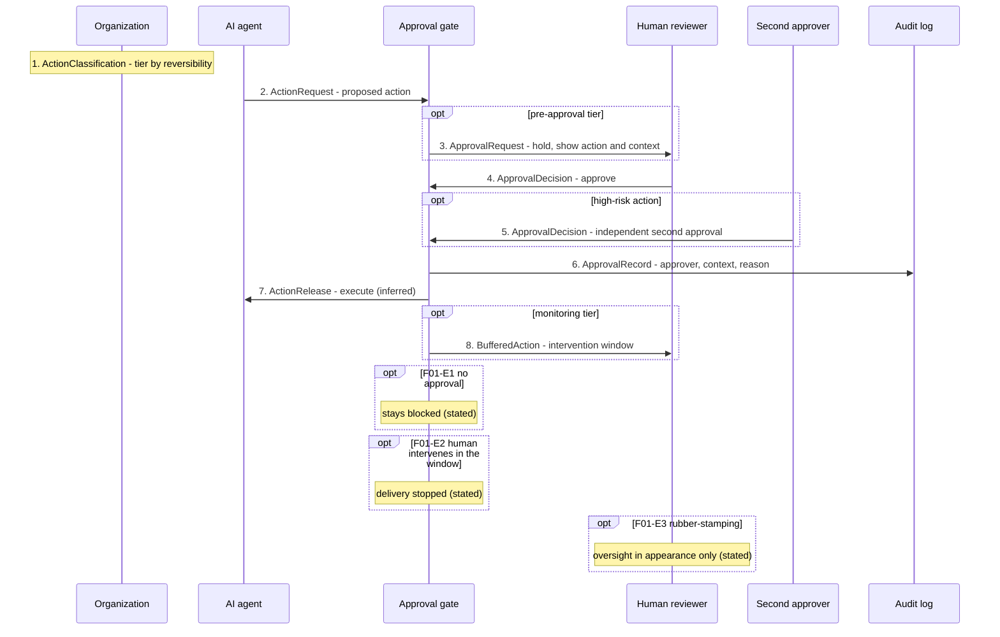

## F02. Delegating a task to another agent (Agentic AI / Isolation / Trust boundaries between AI agents)

DSOMM's one inter-agent protocol, with its rejection paths stated as assessment items.

<!-- q L3504-3507 "Explicit trust boundaries treat every delegation" .. "trusting the chain." -->
> Explicit trust boundaries treat every delegation like an external request. The receiving agent verifies the identity and authorization of the delegating agent instead of trusting the chain.

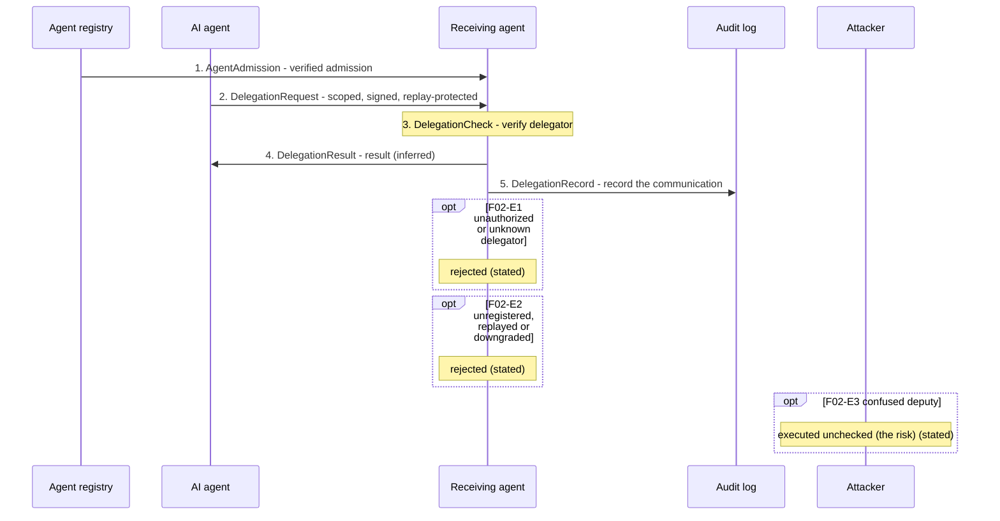

## F03. An agent's push through the version-control gates (Agentic AI / Isolation; Implementation / Development and Source Control; Agentic AI / Verification)

The guardrails a push meets, in order, each placed where the agent cannot touch it.

<!-- q L2954-2958 "Server-side rejection of pushed secrets" .. "bypass or rewrite." -->
> Server-side rejection of pushed secrets is defined in _Block pushes containing secrets_ (Implementation, Development and Source Control): it applies to humans and agents alike, and because it is enforced on the git host, it belongs to the enforcement points an agent cannot bypass or rewrite.

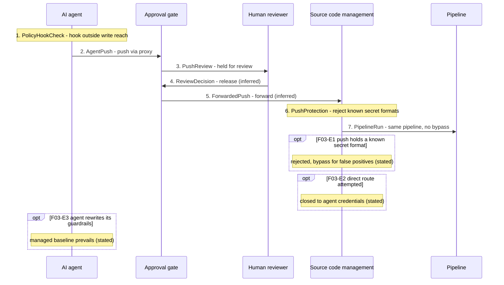

## F04. Detecting and containing an anomalous agent (Agentic AI / Guidance; Information Gathering / Monitoring)

Automate the bookkeeping, not the decisions: the activity's own guiding principle.

<!-- q L2365-2369 "Far-reaching decisions remain with humans." .. "communication)." -->
> Far-reaching decisions remain with humans. The guiding principle: automate the bookkeeping (evidence collection, correlation, documentation of the incident), not the decisions (containment of business-critical systems, disclosure, customer communication).

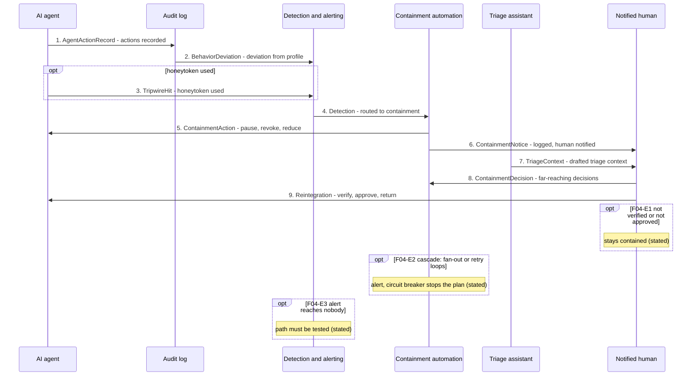

## F05. An AI-assisted change through the oversight ladder (Agentic AI / Guidance; Agentic AI / Verification)

The human-oversight ladder: one gate per phase, specification first because an error there is multiplied into every downstream artifact.

<!-- q L1218-1222 "Establish a spec-driven workflow" .. "under version control." -->
> Establish a spec-driven workflow for AI-assisted development: specify requirements and acceptance criteria first, derive a plan, implement against the plan and review against the specification. Use tooling that enforces the phases and keep the phase artifacts (specification, plan) under version control.

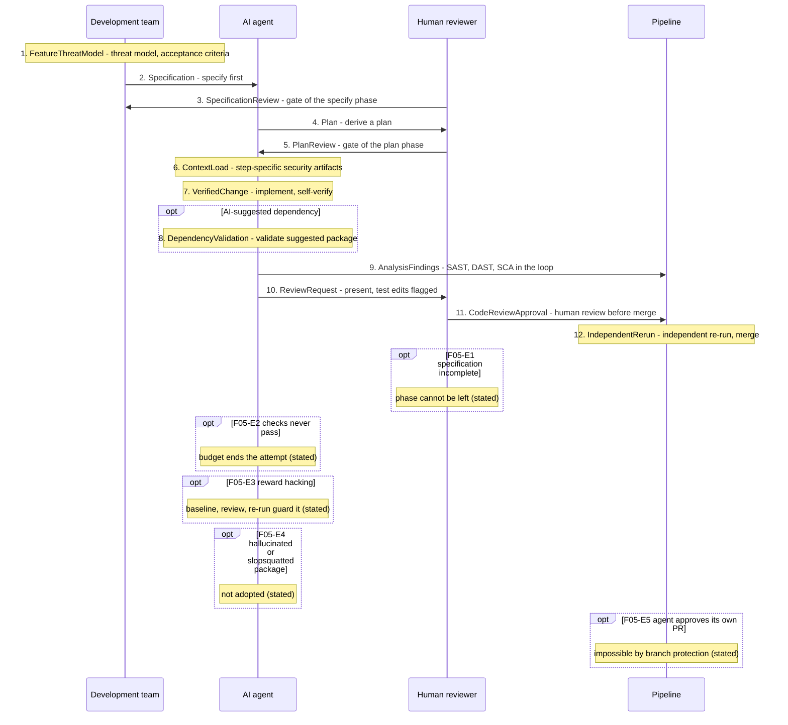

## F06. Reviewing and merging a pull request (Implementation / Development and Source Control; Culture and Organization / Process; Implementation / Identity and Access Management)

Two-eyes review with segregation of duties, and approvals that go stale on a new commit.

<!-- q L7927-7929 "Implement a policy where any commits made after" .. "re-approval process." -->
> Implement a policy where any commits made after a pull request has been approved automatically revoke that approval, necessitating a fresh review and re-approval process.

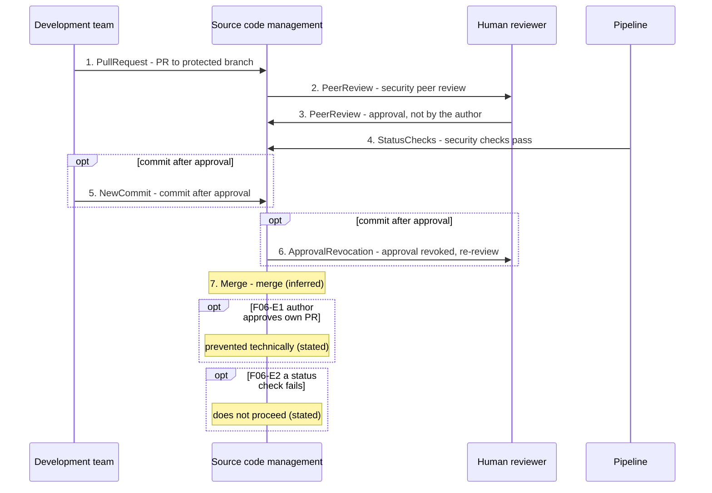

## F07. Just-in-time privileged access and access lifecycle (Implementation / Identity and Access Management)

Zero standing administrative access for day-to-day work.

<!-- q L8570-8572 "Privileged access is requested on demand" .. "day-to-day work." -->
> Privileged access is requested on demand, time-boxed, approved and automatically revoked, so there is zero standing administrative access for day-to-day work.

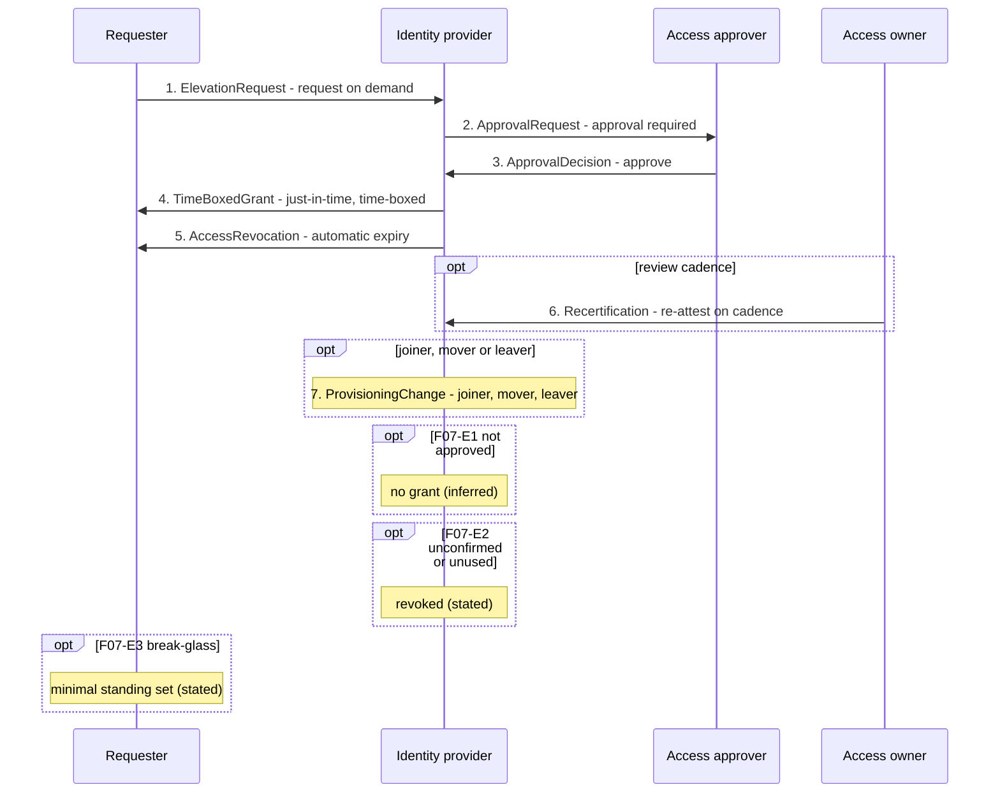

## F08. Automated dependency updates (Build and Deployment / Patch Management; Information Gathering / Test KPI)

The patch pipeline DSOMM spreads across four activities, in the order they state.

<!-- q L5670-5672 "A good practice is to merge trusted dependencies" .. "after a grace period." -->
> A good practice is to merge trusted dependencies (e.g. spring boot) after a grace period like one week. Often, patches, fixes and minor updates are automatically merged. Be aware that automated merging requires a high automated test coverage. Enforcement of merging of pull requests after a grace period.

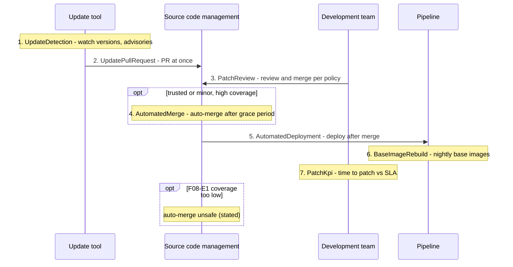

## F09. AI traffic through the gateway and the egress point (Agentic AI / Data Protection; Agentic AI / Isolation)

One enforced point per direction: a gateway for model traffic, an egress point for everything else.

<!-- q L228-230 "Route traffic to external AI services through a gateway" .. "of AI tool usage." -->
> Route traffic to external AI services through a gateway that scans prompts and attachments for secrets and personal data, blocks or redacts findings and provides an audit trail of AI tool usage.

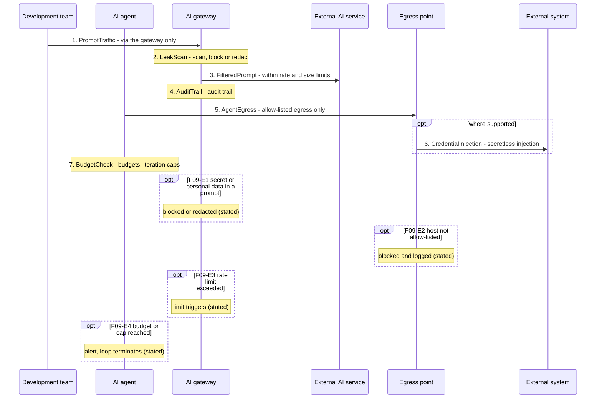

## F10. Triaging findings and handing them to product teams (Test and Verification / Consolidation; Test and Verification / Static depth for applications)

The finding lifecycle DSOMM builds up over several Consolidation activities, from triaged versus untriaged to a release gate.

<!-- q L11058 "At this maturity level, a simple tracking system suffices" .. "without complex categorization." -->
> At this maturity level, a simple tracking system suffices - tools need only distinguish between "triaged" and "untriaged" findings, without complex categorization.

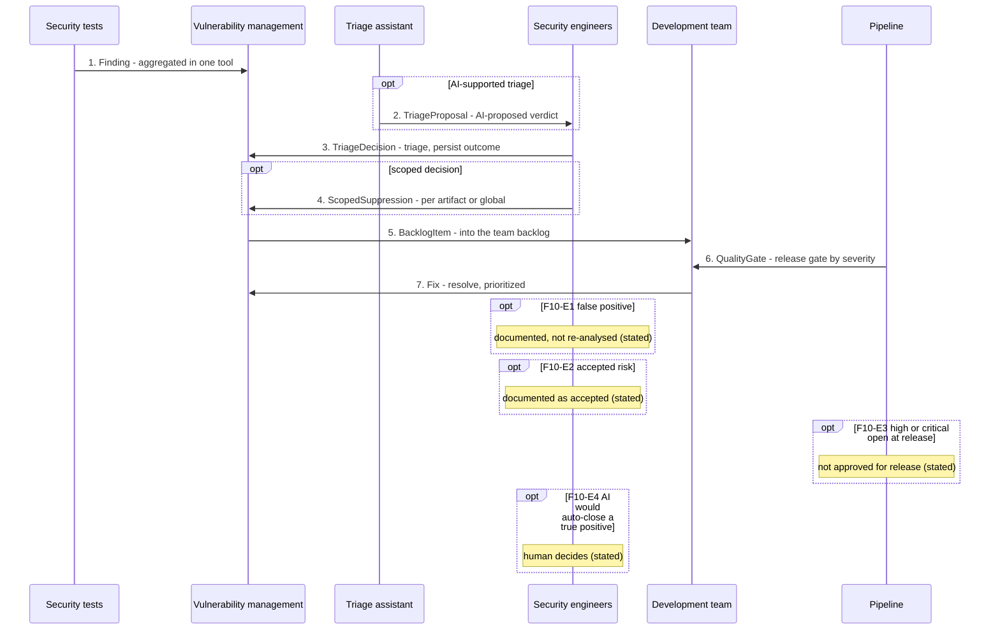

## F11. Adopting a component and reacting to its compromise (Agentic AI / Guidance; Agentic AI / Verification; Test and Verification; Build and Deployment)

Trust at adoption, then continuous re-checking, because compromise comes after approval.

<!-- q L4331-4335 "Trust evaluation at adoption time" .. "a malicious update." -->
> Trust evaluation at adoption time (see _Evaluation of the trust of used AI components_) does not catch compromise that happens afterwards: AI components can be hijacked later like any other dependency, e.g. through a compromised publisher account or a malicious update.

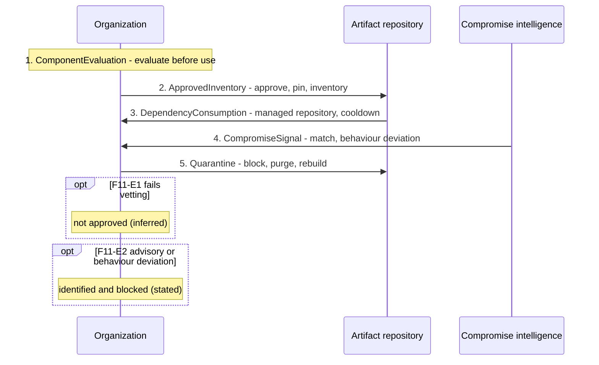

## F12. Releasing a version by canary (Build and Deployment / Deployment / Canary deployment)

Promotion is gated; rollback is automatic.

<!-- q L5399-5400 "Rollback must be automated" .. "without human intervention." -->
> Rollback must be automated and triggered by gate failure without human intervention.

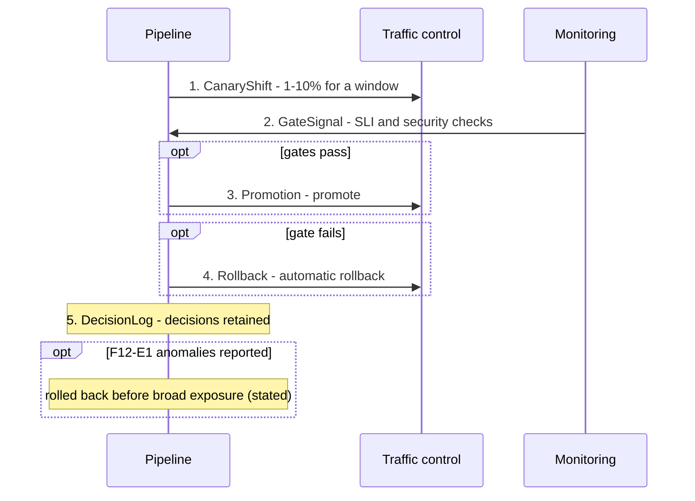

## F13. Detecting and answering drift (Build and Deployment / Deployment; Agentic AI / Verification)

Drift is answered by revert or by re-approval, never by leaving it.

<!-- q L5172-5174 "either revert it automatically" .. "regular review process." -->
> either revert it automatically to the approved state or bring the change through the regular review process.

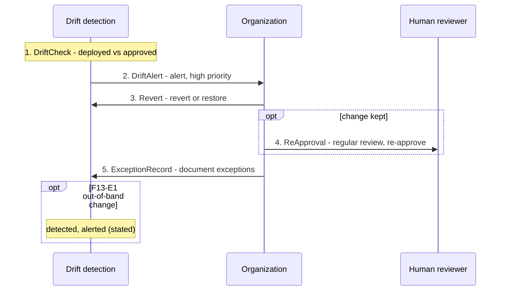

## F14. Decommissioning an AI agent (Agentic AI / Guidance)

Switching an agent off is not the end of its lifecycle: every access path must be closed.

<!-- q L1478-1481 "The lifecycle of an AI agent does not end" .. "preserves the audit evidence." -->
> The lifecycle of an AI agent does not end with switching it off. During operation an agent accumulates an identity, credentials, permissions, policies and integrations with other systems. Secure decommissioning unwinds all of them and preserves the audit evidence.

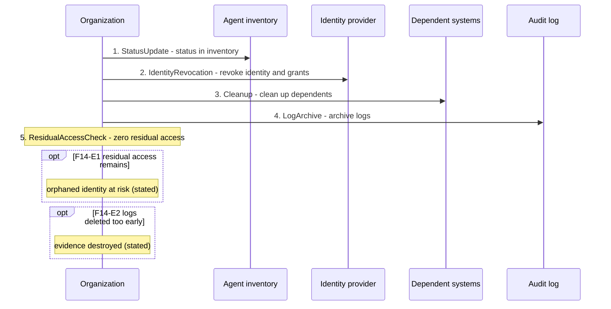

## Lifecycles

`state-machine.yaml` holds SM01, the model's own level and dependsOn structure read as an
adoption lifecycle (inferred throughout, with the data derived by script and one
dependency no level reading can satisfy), and SM02 to SM15, lifecycles individual
activities state: an AI agent, an AI-assisted change, a pull request, a finding, deployed
state against its approved version, a canary release, a privileged grant, a dependency
update, a component, agent memory, a WAF's mode, a container image, an ephemeral
environment and an agent action. The term the levels borrow appears only in passing:

<!-- q L5919 "At maturity level 1," .. "such as STRIDE." -->
> At maturity level 1, you perform threat modeling ad-hoc for high-risk applications and use simple threat checklists, such as STRIDE.
