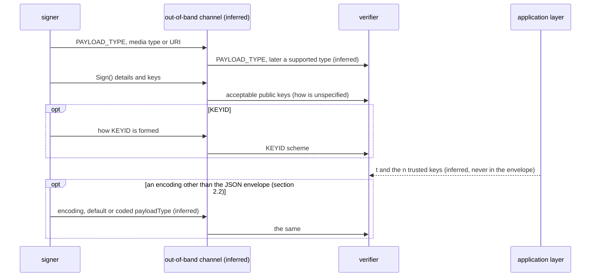
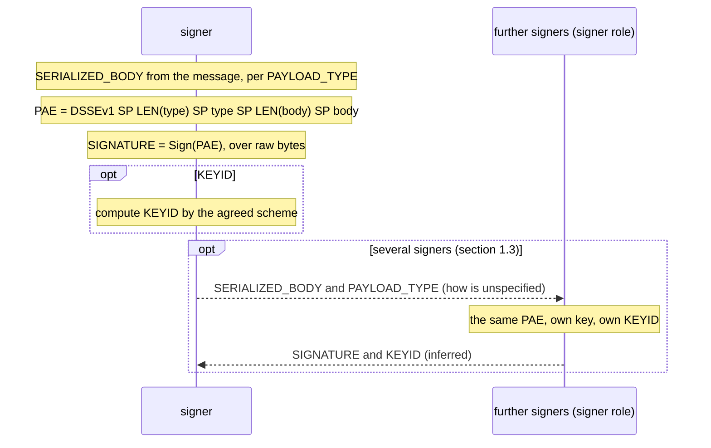
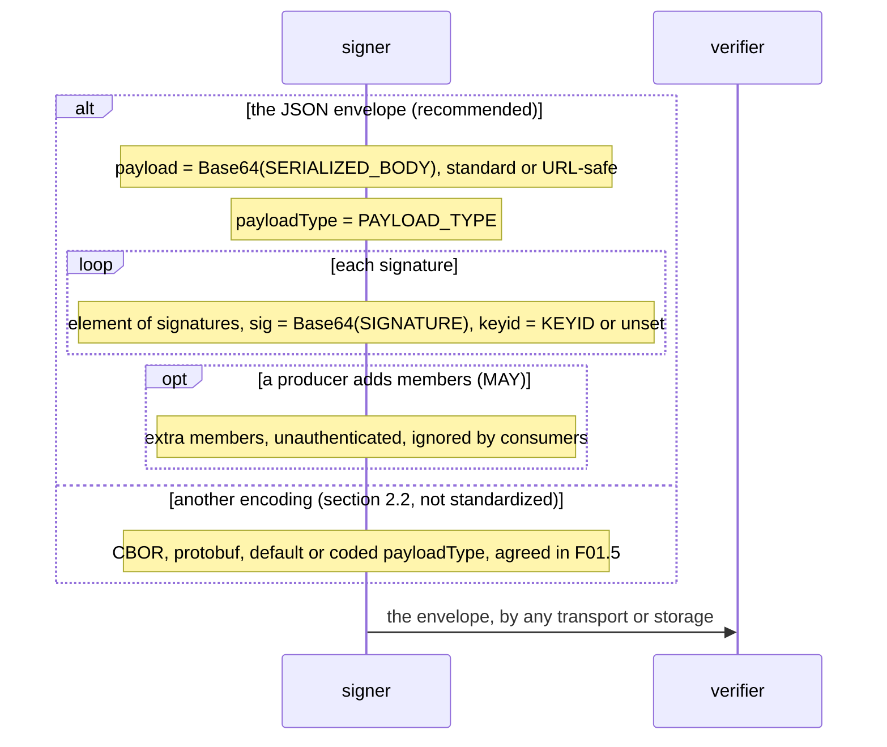
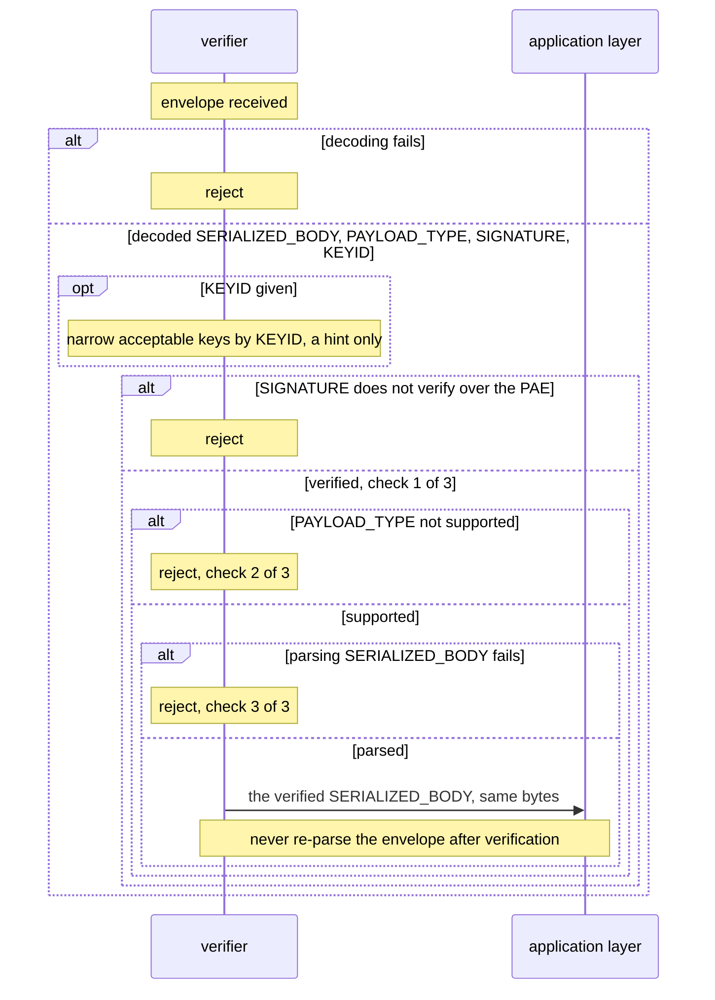
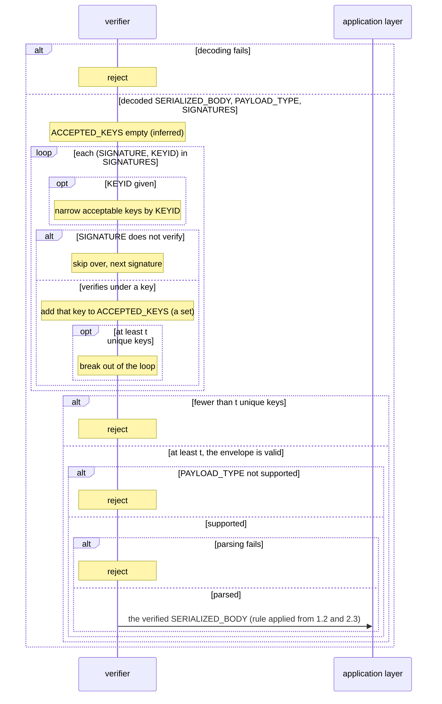
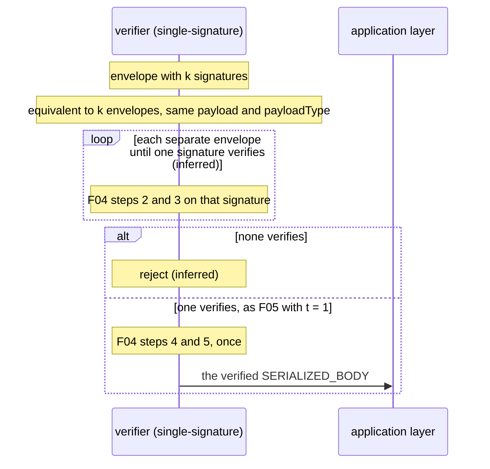
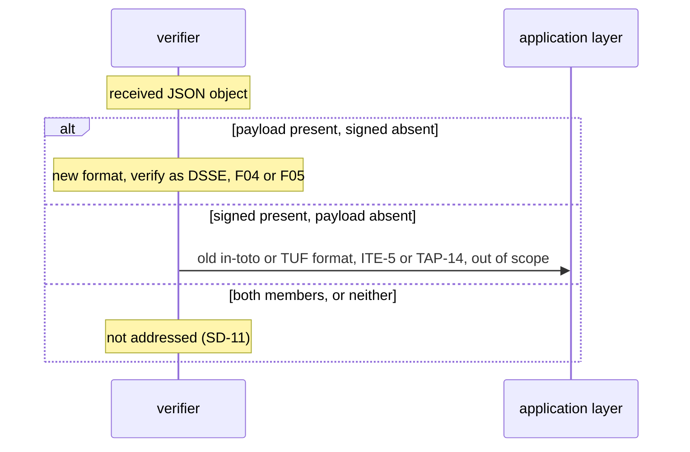
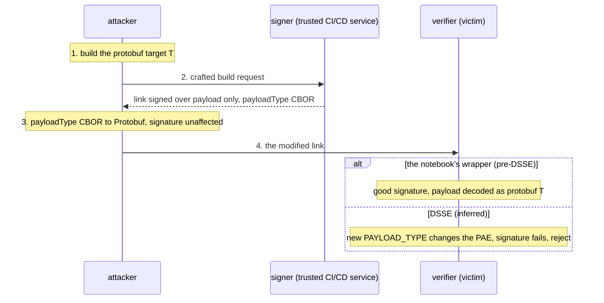

# DSSE: protocol model

`protocol.yaml` is the machine-readable model; this file is its reading, with one Mermaid sequence
diagram per flow. 5 roles (1 kind inferred: out-of-band channel), 8 flows, 45 steps (8 kind
inferred: F01.4, F01.5, F05.2, F05.11, F06.2, F06.3, F07.4, F08.5), 24 error paths (12 stated, 4
inferred, 8 unspecified), 11 source-defect candidates, 8 open issues, 7 out-of-scope items, counted
by script. Verification is also modelled as two state machines in `state-machine.yaml`, M1 (one
signature) and M2 (a (t, n)-ENVELOPE). Every quotation here is a marker rendered from
`.cache/secure-systems-lab-dsse.txt` by `bin/check-quotes --render`, and nothing between the markers
was typed. Requirement ids were emitted by script from the id tables: the fixed skeleton ids R-0001
to R-0033 of `requirements.yaml`; the ids the requirements lane promoted keyword-less binding
sentences to (pass 1 cited their candidates, C-ids of `inferred-candidates.yaml`, and pass 3 rewired
every one to its R-id); and, added by pass 2, the ids that lane later gave binding sentences no
candidate caught, with two of its inferred readings (`protocol.yaml` conventions.constrained_by
lists them). No candidate is cited as a constraint; a rejected sentence quoted as context is named
as such. SDP-n are
this lane's source-defect candidates, SDC-n those of `messages.yaml`; the canonical list is
`normative.md`'s, SD-1 to SD-20, and this file cites it, giving each SDP its canonical id below.

## What kind of protocol this is

protocol.md describes itself as the protocol for signing and verifying, apart from any transport:

<!-- q L10-11 "This document" .. "stored." -->
> This document describes the protocol/algorithm for creating and verifying DSSE signatures, independent of how they are transmitted or stored.

It is a sign-and-verify protocol with an agreement in front of it and a hand-off behind it. Signer
and verifier agree on a PAYLOAD_TYPE and the cryptography out of band; the signer signs the PAE of
the type and the body and sends the envelope one way; the verifier decodes it, verifies, checks the
type, parses, and gives the verified bytes to the application layer. Nothing goes back from
verifier to signer: counted over the five files as whole words, exchange, response, party and role
occur 0 times; client occurs once,
in §4.3 (L363, a client that misinterprets the payload), and server 2 times and
request 4 times, all in the notebook and all about its CI/CD build service.
Reject occurs 8 times, all in §1.2 and §1.3, which are the two
verification procedures. Eight flows model it: F01 agreement, F02 sign, F03 encode and transmit,
F04 verify one signature, F05 verify a (t, n)-ENVELOPE, F06 a multi-signature envelope at a
single-signature verifier, F07 old or new format, and F08 the notebook's payloadType attack with the
PAE's answer to it. in-toto-envelope-v1's model left DSSE's signing and verification opaque; here
they are the subject.

## Roles

| role | kind | who | source |
|---|---|---|---|
| signer | stated | Holds a signing key whose details it agreed out of band with the verifier. Serializes the message as SERIALIZED_BODY according to PAYLOAD_TYPE, signs the PAE of PAYLOAD_TYPE and SERIALIZED_BODY, optionally computes a KEYID, then encodes and transmits the four values, preferably as the JSON envelope, in either base64 alphabet. Several signers may sign the same payload (§1.3). The producers of §2.1.2, who may add members to the envelope, are this role's encoding side (inferred identification: §1.2 gives encoding to the signer). | §1.1, §1.2, §1.3, §2.1.2 |
| verifier | stated | Holds acceptable public keys (trusted public keys in §1.3) and a set of supported PAYLOAD_TYPEs, both from the out-of-band agreement (inferred). Receives and decodes the envelope accepting either base64 alphabet, may narrow its keys by KEYID, verifies the signature or signatures over the PAE, rejects an unsupported PAYLOAD_TYPE, parses SERIALIZED_BODY last, and hands the verified bytes to the application layer. Can tell the old in-toto/TUF format from the new one. The consumers of §2.1.2, who must ignore unrecognized members, are this role's decoding side, and the implementations bound by the bytes-identity rule of §1.2 and §2.3 are its implementations (both identifications inferred: only a verifier decodes and sends a payload on after verification). | §1.1, §1.2, §1.3, §2.1.2, §4.6 |
| application layer | stated | Receives the verified SERIALIZED_BODY from the verifier and acts on it; what it receives must be the bytes that were verified. The source also leaves to the application the threshold t of a (t, n)-ENVELOPE, any encoding other than the JSON envelope, and backwards compatibility with the old in-toto/TUF format. Whether the application that sets t is the one that receives the payload is not said (inferred: one application above the verifier). | §1.2, §1.3, §2.2, §2.3, §4.6 |
| out-of-band channel | inferred | Whatever carries the agreement between signer and verifier on PAYLOAD_TYPE, on Sign() and its cryptographic details including keys, and optionally on KEYID. Not the envelope. | §1.1, §1.2 |
| attacker | stated | The adversary of the attack notebook (§5) and of §4.4's example: has a trusted signer (a CI/CD service that signs what callers ask it to build) sign a message, then changes the unauthenticated payloadType so that the victim, a verifier, interprets the same signed bytes as another type. Not a party to DSSE; modelled for flow F08, the attack DSSE's PAE is built to stop. §4.4's own example names this party the signer, the one who gets a CI/CD system to produce a CBOR message (L409-411); the notebook calls it an attacker and the CI/CD service the signer. This model follows the notebook (inferred identification; SD-20). | §4.4, §5.2, §5.3, §5.4 |

The source's own words for the parties are signer and verifier (§1.1, §1.2), producers and consumers
(§2.1.2), implementations (§1.2, §2.3), the application (§1.2, §1.3, §2.2, §4.6), and attacker and
victim (§5). The model reads producer as the signer's encoding side, consumer and implementation as
the verifier's, and victim as a verifier (inferred identifications, protocol.yaml roles.aliases).

## Reading the diagrams

A solid arrow hands something from one role to another; a dashed arrow is a hand-off the model
infers, or one the source names without saying how. A note is a local step. `alt` blocks are the
source's branches, `opt` an optional step, `loop` a repetition. Section numbers are written
`section 1.3` inside diagrams. Each flow also has its step table, generated from the same data as
`protocol.yaml`; error paths are listed in full below.

## F01 out-of-band-agreement (§1.1, §1.2, §1.3, §2.2)

Nothing in §1.2's procedures works until signer and verifier have agreed, outside the envelope,
what is being signed and how:

<!-- q L80 -->
> Out of band:

<!-- q L82-83 -->
> - Agree on a PAYLOAD_TYPE and cryptographic details, optionally including KEYID.

PAYLOAD_TYPE names both the encoding and the schema of the payload, and the specification asks for
an application-specific media type in lower case or a URI (R-0001 to R-0005).
Sign() is left wholly open (R-0051 to R-0053): the algorithm, the signature format and
the keys are all part of the agreement, and KEYID's meaning with them (R-0043).

<!-- q L71-73 "Details are" .. "format." -->
> Details are agreed upon out-of-band by the signer and verifier. This specification places no restriction on the signature algorithm or format.

The verifier comes away with two things the procedures use and never define: its acceptable public
keys (L99, L130; the trusted public keys of L122) and its set of supported PAYLOAD_TYPEs (L102,
L137). Reading supported as agreed is this model's (inferred). For a threshold the application
also fixes t, which no member of the envelope carries:

<!-- q L122-123 "where `t`" .. "application-specific." -->
> where `t` is application-specific.

An encoding other than the JSON envelope needs agreeing too, because §2.2 allows one and
standardizes none; with a default or coded payloadType the verifier must rebuild the exact string
that was signed (F01.5, inferred; OI-08).

| step | roles | kind | what | constrained_by | on error |
|---|---|---|---|---|---|
| F01.1 | signer → verifier (via out-of-band channel) | stated | Agree the PAYLOAD_TYPE: an opaque, case-sensitive string that says how to interpret the payload, encoding and schema both. To avoid collisions it should be an application-specific media type, in lower case, or a URI that resolves to a description where it can and is case-normalized. | R-0055, R-0038, R-0039, R-0001, R-0002, R-0003, R-0004, R-0005, R-0023, R-0024 | unspecified |
| F01.2 | signer → verifier (via out-of-band channel) | stated | Agree the cryptographic details: the signature algorithm and format behind Sign(), on which the specification places no restriction, and the keys. The verifier comes away with its acceptable public keys; how it obtains them is not described (inferred). | R-0055, R-0051, R-0052, R-0053, R-0025 | unspecified |
| F01.3 | signer → verifier (via out-of-band channel) | stated | Optionally agree KEYID: how a key hint is formed and what it points to. KEYID is unauthenticated; it may narrow which keys a verifier tries and must decide nothing. | R-0055, R-0042, R-0043, R-0006, R-0033 | unspecified |
| F01.4 | application layer → verifier | inferred | For multi-signature verification fix the threshold t, which is application-specific, and the set of n unique trusted public keys it is counted against. Neither is carried in the envelope, whose members are payload, payloadType and signatures (§2.1). | R-0070 | unspecified |
| F01.5 | signer → verifier (via out-of-band channel) | inferred | Where the envelope is not the JSON envelope, agree the encoding: CBOR, protobuf, a default PAYLOAD_TYPE when payloadType is omitted, or a shorter code for it, together with the mapping back to the exact string that was signed. | R-0094, R-0095, R-0096, R-0110 | unspecified |

Order: The source orders nothing inside the agreement. It precedes signing (F02) and verification
(F04, F05) because both use what is agreed (inferred). When it is made, how often, how a verifier
obtains keys, and whether it ever changes are not described (OI-02); there is no key rollover,
revocation or expiry anywhere in the source (state-machine.yaml census).

## F02 sign (§1.1, §1.2, §1.3, §4.3)

Signing is four computations, and what matters for an implementation is the exact byte string
signed:

<!-- q L19 -->
> SIGNATURE = Sign(PAE(UTF8(PAYLOAD_TYPE), SERIALIZED_BODY))

<!-- q L87-90 -->
> - Serialize the message according to PAYLOAD_TYPE. Call the result SERIALIZED_BODY. - Sign PAE(UTF8(PAYLOAD_TYPE), SERIALIZED_BODY). Call the result SIGNATURE. - Optionally, compute a KEYID.

The PAE frames the two signed inputs with their byte lengths, so neither can be shifted into the
other, and it puts PAYLOAD_TYPE inside what is signed (R-0044, R-0020 restates
it in envelope.proto with `payload` for `body`):

<!-- q L64 -->
> PAE(type, body) = "DSSEv1" + SP + LEN(type) + SP + type + SP + LEN(body) + SP + body

<!-- q L68 -->
> LEN(s) = ASCII decimal encoding of the byte length of s, with no leading zeros

What is signed is raw bytes, never base64 text, and nothing is canonicalized: the mechanism behind
R-0026 and R-0027. The §1.4 vector is this step's worked example
(examples/pae.verbatim.txt):

<!-- q L161 -->
> DSSEv1 29 http://example.com/HelloWorld 11 hello world

Several signers may sign
the same payload; each then signs the same PAE, since the envelope carries one payload and one
payloadType and §1.3 verifies every signature against one PAE (inferred). How the further signers
receive the bytes is not described (OI-01).

<!-- q L117-118 "Multi-signature enhances" .. "payload." -->
> Multi-signature enhances the security by allowing multiple signers to sign the same payload.

| step | roles | kind | what | constrained_by | on error |
|---|---|---|---|---|---|
| F02.1 | signer | stated | Serialize the message according to PAYLOAD_TYPE; the result, an arbitrary byte sequence, is SERIALIZED_BODY. For a detached signature the message carries a cryptographic hash of the external data. | R-0056, R-0037, R-0100, R-0024 | unspecified |
| F02.2 | signer | stated | Build PAE(UTF8(PAYLOAD_TYPE), SERIALIZED_BODY): the ASCII string DSSEv1, a space, the decimal byte length of the UTF-8 type with no leading zeros, a space, the type bytes, a space, the decimal byte length of the body, a space, the body bytes. Nothing is canonicalized and nothing is base64-encoded. | R-0057, R-0044, R-0045, R-0054, R-0020, R-0023, R-0026, R-0027 | unspecified |
| F02.3 | signer | stated | Sign the PAE bytes with the agreed Sign(); the output is SIGNATURE. | R-0057, R-0035, R-0051, R-0052, R-0053, R-0025 | unspecified |
| F02.4 | signer | stated | Optionally compute a KEYID, the hint to which key and algorithm signed, by the scheme agreed in F01.3. | R-0058, R-0042, R-0043, R-0006, R-0033 | none |
| F02.5 | signer | stated | Each further signer repeats steps 2 to 4 over the same SERIALIZED_BODY and PAYLOAD_TYPE, so that every signature is over the same PAE. | R-0075, R-0010, R-0030 | inferred |

Order: Stated order: serialize, sign, then optionally KEYID (L87-90). Steps 2 and 3 are one source
step, split here because the PAE is the byte string an implementation has to get exactly right.
KEYID depends on the key, not on the signature, so step 4 may come anywhere (inferred). How further
signers obtain SERIALIZED_BODY and PAYLOAD_TYPE is not described (OI-01).

## F03 encode-and-transmit (§1, §2.1, §2.2, §3)

The four values are encoded, preferably as the JSON envelope, and sent by any means; the protocol
is explicitly independent of transport and storage:

<!-- q L10-11 "This document" .. "stored." -->
> This document describes the protocol/algorithm for creating and verifying DSSE signatures, independent of how they are transmitted or stored.

<!-- q L207-208 -->
> The standard data structure for storing a signed message is a JSON message of the following form, called the "JSON envelope":

payload is Base64(SERIALIZED_BODY), payloadType is PAYLOAD_TYPE, and each signature becomes one
element of signatures with sig = Base64(SIGNATURE) and an optional keyid. Either alphabet may be
used; the signer chooses and the verifier must take both (R-0007):

<!-- q L223-225 -->
> Base64() is [Base64 encoding](https://tools.ietf.org/html/rfc4648), transforming a byte sequence to a unicode string. Either standard or URL-safe encoding is allowed.

Required members are set even when empty and keyid may be unset, an unset keyid counting as an
empty one (R-0011, R-0012, R-0013; the rule's own names
`signature` and `signature.sig` are off, SD-1). A producer may add members, which
every consumer ignores (R-0014, R-0015); an added member, like keyid, sits
outside the PAE and is unauthenticated (inferred). A multi-signature envelope is one signatures list
(R-0010), equivalent to separate envelopes. Other encodings are allowed and not
standardized:

<!-- q L258-259 -->
> Optionally, applications may encode the signed message in other methods without invalidating the signature:

<!-- q L265 "At this" .. "encoding." -->
> At this point we do not standardize any other encoding.

The protobuf schema of §3 defines the structure only; JSON is the one recommended encoding
(R-0085, R-0086).

| step | roles | kind | what | constrained_by | on error |
|---|---|---|---|---|---|
| F03.1 | signer | stated | Use the JSON envelope, the recommended structure and the only recommended encoding; envelope.proto defines its schema and nothing more. An application may instead use another encoding (CBOR, protobuf, a default or shortened payloadType), which the source leaves unstandardized. | R-0059, R-0084, R-0085, R-0086, R-0087, R-0094, R-0095, R-0096, R-0029, R-0032 | unspecified |
| F03.2 | signer | stated | Set payload to Base64(SERIALIZED_BODY) in the standard or the URL-safe alphabet; it is required and is set even when SERIALIZED_BODY is empty. | R-0068, R-0007, R-0088, R-0089, R-0090, R-0011, R-0018 | unspecified |
| F03.3 | signer | stated | Set payloadType to PAYLOAD_TYPE as a JSON string; it is required. | R-0088, R-0011, R-0019, R-0038 | unspecified |
| F03.4 | signer | stated | Put one element in signatures per signature: sig is Base64(SIGNATURE) and is required; keyid is KEYID and is optional, an unset keyid counting the same as an empty one. An envelope may carry several signatures, which is equivalent to separate envelopes with one signature each. | R-0088, R-0010, R-0011, R-0012, R-0013, R-0020, R-0021, R-0022, R-0030, R-0069 | unspecified |
| F03.5 | signer | stated | Optionally add further members; consumers must ignore any member they do not recognize. | R-0014, R-0015 | none |
| F03.6 | signer → verifier | stated | Transmit or store the envelope by any means; the protocol does not depend on how. | R-0034, R-0059, R-0069 | inferred |

Order: Encode, then transmit (L91-92); nothing is ordered inside the encoding, and the template's
member order is not a constraint (inferred: a JSON object is unordered). A multi-signature envelope
gathers every signer's (SIGNATURE, KEYID) into one signatures list; who assembles it is not
described (OI-01). The protobuf schema of §3 defines the structure only; JSON is the one recommended
encoding.

## F04 verify-single-signature (§1.1, §1.2, §2.1.2, §2.3, §4.3, §4.4)

§1.2's verification is five steps in a fixed list order, four of them with a reject exit:

<!-- q L96-104 -->
> - Receive and decode SERIALIZED_BODY, PAYLOAD_TYPE, SIGNATURE, and KEYID, such as from the recommended [JSON envelope](envelope.md). Reject if decoding fails. - Optionally, filter acceptable public keys by KEYID. - Verify SIGNATURE against PAE(UTF8(PAYLOAD_TYPE), SERIALIZED_BODY). Reject if the verification fails. - Reject if PAYLOAD_TYPE is not a supported type. - Parse SERIALIZED_BODY according to PAYLOAD_TYPE. Reject if the parsing fails.

Two ordering facts matter. The signature is verified **before** PAYLOAD_TYPE is checked as
supported, so the type check acts on a string the signature has just authenticated; and
SERIALIZED_BODY is parsed **last**, after both. That is the order §4.4 prefers, and the one §4.3
keeps open by asking the protocol not to require parsing before verifying (R-0028):

<!-- q L403-404 "The preferred" .. "parsing." -->
> The preferred solution is to transmit the encoded byte stream exactly as it was signed, which the verifier verifies before parsing.

No sentence makes the order binding, and acceptance needs every check to pass whichever comes
first, so moving the type check ahead of the signature changes only which rejection is reported;
the parse needs a supported type to choose its parser, so it follows the type check by necessity.
Parsing ahead of verifying changes no outcome either, but puts the parser on unauthenticated bytes,
the attack surface §4.4 names (inferred; OI-05).

KEYID can only narrow the keys tried. What happens when it matches no acceptable key is not said
(EP-14, SD-15): rejecting and falling back to every key are both consistent with
R-0006, and neither can accept a bad signature.

<!-- q L54-56 "It **MUST" .. "try." -->
> It **MUST NOT** be used for security decisions; it may only be used to narrow the selection of possible keys to try.

Then the bytes-identity rule, stated after the list and again in §2.3 for every envelope format
(R-0008, R-0009; R-0016, R-0017):

<!-- q L109-113 -->
> **Important:** Implementations MUST ensure that the same SERIALIZED_BODY that is verified is the same sent to the application layer. In particular, implementations MUST NOT re-parse the envelope after verification to pull out the payload. Failure to adhere to this requirement can lead to security vulnerabilities.

So the application layer gets exactly the SERIALIZED_BODY that step 3 verified; whether it also gets
PAYLOAD_TYPE, the parsed message or the verifying key is not said (OI-04), and neither copy of the
rule says that the type the application uses is the type verified (SD-19; the requirements lane
reads it so, R-0108, inferred).

| step | roles | kind | what | constrained_by | on error |
|---|---|---|---|---|---|
| F04.1 | verifier | stated | Receive the envelope and decode SERIALIZED_BODY, PAYLOAD_TYPE, SIGNATURE and KEYID: from the JSON envelope, base64-decode payload and sig in either alphabet, ignore members it does not recognize, and treat an unset keyid as an empty one. Reject if decoding fails. | R-0060, R-0061, R-0007, R-0011, R-0012, R-0013, R-0015, R-0018, R-0019, R-0021, R-0022 | stated |
| F04.2 | verifier | stated | Optionally narrow the acceptable public keys to those the KEYID hint points to. The hint only narrows which keys are tried; it decides nothing. | R-0062, R-0006, R-0033 | unspecified |
| F04.3 | verifier | stated | Rebuild PAE(UTF8(PAYLOAD_TYPE), SERIALIZED_BODY) from the decoded values and verify SIGNATURE over it with the candidate keys. Reject if the verification fails. PAYLOAD_TYPE is inside the PAE, so a changed payloadType fails here. | R-0063, R-0064, R-0035, R-0044, R-0045, R-0054, R-0020, R-0023, R-0026, R-0028 | stated |
| F04.4 | verifier | stated | Reject if PAYLOAD_TYPE is not a supported type. The check is on the string the signature has just authenticated, compared case-sensitively (inferred from L32). | R-0065, R-0038, R-0023 | stated |
| F04.5 | verifier | stated | Parse SERIALIZED_BODY according to PAYLOAD_TYPE. Reject if the parsing fails. | R-0066, R-0067, R-0028, R-0031, R-0101 | stated |
| F04.6 | verifier → application layer | stated | Hand the application layer the SERIALIZED_BODY verified in step 3, byte for byte. Never re-parse the envelope after verification to pull the payload out again. | R-0008, R-0009, R-0016, R-0017, R-0031 | stated |

Order: The source's list order (L96-104): decode, filter, verify, type check, parse. The signature
is verified BEFORE PAYLOAD_TYPE is checked as supported, and SERIALIZED_BODY is parsed LAST, after
both. No sentence makes the order itself binding (inferred); it is the order §4.4 calls the
preferred solution, verify before parsing, and the one §4.3 keeps open by asking the protocol not to
require parsing before verifying (R-0028). Moving the type check ahead of step 3 changes only which
rejection is reported, since acceptance needs steps 1, 3, 4 and 5 all to pass in any order
(inferred); the parse needs a supported type to choose its parser, so it follows step 4 by
necessity. Parsing ahead of step 3 changes no outcome either, but puts the parser on unauthenticated
bytes, which §4.4 calls error-prone and an increased attack surface. Step 6 is the bytes-identity
rule of the paragraph after the list, which §2.3 restates for every envelope format.

## F05 verify-threshold (§1.1, §1.2, §1.3, §2.1.2, §2.3, §4.3)

A (t, n)-ENVELOPE is valid when its signatures verify against at least t of n unique trusted
public keys, t being the application's:

<!-- q L121-123 -->
> A `(t, n)`-ENVELOPE is valid if the enclosed signatures pass the verification against at least `t` of `n` unique trusted public keys where `t` is application-specific.

The procedure loops over the signatures with an accumulator:

<!-- q L127-139 -->
> - Receive and decode SERIALIZED_BODY, PAYLOAD_TYPE, SIGNATURES from ENVELOPE. Reject if decoding fails. - For each (SIGNATURE, KEYID) in SIGNATURES, - Optionally, filter acceptable public keys by KEYID. - Verify SIGNATURE against PAE(UTF8(PAYLOAD_TYPE), SERIALIZED_BODY). Skip over if the verification fails. - Add the accepted public key to the set ACCEPTED_KEYS. - Break if the number of unique keys in ACCEPTED_KEYS is greater or equal to `t`. - Reject if the unique keys in ACCEPTED_KEYS is less than `t`. - Reject if PAYLOAD_TYPE is not a supported type. - Parse SERIALIZED_BODY according to PAYLOAD_TYPE. Reject if the parsing fails.

A signature that fails is skipped, not fatal. A signature that verifies adds its key to the set
ACCEPTED_KEYS, and the loop breaks as soon as the set holds t unique keys. Break saves work and
changes no accept or reject outcome; it does decide which keys end up in ACCEPTED_KEYS, which
matters only if they are reported on (inferred, OI-04). Unique keys means one key signing twice
counts once
(R-0077 to R-0079); when two keys are the same is not defined (SD-14). Key equality by
key material keeps a key listed twice among the trusted keys from counting twice, but not a
signature that verifies under two distinct trusted keys, which a key admitted without proof that
its holder signs with it can make happen (EP-15, SD-15). ACCEPTED_KEYS is never said to start
empty (F05.2, inferred).

Then the same two ordering facts as F04: PAYLOAD_TYPE is checked after the signatures, and the parse
is last. t appears nowhere in the envelope and nothing bounds it, so with t of 0 the threshold check
never rejects and an envelope with no verified signature, or none at all, goes on to the type check
and the parse (SD-10, EP-18). Passing the threshold check is what L121-123 calls valid, and the
envelope can still be rejected after it (SD-16). The bytes-identity rule is not restated in §1.3;
it reaches F05.11 from §2.3, which binds every implementation for all envelope formats
(R-0097; this lane's SDP-7 read that as a gap and normative.md declined it):

<!-- q L270-271 -->
> The following advisories are relevant to all envelope formats, not just the standard JSON envelope.

| step | roles | kind | what | constrained_by | on error |
|---|---|---|---|---|---|
| F05.1 | verifier | stated | Receive the envelope and decode SERIALIZED_BODY, PAYLOAD_TYPE and the list SIGNATURES, under the same decoding rules as F04.1. Reject if decoding fails. | R-0071, R-0072, R-0007, R-0011, R-0012, R-0013, R-0015 | stated |
| F05.2 | verifier | inferred | Start with an empty ACCEPTED_KEYS. | R-0077 | none |
| F05.3 | verifier | stated | Take the next (SIGNATURE, KEYID) of SIGNATURES. | R-0073, R-0010, R-0030 | inferred |
| F05.4 | verifier | stated | Optionally narrow the acceptable public keys by this signature's KEYID. | R-0074, R-0006, R-0033 | unspecified |
| F05.5 | verifier | stated | Verify SIGNATURE over PAE(UTF8(PAYLOAD_TYPE), SERIALIZED_BODY), the same PAE for every signature. Skip to the next signature if it fails. | R-0075, R-0076, R-0035, R-0044, R-0045, R-0054, R-0020, R-0023, R-0026, R-0028 | stated |
| F05.6 | verifier | stated | Add the public key that verified this SIGNATURE to the set ACCEPTED_KEYS; a key already in it is not added twice. | R-0077, R-0070 | unspecified |
| F05.7 | verifier | stated | Leave the loop once ACCEPTED_KEYS holds at least t unique keys; otherwise go on with the next signature (step 3). | R-0078, R-0070 | none |
| F05.8 | verifier | stated | After the loop, reject if ACCEPTED_KEYS holds fewer than t unique keys. Passing this is what L121-123 calls a valid (t, n)-ENVELOPE. | R-0079, R-0070 | stated |
| F05.9 | verifier | stated | Reject if PAYLOAD_TYPE is not a supported type (as F04.4). | R-0080, R-0038, R-0023 | stated |
| F05.10 | verifier | stated | Parse SERIALIZED_BODY according to PAYLOAD_TYPE. Reject if the parsing fails. | R-0081, R-0082, R-0028, R-0031 | stated |
| F05.11 | verifier → application layer | inferred | Hand the application layer the SERIALIZED_BODY that was verified, byte for byte; never re-parse the envelope after verification. | R-0097, R-0008, R-0009, R-0016, R-0017 | stated |

Order: The source's order: decode, the loop, the threshold check, the type check, the parse. As in
F04 the signatures are verified before PAYLOAD_TYPE is checked, and parsing is last. Break (step 7)
is an early exit: acceptance needs t unique keys whether the loop stops early or not, so it saves
work and changes no accept or reject outcome; it does decide which keys end up in ACCEPTED_KEYS,
which matters only if they are reported on (inferred, OI-04). The loop takes SIGNATURES in list
order (inferred); the outcome does not depend on the order. ACCEPTED_KEYS is never said to start
empty (step 2, inferred). The bytes-identity rule (step 11) is not restated in §1.3; it reaches it
from §2.3, which binds implementations for all envelope formats (R-0097). This lane's SDP-7 called
that a scope gap; normative.md declined it as a defect. Passing step 8 is what L121-123 calls a
valid (t, n)-ENVELOPE; steps 9 and 10 can still reject it (SD-16).

## F06 multi-signature-envelope-at-single-signature-verifier (§1.2, §1.3, §2.1.1, §5.5.4)

The single-signature procedure decodes one SIGNATURE and one KEYID, while the envelope's
signatures is a list. The only bridge is §2.1.1's equivalence (R-0010):

<!-- q L229-230 -->
> An envelope MAY have more than one signature, which is equivalent to separate envelopes with individual signatures.

So a verifier that runs only F04 can take each element as a separate envelope with the same payload
and payloadType and accept when one passes, which is F05 with t = 1 (inferred; SD-9). The type
check and the parse concern the shared payload and run once. Checking only the first signature, as
the notebook's demo verifier does for its pre-DSSE wrapper, makes acceptance depend on the order of
the signatures, which the equivalence rules out:

<!-- q L717 -->
> signature = base64.b64decode(wrapper['signatures'][0]['sig'])

| step | roles | kind | what | constrained_by | on error |
|---|---|---|---|---|---|
| F06.1 | verifier | stated | Receive a JSON envelope whose signatures list has more than one element. | R-0010 | unspecified |
| F06.2 | verifier | inferred | Treat each element of signatures as a separate envelope carrying the same payload and payloadType. | R-0010 | none |
| F06.3 | verifier → application layer | inferred | Run F04 steps 2 and 3 on the separate envelopes until one signature verifies; then F04 steps 4 to 6 once. Reject if none verifies. | R-0063, R-0064, R-0070, R-0010 | inferred |

Order: All inferred from the equivalence sentence, except F04 itself. The source does not say which
signature a single-signature verifier checks. Checking only the first would make acceptance depend
on the order of signatures, which the equivalence rules out (inferred). The type check and the parse
concern the shared payload and payloadType, so they run once, after a signature passes (inferred, as
F04's order).

## F07 old-or-new-format-detection (§2.1.2, §4.4, §4.6)

A verifier can tell the formats apart by one member:

<!-- q L484-487 -->
> Verifiers can differentiate between the [old](https://github.com/in-toto/specification/blob/d416c1f334ac6b581f75c0fa65125fb434d7a610/in-toto-spec.md#42-file-formats-general-principles) and new envelope format by detecting the presence of the `payload` field (new format) vs `signed` field (old format).

The old format is the application's to handle (R-0102); ITE-5 and TAP-14 are outside this
source. The test is not exclusive: an object with both members, or neither, is not addressed, and
because a DSSE consumer must ignore unrecognized members (R-0015) it treats signed as
noise while an old-format reader acts on it. One object then reads two ways (SD-11), akin to the
misinterpretation §4.4 holds against the old scheme and §4.3 asks the protocol to reduce
(R-0023):

<!-- q L407-408 -->
> Second, the scheme does not include an authenticated "context" indicator to ensure that the signer and verifier interpret the payload in the same exact way.

| step | roles | kind | what | constrained_by | on error |
|---|---|---|---|---|---|
| F07.1 | verifier | stated | Look for the payload member and the signed member in the received object. | R-0103 | none |
| F07.2 | verifier | stated | New format: verify it as a DSSE envelope (F04, or F05 for a threshold). | R-0103 | stated |
| F07.3 | verifier → application layer | stated | Old format: leave it to the application's compatibility handling, which ITE-5 (in-toto) and TAP-14 (TUF) describe outside this source. | R-0103, R-0102 | stated |
| F07.4 | verifier | inferred | Both members, or neither: not addressed. A DSSE consumer must ignore unrecognized members, so to it signed is noise and payload makes the object a DSSE envelope, while an old-format reader may act on signed. One object can then be read two ways, akin to the misinterpretation §4.4 holds against the old scheme and §4.3 asks the protocol to reduce (R-0023). | R-0015, R-0103, R-0023 | unspecified |

Order: Before decoding (inferred): the test reads which members exist and nothing else. It is a
capability (can), not an obligation.

## F08 type-confusion-attack (§1.1, §5.2, §5.3, §5.4, §5.5.3, §5.5.4)

The notebook shows why the type must be authenticated, against a wrapper that signs the payload
and not payloadType (a pre-DSSE wrapper; the notebook's own scenario):

<!-- q L554 -->
> * `signatures`: Cryptographic signatures over `payload` but **not** `payloadType`. **This is the problem.**

<!-- q L592-595 -->
> 1. Construct a target payload T in protobuf format that we want the victim to consume. 2. Send a carefully crafted build request that results CI/CD returning a signed CBOR-type link file, such that the payload is interpreted as P when type is CBOR but T when type is protobuf. 3. Modify the `payloadType` field to say `Protobuf` instead of `CBOR`. This does not invalidate the signature because the `payloadType` is unauthenticated. 4. Send the modified link file to the victim. They will interpret the payload as T, even though the CI/CD system intended it to be interpreted as P.

Under DSSE step 3 fails: PAYLOAD_TYPE is an authenticated parameter, so the victim's F04.3 rebuilds
a different PAE and the signature does not verify (F08.5, inferred from §1.1; EP-23). The §1.4
vector's rejection under a changed type is reproduced in examples/.

<!-- q L27 -->
> PAYLOAD_TYPE | string | Yes | Yes

<!-- q L533 "Instead, the" .. "payload." -->
> Instead, the signature wrapper **must** include some authenticated "context" indicator that describes how to interpret the payload.

| step | roles | kind | what | constrained_by | on error |
|---|---|---|---|---|---|
| F08.1 | attacker | stated | Build the target payload T in protobuf format. | none | none |
| F08.2 | attacker → signer | stated | Send the CI/CD service a crafted build request; it returns a link file signed over the payload alone, typed CBOR, whose bytes read as P when typed CBOR and as T when typed Protobuf. | none | none |
| F08.3 | attacker | stated | Change payloadType from CBOR to Protobuf. In the notebook's wrapper the signature still verifies, payloadType being unauthenticated. | none | none |
| F08.4 | attacker → verifier | stated | Send the modified link file to the victim, which checks the signature over payload alone and decodes payload with the decoder payloadType names. | none | stated |
| F08.5 | verifier | inferred | Under DSSE the victim's F04.3 rebuilds the PAE from the received PAYLOAD_TYPE. Protobuf in place of CBOR changes the PAE, the signature fails, and the envelope is rejected. | R-0035, R-0036, R-0057, R-0063, R-0064, R-0023 | inferred |

Order: Steps 1 to 4 are §5.4's outline, in its order; step 5 is this model's, the DSSE outcome
(inferred). examples/ reproduces the §1.4 vector's rejection under a changed type.

## Ordering, in one place

| check | single signature (F04) | threshold (F05) | on failure |
|---|---|---|---|
| decode the envelope | step 1 | step 1 | reject |
| narrow keys by KEYID (optional) | step 2 | step 4, per signature | not stated (EP-14) |
| verify the signature over the PAE | step 3 | step 5, per signature | F04 reject; F05 skip over |
| count unique keys against t | none | steps 6 to 8 | Break at t (step 7); reject below t (step 8) |
| PAYLOAD_TYPE is supported | step 4 | step 9 | reject |
| parse SERIALIZED_BODY | step 5, last | step 10, last | reject |
| hand the verified bytes on | step 6 | step 11 (inferred) | never re-parse (EP-07) |

The order is the source's list order; no sentence makes it binding. Acceptance needs every check to
pass, so reordering the checks changes only which rejection is reported, except that the parse needs
a supported type and so follows the type check by necessity; parsing before verifying changes the
attack surface, which §4.3 (R-0028) and §4.4 (L403-404) argue against (OI-05).

t is application-specific (L122-123) and is not a member of the envelope; n is the number of unique
trusted public keys and appears in no step. Neither is bounded (SD-10).

## Error paths

Each row says whether its outcome is stated, inferred or unspecified.

| id | condition | steps | basis | outcome | ids |
|---|---|---|---|---|---|
| EP-01 | Decoding fails. | F04.1, F05.1 | stated | Reject. | R-0061, R-0072 |
| EP-02 | The signature does not verify over the PAE (single-signature verification). | F04.3, F08.5 | stated | Reject. | R-0064 |
| EP-03 | One signature of a (t, n)-ENVELOPE does not verify. | F05.5 | stated | Skip over it and go on with the next; not fatal to the envelope by itself. | R-0076 |
| EP-04 | After the loop ACCEPTED_KEYS holds fewer than t unique keys. | F05.8 | stated | Reject. | R-0079 |
| EP-05 | PAYLOAD_TYPE is not a supported type. | F04.4, F05.9 | stated | Reject, after the signature check in both procedures. | R-0065, R-0080 |
| EP-06 | Parsing SERIALIZED_BODY according to PAYLOAD_TYPE fails. | F04.5, F05.10 | stated | Reject; this is the last check. | R-0067, R-0082 |
| EP-07 | The application layer is sent other bytes than those verified, for instance by re-parsing the envelope after verification to pull out the payload. | F04.6, F05.11 | stated | Forbidden (MUST NOT); the stated consequence is that it can lead to security vulnerabilities. An implementation defect, not an input with an outcome. | R-0008, R-0009, R-0016, R-0017 |
| EP-08 | payload or sig is in the other base64 alphabet. | F04.1, F05.1 | stated | Accept: verifiers must take either alphabet, so rejecting one is non-conformant. Padding, mixed alphabets and whitespace are not addressed (messages.yaml source_silences). | R-0007 |
| EP-09 | The envelope has members the consumer does not recognize. | F04.1, F05.1, F07.4 | stated | Ignore them. They are outside the PAE and so unauthenticated (inferred). | R-0015 |
| EP-10 | keyid is unset. | F04.1, F04.2, F05.1, F05.4 | stated | Treat it as set but empty; an empty KEYID narrows nothing (inferred). | R-0013 |
| EP-11 | signatures is empty. | F03.4, F04.1, F05.3, F05.8 | inferred | Single signature: there is no SIGNATURE to decode or verify, so F04.1 or F04.3 rejects (inferred). (t, n): the loop does not run and F05.8 rejects exactly when t >= 1; with t of 0 or less an unsigned envelope is accepted (SD-10). Producer side: set-but-empty is allowed by §2.1.2 and breaks the proto's length >= 1 (SD-2). | R-0011, R-0020, R-0079 |
| EP-12 | Two signatures carry the same keyid. | F05.4 | unspecified | Not addressed. keyid is only a hint, so a duplicate can neither count as a second signer nor be an error by itself (inferred); keys, not keyids, are counted. (SD-14) | R-0006 |
| EP-13 | One key signs twice: two signatures verify under the same key. | F05.6, F05.7, F05.8 | stated | The key counts once: ACCEPTED_KEYS is a set and the threshold counts unique keys. What makes two keys the same is not defined. (SD-14) | R-0077, R-0078, R-0079 |
| EP-14 | KEYID matches no acceptable public key. | F04.2, F05.4 | unspecified | Not addressed. With nothing left to try, F04.3 rejects and F05.5 skips (inferred); falling back to every acceptable key is also consistent with R-0006. Either way the hint can cause a false rejection and never a false acceptance (inferred). (SD-15) | R-0062, R-0074, R-0006 |
| EP-15 | One signature verifies under more than one candidate key. | F05.6 | unspecified | Not addressed: 'the accepted public key' presumes one. With honestly generated keys a sound signature scheme makes a second verifying key negligible, so in practice this is one key listed twice among the trusted keys, which uniqueness by key material collapses and uniqueness by entry double-counts. Unforgeability does not rule out a second key, though: a key admitted to the trusted set without proof that its holder signs with it can be made to verify another signer's signature, and one signature then counts for two distinct keys (inferred). (SD-14, SD-15) | R-0077 |
| EP-16 | A multi-signature envelope reaches a verifier that runs only the single-signature procedure. | F06.1, F06.3, F04.1 | inferred | Equivalent to separate envelopes: accept if one passes F04, which equals F05 with t = 1. Rejecting it at decoding, or checking only the first signature, is not what the equivalence describes. (SD-9) | R-0010 |
| EP-17 | A required member (payload, payloadType, signatures or sig) is absent. | F03.2, F03.3, F03.4, F04.1, F05.1 | unspecified | The consumer's handling is not stated. Read as a decoding failure it is rejected (EP-01, inferred); read with L251 over every field it equals an empty value (SD-8). The rule's own names are off (SD-1). | R-0011, R-0013 |
| EP-18 | t is 0 or less, or greater than n. | F01.4, F05.8 | unspecified | No bound is stated. t of 0 or less accepts with no verified signature, even with no signature at all; t greater than n can never be met, so every envelope is rejected (inferred). (SD-10) | R-0070, R-0079 |
| EP-19 | The object has both payload and signed, or neither. | F07.4 | unspecified | Not addressed. (SD-11) | R-0015, R-0103 |
| EP-20 | The object is in the old format (signed present). | F07.3 | stated | Handled by the application (ITE-5, TAP-14); out of scope. | R-0102 |
| EP-21 | The JSON envelope has duplicate member names, or decodes differently in another parser. | F04.1, F04.6, F05.1, F05.11 | unspecified | Not addressed (messages.yaml source_silences). It is harmless only while the bytes verified are the bytes delivered, which the ban on re-parsing secures, and the type the application uses is the type verified, which no sentence secures (SD-19; R-0108, inferred): a duplicated payloadType read again after verification can name another type than the one in the PAE. | R-0008, R-0009, R-0016, R-0017, R-0108 |
| EP-22 | A key agreed for one PAYLOAD_TYPE signs an envelope of another type the verifier supports. | F04.4, F05.9 | unspecified | Accepted as written: the type check asks only whether the type is supported, and keys are narrowed by KEYID alone. (SD-17) | R-0065, R-0080 |
| EP-23 | The envelope is relabelled with another payloadType (the notebook's attack). | F08.3, F08.5, F04.3 | inferred | Under DSSE the PAE changes and the signature fails: reject (EP-02). Under the notebook's wrapper the signature still verifies (stated, L594). | R-0063, R-0064, R-0036 |
| EP-24 | keyid or an added member is altered in transit. | F03.5, F03.6, F04.1 | inferred | Not detected, since neither is in the PAE; harmless because keyid decides nothing and unknown members are ignored (inferred). | R-0006, R-0015, R-0022 |

## Source-defect candidates

### SDP-1 (gap, canonical SD-9): The single-signature procedure takes one SIGNATURE; the envelope carries a list

§1.2 decodes one SIGNATURE and one KEYID. The envelope's signatures member is a list and may hold
several, and the only guidance on reading several with the §1.2 procedure is that they are
equivalent to separate envelopes. A single-signature verifier that checks only the first signature,
or rejects more than one at decoding, behaves differently from one that treats each as a separate
envelope, and the source does not say which it should do. Modelled as: F06; EP-16;
state-machine.yaml M1 U2.

<!-- q L96 "- Receive" .. "KEYID," -->
> - Receive and decode SERIALIZED_BODY, PAYLOAD_TYPE, SIGNATURE, and KEYID,

<!-- q L229-230 -->
> An envelope MAY have more than one signature, which is equivalent to separate envelopes with individual signatures.

### SDP-2 (gap, canonical SD-10): t has no lower bound; t of 0 accepts an envelope with no verified signature

t is application-specific and nothing bounds it. The only rejecting check on the signatures is fewer
than t unique keys, so with t = 0 (or less) it never fires, and the procedure goes on to the type
check and the parse whatever the signatures are, including none. As written, a (t, n) verifier
configured with t = 0 accepts unsigned envelopes. The source does not require t >= 1. Modelled as:
F05.8 on_error; EP-11, EP-18; state-machine.yaml M2 parameterisations.

<!-- q L121-123 -->
> A `(t, n)`-ENVELOPE is valid if the enclosed signatures pass the verification against at least `t` of `n` unique trusted public keys where `t` is application-specific.

<!-- q L136 -->
> - Reject if the unique keys in ACCEPTED_KEYS is less than `t`.

### SDP-3 (gap, canonical SD-14): Unique keys are counted, but key equality is never defined

ACCEPTED_KEYS is called a set, and the steps then count the unique keys in it; the definition counts
against n unique trusted public keys. Nothing says when two keys are the same: the same key
material, the same trusted-key entry, or the same KEYID, which R-0006 rules out for a security
decision. If uniqueness is by entry, a trusted set that lists one key twice, say under two KEYIDs,
lets one signer count twice towards t. Uniqueness by key material is the reading that keeps the
threshold meaningful (inferred), though not by itself: one signature that verifies under two
distinct trusted keys counts twice under it too (EP-15, SD-15). Modelled as: F05.6 note; EP-12,
EP-13, EP-15; state-machine.yaml M2 U2.

<!-- q L122 "unique trusted" .. "keys" -->
> unique trusted public keys

<!-- q L133 -->
> - Add the accepted public key to the set ACCEPTED_KEYS.

<!-- q L134-135 -->
> - Break if the number of unique keys in ACCEPTED_KEYS is greater or equal to `t`.

<!-- q L54-56 "It **MUST" .. "try." -->
> It **MUST NOT** be used for security decisions; it may only be used to narrow the selection of possible keys to try.

### SDP-4 (gap, canonical SD-15): The KEYID filter's empty and plural results have no stated outcome

Filtering acceptable keys by KEYID can leave no key, or several. The procedures go straight to
verifying, and §1.3 then adds 'the accepted public key', as if exactly one key verified. Verifiers
may differ on a KEYID that matches no key (reject or skip, or retry with every key) and on which key
to add when several verify, or whether to add each. Neither difference can accept a bad signature,
since the hint decides nothing (inferred); adding every key that verifies can count one signature
twice when a trusted key was admitted without proof that its holder signs with it (EP-15). Modelled
as: F04.2, F05.4, F05.6 on_error; EP-14, EP-15; state-machine.yaml M1 U1, M2 U1 and U3.

<!-- q L99 -->
> - Optionally, filter acceptable public keys by KEYID.

<!-- q L133 -->
> - Add the accepted public key to the set ACCEPTED_KEYS.

<!-- q L55-56 "it may" .. "try." -->
> it may only be used to narrow the selection of possible keys to try.

### SDP-5 (gap, canonical SD-11): The old/new format test is not exclusive

§4.6 tells the formats apart by payload (new) versus signed (old). An object with both, or neither,
is not addressed, and under R-0015 a DSSE consumer ignores signed as an unrecognized member while an
old-format reader would act on it. One object can be accepted as a DSSE envelope by one verifier and
read as an old-format document by another: two interpretations of one signed object, the ambiguity
DSSE exists to remove. Modelled as: F07.4; EP-19.

<!-- q L484-487 -->
> Verifiers can differentiate between the [old](https://github.com/in-toto/specification/blob/d416c1f334ac6b581f75c0fa65125fb434d7a610/in-toto-spec.md#42-file-formats-general-principles) and new envelope format by detecting the presence of the `payload` field (new format) vs `signed` field (old format).

<!-- q L253 -->
> Consumers MUST ignore unrecognized fields.

### SDP-6 (ambiguity, canonical SD-8): The scope of 'An unset field MUST be treated the same as set-but-empty'

The sentence closes the OPTIONAL bullet for signature.keyid but says 'An unset field' and does not
limit itself to optional fields. Read over every field it makes an absent payload, payloadType or
sig equal to an empty one, which the REQUIRED bullet's 'MUST be set' otherwise rules out. Two
consumers can disagree on an envelope with payload missing: one rejects it as malformed, the other
verifies it as an empty SERIALIZED_BODY. Modelled as: EP-17; state-machine.yaml M1 U3, M2 U4.

<!-- q L248-249 -->
> * The following fields are REQUIRED and MUST be set, even if empty: `payload`, `payloadType`, `signature`, `signature.sig`.

<!-- q L250 -->
> * The following fields are OPTIONAL and MAY be unset: `signature.keyid`.

<!-- q L251 -->
> An unset field MUST be treated the same as set-but-empty.

### SDP-7 (scope, canonical declined): The bytes-identity rule is not stated for the (t, n) procedure

The rule that the bytes verified are the bytes the application receives sits in §1.2, after the
single-signature steps, and §2.3 extends it to all envelope formats. §1.3's procedure does not
repeat it, and neither copy names verification procedures. Read narrowly, a (t, n) verifier is not
bound by it. The model applies it to F05 (inferred); it is plainly meant generally. Modelled as:
F05.11 (kind inferred); state-machine.yaml M2 forbidden and invariants. Canonical status: declined
by normative.md: R-0016 and R-0017 bind every implementation for every envelope format (R-0097), so
they reach a (t, n) verifier as written.

<!-- q L109-110 "**Important:** Implementations" .. "layer." -->
> **Important:** Implementations MUST ensure that the same SERIALIZED_BODY that is verified is the same sent to the application layer.

<!-- q L125 -->
> To verify a `(t, n)`-ENVELOPE:

<!-- q L270-271 -->
> The following advisories are relevant to all envelope formats, not just the standard JSON envelope.

### SDP-8 (terminology, canonical SD-16): A valid (t, n)-ENVELOPE can still be rejected

Validity is defined by the signatures alone: they pass against at least t of n unique trusted keys.
The procedure that follows also rejects an unsupported PAYLOAD_TYPE and a body that does not parse.
'valid' and 'accepted' are different predicates. A check or API built from the definition alone
omits two rejections. Modelled as: state-machine.yaml M2 threshold_met versus delivered; F05
order_note.

<!-- q L121-123 -->
> A `(t, n)`-ENVELOPE is valid if the enclosed signatures pass the verification against at least `t` of `n` unique trusted public keys where `t` is application-specific.

<!-- q L137 -->
> - Reject if PAYLOAD_TYPE is not a supported type.

<!-- q L138-139 -->
> - Parse SERIALIZED_BODY according to PAYLOAD_TYPE. Reject if the parsing fails.

### SDP-9 (gap, canonical SD-17): 'supported type' is undefined and not tied to the verifying key

Signer and verifier agree a PAYLOAD_TYPE out of band, but the procedures check only that
PAYLOAD_TYPE is a supported type and narrow keys by KEYID alone; no step asks whether the key that
verified is trusted for that type. §4.2 names one key per message type as the burden raw signatures
impose. A verifier supporting several types accepts an envelope of type B signed by a key agreed
only for type A. DSSE prevents confusing the types of one signed message; which signer may sign
which type is left to policy the source does not describe. Modelled as: F04.4, F05.9 notes; EP-22;
OI-03.

<!-- q L82-83 -->
> - Agree on a PAYLOAD_TYPE and cryptographic details, optionally including KEYID.

<!-- q L102 -->
> - Reject if PAYLOAD_TYPE is not a supported type.

<!-- q L99 -->
> - Optionally, filter acceptable public keys by KEYID.

<!-- q L336-337 "Every public" .. "type," -->
> Every public key must be used for exactly one purpose over exactly one message type,

### SDP-10 (typo, canonical SD-12): The notebook's build interface takes 'three' parameters and lists two

Two parameters follow the sentence: command and encoding. None for DSSE; a reader reproducing the
attack looks for a third. Modelled as: F08.2 note.

<!-- q L558 "In our" .. "parameters:" -->
> In our scenario, the build interface takes three user-defined parameters:

<!-- q L560 -->
> * `command`: The shell command to run.

<!-- q L561 -->
> * `encoding`: The `payloadType` to return.

### SDP-11 (typo, canonical SD-12): The notebook's prose names the characters z} where its code uses z~

The prose explains the two characters as z (field 15, length-delimited) and ~ (length 126) but
writes them as z}; the code appends z~. ~ is 0x7E, 126, so the code is right and the prose's }
(0x7D, 125) is wrong. None for DSSE; z} as written would declare one byte too few. Modelled as: not
modelled (attack-construction detail).

<!-- q L1097 "The characters" .. "126," -->
> The characters `z}` will do precisely that: `z` is field number 15 of type length-delimited, and `~` is length 126,

<!-- q L1102 "tar" .. "'" -->
> target_payload + b"z~'

## Open issues

- **OI-01** (§1.3, §2.1.1). How the signatures of several signers reach one envelope: who serializes SERIALIZED_BODY, how further signers obtain it with PAYLOAD_TYPE, and who assembles the signatures list (F02.5, F03.4).
- **OI-02** (§1.1, §1.2, §1.3). Where the verifier's acceptable or trusted public keys come from, how KEYID is formed and mapped to them, and whether keys ever change. All of it is out of band and none is described (F01.2, F01.3).
- **OI-03** (§1.2). Whether acceptable keys are bound to the PAYLOAD_TYPEs they may sign (SD-17).
- **OI-04** (§1.2, §2.3). What the application layer receives besides the verified bytes: PAYLOAD_TYPE, the parsed message, the key or keys that verified (ACCEPTED_KEYS). Policy above the verifier may need them. For PAYLOAD_TYPE, that it must be the type verified is not said either (SD-19).
- **OI-05** (§1.2, §1.3, §4.3, §4.4). Whether the order of the verification steps is itself binding. Outcomes do not depend on it; the attack surface of parsing does (F04 order_note).
- **OI-06** (§1.2, §2.1.1). How a single-signature verifier should treat several signatures (SD-9).
- **OI-07** (§1.3). The bounds of t, who sets it, and whether it may vary with PAYLOAD_TYPE (SD-10).
- **OI-08** (§2.2). With a default or coded payloadType (§2.2), how the verifier rebuilds the exact PAYLOAD_TYPE string the signature covers (F01.5).

## Out of scope

- Sign(): algorithms, signature formats and key generation. Agreed out of band; the specification places no restriction on them. [§1.1 (L71-73)]
- Key distribution, trust in a key, and how KEYID is computed and resolved. [§1.1, §1.2 (L52-56, L82-83)]
- Serializing and parsing a message according to its PAYLOAD_TYPE: each payload type's own format. [§1.2 (L87, L103)]
- Encodings other than the JSON envelope, which the source does not standardize. [§2.2 (L265)]
- The old in-toto/TUF envelope format and backwards compatibility with it (ITE-5, TAP-14). [§4.6 (L477-487)]
- The reference implementation the test vectors point to (implementation/signing_spec.py), which record.yaml says is not specification text and was not read. [§1.4 (L143)]
- The notebook's mock cryptography, CI/CD service and protobuf parser beyond what F08 uses. [§5.5, §5.7]

## State machines

`state-machine.yaml` models verification, the one lifecycle the source states: M1 for §1.2
(12 states, 11 transitions, 4 error
states) and M2 for §1.3 (15 states, 19 transitions,
4 error states, the ACCEPTED_KEYS loop with Break as its guard). Each reject
exit is its own error state so that each is one test; the source's word is just Reject. The re-parse
prohibition is a forbidden action from the verified states on (M1.X1, M2.X1). Signing, the
out-of-band agreement, format detection, the envelope over time and the notebook's attack were
assessed and are not machines (state-machine.yaml candidates SC-4 to SC-8); none of the
29 lifecycle-over-time words of its census (state, status, revoke, expire, rotate,
update, supersede and the rest) occurs in the source.
