# Protocol model: Simple Public Key Certificate (draft-ietf-spki-cert-structure-06)

FX-1 pass 1, protocol and state-machine agent, from the source only. The machine-readable model is `protocol.yaml` (roles, flows, steps, error paths, source defects) and `state-machine.yaml` (15 machines); this file is their prose and diagrams, built from the same objects. Every quotation below is a `<!-- q -->` marker whose words `bin/check-quotes --render` wrote from `.cache/draft-ietf-spki-cert-structure.txt`; nothing between markers is a quotation. Literal tokens and draft object names are in backticks.

## What the draft defines and what it leaves out

Applicable. The draft defines structures delivered from a prover to a verifier (certificates, CRLs, revalidations, sequences) and the processing a verifier applies to them: sequence reading, signature checking, validity and online tests, tuple formation, name reduction, 5-tuple reduction, tag intersection, threshold subjects and result certificates. It also describes four online tests that involve a third party, the online-test responder. It does not define the request, any transport, any online-test protocol, or any reply to the prover; where a flow needs one, the step is marked inferred or names no message. There are no BCP 14 keywords in the draft (its boilerplate cites RFC 2119 and the body never uses an uppercase keyword); its obligations are lowercase must, should and may, and the requirements those sentences became are joined below by script.

## Framing

**FR-01** (Abstract). The objects exist to show a prover's authorization to a verifier; identity is optional and often unnecessary.

<!-- q L86-90 "This document" .. "the verifier." -->
> This document defines the structure of SPKI certificates, CRLs, other fine-grain validity instruments and sequences of those objects to be delivered from a prover to a verifier. The purpose of such objects is to establish the prover's authorization to have a request satisfied by the verifier.

**FR-02** (§2, §4). Authority flows in a circuit from the verifier's ACL, through certificates, back to the verifier; the verifier is the only root.

<!-- q L352-353 "ACL: an" .. "chain." -->
> ACL: an Access Control List: a list of entries that anchors a certificate chain.

**FR-03** (Abstract, §6.1, §9.1). The ACL is never communicated, so its format is not standardized.

<!-- q L95-99 -->
> The authorization computation also involves an ACL [Access Control List], by necessity. Since the ACL is never communicated from one party to another, there is no reason to standardize its format. That is left to the implementer, although this document does give an example format for an ACL.

**FR-04** (§3.1, §3.5). What travels between machines is canonical S-expressions; canonical form is what is hashed and signed.

<!-- q L545-548 -->
> All SPKI structures communicated from one machine to another must be in canonical form. If canonical S-expressions need to be transmitted over a 7-bit channel, there is a form defined for base64 encoding them.

**FR-05** (§4.9.3, §7, §7.1). Online-test protocols, and online protocols generally, are not specified.

<!-- q L1517 -->
> The protocol used for these online tests is not fully specified here.

**FR-06** (Abstract, §8, §8.1, §9.1). The reduction is defined, but any computationally equivalent algorithm is allowed; 5-tuples are internal and their representation is free.

<!-- q L108-111 -->
> The process of reducing SPKI sequences and an ACL to determine an authorization result is spelled out here, but an individual implementer is free to design new reduction algorithms as long as they are computationally equivalent to the one defined here.

**FR-07** (§6). Sequences are the one structure that is part of a protocol; ACLs are private.

<!-- q L1774-1776 -->
> ACL and sequence structures are in the grey area. ACLs are private to one developer or application. Sequences can be thought of as part of the protocol using certificates.

## Roles

| role | kind | what it does | flows |
|---|---|---|---|
| prover | party | Wants a request satisfied, or has signed a document. Gathers the certificates that empower it, fetches every online-test result but the one-time ones, and hands the verifier a `<sequence>`. Called the calling client in §4.4 and, in §8.7, the caller. | F-01, F-03, F-04, F-05, F-06, F-07, F-08, F-09, F-10, F-21, F-22 |
| verifier | party | Processes the prover's request and sequence, holds the ACL, runs the trust engine (5-tuple reduction) and decides. Fetches one-time revalidations itself. May sign its result as a certificate. In 5-tuples it is `self`. | F-01, F-06, F-07, F-08, F-09, F-10, F-12, F-13, F-14, F-15, F-16, F-17, F-18, F-19, F-20, F-21, F-22 |
| issuer | party | Signs certificates: authorization certificates that pass on authority it holds, and name certificates that define names in its own name space, which needs no authority. | F-03, F-04, F-22 |
| online-test-responder | party | Answers online tests with signed CRLs, delta-CRLs, revalidations, one-time revalidations or fresh certificates, signing with the principal that certificates name in their tests. The draft calls it an online server, the revalidation center or a validity center, and describes passive web pages and CGI code as ways to run it. | F-06, F-07, F-08, F-09, F-10, F-11 |
| acl-owner | party | Writes and edits the verifier's ACL. The source never names who this is; §2 makes the owner of the controlled resource the ACL's implicit issuer and expects one ACL per resource owner. | F-16 |
| keyholder | party | The person or machine that controls a private key. A principal speaks for its keyholder; a `<keyholder>` subject makes a certificate a statement about that holder, mainly for people. | F-03 |
| principal | key | A signing key. Every party acts through one: an issuer signs as a principal, a responder signs replies as the principal a test names, and in 5-tuples all principals are taken to be public keys. | none |
| subject | object-of-a-grant | What a certificate or ACL entry empowers: a key, a name, an object hash, a keyholder, or a threshold of subjects. Not a party; a key subject acts later as prover or issuer. | none |
| certificate-source | location | Wherever issuer-info, subject-info or a key's URIs point. No protocol is given. | F-05 |
| other-verifier | party | A verifier that trusts a first verifier to delegate an authorization, and so may accept that verifier's result certificate. | F-21 |
| sender | generic | Whichever role transmits an SPKI structure (F-02). | F-02 |
| receiver | generic | Whichever role receives an SPKI structure (F-02). | F-02 |
| 7-bit-channel | channel | A channel that cannot carry 8-bit bytes; the reason for the base64 transport form. | F-02 |
| human | mentioned | Reader of comments, keyholder statements and display hints (through user-interface software). | none |
| implementer | mentioned | Chooses the ACL format, the 5-tuple representation and the reduction algorithm (if equivalent), and defines tags. | none |
| iana | mentioned | Preferred registrar of single-word algorithm names; no registration procedure is given. | none |
| certification-authority | mentioned | A commercial CA whose name certificates may be mapped into SDSI names. | none |
| limited-device | mentioned | A computationally limited device (a smart card) that may use a result certificate in place of complex formats. | none |

## Flows

### F-01 authorization-request: A prover asks a verifier to satisfy a request and carries its authorization in a `<sequence>`

*exchange; Abstract, §2, §3.8, §6.2, §8.1, §9.1; participants: prover, verifier.*

The exchange the whole document serves. The source defines what the prover delivers (a `<sequence>` of certificates, keys, signatures, online-test results and opcodes) and what the verifier concludes (a 5-tuple whose issuer is `self`). It defines neither the request, nor the channel, nor the rule that compares a request with the authorization reached, nor any reply.

<!-- q L1220-1224 "We expect" .. "prover." -->
> We expect the prover (the calling client) to track down such other certificates and provide them to the verifier (the called server), but we allow this information in the certificate to simplify that process for the prover.

<!-- q L86-90 "This document" .. "the verifier." -->
> This document defines the structure of SPKI certificates, CRLs, other fine-grain validity instruments and sequences of those objects to be delivered from a prover to a verifier. The purpose of such objects is to establish the prover's authorization to have a request satisfied by the verifier.

<!-- q L2250-2251 -->
> <sequence>: the object carrying keys, certificates and online test results from prover to verifier.

| n | from | to | message | kind | step |
|---|---|---|---|---|---|
| 1 | prover | prover | `<sequence>` | stated | Collect the certificates that carry authority from the verifier's ACL to the prover, the keys and signatures they need, and every online-test result the prover may fetch (F-05, F-06 to F-08, F-10). One-time results are left to the verifier (F-09). |
| 2 | prover | verifier | none | stated | Make the request the prover wants satisfied, by a message or over a channel, in a way the verifier can attribute to the prover's key (it checks signatures and credentials sent by the prover). |
| 3 | prover | verifier | `<sequence>` | stated | Hand over the `<sequence>` in canonical form, or in its base64 transport form over a 7-bit channel (F-02). |
| 4 | verifier | verifier | `<sequence>` | stated | Process the sequence (F-12), verify each signature (F-13), check validity (F-14) and obtain the one-time results itself (F-09), turn certificates and its own ACL entries into 5-tuples (F-15, F-16), reduce names (F-17) and reduce the 5-tuples (F-18, F-19, F-20). |
| 5 | verifier | verifier | `<5-tuple>` | inferred | Decide. Only a result whose issuer is `self` means anything; its subject must be the prover (or the object asked about), its validity must hold now, and the request must fall inside its authorization A. |
| 6 | verifier | prover | none | inferred | Answer: satisfy or refuse the request; optionally return a signed result certificate for later use (F-21). |

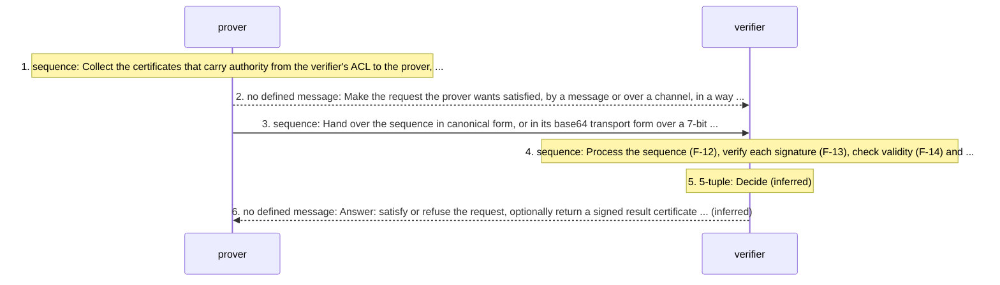

### F-02 transport-encoding: Moving SPKI objects between machines: canonical form, base64 transport, advanced form for people

*encoding; §3, §3.1, §3.4, §3.5, §3.6, §9; participants: sender, receiver, 7-bit-channel.*

Every structure that leaves a machine is a canonical S-expression; over a 7-bit channel it may travel base64-encoded in braces. The advanced form exists for people and for this document's examples and is never what is hashed or signed. Sender and receiver are whichever roles a flow names (prover, verifier, issuer, online-test responder).

<!-- q L545-548 -->
> All SPKI structures communicated from one machine to another must be in canonical form. If canonical S-expressions need to be transmitted over a 7-bit channel, there is a form defined for base64 encoding them.

<!-- q L675-678 "The canonical" .. "form." -->
> The canonical S-expression is the form which is hashed for both generating and verifying signatures. These two processes can be thought of as the start and end of an SPKI object's useful life and both require canonical form.

<!-- q L535-539 -->
> For the sake of readability, all examples and the BNF in this document deal with advanced rather than canonical S-expressions. That is, single word strings that start with alphabetic characters are used without quotes and strings can be in hex, base64 or double-quoted ASCII. The mapping to canonical form is specified below.

| n | from | to | message | kind | step |
|---|---|---|---|---|---|
| 1 | sender | sender | `<s-expr>` | stated | Serialise the object canonically: each byte string prefixed by its decimal length and a colon, display types in brackets, lists in parentheses, no white space, no redundant leading zero in a length. |
| 2 | sender | receiver | `<s-expr>` | stated | Transmit the canonical form; over a 7-bit channel, its base64 encoding enclosed in braces. |
| 3 | receiver | receiver | `<s-expr>` | inferred | If the object arrived in braces, base64-decode it to recover the canonical bytes. |
| 4 | receiver | receiver | `<s-expr>` | stated | Keep the received canonical bytes beside the parsed object, because hashing and signature checking operate on them (F-13). |
| 5 | sender | receiver | none | stated | Use the advanced form (bare tokens, quoted strings, hex between hash marks, base64 between bars, free white space) only for reading; it is converted to canonical form before any processing. |

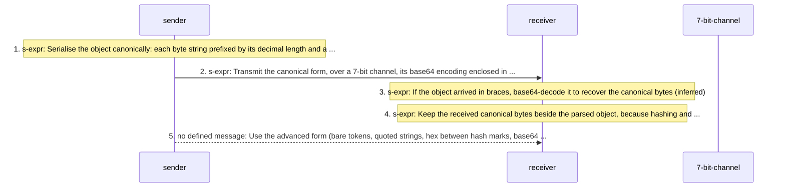

### F-03 authorization-certificate-issuance: An issuer creates and signs an authorization certificate (`<cert>` and its `<signature>`)

*creation-and-delivery; §2, §3.1, §3.5, §3.8, §3.8.3, §3.8.3.1, §4, §4.1 to §4.10; participants: issuer, prover, keyholder.*

The issuer writes the body, canonicalises it, hashes it and signs it with the key that names it. A certificate transfers authority; it does not create it, so what the subject ends up with is settled at reduction, not here. Delivery is not described.

<!-- q L386-387 -->
> ISSUER: the signer of a certificate and the source of empowerment that the certificate is communicating to the Subject.

<!-- q L1242-1247 "However in" .. "authorization)." -->
> However in full-blown implementations, the subject may also be a name, representing a group of principals or a delayed binding to some one principal, the hash of an object, or a K-of-N threshold of principals (in which case, the authorization being granted to the subject is being spread out among multiple parties that must cooperate to exercise that authorization).

<!-- q L1150-1152 "The basic" .. "another." -->
> The basic certificate form is an authorization certificate. It transfers some specific authorization or permission from one principal to another.

| n | from | to | message | kind | step |
|---|---|---|---|---|---|
| 1 | issuer | issuer | `<cert>` | stated | Name itself as issuer by its principal: a public key or the hash of one. |
| 2 | issuer | issuer | `<cert>` | stated | Choose the subject: a principal, a name, an object hash, a keyholder, or a k-of-n threshold of subjects. An implementation may support principals only. |
| 3 | issuer | issuer | `<cert>` | stated | Write the authorization in `<tag>` and add (propagate) if the subject may pass it on. A principal empowered to delegate may delegate any subset of what a tag with *-forms denotes. |
| 4 | issuer | issuer | `<cert>` | stated | Set validity: not-before and not-after in the UTC date form, and any online tests, each naming its type, its URIs, the principal whose signature will validate replies, and an id (the new-cert form names URIs only). |
| 5 | issuer | issuer | `<cert>` | stated | Optionally add a version, a display hint, issuer-info and subject-info locations, and a comment meant for people. |
| 6 | issuer | issuer | `<cert>` | stated | Encode the body canonically. Its fields may stand in any order and each appears at most once; the draft presents them in BNF order. |
| 7 | issuer | issuer | `<signature>` | stated | Hash the canonical body and sign the hash with the private key of the issuing principal, producing (signature `<hash>` `<principal>` `<sig-val>`): one integer for RSA, an r and an s for DSA, a structure defined with any other algorithm. |
| 8 | issuer | prover | `<cert>` | inferred | Deliver the certificate and its signature to whoever will present it: the subject's keyholder, a later issuer in the chain, or a location that issuer-info, subject-info or a key's URIs point at. |
| 9 | issuer | keyholder | `<cert>` | stated | Variant: a certificate whose subject is a keyholder states something about the person or machine holding a key and is mostly read by people, not reduced. |

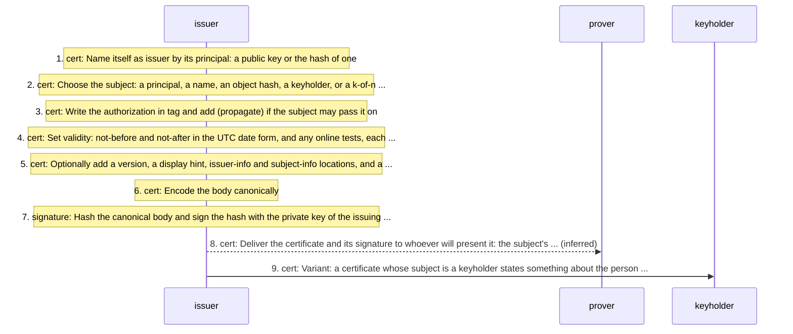

### F-04 name-certificate-issuance: An issuer defines a name in its own name space (`<name-cert>`)

*creation-and-delivery; §5, §5.1, §5.2, §4.6; participants: issuer, prover.*

Any issuer may define names; a name certificate needs no authority, has no tag (all permissions are assumed) and no delegation field, and several certificates for one name make a group. Signing and delivery are not restated in §5.

<!-- q L1609-1610 "The issuer" .. "right." -->
> The issuer needs no authorization in order to create names. Every issuer has that right.

<!-- q L1639-1640 -->
> <issuer-name>:: "(" "issuer" "(" "name" <principal> <byte-string> ")" ")" ;

<!-- q L1647-1648 "In a" .. "field." -->
> In a name certificate, the (tag) field is omitted and (tag (*)) is assumed. There is also no <deleg> field.

| n | from | to | message | kind | step |
|---|---|---|---|---|---|
| 1 | issuer | issuer | `<name-cert>` | stated | Choose a local name. No authorization is needed, so no issuer-info is carried. |
| 2 | issuer | issuer | `<name-cert>` | stated | Write the issuer as a name under its own principal; that principal is the certificate's issuer. |
| 3 | issuer | issuer | `<name-cert>` | stated | Leave out tag and propagate: (tag (*)) is assumed and there is no delegation field. |
| 4 | issuer | issuer | `<name-cert>` | stated | Bind the name to any subject, in any name space. More certificates for the same name with other subjects make the name a group. |
| 5 | issuer | issuer | `<signature>` | inferred | Canonicalise and sign as in F-03 steps 6 and 7. |
| 6 | issuer | prover | `<name-cert>` | inferred | Deliver it, or publish it where a subject-info field may point (a name certificate server). |

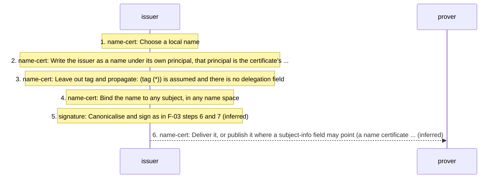

### F-05 certificate-discovery: The prover tracks down the certificates that empower it and orders them in a `<sequence>`

*local-with-fetch; §3.8.1, §3.8.3, §4.4, §4.6, §6.2, §8.4; participants: prover, certificate-source.*

The burden of finding the chain is the prover's. Certificates and keys may carry locations that help; no retrieval protocol and no ordering rule for the chain are given.

<!-- q L1218-1220 "The (issuer-info" .. "<cert>." -->
> The (issuer-info ) object provides the location of the certificate(s) by which the issuer derives the authority to pass along the authorization in the present <cert>.

<!-- q L1362-1364 "This optional" .. "hashed." -->
> This optional field provides the location of information about the subject. For example, if the subject is a hash of a key, this might provide the location of the key being hashed.

<!-- q L792-793 "The <uri>s," .. "key." -->
> The <uri>s, if present, give locations where one might find certificates empowering that public key.

| n | from | to | message | kind | step |
|---|---|---|---|---|---|
| 1 | prover | prover | `<cert>` | stated | Follow issuer-info to the certificates by which each issuer holds the authority it passes on. |
| 2 | prover | prover | `<cert>` | stated | Follow subject-info to information about a subject, such as the key behind a key hash. |
| 3 | prover | prover | `<pub-key>` | stated | Follow a public key's URIs to certificates that empower that key. |
| 4 | prover | certificate-source | none | inferred | Fetch what the URIs name. |
| 5 | prover | prover | `<sequence>` | stated | Order the objects: each signature after the body it signs, and a hash opcode after any object a later object refers to by hash (several opcodes when several hashes are needed). |
| 6 | prover | prover | `<sequence>` | inferred | Order the certificates along the chain. No order is required; a verifier may reduce left to right or right to left. |

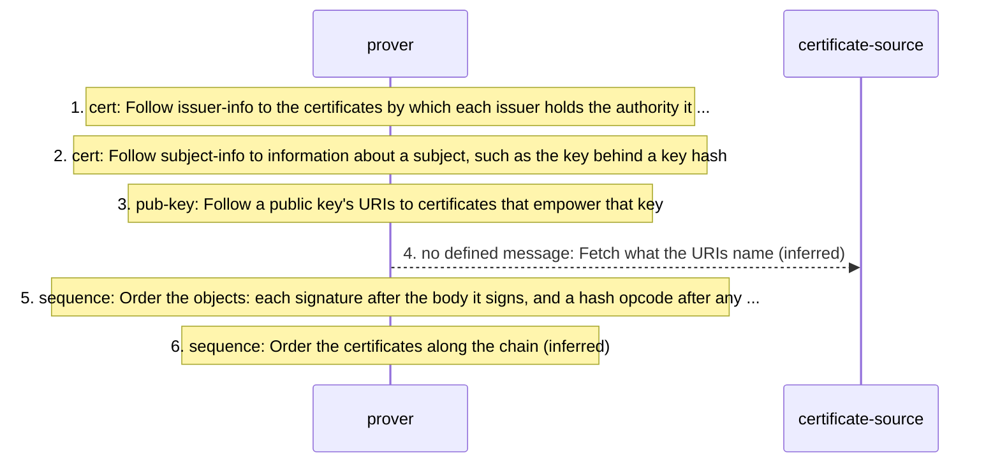

### F-06 online-test-crl: CRL online test: fetch, carry in the sequence, check

*exchange; §2, §4.9.2, §4.9.3, §7, §7.1; participants: prover, online-test-responder, verifier.*

In the standard model the prover fetches the CRL and hands it over in the `<sequence>`; the verifier checks its signer, its interval and whether the certificate is listed. The request is not specified.

<!-- q L1460-1461 -->
> <online-test>:: "(" "online" <online-type> <uris> <principal> <online-id> <s-part>* ")" | "(" "online" "new-cert" <uris> ")" ;

<!-- q L1504 -->
> If there are multiple URIs specified, any one of them can be used.

<!-- q L1919 -->
> <crl>:: "(" "crl" <version>? <cancel-list> <valid-basic> ")" ;

| n | from | to | message | kind | step |
|---|---|---|---|---|---|
| 1 | prover | prover | `<online-test>` | stated | Read the certificate's test: (online crl `<uris>` `<principal>` `<online-id>` `<s-part>`*). |
| 2 | prover | online-test-responder | none | stated | Ask for the CRL at any one of the URIs: a passive web page, a CGI fetch whose parameters ride in the URI, or parameters in the test's `<s-part>`s. |
| 3 | online-test-responder | prover | `<crl>` | stated | Reply with (crl `<version>`? (canceled `<hash>`*) `<valid-basic>`), signed by the principal the test names. |
| 4 | prover | verifier | `<sequence>` | stated | Include the CRL, with its signature, in the `<sequence>`. |
| 5 | verifier | verifier | `<crl>` | stated | Check that the CRL is signed by the principal named in the online test of the certificate being checked. |
| 6 | verifier | verifier | `<crl>` | stated | Check that the CRL is current: the present time lies inside its interval. |
| 7 | verifier | verifier | `<crl>` | stated | Look for the certificate's hash in the canceled list. If it is not there, the certificate is presumed valid. |
| 8 | verifier | verifier | `<valid>` | stated | Intersect the CRL's validity dates with the certificate's to obtain its current working validity. |

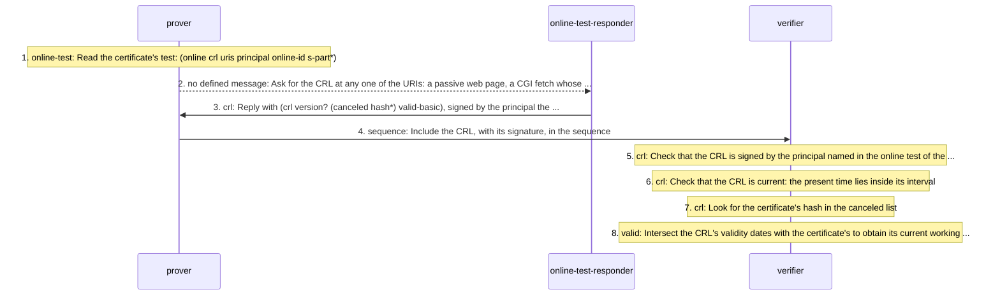

### F-07 online-test-delta-crl: Delta-CRL: a CRL that modifies its predecessor

*exchange; §7, §7.1, §9.2; participants: online-test-responder, prover, verifier.*

A responder whose CRL grows may send only a delta naming its predecessor by hash. The source gives the object, the signer and the link; it does not say how the predecessor reaches the verifier or how the two lists combine.

<!-- q L1916-1917 -->
> If one wants to provide CRLs, and that CRL grows, then one may prefer to send only a delta CRL.

<!-- q L1921-1922 -->
> <delta-crl>:: "(" "delta-crl" <version>? <hash-of-pred> <cancel-list> <valid-basic> ")" ;

<!-- q L1926-1927 "For convenience," .. "predecessor." -->
> For convenience, that <hash> should probably also have a URI pointing the user to that predecessor.

| n | from | to | message | kind | step |
|---|---|---|---|---|---|
| 1 | online-test-responder | online-test-responder | `<delta-crl>` | stated | Decide between a full CRL and a delta; the decision procedure is left open. |
| 2 | online-test-responder | prover | `<delta-crl>` | stated | Send (delta-crl `<version>`? `<hash-of-pred>` `<cancel-list>` `<valid-basic>`), naming the predecessor CRL or delta-CRL by hash, preferably with a URI for it, signed by the test's principal. |
| 3 | prover | online-test-responder | none | inferred | Fetch any predecessor the prover does not hold, back to a full CRL. |
| 4 | prover | verifier | `<sequence>` | inferred | Include the delta and its predecessors in the `<sequence>`. |
| 5 | verifier | verifier | `<delta-crl>` | stated | Check the delta's signer against the online test's principal. |
| 6 | verifier | verifier | `<delta-crl>` | inferred | Resolve the predecessor by its hash and take the canceled list in force as the predecessor's list with the delta's entries added. |
| 7 | verifier | verifier | `<delta-crl>` | inferred | Check the delta's interval and the certificate's membership as in F-06 steps 6 to 8. |

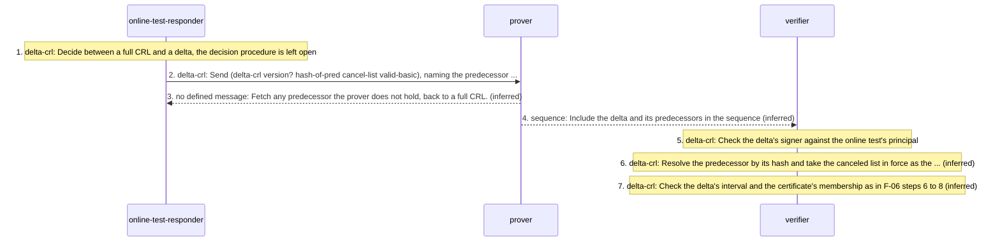

### F-08 online-test-revalidation: Revalidation online test: a signed list of valid certificates

*exchange; §4.9.2, §7, §7.2; participants: prover, online-test-responder, verifier.*

The opposite of a CRL: the certificate is valid if it is listed on a currently valid list. There is no delta form. Fetching and delivery are as for a CRL.

<!-- q L1460-1461 -->
> <online-test>:: "(" "online" <online-type> <uris> <principal> <online-id> <s-part>* ")" | "(" "online" "new-cert" <uris> ")" ;

<!-- q L1504 -->
> If there are multiple URIs specified, any one of them can be used.

<!-- q L1952 -->
> <reval>:: "(" "reval" <version>? <reval-list> <valid-basic> ")" ;

| n | from | to | message | kind | step |
|---|---|---|---|---|---|
| 1 | prover | prover | `<online-test>` | stated | Read the certificate's test: (online reval `<uris>` `<principal>` `<online-id>` `<s-part>`*). |
| 2 | prover | online-test-responder | none | stated | Ask for the revalidation at any one of the URIs. |
| 3 | online-test-responder | prover | `<reval>` | stated | Reply with (reval `<version>`? (valid `<hash>`+) `<valid-basic>`), signed by the principal the test names. |
| 4 | prover | verifier | `<sequence>` | stated | Include the reval, with its signature, in the `<sequence>`. |
| 5 | verifier | verifier | `<reval>` | stated | Check the signer against the online test's principal. |
| 6 | verifier | verifier | `<reval>` | stated | Check that the reval is current. |
| 7 | verifier | verifier | `<reval>` | stated | The certificate is valid if its hash is listed; no search for absence is needed and no delta exists. |
| 8 | verifier | verifier | `<valid>` | stated | Intersect the reval's dates with the certificate's. |

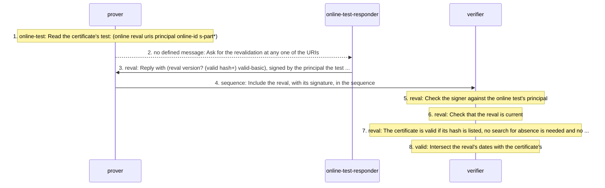

### F-09 online-test-one-time-revalidation: One-time revalidation: a nonce challenge answered for this verification only

*exchange; §2, §4.9.2, §4.9.3, §7, §7.3, §8.2; participants: verifier, online-test-responder, prover.*

The only online test the verifier runs itself (in three sections; §7 also allows it to go through the prover). The verifier's nonce comes back inside a signed reval that is valid for `now` only. The request carrying the nonce is not defined.

<!-- q L1462 -->
> <online-type>:: "crl" | "reval" | "one-time" ;

<!-- q L1496-1498 "The process" .. "response." -->
> The process of getting this one-time revalidation involves sending a unique (and partly random) challenge which is returned as part of the signed response.

<!-- q L1970-1971 -->
> For one-time revalidation, the verifier itself must fetch the (reval) record, which will have the form:

| n | from | to | message | kind | step |
|---|---|---|---|---|---|
| 1 | verifier | verifier | `<online-test>` | stated | Read the certificate's test (online one-time `<uris>` `<principal>` `<online-id>` `<s-part>`*) and create a nonce that is unique over time and cannot be guessed. |
| 2 | verifier | online-test-responder | none | stated | Ask for the one-time revalidation, sending the nonce, identifying the certificate and probably the transaction data, by whatever server and protocol the application defines. |
| 3 | online-test-responder | verifier | `<reval>` | stated | Reply with the one-time form (reval `<version>`? (cert `<hash>`) (one-time `<nonce>`)), which should be signed by the principal the test names. |
| 4 | verifier | verifier | `<reval>` | inferred | Check the signer, that the nonce is the one sent, and that the hash names the certificate in question. |
| 5 | verifier | verifier | `<valid>` | stated | Treat the result as valid only for the current verification step: a zero-length interval, `now`. |
| 6 | verifier | verifier | `<5-tuple>` | stated | In reduction, `now` intersected with a date range yields `now` or `null`. |

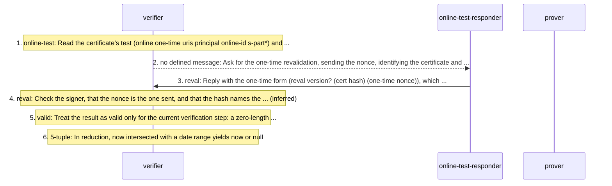

### F-10 online-test-new-cert: new-cert online test: fetch a fresh copy of a short-lived certificate

*exchange; §1, §2, §4.9.2; participants: prover, online-test-responder, verifier.*

The fourth online-test form, missing from the glossary, the overview and §9.2. It names URIs and no principal, and §7 gives no reply format.

<!-- q L1460-1461 -->
> <online-test>:: "(" "online" <online-type> <uris> <principal> <online-id> <s-part>* ")" | "(" "online" "new-cert" <uris> ")" ;

<!-- q L1500 -->
> The new-cert form requests a new copy of the certificate in question.

<!-- q L1511 -->
> See section 7 for a full description of online test reply formats.

| n | from | to | message | kind | step |
|---|---|---|---|---|---|
| 1 | prover | prover | `<online-test>` | stated | Notice that a certificate carrying (online new-cert `<uris>`) has expired. |
| 2 | prover | online-test-responder | none | stated | Ask any one of the URIs for a new copy of the certificate. |
| 3 | online-test-responder | prover | `<cert>` | inferred | Return a fresh copy of the certificate with its signature. |
| 4 | verifier | verifier | `<cert>` | inferred | Check the new copy as any certificate: its own signature by its issuer (F-13) and its validity (F-14). |

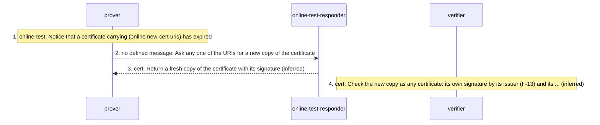

### F-11 online-instrument-issuance: The online-test responder issues CRLs, delta-CRLs and revalidations over time

*creation; §7, §7.1, §7.2, §7.3; participants: online-test-responder.*

Instruments are issued for consecutive, non-overlapping intervals so that a user can tell which is current, each signed by the principal that certificates name in their online tests.

The draft carries an open editorial question at the head of §7 (L1888-1889) about identifying a CRL or reval thread (D-22).

<!-- q L1907 -->
> Each of these instruments contains a <valid-basic> time interval.

<!-- q L1892-1894 "That object" .. "valid." -->
> That object specifies either a list of invalid certificates or that a given certificate (or list of certificates) is still valid.

<!-- q L1929-1930 -->
> The <crl> or <delta-crl> must be signed by the principal indicated in the <online-test> field that directed the CRL to be fetched.

| n | from | to | message | kind | step |
|---|---|---|---|---|---|
| 1 | online-test-responder | online-test-responder | `<crl>` | stated | Issue each instrument for an interval that does not overlap the previous one; the instrument is valid only inside it. |
| 2 | online-test-responder | online-test-responder | `<crl>` | stated | Say either which certificates are invalid or which (often just the one asked about) are valid. |
| 3 | online-test-responder | online-test-responder | `<signature>` | stated | Sign with the principal named in the online tests that direct users to it; for one-time replies the source says should, for the others must. |
| 4 | online-test-responder | online-test-responder | `<delta-crl>` | stated | Choose full or delta CRLs by a procedure the source leaves open. |
| 5 | online-test-responder | online-test-responder | `<reval>` | stated | For a one-time request, echo the caller's nonce and carry no interval. |

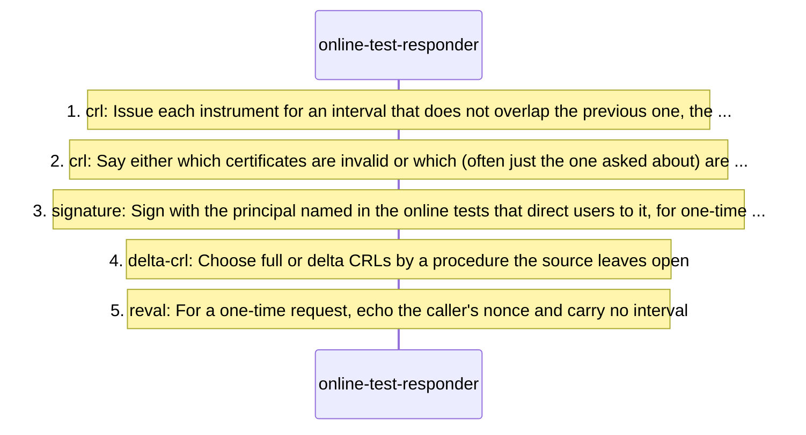

### F-12 sequence-processing: The verifier reads a `<sequence>` in order

*receive-processing; §3.8.3, §6.2, §9.2; participants: verifier.*

A `<sequence>` is ordered. Objects are read one at a time; the hash opcode and every signature act on the item read before them and index it by hash, so that later objects can refer to it by hash. The machine is SM-01.

<!-- q L1841-1842 "A <sequence>" .. "access." -->
> A <sequence> is an ordered sequence of objects that the verifier is to consider when deciding to grant access.

<!-- q L1848-1851 "At present" .. "value." -->
> At present the only opcode defined is "hash" -- meaning, that the previous item in the sequence (the last one read in) is to be hashed by the given algorithm and saved, indexed by that hash value.

<!-- q L1835 -->
> <hash-op>:: "(" "do" "hash" <hash-alg-name> ")" ;

| n | from | to | message | kind | step |
|---|---|---|---|---|---|
| 1 | verifier | verifier | `<sequence>` | stated | Read the entries in order. |
| 2 | verifier | verifier | `<cert>` | inferred | On a certificate, name certificate, public key, CRL, delta-CRL or reval: hold it as the item last read. |
| 3 | verifier | verifier | `<hash-op>` | stated | On (do hash `<alg>`): hash the item last read with that algorithm and save it, indexed by the hash value. Several opcodes give several hashes of one object. |
| 4 | verifier | verifier | `<signature>` | stated | On a signature: compute the hash of the preceding item (the signature does double duty), index it, and verify the signature (F-13). An explicit hash opcode before it does no harm. |
| 5 | verifier | verifier | `<general-op>` | stated | On (do `<byte-string>` `<s-part>`*) other than hash: no such operation is defined. |
| 6 | verifier | verifier | `<hash>` | stated | Resolve each reference by hash in a later object (a key named by its hash, a hashed certificate) from the saved index. |
| 7 | verifier | verifier | `<5-tuple>` | stated | When the sequence ends, reduce the certificates it carried (F-15 to F-20). |

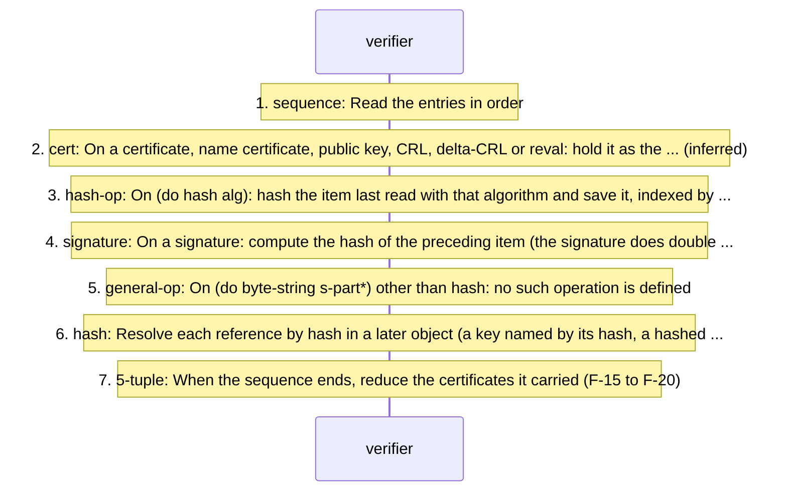

### F-13 signature-verification: Verifying a `<signature>` over the object before it

*receive-processing; §2, §3.1, §3.5, §3.8, §3.8.1, §3.8.1.3, §3.8.2, §3.8.3, §3.8.3.1, §6.2; participants: verifier.*

The canonical form is what is hashed and signed. Everything after the hash (comparing it, finding the key, binding the signer to the issuer) is this file's reading of a document that names the pieces but not the procedure. The machine is SM-02.

<!-- q L553-555 "The canonical" .. "functions." -->
> The canonical form is a unique representation of an S-expression and is used as the input to all hash and signature functions.

<!-- q L1001 "A <hash>" .. "object." -->
> A <hash> object gives the hash of some other object.

<!-- q L1206 -->
> <principal>:: <pub-key> | <hash-of-key> ;

| n | from | to | message | kind | step |
|---|---|---|---|---|---|
| 1 | verifier | verifier | `<signature>` | stated | Take the canonical bytes of the signed object exactly as received. |
| 2 | verifier | verifier | `<hash>` | inferred | Hash them with the algorithm the signature's `<hash>` names (md5, sha1, or a URI) and compare with its hash value. |
| 3 | verifier | verifier | `<principal>` | inferred | Find the public key: the signature's principal is a key or the hash of one, a hash being resolved from the sequence's index or from elsewhere. |
| 4 | verifier | verifier | `<sig-val>` | stated | Verify the signature value with that key under its algorithm: one integer for RSA, an r and an s for DSA; other algorithms define their own parameters. Algorithm names are case sensitive. |
| 5 | verifier | verifier | `<cert>` | inferred | For a certificate, require the signing principal to be the certificate's issuer (for a name certificate, the principal inside its issuer name). |
| 6 | verifier | verifier | `<cert>` | stated | Take the verified object as a statement made by that principal. |

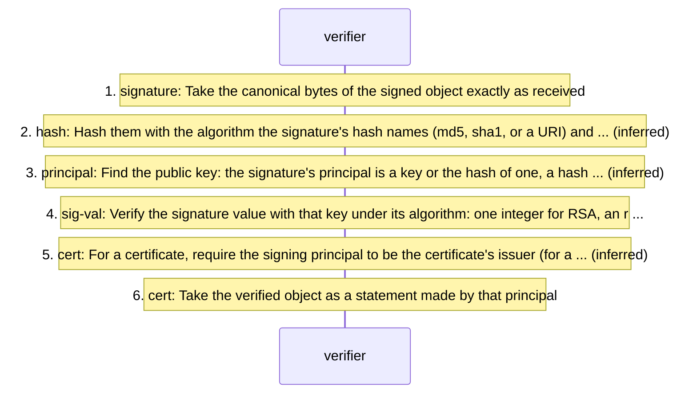

### F-14 validity-checking: Is a certificate valid now? Dates, then online tests

*receive-processing; §2, §4.9, §4.9.1, §4.9.2, §7, §8.1; participants: verifier.*

Validity is a date range that must include the present and a set of online tests that must all succeed. Each test reply narrows the range; a one-time reply narrows it to `now`. The machine is SM-03.

<!-- q L1417-1418 -->
> The <valid> field gives validity dates and/or online test information for the certificate.

<!-- q L1445-1449 "A date" .. "UTC." -->
> A date field is an ASCII byte string of the form: YYYY-MM-DD_HH:MM:SS always UTC.

<!-- q L462-463 "a set" .. "valid." -->
> a set of online tests that must succeed before a certificate is to be considered valid.

| n | from | to | message | kind | step |
|---|---|---|---|---|---|
| 1 | verifier | verifier | `<valid>` | stated | Read not-before and not-after; a missing bound leaves that direction open. |
| 2 | verifier | verifier | `<date>` | stated | Compare the present UTC time, written in the same form, with the bounds as ASCII byte strings. |
| 3 | verifier | verifier | `<online-test>` | stated | For each online test, obtain and check its reply (F-06 to F-10). |
| 4 | verifier | verifier | `<valid>` | stated | Intersect each reply's dates with the certificate's to get the current working validity. |
| 5 | verifier | verifier | `<cert>` | stated | The certificate is valid only if the range includes the present and every online test has succeeded. |
| 6 | verifier | verifier | `<5-tuple>` | inferred | Carry the result into the 5-tuple's valid5: a date range, `now`, or `null`. |

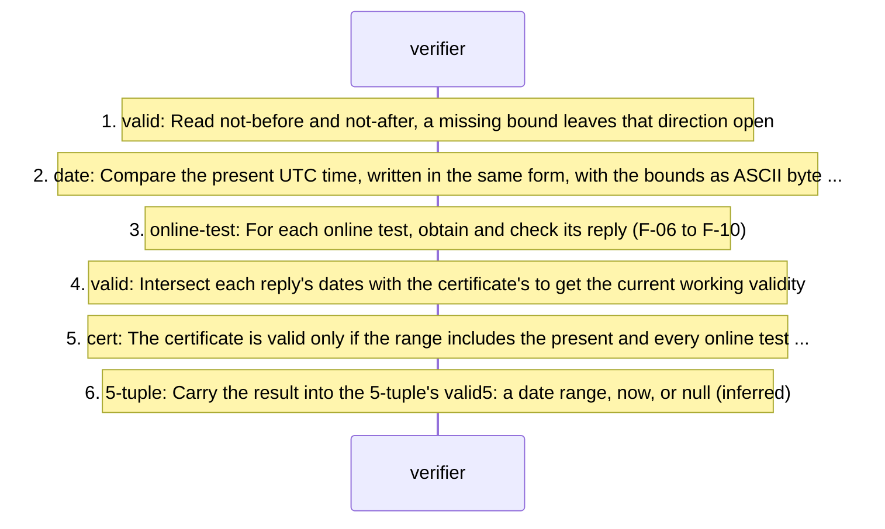

### F-15 tuple-formation: Turning certificates and ACL entries into 5-tuples, and name certificates into 4-tuples

*receive-processing; §2, §4.1, §4.2, §4.5, §4.7, §4.10, §6.1, §8, §8.1, §8.7; participants: verifier.*

The trust engine reduces 5-tuples, whatever certificate they came from. The source gives the 5-tuple's grammar and the fields of both tuples; the field-by-field mapping is this file's.

<!-- q L1176-1177 -->
> A certificate containing an unrecognized version number must be ignored.

<!-- q L1185-1188 -->
> This optional field gives a display hint for the entire certificate. This display parameter does not affect certificate chain reduction, but is provided to aid user-interface software in certificate display.

<!-- q L2027 -->
> <5-tuple>:: <issuer5> <subject5> <deleg5> <tag-body5> <valid5> ;

| n | from | to | message | kind | step |
|---|---|---|---|---|---|
| 1 | verifier | verifier | `<cert>` | stated | Ignore a certificate whose version is not recognised; an absent version means version 0. |
| 2 | verifier | verifier | `<cert>` | stated | Set aside the display hint and the comment; neither takes part in reduction. |
| 3 | verifier | verifier | `<5-tuple>` | inferred | Form `<issuer5, subject5, deleg5, tag-body5, valid5>`: the issuer's key, the subject, `t` when (propagate) is present and `f` otherwise, the tag body, and the validity from F-14. |
| 4 | verifier | verifier | `<5-tuple>` | stated | Form a 5-tuple from each ACL entry with `self` as its issuer. |
| 5 | verifier | verifier | `<name-cert>` | stated | Form a 4-tuple `<Issuer, Name, Subject, Validity>` from each name certificate, for name reduction. |
| 6 | verifier | verifier | `<5-tuple>` | stated | Translate certificates of other kinds into 5-tuples (X.509, SET, DNSSEC, PGP); no translation is given. |
| 7 | verifier | verifier | `<5-tuple>` | stated | Reduce names in subjects first (F-17), so that issuers and subjects are principals, and treat principals as public keys whichever way they are stored. |
| 8 | verifier | verifier | `<5-tuple>` | inferred | A keyholder subject is of little interest to verifier code: its tuple ends a chain. |

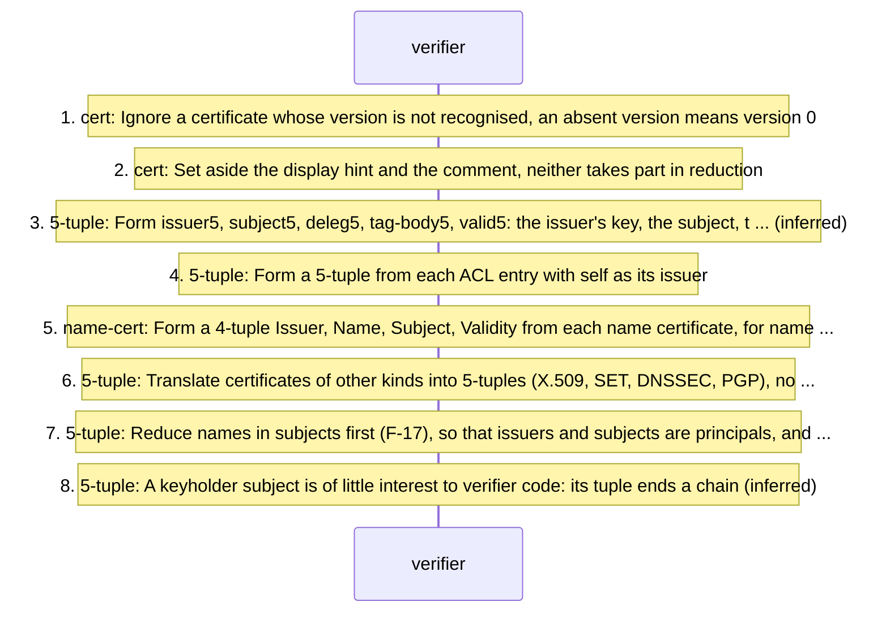

### F-16 acl-maintenance: The verifier's ACL: local, unsigned, the root of every chain

*local; Abstract, §2, §4, §6, §6.1, §9.1; participants: acl-owner, verifier.*

The ACL never leaves the verifier, so its format is free; the draft's `<acl>` is an example. Its entries are certificate bodies without issuer or signature, and they are where every chain starts and ends. The lifecycle is SM-13.

<!-- q L1782 -->
> <acl>:: "(" "acl" <version>? <acl-entry>* ")" ;

<!-- q L1794-1797 -->
> If all the optional fields are left out, the subject is given the permission specified in <tag>, without permission to delegate it, with no expiration date or condition (until the ACL is edited to remove the permission).

<!-- q L1787-1789 "An ACL" .. "memory." -->
> An ACL is a list of assertions: certificate bodies which don't need issuer fields or signatures because they are being held in secure memory.

| n | from | to | message | kind | step |
|---|---|---|---|---|---|
| 1 | acl-owner | verifier | `<acl>` | stated | Write entries (entry `<subj-obj>` `<deleg>`? `<tag>` `<valid>`? `<comment>`?) with no issuer and no signature, in any format the implementation chooses. |
| 2 | acl-owner | verifier | `<acl-entry>` | stated | Defaults: without (propagate) the subject may not delegate; without `<valid>` the entry lasts until the ACL is edited. |
| 3 | verifier | verifier | `<acl>` | stated | Keep the ACL in secure memory and never send it to anyone. |
| 4 | verifier | verifier | `<5-tuple>` | stated | Use each entry as a 5-tuple issued by `self`: the verifier is the only root. |
| 5 | acl-owner | verifier | `<acl>` | inferred | Edit the ACL to remove a permission. |

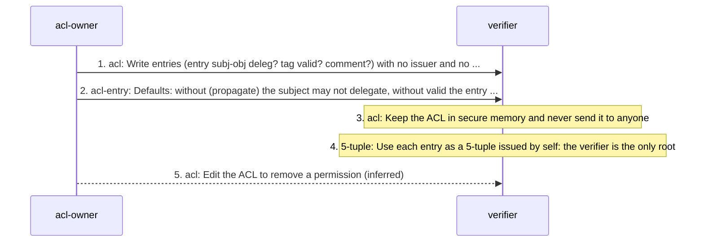

### F-17 name-reduction: Reducing names to principals

*receive-processing; §5, §5.1, §5.2, §5.3, §8; participants: verifier.*

Names are reduced before 5-tuple reduction. One rule, applied recursively, rewrites the first name of a fully qualified name by the subject of the name certificate that defines it. The rules that bound the recursion are in another document. The machine is SM-07.

<!-- q L1684-1686 "A relative" .. "certificate." -->
> A relative name is defined only with respect to an issuer and should show up only in a certificate, borrowing the <principal> from the issuer of that certificate.

<!-- q L1696-1702 -->
> Given the name definition (cert (issuer (name (hash md5 |Txoz1GxK/uBvJbx3prIhEw==|) fred)) (subject (hash md5 |Z5pxCD64YwgS1IY4Rh61oA==|)) (not-after "2001-01-01_00:00:00"))

<!-- q L1715-1723 -->
> the name (subject (name (hash md5 |Txoz1GxK/uBvJbx3prIhEw==|) fred sam george mary)) reduces to (subject (name (hash md5 |Z5pxCD64YwgS1IY4Rh61oA==|) sam george mary))

| n | from | to | message | kind | step |
|---|---|---|---|---|---|
| 1 | verifier | verifier | `<name>` | stated | Translate each relative name into a fully qualified one with the principal of the issuer of the certificate it appears in. |
| 2 | verifier | verifier | `<name-cert>` | inferred | For (name P n1 n2 ...), find a name certificate whose issuer is (name P n1). |
| 3 | verifier | verifier | `<name>` | stated | Replace (P n1) by that certificate's subject, keeping the rest of the names. |
| 4 | verifier | verifier | `<name>` | stated | Recurse until the name reduces to a principal. |
| 5 | verifier | verifier | `<name>` | inferred | Where several certificates define the same name, the name is a group: each subject gives its own reduction. |
| 6 | verifier | verifier | `<name-cert>` | stated | Guard against a certificate that defines a name in terms of itself: reduced naively it grows without bound; the rules that prevent this are in the theory document. |
| 7 | verifier | verifier | `<name-cert>` | inferred | Apply the name certificate's validity to the result. |

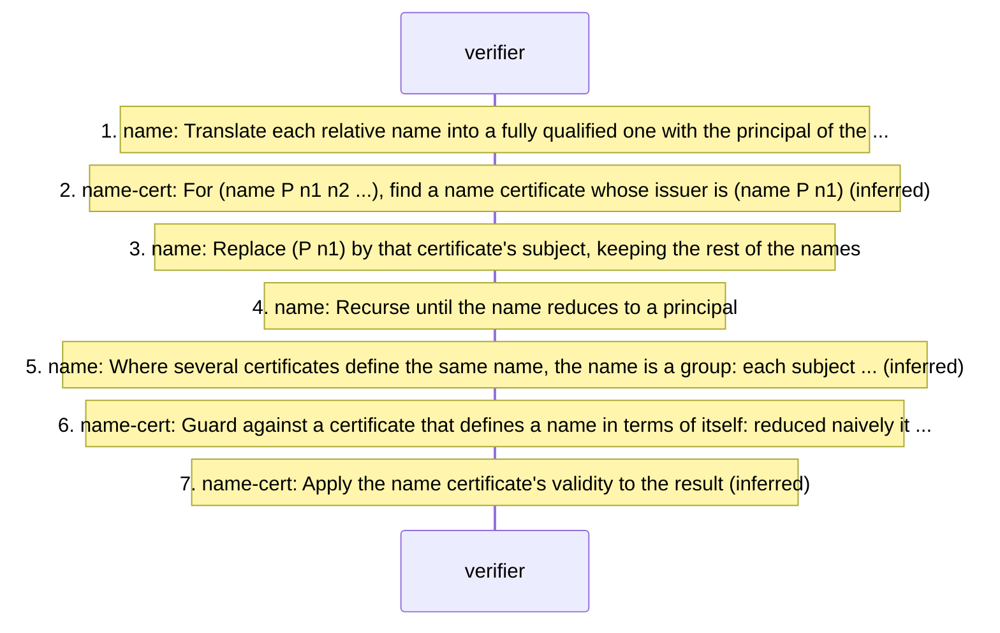

### F-18 five-tuple-reduction: The top-level reduction rule, applied until a 5-tuple issued by self results

*receive-processing; Abstract, §2, §8, §8.1, §8.2, §8.4; participants: verifier.*

Two 5-tuples combine when the first one's subject is the second one's issuer and the first one permits delegation; authorization and validity intersect. Repeating this from the verifier's ACL entries is meant to end at `<self, prover, D, A, V>`. Any computationally equivalent algorithm is allowed. The machines are SM-08 (one application) and SM-09 (the repetition).

<!-- q L2059 -->
> <i1,s1,d1,a1,v1> + <i2,s2,d2,a2,v2> yields <i1,s2,d2,a,v> if:

<!-- q L2061 -->
> d1 = "t"

<!-- q L2062 -->
> a = the intersection of a1 and a2

| n | from | to | message | kind | step |
|---|---|---|---|---|---|
| 1 | verifier | verifier | `<5-tuple>` | stated | Pick two tuples `<i1,s1,d1,a1,v1>` and `<i2,s2,d2,a2,v2>` with s1 = i2. |
| 2 | verifier | verifier | `<5-tuple>` | stated | Require d1 = `t`. |
| 3 | verifier | verifier | `<5-tuple>` | stated | Compute a as the intersection of a1 and a2 (F-19); a `null` result means no reduction. |
| 4 | verifier | verifier | `<5-tuple>` | stated | Compute v as the intersection of v1 and v2: date ranges intersect, online tests are united, and `now` against a range yields `now` or `null`. |
| 5 | verifier | verifier | `<5-tuple>` | stated | Yield `<i1,s2,d2,a,v>`. |
| 6 | verifier | verifier | `<5-tuple>` | stated | Repeat until a tuple issued by `self` names the prover; only such tuples mean anything. |
| 7 | verifier | verifier | `<5-tuple>` | stated | Any other reduction algorithm may be used if it is computationally equivalent. |

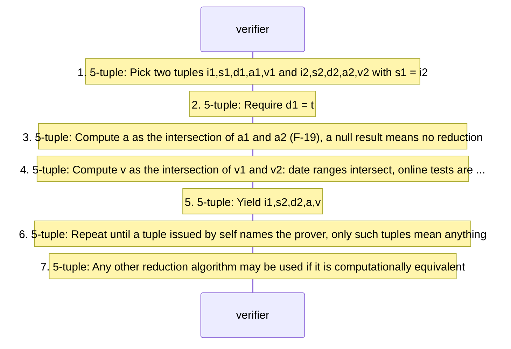

### F-19 tag-intersection: Intersecting two tags: §8.2's basic cases and §8.3's six rules

*local-decision; §3.2, §4.8, §8.2, §8.3, §9.2; participants: verifier.*

In the usual case one tag has no *-forms. Equal tags intersect to themselves, (tag (*)) to the other tag, a set is expanded, a range or prefix is tested against the explicit string, and anything else is `null`. The machine is SM-10.

<!-- q L1391 -->
> The form "(tag (*))" means "all permissions".

<!-- q L2094 -->
> 1. basic: if a1 == a2, then the result is a1.

<!-- q L2096-2097 -->
> 2. basic: if a1 != a2 and neither has a *-form, then the result is "null".

| n | from | to | message | kind | step |
|---|---|---|---|---|---|
| 1 | verifier | verifier | `<tag>` | stated | If either tag is (tag (*)), the result is the other. |
| 2 | verifier | verifier | `<tag>` | stated | If the tags are equal (display types included), the result is that tag. |
| 3 | verifier | verifier | `<tag>` | stated | If they differ and neither has a *-form, the result is `null`. |
| 4 | verifier | verifier | `<tag>` | stated | If a tag contains (* set ...), expand the set and intersect the simpler expressions. |
| 5 | verifier | verifier | `<tag>` | stated | If a field compares (* range ...) with a byte string, do the range comparison; the result is the explicit string tested, and the empty set when display types differ. |
| 6 | verifier | verifier | `<tag>` | stated | If a field compares (* prefix ...) with a byte string, the result is the explicit string when the prefix is a prefix of it, and `null` otherwise. |
| 7 | verifier | verifier | `<tag>` | inferred | Match fields by position, recursing into sub-expressions. |
| 8 | verifier | verifier | `<tag>` | stated | Two *-forms against each other (set with range, two ranges, two prefixes) are not covered; general set-to-set code is allowed but not specified. |

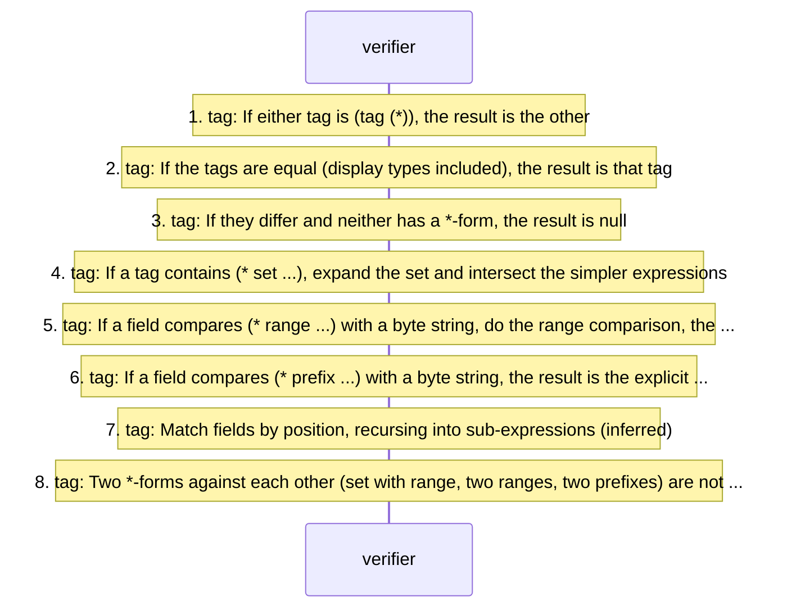

### F-20 threshold-subject-reduction: Reducing a k-of-n subject

*receive-processing; §2, §4.5.3, §8.4; participants: verifier.*

A threshold subject passes a share to each listed subject; the permission reaches a target only when K of them show paths that converge on it. §8.4 sketches one procedure and defers the algorithms to another document. The machine is SM-12.

K < N is required by §4.5.3, against example 4's two-of-two (D-12).

<!-- q L2129-2131 "One general" .. "copy." -->
> One general procedure is to make K copies of of the 5-tuple containing the K-of-N subject and indicate which of those subjects is being handled by that copy.

<!-- q L2131-2132 "One then" .. "subject." -->
> One then reduces that copy as if it had a single subject.

<!-- q L2132-2133 "One can" .. "subject." -->
> One can stop the separate reductions when all K of the reduced values have the same subject.

| n | from | to | message | kind | step |
|---|---|---|---|---|---|
| 1 | verifier | verifier | `<5-tuple>` | stated | Make copies of the tuple holding the k-of-n subject, each marked with the listed subject it handles. |
| 2 | verifier | verifier | `<5-tuple>` | stated | Reduce each copy on its own, treating its marked subject as the only one. |
| 3 | verifier | verifier | `<5-tuple>` | stated | Stop when all K reduced copies have the same subject; they then become a single 5-tuple. |
| 4 | verifier | verifier | `<5-tuple>` | stated | If fewer than K paths converge, the permission is not delegated. |
| 5 | verifier | verifier | `<5-tuple>` | inferred | Give the merged tuple its delegation, authorization and validity. |

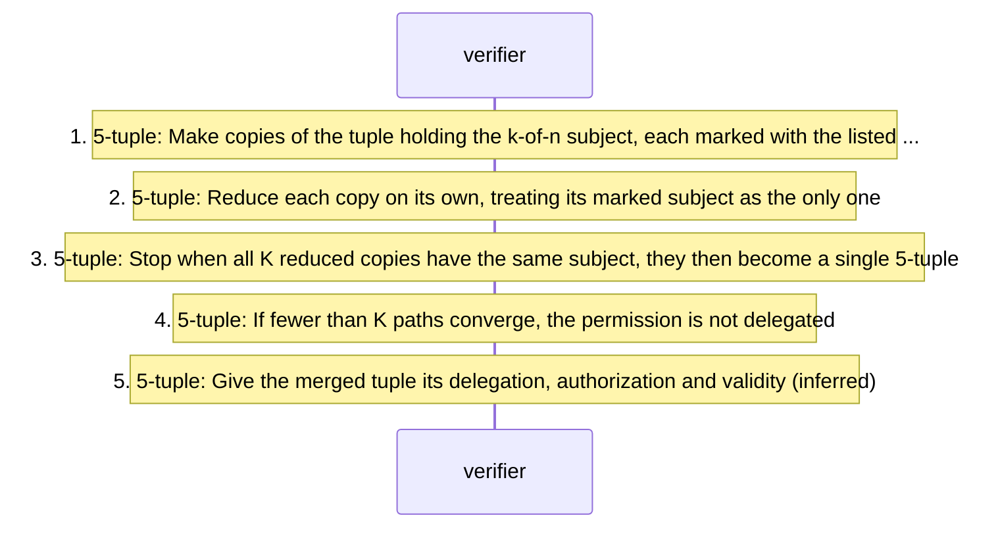

### F-21 certificate-result-certificate: The verifier signs its reduction result and returns it for later use

*exchange; §8.7; participants: verifier, prover, other-verifier.*

A verifier holding a private key may turn a reduced (Self,X,D,A,V) into an ordinary SPKI certificate and hand it back; it then stands in for the whole chain at that verifier, or at one that trusts it to delegate A. The machine is SM-14.

<!-- q L2144-2147 -->
> In cases where the verifier, Self, has access to a private key, once it has reduced a chain of certificate bodies down to the form: (Self,X,D,A,V)

<!-- q L2149-2150 "it can" .. "certificate." -->
> it can sign that generated body, using its private key, producing an SPKI certificate.

<!-- q L2155-2157 "Therefore, one" .. "use." -->
> Therefore, one option by the verifier is to sign and return the result 5-tuple to the caller for this later use.

| n | from | to | message | kind | step |
|---|---|---|---|---|---|
| 1 | verifier | verifier | `<5-tuple>` | stated | Having a private key, reduce a chain to (Self,X,D,A,V). |
| 2 | verifier | verifier | `<cert>` | stated | Sign the generated body as an SPKI certificate whose validity is no larger than that of any certificate in the loop. |
| 3 | verifier | prover | `<cert>` | stated | Return it to the caller for later use. |
| 4 | prover | verifier | `<sequence>` | stated | Later, present it instead of the full chain, to that verifier. |
| 5 | verifier | verifier | `<5-tuple>` | inferred | Reduce it: the verifier must treat its own key as `self`, or hold an ACL entry for it. |
| 6 | verifier | verifier | `<cert>` | stated | Variant: if no other verifier need accept it, sign with a symmetric key (an HMAC); such keys are not defined. |
| 7 | other-verifier | other-verifier | `<cert>` | stated | Another verifier accepts it only if it trusts the first verifier to delegate A; the result then maps chains of other formats into SPKI, for instance for a small device. |

```mermaid
sequenceDiagram
  participant V as verifier
  participant P as prover
  participant W as other-verifier
  Note over V: 1. 5-tuple: Having a private key, reduce a chain to (Self,X,D,A,V)
  Note over V: 2. cert: Sign the generated body as an SPKI certificate whose validity is no larger than that of ...
  V->>P: 3. cert: Return it to the caller for later use
  P->>V: 4. sequence: Later, present it instead of the full chain, to that verifier
  Note over V: 5. 5-tuple: Reduce it: the verifier must treat its own key as self, or hold an ACL entry for it (inferred)
  Note over V: 6. cert: Variant: if no other verifier need accept it, sign with a symmetric key (an HMAC), such ...
  Note over W: 7. cert: Another verifier accepts it only if it trusts the first verifier to delegate A, the ...
```

### F-22 object-and-keyholder-subjects: Authorizing an object by its hash, signing documents, and keyholder statements

*receive-processing; §2, §3.8.3, §4.5.1, §4.5.2, §6.2; participants: issuer, prover, verifier.*

A chain may end at an object (a file, a program) named by its hash rather than at a key, and a prover may be the signer of a document rather than the opener of a channel. Keyholder subjects carry statements for people.

<!-- q L1263-1265 -->
> This option for a (subject ) refers to an object other than a <principal>. One might use this form to assign attributes to an object (a file, a web page, an executable program, ...).

<!-- q L1017-1019 "One can" .. "file." -->
> One can also sign objects other than certificate bodies, of course. For example, one can form the signature of a file.

<!-- q L1842-1844 "By reducing" .. "sequence." -->
> By reducing certificates in the sequence, the verifier will establish that the final subject (key or object) has been granted authority through the sequence.

| n | from | to | message | kind | step |
|---|---|---|---|---|---|
| 1 | issuer | issuer | `<cert>` | stated | Grant to an object: (subject (object-hash `<hash>`)). |
| 2 | prover | verifier | `<signature>` | stated | Sign a document or file and send it with the signature and the chain. |
| 3 | verifier | verifier | `<5-tuple>` | inferred | Accept the object when reduction ends at a tuple from `self` whose subject is that object's hash, after hashing the object held. |
| 4 | verifier | verifier | `<cert>` | stated | Leave keyholder statements to people; they are not used in verification. |

```mermaid
sequenceDiagram
  participant I as issuer
  participant P as prover
  participant V as verifier
  Note over I: 1. cert: Grant to an object: (subject (object-hash hash))
  P->>V: 2. signature: Sign a document or file and send it with the signature and the chain
  Note over V: 3. 5-tuple: Accept the object when reduction ends at a tuple from self whose subject is that ... (inferred)
  Note over V: 4. cert: Leave keyholder statements to people, they are not used in verification
```

## Error paths

| id | trigger | outcome | basis | in |
|---|---|---|---|---|
| E-01 | A certificate carries a version the verifier does not recognise. | The certificate is ignored. | stated | F-15 1 |
| E-02 | A certificate writes version 0 as the ASCII string 0 where a verifier expects the integer encoding (one byte 0x00), or the reverse. | Inferred: the two encodings differ byte for byte, so one may be treated as unrecognised and the certificate ignored. | inferred | F-15 1 |
| E-03 | The hash of the object before a `<signature>` does not equal the hash the signature carries. | Inferred: the signature is not over this object, so the object is not a statement of the principal. | inferred | F-13 2, F-12 4 |
| E-04 | The signature value does not verify under the principal's key. | unspecified by source; inferred: the object is not accepted. | unspecified | F-13 4 |
| E-05 | The signing principal is not the certificate's issuer. | unspecified by source; inferred: the certificate is not accepted. | inferred | F-13 5 |
| E-06 | The key or hash algorithm is unknown to the verifier, including elliptic-curve DSA, for which no format exists. | unspecified by source | unspecified | F-13 4 |
| E-07 | A principal given as a hash of a key cannot be resolved to a key. | unspecified by source | unspecified | F-12 6, F-13 3 |
| E-08 | The present time is outside the certificate's date range. | The certificate is not to be considered valid. | stated | F-14 2, F-14 5 |
| E-09 | An online test cannot be satisfied: no URI answers, no reply is obtained, or the reply does not validate the certificate. | The certificate is not to be considered valid (all its online tests must succeed). | stated | F-14 3, F-14 5, F-06 2, F-08 2 |
| E-10 | The certificate's hash is on a current CRL. | Inferred from the CRL being the list of invalid certificates: the certificate is invalid. | inferred | F-06 7, F-07 7 |
| E-11 | The certificate's hash is not on a current reval list. | Inferred: the reval does not validate it, so its test does not succeed. | inferred | F-08 7 |
| E-12 | A CRL, delta-CRL or reval is not signed by the principal of the online test that directed it to be fetched. | Inferred: it cannot satisfy that test. | inferred | F-06 5, F-07 5, F-08 5, F-09 4 |
| E-13 | An instrument is used outside its interval. | Stated: an instrument is valid only during its interval. | stated | F-06 6, F-07 7, F-08 6 |
| E-14 | A delta-CRL's predecessor cannot be found, or does not hash to the delta's `<hash-of-pred>`. | unspecified by source | unspecified | F-07 3, F-07 6 |
| E-15 | A one-time reval does not carry the nonce the verifier sent. | Inferred: a replay; the test fails. | inferred | F-09 4 |
| E-16 | A one-time reval reaches the verifier through the prover. | Contradictory: three sections say the verifier must fetch it, §7 allows the prover as intermediary. | stated | F-09 2 |
| E-17 | A one-time reval is unsigned. | unspecified by source: §7.3 says should be signed; §4.9.2 and §7 say every reply is a signed object. | unspecified | F-09 4 |
| E-18 | A certificate with a new-cert test has expired and no new copy is obtained. | Inferred: the expired copy stays outside its dates (E-08). | inferred | F-10 2, F-10 3 |
| E-19 | The first tuple's subject is not the second tuple's issuer. | The top-level rule does not apply to the pair. | stated | F-18 1 |
| E-20 | The first tuple does not permit delegation (d1 is `f`). | The top-level rule does not apply to the pair. | stated | F-18 2 |
| E-21 | The tags intersect to `null` (or the empty set), or the case is not covered. | Stated: the 5-tuple does not reduce. | stated | F-18 3, F-19 3, F-19 8 |
| E-22 | The validities intersect to `null`. | unspecified by source; inferred: a tuple valid at no time grants nothing. | unspecified | F-18 4 |
| E-23 | Reduction ends without a tuple issued by `self` that names the prover. | Stated: only tuples issued by `self` mean anything to the verifier; inferred: the request is not satisfied. | stated | F-01 5, F-18 6 |
| E-24 | Fewer than K of a threshold's subjects show converging paths. | Stated: the permission is not delegated. | stated | F-20 4 |
| E-25 | No name certificate defines the first name of a name being reduced. | unspecified by source; inferred: the name does not reduce to a principal and its tuple cannot be used. | unspecified | F-17 2 |
| E-26 | A name certificate defines a name in terms of itself. | Stated: a naive reduction grows without bound; the theory document's rules prevent it. | stated | F-17 6 |
| E-27 | A sequence carries an opcode other than hash. | unspecified by source (only hash is defined) | unspecified | F-12 5 |
| E-28 | A hash opcode or signature has no preceding item, or a later reference by hash names nothing indexed. | unspecified by source | unspecified | F-12 3, F-12 6 |
| E-29 | A certificate carries some field more than once. | unspecified by source: the BNF forbids it; no handling is given. | unspecified | F-13 1 |
| E-30 | A range is compared with a string of a different display type. | Stated: the empty set. | stated | F-19 5 |
| E-31 | A prefix is not a prefix of the explicit string. | Stated: `null`. | stated | F-19 6 |
| E-32 | A field added to a tag makes the tag invalid. | Stated: the permission is restricted to zero. | stated | F-19 3 |
| E-33 | A structure arrives in a form other than canonical (or a brace form that does not decode). | unspecified by source | unspecified | F-02 3, F-02 5 |
| E-34 | An ACL entry's subject is a relative name, which has no issuer to borrow a principal from. | unspecified by source | inferred | F-16 1 |

## Source defects, tensions and gaps

Each is recorded, not repaired; `protocol.yaml` carries the quotations.

| id | kind | lines | finding | affects |
|---|---|---|---|---|
| D-01 | defect | L1832-1833, L2334, L2342 | `<seq-ent>` in §6.2 omits `<name-cert>`; §9.2 admits it. Whether a name certificate may travel in a sequence depends on which rule is read. | F-04 6, F-12 1, SM-01 |
| D-02 | defect | L1460-1461, L2318-2319 | `<online-test>` in §4.9.2 has an `<online-id>` and a new-cert alternative; §9.2's rule has neither. | F-06 1, F-10 1, SM-03 |
| D-03 | defect | L1952, L1973, L2329-2331, L2348 | `<reval>` is defined three ways: §7.2 with a valid list and `<valid-basic>`; §7.3 with (cert `<hash>`) and `<one-valid>`; §9.2 with a valid list and a body that is either. §9.2's one-time form names the certificate by a list, §7.3's by `<subj-hash>`, which only §9.2 defines. | F-08 3, F-09 3, SM-04, SM-05 |
| D-04 | defect | L1919-1923, L2267-2275, L2290 | The CRL rules are named differently in §7.1 (`<cancel-list>`, `<hash-of-pred>`) and §9.2 (`<crl-hash-list>`, `<hash-of-crl>`), and §9.2 also defines an unused `<hash-list>` with the same body. | F-06 3, F-07 2 |
| D-05 | defect | L2031, L2353-2354, L2013-2014 | `<subject5>` uses `<threshold-subj>` in §8.1 and `<fq-name5>` in §9.2; neither is defined. §9.2 also lets a 5-tuple subject be a name, after §8 has assumed every subject is a principal. | F-15 7, F-18, SM-08 |
| D-06 | defect | L2039, L2356 | `<tag-body5>` is built on an undefined `<tag-body>` in §8.1 and on `<tag-expr>` in §9.2. | F-15 3 |
| D-07 | tension | L2037, L2065-2069 | §8.2 intersects validity by uniting the online tests of v1 and v2, but `<valid5>` can hold only dates, `null` or `now`: a 5-tuple has nowhere to keep an online test. Read here as: tests are resolved into dates before reduction. | F-14 6, F-18 4, SM-11 |
| D-08 | defect | L1907, L1973, L1983-1984 | §7 says each instrument contains a `<valid-basic>` interval; the one-time reval of §7.3 contains `<one-valid>` and no interval. | F-09 5, F-11 1, SM-06 |
| D-09 | defect | L309-311, L410-414, L1460-1461, L1470-1471, L1500-1511 | The new-cert online test has no principal, so its reply cannot be validated by the test's principal as §4.9.2 says every reply is; §7 gives no reply format for it; the glossary lists three online tests and not this one, and §1 says an online test asks for a CRL or a revalidation. | F-10 3, F-10 4, SM-03 |
| D-10 | tension | L1493-1495, L1530-1533, L1903-1905, L1970-1971 | Three sections require the verifier itself to fetch a one-time result; §7 lets the verifier contact the revalidation center directly or via the prover. | F-09 2, SM-05 |
| D-11 | tension | L1470-1471, L1891-1892, L1929-1930, L1963-1964, L1979-1981 | A one-time reply should be signed (§7.3); CRLs and revals must be (§7.1, §7.2); every online-test reply is a signed object (§4.9.2, §7). | F-09 3, F-09 4, F-11 3, SM-05 |
| D-12 | tension | L1289, L1344-1348 | The threshold rule requires K < N, but example 4 has a permission that could require both of two issuers, which is 2 of 2. | F-20, SM-12 |
| D-13 | ambiguity | L2129-2133 | The procedure makes K copies of a tuple whose subject lists N, each copy handling one subject: which K subjects is not said, and a choice that fails is not revisited. One copy per listed subject, succeeding when K converge, is this file's reading. The sentence also has a doubled of. | F-20 1, SM-12 |
| D-14 | defect | L1287, L2031, L2126 | The threshold subject is k-of-n in its BNF, threshold in §8.4's heading, and `<threshold-subj>` in §8.1, which is undefined. | F-20 |
| D-15 | editorial | L246-247, L2126, L2142 | §8 numbers its subsections 8.1 to 8.4 and then 8.7, in the body and in the table of contents; there is no 8.5 or 8.6. | F-21 |
| D-16 | defect | L614-615, L1169-1173 | Version numbers are alphanumeric strings and the default is written as the quoted string 0, but `<version>` holds an `<integer>`, whose 0 is one byte 0x00. A verifier that compares versions byte for byte can ignore a certificate it should accept, or the reverse. | F-15 1, E-02, SM-03 |
| D-17 | tension | L1393-1394, L1405-1408, L2096-2097 | §4.8 says tags are extendable: a field added to the end of a tag restricts the permission. §8.3 rule 2 makes any two unequal tags without *-forms intersect to `null`, and §4.8 itself says a tag without *-forms is passed along and used intact. So a shorter tag and its extension (the same tag plus one field) intersect to `null` by rule 2 and to the extension by the extendability paragraph. | F-19 3, SM-10 |
| D-18 | ambiguity | L1838-1839, L1848-1851 | The hash opcode hashes the last key or cert in the sequence, and also the previous item (the last one read in). The two differ when a CRL, reval or signature was read last. | F-12 3, SM-01 |
| D-19 | tension | L553-555, L776-778 | The canonical form is unique for an S-expression, but a certificate's fields may be in any order, so one certificate has many canonical forms and many hashes. CRLs and revals name certificates by hash, and a verifier that re-serialises a parsed certificate may not reproduce the signed bytes. | F-03 6, F-06 7, F-13 1, SM-02 |
| D-20 | defect | L1041-1043, L1095-1097, L2277 | §9.2's `<dsa-sig-val>` uses dsa-sha1-sig and is referenced by no rule; §3.8.3.1 and the DSA sample signature use dsa-sha1 with (r ...) (s ...). | F-13 4 |
| D-21 | gap | L987-993 | The elliptic-curve key format is an editorial placeholder, so no ECDSA key or signature can be processed. | F-13 4, E-06 |
| D-22 | gap | L1463, L1888-1889 | `<online-id>` is in the online-test grammar with no stated meaning; §7 opens with an editorial question about whether a CRL or reval thread needs an id at all. | F-06 1, F-11 |
| D-23 | defect | L1698-1702, L1731-1735, L1420 | The name certificates of §5.3 put (not-after ...) directly in the certificate; the grammar requires it inside (valid ...). | F-14 1, F-17 |
| D-24 | defect | L1630-1640 | The name-certificate template writes the issuer as (name `<principal>` `<name>`), and shows `<valid>` with no optional mark; the BNF takes a single `<byte-string>` and makes `<valid>` optional. | F-04 2 |
| D-25 | ambiguity | L2096-2097, L2115-2117 | Rule 5 yields the empty set for unequal display types where rules 2 and 6 yield `null`; presumably the same, not said. Rule 5 gives no result at all for a range comparison that fails. | F-19 5, SM-10 |
| D-26 | ambiguity | L1977-1979, L2155-2157 | The caller is the verifier in §7.3 (it supplies the nonce) and the prover in §8.7 (it receives the result certificate). | F-09 1, F-21 3 |
| D-27 | gap | L448-453, L1715-1726 | The 4-tuple of a name certificate carries a validity; name reduction never says what becomes of it. | F-15 5, F-17 7, SM-07 |
| D-28 | gap | L2133-2134 | The single 5-tuple that K converged copies become has no stated delegation, authorization or validity. | F-20 5, SM-12 |
| D-29 | gap | L2045-2046, L2069-2070, L2149-2150 | A result certificate is issued by the verifier's key, but only tuples issued by `self` mean anything; how the verifier recognises its own certificate, and how `now` or united online tests become a `<valid>`, are not said. | F-21 2, F-21 5, SM-14 |
| D-30 | gap | L1206, L2014-2017, L2060 | s1 = i2 compares principals that may be held as a key, a hash of it, or the key's address, with md5 or sha1; equality across these forms is not defined. | F-18 1, F-13 5, SM-08 |
| D-31 | gap | L86-90, L420-423 | The request itself, the channel, and the rule that compares the request with the authorization reached are not defined. | F-01 2, F-01 5 |
| D-32 | gap | L1506-1509, L1920, L1953 | CRLs and revals list hashes of certificates without saying which bytes are hashed (the canonical body as signed, or something else). Each listed `<hash>` names its own algorithm, so a verifier may have to hash the certificate once per algorithm the list uses. | F-06 7, F-08 7, SM-04 |
| D-33 | gap | L1463, L1899-1901 | A CRL or reval in the sequence is not tied to the certificate whose test it answers, except through its signer; nothing says how a verifier pairs them. | F-06 4, F-08 4 |
| D-34 | gap | L1171-1177 | The rule for an unrecognised version is stated for certificates only; `<acl>`, `<crl>`, `<delta-crl>` and `<reval>` also carry versions. | F-15 1, SM-04 |
| D-35 | gap | L1836-1838 | `<general-op>` is in the grammar but no operation other than hash is defined. | F-12 5, SM-01 |
| D-36 | gap | L1925-1926 | How a delta-CRL combines with its predecessor, and whose interval governs the result, is not said. | F-07 6, F-07 7, SM-04 |
| D-37 | editorial | L356, L732, L757, L1532, L1671, L2129, L2151 | Slips that a reader must repair: the source that power (L356), a normal URIs (L732), a missing full stop (L757), tests fetches (L1532), a option (L1671), copies of of (L2129), no larger that of (L2151). | F-16, F-20, F-21 |
| D-38 | gap | L357-359, L1684-1686 | A relative name borrows its principal from the issuer of its certificate, so a relative name in an ACL entry (which has no issuer) has no meaning; the source says only that a relative name should show up only in a certificate, and not what a verifier does with one elsewhere. | F-16 1, E-34 |
| D-39 | gap | L2128-2129 | The threshold algorithms are deferred to a separate document. | F-20 |
| D-40 | gap | L2288, L2306-2307, L2327, L2359-2360, L2365 | The range orderings (alpha, numeric, time, binary, date) and the limit forms g, ge, l, le have names and no semantics. | F-19 5, SM-10 |
| D-41 | gap | L2088-2104 | Rule 4 expands a set and intersects the simpler expressions without saying how the results combine; intersections of two *-forms are not covered. | F-19 4, F-19 8, SM-10 |

## Not defined by the draft

- **ND-01** The prover's request, the channel it uses, and any reply, grant, refusal or error message.
- **ND-02** How the verifier compares a request with the authorization A it has reached.
- **ND-03** Any protocol for online tests beyond remarks on HTTP, passive web pages and CGI.
- **ND-04** The one-time request: how the nonce, the certificate and any transaction data are sent.
- **ND-05** A reply format for the new-cert test.
- **ND-06** How certificates and keys are published or retrieved at the URIs certificates and keys name.
- **ND-07** How a delta-CRL combines with its predecessor.
- **ND-08** Which bytes, and which algorithm, a CRL or reval hash covers.
- **ND-09** How a CRL or reval in a sequence is matched to the certificate test it answers.
- **ND-10** The meaning of `<online-id>`.
- **ND-11** Equality of principals held in different forms.
- **ND-12** The mapping from certificate fields to 5-tuple fields, and from valid5 back to `<valid>` in a result certificate.
- **ND-13** The algorithms for threshold subjects and the name-reduction rules that bound recursion (both deferred to other documents).
- **ND-14** The 5-tuple data structures and reduction code (deferred to a separate document).
- **ND-15** Translation of X.509, SET, DNSSEC or PGP certificates into 5-tuples.
- **ND-16** The signature computations themselves, and any elliptic-curve key or signature format.
- **ND-17** Symmetric (HMAC) keys for result certificates.
- **ND-18** A registration procedure for algorithm names.
- **ND-19** Key lifecycle: rotation, compromise or revocation of keys, as opposed to certificates.
- **ND-20** Who may edit an ACL, and what happens to results already derived from a removed entry.

## State machines

Rendered from `state-machine.yaml`; a transition label is the transition number, the trigger, and the guard in parentheses (shortened).

### SM-01 sequence-reader: Reading a `<sequence>`: holding items, hashing, signatures

*§3.8.3, §6.2, §9.2; owner: verifier; renders F-12.* Error states: unknown-op, nothing-to-hash.

```mermaid
stateDiagram-v2
  state "idle" as s0
  state "reading" as s1
  state "item-held" as s2
  state "signature-pending" as s3
  state "sequence-read" as s4
  state "unknown-op" as s5
  state "nothing-to-hash" as s6
  [*] --> s0
  s0 --> s1: T01 sequence
  s1 --> s2: T02 cert
  s2 --> s2: T03 cert
  s2 --> s2: T04 hash-op
  s2 --> s3: T05 signature
  s3 --> s2: T06 completion
  s1 --> s6: T07 hash-op (nothing is held)
  s1 --> s5: T08 general-op (the operation is not hash)
  s2 --> s5: T09 general-op (the operation is not hash)
  s2 --> s4: T10 end-of-sequence
  s1 --> s4: T11 end-of-sequence
  s4 --> [*]
```

### SM-02 signature-check: Checking one `<signature>` over the item before it

*§2, §3.1, §3.5, §3.8, §3.8.1, §3.8.2, §3.8.3, §3.8.3.1, §4.3, §5.1, §6.2; owner: verifier; renders F-13.* Error states: hash-mismatch, key-unresolved, algorithm-unsupported, value-invalid, signer-not-issuer.

```mermaid
stateDiagram-v2
  state "received" as s0
  state "hashed" as s1
  state "hash-matched" as s2
  state "key-resolved" as s3
  state "value-verified" as s4
  state "accepted" as s5
  state "hash-mismatch" as s6
  state "key-unresolved" as s7
  state "algorithm-unsupported" as s8
  state "value-invalid" as s9
  state "signer-not-issuer" as s10
  [*] --> s0
  s0 --> s1: T01 signature
  s1 --> s2: T02 completion (the computed hash equals the ...)
  s1 --> s6: T03 completion (the hashes differ)
  s2 --> s3: T04 completion (the principal is a public key, or a ...)
  s2 --> s7: T05 completion (the principal is a hash that resolves ...)
  s3 --> s8: T06 completion (the key's algorithm is not one the ...)
  s3 --> s4: T07 completion (the signature value verifies under the ...)
  s3 --> s9: T08 completion (the signature value does not verify)
  s4 --> s5: T09 completion (the item is not a certificate, or the ...)
  s4 --> s10: T10 completion (the item is a certificate issued by ...)
  s5 --> [*]
```

### SM-03 certificate-acceptance: One certificate from read to 5-tuple: version, signature, dates, online tests

*§2, §4.1, §4.2, §4.9, §4.9.1, §4.9.2, §4.10, §8.1, §3.8.3; owner: verifier; renders F-14.* Error states: ignored, unsigned, out-of-date, test-failed.

```mermaid
stateDiagram-v2
  state "read" as s0
  state "ignored" as s1
  state "version-ok" as s2
  state "signed" as s3
  state "unsigned" as s4
  state "in-date" as s5
  state "out-of-date" as s6
  state "expired-renewable" as s7
  state "tests-pending" as s8
  state "valid" as s9
  state "test-failed" as s10
  state "tuple-formed" as s11
  [*] --> s0
  s0 --> s1: T01 completion (its version is not recognised)
  s0 --> s2: T02 completion (it has no version, or a recognised one)
  s2 --> s3: T03 signature (SM-02 accepts a signature over it)
  s2 --> s4: T04 end-of-sequence (no accepted signature covers it)
  s3 --> s5: T05 clock-read (the present is not before not-before ...)
  s3 --> s6: T06 clock-read (the present is outside the dates)
  s6 --> s7: T07 completion (it is past not-after and carries ...)
  s7 --> s0: T08 cert (a new copy arrives)
  s5 --> s8: T09 completion (it carries one or more online tests)
  s5 --> s9: T10 completion (it carries no online test)
  s8 --> s8: T11 crl (SM-04 or SM-05 for a one-time test ...)
  s8 --> s9: T12 completion (every test is satisfied and the working ...)
  s8 --> s10: T13 reply-missing (a test cannot be satisfied)
  s9 --> s11: T14 completion
  s1 --> [*]
  s11 --> [*]
```

### SM-04 online-reply-check: Checking a CRL, delta-CRL or reval for one certificate's test

*§4.9.2, §7, §7.1, §7.2, §9.1; owner: verifier; renders F-06.* Error states: no-reply, wrong-signer, not-current, predecessor-missing, listed-invalid, not-listed.

```mermaid
stateDiagram-v2
  state "awaited" as s0
  state "received" as s1
  state "no-reply" as s2
  state "signer-ok" as s3
  state "wrong-signer" as s4
  state "current" as s5
  state "not-current" as s6
  state "combined" as s7
  state "predecessor-missing" as s8
  state "listed-invalid" as s9
  state "presumed-valid" as s10
  state "listed-valid" as s11
  state "not-listed" as s12
  [*] --> s0
  s0 --> s1: T01 crl (the reply is in the sequence)
  s0 --> s2: T02 end-of-sequence (no reply for the test)
  s1 --> s3: T03 completion (the reply is signed by the principal of ...)
  s1 --> s4: T04 completion (it is not)
  s3 --> s5: T05 clock-read (the present lies in the reply's interval)
  s3 --> s6: T06 clock-read (it does not)
  s5 --> s7: T07 completion (the reply is a delta-CRL whose ...)
  s5 --> s8: T08 completion (the reply is a delta-CRL and its ...)
  s5 --> s9: T09 completion (the reply is a CRL that lists the ...)
  s5 --> s10: T10 completion (the reply is a CRL that does not list it)
  s7 --> s9: T11 completion (the combined list has its hash)
  s7 --> s10: T12 completion (it does not)
  s5 --> s11: T13 completion (the reply is a reval listing the ...)
  s5 --> s12: T14 completion (the reval does not list it)
  s9 --> [*]
  s10 --> [*]
  s11 --> [*]
  s12 --> [*]
```

### SM-05 one-time-revalidation: The verifier's one-time revalidation, nonce to `now`

*§4.9.2, §4.9.3, §7, §7.3, §8.2, §9.2; owner: verifier; renders F-09.* Error states: no-reply, bad-signer, replayed, wrong-certificate.

```mermaid
stateDiagram-v2
  state "idle" as s0
  state "nonce-ready" as s1
  state "requested" as s2
  state "reply-received" as s3
  state "valid-now" as s4
  state "consumed" as s5
  state "no-reply" as s6
  state "bad-signer" as s7
  state "replayed" as s8
  state "wrong-certificate" as s9
  [*] --> s0
  s0 --> s1: T01 one-time-test-reached
  s1 --> s2: T02 request-sent
  s2 --> s3: T03 reval (the one-time form)
  s2 --> s6: T04 reply-missing
  s3 --> s7: T05 completion (unsigned, or not signed by the ...)
  s3 --> s8: T06 completion (the one-valid byte string is not the ...)
  s3 --> s9: T07 completion (cert hash does not name the ...)
  s3 --> s4: T08 completion (signer, nonce and certificate all match)
  s4 --> s5: T09 verification-step-ended
  s5 --> [*]
```

### SM-06 instrument-series: The responder's series of CRLs, deltas and revals

*§7, §7.1, §7.2; owner: online-test-responder; renders F-11.* Error states: none.

```mermaid
stateDiagram-v2
  state "instrument-current" as s0
  state "interval-ended" as s1
  state "delta-current" as s2
  [*] --> s0
  s0 --> s1: T01 interval-ended
  s1 --> s0: T02 completion
  s0 --> s2: T03 delta-chosen (the current instrument is a CRL)
  s2 --> s2: T04 delta-chosen
  s2 --> s0: T05 full-crl-chosen
```

### SM-07 name-reduction: Reducing a name to a principal

*§5.1, §5.2, §5.3; owner: verifier; renders F-17.* Error states: undefined-name, unbounded.

```mermaid
stateDiagram-v2
  state "name" as s0
  state "fully-qualified" as s1
  state "group-branch" as s2
  state "rewritten" as s3
  state "principal" as s4
  state "undefined-name" as s5
  state "unbounded" as s6
  [*] --> s0
  s0 --> s1: T01 completion (the name is relative)
  s0 --> s1: T02 completion (the name is fully qualified)
  s1 --> s3: T03 name-certificate-found (exactly one name certificate defines P ...)
  s1 --> s2: T04 name-certificate-found (several name certificates define P n1)
  s2 --> s3: T05 completion
  s1 --> s5: T06 completion (no name certificate defines P n1)
  s3 --> s4: T07 completion (no names remain)
  s3 --> s1: T08 completion (names remain)
  s3 --> s6: T09 completion (the definition reintroduces the name ...)
  s4 --> [*]
```

### SM-08 top-level-rule: One application of the §8.2 rule to a pair of 5-tuples

*§8.2, §4.8, §8.1; owner: verifier; renders F-18.* Error states: does-not-reduce.

```mermaid
stateDiagram-v2
  state "pair" as s0
  state "linked" as s1
  state "delegable" as s2
  state "a-computed" as s3
  state "v-computed" as s4
  state "reduced" as s5
  state "does-not-reduce" as s6
  [*] --> s0
  s0 --> s1: T01 reduction-step (s1 = i2)
  s0 --> s6: T02 reduction-step (s1 differs from i2)
  s1 --> s2: T03 completion (d1 = t)
  s1 --> s6: T04 completion (d1 is f)
  s2 --> s3: T05 completion
  s3 --> s6: T06 completion (a is null)
  s3 --> s4: T07 completion (a is not null)
  s4 --> s5: T08 completion (v is not null)
  s4 --> s6: T09 completion (v is null)
  s5 --> [*]
  s6 --> [*]
```

### SM-09 reduction-driver: Repeating the rule until the verifier believes a 5-tuple

*Abstract, §2, §8, §8.1, §8.4, §4.5.3, §6.2; owner: verifier; renders F-18.* Error states: not-authorized.

```mermaid
stateDiagram-v2
  state "tuples-ready" as s0
  state "reducing" as s1
  state "authorized" as s2
  state "not-authorized" as s3
  [*] --> s0
  s0 --> s1: T01 tuples-ready
  s1 --> s1: T02 reduction-step (SM-08 ends in reduced)
  s1 --> s1: T03 reduction-step (one of the pair has a k-of-n subject)
  s1 --> s2: T04 completion (a tuple issued by self names the prover ...)
  s1 --> s3: T05 completion (no pair combines further and no such ...)
  s2 --> [*]
  s3 --> [*]
```

### SM-10 tag-intersection: Intersecting two tags (rules of §8.2 and §8.3)

*§3.2, §4.8, §8.2, §8.3; owner: verifier; renders F-19.* Error states: result-null, result-empty, uncovered.

```mermaid
stateDiagram-v2
  state "compare" as s0
  state "result-a1" as s1
  state "result-a2" as s2
  state "result-explicit" as s3
  state "expanded" as s4
  state "result-null" as s5
  state "result-empty" as s6
  state "uncovered" as s7
  [*] --> s0
  s0 --> s2: T01 completion (a1 is tag *)
  s0 --> s1: T02 completion (a2 is tag *)
  s0 --> s1: T03 completion (a1 equals a2, display types included)
  s0 --> s5: T04 completion (a1 differs from a2 and neither has a ...)
  s0 --> s4: T05 completion (a tag contains * set ...)
  s4 --> s3: T06 completion (at least one expanded comparison is not ...)
  s4 --> s5: T07 completion (every expanded comparison is null)
  s0 --> s3: T08 completion (a field compares * range ... with a ...)
  s0 --> s6: T09 completion (the range is compared with a string of ...)
  s0 --> s5: T10 completion (the range comparison fails)
  s0 --> s3: T11 completion (a field compares * prefix p with a ...)
  s0 --> s5: T12 completion (p is not a prefix of it)
  s0 --> s0: T13 completion (both tags are lists with sub-expressions)
  s0 --> s7: T14 completion (two *-forms meet)
  s1 --> [*]
  s2 --> [*]
  s3 --> [*]
  s5 --> [*]
  s6 --> [*]
```

### SM-11 validity-intersection: Intersecting two validities, v1 and v2

*§8.1, §8.2, §4.9, §7.3; owner: verifier; renders F-18.* Error states: null.

```mermaid
stateDiagram-v2
  state "inputs" as s0
  state "range" as s1
  state "now" as s2
  state "null" as s3
  [*] --> s0
  s0 --> s1: T01 completion (both are date ranges and they overlap)
  s0 --> s3: T02 completion (both are date ranges and they do not ...)
  s0 --> s1: T03 completion (either carries online tests)
  s0 --> s2: T04 completion (one is now and the present lies in the ...)
  s0 --> s3: T05 completion (one is now and the present lies outside ...)
  s0 --> s2: T06 completion (both are now)
  s0 --> s3: T07 completion (either is null)
  s1 --> [*]
  s2 --> [*]
  s3 --> [*]
```

### SM-12 threshold-reduction: Reducing a k-of-n subject

*§2, §4.5.3, §8.4; owner: verifier; renders F-20.* Error states: insufficient.

```mermaid
stateDiagram-v2
  state "threshold" as s0
  state "copies-made" as s1
  state "copies-reducing" as s2
  state "converged" as s3
  state "merged" as s4
  state "insufficient" as s5
  [*] --> s0
  s0 --> s1: T01 completion
  s1 --> s2: T02 completion
  s2 --> s3: T03 reduction-step (K reduced copies have the same subject)
  s3 --> s4: T04 completion
  s2 --> s5: T05 completion (no copy reduces further and fewer than ...)
  s4 --> [*]
  s5 --> [*]
```

### SM-13 acl-entry: An ACL entry from writing to removal

*§2, §6.1, §4.9; owner: verifier; renders F-16.* Error states: outside-dates.

```mermaid
stateDiagram-v2
  state "entry-written" as s0
  state "in-force" as s1
  state "in-force-dated" as s2
  state "outside-dates" as s3
  state "removed" as s4
  [*] --> s0
  s0 --> s1: T01 completion (no valid)
  s0 --> s2: T02 completion (it has a valid)
  s1 --> s4: T03 acl-edited
  s2 --> s4: T04 acl-edited
  s2 --> s3: T05 clock-read (the present is outside its dates)
  s3 --> s2: T06 clock-read (the present is inside its dates again)
  s4 --> [*]
```

### SM-14 result-certificate: A certificate result certificate

*§8.7; owner: verifier; renders F-21.* Error states: refused-elsewhere.

```mermaid
stateDiagram-v2
  state "reduced" as s0
  state "signed" as s1
  state "returned" as s2
  state "presented" as s3
  state "accepted-here" as s4
  state "accepted-elsewhere" as s5
  state "refused-elsewhere" as s6
  state "expired" as s7
  [*] --> s0
  s0 --> s1: T01 completion (the verifier has a private key or a ...)
  s1 --> s2: T02 reply-to-caller
  s2 --> s3: T03 sequence (it carries the result certificate)
  s3 --> s4: T04 completion (the same verifier, within its validity)
  s3 --> s5: T05 completion (another verifier that trusts Self to ...)
  s3 --> s6: T06 completion (any other verifier)
  s2 --> s7: T07 certificate-expired
  s4 --> [*]
  s5 --> [*]
  s6 --> [*]
  s7 --> [*]
```

### SM-15 certificate-standing: A certificate's standing as online tests report it

*§4.9.2, §7, §7.1, §7.2, §4.9; owner: online-test-responder; renders F-11.* Error states: none.

```mermaid
stateDiagram-v2
  state "issued" as s0
  state "revalidated" as s1
  state "canceled" as s2
  state "expired" as s3
  state "renewed" as s4
  [*] --> s0
  s0 --> s2: T01 responder-cancels
  s0 --> s1: T02 responder-revalidates
  s1 --> s0: T03 interval-ended (the next reval omits it)
  s0 --> s3: T04 certificate-expired
  s3 --> s4: T05 cert (it carries a new-cert test and a new ...)
  s2 --> [*]
  s4 --> [*]
```

## Coverage

18 roles. 22 flows (1 creation, 2 creation-and-delivery, 1 encoding, 7 exchange, 1 local, 1 local-decision, 1 local-with-fetch, 8 receive-processing) with 140 steps, 30 of them inferred and 9 with message none; on_error_basis inferred 10, stated 13, unspecified 117. 42 draft object names used. 34 error paths. 41 source defects and gaps (4 ambiguity, 13 defect, 2 editorial, 16 gap, 6 tension). 20 not_defined items. 554 quote items, all cut by script. constrained_by: 619 links from 140 steps and 34 error paths to 352 distinct requirement ids, of 461 in requirements.yaml when the join ran; 0 items carry none. Counted by join_protocol.derived.py from protocol.yaml as written, 2026-11-12; any later edit owes a re-run.

15 machines, 110 states, 130 transitions, 53 inferred. SM-01 7 states, 11 transitions, 6 inferred; SM-02 11 states, 10 transitions, 9 inferred; SM-03 12 states, 14 transitions, 4 inferred; SM-04 13 states, 14 transitions, 8 inferred; SM-05 10 states, 9 transitions, 4 inferred; SM-06 3 states, 5 transitions, 1 inferred; SM-07 7 states, 9 transitions, 2 inferred; SM-08 7 states, 9 transitions, 3 inferred; SM-09 4 states, 5 transitions, 2 inferred; SM-10 8 states, 14 transitions, 4 inferred; SM-11 4 states, 7 transitions, 3 inferred; SM-12 6 states, 5 transitions, 0 inferred; SM-13 5 states, 6 transitions, 4 inferred; SM-14 8 states, 7 transitions, 2 inferred; SM-15 5 states, 5 transitions, 1 inferred. 28 triggers (10 draft objects, 18 events). 261 quote items, all cut by script. constrained_by: 344 links from 130 transitions to 197 distinct requirement ids, of 461 in requirements.yaml when the join ran; 0 transitions carry none. Counted by join_protocol.derived.py from state-machine.yaml as written, 2026-11-11; any later edit owes a re-run.
