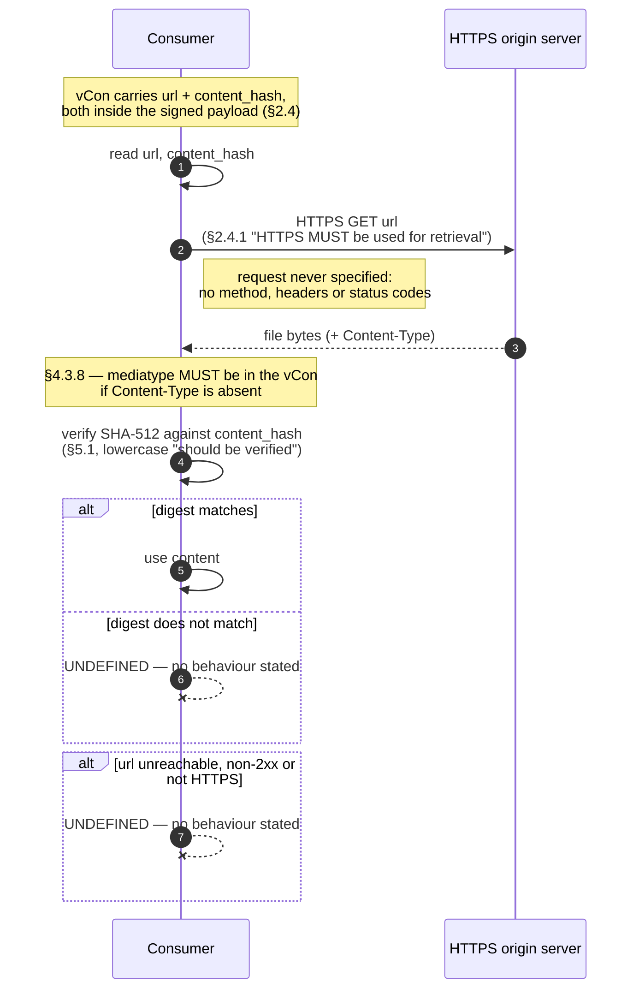
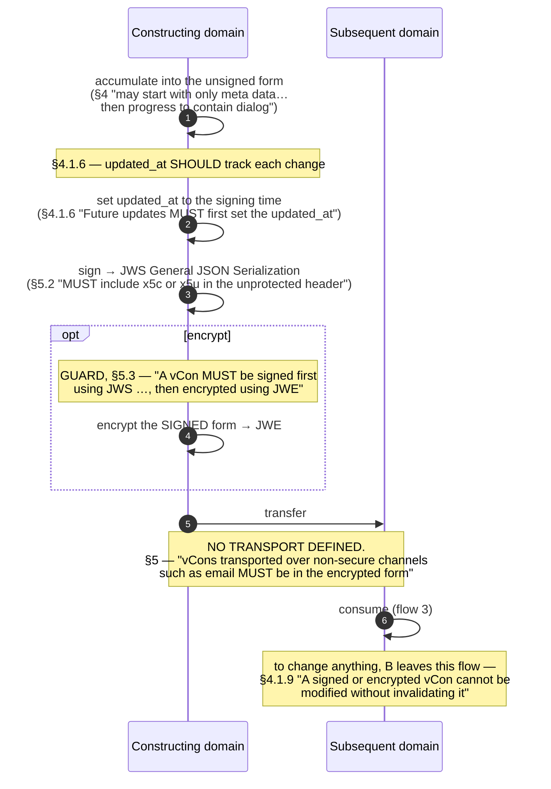
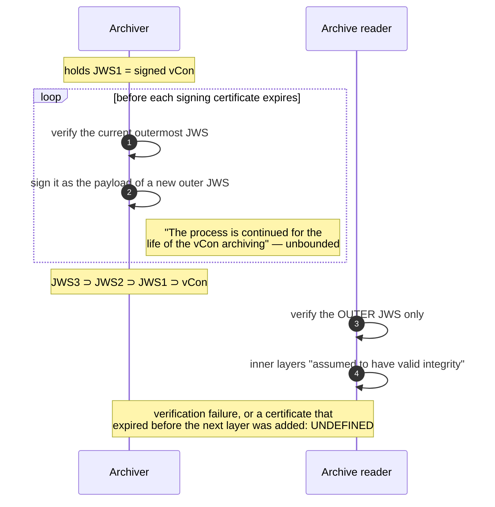

# Protocol model

Source `.cache/draft-ietf-vcon-vcon-core-04.txt`, sha256
`cc2a2cb5051b860e2f29478a9ff946e3d882818bfad55dff48e0f5ae033cd722`, 8904
lines, read in full. Structured companion: `protocol.yaml`. Lifecycle:
`state-machine.yaml`.

Quotations are verbatim with the draft's line wrapping removed, and carry a
section locator plus a line range into the cached source. Where the draft
marks emphasis with asterisks (`*MUST NOT*`) the asterisks are the source's.
**Anything not in quotation marks is this extraction's analysis.**

---

## Verdict: applicable, and partial

vCon is a container format. The default answer for this artifact on a
container format is *not applicable*, and that answer was argued properly
before being rejected. The case for it, at full strength:

> vCon defines no network protocol, no transport binding, no wire message, no
> request and no response. It mandates no verification procedure anywhere, and
> it defines no error path for a failed check. `rfc-9804` in this library was
> declared not-applicable on exactly that ground.

Three of the four clauses in rfc-9804's reason — *"There are no roles, no
messages between parties, no error signalling and no processing order anywhere
in the document"* — are **false of vCon**, and each was checked separately:

| clause | true of RFC 9804 | true of vCon? |
|---|---|---|
| no roles | yes | **no** — §2.5 names a *transcriber* and a *redactor* and gives them different admission rules on the same input; §4 and §5 name a constructing and a subsequent security domain |
| no messages between parties | yes | mostly — but §2.4.1 mandates an HTTPS retrieval from a second party |
| no error signalling | yes | **no** — §2.5 and §4.1.4 define one, with a `MUST NOT` and a named exit |
| no processing order | yes | **no** — §5.3 mandates sign-then-encrypt with a `MUST`; §5.2.3 orders verify-then-re-sign and outer-then-inner; §5.4 orders decompress-then-differentiate |

The library's own precedent settles the last row. rfc-9804's README contrasts
it with RFC 8785 §5, *"which **mandates** the ordering R-O-05 forbids, and
whose `protocol.md` exists precisely to hold that contradiction."* A mandated
processing order is the thing that makes this artifact exist. vCon has one.

And the absence needs somewhere to live. Declaring not-applicable would
compress the richest finding below into one reason string. Modelling the flows
puts each undefined failure **beside the step that should have defined it**,
with a locator.

What is claimed is narrow: five flows, one with a genuine second party, one
defined error path between them. Everything else is enumerated as absent.

---

## The finding that matters most

**The integrity machinery of this document is mandatory to construct and
optional to use.**

Every occurrence of `content_hash` in §§1–7 was pulled with its sentence and
scored for BCP 14 keywords. Every obligation on it is about **carriage**:

> "Objects that refer to a file which is externally stored from the vCon MUST
> have the parameters: url, content_hash." — §2.4, lines 546–548

> "content_hash MUST be included if url is provided." — §4.1.8.1, line 944

> "content_hash MUST be provided if url is provided." — §4.1.9.1, line 1043

…plus three parallel `SHOULD contain` statements for Dialog, Attachment and
Analysis Content (§4.3.10, §4.4.7, §4.5.9). **Not one is about checking it.**

The only sentence in the document asking anyone to verify an external hash is:

> "After retrieving externally referenced files, before using its content, the
> payload of the HTTPS request should be verified using the signature
> parameter value for the hash for the url body using the procedure defined in
> section 6.3 and 6.4 of [SHA-512]." — §5.1, lines 2667–2670

Two defects in one sentence. The verb is **lowercase** `should`, so the single
verification-ordering rule in the document carries no BCP 14 weight while the
surrounding text uses capitals freely. And it names **`signature`**, which
§7.3 line 3842 records as folded into `content_hash` three schema revisions
ago — except that `signature` still exists, at §5.2.1, as a parameter of the
JWS Signature Object holding the signature over the *whole vCon*. A reader who
looks the name up finds a live parameter that is the wrong one, covering the
wrong bytes. A dangling reference fails loudly; this one resolves to something
plausible and wrong.

The same shape recurs at every integrity point:

- §5.2.2's convenience `uuid` exists **expressly so a consumer need not
  verify** — *"This is added for convenience to not require verification of
  the signed vCon to get it's UUID."* (lines 2750–2751) — and the cross-check
  that would catch a substituted payload is itself optional: *"When the vCon
  is verified, the value of this uuid parameter SHOULD be verified against the
  UUID in the signed vCon."* (lines 2751–2752).
- §5.3.1 is the same shape for the encrypted form (lines 2862–2864).
- §5.4 does not even reach `SHOULD`: **zero `MUST` in 59 lines**, while
  telling a consumer that distinguishing the form is *"necessary"* and that
  *"a signed vCon needs to be verified."*

A fully conforming implementation may fetch external media over HTTPS and use
it without computing a digest; read a signed vCon's uuid without verifying the
signature; and act on a payload without checking the header uuid matches it.

---

## Flow 1 — external content retrieval

§2.4, §2.4.1, §2.4.2, §2.2, §4.3.8, §5.1. The only flow with two independent
parties and a wire. The HTTPS exchange itself is never written out by the
draft; it is drawn here because without it the §5.1 check has nothing to
check.



Asymmetry worth naming: §2.4 is the hardest section in the flow — 4 `MUST`, 0
`SHOULD` across lines 543–585 — and **all four constrain the producer**. §5.1,
which is what a consumer does with them, has 0 `MUST` and 1 `SHOULD`, and the
one `SHOULD` is *"any externally referenced files SHOULD also have a
signature"*, not the verification sentence.

> "The secure storage and access of externally referenced conversation data is
> considered out of scope from this document." — §5, lines 2594–2595

---

## Flow 2 — export from a security domain

§4, §5, §5.2, §5.2.2, §5.3, §4.1.6. The document's organising narrative.



**Signing is never required.** Every trigger is a `SHOULD`: *"it SHOULD be
signed or encrypted by the domain that constructed it"* (§4), *"Before a vCon
leaves a security domain, it SHOULD be signed"* (§5), *"Any time a vCon is
shared outside its original security domain, it SHOULD be signed and
optionally encrypted"* (§5). The `MUST`s appear only once you have chosen to
do both — the §5.3 ordering — and once as a channel condition.

### The one mandated ordering, and why nothing can check it

> "A vCon MUST be signed first using JWS as defined in Signed Form of vCon
> Object (Section 5.2), then encrypted using JWE as opposed to just encrypted
> with integrity protection." — §5.3, lines 2807–2809

This is **mandated, not implied**: an explicit `MUST` with an explicit
sequence. The trailing clause is a rationale for preferring sign-then-encrypt
over an AEAD mode alone; it neither weakens nor conditions the keyword.

It is also **unenforceable by anything the draft ships**. Appendix B covers
the unsigned form only — its own title is `"vCon - Unsigned Form"`. Appendix C
covers all three, but as a flat union:

```
vcon = unsigned_vcon_type / signed_vcon_type / encrypted_vcon_type
```

…in which `signed_vcon_type` has `payload: base64url_value_type`,
`encrypted_vcon_type` has `ciphertext: base64url_value_type`, and the last
production reads `base64url_value_type = tstr`. **A plain string.** The grammar
never says a signed vCon's payload decodes to an unsigned vCon, nor that an
encrypted vCon's ciphertext decrypts to a *signed* one. Containment is typed
away, so an encrypted-but-never-signed vCon — the one thing §5.3 forbids
outright — validates cleanly against the draft's own CDDL.

---

## Flow 3 — consuming a received vCon

§5.4, §6.2, §5.2.2, §5.3.1, §2.5, §4.1.4, §4.1.3.

§5.4 orders decompression before form recognition explicitly. §2.5 and §4.1.4
do not say where the `critical` check falls; placing it after the form is
known is forced by the fact that `critical` lives inside the unsigned object,
which in the signed and encrypted forms is unreachable until the outer layer
is opened. **That placement is this extraction's inference.**

```mermaid
sequenceDiagram
    autonumber
    participant C as Consumer
    participant U as User (§2.5, undefined)
    C->>C: gzip? (§5.4 — media type, else gzip magic numbers)
    opt compressed
        C->>C: decompress
    end
    C->>C: differentiate form (§5.4)
    Note right of C: unsigned ← one or more of parties/dialog/analysis/attachments<br/>signed ← BOTH payload and signatures<br/>encrypted ← BOTH ciphertext and recipients
    alt matches no rule
        C--xC: UNDEFINED — and reachable, see below
    end
    opt encrypted
        C->>C: decrypt; §5.3.1 uuid SHOULD be verified
        Note right of C: decryption failure: UNDEFINED
    end
    opt signed
        C->>C: verify signature; §5.2.2 uuid SHOULD be verified
        Note right of C: VERIFICATION FAILURE: UNDEFINED
    end
    C->>C: critical extensions all supported?
    alt supported
        C->>C: process the vCon
    else not supported
        C-->>U: reject, or notify<br/>(§2.5 "*MUST NOT* process the vCon<br/>except to reject it or notify the user")
        Note over C,U: the ONLY defined failure exit in the document —<br/>and the rejection itself has no defined form
    end
```

**The one defined failure exit delivers to an actor the document never
defines.** `U` is drawn because §2.5 puts something at the far end of the
rejection — *"except to reject it or notify the user"* (lines 693–696) — but
"the user" occurs in that sentence and nowhere else. No section says who the
user is, what a notification contains, or by what channel it travels. The
parallel statement of the same obligation at §4.1.4 lines 829–831 names a
*different* recipient and no user at all: *"except to reject it or report
unsupported content"*. Two statements of one rule, two recipients, neither
defined. The role is carried in `protocol.yaml` under `roles` as `the user`
rather than dropped, so the diagram and the model agree.

### §5.4 is unsound, and that is a defect rather than a disproof

The form recogniser **keys on the four optional members and ignores both
mandatory ones.**

- Its unsigned rule tests `parties`, `dialog`, `analysis`, `attachments`
  (lines 2893–2902). Each is marked `(optional)` at its own definition —
  lines 1109, 1130, 1143, 1155 — and collectively they are only a `SHOULD`
  (§4, lines 741–743).
- The two members that **MUST** be present are never consulted: *"All vCon
  documents MUST have the uuid parameter and value set."* (§4.1.2, lines
  792–794) and `created_at` *"MUST be present"* (§4.1.5, lines 847–848).
  Appendix B agrees, listing exactly those two under `required` (source lines
  6749–6752).

So a vCon carrying `vcon`, `uuid` and `created_at` is valid under **both**
formal schemas, violates no `MUST`, and matches **no rule in §5.4**.

This is a defect in the state machine, **not** evidence that no state machine
exists. §5.4 is an *observer*, and the states it observes are established
without reference to it: §3 enumerates them, §5.2 and §5.3 define their
structures, Appendix C unions them, §5.3 orders two of them with a `MUST`, and
§4.1.9 makes two of them immutable. An unsound recogniser is a broken
thermometer, not an absence of temperature — and the unsoundness is only
*statable* because the states exist.

The sound test was available in the same document: key on the two
`MUST`-present members plus the absence of `payload`/`signatures`/
`ciphertext`/`recipients`. *(Our analysis, not the draft's.)*

### Role-dependent admission

§2.5 asks two consumer roles to decide differently on the same input:

> "In these cases a transcriber will likely only need to look at the critical
> extensions. However the redactor perhaps should reject vCons with any
> extension that it does not support." — §2.5, lines 683–686

A redactor is asked to widen the test from `critical` to `extensions`. But
§4.1.3 makes `extensions` a `SHOULD` — *"The extensions parameter SHOULD
contain the list of names of all vCon extensions…"* — so a producer that omits
it conforms, and **the stricter rule punishes disclosure**: a redactor
following §2.5 admits the silent vCon and rejects the honest one. Note also
that "perhaps should" hedges a BCP 14 word into being neither keyword nor
plain prose.

---

## Flow 4 — deriving a new instance version

§4, §4.1.8, §4.1.8.1, §4.1.9, §4.1.9.1, §5. The state model is in
`state-machine.yaml` (`vcon-instance-version-chain`); this is the
party-to-party sequence around it.

```mermaid
sequenceDiagram
    autonumber
    participant A as Originating domain
    participant B as Subsequent domain
    participant C as Later consumer
    A->>B: signed or encrypted vCon (flow 2)
    Note over B: §4.1.9 — cannot be modified in place
    B->>B: build a NEW instance version, new uuid<br/>(§5 "a new vCon is created with the removed<br/>or added data and the prior version is referenced")
    alt redaction
        B->>B: add Redacted Object — uuid, type, [url + content_hash]
    else amendment
        B->>B: add Amended Object — uuid, [url + content_hash]
    end
    Note over B: GUARD — "mutually exclusive" (§4.1.8, §4.1.9),<br/>per NODE, not per chain; NO BCP 14 keyword
    B->>B: sign the derivative<br/>(§4.1.8 "The assurance of the accuracy of the<br/>redaction is made by the entity that creates it")
    B->>C: export
    C->>C: resolve the predecessor by uuid
    Note right of C: NO RESOLVER EXISTS. url is only MAY.<br/>uuid is form-ambiguous: unsigned, signed and<br/>encrypted forms all carry the SAME uuid
    alt redacted, uuid absent
        C->>C: §4.1.8.1 — "not available or does not exist"
    else uuid present but unresolvable
        C--xC: UNDEFINED
    end
```

**The chain's existence is `MUST`; the chain's links are `SHOULD`.** §4.1.9
requires a new instance version — *"a new vCon instance version MUST be
created"* — while the back-reference is only *"SHOULD be referenced via the
uuid"*, and §4.1.8 likewise. A conforming producer can emit an unbroken
succession of amendments that point at nothing.

**Branching is demonstrated, not merely permitted.** Appendix A.8's Redacted
Object and Appendix A.9's Amended Object reference the *same* parent uuid
`01a07da8-c2bb-83e5-b9a2-279e0d16bc46` (source lines 6593 and 6713) — the vCon
of A.4, whose signed form is A.6 and encrypted form is A.7. One parent, two
children, one by redaction and one by amendment. Every edge points backwards
only, so the forward direction is not enumerable from the vCons themselves.

**What the draft leaves genuinely undefined here** is set out in full in
`state-machine.yaml` under `vcon-instance-version-chain.undefined`. In short:
whether a redacted vCon may be amended or vice versa (the mutual exclusion is
per-parameter, and both formal schemas encode exactly that and no more);
whether the chain is bounded, terminates, or may cycle; what terminates an
amendment chain, since §4.1.8.1's "absence of uuid" sentinel has no
amended-side counterpart; and which *form* of the predecessor a bare uuid
names, given that Figure 1 points at an encrypted parent and Figure 2 at a
signed one, two sections apart, neither stated as a rule.

---

## Flow 5 — long-term archiving

§5.2.3. **Zero BCP 14 keywords in the whole section** (lines 2755–2804). The
document's only answer to signing-certificate expiry is entirely
non-normative, and announces itself as such: *"Below is an approach… There may
be other approaches to this as well."*



Read strictly, only the **outer** signature is verified and everything inside
is *"assumed to have valid integrity"*. That assumption is sound only because
the archiver verified each layer at the moment it wrapped it — which makes the
**archiver's discipline** the load-bearing part and the reader's check the
cheap part. The document does not say this, and it gives a reader no way to
tell whether the archiver ever performed that step: the nesting looks
identical either way.

---

## Error model

**One defined path. At least eight undefined.**

| condition | locator | behaviour |
|---|---|---|
| unsupported `critical` extension | §2.5, §4.1.4 | **defined** — `MUST NOT` process except to reject or notify. No form is given for the rejection: no structure, no code, no recipient, no channel |
| signature verification failure | §5.2, §5.2.2, §5.4 | undefined |
| `content_hash` mismatch | §2.4, §2.4.2, §5.1 | undefined |
| decryption failure | §5.3, §5.3.1 | undefined |
| header/payload uuid mismatch | §5.2.2, §5.3.1 | undefined |
| vCon matching no §5.4 rule | §5.4 | undefined, and reachable |
| unreachable, non-HTTPS or non-2xx `url` | §2.4.1, §5.1 | undefined |
| unresolvable predecessor uuid | §4.1.8.1, §4.1.9.1 | undefined |
| archived JWS whose certificate expired first | §5.2.3 | undefined |

This is a fact about the document, not an artefact of searching. Across §§1–7
the words *fail, failure, error, invalid, discard, abort* occur **twice**:
*"ignore them while maintaining valid processing of the vCon"* (§2.5, line
653) and *"Call attempts may fail."* (§4.3.14, line 2194) — the second about
telephony, not processing. "invalid" occurs only inside *"invalidating"* at
§4.1.9 line 1015. Every other occurrence of failure vocabulary is in the
§4.3.11 `disposition` token list, which describes a failed **call**, not
failed **processing**. There is no error section, no error registry, and no
error entry in any of the nine IANA registries of §6.3.

The pattern across all five flows: **where there is a `MUST`, there is an
error path; where there is a `SHOULD`, there is none.**

---

## Other defects found

1. **gzip magic numbers are both required and registered as absent.** §5.4
   (lines 2934–2936) tells a consumer with no media type to use *"the gzip
   member header magic numbers defined in section 2.3.1 of [GZIP]"*. §6.2's
   media type registration lists `Magic number(s): N/A`. §6.1 and §6.2 also
   register the **same** file extension `"vcon"` and the same Windows
   Clipboard Name `VCON`, so neither disambiguates either.

2. **The container's version discriminator was deprecated in the document that
   records four incompatible changes.** §4.1.1: *"The "vcon" parameter is
   DEPRECATED… The extension mechanism replaces the need for schema
   versioning."* §7 then lists four non-upward-compatible changes across three
   syntax versions, **every one a rename of a core parameter** — `appended`→
   `amended`, `must_support`→`critical`, `transfer-target`→`transfer_target`,
   `target-dialog`→`target_dialog`, `mimetype`→`mediatype`, `alg`+`signature`→
   `content_hash`. An extensions list cannot carry a core rename; it names
   additions a producer opted into. The stated replacement does not cover the
   stated failure mode. Each old spelling occurs **exactly once** in 8904
   lines, in §7, and two of them land on mechanisms modelled here: `appended`
   is the amendment half of flow 4, and `must_support` means the `critical`
   parameter of flow 3 is one draft revision old under its current name.

3. **A registry section describes the wrong registry.** §6.3.5.1.2 is titled
   *"party_event Type Name Registration Initial Values"* and its body reads
   *"The following table defines the initial values for the Dialog Object
   Types Registry."* — copied verbatim from §6.3.4.1.2 (lines 3403–3404),
   where it is correct. The table beneath it is the `party_event` table.

4. **An unresolved editorial placeholder is still in the document**, at the end
   of Appendix A.9 (source line 6725): an editorial note announcing a
   `recording-set` example with `party_history` that was never written — the
   three-letter marker this library's own validator forbids, left in a `-04`
   working-group draft.

5. **The redacted example's uuid predates the vCon it redacts.** §4.1.2 says a
   vCon uuid SHOULD be a version 8 UUID *"generated identically to a version 7
   UUID"* except in `rand_b`, so the leading 48 bits are a Unix millisecond
   timestamp. A.8's redacted vCon `01928e10-193e-8231-…` decodes to
   **2024-10-15T02:44:32Z**; its parent, A.4's `01a07da8-c2bb-83e5-…`, decodes
   to **2026-09-07T20:56:47.035Z**. The redaction's identifier is timestamped
   **23 months before** the thing it was derived from. A.9's amended example is
   consistent by contrast — 774 ms after its parent — which is exactly what
   invites the assumption that A.8 breaks. Found by decoding the identifiers,
   not by reading them. Nothing requires monotonicity along a chain, so this is
   a defective example rather than a violated rule.

6. **Protection of a referenced unredacted vCon is stated three times at three
   strengths.** §4.1.8 (lines 889–892) requires access control on the `url`
   (`MUST`, conditional); §5 (lines 2589–2592) recommends encryption *"if
   inline"* (`SHOULD`); §5 (lines 2640–2642) requires encryption
   unconditionally (`MUST`). Worse, the `"if inline"` precondition **cannot be
   met**: the Redacted Object defines only `uuid`, `type`, `url` and
   `content_hash` (§4.1.8.1, lines 926–948), and Appendix C's
   `redacted_object_type` confirms there is no `body` or `encoding`. That
   branch of §5 has no realisation in the core schema.

---

## What is absent, stated plainly

- No transport binding for a vCon. Two media types are registered (§6.1, §6.2)
  and bound to no protocol operation.
- No request/response pairing except the HTTPS GET implied by §2.4.1, which is
  never written out.
- **No negotiation.** `extensions` and `critical` are unilateral in-band
  declarations by the producer. There is no capability exchange, no reply
  channel, and no way for a consumer to tell a producer what it supports.
  *"Extension negotiation"* is a misnomer for what §2.5 defines; it is
  extension **admission**.
- No rejection message, code or recipient, despite a `MUST NOT` that depends
  on one.
- No sessions, retries, timeouts, idempotency, or ordering guarantees between
  parties.
- No discovery: a derivative names its predecessor by uuid, and the document
  defines no resolver for a uuid.
