# rfc-2692 — protocol model

## Applicability: a requirements document with no protocol

RFC 2692 specifies no protocol. It has no transport, no framing, no encoding,
no request or response format and no error signalling, and it contains **no
BCP 14 keyword**. Its abstract describes it as a summary of requirements drawn
from "a list of things one might want to do with certificates". On the two
points where a protocol would be expected, it disclaims one:

- the CRL: "Its method of transmission is not specified." (§Validity and CRLs ¶2, p.4)
- repositories: "If the keyholder wishes to use a global repository, such as
  LDAP, the global PGP key server or the DNS database, that is up to the
  keyholder and not for the SPKI WG to specify." (§General Requirements ¶5, p.3)

Its status boilerplate nonetheless says "This memo defines an Experimental
Protocol". That is recorded as a source defect.

What the document does give is a set of named **roles** and, mostly one
sentence at a time, named or implied **exchanges**. Each is modelled here at
the level the source gives, and each step that is not literally in the source
is flagged `inferred: true` with a reason. Much of the material comes from the
"List of Certificate Uses", which the source calls "a brainstorming list", and
from "Open Questions", which records what certificates cannot do. List items
that describe an exchange become flows. The rest are mapped under `use_cases`,
and the Open Questions are recorded as `non_flows`.

Where the actual structures live is outside this document. RFC 2692 cites
only [DH] and [KOHN]. As a library pointer, not a claim made by the source,
the SPKI WG's companion documents are RFC 2693 and
draft-ietf-spki-cert-structure. Nothing here is taken from them.

## Reading `protocol.yaml`

| key | what it holds |
|---|---|
| `applicability`, `applicability_quotes` | the scope statement above, with the source's own disclaimers |
| `conventions` | quoting, locators, `inferred`, `on_error_basis`, `status`, `kind`, message names, `constrained_by` |
| `framing` | 5 statements that govern every flow |
| `roles` | 26 roles; `kind` is party, implementer, local-component, example-party, threat or historical |
| `messages_referenced`, `message_notes` | the 42 message names used, each reconciled with `messages.yaml`: `resolves_to` is entry (26), field (10), variant (5) or none (1); `renamed_from` gives the pass-1 name; `in_source` flags names with no source counterpart |
| `flows` | 26 flows, 88 steps |
| `use_cases` | every List of Certificate Uses item mapped to its flow |
| `non_flows` | 7 things the source says certificates or the WG do not do |
| `error_paths` | 34 error paths |
| `source_defects_and_ambiguities` | 22 entries |
| `not_defined` | 16 things an implementer will not find in RFC 2692 |

- **Locators.** The sections are unnumbered, so a locator is the section title
  plus a paragraph count and page: "§Validity and CRLs ¶2 (p.4)". List items
  are located by their opening words, and Open Questions are numbered Q1 to Q4.
- **Inferred.** 37 of the 88 steps are `inferred: true`, each with an
  `inferred_reason`. Flows whose content is mostly inferred say so in their
  summary.
- **Errors.** `on_error_basis` is `stated`, `inferred` or `unspecified`. 52
  steps are `unspecified`: the source names the step and says nothing about
  failure. That gap belongs to the source.
- **Quotes.** All 327 quoted spans (quotes, on_error quotes, use-case items and
  wallet-card names) were checked mechanically against `.cache/rfc-2692.txt`
  with line wrapping undone, in-line double spaces kept, and "collision-" /
  "free" joined. None crosses a blank line or a page break. In this prose
  file, a double quote inside a quoted span is written as a single quote
  (blockquotes keep the source's marks). Where a source
  sentence runs over a page break the quote stops at the break and a
  `quote_notes` entry says so.
- **constrained_by.** Wired in pass 3 with `rfc-2692#R-NNNN` ids from
  `requirements.yaml`, every one of which resolves there. 80 of the 88 steps
  and 24 of the 26 flows cite at least one requirement, 92 distinct ids in all
  (table at the end). A flow cites the union of its steps and guards. An empty
  list carries `constrained_by_note`. The eight steps and two flows with none
  rest on text `requirements.yaml` leaves out: the minimal-CRL description of
  §Validity and CRLs ¶2, and the Background history. Every requirement has
  verb `none`, so a citation marks a lowercase statement, not a BCP 14
  obligation.
- **Message names** were reconciled with `messages.yaml` in pass 3. Each is an
  entry name, `entry.field` or `entry.variant`. Where `messages.yaml` models
  the hand-over itself (`certificate-presentation`, `repository-publication`),
  the step's message is the exchange and `carries` names the certificate. One
  name, `signed-request`, has no entry in `messages.yaml`; it stands for an
  inferred step and is marked. `online-validation-request` resolves to the
  inferred entry pass 3 added. Every diagram
  arrow begins with its step's message. See *Message names used* at the end.

## Roles

| role | kind | where the source names it |
|---|---|---|
| `keyholder` | party | §General Requirements ¶1 "KEYHOLDER"; "I" throughout the List |
| `verifier` | party | §General Requirements ¶5; §Validity and CRLs ¶2; "user of a certificate" §Background ¶2; "reader of a certificate" §Implementation ¶2 |
| `issuer` | party (our word) | "any keyholder empowered to grant or delegate the authorization in question" §Implementation ¶1; "creator of a certificate" ¶2 |
| `code-author` | party | "the author of code which uses the certificate" §General Requirements ¶4 |
| `certificate-code-developer` | implementer | "many different developers, frequently persons acting alone, operating out of garages or dorm rooms" §Implementation ¶1 |
| `crl-issuer` | party, **inferred** | implied by "a signature" on the CRL, §Validity and CRLs ¶2 |
| `online-validator` | party, **inferred** | "on-line validation", "on-line refinement of validity", §Validity and CRLs ¶1, ¶3, ¶4 |
| `global-repository` | party | LDAP, PGP key server, DNS, §General Requirements ¶5 |
| `smart-card` | party | List item "This signed-key should be considered equivalent" (p.9); §Implementation ¶1 |
| `central-administrator` | party | Other requirements, host authentication (p.10) |
| `notary-service` | party | "Timestamping / notary services" (p.10); Other requirements (p.10, p.11) |
| `key-cache` | local component | Other requirements, "cached locally" (p.11) |
| `revoker` | party, **inferred** | implied by "distribution of key revocations" (p.11) |
| `key-generating-administrator` | party | "the people generating the keys (e.g., administrators)" (p.11) |
| `name-binder` | party | "someone trustworthy binding that unique name to the key" (p.6) |
| `negative-fact-organization` | party | "some organization is capable of determining that fact" Q3 (p.12) |
| `bank`, `master-bank-certifier`, `other-bank` | example parties | electronic-check items (p.5-6); NACHA "perhaps" |
| `dns-name-owner` | example party | "DNS name owner" certificate (p.10) |
| `software-vouchee` | example party | "some reputable company or person" (p.6) |
| `application` | local component | "the audit identity should be in the domain of the particular application" (p.9) |
| `key-thief`, `key-loaner` | threats | Q1 (p.11), Q4 (p.12), signed-key item (p.10) |
| `online-directory`, `communicant` | historical | §Background ¶1 |

## Flows

Twenty-six flows, each with a diagram. Each step of the flow in
`protocol.yaml` is one solid or dashed arrow, in step order; a step taken only
on a condition sits in an `opt` block. A step
the source does not state is a dashed arrow (`-->>`) whose text ends in a
parenthesis beginning "inferred". A crossed arrow (`--x`) inside an `alt`
block is a failure outcome, marked the same way when the outcome is inferred.
A self-arrow is a local step. `autonumber` numbers the failure arrows too, so
step numbers in the text are the YAML `n`, not the diagram's numbers.

### 1. `direct-certificate-distribution`

§General Requirements ¶5, ¶6 (p.3); §Implementation of Certificates ¶5 (p.5);
§Validity and CRLs ¶1 (p.4); §Background ¶2 (p.2). *Status: assumed.* The
default model: "we assume that certificates will be distributed directly by the
keyholder to the verifier", because they may carry what the keyholder would not
publish. The keyholder releases a minimum of information. The verifier checks a
signature made "exactly as it is transmitted", with no reformatting except
white-space canonicalization of text, and decides whether the keyholder "has
been granted some specific authorization". **Inferred:** step 4, the
validity-period check. Failure outcomes for the signature check and the
authorization decision are inferred. Delivery failure is unspecified.

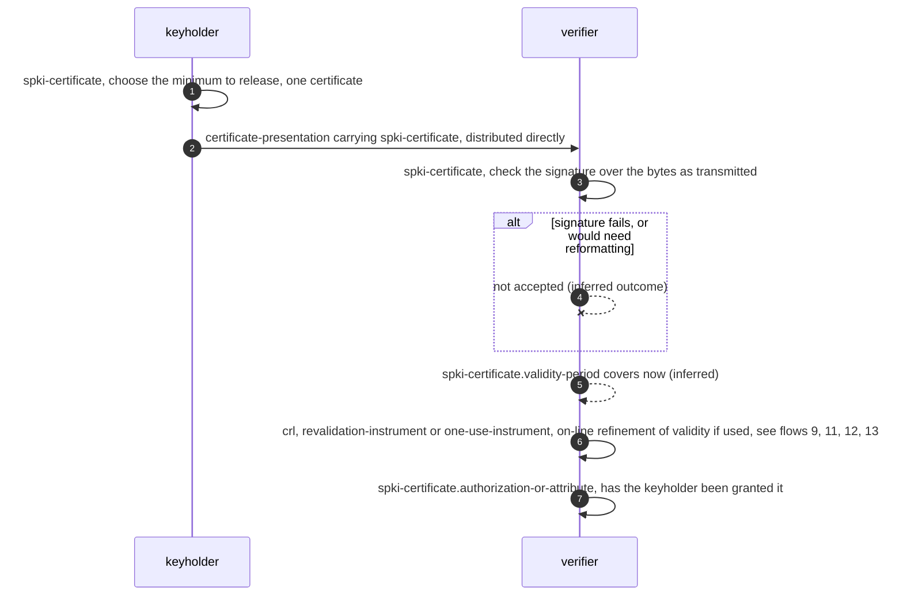

### 2. `repository-publication`

§General Requirements ¶5 (p.3). *Status: considered.* Publishing to LDAP, the
global PGP key server or the DNS database is "up to the keyholder and not for
the SPKI WG to specify". **Inferred:** step 2, the verifier's retrieval. Both
steps' failures are unspecified.

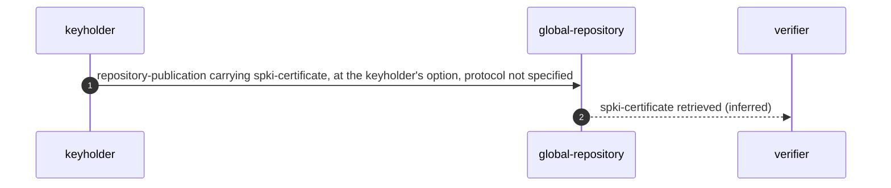

### 3. `certificate-issuance`

§Implementation of Certificates ¶1 to ¶7 (p.4-5); §General Requirements ¶2,
¶3, ¶6, ¶7, ¶8 (p.3); §Validity and CRLs ¶1 (p.4). *Status: required
capability.* Certificates "should be generated by any keyholder empowered to
grant or delegate the authorization in question". The subject is the public
key, a collision-free hash of it, a name to be resolved later, or a blinded
signature key. The certificate has a bare minimum of fields, minimum
information, optionally a validity period, no ASN.1 and no library code, and an
LR(0) grammar with no recursion "if possible". It is signed exactly as
transmitted. The creator is constrained "by the structure definition, not by
complaints (or error messages) from the reader", so there is no
reader-to-creator error channel. Guards cover constrained environments, light
bureaucracy for host authentication, highly trusted notary keys and not sharing
keys. **Inferred:** step 6, delivery to the subject keyholder, and step 7,
onward delegation by a delegatee. The source's only word on delegation control
is "Maybe we need a 'delegation-allowed' bit", dismissed because a key can be
loaned.

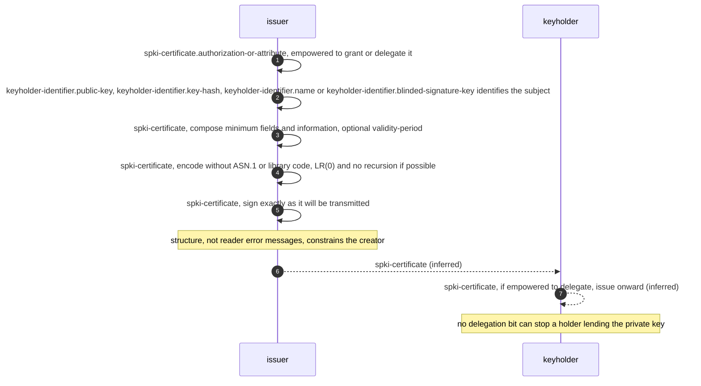

### 4. `authorization-definition`

§General Requirements ¶4 (p.3). *Status: required capability.* "The creation of
new authorizations should not require interaction with any other person or
organization but rather be under the total control of the author of the code
using the certificate." **Inferred:** steps 2 and 3, how issuers learn the
definition and that the code using it runs at the verifier.

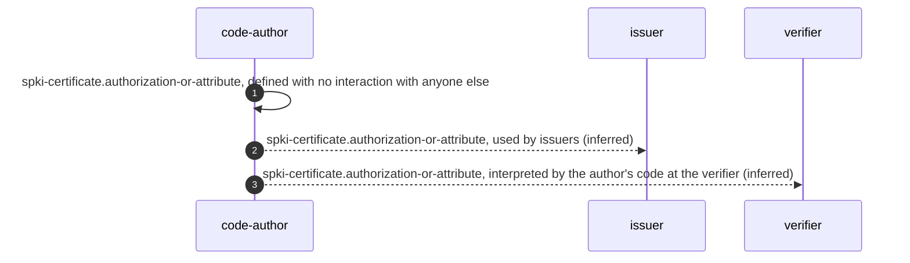

### 5. `delayed-binding-resolution`

§General Requirements ¶3, ¶9 (p.3-4). *Status: required capability.* The
keyholder may be identified "via a collision-free hash of the public key or via
a name, later to be resolved into a key". SPKI should support the SDSI name
construct "if possible", and the bracketed note says SPKI and SDSI have merged.
No resolution procedure is given. **Inferred:** step 1, supplying the key and
comparing its hash. Name-resolution failure is unspecified.

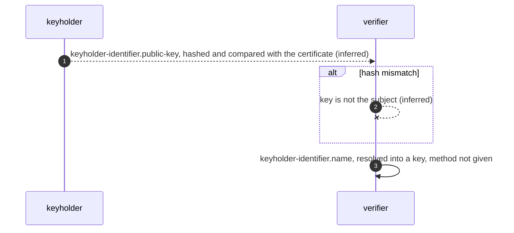

### 6. `traditional-certificate-issuance`

§List of Certificate Uses, item "[traditional certificate]" (p.6). *Status:
brainstorm use.* The item reads "binding a key to a name". It needs unique identification of a
person, "which is difficult in non-digital space", and "someone trustworthy"
to bind the name. The key then "acquires attributes, permissions and authority
from the person bound to it". The Background explains that SPKI finds such
bindings "of extremely limited use for trust management". **Inferred:** step 1,
the keyholder submitting to identification.

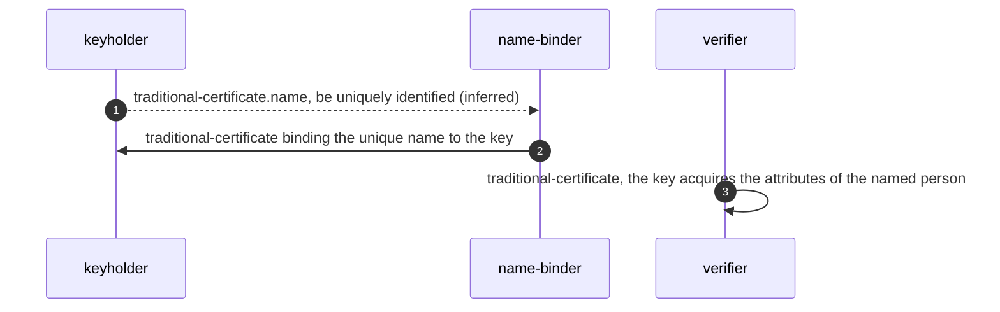

### 7. `direct-certificate-self-signing`

§List of Certificate Uses, item "[direct certificate]" (p.6). *Status:
brainstorm use.* A self-signed declaration of the name the keyholder goes by.
"The unique identification of the key is automatic", and the key's authority
comes "directly by other certificates, not indirectly through some person's
name". **Inferred:** step 2, presentation to a verifier.

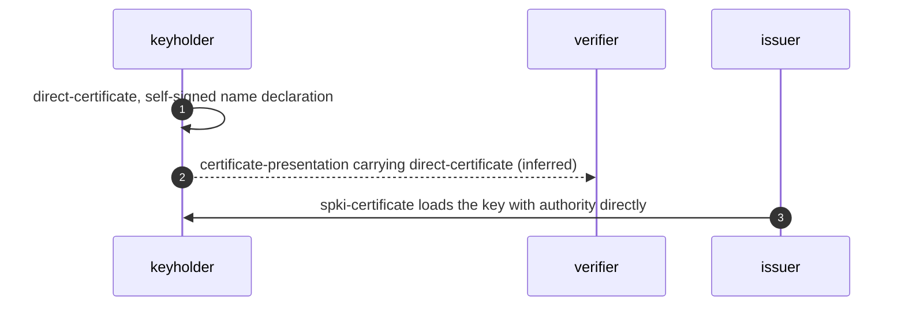

### 8. `personal-binding`

§List of Certificate Uses, item "[personal binding]" (p.6-7); §General
Requirements ¶9 (p.3). *Status: brainstorm use.* I sign someone else's key
with my nickname for them. It is "for my use only -- never given out", and
signed "to prevent tampering with my own private" directory of keys. The
quote stops at the p.6/p.7 page break, where the sentence continues "directory
of keys." It records nothing about how I satisfied
myself of the binding. The source says "singing" for "signing". **Inferred:**
no step. The tamper-detection outcome is inferred.

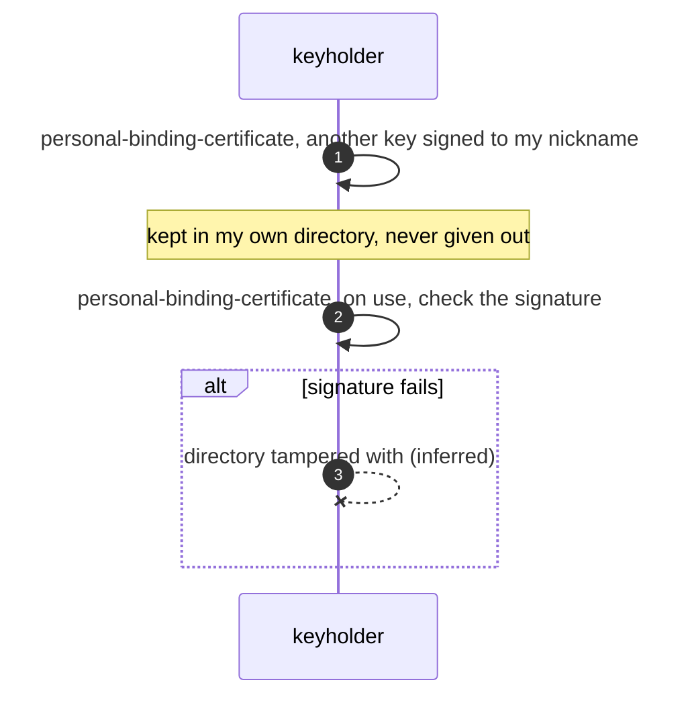

### 9. `crl-validation`

§Validity and CRLs ¶1, ¶2, ¶5 (p.4). *Status: required capability, conditional
on "if SPKI uses CRLs".* There are three requirements: "the certificate that uses
it must explicitly tell the verifier where to find the CRL, the CRL must carry
explicit validity dates and the dates of a sequence of CRLs must not overlap."
A CRL "must have its own lifetime", and a lifetime of 0 "is not possible".
Validation is then "deterministic (aside from the question of clock skew)".
Transmission is "not specified". The source never names the CRL signer or the
key the verifier should expect. Annihilation of listed certificates and of
previous CRLs is stated only for the minimal CRL of flow 10. **Inferred:**
steps 3 (fetch from the stated location), 4 (CRL signature check), 5 (date
check), 6 (supersession applied to a conforming CRL) and 7 (annihilation
applied to a conforming CRL). The outcome of an unobtainable CRL is unspecified.
RFC 2692 does not say the certificate then fails.

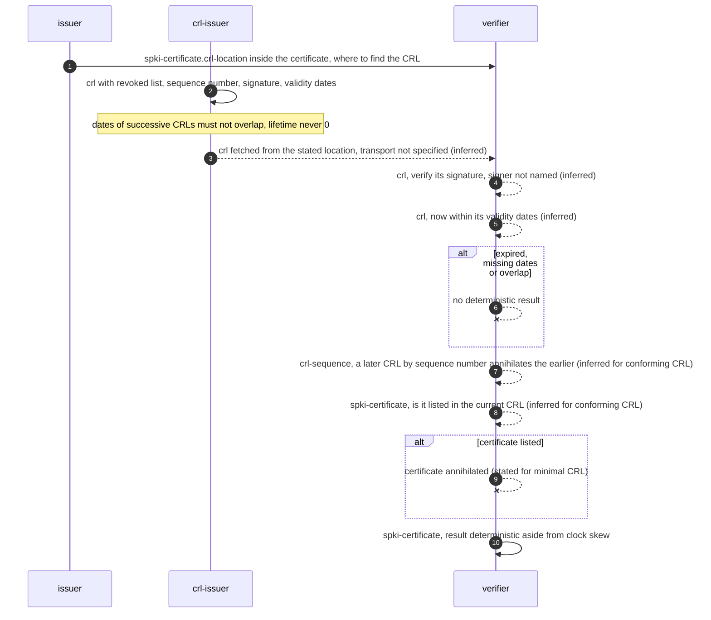

### 10. `minimal-crl-propagation`

§Validity and CRLs ¶2 (p.4). *Status: described and rejected.* "A minimal CRL
contains a list of revoked certificates, identified uniquely, a sequence number
and a signature.  Its method of transmission is not specified." It annihilates
any certificate it lists and any previous CRL it meets. "Such a CRL leads to
non-deterministic program behavior", and that is why flow 9's three
requirements exist. **Inferred:** none.

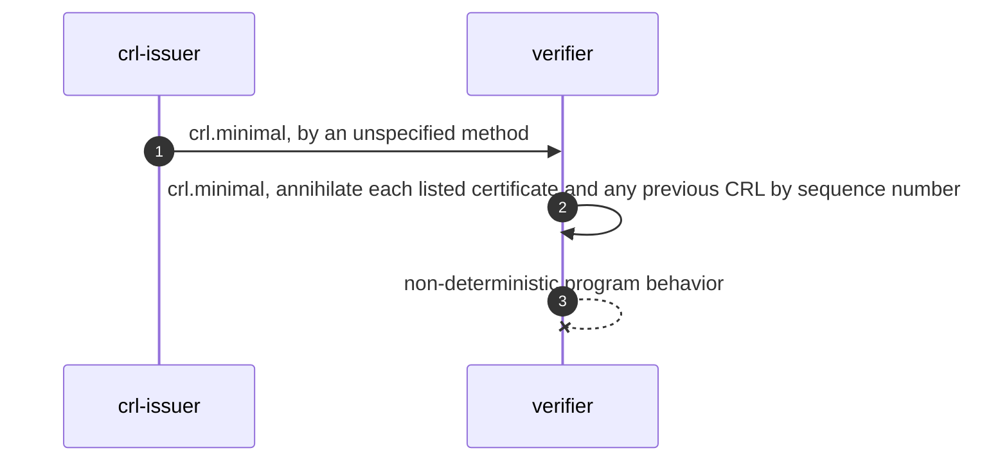

### 11. `positive-online-validation`

§Validity and CRLs ¶1, ¶3, ¶4, ¶5 (p.4). *Status: required capability.* "SPKI
should support both positive and negative on-line validations", which is the
retail move to "on-line validation of a single check, ATM card or credit card".
"Any CRL or revalidation instrument must have its own lifetime", and the
lifetime cannot be 0 "because of communication delays and clock skews".
Treating the positive validation as the revalidation instrument is inferred.
**Inferred:** step 1 (the request) and step 3 (using the instrument within its
lifetime to refine validity).

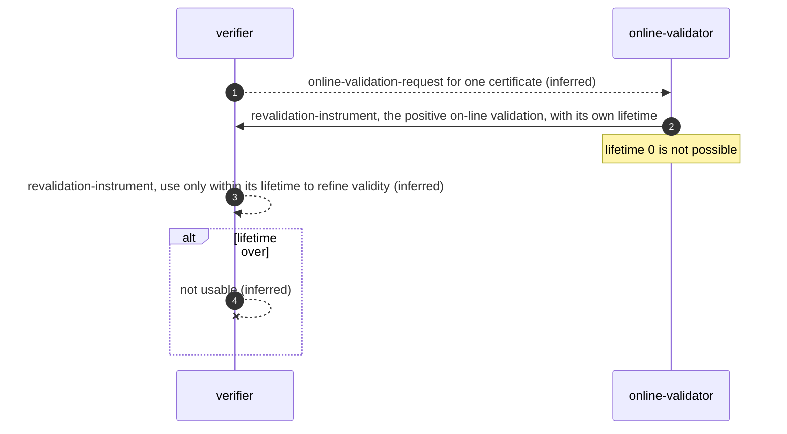

### 12. `negative-online-validation`

§Validity and CRLs ¶3, ¶4, ¶5 (p.4). *Status: required capability.* The phrase
"negative on-line validations" is used once and never described. The only
negative statement in the document is the CRL ("A CRL is a negative
statement"), so the flow is modelled as an on-line negative statement under the
CRL lifetime rule. **Inferred:** both steps.

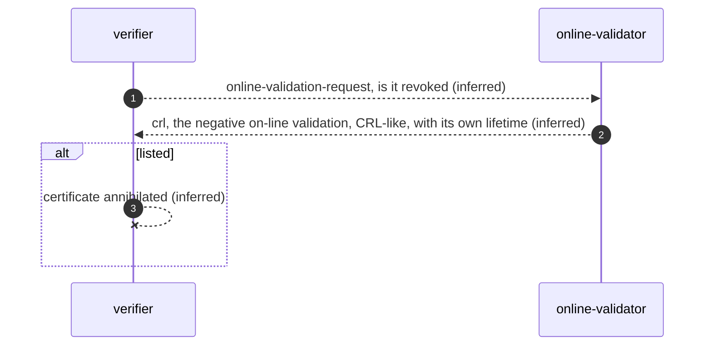

### 13. `one-use-instrument-challenge-response`

§Validity and CRLs ¶5 (p.4). *Status: considered.* "one can consider an
instrument whose lifetime is 'one use' and which is delivered only as part of a
challenge/response protocol." Challenger, challenge content and binding are not
given. **Inferred:** step 1, the verifier as challenger. The outcomes of reuse
and of delivery outside a challenge/response are inferred.

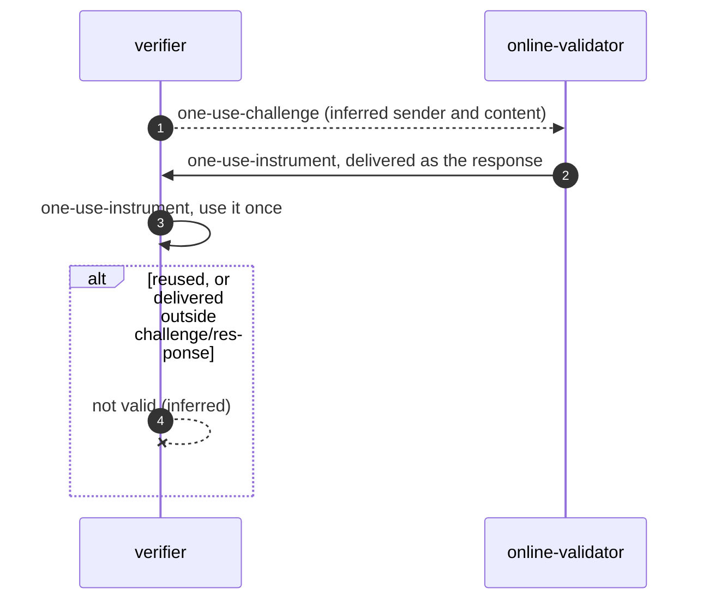

### 14. `minimal-information-proof`

§General Requirements ¶6, ¶7 (p.3); §Background ¶2 (p.2); List item "I'm the
a purchasing agent" (p.9). *Status: required capability.* A certificate is "like
a single key rather than a key ring or a single credit card rather than a whole
wallet", and "at least some certificates" must be anonymous. The purchasing
agent shows a $15,000 authorization without a name and without sharing a
"Megacorp Purchasing Department Certificate", which would mean sharing the
private key. **Inferred:** step 3, proof of control of the private key, which
the source never describes.

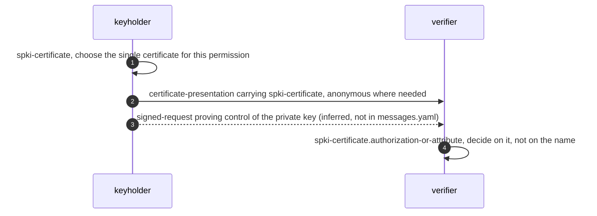

### 15. `certificate-chain-following`

List items "I need a certificate to give me permission", "My bank would need a
certificate", "My bank would issue a certificate" (p.5-6); Other requirements,
"Trust model must be a web" (p.10). *Status: brainstorm use.* "My bank would
issue a certificate signing the key of a master bank certifier -- perhaps NACHA
-- so that I could follow a certificate chain from a key I know (my bank's) to
the key of any other bank". The guard: people "must be able to choose whom they
trust or consider reliable roots". **Inferred:** step 1 (my bank issues my
check-writing certificate) and step 4 (the master certifier certifies other
banks). Who certifies my bank, and how the chain is gathered, are unspecified.

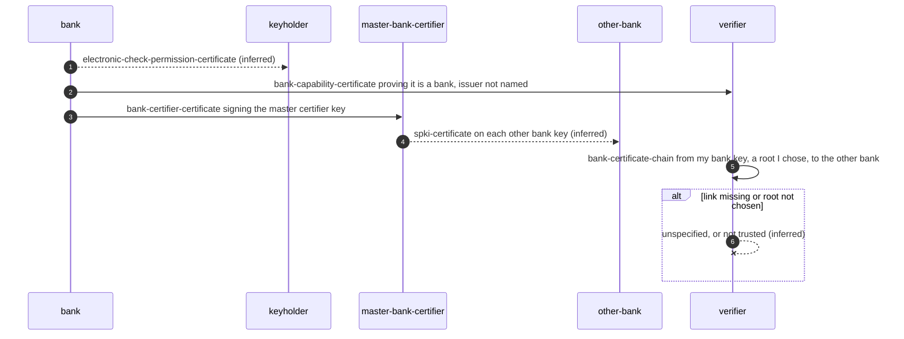

### 16. `smart-card-short-term-key`

List item "This signed-key should be considered equivalent" (p.9-10).
*Status: brainstorm use.* Smart cards "typically have slow processors and are
connected through low-bandwidth links". Using one only at login, "if you only use the smart card at 'login' time to
certify a short-term key pair", gives "high performance and low exposure of the
long term key". The certificate makes the signed key "equivalent to the
certifying-key until this certificate expires for the following purposes ...",
and the source elides the purposes. The guard notes that this "flies in the face
of attempts to prevent delegation". **Inferred:** steps 1 (who generates the
pair), 2 (hand-over to the card) and 4 (presentation to a verifier).

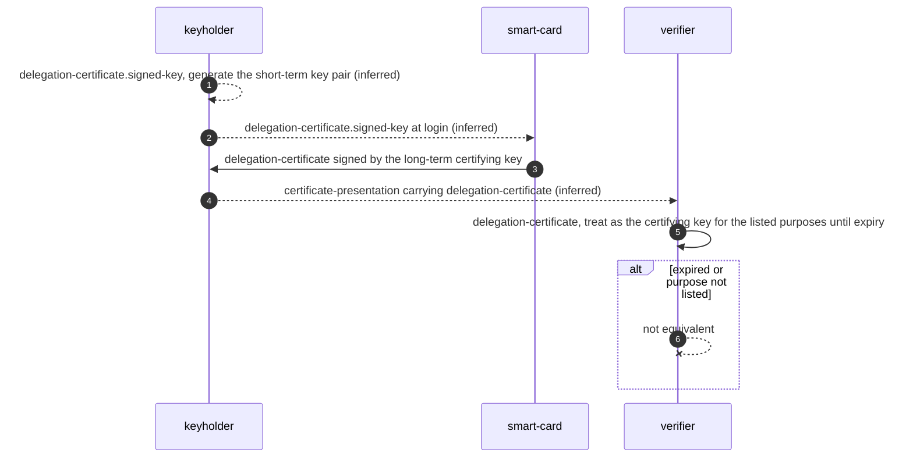

### 17. `key-caching`

Other requirements, "Keys will need to be cached locally" and "Reliable
distribution of key revocations" (p.11). *Status: brainstorm use.* Keys are
cached "to avoid long delays fetching frequently used keys.  Cf. current name
servers." Caching "interacts with" revocation distribution. **Inferred:** step 1
(the lookup) and step 2 (the fetch source; a global repository is the only key
source the document names). The stale-entry outcome is inferred.

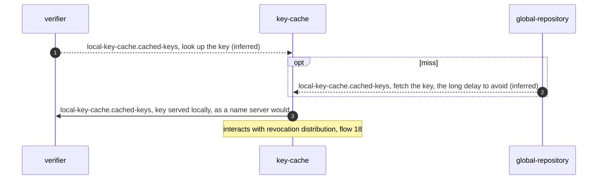

### 18. `revocation-distribution`

Other requirements, "Reliable distribution of key revocations" (p.11).
*Status: tentative.* "Reliable distribution of key revocations and other
certificates (e.g., the ceasing of the right to make new certificates).  May
involve goals like 'will have spread everywhere in 24 hours' or something like
that.  This interacts with caching." **Inferred:** step 1 (the issuer) and step 3
(cache invalidation). The exposure window is inferred.

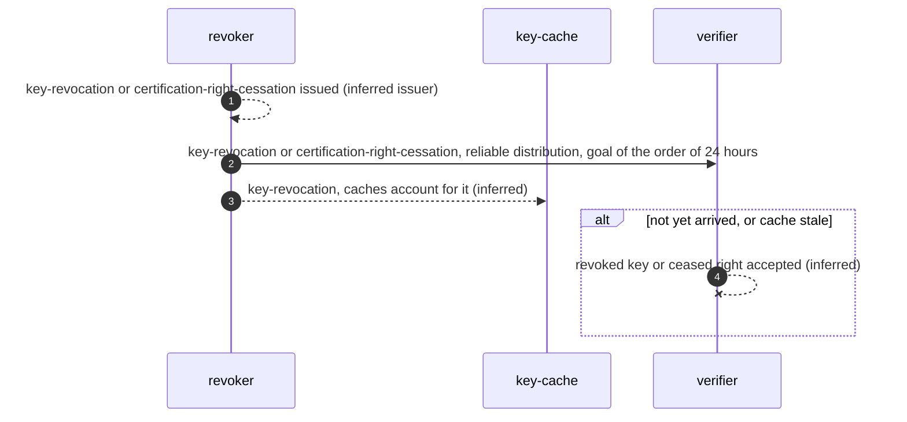

### 19. `certification-right-expiration`

Other requirements, "Especially in lower-end applications" and "Reliable
distribution of key revocations" (p.11); item "Timestamping / notary services"
(p.10). *Status: tentative.* Administrators "will change, and you will no longer
want them to be able to certify", but "you will usually also not want all keys
they have generated to expire". "This may imply a 'certification right
expiration' certificate requirement, probably to be implemented together with
notary services." **Inferred:** step 2 (timestamping each certification),
step 3 (the trigger, issuer and delivery of the expiration certificate) and
step 4 (the verifier enforcing the stated intent).

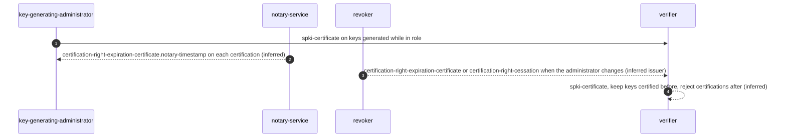

### 20. `reputation-voucher-introduction`

List item "I might generate a certificate (a 'reputation voucher')" (p.6).
*Status: brainstorm use.* I testify to "my friend's political opinion (e.g., libertarian
cypherpunk) or physical characteristics or anything else of interest" so as to "introduce him
to another friend". **Inferred:** step 2, the friend presenting it.

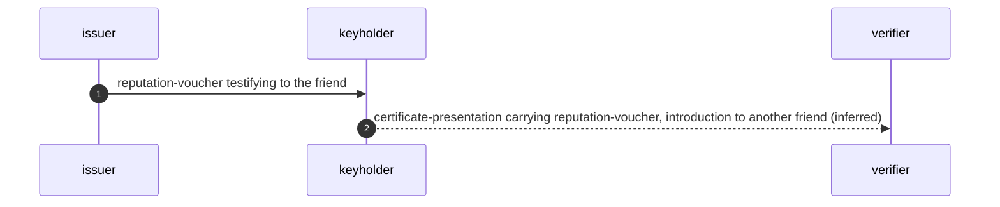

### 21. `mail-receiver-certification-chain`

List items "I am the current legitimate owner of a this DNS name or subtree"
and "I am the legitimate receiver of mail" (p.10). *Status: brainstorm use.* The
statement "might need to be signed by a key which itself had been certified by
the appropriate 'DNS name owner' certificate", for when "I know someone owns a
particular e-mail address but I don't know their key". **Inferred:** no step,
but the source hedges ("might need"). Who signs the DNS name owner certificate,
and how the verifier obtains the chain, are not stated. The first-person wording
is recorded as an ambiguity.

```mermaid
sequenceDiagram
  autonumber
  participant D as dns-name-owner
  participant I as issuer
  participant K as keyholder
  participant V as verifier
  D->>D: dns-name-ownership-certificate, owner of the DNS name or subtree
  D->>I: dns-name-ownership-certificate certifies this key
  I->>K: email-receiver-certificate, legitimate receiver of mail at the address
  V->>V: email-receiver-certificate, from a known address to the unknown key via the chain
```

### 22. `software-certification`

List item "I want a certificate for some software" (p.6). *Status: brainstorm
use.* The subject is software, not a keyholder. The user wants "to make sure it
hasn't changed and that some reputable company or person stands behind it".
**Inferred:** step 1, issuance and delivery. The do-not-run outcome is inferred.

```mermaid
sequenceDiagram
  autonumber
  participant S as software-vouchee
  participant V as verifier
  S-->>V: software-certificate (inferred)
  V->>V: software-certificate, before running, check the software has not changed
  alt changed
    V--xV: do not run (inferred)
  end
```

### 23. `negative-fact-as-positive-attribute`

Open Questions Q3 (p.12). *Status: considered.* "The absence of attributes can be
determined only if all relevant records are digitized and all parties have
inescapable IDs." Still, the source answers:

> A certificate can communicate the 'positive' attribute "not already married" or "not registered as a voter in any other district".

That holds provided "some organization is capable of determining that fact".
"The method of determining such a negative fact is not part of the
certificate definition." **Inferred:** step 3, presentation for a marriage
license.

```mermaid
sequenceDiagram
  autonumber
  participant G as negative-fact-organization
  participant K as keyholder
  participant V as verifier
  G->>G: negative-fact-attribute-certificate.attribute, determine the negative fact, method outside the certificate definition
  alt records not all digitized or IDs escapable
    G--xG: absence cannot be determined
  end
  G->>K: negative-fact-attribute-certificate with the positive attribute not already married
  K-->>V: certificate-presentation carrying negative-fact-attribute-certificate, for a digital marriage license (inferred)
```

### 24. `blinded-key-attribute`

§General Requirements ¶8 (p.3). *Status: required capability.* "Because one use
of SPKI certificates is in secret balloting and similar applications, an SPKI
certificate must be able to assign an attribute to a blinded signature key."
Blinding is not described. **Inferred:** step 1, submission of the blinded key.

```mermaid
sequenceDiagram
  autonumber
  participant K as keyholder
  participant I as issuer
  K-->>I: keyholder-identifier.blinded-signature-key (inferred)
  I->>K: spki-certificate assigning an attribute to the blinded key
```

### 25. `online-directory-lookup` (historical)

§Background ¶1 (p.2). *Status: historical.* Diffie and Hellman's public-key
"telephone book": "look up his or her desired communication partner in the
directory, find that person's public key and open a secure channel to that
person." Kohnfelder noted that "an on-line service has the disadvantage of being
a performance bottleneck". **Inferred:** none.

```mermaid
sequenceDiagram
  autonumber
  participant P as communicant
  participant D as online-directory
  P->>D: public-key-directory.entry-name, look up the partner
  D->>P: public-key-directory.public-key
  P->>P: public-key-directory.public-key, open a secure channel, no prior secret channel needed
  Note over D: an on-line service is a performance bottleneck
```

### 26. `signed-directory-entry` (historical)

§Background ¶1 (p.2). *Status: historical.* "To replace it, he proposed creation
of digitally signed directory entries which he called certificates." The guard
records that "certificate" has since "frequently been assumed to mean a binding
between name and key", which SPKI rejects as the main purpose. **Inferred:**
step 2, off-line verification and use.

```mermaid
sequenceDiagram
  autonumber
  participant D as online-directory
  participant P as communicant
  D->>P: kohnfelder-certificate, a signed directory entry, the first certificates
  P-->>P: kohnfelder-certificate, verify and use without the on-line service (inferred)
```

## What certificates cannot do: non-flows

These are recorded so that nobody builds a flow the source says cannot exist.

| id | question | the source's answer | locator |
|---|---|---|---|
| `prove-non-composition` | prove I did not sign with my stolen key | "certificate format, contents or issuing machinery can not ensure the protection of a user's private key or prove whether or not a private key has been stolen or misused" | Q1, p.11 |
| `title-scan` | title scan for a house | the database of titles and liens "is a project not related to certificate structure" | Q2, p.11 |
| `prove-a-negative` | certify I am not already married | absence needs all records digitized and inescapable IDs; a positive attribute is possible (flow 23) | Q3, p.12 |
| `prevent-key-loaning` | stop a holder lending the private key | "a potential flaw in any system providing authorization"; a delegation-allowed bit would not help | Q4, p.12; p.10 |
| `reader-to-creator-errors` | error messages from reader to creator | deliberately absent; the structure constrains the creator | §Implementation ¶2 |
| `repository-protocol` | a repository protocol | "not for the SPKI WG to specify" | §General Requirements ¶5 |
| `crl-transport` | how a CRL travels | "not specified" | §Validity and CRLs ¶2 |

## The List of Certificate Uses

`use_cases` has 35 entries: the 29 items at the list's top level (the
wallet-card lead-in counted once, with its 33 cards kept verbatim under it) and
the 6 "Other requirements:" items. The three name-binding sub-items share their
parent's entry. 32 entries map to the flows above. Most are instances of flow 3
followed by flow 1, differing only in issuer and authorization: security
clearance (a governmental issuing authority), SAGE, DOC amateur radio licences,
the ephemeral root-access certificate with an application-domain audit identity,
the IP-address-space claim, and the wallet cards. 3 entries map to no flow and
say why: the house-contract and "80-year-old man" items are bare questions with
no mechanism, and "Digital signatures (unforgeability)" is a property, not an
exchange.

## Error paths

*S* means the outcome is stated in the source and *I* that it is inferred. Full
entries, with quotes, are in `error_paths`.

| id | trigger | outcome | basis | locator |
|---|---|---|---|---|
| `certificate-signature-invalid` | signature does not verify | not accepted | I | §Implementation ¶5 |
| `signature-check-needs-reformatting` | check would need reformatting | breaks the requirement; text white-space canonicalization allowed | S | §Implementation ¶5 |
| `reader-complaints-not-a-constraint` | creator relies on reader complaints | prevented by structure; no error message | S | §Implementation ¶2 |
| `certificate-outside-validity-period` | date outside validity period | not valid | I | §Validity ¶1 |
| `crl-location-not-given` | certificate uses a CRL without saying where | breaks requirement; verifier action unspecified | I | §Validity ¶2 |
| `crl-dates-missing-or-overlap` | no dates, or overlapping dates | non-determinism returns | S | §Validity ¶2 |
| `crl-nondeterminism` | minimal CRLs | non-deterministic program behavior | S | §Validity ¶2 |
| `crl-unobtainable` | CRL cannot be fetched | unspecified | I | §Validity ¶2 |
| `crl-signature-invalid` | CRL signature fails or wrong key | unspecified; signer not named | I | §Validity ¶2 |
| `instrument-expired` | CRL or revalidation past lifetime | not usable | I | §Validity ¶5 |
| `zero-lifetime-impossible` | lifetime 0 | not possible; one-use instrument offered | S | §Validity ¶5 |
| `clock-skew` | clocks disagree | deterministic only aside from skew; no tolerance | S | §Validity ¶2, ¶5 |
| `crl-superseded` | CRL meets an earlier one | earlier annihilated (minimal CRL) | S | §Validity ¶2 |
| `certificate-listed-in-crl` | certificate in the CRL | annihilated (minimal CRL) | S | §Validity ¶2 |
| `one-use-instrument-reused` | second use | outside lifetime | I | §Validity ¶5 |
| `one-use-instrument-outside-challenge-response` | delivered outside the protocol | not acceptable | I | §Validity ¶5 |
| `name-unresolved` | name cannot be resolved | unspecified | I | §General Requirements ¶3 |
| `key-hash-mismatch` | key does not match hash | not the subject | I | §General Requirements ¶3 |
| `unique-identification-difficult` | person not uniquely identifiable | unspecified | S | p.6 |
| `personal-binding-tampered` | private directory altered | signature reveals it | I | p.6 |
| `chain-broken` | missing or failing link | unspecified | I | p.6 |
| `untrusted-root` | chain starts at an unchosen key | not trusted | I | p.10 |
| `short-term-certificate-expired` | signed-key certificate expired | no longer equivalent | S | p.9 |
| `purpose-not-listed` | use outside the listed purposes | not equivalent | I | p.9 |
| `delegation-against-rules-by-key-loaning` | holder lends the private key | unpreventable by any bit | S | p.10; Q4 |
| `key-stolen-signature` | signature with a stolen key | certificates cannot prove it | S | Q1 |
| `revocation-not-yet-propagated` | verifier acts before arrival | may accept what is revoked | I | p.11 |
| `stale-cache` | cached key since revoked | served unless the cache accounts for revocations | I | p.11 |
| `certifier-right-ceased` | certification after the right ended | rejected; earlier keys kept | I | p.11 |
| `central-administrator-unreachable` | host auth cannot reach an administrator | must not block | I | p.10 |
| `dossier-aggregation` | many certificates gathered | privacy violation | S | §General Requirements ¶6 |
| `shared-private-key` | departmental certificate | key sharing, rejected | S | p.9 |
| `negative-fact-undeterminable` | records incomplete, IDs escapable | absence undeterminable | S | Q3 |
| `online-service-bottleneck` | every lookup on-line | performance bottleneck | S | §Background ¶1 |

## Source defects and ambiguities

The full entries, with quotes, are in `source_defects_and_ambiguities`.

- **Boilerplate.** The status says "This memo defines an Experimental Protocol";
  the document defines none.
- **Charter against scope.** The charter promises "key acquisition protocols",
  but §General Requirements ¶5 leaves distribution to the keyholder and puts
  repositories out of scope.
- **The CRL as actor.** "If it encounters some certificate that it lists, then
  it annihilates that certificate": the CRL is the grammatical subject, and the
  party applying it is never named.
- **Annihilation scope.** Listing and supersession semantics are given for the
  minimal CRL only. Whether sequence-number supersession survives the
  non-overlap rule is unclear.
- **CRL signer unnamed.** The certificate must say *where* the CRL is, not *who
  signs it*, so a CRL at the right place signed by anyone is not ruled out.
- **Certificate identifier undefined** ("identified uniquely").
- **"negative on-line validations"** and **"revalidation instrument"** are each
  used once and never defined. Their relation to the CRL and to positive
  validation is inferred.
- **One-use challenge/response.** No parties and no binding are given.
- **Clock skew** is named twice with no tolerance.
- **Typos.** "singing someone else's key" (p.6), "I'm the a purchasing agent" and
  "posses" (p.9), "a this DNS name" (p.10).
- **rfc822 item.** The editorial bracket sits inside the certificate statement's
  quotation marks.
- **First-person ownership claims** ("I am the current legitimate owner")
  read as self-signed, which cannot establish ownership. The signer is not named.
- **Dangling [SPKI] citation.** The References list only [DH] and [KOHN]. SDSI,
  NACHA, LDAP and PGP have no references.
- **Wallet list flat.** The cards are at the parent's indent, so where the list
  ends is unmarked.
- **"Other requirements:"** is nested in the brainstorming list. Its "must"
  ("Trust model must be a web") is of unclear force.
- **Web against master certifier.** The trust model "must be a web" while the
  chain example runs through NACHA. They are compatible but never reconciled.
- **Hedged mechanisms.** The delegation-allowed bit ("Maybe"), the certification
  right expiration certificate ("may imply", "probably") and the 24-hour goal
  ("or something like that").
- **"blinded signature key"** is not explained.
- **Page breaks.** Three sentences (SDSI, smart cards, personal binding) and
  one bracketed comment (the signed-key item's) cross page breaks. Quotes stop
  at the break.

## What RFC 2692 does not define

- Any transport, framing or encoding. The certificate structure is left to work
  the document does not cite (library pointer: RFC 2693,
  draft-ietf-spki-cert-structure).
- CRL transmission, CRL format beyond its minimal components, the certificate
  identifier, the CRL signer, and the verifier's response to a missing, expired
  or overlapping CRL.
- Any request or response for positive or negative on-line validation, or the
  party providing it.
- The one-use challenge/response: parties, content, binding.
- Repository protocols.
- Proof of possession of the private key.
- Name resolution. SDSI is named "if possible" and not defined.
- Chain discovery, assembly or delivery.
- Delegation control.
- Key-cache lifetimes and invalidation.
- The revocation distribution mechanism and its issuer. The 24-hour figure is a
  hedged example.
- The certification right expiration certificate and the notary or timestamp
  service it would use.
- Blinding for secret-ballot keys.
- The audit identity format, which belongs to "the domain of the particular
  application".
- Error signalling of any kind.
- Clock synchronization tolerances.

## Message names used

Pass 3 reconciled every message name with `messages.yaml`. A name is an entry
(`messages[].name`), `entry.field` or `entry.variant`, the dotted form
`messages.yaml` itself uses. `message_notes` gives each of the 42 names its
resolution and the pass-1 name it replaced.

Of the 30 names pass 1 used, 9 matched an entry exactly: `spki-certificate`,
`crl`, `revalidation-instrument`, `one-use-instrument`,
`traditional-certificate`, `direct-certificate`, `reputation-voucher`,
`key-revocation` and `certification-right-expiration-certificate`. 19 were
renamed:

| pass-1 name | name now | resolves as |
|---|---|---|
| `authorization` | `spki-certificate.authorization-or-attribute`; in flow 23, `negative-fact-attribute-certificate.attribute` | field |
| `validity-period` | `spki-certificate.validity-period` | field |
| `crl-location` | `spki-certificate.crl-location` | field |
| `public-key` | `keyholder-identifier.public-key` (flows 3, 5); `delegation-certificate.signed-key` (16); `local-key-cache.cached-keys` (17); `public-key-directory.public-key` (25) | variant; fields |
| `public-key-hash` | `keyholder-identifier.key-hash` | variant |
| `name` | `keyholder-identifier.name` (flows 3, 5); `traditional-certificate.name` (6) | variant; field |
| `blinded-signature-key` | `keyholder-identifier.blinded-signature-key` | variant |
| `positive-online-validation` | `revalidation-instrument` | entry; the old name is its alias |
| `negative-online-validation` | `crl` | entry; the old name is its alias |
| `challenge` | `one-use-challenge` | entry |
| `response` | `one-use-instrument` | entry; no response entry exists, and the instrument is what the response delivers |
| `personal-binding` | `personal-binding-certificate` | entry |
| `certificate-chain` | `bank-certificate-chain` (flow 15); `email-receiver-certificate` (21) | entry; the old name is an alias of the first only |
| `short-term-key-certificate` | `delegation-certificate` | entry; the old name is its alias |
| `timestamp` | `certification-right-expiration-certificate.notary-timestamp` | field |
| `dns-name-owner-certificate` | `dns-name-ownership-certificate` | entry; the old name is its alias |
| `mail-receiver-certificate` | `email-receiver-certificate` | entry |
| `signed-directory-entry` | `kohnfelder-certificate` | entry; the old name is its alias |
| `directory-lookup` | `public-key-directory.entry-name` | field; no lookup request exists |

Steps that already named a valid entry were pointed at a more specific one
where `messages.yaml` has an entry for exactly that thing:

- The six keyholder-to-verifier hand-overs (flows 1, 7, 14, 16, 20, 23) are
  `certificate-presentation`, carrying the certificate. Publication in flow 2
  is `repository-publication`, carrying `spki-certificate`.
- Flow 15 steps 1 to 3 are `electronic-check-permission-certificate`,
  `bank-capability-certificate` and `bank-certifier-certificate`. Flow 22 is
  `software-certificate`, and flow 23 step 2 is
  `negative-fact-attribute-certificate`.
- Flow 10 is `crl.minimal`, and flow 9 step 6 is `crl-sequence`.
- The alternative in flows 18 and 19 for "the ceasing of the right to make new
  certificates" is `certification-right-cessation`. `messages.yaml` keeps it
  apart from `certification-right-expiration-certificate`, because the source
  never connects the two.
- Flow 1 step 5 gains the alternatives `revalidation-instrument` and
  `one-use-instrument`, the instruments of the flows its action names.

One name is **not in `messages.yaml`**, and its `message_notes` entry says
so. A second, `online-validation-request` (flows 11 and 12, step 1), has no
source counterpart either; pass 3 added it to `messages.yaml` as an inferred
entry, on the same footing as `one-use-challenge`.

- `signed-request` (flow 14, step 3) has no source counterpart. It is not
  proposed: no source text names a proof of possession.

## Requirements wired to each flow

Each flow's `constrained_by`, as `rfc-2692#R-NNNN` ids from
`requirements.yaml`. Steps carry their own subsets in `protocol.yaml`.

| flow | requirements |
|---|---|
| 1. `direct-certificate-distribution` | R-0005, R-0006, R-0010, R-0012, R-0014, R-0015, R-0016, R-0022, R-0023, R-0030, R-0044, R-0045 |
| 2. `repository-publication` | R-0012, R-0013 |
| 3. `certificate-issuance` | R-0008, R-0009, R-0014, R-0017, R-0018, R-0022, R-0033, R-0035, R-0036, R-0037, R-0038, R-0039, R-0040, R-0042, R-0043, R-0044, R-0045, R-0046, R-0047, R-0048, R-0049, R-0121, R-0125, R-0140, R-0141, R-0142 |
| 4. `authorization-definition` | R-0010, R-0011 |
| 5. `delayed-binding-resolution` | R-0008, R-0009, R-0021 |
| 6. `traditional-certificate-issuance` | R-0020, R-0056, R-0057, R-0058, R-0059 |
| 7. `direct-certificate-self-signing` | R-0012, R-0020, R-0056, R-0060, R-0061, R-0062, R-0063, R-0064 |
| 8. `personal-binding` | R-0019, R-0020, R-0056, R-0065, R-0066, R-0067, R-0068 |
| 9. `crl-validation` | R-0023, R-0024, R-0025, R-0026, R-0027, R-0028, R-0029, R-0031, R-0032 |
| 10. `minimal-crl-propagation` | R-0024 |
| 11. `positive-online-validation` | R-0023, R-0030, R-0031, R-0032 |
| 12. `negative-online-validation` | R-0029, R-0030, R-0031, R-0032 |
| 13. `one-use-instrument-challenge-response` | R-0031, R-0032 |
| 14. `minimal-information-proof` | R-0005, R-0006, R-0007, R-0012, R-0014, R-0015, R-0016, R-0017, R-0119, R-0120, R-0121 |
| 15. `certificate-chain-following` | R-0050, R-0051, R-0052, R-0138, R-0139 |
| 16. `smart-card-short-term-key` | R-0012, R-0035, R-0122, R-0123, R-0124, R-0125 |
| 17. `key-caching` | R-0146, R-0147, R-0150 |
| 18. `revocation-distribution` | R-0148, R-0149, R-0150 |
| 19. `certification-right-expiration` | R-0135, R-0143, R-0144, R-0145, R-0148 |
| 20. `reputation-voucher-introduction` | R-0012, R-0053 |
| 21. `mail-receiver-certification-chain` | R-0128, R-0129, R-0130, R-0131 |
| 22. `software-certification` | R-0055 |
| 23. `negative-fact-as-positive-attribute` | R-0012, R-0075, R-0077, R-0154, R-0155, R-0156, R-0157 |
| 24. `blinded-key-attribute` | R-0018 |
| 25. `online-directory-lookup` | none: §Background history, which `requirements.yaml` leaves out |
| 26. `signed-directory-entry` | none: §Background history, which `requirements.yaml` leaves out |

Eight steps cite nothing, and each says why in `constrained_by_note`. They
are flow 3 step 6 (issuer-to-keyholder delivery, which no requirement covers),
flow 9 step 4 (the CRL signature check), flow 10 step 1 (the minimal CRL
itself), and the five steps of flows 25 and 26. In flow 9, steps 2, 3, 6 and 7
also rest partly on the minimal-CRL description, which `requirements.yaml`
leaves out as text the section rules out. Their notes say so.
