# rfc-2693 — protocol model

## Framing: a theory document whose procedures are examples

RFC 2693 is not a wire protocol. It defines no transport, no framing, no
encoding for anything exchanged, and no error signalling. The abstract says
outright that it "gives the theory behind SPKI certificates and ACLs without
going into technical detail about those structures or their uses", and §6 says
its processing plan "is an example that may be followed, but its primary
purpose is to clarify the semantics of an SPKI certificate". The document
contains **no BCP 14 keyword**. Every guard below rests on the source's own
lowercase wording ("must", "demands", "permits", "has ruled out"), quoted in
`protocol.yaml`.

What the document does give an implementer is procedural, in three parts:

1. **The §6 tuple reduction.** Certificates of any format are verified and
   translated into 5-tuples ⟨Issuer, Subject, Delegation, Authorization,
   Validity⟩ and name 4-tuples. Names are resolved to keys, and the 5-tuples are
   folded left to right from one of the verifier's own unsigned ACL entries,
   whose issuer is the reserved word `Self`. These are precise enough to
   implement and test: AIntersect, VIntersect, threshold reduction and name
   reduction are written here as step lists with inputs, outputs and failure
   conditions.
2. **The §5 validity conditions.** These are on-line tests that narrow a
   certificate's dates: timed CRLs, timed revalidations, one-time revalidations
   and short-lived certificate renewal. The one-time revalidation is the only
   request and response in the whole document. The wandering anti-matter CRL is
   described so that it can be ruled out.
3. **The §7 key-management patterns.** These are ways to use the mechanisms
   rather than protocols: re-pointing a name at a fresh key, a hired revocation
   service, and threshold ACL subjects that elect replacement root keys.

Everything the source does not literally say is marked `inferred` in the YAML.
That includes the access request, the proof that the requester holds the subject
key, the final comparison and the reply, none of which exist in the source.

## Reading `protocol.yaml`

| key | what it holds |
|---|---|
| `roles` | 18 roles, each with locators and verbatim quotes; `kind` is party, local-component, threat or design-option |
| `messages_referenced`, `message_notes` | the 31 message names used, for reconciliation with `messages.yaml`; names with no source counterpart are flagged |
| `flows` | 14 flows, 83 steps; each step has `from`, `to`, `message`, `action`, `basis`, `locator`, `quotes`, `on_error`, `on_error_basis`, and optionally `invokes`, `message_alternatives`, `on_error_quotes`, `note` |
| `algorithms` | 11 local algorithms, 55 steps, with `inputs`, `outputs`, `failure_conditions` and, where the source has them, `source_examples` |
| `design_options` | 9 options the source discusses and does not adopt; none defines a protocol |
| `error_paths` | 40 error paths, each with trigger, detecting role, outcome, basis and quote |
| `source_defects_and_ambiguities` | 21 entries |
| `not_defined` | 22 things an implementer will not find in RFC 2693 |

- **Basis.** `basis: stated` means the step is literally at its locator.
  `inferred` means it is the reading needed to make the stated text
  executable. 22 of the 83 flow steps and 11 of the 55 algorithm steps are
  inferred.
- **Errors.** `on_error_basis` adds `unspecified` for checks whose consequence
  the source never gives. 36 of the 83 flow steps are unspecified, which is the
  source's gap, not the extraction's.
- **Quotes.** Every `quotes` item is one contiguous span of
  `.cache/rfc-2693.txt`, with each run of whitespace collapsed to a single
  space, never crossing a page break, never spliced. All 383 were checked
  mechanically against the source.

## Roles

| role | kind | where the source names it | what it does here |
|---|---|---|---|
| `issuer` | party | §1.1 ISSUER; §4.2 "a delegator"; §5 | signs certificates; delegates; names the issuer of validity confirmations |
| `keyholder` | party | §1.1 KEYHOLDER, SUBJECT; §6.3.4 "the delegatee" | owns the private key the Subject is or resolves to |
| `prover` | party | §6.3.4 "in the order provided by the prover" | finds and orders the reductions, normally the keyholder (inferred) |
| `verifier` | party | §5.2, §5.7.2, §6.3.4, §6.4, §6.5.7 | holds the ACL, verifies, reduces, decides |
| `acl-owner` | party | §1.1 ACL; §3.4; §6.1 "Self" | implicit issuer of the unsigned ACL entries |
| `name-definer` | party | §2.6.1, §2.8, §2.10, §6.2 | issues name certificates in its own name space |
| `validity-confirmation-issuer` | party | §5 "the issuer of validity confirmations" | issues timed CRLs, revalidations, one-time revalidations |
| `fetch-location` | party (our name) | §5.2 "locations where that CRL might be fetched"; §5.6 | serves CRLs and short-lived replacements |
| `requester` | party (our name) | §5.5 "One applies"; §5.6 "the user of the certificate"; §6.6 | the unnamed party asking an on-line service |
| `crc-issuer` | party | §6.6 "the entity doing the computation"; §6.4.1 | signs Certificate Result Certificates |
| `key-revocation-service` | party | §7.6 | revokes a lost working key; cannot create keys |
| `threshold-subordinate` | party | §1.1 THRESHOLD SUBJECT; §6.3.3; §7.7 | holder of one of N subordinate subjects |
| `attribute-certificate-issuer` | party | §3.1 "an authority on the authorization" | issues authorization-to-name certificates |
| `id-certificate-issuer` | party | §3.1 "an authority on names"; §8 | issues name-to-key certificates |
| `translator` | local component | §6.1 "via trusted software"; §6.5.3 "root-specific code" | turns credentials into tuples |
| `application` | local component | §6.3.1, §6.5.7 | gives tags meaning; ANDs separate reductions |
| `adversary` | threat | §5.1, §3.1, §8 | blocks CRLs, subverts issuers, guides name mistakes |
| `naming-authority` | design option | §7.2 | rejected single global naming body |

## Flows

Fourteen flows. Every flow with two or more parties has a sequence diagram.
Inferred steps say so in the arrow text. A crossed arrow (`--x`) is a failure
outcome.

### 1. `authorization-decision` (§3, §6, §6.3.4, §6.6, §4.1.4, §6.5.7)

*Status: example processing plan.* This is the end-to-end flow, and every other
flow and algorithm plugs into it. The source gives the three stages (verify and
translate, replace names, reduce 5-tuples) and the prover's duty to order the
reductions. It does not give the request, the proof that the requester holds
the final Subject key, the comparison against the request, or the reply. Two
stated guards apply. Every computation must be deterministic (§5.1). The final
delegation bit does not limit exercise: "The subject of a certificate or ACL
entry may exercise any permission granted" (§4.1.4).

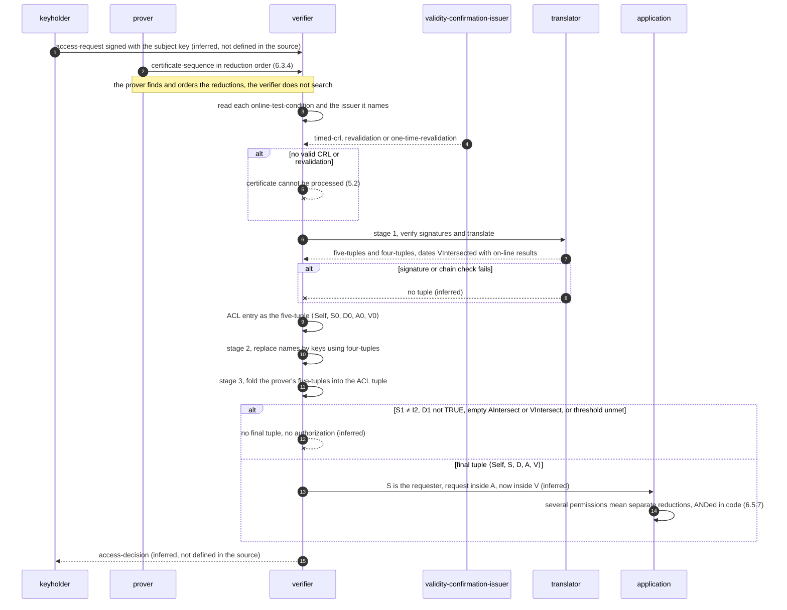

### 2. `delegation-by-certificate-issuance` (§1.1, §4, §4.1.4, §4.2, §4.3, §6.3.4)

*Status: described pattern.* Authority enters at an ACL entry and flows down by
certificates. Each issuer passes on all or part of what it holds and decides
with one boolean whether the delegatee may pass it on again. The group chose
boolean control over integer depth and over no control (§4.1). **Nothing is
checked at issuance**: the D1 = TRUE condition is applied at the verifier, and
over-broad grants are narrowed by AIntersect rather than rejected. Two stated
guards matter to an implementer:

- width is uncontrolled (§4.1.4);
- authority granted to a *name* can be re-delegated at will by whoever defines
  the name, whatever the delegation bit (§7.5).

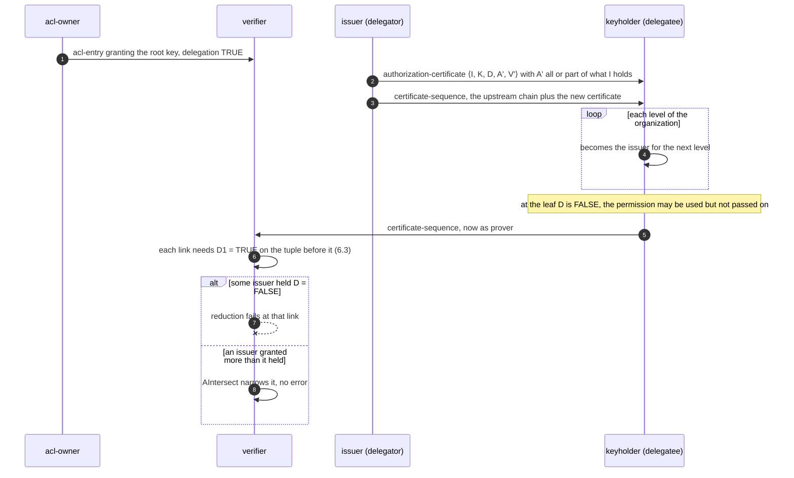

### 3. `certificate-path-discovery` (§6.3.4, §6.4)

*Status: example processing plan.* Path finding belongs to the prover. Normally
it already holds the sequence handed over when it was delegated to. The general
algorithm for an unordered set "has been solved[ELIEN]", but the document does
not give it. The verifier "need only do as it is told". The only rule for a
verifier with an unordered pool covers names; for 5-tuples there is none.

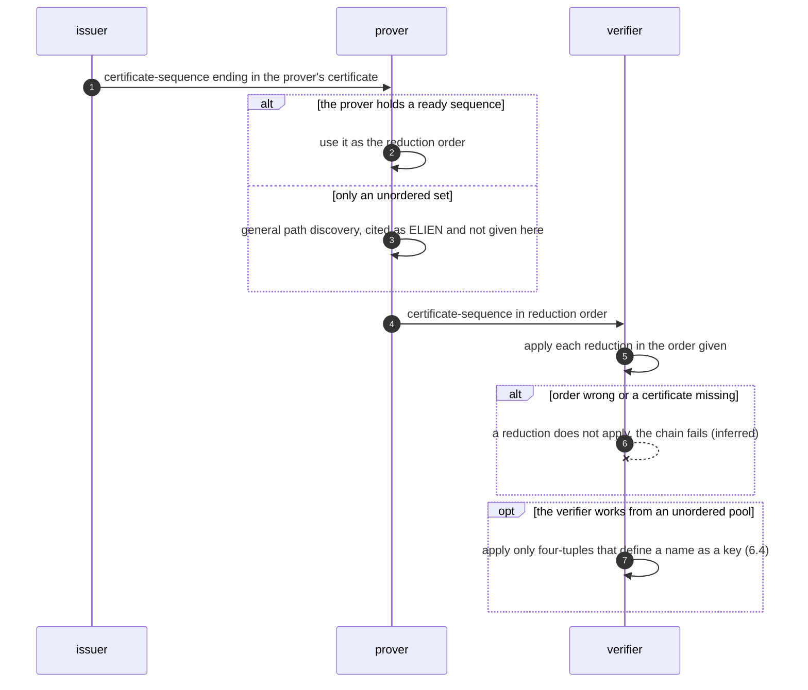

### 4. `timed-crl-check` (§5, §5.2, §5.4, §5.5, §6, §6.3.2)

*Status: permitted with conditions.* SPKI permits CRLs only in timed form,
under three conditions:

1. The certificate lists the CRL-signing key.
2. Every CRL carries validity dates.
3. Successive CRLs never overlap.

Under these rules the CRL is "a completion of the certificate, rather than a
message to the world announcing a change of mind". Without a valid CRL the
certificate cannot be processed (stated). The validity interval is a
risk-management choice, and it bounds revocation latency: "That is the earliest
one can revoke a certificate one learns to be false" (§5.4). The source never
says, for timed CRLs, that a listed certificate is rejected; that step is
inferred.

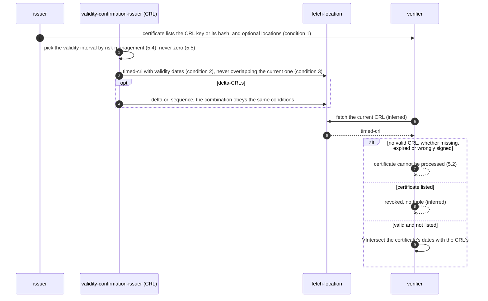

### 5. `timed-revalidation-check` (§5.3, §5.2, §5.4, §6.3.2)

*Status: permitted with conditions.* A revalidation is the positive counterpart
of a CRL. It usually lists one certificate and may list a set "to save digital
signature effort". §5.3 imposes the §5.2 rules by reference. Their translation
to revalidations (the certificate names the revalidation key; the ranges do not
overlap) is that cross-reference, so the steps that depend on it are inferred.
The source does not say who fetches or carries the revalidation.

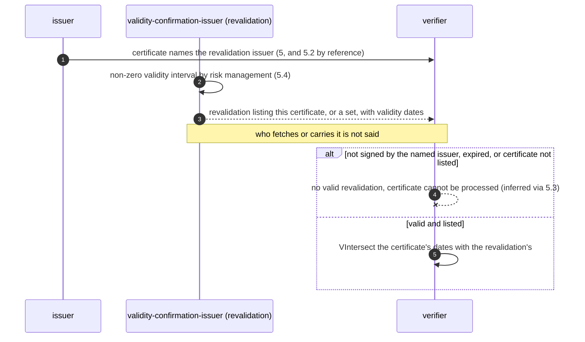

### 6. `one-time-revalidation` (§5.5, §5)

*Status: SPKI defines it, but this document gives no format.* This is the only
request and response in the document. "One applies" with a request containing a
nonce. The signed answer returns the nonce "in order to prevent replay attacks".
The answer counts as a zero-length validity interval "starting and ending at the
time the authorization computation completes", and it is worthless afterwards.
The source does not say who applies or who chooses the nonce. Because the nonce
exists to stop replay, the verifier is the natural applicant (inferred).
VIntersect fails only when Vmin > Vmax, so a zero-length interval passes it.

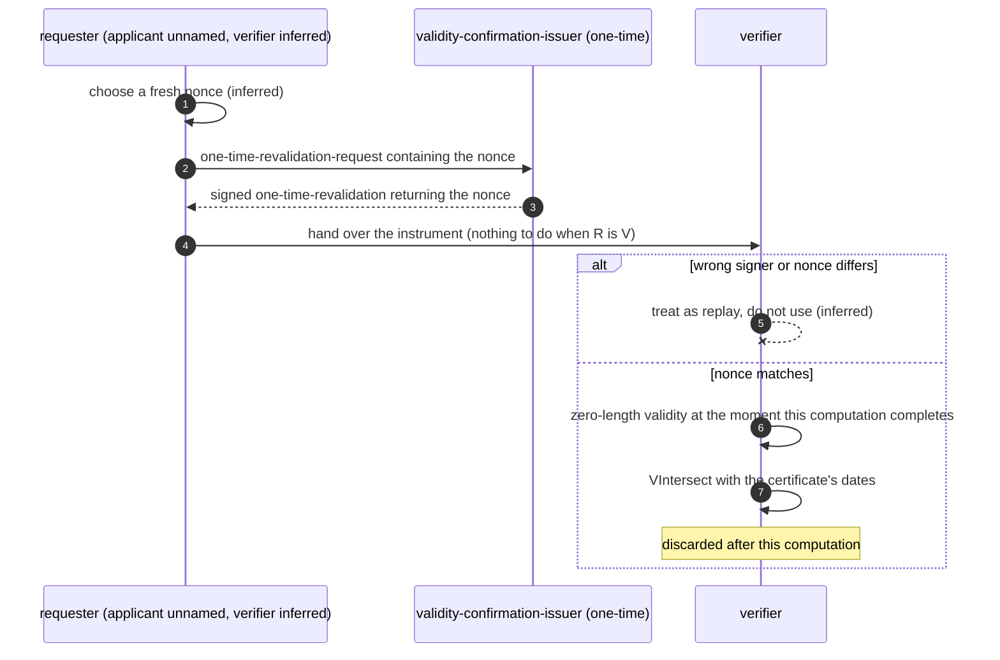

### 7. `short-lived-certificate-renewal` (§5.6, §7)

*Status: SPKI defines it, but this document gives no format.* Instead of a long
certificate plus an on-line test, the issuer issues certificates that expire
soon. A "kind of online test statement" tells the user of the certificate where
to fetch the replacement. The source counts this as cheaper whenever the same
key would sign the test result, and always cheaper in signature verifications.
This is also where §7's principle lands: "all key lifetime control becomes
certificate lifetime control". The source does not say whether the user of the
certificate is its keyholder or a verifier.

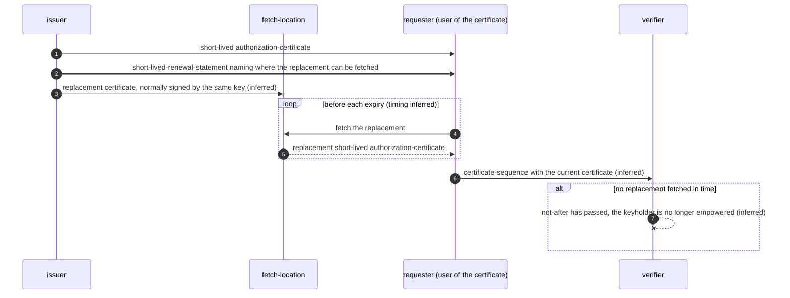

### 8. `anti-matter-crl-dissemination` (§5.1)

*Status: ruled out.* This is the early CRL modelled on the bad-cheque book at a
checkout counter. Each CRL is a sequence-numbered list that is released whenever
the issuer likes and spreads by any route. It annihilates the certificates it
lists and any older CRL it meets. The result is timing dependent, and an
adversary who blocks delivery prevents revocation with "merely network
tampering". "SPKI has ruled out the use of wandering anti-matter CRLs for its
certificates." The flow is kept because the timed CRL rules are built against
it.

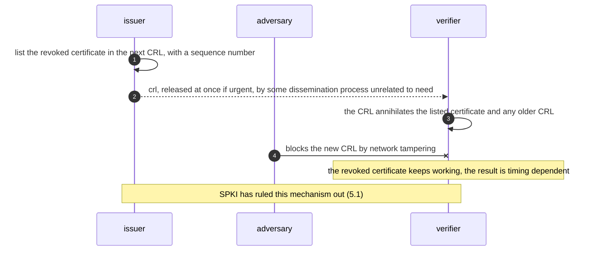

### 9. `certificate-result-certificate-issuance` (§6.6, §6.3.2, §6.4.1)

*Status: example processing plan.* An entity reduces a chain to answer form 2
of the authorization question, "What is Subject S allowed to do, under this ACL
and with this set of certificates?". It then signs the answer as a new
certificate. For a long-lived result, VIntersect may carry the union of the
chain's on-line tests forward instead of evaluating them. A CRC service may also
resolve the names inside a threshold subject and leave it in threshold form. The
source does not say who asks for the CRC, or how a later verifier comes to
accept its issuer, given that the CRC answers "under this ACL" but is not
signed by the ACL's `Self`.

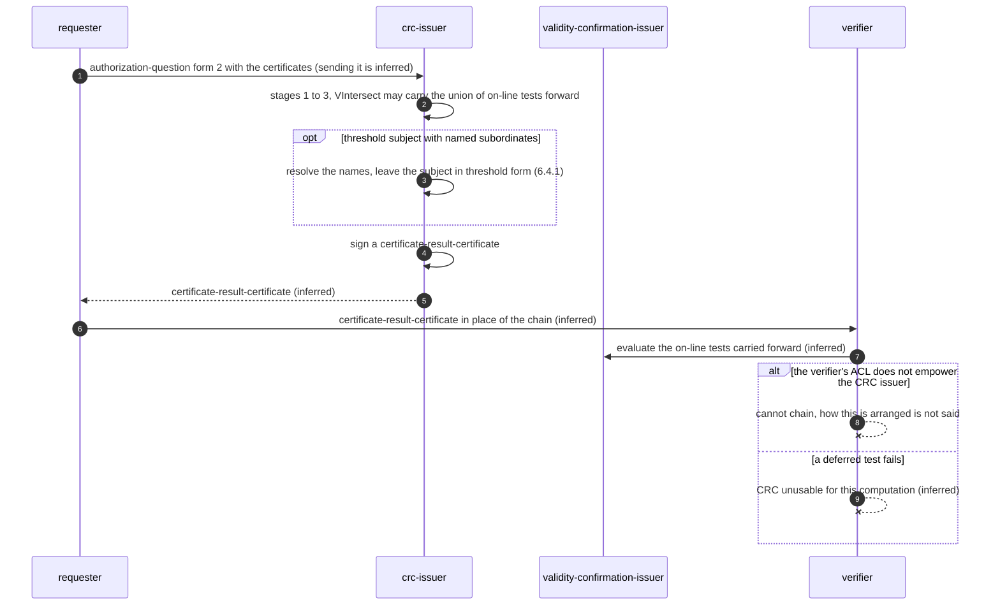

### 10. `attribute-plus-id-authorization` (§3.1, §6, §6.5.4, §8)

*Status: described pattern.* This is the X9.57 path. An attribute certificate
grants an authorization to a name, and an ID certificate binds that name to a
key. The verifier needs both, which means trusting two issuers and matching a
name across their name spaces. §8 gives both as the reasons a direct
authorization certificate is more secure, and both vanish when one issuer issues
both certificates.

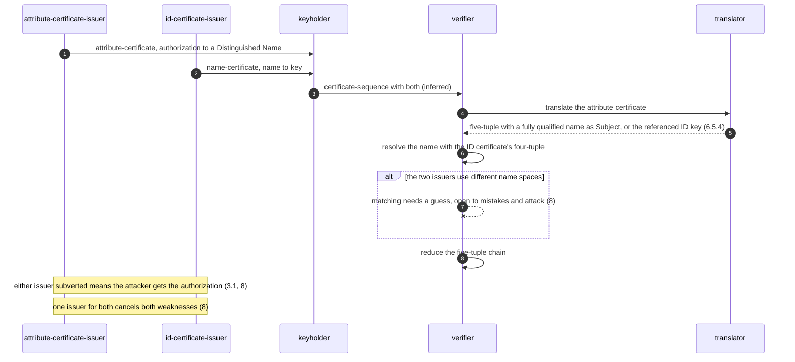

### 11. `name-definition` (§2.6.1, §2.6.2, §2.8, §2.10, §6.2, §7.3)

*Status: described pattern.* Every name is local to the key that defines it.
Several certificates for one name define a group, and names chain through other
definers' names. Inside a certificate a local name belongs to the issuer's name
space; outside one it must carry its key, for example
`(name (hash sha1 |TLCgPLFlGTzgUbcaYLW8kGTEnUk=|) jim therese)`. A stated guard
from §2.4 covers any global identifier that cannot be avoided: it should have no
recognisable sub-field and come from a sparse space.

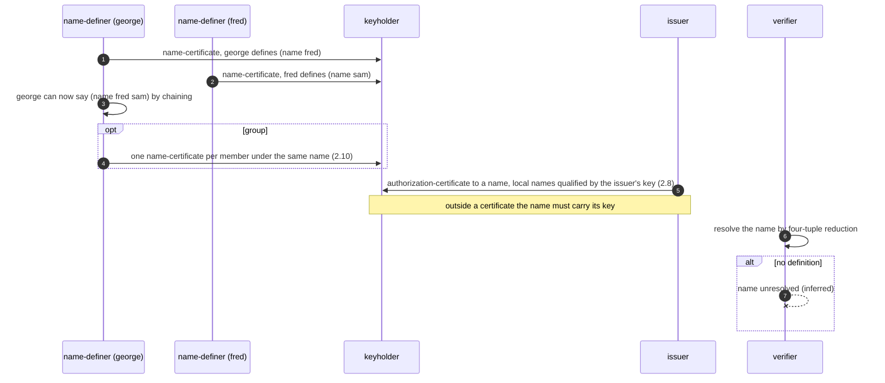

### 12. `key-management-via-name-certificates` (§7, §7.3, §7.4, §7.5)

*Status: described pattern.* SPKI has no way to declare a key bad: under SPKI
"one does not declare a key to be bad but rather stops empowering it and instead
empowers some other key." Authorizers therefore grant to a fully qualified name that hangs off
a long-lived naming root key. That key is kept off line and used rarely, and the
keyholder re-points the name at a fresh working key whenever it likes.

Granting to the root key directly (§7.5, model 2) also works, but changes what
can be delegated. Without delegation TRUE the root key can pass nothing to a
working key. Model 1, the name subject, lets it delegate "at will through
<name,key> certificates". The source asks for key replacement to be announced
but gives no mechanism for it.

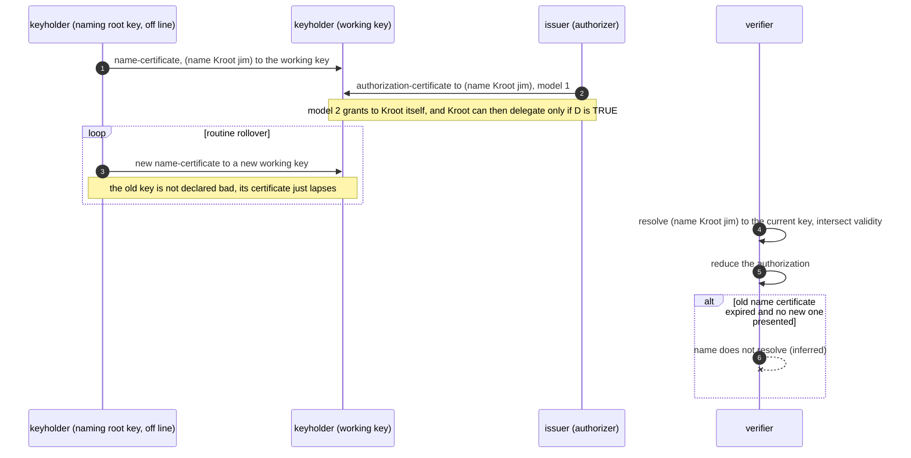

### 13. `key-revocation-service` (§7.6, §5, §5.4)

*Status: described pattern.* The certificate from the master key to the more
temporary key carries an on-line validity test, and someone on line has to
supply it. The user may hire a service with "a 24x7 manned desk, to receive
phone calls reporting loss of a key". The service can revoke the current key
and can never create one. That it revokes by withholding revalidations or by
listing in a CRL is inferred from §5. Losing the master key itself is handled
like a lost wallet: every upstream issuer re-issues through the new master key
and, if the old one was stolen, cancels the old authorizations. No cancellation
mechanism is given.

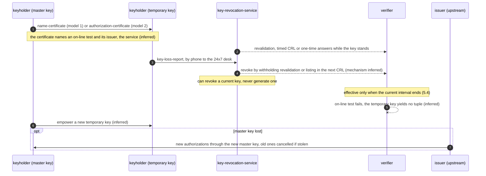

### 14. `threshold-acl-membership-change` (§7.7, §6.3.3, §1.1)

*Status: described pattern.* "Truly long lifetimes come from replacement, not
just redundancy." Putting a threshold subject in place of a single root key
gives redundancy, of algorithms as well as of keys. Giving the ACL's own
`(tag (acl-edit))` entry to a larger threshold of the same keys gives
replacement. The source's example is `(k-of-n #03# #07# K1 ... K7)` for normal
entries and `(k-of-n #05# #07# K1 ... K7)` for `acl-edit`, which lets a quorum
elect new members and retire failed or compromised ones.

The source does not describe how an edit is requested or checked. The steps
below apply the glossary's mechanism, in which subordinates agree "by delegating
their shares along to the same object or key". They are inferred, and they need
the `acl-edit` entry to carry delegation TRUE.

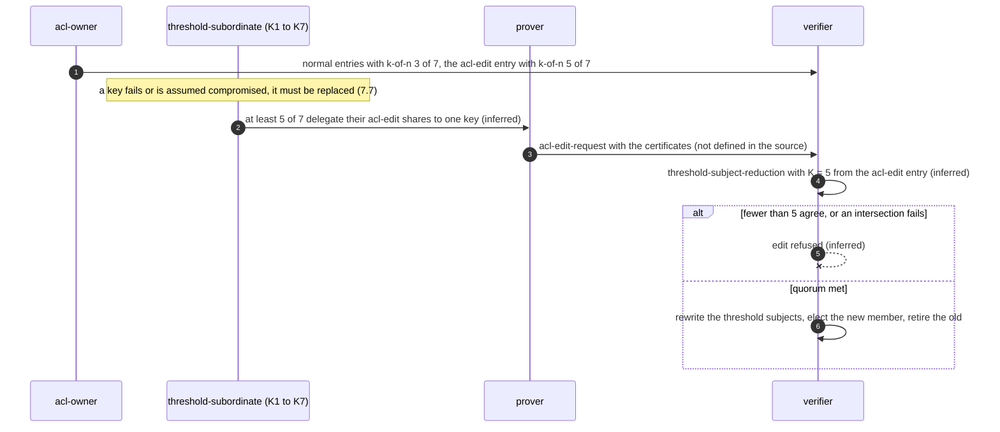

## Algorithms

Eleven local algorithms, each a flowchart. In the YAML each has explicit
`inputs`, `outputs`, numbered steps with `on_error`, `failure_conditions` keyed
to `error_paths`, and the source's own worked examples as `source_examples`
(seven for AIntersect, two for name reduction, one for VIntersect, one fully
qualified name). The examples are recorded so the algorithm is checkable against
them. The fixtures themselves belong to `examples/`.

### A1. `certificate-to-tuple-translation` (§6, §6.1, §6.2, §6.5, §3.4)

Stage 1. Translation per format is stated for ACL entries, SPKI, SDSI 1.0,
X.509v1, PGP, X.509v3, X9.57 and SSL; `translation_rules` holds each mapping
with its quote. X.509 and PGP verification are left to "the written
documentation" for each root and to "web-of-trust rules"; the source gives
neither.

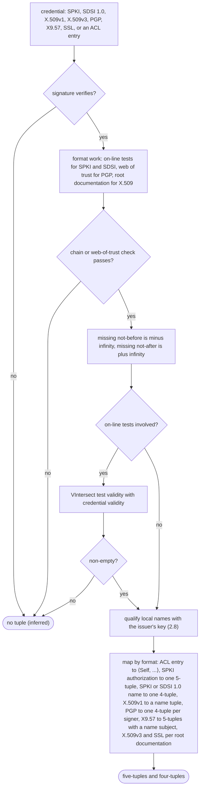

### A2. `name-qualification` (§2.8, §2.9, §6.5.4)

A local name inside a credential belongs to the issuer's name space. Outside
any credential it must already carry its key. X.509 names become
`(name <root key> <leaf name>)`, or the CA-chain form when leaf names are unique
only per CA.

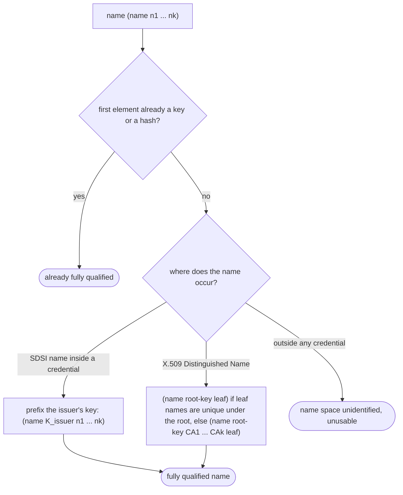

### A3. `four-tuple-name-reduction` (§6.4, §6.4.2)

The rule is "replace the name just defined by its definition", applied in the
prover's order. A class 1 4-tuple defines a name as a key and a class 2 as
another name. Class 2 names "temporarily grow". Two cases are inferred and
marked:

- the bare-key result when no names remain;
- a 4-tuple whose subject is a threshold function, which §6.2 allows but §6.4
  never classifies.

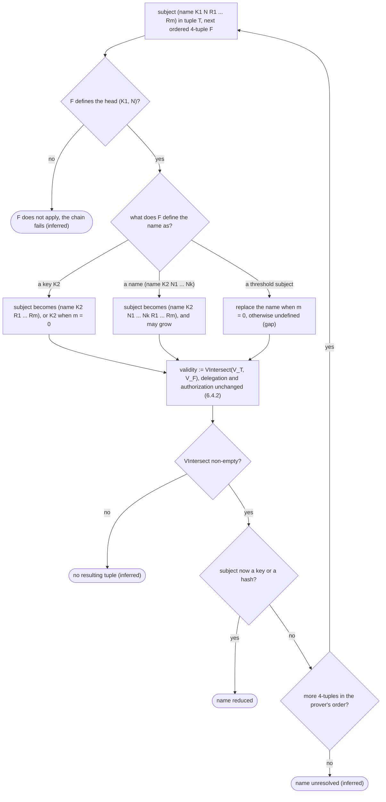

### A4. `unordered-pool-name-reduction` (§6.4)

A verifier with an unordered pool applies only class 1 4-tuples and brings
class 2 4-tuples into class 1. In the source's words, such applications should
"eventually reduce all names to keys", and "Any naming loops are avoided by this
process." The mechanics of the conversion and
the fixpoint are inferred.

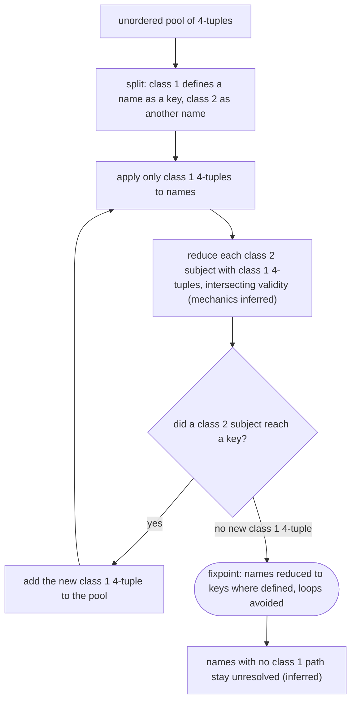

### A5. `four-tuple-validity-intersection` (§6.4.2)

Name reduction narrows validity and nothing else. Delegation and authorization
pass through unchanged, which is the mechanism behind §7.5: a key reached
through a name inherits the delegation bit of the tuple that named it.

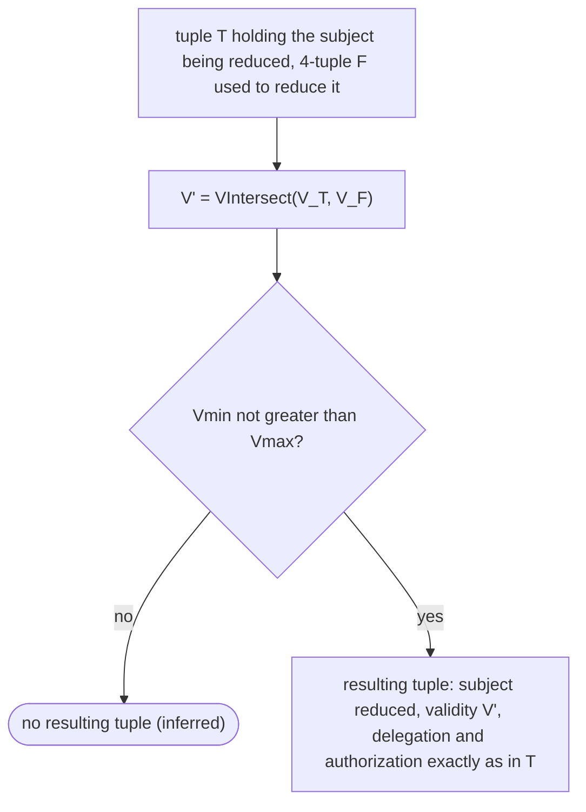

### A6. `four-tuple-threshold-subject-reduction` (§6.4.1)

Named subordinate subjects are reduced independently, with validity
intersection only. The subject may then be left in threshold form, which is the
CRC-service use, or the reduction can continue into A11.

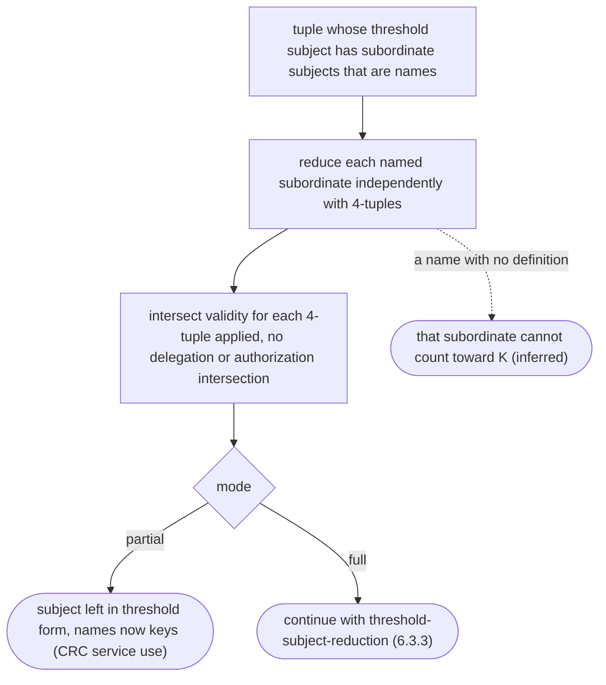

### A7. `five-tuple-reduction` (§6.3)

The rule is ⟨I1,S1,D1,A1,V1⟩ + ⟨I2,S2,D2,A2,V2⟩ yields
⟨I1,S2,D2,AIntersect(A1,A2),VIntersect(V1,V2)⟩. It applies "provided the two
intersections succeed, S1 = I2 and D1 = TRUE". The rule is not commutative.
Whether a key equals a hash of that key is not defined.

```mermaid
flowchart TD
  s1["T1 = ⟨I1,S1,D1,A1,V1⟩, T2 = ⟨I2,S2,D2,A2,V2⟩"] --> d0{"S1 a threshold subject?"}
  d0 -->|yes| t1(["threshold-subject-reduction (6.3.3)"])
  d0 -->|no| d1{"S1 = I2?"}
  d1 -->|no| f1(["no tuple"])
  d1 -->|yes| d2{"D1 = TRUE?"}
  d2 -->|no| f1
  d2 -->|yes| s2["A = AIntersect(A1, A2)"]
  s2 --> d3{"succeeded?"}
  d3 -->|no| f1
  d3 -->|yes| s3["V = VIntersect(V1, V2)"]
  s3 --> d4{"succeeded?"}
  d4 -->|no| f1
  d4 -->|yes| g1(["⟨I1, S2, D2, A, V⟩"])
```

### A8. `five-tuple-chain-reduction` (§6, §6.3, §6.3.4)

The source states the binary rule and the prover's order. The left fold from
the ACL tuple is inferred from those two statements. Issuer `Self` survives to
the end because the result always keeps I1.

```mermaid
flowchart TD
  s1["acc := the ACL entry tuple ⟨Self, S0, D0, A0, V0⟩"] --> d1{"more tuples in the prover's order?"}
  d1 -->|no| g1(["final authorization result ⟨Self, S, D, A, V⟩"])
  d1 -->|yes| d2{"acc's subject is"}
  d2 -->|"a name"| s2["four-tuple-name-reduction"]
  d2 -->|"a threshold subject"| s3["threshold-subject-reduction"]
  d2 -->|"a key or a hash"| s4["acc := five-tuple-reduction(acc, next tuple)"]
  s2 --> d3{"succeeded?"}
  s3 --> d3
  s4 --> d3
  d3 -->|yes| d1
  d3 -->|no| f1(["no result, the verifier does not search (inferred)"])
```

### A9. `aintersect` (§6.3.1)

"AIntersect() is normal set intersection". A normal list means all lists that
start with its elements, `(*)` means everything, and `(* set ...)`,
`(* prefix ...)` and `(* range ...)` mean what their names say. A shorter list
is padded with `(*)`.

The stated parts are the semantics and the seven worked results: the ftp
narrowing, the four `AIntersect` examples, the range failure, and the SSL
trailing-`(*)` equivalence. The per-case procedure below is inferred from them.
Range with range, range with prefix, the range operators (`ge`, `le`) and
numeric order over byte strings are not defined.

```mermaid
flowchart TD
  s1["AIntersect(a, b)"] --> d1{"either is (*)?"}
  d1 -->|yes| r1(["the other operand"])
  d1 -->|no| d2{"either is a (* set ...) form?"}
  d2 -->|yes| s2["intersect each member with the other side, keep successes in first-operand order (inferred)"]
  s2 --> d2a{"how many survive?"}
  d2a -->|none| f1(["fails to intersect"])
  d2a -->|one| r2(["that result"])
  d2a -->|several| r3(["(* set results)"])
  d2 -->|no| d3{"both plain lists?"}
  d3 -->|yes| s3["pad the shorter with (*), intersect element by element, type element included"]
  s3 --> d3a{"every element succeeds?"}
  d3a -->|no| f1
  d3a -->|yes| r4(["list as long as the longer operand"])
  d3 -->|no| d4{"both byte strings?"}
  d4 -->|yes| d4a{"equal?"}
  d4a -->|yes| r5(["that string"])
  d4a -->|no| f1
  d4 -->|no| d5{"prefix or range form against a byte string?"}
  d5 -->|yes| d5a{"string starts with the prefix, or lies within the limits?"}
  d5a -->|yes| r6(["the byte string"])
  d5a -->|no| f1
  d5 -->|no| d6{"prefix with prefix?"}
  d6 -->|yes| d6a{"does one prefix extend the other?"}
  d6a -->|yes| r7(["the longer prefix"])
  d6a -->|no| f1
  d6 -->|no| d7{"byte string, prefix or range against a list?"}
  d7 -->|yes| f1
  d7 -->|no| u1(["range with range, range with prefix: set intersection, no written form given (gap)"])
```

### A10. `vintersect` (§6.3.2, §6.1, §6)

The definition is Vmin = max(Xmin, Ymin) and Vmax = min(Xmax, Ymax), and
"if Vmin > Vmax, then the intersection failed". Equal bounds therefore succeed.
Missing dates default to minus or plus infinity, and daytimes must be monotonic.
"The full SPKI VIntersect() also deals with online tests", either evaluating
them now or deferring their union to the end for a CRC.

```mermaid
flowchart TD
  s1["X = (Xmin, Xmax), Y = (Ymin, Ymax), a missing not-before is minus infinity, a missing not-after is plus infinity"] --> s2["Vmin = max(Xmin, Ymin), Vmax = min(Xmax, Ymax)"]
  s2 --> d1{"Vmin greater than Vmax?"}
  d1 -->|yes| f1(["the intersection failed"])
  d1 -->|"no, equal bounds succeed"| d2{"on-line tests on the certificate?"}
  d2 -->|none| g1(["V = (Vmin, Vmax)"])
  d2 -->|"immediate mode"| s3["evaluate each test, intersect its interval with V"]
  s3 --> d3{"all pass and non-empty?"}
  d3 -->|yes| g1
  d3 -->|no| f2(["no valid interval (inferred)"])
  d2 -->|"deferred mode, for a CRC"| s4["carry the union of the tests in the accumulating tuples, evaluate them at the end"]
  s4 --> g2(["V plus pending tests"])
```

### A11. `threshold-subject-reduction` (§6.3.3, §6.3, §1.1)

The source states the procedure:

1. Copy the tuple once per subordinate subject.
2. Select K of the N and set the other N−K to `(null)`.
3. Reduce each selected copy independently until K share a subject.
4. Validity-, authorization- and delegation-intersect those K.

Delegation intersection is never defined, and logical AND is inferred. Each
delegation step inside a branch is an ordinary 5-tuple reduction, so it needs
D = TRUE on the tuple before it (inferred).

```mermaid
flowchart TD
  s1["T = ⟨I, (k-of-n K N S1 ... SN), D, A, V⟩"] --> d1{"K at least 1, at most N, and N subordinates given?"}
  d1 -->|no| f1(["malformed, no reduction (inferred)"])
  d1 -->|yes| s2["copy T once per subordinate: Ti = ⟨I, Si, D, A, V⟩"]
  s2 --> s3["select K of them, set the other N-K to (null)"]
  s3 --> s4["reduce each selected Ti through its own certificates, by 5-tuple and 4-tuple reduction"]
  s4 --> d2{"do K entries share one subject?"}
  d2 -->|no| f2(["threshold not met, no tuple (inferred)"])
  d2 -->|yes| s5["VIntersect the validities, AIntersect the authorizations, AND the delegation bits (AND inferred)"]
  s5 --> d3{"intersections non-empty?"}
  d3 -->|no| f3(["no tuple (inferred)"])
  d3 -->|yes| g1(["one tuple ⟨I, S, D', A', V'⟩ replaces the list"])
```

## Design options the source discusses and does not adopt

None of these defines a protocol. They are recorded so that nobody mistakes
them for SPKI mechanisms.

| option | locator | status | why |
|---|---|---|---|
| Micali hash-chain validation | §5.7.1 | mentioned, not defined | patented; only its effect on the performance comparison is noted |
| verifier-decided validity (Rivest) | §5.7.2 | not adopted | "not reflected in the SPKI structure definition" |
| inescapable names | §7.1, §2.5 | rejected | "there are no inescapable names for keyholders" |
| single naming authority | §7.2 | rejected | could empower its own keys as anyone; "not likely to be tolerated" |
| integer delegation depth | §4.1.3, §4.1.4 | rejected | right depth unpredictable; depth does not bound width |
| no delegation control | §4.1.1, §4.1.4 | rejected | the signing-oracle risk is accepted, not removed |
| restrict delegator exercise | §4.2 | rejected | a delegator can delegate to its own fresh key |
| aggregated master certificate | §3.2 | rejected | "authorizations be limited to one per certificate" |
| ACL with group certificates | §4.3 | argued against | the ACL grows huge and needs nested ACLs of its own |

## Error paths

Forty error paths. The full entries, with quotes, are in `error_paths`. *S* means
the outcome is stated in the source and *I* that it is inferred.

| id | trigger | outcome | basis | locator |
|---|---|---|---|---|
| `signature-invalid` | signature does not verify | no tuple | I | §6 |
| `chain-validation-failed` | X.509 chain or PGP web of trust fails | no tuple | I | §6.5.1–§6.5.3 |
| `no-valid-crl` | no valid CRL for a certificate that might use one | cannot be processed | S | §5.2 |
| `crl-signed-by-wrong-key` | CRL not signed by the listed key | not a valid CRL | I | §5.2 |
| `certificate-listed-in-crl` | certificate in the current CRL | revoked, no tuple | I | §5.1, §5.2 |
| `crl-ranges-intersect` | new CRL takes effect before the current one expires | issuer breaks condition 3; verifier action unspecified | S | §5.2 |
| `zero-length-crl-interval` | zero-length CRL or revalidation interval | not possible; use one-time | S | §5.5 |
| `verifier-clock-inaccurate` | verifier clock wrong | deterministic, but possibly not what the issuer meant | S | §5.2 |
| `no-valid-revalidation` | no current revalidation | cannot be processed | I | §5.3 |
| `certificate-not-in-revalidation` | revalidation does not list it | no tuple | I | §5.3 |
| `one-time-nonce-mismatch` | returned nonce differs | replay; not used | I | §5.5 |
| `one-time-revalidation-reused` | offered in a later computation | invalid | S | §5.5 |
| `short-lived-replacement-unavailable` | no replacement before expiry | no longer empowered | I | §5.6 |
| `anti-matter-crl-suppressed` | adversary blocks the new CRL | revocation prevented; mechanism ruled out | S | §5.1 |
| `validity-intersection-empty` | Vmin > Vmax | "the intersection failed" | S | §6.3.2 |
| `authorization-intersection-empty` | no common element | "fails to intersect" | S | §6.3.1 |
| `subject-issuer-mismatch` | S1 ≠ I2 | rule does not apply | S | §6.3 |
| `delegation-not-permitted` | D1 not TRUE | rule does not apply | S | §6.3 |
| `threshold-not-satisfied` | fewer than K branches converge | no tuple | I | §6.3.3 |
| `threshold-parameters-invalid` | K, N outside 0 < K ≤ N | malformed | I | §6.3.3 |
| `name-unresolved` | no defining 4-tuple | no later 5-tuple can chain | I | §6, §6.4 |
| `name-definition-mismatch` | 4-tuple does not define the head name | does not apply | I | §6.4 |
| `naming-loop` | cyclic name definitions | avoided by the class 1 only rule | S | §6.4 |
| `misordered-or-incomplete-sequence` | prover's sequence out of order or short | no result; verifier owes no search | I | §6.3.4 |
| `no-path-found` | prover finds no path | nothing to present | I | §6.3.4 |
| `crc-issuer-not-empowered` | verifier's ACL does not empower the CRC issuer | cannot chain; unspecified | I | §6.6 |
| `deferred-online-test-fails` | a carried-forward test fails | result invalid | I | §6.3.2 |
| `subverted-issuer` | one of two issuers subverted | attacker gains access | S | §3.1, §8 |
| `foreign-name-space` | attribute and ID issuers' name spaces differ | name matching error-prone, attackable | S | §8 |
| `common-name-confusion` | human picks an ID by its common name | mistakes, an avenue for attack | S | §2.4 |
| `unqualified-name-outside-certificate` | local name used without its key | unusable | S | §2.8 |
| `key-lent-or-proxied` | holder without delegation lends key or proxies | undetectable; accepted risk | S | §4.1.1, §4.1.4 |
| `delegation-through-name-subject` | grant with D FALSE to a name | definer re-delegates at will | S | §7.5 |
| `temporary-key-lost` | working key lost | service revokes it; cannot replace it | S | §7.6 |
| `master-key-lost` | master key lost | every upstream issuer re-issues; cancels if stolen | S | §7.6 |
| `revocation-latency` | revocation learned while an interval is current | effective at the interval's end | S | §5.4 |
| `root-key-compromised` | threshold root key fails or is suspect | must be replaced by quorum | S | §7.7 |
| `unnoticed-key-theft` | theft not noticed | covered only by routine replacement | S | §7 |
| `non-monotonic-time` | dates not monotonic | VIntersect rules do not hold | S | §6.3.2 |
| `naming-authority-forgery` | a single naming authority turns hostile | could empower its own keys as anyone; design rejected | S | §7.2 |

## Source defects and ambiguities

Twenty-one entries; each has its quotes in `source_defects_and_ambiguities`.

- **Defect, §6.4.1:** cites "[see 6.7]" for Certificate Result Certificates.
  There is no §6.7; CRCs are §6.6.
- **Defect, §5.1:** typographical, "leaving a copies of itself". Quoted
  verbatim.
- **Inconsistency, §6.2 / §6.4 / §6.5:** the name 4-tuple is written three ways:
  - as an element list with Name "a byte string" (§6.2);
  - as `[(name K1 N) -> K2]`, with issuer and name merged and no validity
    (§6.4);
  - as `[Kroot, (name <leaf-name>), K1, validity]` (§6.5).

  The X.509v1 chain form puts a compound name where §6.2 requires a byte
  string.
- **Inconsistency, §5 vs §5.6:** "Three kinds of on-line tests are envisioned",
  then a fourth: the short-lived replacement statement.
- **Gap, §6.2 vs §6.4:** a 4-tuple subject may be a threshold function, yet §6.4
  knows only two classes, key and name.
- **Gap, §6.3.3:** "delegation- intersected" is never defined.
- **Gap, §6.3.4 vs §6.3.3:** reduction follows the prover's order, a sequence,
  but a threshold proof is a tree of K branches. No order is given for the
  branches.
- **Gap, §6.3.1:** several AIntersect cases are missing:
  - no rule or written form for range with range, range with prefix, or prefix
    with set;
  - no rule for whether a one-member set result is written bare;
  - the operators `ge` and `le` are used but undefined;
  - numeric order over byte strings such as `#30#` is unexplained.
- **Gap, §5.1/§5.2:** the timed CRL rules never say that a listed certificate is
  rejected. Nothing covers a verifier that sees overlapping CRLs.
- **Gap, §5.3:** revalidations follow "the same rules" as CRLs, but condition 1
  speaks of the CRL key.
- **Gap, §6.3.2 vs §6.1:** deferred VIntersect carries a union of on-line tests
  in the tuples, but the 5-tuple has no element for them.
- **Gap, §6.6:** a CRC answers "under this ACL" but is signed by the computing
  entity. Its acceptance by later verifiers, and its validity, are not given.
- **Gap, §5.5 / §5.6 / §6.5.7 / References:** "SPKI defines" the one-time
  revalidation and the replacement statement, and SSL tags are left to "the
  examples document". Neither document is cited.
- **Gap, §6.3.3:** `(null)` appears nowhere else.
- **Ambiguity, §6.3:** S1 = I2 where either side may be a key or its hash.
- **Ambiguity, §1.1 / §6.3 / §6.3.3:** convergence "by delegating their shares"
  needs D = TRUE on the threshold tuple. The source never says so, and §7.7's
  example never states its delegation bit.
- **Ambiguity, §5.5:** who applies for a one-time revalidation, and who chooses
  the nonce.
- **Ambiguity, §5.6:** whether "the user of the certificate" is its keyholder or
  a verifier.
- **Ambiguity, §6.4:** name 4-tuples "in the order needed by the prover". The
  order the verifier needs, supplied by the prover, is presumably meant.
- **Ambiguity, §6.5.7:** the source says the leaf server tag "could have been
  abbreviated" from `(tag (* set (ssl) (dns www.datafellows.com)))` to
  `(tag (ssl www.datafellows.com))`. Under §6.3.1 the two denote different sets,
  and the abbreviation would no longer reduce against a separate `(dns)` root.
  The source half-concedes this in the next sentence.
- **Ambiguity, §5.2:** "independent of clock skew, although clock inaccuracies
  in the verifier may produce a result not desired by the issuer".
  Deterministic given the verifier's clock is the consistent reading.

## What RFC 2693 does not define

- Transport and framing: there is no wire protocol and no encoding for anything
  exchanged.
- The formats of certificates, ACL entries, CRLs, delta-CRLs, revalidations,
  one-time revalidation requests and answers, renewal statements and CRCs. The
  document is theory only and cites no structure document.
- The access request, and any challenge-response by which a requester proves it
  holds the private key of the final Subject.
- Error signalling of any kind: no refusal message, error code or diagnostic.
- How on-line test results are retrieved, cached or refreshed. Locations may be
  named, nothing more.
- What a verifier does with a certificate listed in a timed CRL, or with two
  CRLs whose ranges intersect.
- Nonce generation, length and freshness, and who applies for a one-time
  revalidation.
- Clock synchronisation requirements and tolerances.
- The general certificate path discovery algorithm, cited as ELIEN and not
  given.
- The order and packaging of a threshold (tree-shaped) proof.
- AIntersect results across different `*`-forms, the range operators, and the
  alpha, numeric, time, binary and date orderings over byte strings.
- Delegation intersection in threshold reduction.
- Whether a public key equals a hash of it in the S1 = I2 test.
- How a verifier comes to trust the issuer of a Certificate Result Certificate,
  and the CRC's validity.
- The ACL format (deliberately: "it is never communicated"), and any operation
  that edits an ACL.
- The key revocation service's interface (a phone desk) and which on-line test
  it uses to revoke.
- The announcement that §7 says a key replacement needs. Only the new
  certificate itself exists.
- How authorizations issued through a stolen master key are cancelled.
- PGP web-of-trust rules and X.509 chain validation, which are left to their own
  documentation.
- Micali's hash-chain mechanism (ECR) and verifier-decided validity (R98).
- Delta-CRL composition beyond treating the sequence as the current CRL.
- Any limit on delegation depth beyond the boolean, or on width.

## Message names used

These are descriptive names chosen for this file, listed in
`messages_referenced` for reconciliation with `messages.yaml` in the
cross-check pass. Those marked † have no counterpart in the source and are
modelling conveniences for inferred steps.

`access-request` †, `access-decision` †, `acl-edit-request` †,
`authorization-question` (the §6.6 question forms; sending one is inferred),
`key-loss-report` (out of band, §7.6), `certificate-sequence`,
`authorization-certificate`, `name-certificate`, `attribute-certificate`,
`acl-entry`, `five-tuple`, `four-tuple`, `threshold-subject`,
`authorization-tag`, `validity-interval`, `sdsi-name`, `fully-qualified-name`,
`online-test-condition`, `crl` (the ruled-out anti-matter CRL), `timed-crl`,
`delta-crl`, `revalidation`, `one-time-revalidation-request`,
`one-time-revalidation`, `short-lived-renewal-statement`,
`certificate-result-certificate`, `x509v1-certificate`, `x509v3-certificate`,
`pgp-certificate`, `sdsi-1-0-certificate`, `ssl-certificate`.
