# rfc-5280 — protocol model

## Framing: two profiles, two algorithms, no wire protocol

RFC 5280 defines no exchange. Its own description of itself: “This specification profiles the format and semantics of certificates and certificate revocation lists (CRLs) for the Internet PKI. Procedures are described for processing of certification paths in the Internet environment.” (§1) The protocols that would carry certificates and CRLs are elsewhere: “Operational protocols supporting these functions are defined in other PKIX specifications.” (§3.4) Distribution can be anything, because the objects are signed: “Since certificates and CRLs are digitally signed, no additional integrity service is necessary.” (§8)

What the document does give, and how this model represents it:

1. **Issuance flows.** §4 and §5 say what a conforming CA and CRL issuer must emit. Each field and extension is one step of `certificate-issuance` or `crl-issuance`, wired by `constrained_by` to the requirement ids. Delta and indirect CRLs are their own flows.
2. **Retrieval flows.** CDP, freshestCRL, AIA, SIA and the CRL AIA are pointer semantics: they say what a location holds and how a URI is to be read, not how to talk to the server.
3. **Two local algorithms** bound by external behaviour: “Conforming implementations of this specification are not required to implement this algorithm, but MUST provide functionality equivalent to the external behavior resulting from this procedure.” (§6) Basic path validation (§6.1) and CRL validation (§6.3) are written out step by step with every lettered step, their inputs, state variables, failure exits and outputs.
4. **Sub-algorithms**: name constraint matching (§4.2.1.10 with §6.1.3(b)(c) and §6.1.4(g)), DN comparison (§7.1), DNS names (§7.2, §7.3), URIs (§7.4), email addresses (§7.5), delta CRL combination (§5.2.4) and critical-extension handling (§4.2, Appendix B).

Path discovery is outside the source's scope: “The procedure performed to obtain this sequence of certificates is outside the scope of this specification.” (§6.1) The `path-discovery` flow records only the hints the source offers.

## Reading `protocol.yaml`

| key | what it holds |
|---|---|
| `framing` | 4 statements of what kind of document this is, quoted |
| `roles` | 11 roles with the source's names for them, locators and quotes |
| `messages_used`, `message_notes` | the 39 message and object names the steps pass, for reconciliation with `messages.yaml`; names beyond the shared list are flagged |
| `flows` | 13 flows, 105 steps: `from`, `to`, `message`, `action`, `basis`, `locator`, `quotes`, `constrained_by`, `on_error`, `on_error_basis`, and where needed `invokes`, `message_alternatives`, `status`, `note` |
| `algorithms` | 9 algorithms, 128 steps; the two main ones have `inputs`, `state_variables`, `stages` and `outputs`, and each step a `kind`, `condition`, `on_fail` |
| `error_paths` | 40 error paths: trigger, detecting role, where, outcome, basis, quotes |
| `source_defects_and_ambiguities` | 37 entries |
| `not_defined` | 20 things an implementer will not find in RFC 5280 |

- **Quotes.** Every `quotes` item is a contiguous span of `.cache/rfc-5280.txt` with page footers and headers removed, whitespace collapsed and line-end hyphens joined; all were checked mechanically, as were the quotes in this file.
- **Requirements.** `constrained_by` cites `rfc-5280#R-NNNN`. Every §6 entry R-0376 to R-0537 is cited in `basic-path-validation` or `crl-validation` by the step, input, state variable or rule it states, and each lettered step maps to its own entries.
- **Errors.** `on_error_basis` (flows) and `on_fail_basis` (algorithms) are stated, inferred or unspecified. Every check in §6.3.3 is unspecified: the source never says what follows a failed verification there.

## Roles

| role | kind | our name, then the source's names | locators |
|---|---|---|---|
| `ca` | party | ca, certificate issuer, issuer, conforming CA | §3, §3.1, §3.5, §4, §5 |
| `crl-issuer` | party | crl-issuer, conforming CRL issuer | §3, §5, §5.2.5, §5.3.3 |
| `end-entity` | party | end-entity, subject, user | §3, §2.3, §3.2 |
| `relying-party` | party | relying-party, certificate user, certificate-using system, certificate-using client, client, application, conforming application, path validation implementation, conforming implementation, verifier, certificate validator, CRL verifier, CRL validator | §2, §4.1.2.2, §4.2, §6, §6.1, §6.1.1(c), §8 |
| `registration-authority` | party | registration-authority, RA | §3, §3.5(a), §8 |
| `repository` | party | repository, directory, directory server, public repository, HTTP server, FTP server | §3, §3.3, §4.2.1.13, §4.2.2.1, §4.2.2.2, §5.2.7 |
| `trust-anchor` | input | trust-anchor, trusted CA, trust anchor information | §6, §6.1, §6.1.1(d), §6.2, §8 |
| `requester` | party | requester | §3.5(f) |
| `ocsp-responder` | referenced | ocsp-responder, on-line validation service | §3, §3.3, §4.2.2.1 |
| `timestamping-service` | referenced | timestamping-service | §4.2.2.2 |
| `attribute-authority` | mentioned | attribute-authority | §3, §5.2.5 |

The components of the §3 model are defined there: “end entity: user of PKI certificates and/or end user system that is the subject of a certificate;” (§3) “CRL issuer: a system that generates and signs CRLs; and” (§3) “repository: a system or collection of distributed systems that stores certificates and CRLs and serves as a means of distributing these certificates and CRLs to end entities.” (§3) The relying party has no definition and many names (certificate user, certificate-using system, client, application, path validation implementation, CRL validator); they are one role here. The trust anchor is an input, not a party: “The trust anchor is an input to the algorithm.” (§6.1)

## Flows

Arrows are drawn only where the source places an object between two roles; a note over one role is a local step. Dashed arrows are steps the source places out of scope or leaves to a cited document. The step tables give the structure; the quotes and requirement ids are in `protocol.yaml`.

### 1. `certificate-issuance` (§3, §3.1, §3.5, §4.1, §4.2, §8, Appendix B)

*Certificate issuance: registration, the CA's profile obligations on every field and extension it emits, signing, return and publication.* Kind: issuance.

The source states the CA's assertion and leaves its basis open: “The CA may base this assertion upon technical means (a.k.a., proof of possession through a challenge-response protocol), presentation of the private key, or on an assertion by the subject.” (§3.1) Signing is the act of certification: “By generating this signature, a CA certifies the validity of the information in the tbsCertificate field. In particular, the CA certifies the binding between the public key material and the subject of the certificate.” (§4.1.1.3) Steps 3 to 29 are one per TBSCertificate field and per extension; the request and the reply have no format in this document.

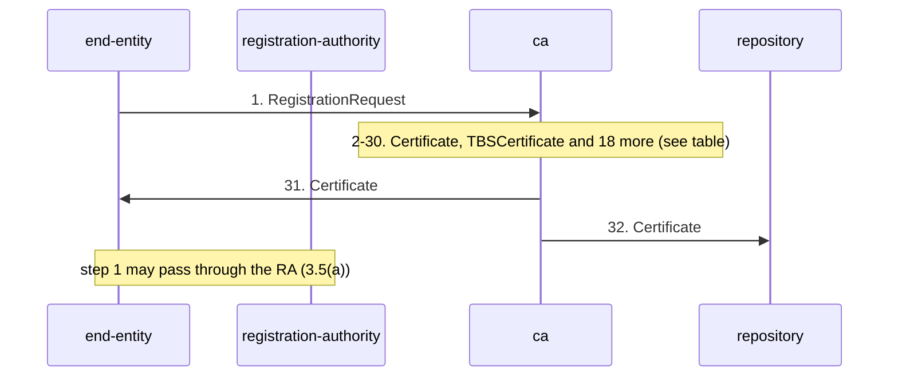

| n | from → to | message | step | locator | on error |
|---|---|---|---|---|---|
| 1 | end-entity → ca | `RegistrationRequest` | The user makes itself known to the CA, directly or through an RA, before the CA issues certificates for it. | §3.5(a), §3 | unspecified |
| 2 | ca → ca | `Certificate` | Establish the binding the certificate will assert, and verify every part of the subject alternative name. The source names the possible bases; it does not specify the verification. | §3.1, §4.2.1.6, §8 | stated |
| 3 | ca → ca | `TBSCertificate` | Set version: v3 when extensions are used; v2 or v1 rules otherwise; fields gated on version. | §4.1, §4.1.2.1, §4.1.2.8, §4.1.2.9 | unspecified |
| 4 | ca → ca | `TBSCertificate` | Assign serialNumber: positive, unique per issuer, non-negative in DER, at most 20 octets. | §4.1.2.2, Appendix B | unspecified |
| 5 | ca → ca | `TBSCertificate` | Set the signature field to the algorithm identifier the CA will sign with, identical to Certificate.signatureAlgorithm. | §4.1.2.3, §4.1.1.2, §1 | unspecified |
| 6 | ca → ca | `TBSCertificate` | Set issuer: a non-empty DN, PrintableString or UTF8String except for the legacy-encoding exceptions, encoded identically to the subject field of the CA's own certificate. | §4.1.2.4, §8 | unspecified |
| 7 | ca → ca | `TBSCertificate` | Set validity: notBefore and notAfter as UTCTime through 2049 and GeneralizedTime from 2050, Zulu, with seconds and no fractions; 99991231235959Z for no well-defined expiry; keep status information for the whole period or make every path invalid when it stops. | §4.1.2.5, §4.1.2.5.1, §4.1.2.5.2 | unspecified |
| 8 | ca → ca | `TBSCertificate` | Set subject: a DN unique per subject entity under this issuer, or an empty sequence with a critical subjectAltName; CA and CRL-issuer subjects non-empty and encoded as the subject encodes its own issuer field; email addresses in rfc822Name. | §4.1.2.6 | unspecified |
| 9 | ca → ca | `TBSCertificate` | Set subjectPublicKeyInfo: the subject's key and its algorithm identifier, encoded as the algorithm documents specify. | §4.1.2.7, §1 | unspecified |
| 10 | ca → ca | `TBSCertificate` | Omit issuerUniqueID and subjectUniqueID. | §4.1.2.8 | unspecified |
| 11 | ca → ca | `Extension:*` | Apply the general extension rules: one instance per extension; support the mandatory extensions; criticality per extension as the following steps give. | §4.2 | unspecified |
| 12 | ca → ca | `Extension:authorityKeyIdentifier` | Include keyIdentifier in every certificate (optional in a self-signed one), derived from the signing key or by a unique method, reusing an established identifier; non-critical. | §4.2.1.1 | unspecified |
| 13 | ca → ca | `Extension:subjectKeyIdentifier` | Include in every CA certificate, equal to the keyIdentifier this subject will put in AKI of the certificates it issues; SHOULD in end entity certificates; non-critical. | §4.2.1.2 | unspecified |
| 14 | ca → ca | `Extension:keyUsage` | Include in certificates whose keys verify signatures on certificates or CRLs; SHOULD be critical; keyCertSign only with cA; at least one bit set. | §4.2.1.3 | unspecified |
| 15 | ca → ca | `Extension:certificatePolicies` | Assert policy OIDs, each at most once, anyPolicy when not limiting; qualifiers limited and encoded as profiled. | §4.2.1.4 | unspecified |
| 16 | ca → ca | `Extension:policyMappings` | Map issuerDomainPolicy to subjectDomainPolicy, never to or from anyPolicy; SHOULD be critical. | §4.2.1.5 | unspecified |
| 17 | ca → ca | `Extension:subjectAltName` | Bind Internet-style identities in subjectAltName with the name-form encoding rules; critical when subject is empty; no empty sequence and no empty GeneralName. | §4.2.1.6 | unspecified |
| 18 | ca → ca | `Extension:issuerAltName` | Encode as subjectAltName; SHOULD be non-critical. Not used in path validation. | §4.2.1.7 | unspecified |
| 19 | ca → ca | `Extension:subjectDirectoryAttributes` | Mark non-critical. | §4.2.1.8 | unspecified |
| 20 | ca → ca | `Extension:basicConstraints` | Include, critical, in every CA certificate whose key verifies certificate signatures; pathLenConstraint only with cA and keyCertSign, never negative. | §4.2.1.9 | unspecified |
| 21 | ca → ca | `Extension:nameConstraints` | Only in CA certificates; critical; never an empty sequence; minimum zero and maximum absent; URI and email forms as host or domain; iPAddress as address plus mask; directoryName encoded exactly as the subject or subjectAltName it is to match, preferably as permittedSubtrees. | §4.2.1.10, §8, Appendix B | unspecified |
| 22 | ca → ca | `Extension:policyConstraints` | Critical; at least one of requireExplicitPolicy and inhibitPolicyMapping. | §4.2.1.11 | unspecified |
| 23 | ca → ca | `Extension:extKeyUsage` | Key purposes at the issuer's choice of criticality; not critical when anyExtendedKeyUsage is present. | §4.2.1.12 | unspecified |
| 24 | ca → ca | `Extension:cRLDistributionPoints` | SHOULD be non-critical; each DistributionPoint has distributionPoint or cRLIssuer; cRLIssuer present exactly when another entity issues the CRL, encoded as that CRL's issuer field; URI pointer rules for HTTP, FTP and LDAP; at least one DistributionPoint covering all reasons. | §4.2.1.13 | unspecified |
| 25 | ca → ca | `Extension:inhibitAnyPolicy` | Mark critical. | §4.2.1.14 | unspecified |
| 26 | ca → ca | `Extension:freshestCRL` | Mark non-critical; same syntax and conventions as cRLDistributionPoints. | §4.2.1.15 | unspecified |
| 27 | ca → ca | `Extension:authorityInfoAccess` | Mark non-critical; caIssuers locations as LDAP, HTTP or FTP URIs pointing to a DER certificate or a certs-only CMS message; ocsp locations per RFC 2560; avoid https and ldaps, or make the server certificate validatable without the pointed-to data. | §4.2.2.1, §8 | unspecified |
| 28 | ca → ca | `Extension:subjectInfoAccess` | Mark non-critical; caRepository and timeStamping location rules as for AIA. | §4.2.2.2, §8 | unspecified |
| 29 | ca → ca | `TBSCertificate` | Respect the encoding limits that bind issuers: no @ or _ in PrintableString, trailing zero bits omitted from named bit lists, OIDs within the stated limits. | Appendix B | unspecified |
| 30 | ca → ca | `Certificate` | DER-encode tbsCertificate, sign it, and place the algorithm identifier and signature value in the Certificate. | §4.1, §4.1.1.2, §4.1.1.3 | unspecified |
| 31 | ca → end-entity | `Certificate` | Return the certificate to the user's client system. | §3.5(c) | unspecified |
| 32 | ca → repository | `Certificate` | Publish the certificate. A CA that publishes the certificates it issues may say where with SIA id-ad-caRepository in its own certificate. | §3, Figure 1, §3.5(c), §4.2.2.2 | unspecified |

### 2. `crl-issuance` (§3, §3.3, §3.5(f), §5, §5.1, §5.2, §5.3, §8)

*Complete CRL issuance: revocation request, entry addition, the CRL issuer's obligations on every field and extension, signing and publication.* Kind: issuance.

A CRL is “a time-stamped list identifying revoked certificates that is signed by a CA or CRL issuer and made freely available in a public repository.” (§3.3) Entries enter and leave on a schedule: “An entry is added to the CRL as part of the next update following notification of revocation.” (§3.3) “An entry MUST NOT be removed from the CRL until it appears on one regularly scheduled CRL issued beyond the revoked certificate's validity period.” (§3.3)

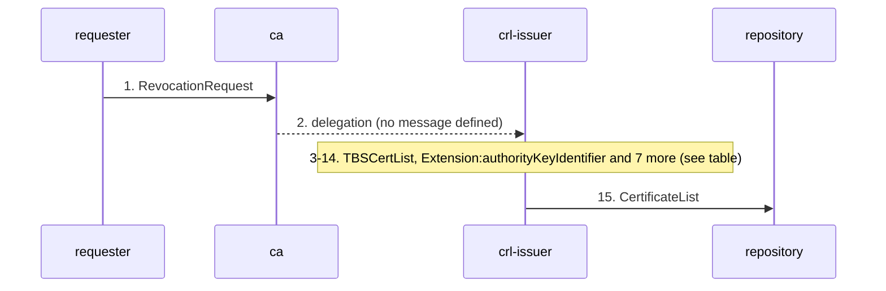

| n | from → to | message | step | locator | on error |
|---|---|---|---|---|---|
| 1 | requester → ca | `RevocationRequest` | An authorized person tells the CA that a certificate must be revoked. | §3.5(f), §3.3 | unspecified |
| 2 | ca → crl-issuer | `CertificateList` | The CA issues the CRL itself or has a CRL issuer it has authorized do it. | §3, §5 | unspecified |
| 3 | crl-issuer → crl-issuer | `TBSCertList` | Add an entry at the next update after notification; keep it until it has appeared on one scheduled CRL issued after the certificate expires; omit the list when nothing is revoked. | §3.3, §5.1.2.6 | unspecified |
| 4 | crl-issuer → crl-issuer | `TBSCertList` | Set version v2; signature identical to CertificateList.signatureAlgorithm; issuer a non-empty DN encoded as in certificates. | §5, §5.1, §5.1.2.1, §5.1.2.2, §5.1.2.3, §8 | unspecified |
| 5 | crl-issuer → crl-issuer | `TBSCertList` | Set thisUpdate and nextUpdate (always present, not earlier than any previous nextUpdate), UTCTime through 2049 and GeneralizedTime from 2050. | §5.1.2.4, §5.1.2.5, §3.3 | unspecified |
| 6 | crl-issuer → crl-issuer | `Extension:authorityKeyIdentifier` | Include AKI by the key identifier method in every CRL. | §5.2, §5.2.1 | unspecified |
| 7 | crl-issuer → crl-issuer | `Extension:issuerAltName` | Carry alternative issuer identities in issuerAltName; SHOULD be non-critical. | §5.2.2 | unspecified |
| 8 | crl-issuer → crl-issuer | `Extension:cRLNumber` | Include a non-critical, monotonically increasing CRL number per scope, at most 20 octets, different whenever thisUpdate differs. | §5.2.3, Appendix B | unspecified |
| 9 | crl-issuer → crl-issuer | `Extension:issuingDistributionPoint` | When the CRL is scoped, state the scope in a critical IDP: distribution point names matching the certificates' CDPs with identical encoding, onlySomeReasons for reason-partitioned CRLs, the only-contains booleans, onlyContainsAttributeCerts FALSE, never an empty sequence. | §5.2.5 | unspecified |
| 10 | crl-issuer → crl-issuer | `Extension:freshestCRL` | When delta CRLs exist for this complete CRL, point to them: non-critical, distribution point field only, same scope. | §5.2.6 | unspecified |
| 11 | crl-issuer → crl-issuer | `Extension:authorityInfoAccess` | Optionally point to certificates that verify the CRL signature: non-critical, id-ad-caIssuers only, URI rules as for the certificate extension. | §5.2.7 | unspecified |
| 12 | crl-issuer → crl-issuer | `Extension:reasonCode` | Give each entry a reason code when known, never the value unspecified, and removeFromCRL only in delta CRLs; add invalidityDate when known. | §5.3, §5.3.1, §5.3.2 | unspecified |
| 13 | crl-issuer → crl-issuer | `CertificateList` | Take care with critical extensions that relying parties may not process; keep OIDs within limits. | §8, §5.2, Appendix B | unspecified |
| 14 | crl-issuer → crl-issuer | `CertificateList` | DER-encode tbsCertList and sign it, with the certificate-signing key or a separate CRL-signing key. | §5.1, §5.1.1.2, §5.1.1.3 | unspecified |
| 15 | crl-issuer → repository | `CertificateList` | Publish the CRL. | §3, Figure 1, §3.3 | unspecified |

### 3. `delta-crl-issuance` (§5, §5.2.3, §5.2.4, §5.2.6, §5.3.1, §4.2.1.15)

*Delta CRL issuance: base CRL, shared numbering, the delta CRL indicator and the entry rules.* Kind: issuance.

“A delta CRL only lists those certificates, within its scope, whose revocation status has changed since the issuance of a referenced complete CRL. The referenced complete CRL is referred to as a base CRL.” (§5) Step 4 lists the four entry rules (a) to (d) of §5.2.4; the relying party's side is the `delta-crl-combination` algorithm.

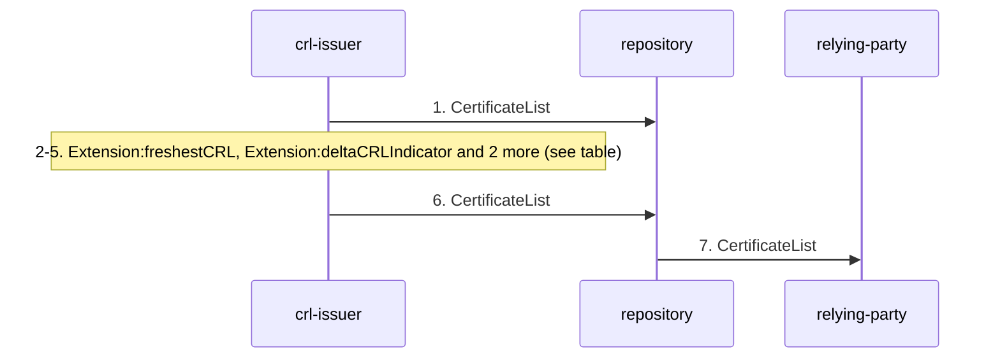

| n | from → to | message | step | locator | on error |
|---|---|---|---|---|---|
| 1 | crl-issuer → repository | `CertificateList` | Publish the base CRL as a complete CRL; complete and delta CRLs of a scope share one numbering sequence. | §5.2.4, §5.2.3 | unspecified |
| 2 | crl-issuer → crl-issuer | `Extension:freshestCRL` | Tell relying parties where deltas are: freshestCRL in the complete CRL (and, by the CA, in certificates). | §5.2.6, §4.2.1.15 | unspecified |
| 3 | crl-issuer → crl-issuer | `Extension:deltaCRLIndicator` | Mark the delta with a critical delta CRL indicator carrying the BaseCRLNumber; same scope, same reasons and certificates, same IDP and same signing key as the base. | §5, §5.2.4 | unspecified |
| 4 | crl-issuer → crl-issuer | `TBSCertList` | List every certificate in scope whose status changed since the base: revoked (a); released from hold as removeFromCRL (b); revoked for an out-of-scope reason after an in-scope listing, without reason code (c); not listed otherwise (d). | §5.2.4 | unspecified |
| 5 | crl-issuer → crl-issuer | `CertificateList` | Leave freshestCRL out of the delta CRL; removeFromCRL appears only in deltas. | §5.2.6, §5.3.1 | unspecified |
| 6 | crl-issuer → repository | `CertificateList` | Publish the delta, possibly several before the indicated nextUpdate. | §5.2.4 | unspecified |
| 7 | repository → relying-party | `CertificateList` | The relying party that supports deltas obtains the current delta and combines it with a complete CRL. | §5.2.4, §5 | inferred |

### 4. `indirect-crl-issuance` (§5, §5.2.5, §5.3.3, §4.2.1.13, §6.3.3(b)(1))

*Indirect CRL: a CRL issuer covering certificates issued by another authority.* Kind: issuance.

“If the scope of the CRL includes one or more certificates issued by an entity other than the CRL issuer, then it is an indirect CRL.” (§5) Three things must line up: cRLIssuer in the certificate's distribution point, indirectCRL in the CRL's IDP, and the certificate issuer entry extension on the entries.

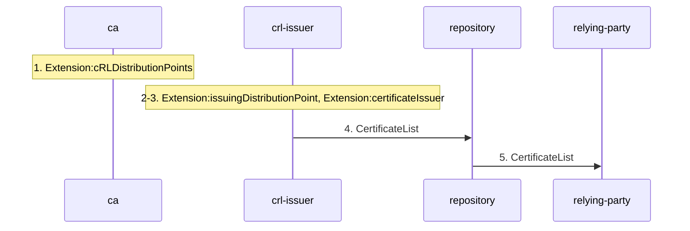

| n | from → to | message | step | locator | on error |
|---|---|---|---|---|---|
| 1 | ca → ca | `Extension:cRLDistributionPoints` | Name the CRL issuer in cRLIssuer of the DistributionPoint, encoded exactly as that CRL's issuer field. | §4.2.1.13 | unspecified |
| 2 | crl-issuer → crl-issuer | `Extension:issuingDistributionPoint` | Set indirectCRL TRUE when any certificate in scope was issued by another authority; a CA issuing an indirect CRL MAY include its own certificates. | §5, §5.2.5 | unspecified |
| 3 | crl-issuer → crl-issuer | `Extension:certificateIssuer` | Attribute entries with the critical certificate issuer entry extension holding the certificate's issuer DN, identically encoded; absent on an entry means the same issuer as the preceding entry, and the CRL issuer for the first. | §5.3.3 | unspecified |
| 4 | crl-issuer → repository | `CertificateList` | Publish. | §3, Figure 1 | unspecified |
| 5 | repository → relying-party | `CertificateList` | The relying party checks the CRL issuer against cRLIssuer and the indirectCRL flag, and matches entries by certificate issuer and serial number. | §6.3.3(b)(1), §6.3.3(i) | unspecified |

### 5. `crl-retrieval` (§4.2.1.13, §4.2.1.15, §5.2.6, §6.3, §6.3.3(a), §8)

*CRL and delta CRL retrieval through cRLDistributionPoints and freshestCRL.* Kind: retrieval.

“The CRL distribution points extension identifies how CRL information is obtained.” (§4.2.1.13) The retrieval itself is assumed by §6.3: “This algorithm assumes that all of the needed CRLs are available in a local cache. Further, if the next update time of a CRL has passed, the algorithm assumes a mechanism to fetch a current CRL and place it in the local CRL cache.” (§6.3)

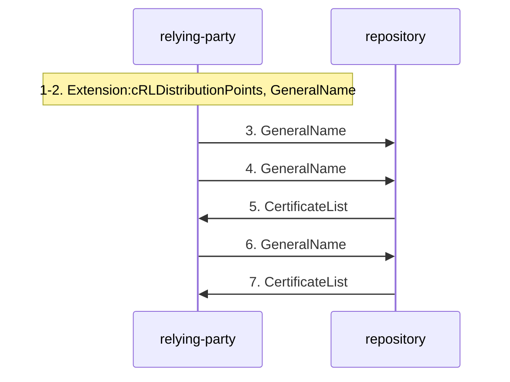

| n | from → to | message | step | locator | on error |
|---|---|---|---|---|---|
| 1 | relying-party → relying-party | `Extension:cRLDistributionPoints` | Read the DistributionPoints of the certificate; several names in one DistributionPointName are alternative ways to the same CRL. | §4.2.1.13, §6.3.3 | stated |
| 2 | relying-party → relying-party | `GeneralName` | Resolve nameRelativeToCRLIssuer by appending it to the CRL issuer DN (cRLIssuer if present, else the certificate issuer). | §4.2.1.13 | unspecified |
| 3 | relying-party → repository | `GeneralName` | directoryName: fetch the certificateRevocationList or authorityRevocationList attribute of that entry from the locally configured directory server, by a locally chosen protocol. | §4.2.1.13 | unspecified |
| 4 | relying-party → repository | `GeneralName` | URI: treat it as a pointer to the current CRL; HTTP and FTP return one DER CRL (application/pkix-crl); LDAP URIs name the entry and the attribute, and an omitted host relies on a priori knowledge. | §4.2.1.13 | unspecified |
| 5 | repository → relying-party | `CertificateList` | Receive the CRL; check that what was retrieved is properly formed. | §4.2.1.13, §8 | stated |
| 6 | relying-party → repository | `GeneralName` | When use-deltas is set and the certificate or the CRL carries freshestCRL, fetch the delta CRL from its distribution point names; freshestCRL only locates deltas and plays no part in validating them. | §4.2.1.15, §5.2.6, §6.3.3(a) | unspecified |
| 7 | repository → relying-party | `CertificateList` | Receive the delta CRL and place both in the local CRL cache that crl-validation reads. | §6.3 | unspecified |

### 6. `ca-certificate-retrieval-aia` (§4.2.2.1, §8)

*Issuer certificate retrieval through authorityInfoAccess id-ad-caIssuers, and the OCSP pointer.* Kind: retrieval.

“The referenced CA issuers description is intended to aid certificate users in the selection of a certification path that terminates at a point trusted by the certificate user.” (§4.2.2.1) Step 6 is only a pointer to RFC 2560.

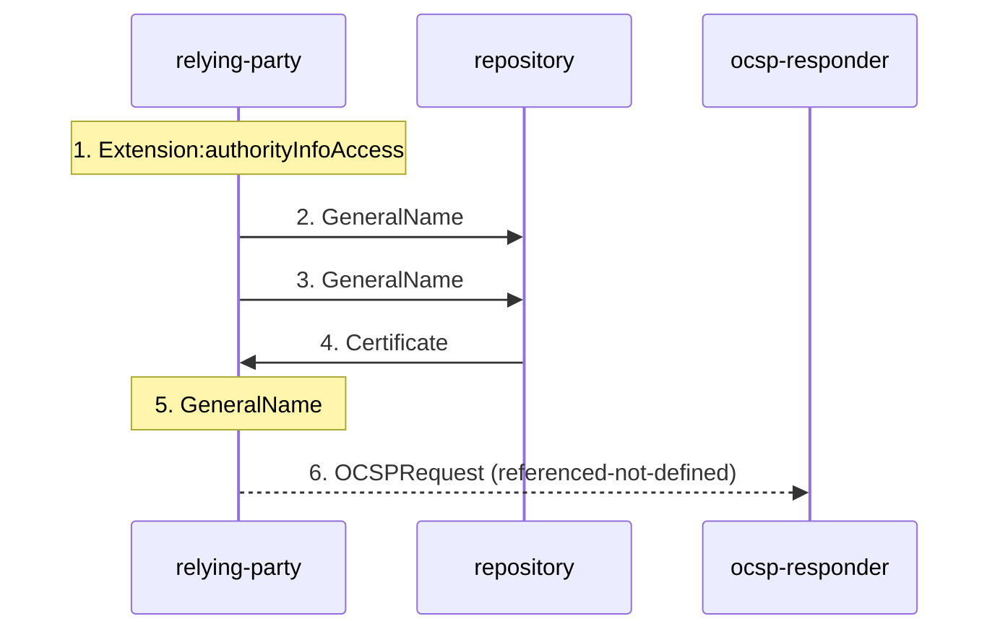

| n | from → to | message | step | locator | on error |
|---|---|---|---|---|---|
| 1 | relying-party → relying-party | `Extension:authorityInfoAccess` | Read the AccessDescriptions; caIssuers entries list certificates issued to the issuing CA. | §4.2.2.1 | unspecified |
| 2 | relying-party → repository | `GeneralName` | directoryName: read crossCertificatePair and/or cACertificate from the locally configured directory server. | §4.2.2.1 | unspecified |
| 3 | relying-party → repository | `GeneralName` | LDAP URI (dn, attributes, optional host) or HTTP/FTP URI pointing to one DER certificate or a certs-only CMS message. | §4.2.2.1 | unspecified |
| 4 | repository → relying-party | `Certificate` | Receive a DER certificate (always accepted) or a certs-only CMS message (SHOULD be accepted); use media type or file suffix as a hint only. | §4.2.2.1, §8 | inferred |
| 5 | relying-party → relying-party | `GeneralName` | Other name forms of caIssuers accessLocation: no semantics. | §4.2.2.1 | stated |
| 6 | relying-party → ocsp-responder | `OCSPRequest` | id-ad-ocsp gives the location of the OCSP responder for this certificate's status. The exchange is RFC 2560's. | §4.2.2.1, §3 | unspecified |

### 7. `subject-information-retrieval-sia` (§4.2.2.2)

*Subject information access: a CA's repository of issued certificates, and timestamping services.* Kind: retrieval.

“The id-ad-caRepository OID is used when the subject is a CA that publishes certificates it issues in a repository.” (§4.2.2.2)

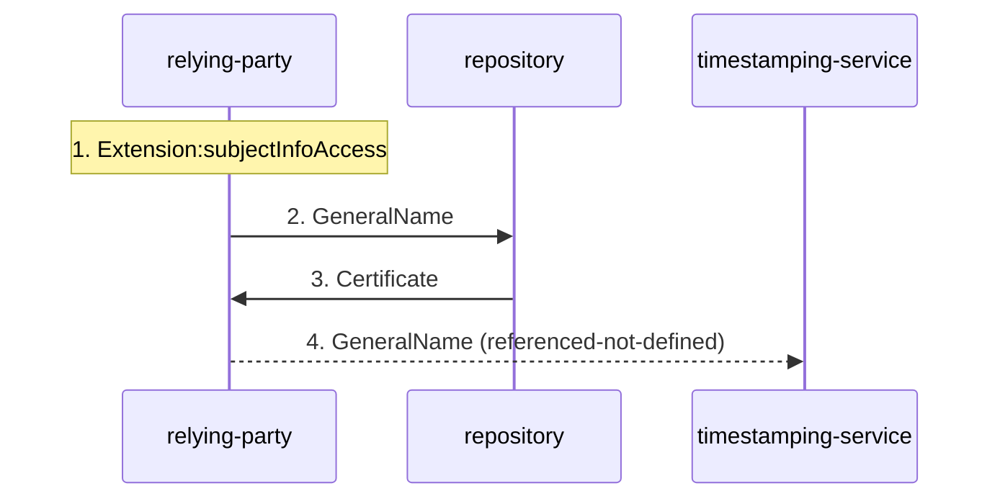

| n | from → to | message | step | locator | on error |
|---|---|---|---|---|---|
| 1 | relying-party → relying-party | `Extension:subjectInfoAccess` | Read the AccessDescriptions. | §4.2.2.2 | unspecified |
| 2 | relying-party → repository | `GeneralName` | id-ad-caRepository: directoryName (crossCertificatePair, cACertificate), LDAP URI, or HTTP/FTP URI to a DER certificate or certs-only CMS message. | §4.2.2.2 | unspecified |
| 3 | repository → relying-party | `Certificate` | Receive as for AIA. | §4.2.2.2 | unspecified |
| 4 | relying-party → timestamping-service | `GeneralName` | id-ad-timeStamping: the subject offers RFC 3161 timestamping at a URI (HTTP, FTP), an rfc822Name (mail) or a dNSName or iPAddress (TCP/IP). | §4.2.2.2 | unspecified |

### 8. `crl-signer-certificate-retrieval` (§5.2.7, §5.1.1.3)

*Retrieving the certificates that verify a CRL's signature, through the CRL's authorityInfoAccess.* Kind: retrieval.

“The id-ad-caIssuers OID is used when the information available lists certificates that can be used to verify the signature on the CRL (i.e., certificates that have a subject name that matches the issuer name on the CRL and that have a subject public key that corresponds to the private key used to sign the CRL).” (§5.2.7)

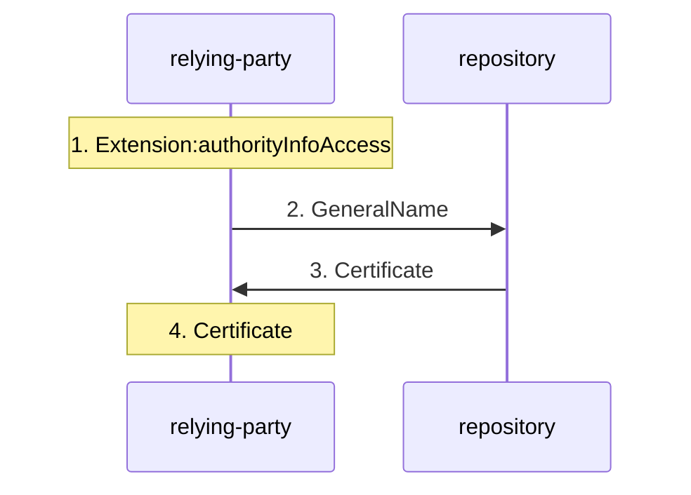

| n | from → to | message | step | locator | on error |
|---|---|---|---|---|---|
| 1 | relying-party → relying-party | `Extension:authorityInfoAccess` | Read the CRL's AIA. | §5.2.7 | unspecified |
| 2 | relying-party → repository | `GeneralName` | directoryName: look in crossCertificatePair, cACertificate and userCertificate; LDAP and HTTP/FTP URIs as for the certificate extension. | §5.2.7 | unspecified |
| 3 | repository → relying-party | `Certificate` | Receive a DER certificate or certs-only CMS message. | §5.2.7 | unspecified |
| 4 | relying-party → relying-party | `Certificate` | Build and validate the CRL signer's path to the same trust anchor (crl-validation step (f)). | §5.1.1.3, §6.3.3(f), §8 | inferred |

### 9. `trust-anchor-provisioning` (§3.5(b), §6, §6.1.1(d), §6.2, §8, §4.1.2.5)

*Trust anchor provisioning and withdrawal (out of band).* Kind: out-of-band.

“The authenticated distribution of trusted CA public keys (usually in the form of a "self-signed" certificate) is a security critical out-of-band process that is beyond the scope of this specification.” (§8)

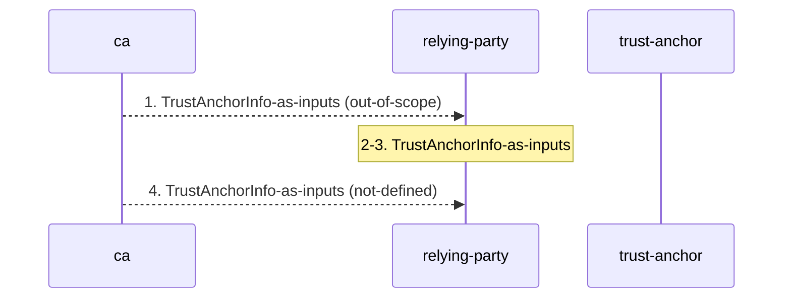

| n | from → to | message | step | locator | on error |
|---|---|---|---|---|---|
| 1 | ca → relying-party | `TrustAnchorInfo-as-inputs` | Install the trusted CA's public key and assured information in the client before it validates paths; the CA may distribute a self-signed certificate for this. | §3.5(b), §6.1.1(d), §8 | unspecified |
| 2 | relying-party → relying-party | `TrustAnchorInfo-as-inputs` | Choose which CAs to trust; a local decision. | §6, §6.2, §8 | unspecified |
| 3 | relying-party → relying-party | `TrustAnchorInfo-as-inputs` | After key compromise or failure of a trusted CA, change the trust anchor information. | §8 | unspecified |
| 4 | ca → relying-party | `TrustAnchorInfo-as-inputs` | An issuer that stops maintaining status information before notAfter makes every path to the certificate invalid, for example by ceasing use of its key as a trust anchor. | §4.1.2.5 | unspecified |

### 10. `certificate-validation-and-use` (§6, §6.1, §6.2, §4.2, §4.2.1.3, §4.2.1.4, §4.2.1.9, §4.2.1.12)

*Relying party: choose a trust anchor, set the inputs, validate the path, check revocation, then use the key within its restrictions.* Kind: local-use.

“Thus, the path validation algorithm presented in Section 6.1 defines the minimum conditions for a path to be considered valid.” (§6.2) Step 5 is where `crl-validation` (or OCSP, or an out-of-band mechanism) answers 6.1.3(a)(3).

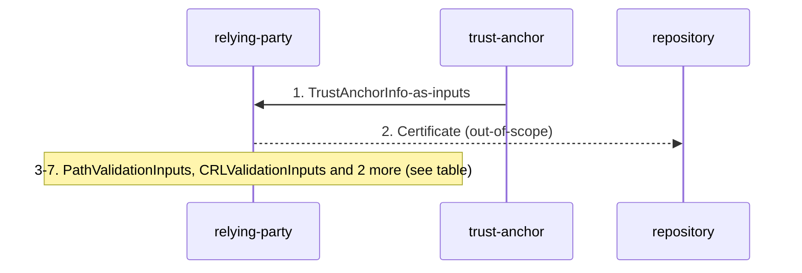

| n | from → to | message | step | locator | on error |
|---|---|---|---|---|---|
| 1 | trust-anchor → relying-party | `TrustAnchorInfo-as-inputs` | Select one of the system's trusted CAs as the trust anchor for this path. | §6.2, §6.1 | unspecified |
| 2 | relying-party → repository | `Certificate` | Obtain a prospective certification path from the trust anchor to the target certificate. | §6.1 | unspecified |
| 3 | relying-party → relying-party | `PathValidationInputs` | Set the nine inputs for this path; they may differ per path and may express limits on the trust in this trust anchor; inputs may be taken from extensions of a self-signed trust anchor certificate, or ignored. | §6.2, §6.1.1 | unspecified |
| 4 | relying-party → relying-party | `PathValidationInputs` | Run basic path validation, possibly augmented to limit the valid paths further. | §1, §6.1, §6.2 | stated |
| 5 | relying-party → relying-party | `CRLValidationInputs` | For each certificate, establish that it is not revoked: by CRLs (crl-validation), by status information such as OCSP, or out of band. | §6.1.3(a)(3), §6.3, §4.2.2.1, §8 | stated |
| 6 | relying-party → relying-party | `PathValidationOutputs` | On success take the valid_policy_tree and the working public key, algorithm and parameters; display only user notices returned by validation. | §6.1.6, §4.2.1.4 | unspecified |
| 7 | relying-party → relying-party | `Certificate` | Use the key only as keyUsage, basicConstraints and extKeyUsage allow; an application may require a particular extended key purpose. | §4.2.1.3, §4.2.1.9, §4.2.1.12 | stated |

### 11. `path-discovery` (§3.2, §4.1.2.4, §4.2.1.1, §4.2.1.2, §4.2.2.1, §4.2.2.2, §5.1.1.3, §6.1, §8)

*Path discovery (building): only what the source itself says.* Kind: local-use; status: out-of-scope.

Every step is a hint, not a procedure. The key identifiers exist “to facilitate certification path construction.” (§4.2.1.1) and validation need not check them: “Applications are not required to verify that key identifiers match when performing certification path validation.” (§4.2.1.2) §8 has no path-building discussion beyond the https circularity, name collisions and the trust anchor rule.

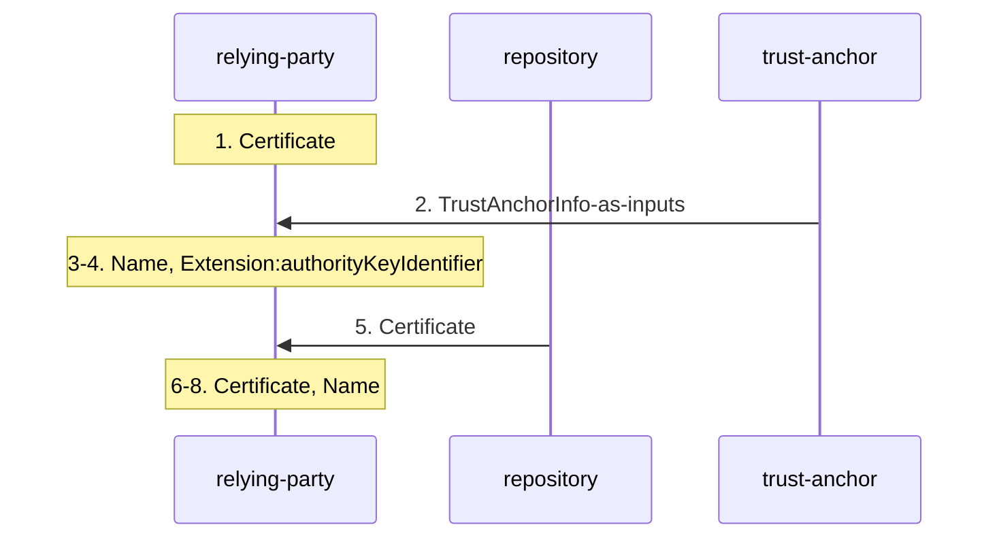

| n | from → to | message | step | locator | on error |
|---|---|---|---|---|---|
| 1 | relying-party → relying-party | `Certificate` | Discovery is out of scope. | §6.1 | stated |
| 2 | trust-anchor → relying-party | `TrustAnchorInfo-as-inputs` | Paths start at a CA in the user's own domain or at the top of a hierarchy. | §3.2 | unspecified |
| 3 | relying-party → relying-party | `Name` | Chain by name: match each certificate's issuer DN to the subject DN of a CA certificate, by the §7.1 rules. | §4.1.2.4 | unspecified |
| 4 | relying-party → relying-party | `Extension:authorityKeyIdentifier` | Use key identifiers to pick the issuer certificate when an issuer has several keys; validation itself need not check them. | §4.2.1.1, §4.2.1.2 | unspecified |
| 5 | repository → relying-party | `Certificate` | Fetch candidate issuer certificates from AIA caIssuers, and a CA's issued certificates from SIA caRepository. | §4.2.2.1, §4.2.2.2 | unspecified |
| 6 | relying-party → relying-party | `Certificate` | Never put one certificate in a prospective path twice; a self-signed trust anchor certificate is not part of the path. | §6.1 | inferred |
| 7 | relying-party → relying-party | `Certificate` | When CRLs are checked, build a second path for the CRL signer, to the same trust anchor. | §5.1.1.3, §6.3.3(f), §8 | unspecified |
| 8 | relying-party → relying-party | `Name` | Expect unrelated CAs and CRL issuers with the same name. | §8 | unspecified |

### 12. `ca-key-rollover-self-issued` (§3.2, §6.1, §4.2.1.10, §8)

*CA key rollover and other operational changes signalled with self-issued certificates.* Kind: issuance.

“Self-issued certificates provide CAs with one automated mechanism to indicate changes in the CA's operations.” (§8)

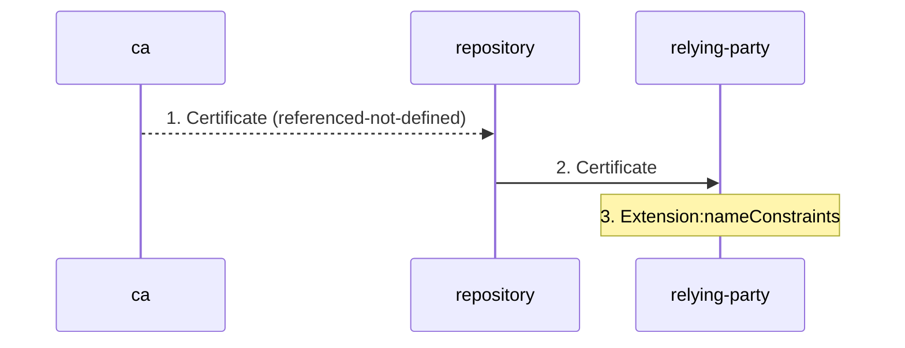

| n | from → to | message | step | locator | on error |
|---|---|---|---|---|---|
| 1 | ca → repository | `Certificate` | Issue the two self-issued certificates linking the old and the new key. | §8, §3.2 | unspecified |
| 2 | repository → relying-party | `Certificate` | The relying party processes the self-issued certificate within a path. | §8, §6.1 | unspecified |
| 3 | relying-party → relying-party | `Extension:nameConstraints` | Skip name constraint checks on self-issued intermediates. | §4.2.1.10, §6.1.3(b), §6.1.3(c) | unspecified |

### 13. `ca-compromise-response` (§8)

*Response to the compromise or loss of a CA signing key.* Kind: issuance.

“If such a compromise is detected, all certificates issued to the compromised CA MUST be revoked, preventing services between its users and users of other CAs.” (§8)

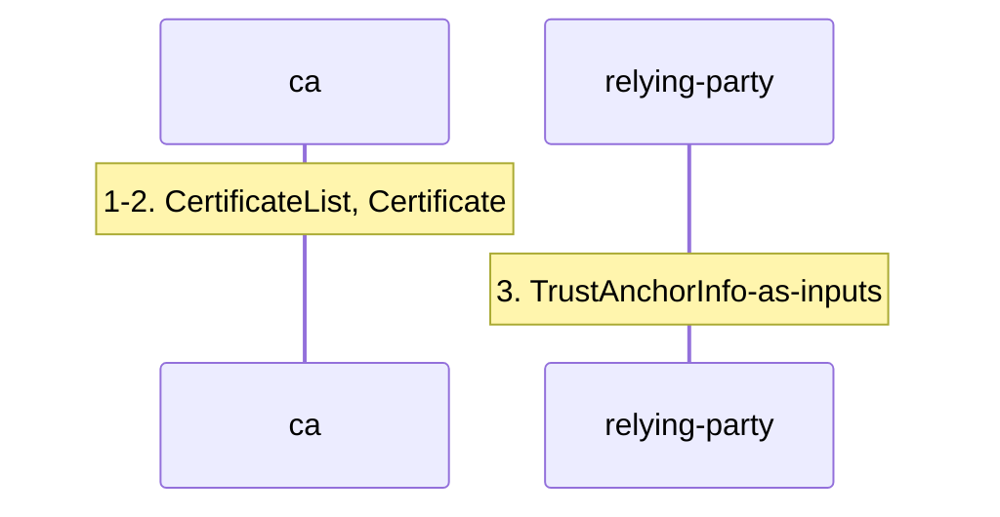

| n | from → to | message | step | locator | on error |
|---|---|---|---|---|---|
| 1 | ca → ca | `CertificateList` | Revoke every certificate issued to the compromised CA (through crl-issuance or another status mechanism). | §8 | unspecified |
| 2 | ca → ca | `Certificate` | Keep secure backup of signing keys, without which the CA can produce neither CRLs nor a normal rollover. | §8 | unspecified |
| 3 | relying-party → relying-party | `TrustAnchorInfo-as-inputs` | If the compromised CA is a trust anchor, modify the trust anchor information. | §8 | unspecified |

## Algorithms

### A1. `basic-path-validation` (§6.1)

“A conforming implementation MUST include an X.509 path processing procedure that is functionally equivalent to the external behavior of this algorithm.” (§6.1) The source's structure: “This section presents the algorithm in four basic steps: (1) initialization, (2) basic certificate processing, (3) preparation for the next certificate, and (4) wrap-up. Steps (1) and (4) are performed exactly once. Step (2) is performed for all certificates in the path. Step (3) is performed for all certificates in the path except the final certificate.” (§6.1)

**Inputs (§6.1.1).** “This algorithm assumes that the following nine inputs are provided to the path processing logic:” (§6.1.1)

| id | input | object |
|---|---|---|
| 6.1.1(a) | `prospective_path` | `PathValidationInputs` |
| 6.1.1(b) | `current_time` | `PathValidationInputs` |
| 6.1.1(c) | `user-initial-policy-set` | `PathValidationInputs` |
| 6.1.1(d) | `trust_anchor_information` | `TrustAnchorInfo-as-inputs` |
| 6.1.1(e) | `initial-policy-mapping-inhibit` | `PathValidationInputs` |
| 6.1.1(f) | `initial-explicit-policy` | `PathValidationInputs` |
| 6.1.1(g) | `initial-any-policy-inhibit` | `PathValidationInputs` |
| 6.1.1(h) | `initial-permitted-subtrees` | `PathValidationInputs` |
| 6.1.1(i) | `initial-excluded-subtrees` | `PathValidationInputs` |

**State variables (§6.1.2).** “This initialization phase establishes eleven state variables based upon the nine inputs:” (§6.1.2)

| id | variable | initial value |
|---|---|---|
| 6.1.2(a) | `valid_policy_tree` | one node at depth 0: valid_policy anyPolicy, qualifier_set {}, expected_policy_set {anyPolicy} |
| 6.1.2(b) | `permitted_subtrees` | initial-permitted-subtrees |
| 6.1.2(c) | `excluded_subtrees` | initial-excluded-subtrees |
| 6.1.2(d) | `explicit_policy` | 0 if initial-explicit-policy is set, else n+1 |
| 6.1.2(e) | `inhibit_anyPolicy` | 0 if initial-any-policy-inhibit is set, else n+1 |
| 6.1.2(f) | `policy_mapping` | 0 if initial-policy-mapping-inhibit is set, else n+1 |
| 6.1.2(g) | `working_public_key_algorithm` | trusted public key algorithm |
| 6.1.2(h) | `working_public_key` | trusted public key |
| 6.1.2(i) | `working_public_key_parameters` | trusted public key parameters |
| 6.1.2(j) | `working_issuer_name` | trusted issuer name |
| 6.1.2(k) | `max_path_length` | n |

Four initial values depend on n, the length of input (a). The three policy counters are non-increasing: “Once set, this variable may be decreased, but may not be increased.” (§6.1.2(d))

**Flowchart.** Every lettered step of 6.1.3, 6.1.4 and 6.1.5 is a node. Solid edges to FAIL are the source's stated failure exits; dotted edges are exits the source implies but does not state.

```mermaid
flowchart TD
  START([START]) --> INIT["6.1.2 initialize 11 state variables from the 9 inputs, i = 1"]
  INIT --> A1["6.1.3(a)(1) signature verifies with working key, algorithm, parameters"]
  A1 --> A2["6.1.3(a)(2) validity period includes current time"]
  A2 --> A3["6.1.3(a)(3) not revoked: crl-validation, status information or out of band"]
  A3 --> A4["6.1.3(a)(4) issuer name = working_issuer_name (dn-comparison)"]
  A4 --> SI{"certificate i self-issued and i less than n?"}
  SI -->|yes: skip b and c| D
  SI -->|no| B["6.1.3(b) subject DN and every subjectAltName within permitted_subtrees"]
  B --> C["6.1.3(c) none within excluded_subtrees"]
  C --> D{"6.1.3(d) certificatePolicies present and tree not NULL?"}
  D -->|yes| D1["6.1.3(d)(1) each P not anyPolicy: (i) child under nodes expecting P, (ii) else under the anyPolicy node"]
  D1 --> D2["6.1.3(d)(2) anyPolicy present and (inhibit_anyPolicy greater than 0 or i less than n and self-issued): expand expected sets"]
  D2 --> D3["6.1.3(d)(3) prune childless nodes of depth i-1 or less"]
  D -->|no| E["6.1.3(e) certificatePolicies absent: tree = NULL"]
  D3 --> FCHK
  E --> FCHK{"6.1.3(f) explicit_policy greater than 0 or tree not NULL?"}
  FCHK -->|yes| LAST{"i = n?"}
  LAST -->|no| PA["6.1.4(a) policyMappings: anyPolicy neither issuer nor subject domain policy"]
  PA --> PB["6.1.4(b) per issuerDomainPolicy: (1) policy_mapping greater than 0 remap, (2) = 0 delete and prune"]
  PB --> PC["6.1.4(c) working_issuer_name = subject"]
  PC --> PD["6.1.4(d) working_public_key = subjectPublicKey"]
  PD --> PE["6.1.4(e) parameters: take non-null, else null if algorithm changed"]
  PE --> PF["6.1.4(f) working_public_key_algorithm = subjectPublicKey algorithm"]
  PF --> PG["6.1.4(g) nameConstraints: (1) permitted = intersection, (2) excluded = union"]
  PG --> PH["6.1.4(h) not self-issued: decrement nonzero explicit_policy, policy_mapping, inhibit_anyPolicy"]
  PH --> PI["6.1.4(i) policyConstraints: lower explicit_policy, policy_mapping"]
  PI --> PJ["6.1.4(j) inhibitAnyPolicy: lower inhibit_anyPolicy"]
  PJ --> PK["6.1.4(k) v3: basicConstraints cA TRUE. v1 or v2: CA out of band, or reject"]
  PK --> PL["6.1.4(l) not self-issued: max_path_length greater than 0, then decrement"]
  PL --> PM["6.1.4(m) pathLenConstraint less than max_path_length: max_path_length = pathLenConstraint"]
  PM --> PN["6.1.4(n) keyUsage present: keyCertSign set"]
  PN --> PO["6.1.4(o) process other critical and relevant non-critical extensions"]
  PO -->|i = i + 1| A1
  LAST -->|yes| WA["6.1.5(a) explicit_policy nonzero: decrement"]
  WA --> WB["6.1.5(b) requireExplicitPolicy = 0: explicit_policy = 0"]
  WB --> WC["6.1.5(c) working_public_key = subjectPublicKey"]
  WC --> WD["6.1.5(d) parameters as 6.1.4(e)"]
  WD --> WE["6.1.5(e) working_public_key_algorithm = subjectPublicKey algorithm"]
  WE --> WF["6.1.5(f) process other critical and relevant non-critical extensions"]
  WF --> WG["6.1.5(g) intersect tree with user-initial-policy-set: (i) NULL, (ii) any-policy, (iii) steps 1 to 4"]
  WG --> OK{"explicit_policy greater than 0 or tree not NULL?"}
  OK -->|yes| SUCCESS[["6.1.6 success: valid_policy_tree, working_public_key, algorithm, parameters"]]
  A1 -->|fail| FAIL[["failure indication and an appropriate reason"]]
  A2 -->|fail| FAIL
  A3 -->|fail| FAIL
  A4 -->|fail| FAIL
  B -->|fail| FAIL
  C -->|fail| FAIL
  FCHK -->|no| FAIL
  PA -->|fail| FAIL
  PK -->|fail| FAIL
  PL -->|fail| FAIL
  PN -->|fail| FAIL
  PO -->|fail| FAIL
  WF -.->|fail: no exit stated| FAIL
  OK -.->|no: failure implied, not stated| FAIL
```

Stated failure exits: “If any of steps (a), (b), (c), or (f) fails, the procedure terminates, returning a failure indication and an appropriate reason.” (§6.1.3) and “If check (a), (k), (l), (n), or (o) fails, the procedure terminates, returning a failure indication and an appropriate reason.” (§6.1.4) For the wrap-up the source gives only the success condition: “If either (1) the value of explicit_policy variable is greater than zero or (2) the valid_policy_tree is not NULL, then path processing has succeeded.” (§6.1.5) Output: “If path processing succeeds, the procedure terminates, returning a success indication together with final value of the valid_policy_tree, the working_public_key, the working_public_key_algorithm, and the working_public_key_parameters.” (§6.1.6)

**Name constraints.** Checked in 6.1.3(b) and (c) against the state, updated in 6.1.4(g) from certificate i, so a constraint in certificate i binds certificates i+1 to n and never the certificate that carries it; the target's own nameConstraints is never applied. The skip rule is “If certificate i is self-issued and it is not the final certificate in the path, skip this step for certificate i.” (§6.1.3(b)) Intersection and union are shown by example only: “For example, the intersection of example.com and foo.example.com is foo.example.com. And the intersection of example.com and example.net is the empty set.” (§6.1.4(g)(1)) “For example, the union of the name spaces example.com and foo.example.com is example.com. And the union of example.com and example.net is both name spaces.” (§6.1.4(g)(2)) An empty permitted set for a name type then excludes every later name of that type: “If the set for a name type is empty, then the certification path will be considered invalid if any certificate in the certification path includes a name of that name type.” (§6.1.1(h)) The per-form matching rules are algorithm A3.

**pathLen and max_path_length.** max_path_length starts at n (6.1.2(k)). For each intermediate, 6.1.4(l) runs before 6.1.4(m): “If the certificate was not self-issued, verify that max_path_length is greater than zero and decrement max_path_length by 1.” (§6.1.4(l)) then “If pathLenConstraint is present in the certificate and is less than max_path_length, set max_path_length to the value of pathLenConstraint.” (§6.1.4(m)) Because the n-1 intermediates can decrement it at most n-1 times, (l) can fail only after (m) lowered it. A certificate with pathLenConstraint p therefore admits p further non-self-issued intermediates, and the target is never counted because 6.1.4 does not run for it. That matches “A pathLenConstraint of zero indicates that no non-self-issued intermediate CA certificates may follow in a valid certification path.” (§4.2.1.9) (m) is applied to self-issued certificates too; only (l) is conditional.

**Policy counters.** 6.1.4(h) decrements before 6.1.4(i) and (j) lower the counters, so a requireExplicitPolicy of 0 in certificate i takes effect from certificate i+1; 6.1.5(a) and (b) apply the same to the target. The source's own tree figures (Figures 3 to 7) are examples for the examples artifact.

### A2. `crl-validation` (§6.3)

“This section describes the steps necessary to determine if a certificate is revoked when CRLs are the revocation mechanism used by the certificate issuer.” (§6.3) Inputs: `certificate` and `use-deltas` (§6.3.1). State: `reasons_mask` (initially empty), `cert_status` (initially UNREVOKED), `interim_reasons_mask` (§6.3.2). The loop: “For each distribution point (DP) in the certificate's CRL distribution points extension, for each corresponding CRL in the local CRL cache, while ((reasons_mask is not all-reasons) and (cert_status is UNREVOKED)) perform the following:” (§6.3.3)

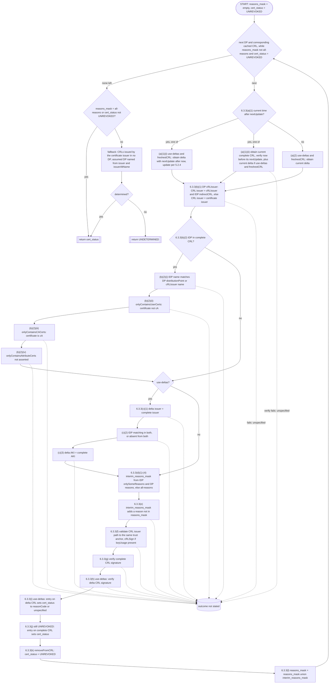

The loop's exit and return: “If ((reasons_mask is all-reasons) OR (cert_status is not UNREVOKED)), then the revocation status has been determined, so return cert_status.” (§6.3.3) and the fallback: “After processing such CRLs, if the revocation status has still not been determined, then return the cert_status UNDETERMINED.” (§6.3.3) The output is `cert_status` only. `reasons_mask` ends the loop but is not returned. No failed verification in (a) to (h) has a stated consequence (defect `crl-verify-no-outcome`), so the dotted edges end in an 'outcome not stated' node rather than in a guess.

### Sub-algorithms

| algorithm | locator | used by | steps |
|---|---|---|---|
| `name-constraints-check` | §4.2.1.10, §6.1.3(b), §6.1.3(c), §6.1.4(g), §7, §8 | 6.1.3(b), 6.1.3(c), 6.1.4(g) | 13 |
| `dn-comparison` | §7.1, §4.1.2.4, §4.1.2.6, §6.1, §8 | self-issued test (6.1), 6.1.3(a)(4), directoryName constraints, 6.3.3(b)(1), name chaining (4.1.2.4) | 10 |
| `dns-name-handling` | §7.2, §7.3, §4.2.1.10 | dNSName and URI constraints, domainComponent comparison, 7.4 and 7.5 | 6 |
| `uri-comparison` | §7.4 | URI constraints, CDP and IDP name matching | 3 |
| `email-comparison` | §7.5 | rfc822Name constraints | 2 |
| `delta-crl-combination` | §5.2.4 | 6.3.3(a), delta-crl-issuance step 7 | 3 |
| `extension-criticality-handling` | §4.2, §4.2.1.4, §4.2.1.10, §4.2.1.11, §6.1, Appendix B | 6.1.4(o), 6.1.5(f) | 5 |

§7 is the comparison layer under name chaining and name constraints. “Two distinguished names DN1 and DN2 match if they have the same number of RDNs, for each RDN in DN1 there is a matching RDN in DN2, and the matching RDNs appear in the same order in both DNs.” (§7.1) “When evaluating name constraints, conforming implementations MUST perform a case-insensitive exact match on a label-by-label basis.” (§7.2) The self-issued test that decides the skip rules of 6.1.3(b), 6.1.3(c), 6.1.4(h) and 6.1.4(l) is itself a §7.1 comparison: “A certificate is self-issued if the same DN appears in the subject and issuer fields (the two DNs are the same if they match according to the rules specified in Section 7.1).” (§6.1)

## Error paths

| id | trigger | in | outcome | basis | locator |
|---|---|---|---|---|---|
| `signature-invalid` | The certificate's signature does not verify under the working public key, algorithm and parameters. | basic-path-validation 6.1.3(a)(1) | Path validation terminates with a failure indication and an appropriate reason. | stated | §6.1.3(a)(1) |
| `outside-validity-period` | The current time is outside notBefore..notAfter. | basic-path-validation 6.1.3(a)(2) | Path validation terminates with a failure indication and an appropriate reason. | stated | §6.1.3(a)(2) |
| `certificate-revoked` | The certificate is revoked at the current time. | basic-path-validation 6.1.3(a)(3), crl-validation | Path validation terminates with a failure indication and an appropriate reason. | stated | §6.1.3(a)(3) |
| `revocation-undetermined` | crl-validation returns UNDETERMINED, or certificateHold. | basic-path-validation 6.1.3(a)(3), crl-validation 6.3.3-fallback | unspecified. Whether 6.1.3(a)(3) passes or fails is not stated. | unspecified | §6.1.3(a)(3), §6.3.3 |
| `issuer-name-mismatch` | The issuer name is not the working_issuer_name by the §7.1 rules. | basic-path-validation 6.1.3(a)(4), dn-comparison | Path validation terminates with a failure indication and an appropriate reason. | stated | §6.1.3(a)(4) |
| `name-not-permitted` | A subject DN or subjectAltName lies outside the permitted subtrees of its type (or the set for that type is empty). | basic-path-validation 6.1.3(b), name-constraints-check | Path validation terminates with a failure indication and an appropriate reason. | stated | §6.1.3(b), §6.1.1(h) |
| `name-excluded` | A subject DN or subjectAltName lies inside an excluded subtree. | basic-path-validation 6.1.3(c), name-constraints-check | Path validation terminates with a failure indication and an appropriate reason. | stated | §6.1.3(c) |
| `explicit-policy-required` | explicit_policy has reached 0 and the valid_policy_tree is NULL. | basic-path-validation 6.1.3(f) | Path validation terminates with a failure indication and an appropriate reason. | stated | §6.1.3(f) |
| `anypolicy-in-mapping` | policyMappings maps to or from anyPolicy. | basic-path-validation 6.1.4(a) | Path validation terminates with a failure indication and an appropriate reason. | stated | §6.1.4(a) |
| `not-a-ca` | An intermediate v3 certificate lacks basicConstraints or has cA FALSE. | basic-path-validation 6.1.4(k) | Path validation terminates with a failure indication and an appropriate reason. | stated | §6.1.4(k) |
| `v1-v2-intermediate-not-confirmed` | An intermediate v1 or v2 certificate is not confirmed as a CA out of band. | basic-path-validation 6.1.4(k) | The application rejects the certificate. | stated | §6.1.4(k) |
| `path-length-exceeded` | A non-self-issued intermediate is reached with max_path_length = 0. | basic-path-validation 6.1.4(l) | Path validation terminates with a failure indication and an appropriate reason. | stated | §6.1.4(l), §4.2.1.9 |
| `keycertsign-missing` | An intermediate has keyUsage without keyCertSign. | basic-path-validation 6.1.4(n) | Path validation terminates with a failure indication and an appropriate reason. | stated | §6.1.4(n) |
| `critical-extension-unprocessed-intermediate` | An intermediate carries a critical extension the implementation does not recognize or cannot process. | basic-path-validation 6.1.4(o), extension-criticality-handling | Path validation terminates with a failure indication and an appropriate reason. | stated | §6.1.4(o), §4.2, §6.1 |
| `critical-extension-unprocessed-target` | The target certificate carries such an extension. | basic-path-validation 6.1.5(f), extension-criticality-handling | Reject (from §4.2 and §6.1). 6.1.5 itself states no failure exit. | inferred | §6.1.5(f), §4.2, §6.1 |
| `wrap-up-policy-failure` | After wrap-up, explicit_policy = 0 and the valid_policy_tree is NULL. | basic-path-validation 6.1.5-exit | Path processing has not succeeded. The source states only the success condition. | inferred | §6.1.5 |
| `repeated-certificate` | A certificate appears more than once in the prospective path. | basic-path-validation, path-discovery | Not a valid prospective path. No step of 6.1 checks it, and no outcome is stated. | unspecified | §6.1 |
| `critical-name-constraint-unprocessable` | A critical nameConstraints constrains a form, or sets minimum or maximum, that the application does not process, and a later certificate has a name of that form. | name-constraints-check | Reject the certificate. | stated | §4.2.1.10 |
| `uri-without-fqdn-host` | A URI constraint applies and a later subjectAltName URI has no authority with an FQDN host. | name-constraints-check | Reject the certificate. | stated | §4.2.1.10 |
| `critical-policies-uninterpretable` | Critical certificatePolicies the software cannot interpret, including qualifiers. | extension-criticality-handling | Reject the certificate. | stated | §4.2.1.4 |
| `inhibit-policy-mapping-unsupported` | Critical policyConstraints with inhibitPolicyMapping, not supported. | extension-criticality-handling | Reject the certificate. | stated | §4.2.1.11 |
| `critical-extension-unexpected-values` | A critical extension contains unexpected values. | extension-criticality-handling | Reject the certificate or CRL. | stated | Appendix B |
| `key-usage-forbids` | keyUsage lacks keyCertSign or cRLSign for the signature to be verified, or basicConstraints lacks cA for a certificate signature. | certificate-validation-and-use | The key must not be used to verify that signature. | stated | §4.2.1.3, §4.2.1.9 |
| `no-consistent-purpose` | No purpose is consistent with both keyUsage and extKeyUsage. | certificate-validation-and-use | The certificate must not be used for any purpose. | stated | §4.2.1.12 |
| `crl-critical-extension-unprocessable` | A CRL has a critical CRL or CRL entry extension the application cannot process. | crl-validation | The CRL is not used to determine status. | stated | §5.2, §5.3 |
| `idp-unsupported` | The CRL has an IDP and the implementation does not support IDP. | crl-validation | Treat unlisted certificates as unknown, or find another CRL without unrecognized critical extensions. | stated | §5.2.5 |
| `no-current-crl` | nextUpdate has passed and no current complete CRL, or none with nextUpdate after now, is obtained. | crl-validation 6.3.3(a)(1)(ii) | unspecified. | unspecified | §6.3.3(a)(1) |
| `crl-issuer-or-scope-mismatch` | 6.3.3(b) fails: wrong issuer, no indirectCRL, IDP name, user/CA scope or attribute-certificate flag. | crl-validation 6.3.3(b) | unspecified; the CRL presumably cannot be used for this certificate. | unspecified | §6.3.3(b) |
| `delta-crl-mismatch` | 6.3.3(c) fails: delta issuer, IDP or AKI differs from the complete CRL. | crl-validation 6.3.3(c) | unspecified. | unspecified | §6.3.3(c) |
| `delta-not-combinable` | The complete and delta CRL fail a §5.2.4 combination condition. | delta-crl-combination | They are not combined. What is used instead is unspecified. | inferred | §5.2.4 |
| `no-new-reasons` | interim_reasons_mask adds no reason to reasons_mask. | crl-validation 6.3.3(e) | unspecified. | unspecified | §6.3.3(e) |
| `crl-issuer-path-invalid` | The CRL issuer's path does not validate, ends at a different trust anchor, or its keyUsage lacks cRLSign. | crl-validation 6.3.3(f), crl-signer-certificate-retrieval | unspecified in 6.3.3; §8 requires the same trust anchor. | unspecified | §6.3.3(f), §8 |
| `crl-signature-invalid` | The complete or delta CRL signature does not verify with the key from (f). | crl-validation 6.3.3(g), crl-validation 6.3.3(h) | unspecified. | unspecified | §6.3.3(g), §6.3.3(h) |
| `status-undetermined` | All DP and issuer CRLs are processed and status is still undetermined. | crl-validation 6.3.3-fallback | crl-validation returns UNDETERMINED. | stated | §6.3.3 |
| `https-unbounded-recursion` | A CDP, AIA or SIA https URI requires validating the server certificate, which needs the pointed-to data. | crl-retrieval, ca-certificate-retrieval-aia, subject-information-retrieval-sia | Possible unbounded recursion or an unresolvable dependency; the relying party must be prepared for it. | stated | §8 |
| `retrieved-data-malformed` | Data fetched through CDP or AIA is malformed or malicious. | crl-retrieval, ca-certificate-retrieval-aia | Not accepted (lowercase should). | stated | §8 |
| `crl-without-nextupdate` | A CRL omits nextUpdate. | crl-validation | Behaviour not specified by the profile. | stated | §5.1.2.5 |
| `empty-policy-constraints` | A certificate has policyConstraints as an empty sequence. | basic-path-validation 6.1.4(i) | Behaviour not addressed. | stated | §4.2.1.11 |
| `empty-generalname-in-san` | subjectAltName contains an empty GeneralName. | basic-path-validation | Behaviour not defined. | stated | §4.2.1.6 |
| `nonpositive-serial` | A non-conforming CA issued a negative or zero serial number. | basic-path-validation | Handle gracefully (SHOULD); the meaning of that is not given. | stated | §4.1.2.2 |

29 stated, 3 inferred, 8 unspecified. The unspecified ones are the source's gaps: no signalling exists anywhere in RFC 5280.

## Source defects and ambiguities

Recorded, not repaired. Each entry in `protocol.yaml` carries its quotes.

| id | kind | locator | finding |
|---|---|---|---|
| `wrap-up-failure-exit-implicit` | gap | §6.1.5, §6.1.6 | 6.1.5 states when path processing has succeeded and 6.1.6 gives the success outputs. Nothing states that the procedure fails, or what it returns, when explicit_policy is 0 and the tree is NULL. Unlike 6.1.3 and 6.1.4, 6.1.5 has no failure sentence. |
| `wrap-up-critical-extension-no-exit` | gap | §6.1.5(f) | 6.1.5(f) requires recognizing and processing every other critical extension of certificate n, but no failure exit covers it; rejection rests on §6.1 and §4.2. |
| `intersection-result-not-assigned` | ambiguity | §6.1.5(g), §6.1.5, §6.1.6 | 6.1.5(g) 'calculates the intersection'; (i) and (ii) describe it as a value ('the intersection is NULL', 'is the entire valid_policy_tree'), while (iii) deletes and adds nodes in the tree. It is not stated that the intersection becomes the valid_policy_tree tested in the success condition and returned by 6.1.6. |
| `duplicate-certificate-no-step` | gap | §6.1 | 'A certificate MUST NOT appear more than once in a prospective certification path' has no step and no failure exit in 6.1.3 or 6.1.4, and 'appear more than once' is not defined (same encoding, same issuer and serial, same key and name). |
| `revocation-undetermined-mapping` | gap | §6.1.3(a)(3), §6.3.2(b), §6.3.3 | 6.1.3(a)(3) requires that the certificate is not revoked. crl-validation can return UNDETERMINED, and a held certificate returns certificateHold. Which of these fail 6.1.3(a) is not stated in §6. For certificateHold, §5.2.4 counts a hold as a revocation ('revoked (for any revocation reason, including certificateHold)'), which supports failing it; state-machine.yaml M01 takes that reading. UNDETERMINED has no such support. |
| `working-key-algorithm-term` | inconsistency | §6.1.2(g), §6.1.4(e), §6.1.4(f), §6.1.3(a)(1) | working_public_key_algorithm is defined as 'the digital signature algorithm used to verify the signature of a certificate', but is initialized from the trusted public key algorithm and assigned the certificate's subjectPublicKey algorithm, a key algorithm. 6.1.3(a)(1) verifies with it and never mentions the certificate's own signature or signatureAlgorithm field, so how a key algorithm and the certificate's signature algorithm are reconciled is not stated. |
| `empty-subject-in-6-1-3` | inconsistency | §6.1.3(b), §6.1.3(c), §4.2.1.10 | 6.1.3(b) and (c) check 'the subject name' against the directoryName subtrees unconditionally; 4.2.1.10 applies directoryName restrictions only 'when the certificate includes a non-empty subject field'. Whether an empty subject is within a permitted subtree is not answered by 6.1.3. |
| `emailaddress-fallback-missing` | gap | §6.1.3(b), §6.1.3(c), §4.2.1.10 | 4.2.1.10 requires rfc822Name constraints to be applied to emailAddress attributes of the subject DN when there is no subjectAltName. 6.1.3(b) and (c) check the subject name only against X.500 subtrees and subjectAltName names against their own type, so the algorithm as written omits this check. |
| `undefined-name-forms` | unimplementable-as-written | §6.1.3(b), §6.1.1(h), §4.2.1.10 | 6.1.3(b) requires every subjectAltName name to be within the permitted subtrees of its name type, and 6.1.1(h) lets the initial set be 'a single subtree that includes all names of that name type'. For otherName, ediPartyName and registeredID the source defines no constraint semantics, and for no name type does it say how the all-names subtree is represented. |
| `min-max-not-in-algorithm` | gap | §6.1.4(g), §4.2.1.10 | 4.2.1.10 says an application that meets non-default minimum or maximum in a critical name constraint MUST process them or reject; 6.1.4(g) speaks only of 'the value indicated in the extension field' and does not mention them. |
| `subtree-intersection-undefined` | ambiguity | §6.1.4(g)(1), §6.1.4(g)(2), §4.2.1.10 | Intersection and union of subtree sets are illustrated only with DNS names. For URI and rfc822Name, where a leading period means the domain but not the host, for iPAddress ranges, and for directoryName, the operation is not defined. |
| `every-certificate-vs-self-issued-skip` | inconsistency | §6.1.1(h), §6.1.3(b) | 6.1.1(h) says all subject names 'in every certificate in the certification path MUST fall' within the permitted subtrees; 6.1.3(b) skips self-issued intermediates. |
| `name-constraints-in-target` | ambiguity | §4.2.1.10, §6.1.5(f) | nameConstraints 'MUST be used only in a CA certificate'. The target certificate never goes through 6.1.4(g), so constraints in it are not applied. Whether a critical nameConstraints in an end entity target counts among the 'other critical extension' of 6.1.5(f), and so must be recognized or cause rejection, is not stated. |
| `policy-constraints-count-wording` | inconsistency | §4.2.1.11, §4.2.1.14, §6.1.4(h) | 4.2.1.11 says inhibitPolicyMapping and requireExplicitPolicy count 'additional certificates'; 4.2.1.14 says 'additional non-self-issued certificates'; the algorithm decrements only for non-self-issued certificates (6.1.4(h)), but 6.1.5(a) decrements explicit_policy for the target whether self-issued or not. |
| `max-path-length-description` | inconsistency | §6.1.2(k), §6.1.4(l) | 6.1.2(k) says max_path_length 'is decremented for each non-self-issued certificate in the path'; 6.1.4(l) decrements it only for certificates 1..n-1, since 6.1.4 never runs for certificate n. |
| `mapping-on-null-tree` | ambiguity | §6.1.4(b), §6.1.3(d) | 6.1.3(d) is guarded by 'the valid_policy_tree is not NULL'; 6.1.4(b) is not, though it operates on nodes of the tree. |
| `policy-child-parent-unnamed` | ambiguity | §6.1.3(d)(1)(ii) | 'generate a child node' does not say of which node; only the depth i-1 anyPolicy node fits. |
| `nested-label-collision` | editorial | §6.1.3(d)(2), §6.1.3 | 6.1.3(d)(2) labels its two conditions (a) and (b), the same labels as steps (a) and (b) of 6.1.3 that the failure sentence names. |
| `empty-tree-vs-null` | ambiguity | §6.1.2(a), §6.1.3(d)(3), §6.1.4(b)(2)(ii), §6.1.5(g)(iii)4 | Pruning can delete every node including the root. The steps never say the result is NULL; 6.1.2(a) implies it ('If valid policies do not exist ... the tree is set to NULL'). |
| `any-policy-spellings` | editorial | §6.1.1(c), §6.1.5(g) | The user-initial-policy-set uses the special value 'any-policy'; the tree uses the OID 'anyPolicy'. The two are distinct and the steps rely on the difference. |
| `validation-time-input` | gap | §6.1, §6.1.1(b), §6.1.3(a)(2), §6.1.3(a)(3) | Input (b) is 'the current date/time' and the checks use 'the current time', while §6.1 states condition (d) as 'the time in question' and lets implementations validate 'with respect to some point in the past'. No input or step expresses a past time. |
| `trust-anchor-constraints-not-inputs` | gap | §6.1.1(d), §6.1.2(k), §6.2 | Trust anchor information has four items and no constraints; §6 says the algorithm requires 'any constraints upon the set of paths' for the key, and §6.2 lets an implementation apply a path length constraint to a trust anchor during initialization, but max_path_length is initialized to n and no input carries it. |
| `v1-v2-out-of-band-undefined` | gap | §6.1.4(k) | The application MUST verify a v1 or v2 intermediate is a CA 'through out-of-band means'; no means is defined. |
| `crl-verify-no-outcome` | gap | §6.3.3(a)(1)(ii), §6.3.3(b), §6.3.3(c), §6.3.3(e), §6.3.3(f), §6.3.3(g), §6.3.3(h) | §6.3.3 uses 'verify' 16 times and 'validate' 4 times and never says what happens when a verification fails: skip this CRL, skip this DP, or end with UNDETERMINED. §6.1 has explicit failure sentences; §6.3 has none. |
| `corresponding-crl-undefined` | ambiguity | §6.3.3 | 'for each corresponding CRL in the local CRL cache' does not define how a cached CRL corresponds to a DP (by DP name, by issuer, by retrieval). |
| `stale-crl-choice` | ambiguity | §6.3.3(a)(1) | 'do one of the following' gives no rule for choosing (i), a delta on the stale complete CRL, or (ii), a new complete CRL. |
| `use-deltas-without-delta` | ambiguity | §6.3.3(c), §6.3.3(h), §6.3.3(i) | Steps (c), (h) and (i) are conditioned on use-deltas being set, but a delta CRL is obtained only when the certificate or CRL carries freshestCRL. With use-deltas set and no freshestCRL, the steps refer to a delta CRL that does not exist. |
| `delta-number-check-indirect` | gap | §6.3.3(c), §5.2.4 | 6.3.3(c) checks the delta's issuer, IDP and AKI, but not §5.2.4 conditions (c) and (d) on CRL numbers. They enter only through 'can be used to update ... as specified in Section 5.2.4' in step (a). |
| `crl-issuer-path-inputs` | gap | §6.3.3(f), §8 | 'Obtain and validate the certification path for the issuer of the complete CRL' gives only the trust anchor rule: not the other path validation inputs, not how the CRL signer's certificate is chosen, and not whether its own revocation is checked, which can recurse. §8 warns of unbounded recursion for https only. |
| `crl-validation-inputs-incomplete` | gap | §6.3.1, §6.3.3 | 6.3.1 lists two inputs (certificate, use-deltas). The steps also use the current time, the local CRL cache, the target's trust anchor (f) and, for the fallback, the certificate's issuerAltName. |
| `crl-validation-per-path-wording` | editorial | §6.3 | §6.3 says the steps 'are performed for each certificate in the path', while the input is one certificate and the output its status. |
| `reasons-mask-not-returned` | structure | §6.3, §6.3.3 | The output is cert_status only. reasons_mask governs the loop and is not returned, so a caller cannot tell which reasons were covered when UNDETERMINED is returned. |
| `idp-name-match-underspecified` | ambiguity | §6.3.3(b)(2)(i), §4.2.1.13 | 6.3.3(b)(2)(i) says 'the distribution field' for the distributionPoint field; it does not say which comparison rule applies to the GeneralNames or that nameRelativeToCRLIssuer must first be expanded as 4.2.1.13 describes. |
| `reasonflags-unused-bit` | ambiguity | §6.3.2(a), §6.3.3(d), §4.2.1.13 | reasons_mask members exclude unspecified; ReasonFlags has bit 'unused (0)'. 6.3.3(d) copies DP reasons and onlySomeReasons into interim_reasons_mask without saying what to do with that bit. |
| `dn-comparison-minimum-conflict` | inconsistency | §8, §7.1 | §8 says the specification 'relaxes these requirements, requiring support for binary comparison at a minimum'; §7.1 requires StringPrep-based comparison and caseIgnoreMatch. |
| `rollover-parenthetical-referent` | ambiguity | §4.2.1.10 | '(This could prevent CAs that use name constraints from employing self-issued certificates to implement key rollover.)' follows the rule that name constraints are not applied to self-issued certificates; 'This' must mean applying them, the opposite of the preceding sentence. |
| `lowercase-binding-rules-in-algorithms` | editorial | §7.1, §7.2, §7.3, §7.4, §4.1.2.6, Appendix B | Several comparison rules the algorithms rely on are lowercase: 'shall include case folding' (7.1), 'shall perform a case-insensitive exact match' (7.3), 'shall perform a case-sensitive exact match' (7.4), 'Binary comparison should be used' (4.1.2.6), 'ought to be ignored' (Appendix B); and the 7.2 display bullets carry SHALL under a lowercase should. Already in the pass-1 source-defects list; recorded here because the sub-algorithms depend on them. |

## What RFC 5280 does not define

- Any wire protocol, transport or framing. Operational protocols for delivering certificates and CRLs are 'defined in other PKIX specifications'. (§3.4)
- The management protocols: registration, initialization, certification, key pair recovery, key pair update, revocation request and cross-certification. Named, not specified; on-line protocols are not mandated. (§3.5)
- Path discovery and path building: no algorithm, explicitly out of scope. (§6.1)
- OCSP: referenced (RFC 2560) as a status mechanism and an AIA access method; no exchange is defined. (§3, §4.2.2.1)
- Trust anchor management: authenticated distribution of trusted CA keys is out of band and beyond scope; trust anchor selection is a local decision; processing of extensions in self-signed trust anchor certificates is left free. (§8, §6.2, §6.1.1(d))
- CA key update procedures, deferred to RFC 4210. (§8)
- The mechanism that fetches a current CRL when nextUpdate has passed; §6.3 assumes one exists. (§6.3)
- The directory access protocol for directoryName locations (DAP or LDAP): a local matter. (§4.2.1.13, §4.2.2.1, §4.2.2.2, §5.2.7)
- The failure reasons of path validation: 'an appropriate reason', not enumerated. (§6.1.3, §6.1.4)
- Revocation status by 'status information' or 'out-of-band mechanisms' (6.1.3(a)(3)), and the out-of-band confirmation that a v1 or v2 intermediate is a CA (6.1.4(k)). (§6.1.3(a)(3), §6.1.4(k))
- How a CA or RA validates the binding between the subject's identity and key, and any legally binding rules or duties. (§2, §8)
- Processing of the CPS Pointer qualifier: a local matter. (§4.2.1.4)
- Client behaviour for CRLs that omit nextUpdate, for an empty policyConstraints, for empty GeneralNames in subjectAltName, and the semantics of wildcard subject alternative names. (§5.1.2.5, §4.2.1.11, §4.2.1.6)
- Name constraint semantics for otherName, ediPartyName and registeredID. (§4.2.1.10)
- Semantics of AIA and SIA accessLocation name forms other than those given; the contents of SIA for end entity services; the Time Stamp Protocol (RFC 3161). (§4.2.2.1, §4.2.2.2)
- Validation with respect to a past time: permitted, with no procedure. (§6.1)
- Limiting revocation checking to a subset of reason codes. (§6.3.2)
- What 'suitably recent' means for a CRL: local policy. (§3.3)
- Profile conformance checking during validation: recommended against. (§6.1)
- Attribute certificates and their revocation (onlyContainsAttributeCerts must be FALSE; 6.3.3(b)(2)(iv) rejects such CRLs). (§5.2.5, §6.3.3(b)(2)(iv))

## Message names used

For pass 3 to reconcile against `messages.yaml`. Names outside the shared list, and names with no structure in the source, are explained in `message_notes`.

`Certificate`, `TBSCertificate`, `CertificateList`, `TBSCertList`, `GeneralName`, `Name`, `TrustAnchorInfo-as-inputs`, `PathValidationInputs`, `PathValidationOutputs`, `CRLValidationInputs`, `CRLValidationOutputs`, `Extension:*`, `Extension:authorityKeyIdentifier`, `Extension:subjectKeyIdentifier`, `Extension:keyUsage`, `Extension:certificatePolicies`, `Extension:policyMappings`, `Extension:subjectAltName`, `Extension:issuerAltName`, `Extension:subjectDirectoryAttributes`, `Extension:basicConstraints`, `Extension:nameConstraints`, `Extension:policyConstraints`, `Extension:extKeyUsage`, `Extension:cRLDistributionPoints`, `Extension:inhibitAnyPolicy`, `Extension:freshestCRL`, `Extension:authorityInfoAccess`, `Extension:subjectInfoAccess`, `Extension:cRLNumber`, `Extension:deltaCRLIndicator`, `Extension:issuingDistributionPoint`, `Extension:reasonCode`, `Extension:invalidityDate`, `Extension:certificateIssuer`, `CertsOnlyCMS`, `OCSPRequest`, `RegistrationRequest`, `RevocationRequest`

| name | in source | note |
|---|---|---|
| `TBSCertList` | yes | Not in the brief's list of names; added as the CRL counterpart of TBSCertificate (§5.1). |
| `Name` | yes | Not in the brief's list; the X.501 Name of the subject and issuer fields (§4.1.2.4), needed because 6.1.3(a)(4), the self-issued test and §7.1 compare Names, not GeneralNames. |
| `CRLValidationOutputs` | yes | Not in the brief's list; the cert_status that 6.3.3 returns. reasons_mask is not part of it. |
| `Extension:*` | yes | Any extension: used for the general extension rules of §4.2 and the 'any other critical extension' steps 6.1.4(o) and 6.1.5(f). |
| `Extension:reasonCode` | yes | The source's identifier is id-ce-cRLReasons with value type CRLReason; it calls the extension 'reasonCode' (§5.3.1). |
| `Extension:authorityInfoAccess` | yes | Used both as the certificate extension (§4.2.2.1) and the CRL extension (§5.2.7), which share syntax. |
| `Extension:authorityKeyIdentifier` | yes | Used both as a certificate extension (§4.2.1.1) and a CRL extension (§5.2.1). |
| `Extension:issuerAltName` | yes | Used both as a certificate extension (§4.2.1.7) and a CRL extension (§5.2.2). |
| `Extension:freshestCRL` | yes | Used both as a certificate extension (§4.2.1.15) and a CRL extension (§5.2.6). |
| `CertificateList` | yes | Complete CRLs, delta CRLs (with deltaCRLIndicator) and indirect CRLs (IDP indirectCRL TRUE) are all CertificateList; the flows say which. |
| `CertsOnlyCMS` | external | A certs-only CMS message per RFC 2797, one of the two things an HTTP or FTP caIssuers/caRepository URI may return (§4.2.2.1). Not defined here. |
| `OCSPRequest` | external | RFC 2560. The source gives only the responder location (§4.2.2.1). |
| `RegistrationRequest` | no | not-in-source. §3.5(a) names the registration function only; the formats are 'defined in other PKIX specifications' (§3.4, §3.5). |
| `RevocationRequest` | no | not-in-source. §3.5(f) names the function only. |
| `TrustAnchorInfo-as-inputs` | yes | The four items of 6.1.1(d); may be conveyed as a self-signed Certificate. |
| `PathValidationInputs` | yes | The nine inputs of 6.1.1(a) to (i); (d) is TrustAnchorInfo-as-inputs. |
| `PathValidationOutputs` | yes | 6.1.6 on success; a failure indication and 'an appropriate reason' otherwise (6.1.3, 6.1.4). |
| `CRLValidationInputs` | yes | The two inputs of 6.3.1; see crl-validation implicit_inputs for what else the steps use. |

## Outside the source

Not part of the extracted text and not applied anywhere above: RFC 9618 replaces the §6.1 valid_policy_tree processing with a policy graph; RFC 9549 and RFC 9598 revise the §7 internationalized name rules; RFC 6818 and RFC 9608 also update RFC 5280.
