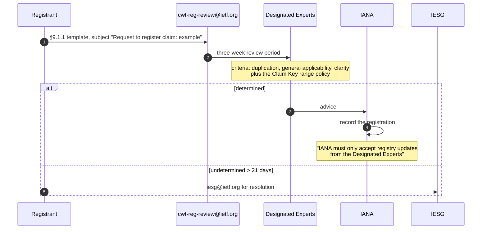

# The two procedures, and the boundary around them

RFC 8392 defines **no exchange** and **two procedures**. The distinction is
measured rather than asserted: over all 1403 lines of `.cache/rfc-8392.txt`,
whole-word and case-insensitive, `verifier`, `sender`, `receiver`,
`recipients`, `exchange`, `handshake`, `negotiate` and `response` each occur
**zero** times, and `protocol` occurs **once** — at line 378, describing
somebody else's job (*"the use of the "application/cwt" content type by a
transport protocol"*). Meanwhile `step`/`steps` occur **15** times and
`return` **twice**, both as *"return to Step 3"* and *"return to Step 1"*.

So each diagram below is **one lane with its external dependencies shown**,
not two parties pretending to converse. `protocol.yaml` carries the steps,
their guards, their `constrained_by` links and what is absent.

## §7.1 — creating a CWT

```mermaid
sequenceDiagram
  autonumber
  participant App as Application
  participant P as Producer (§7.1)
  participant COSE as RFC 8152 / RFC 9052+9053
  App->>P: desired claims (§3: which ones is out of scope)
  P->>P: 1. Create CWT Claims Set
  P->>P: 2. Message = binary representation (NO canonical form named)
  P->>P: 3. Create COSE Header
  Note over P: MUST be valid per [RFC8152]
  P->>COSE: 4. sign / MAC / encrypt with Message as payload
  Note over P,COSE: all steps specified in [RFC8152] MUST be followed (x3)
  COSE-->>P: COSE_Sign1 / COSE_Mac0 / COSE_Encrypt0
  opt 5. nesting
    P->>P: Message = the TAGGED COSE object; return to step 3
  end
  opt 6. if needed by the application
    P->>P: prepend COSE CBOR tag, then CWT CBOR tag 61
  end
  Note over P: the tags are added AFTER the signature exists
  P-->>App: CWT bytes
```

## §7.2 — validating a CWT

```mermaid
sequenceDiagram
  autonumber
  participant App as Application
  participant R as Recipient (§7.2)
  participant COSE as RFC 8152 / RFC 9052+9053
  App->>R: candidate bytes
  R->>R: 1. valid CBOR object?
  R->>R: 2. strip CWT tag 61 if present; a COSE tag MUST follow
  R->>R: 3. strip the COSE tag and read the type from it
  Note over R,App: if there is no COSE tag, the type comes from the application context
  R->>R: 4. COSE Header: only understood and supported parameters
  R->>COSE: 5. validate signature / MAC / decrypt
  COSE-->>R: Message (payload or plaintext)
  opt 6. Message begins with a COSE CBOR tag
    R->>R: nested CWT; return to step 1
  end
  R->>R: 7. Message is a valid CBOR map = the CWT Claims Set
  R-->>App: CWT Claims Set
  Note over R,App: ANY step failing: "the CWT MUST be rejected -- that is,<br/>treated by the application as invalid input"
```

**Both tag-stripping steps run before validation**, and §7.1 step 6 prepends
the tags after it. That pair of facts is the document's own proof that neither
CBOR tag 61 nor the COSE tags is authenticated, and this extraction confirmed
it from the other side by reproducing A.3's signature from `Sig_structure`
alone — `[context, body_protected, external_aad, payload]`, with no tag and no
unprotected header among the inputs.

## §9.1 — registering a claim key

The third procedure, and the one an implementer actually has to execute to
extend the format.



The only way to add a claim key **without** running this is the Private Use
range, integer `< -65536`, which costs **5 octets against 1** for the cheapest
range and is unscoped — two issuers who both reach for `-65537` collide, and
§3 makes the collision silent. `schema/claim-key-policy.derived.yaml` prices
every tier from RFC 8949 §3.

## What no diagram can show, because it is not there

- **No claim validation.** §7.2 step 7 stops at *"a valid CBOR map"*. Nothing
  in RFC 8392 checks `exp`, `nbf` or `aud`, so **a conformant validator
  accepts an expired CWT.** §3 puts that out of scope deliberately; it means
  the procedure above is not a security check on its own.
- **No distinguishable failures.** One rejection covers all seven steps, with
  no error code and no requirement to report anything.
- **No key acquisition.** The recipient has the key before step 1 and nothing
  says how. §8 names the consequence — the recipient must be able to
  *"authenticate the party that assembled the claims"* — and the format does
  not help: all five Appendix A CWTs carry `kid` in the **unprotected** bucket.
