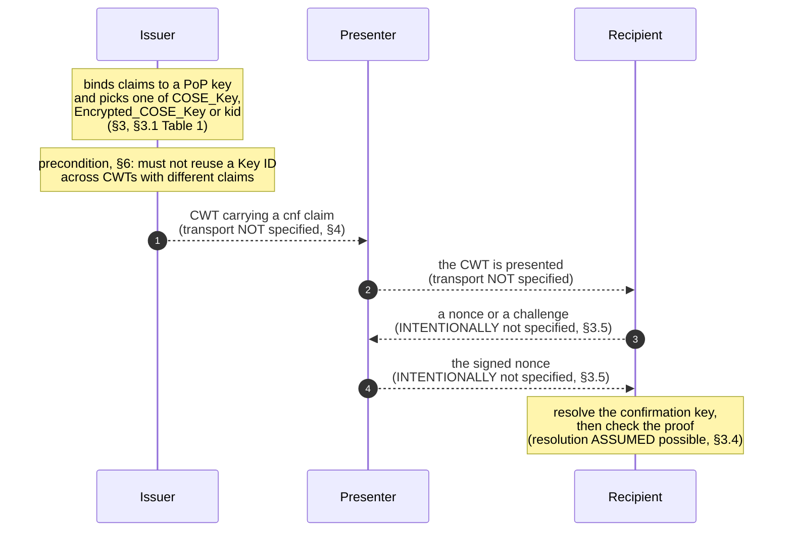

# RFC 8747 — three roles, no messages

**The model is the shape of what is missing.** RFC 8747 defines three roles
outright in §2 — it does not merely name them — and states their relation in
one sentence in §3. It then refuses **twice**, in §3.5, to specify how anything
is communicated, and in §4 puts the surrounding architecture out of scope. So
the diagram below is a role triangle with its arrows annotated by whether the
document specifies them. Five of the six do not exist as specified messages.

**Why this is modelled rather than declared not applicable.** `rfc-9679`'s
extraction declared *its* protocol `not_applicable` on the ground that the flow
belongs to RFC 8747. This is RFC 8747. The role model is the thing that was
pointed at, so it is extracted here rather than deferred a second time — and
the finding is that the arrows are missing from this end too.

## The word sweep behind that judgement

Over all 683 source lines, case-insensitive, matching each word **and its
inflections** (`\bWORD\w*`). The method is stated precisely because this line
previously read "whole words", which does not produce these numbers —
whole-word matching gives `request` 4, `message` 5, `protocol` 2 and `nonce` 3,
and the `where` column below counts `requested`, `messages`, `protocols` and
`nonces`. **The nine zeros hold under both methods**, and they are what the
not-applicable-versus-produce judgement rests on. The role counts in the next
section are whole-word.

| word | hits | where |
|---|---|---|
| `error` | **0** | — |
| `step` | **0** | — |
| `response` | **0** | — |
| `flow` | **0** | — |
| `handshake` | **0** | — |
| `negotiate` | **0** | — |
| `sender` | **0** | — |
| `verifier` | **0** | — |
| `round-trip` | **0** | — |
| `request` | 7 | the masthead `Request for Comments`, one in §4, four in §7's registration procedure, one in §7.2.1's template |
| `message` | 7 on 6 lines | §3.4 (×4 — L319, L323, and L325 twice), §4 (×2, audience restriction), §4 (keyed message digest) |
| `protocol` | 7 | §3.5 (×3, *protocol specific*), §4 (×3, out of scope), one reference title |
| `exchange` | 2 | both in §3.5 |
| `nonce` | 4 | three in §3.5; the fourth is §4's *nonces and timestamps* at L371 |
| `challenge` | 1 | §3.5 |

Counts are **occurrences, not lines** — the two differ only for `message`,
which appears 7 times on 6 lines because line 325 carries it twice.

Zero errors, zero steps, zero responses. Every occurrence of `challenge` and
`exchange`, and three of the four of `nonce`, sit inside §3.5 — the section
titled *Specifics Intentionally Not Specified*. The one `nonce` outside it is
§4's *nonces and timestamps*, which is replay advice rather than a message.
That is a role model with the arrows deliberately left out, not a protocol.

## The role triangle

Every arrow is dashed deliberately: not one of the four is a message this
document defines. The two solid facts in the diagram are both inside a role —
the issuer's construction of the `cnf` claim, and the recipient's obligation to
already know what it needs.

## What each leg costs a reader

| leg | specified here? | what stands in its place |
|---|---|---|
| issuer builds the `cnf` | **structure yes, choice no** | Table 1 and §7.2.2 give the three forms; nothing says when to prefer one |
| issuer → presenter | **no** | §4 names the ACE OAuth Framework and excludes it |
| presenter → recipient | **no** | the role definitions in §2 and nothing else |
| recipient → presenter (nonce) | **no, by explicit refusal** | rfc-8747#R-0064 |
| presenter → recipient (signed nonce) | **no, by explicit refusal** | rfc-8747#R-0065 |
| recipient resolves the key | **no** | §3.4's single word *provided*; §6's out-of-band agreement |

## The hole in the middle

For a `COSE_Key` confirmation the key travels in the token, so step 6 is local.
For an `Encrypted_COSE_Key` the recipient must already hold the decryption key.
For a bare `kid` the resolution is **assumed to be possible and never
specified** — rfc-8747#R-0050 carries the whole of it in one
subordinate clause, *provided the recipient is able to obtain the identified key
using the Key ID*. §6 then says what has to be arranged out of band for that
clause to hold, and §3.4 says what goes wrong when it does not: collisions are
foreseen (rfc-8747#R-0056) and the Key ID is not even
the same on both sides of one conversation (rfc-8747#R-0060).

That is the whole reason this record is held. See `design-notes.md`.

## Error paths: zero

The word `error` occurs **zero** times. The three nearest candidates and why
none is an error path:

| requirement | why not |
|---|---|
| rfc-8747#R-0025 | a local accept-and-drop rule on a map member — no peer, no message, no response |
| rfc-8747#R-0083 | a prohibition on *relying* on a signature; the document never says what to do instead |
| rfc-8747#R-0057 | lowercase *should be prepared to handle such situations* — no behaviour specified, nothing to test |
