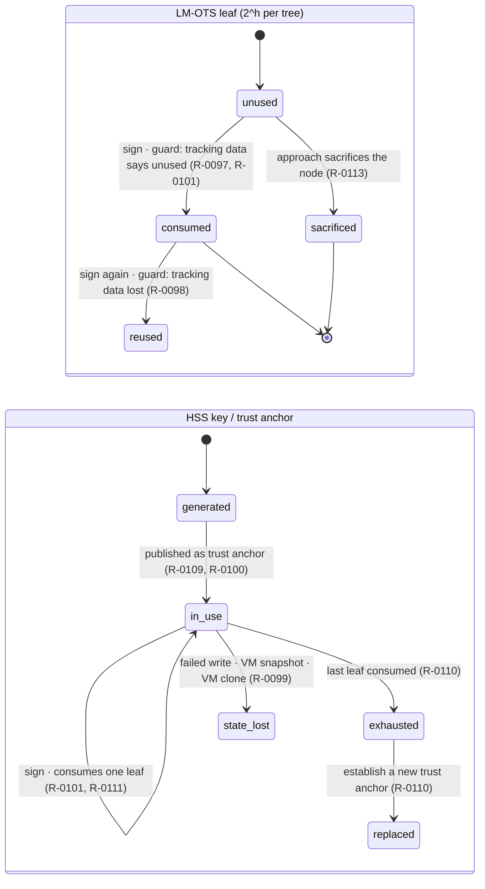

# Protocol model — none

**RFC 8778 defines no protocol.** There is no sequence diagram here because
there is nothing to draw: no counterparties, no messages, no ordering between
parties and no error paths. `protocol.yaml` carries the measurement.

**But the state machine is a different matter, and it is applicable.** §4 and §5
specify a lifecycle with a terminal condition and an error condition, and
`state-machine.yaml` models it. The diagram below is a reading aid for that file,
not a protocol flow.

## Why there is no sequence to draw

Measured as whole words, case-insensitively, over all 772 source lines:

| word | occurrences |
|---|---|
| `protocol`, `exchange`, `handshake`, `negotiate` | **0** each |
| `verifier`, `sender`, `recipient`, `party`, `parties`, `role` | **0** each |
| `flow`, `step`, `procedure`, `response`, `client`, `server`, `issuer` | **0** each |
| `signer` | **3** — lines 91, 159 and 394; the last is an operational rule, the first two are about cost and convenience |
| `request` | **1** — line 6, the RFC masthead |
| `validation` | **1** — §3, in "needed to parse the byte string during signature validation" |
| `validate` | **0** |

**The five COSE-key checks are preconditions with no actor and no consequence.**
`R-0085`: "When using a COSE key for this algorithm, the following checks are
made:" — passive voice, no actor named, and no failure action specified for any
of the five. That is a validation list, not a flow, and it is the whole of §3's
procedural content.

**Both algorithms are cited, not specified.** No signing procedure and no
verification procedure appears in RFC 8778. Each is deferred to `[HASHSIG]` by
section: §3.3 (`R-0030`), §4.4 (`R-0071`), §4.5 (`R-0079`), Appendix B
(`R-0072`) and §9.2 (`R-0112`). A document that specifies neither side has no
side to model.

**And it never says where the signature goes.** `Sig_structure` occurs 0 times,
the word `tag` 0 times, `header` 0 times. `R-0081` says only that the
specification "makes use of the signature with appendix scheme for hash-based
signatures". The envelope is RFC 8152's — see `records/ietf/rfc-9052` for the
document that superseded it — and the only place RFC 8778 shows the signature
inside one is the **non-normative** Appendix A.

## What there is instead: a lifecycle, and one unspecified ordering

`state-machine.yaml` is the applicable artifact. Two machines — one LM-OTS leaf,
and the HSS key that is the trust anchor:

`reused` and `state_lost` are the error states and **neither has a way out**:
RFC 8778 specifies no detection, no recovery and no remediation for either.
Recovering from `state_lost` by restoring a known-good state *is* the
save-and-restore operation §5 withholds the format for (`R-0116`), and `R-0117`
calls it "disastrous opportunities for tree node reuse".

**The one thing a sequence diagram would have shown, the document does not
specify.** `R-0112` says only that "Section 9.2 of [HASHSIG] offers some
practical implementation approaches around this statefulness." So the ordering
between *emitting a signature* and *committing the state change* is undefined
here, and the two orders fail differently — commit first and a crash wastes a
leaf; emit first and a crash can let the leaf be reused. That is recorded under
`unspecified` in `state-machine.yaml` rather than invented as a flow.

## Where the protocol actually lives

| what | where |
|---|---|
| the COSE envelope | RFC 8152, and RFC 9052 after it — `records/ietf/rfc-9052` |
| signing and verifying HSS/LMS | RFC 8554 — `records/ietf/rfc-8554`, a **stub** |
| state management across invocations | RFC 8554 §9.2, cited and not restated |
| the thumbprint computation over this key type | RFC 9679 §3–§4.5 — `records/ietf/rfc-9679`, at `profile: full` |

The same shape as `records/ietf/rfc-9964`, whose extraction reached this
conclusion about the other post-quantum COSE signature binding.
