# RFC 9162 (CT 2.0): protocol model

The machine-readable model is `protocol.yaml` (roles, 28 flows, 162 steps, error paths, source
defects SD-01 to SD-13, open issues OI-01 to OI-12); the lifecycles are `state-machine.yaml`
(M01 to M12). This file is the prose and one sequence diagram per flow. Every quotation below is
a marker rendered from `.cache/rfc-9162.txt` by `bin/check-quotes --render`; nothing between the
markers was typed. Requirement ids were resolved by script from `requirements.yaml`.

## What kind of protocol this is

A log is an HTTPS service with seven client messages (§5.1 to §5.7) and a set of promises it keeps
between requests: merge every entry it issued an SCT for within the Maximum Merge Delay, sign tree
heads at a bounded rate, never serve data with gaps. TLS servers carry the log's signed artifacts
to TLS clients through three channels (a TLS extension, a stapled OCSP response, a certificate
extension). Clients, monitors and auditors check the artifacts locally with the §2.1 algorithms.
The source defines no message for reporting a failed check to anyone: a failure is evidence, and
what to do with it is outside the document.

<!-- q L1288-1291 "Front ends MUST" .. "within that STH)." -->
> Front ends MUST only serve data that is free of gaps (that is, for example, no front end will respond with an STH unless it is also able to prove consistency from all log entries logged within that STH).

## Roles

| role | who | source |
|---|---|---|
| submitter | anyone sending submit-entry: CAs, subjects, third parties | §3, §3.1 |
| ca | builds precertificates, issues certificates, embeds SCTs, signs OCSP | §3.2, §7 |
| log | the append-only tree: accepts, issues SCTs, merges, signs STHs | §4 |
| log-front-end | the HTTPS endpoint; several may exist, out of sync (skew) | §5 |
| log-operator | sets parameters, obtains the Log ID, freezes the log | §4.1, §4.4, §4.13 |
| iana | keeps the Log IDs registry (First Come First Served) | §10.2.5 |
| log-client | any sender of a §5 message | §5, §8 |
| tls-server | presents SCTs, proofs, STHs in the handshake | §6 |
| tls-client | validates SCTs and proofs; evaluates compliance by local policy | §8.1 |
| monitor | watches logs for correctness and certificates of interest | §8.2 |
| auditor | the auditing function, run by a monitor or a TLS client | §8.3 |

## Reading the diagrams

Solid arrows are messages named in `messages.yaml`; dashed arrows are responses. A note marks a
local step. `alt` blocks are the source's branches; `opt` is a MAY or a SHOULD; error paths are
drawn where the source names them and listed in full in `protocol.yaml` error_paths. Inferred steps
are labelled inferred.

## F01 log-establishment (§4.1, §4.4, §10.2.5)

The operator fixes every parameter except the Final STH before the log runs, and none changes
afterwards; the two algorithms cannot change for the log's lifetime (§9). The Log ID is an OID the
operator allocates or obtains from IANA. How clients learn the parameters is outside the source,
so step 7 is inferred. Requirements: rfc-9162#R-0026,
rfc-9162#R-0028, rfc-9162#R-0042.

<!-- q L815-816 "Except for the Final STH" .. "operate the log." -->
> Except for the Final STH, each of these parameters MUST be established before the log operator begins to operate the log.

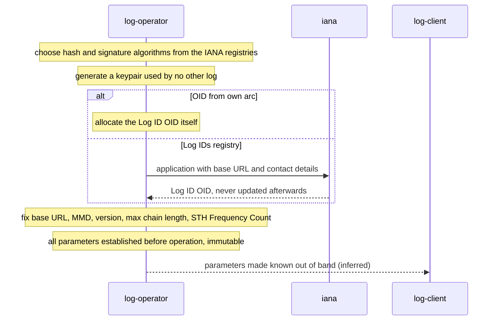

## F02 submit-entry (§3, §4.2, §4.3, §5.1)

One POST carries `submission`, `type` (1 or 2) and `chain`. The log checks the request against
Table 2 (in an order the source does not fix), then the minimum acceptance criteria of §4.2.1 and
its own discretion (§4.2.2). On acceptance it signs an SCT over the entry it will append, stores
the whole chain including the trust anchor, and is then bound to merge the entry within the MMD
(F04). If the entry is already in the tree, it should also return an STH and an inclusion proof.
A submission seen before should get the same SCT back. Rejections for §4.2.1 failures, long chains
and discretion have no error type in the source (OI-01). The values 1 and 2 are not
VersionedTransType values (SD-02).

<!-- q L1418-1421 "If a log detects" .. "an SCT MUST be issued." -->
> If a log detects bad encoding in a chain that otherwise verifies correctly, then the log MUST either log the certificate or return the "badCertificate" error. If the certificate is logged, an SCT MUST be issued.

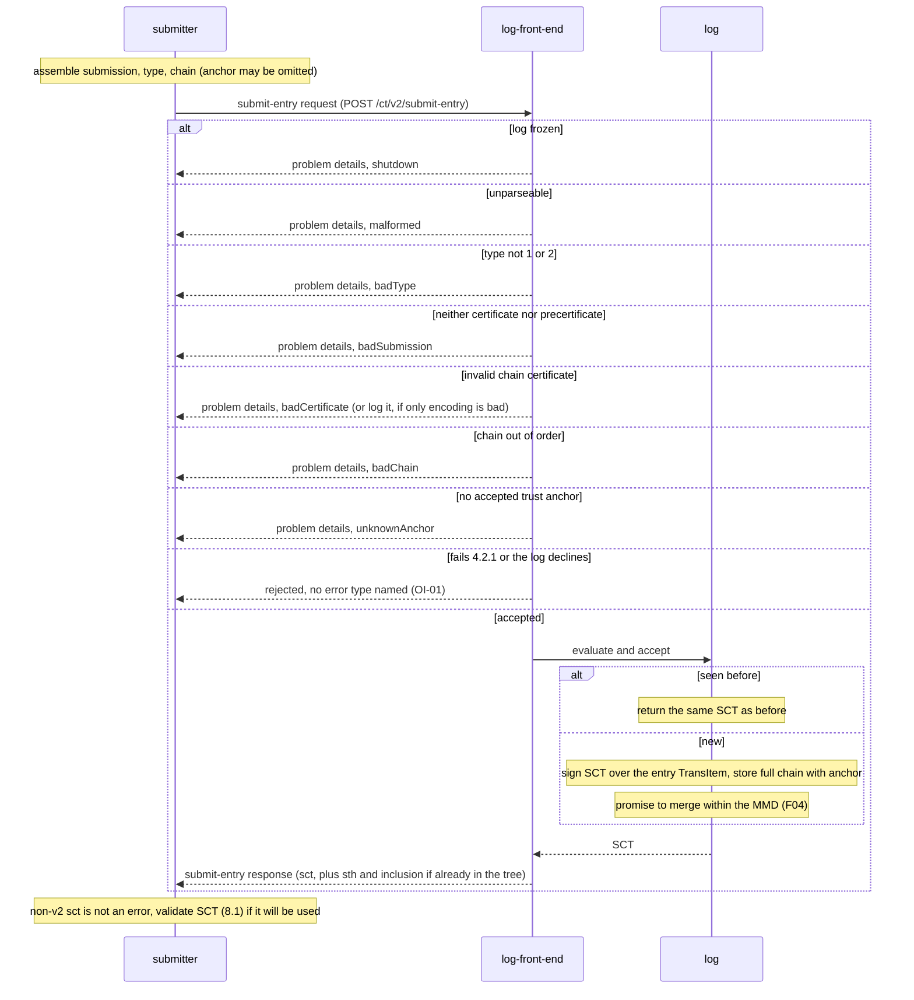

## F03 precertificate-and-certificate-issuance (§3.2, §3.2.1, §7.1.2, Appendix A)

The CA signs a CMS precertificate whose eContent is the future TBSCertificate without the
Transparency Information extension, submits it with type 2, and may embed what comes back in the
certificate it then issues. From the precertificate's signature on, the CA is held to the
certificate as if issued. Appendix A, informative, chains a v2 round and a v1 round so that one
certificate carries both kinds of SCT.

<!-- q L753-760 "Nevertheless, a precertificate's" .. "not actually been issued." -->
> Nevertheless, a precertificate's signature indicates the CA's binding intent to issue the corresponding certificate, which means that: * Misissuance of a precertificate is considered equivalent to misissuance of the corresponding certificate. The CA should expect to be held accountable, even if the corresponding certificate has not actually been issued.

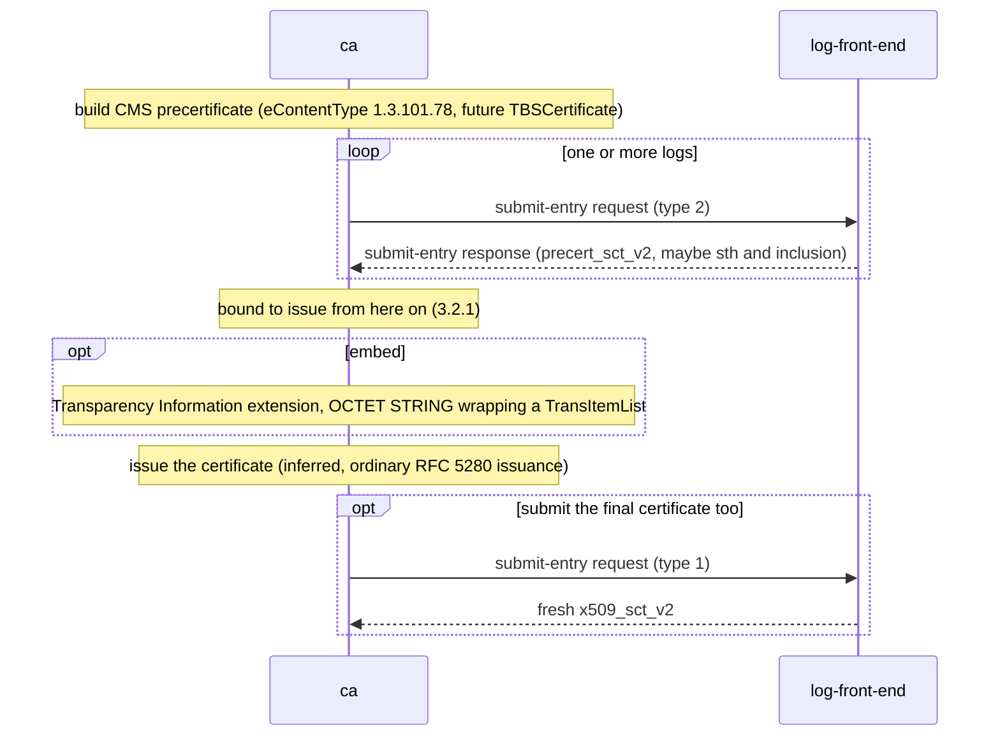

## F04 incorporation-within-mmd (§4, §4.7, §4.10, §5)

The promise an SCT makes, in the order the source lists it: allocate a tree index, compute the
root, sign it, all before the SCT timestamp plus the MMD. Several entries may share one signing. A
front end serves the new STH only when it holds every entry under it. Missing the deadline is
misbehaviour that an auditor detects through an inclusion-proof request (F21). State machine M05.

<!-- q L792-796 "An SCT is the log's promise" .. "(see Section 4.1):" -->
> An SCT is the log's promise to append to its Merkle Tree an entry for the accepted submission. Upon producing an SCT, the log MUST fulfill this promise by performing the following actions within a fixed amount of time known as the Maximum Merge Delay (MMD), which is one of the log's parameters (see Section 4.1):

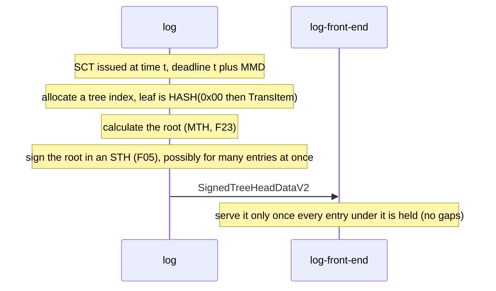

## F05 sth-issuance (§4.9, §4.10, §11.3)

Signing is periodic, at least once per MMD period (with a fresh timestamp over an unchanged root
when nothing was accepted) and never more often than the STH Frequency Count. The tree head's
timestamp is no older than the newest SCT in the tree and strictly later than the previous STH's.
Against client tracking, a log should use deterministic signatures or keep one STH per tree size.
State machine M06.

<!-- q L1153-1159 "a log MUST NOT produce STHs" .. "with a fresh timestamp." -->
> a log MUST NOT produce STHs more frequently than its parameters declare (see Section 4.1). In general, there is no need to produce a new STH unless there are new entries in the log; however, in the event that a log does not accept any submissions during an MMD period, the log MUST sign the same Merkle Tree Hash with a fresh timestamp.

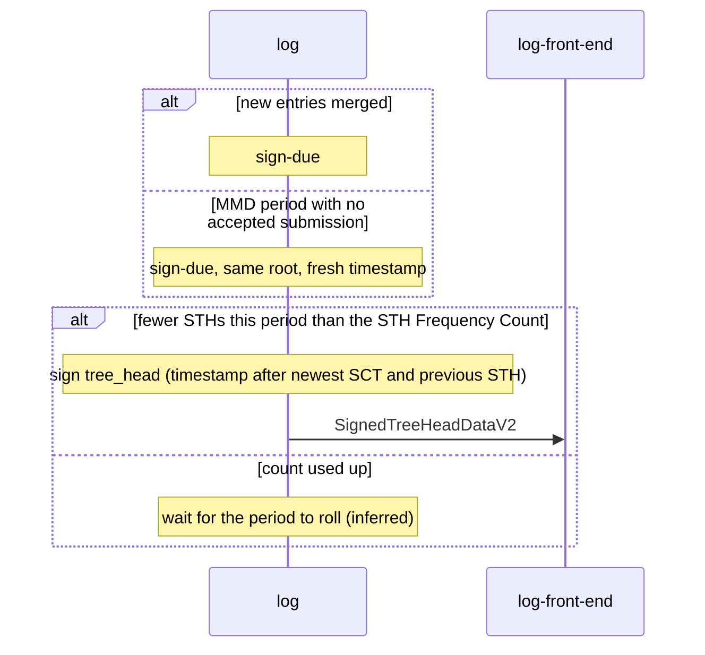

## F06 get-sth (§5.2)

A GET with no parameters. The answer is the latest STH, no older than the MMD
(rfc-9162#R-0055). That the client
then verifies its signature is stated for monitors (§8.2) and inferred here for every client.

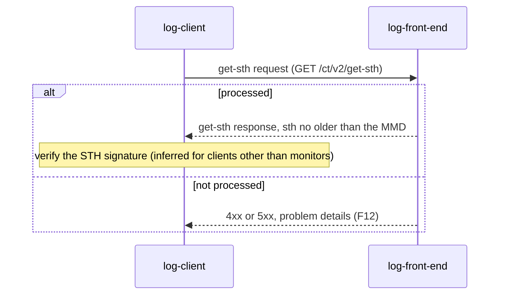

## F07 get-sth-consistency (§5.3)

The client names `first` and, optionally, `second`. What it gets depends on what the reached front
end knows: both STHs, the proof alone; the first only (or `second` omitted), its latest STH and a
proof to it; neither, its latest STH alone. Three error types cover sizes that are below the latest
known STH but are no STH's size, and a `second` smaller than `first`. Equal sizes must produce an
empty proof, which the §2.1.4.2 algorithm then rejects at its step 1 (SD-01).

<!-- q L1455-1462 "However, because of skew" .. "without a consistency proof." -->
> However, because of skew, the receiving front end may not know one or both of the existing STHs. If both are known, then only the consistency output is returned. If the first is known but the second is not (or has been omitted), then the latest known STH is returned, along with a consistency proof between the first STH and the latest. If neither are known, then the latest known STH is returned without a consistency proof.

<!-- q L1468-1470 "If first and second are equal" .. "zero elements)." -->
> If first and second are equal and correspond to a known STH, the returned consistency proof MUST be empty (a consistency_path array with zero elements).

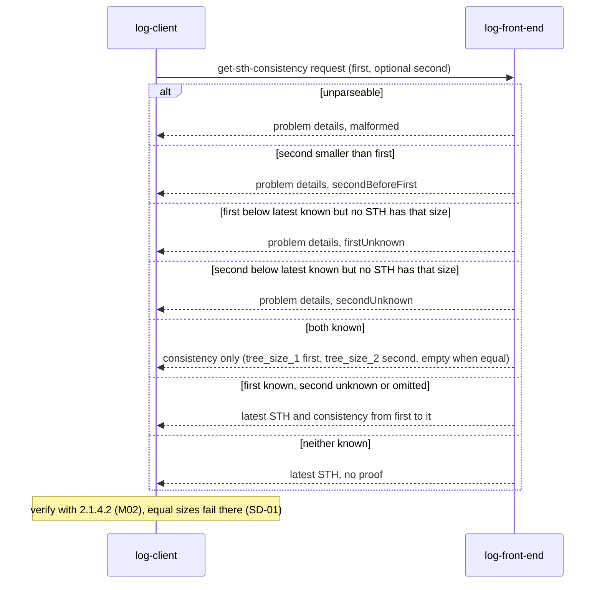

## F08 get-proof-by-hash (§5.4)

The client sends the leaf hash (computed as §4.7 defines, i.e. over the entry TransItem it rebuilds
as for SCT validation) and the size of an STH it holds. A front end that knows that STH returns the
proof alone; one that does not returns its latest STH and a proof into it. `treeSizeUnknown`'s
registered detail names the hash where the tree size is meant (SD-03).

<!-- q L1507-1512 "Because of skew" .. "only inclusion is returned." -->
> Because of skew, the front end may not know the requested tree head. In that case, it will return the latest STH it knows, along with an inclusion proof to that STH. If the front end knows the requested tree head, then only inclusion is returned.

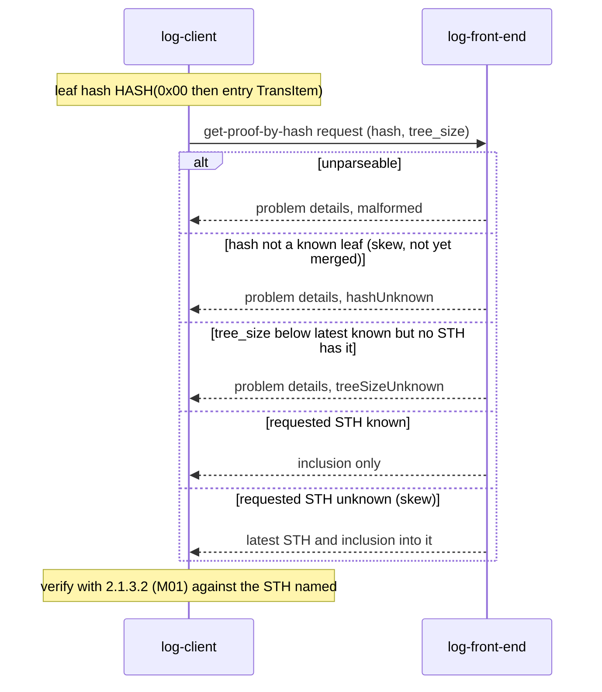

## F09 get-all-by-hash (§5.5)

As F08, but the answer is the union of three independent cases (Table 5): the latest STH when it is
older than the requested one; the latest STH and a consistency proof when it is newer; the inclusion
proof when the leaf is inside the latest STH. If none holds the answer must be empty, which collides
with `hashUnknown` for the same request (SD-04). Which STH the inclusion is against when the two
differ is not said (OI-03).

<!-- q L1577-1579 "Note that more than one case" .. "return an empty response." -->
> Note that more than one case can be true; in which case, the returned data is their union. It is also possible for none to be true; in which case, the front end MUST return an empty response.

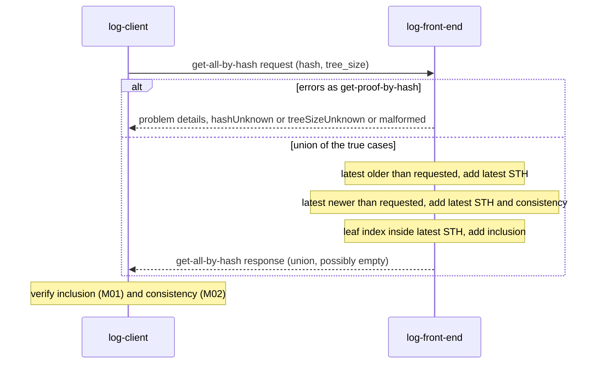

## F10 get-entries (§5.6)

The client asks for `start` to `end` inclusive. The log may shorten the answer (a per-request
limit, the end of its tree) and may have nothing because of skew; it always returns its latest
STH, although the printed output layout puts `sth` inside each entry, leaving no place for it when
the array is empty (SD-09). Unknown TransItem types are not errors: their leaves still count when
the client rebuilds the tree with §2.1.2. `startUnknown` and the empty-array rule overlap (SD-05).

<!-- q L1630-1637 "Note that this message is not signed" .. "opaque input to the tree." -->
> Note that this message is not signed -- the entries data can be verified by constructing the Merkle Tree Hash corresponding to a retrieved STH. All leaves MUST be v2. However, a compliant v2 client MUST NOT construe an unrecognized TransItem type as an error. This means it may be unable to parse some entries, but note that each client can inspect the entries it does recognize as well as verify the integrity of the data by treating unrecognized leaves as opaque input to the tree.

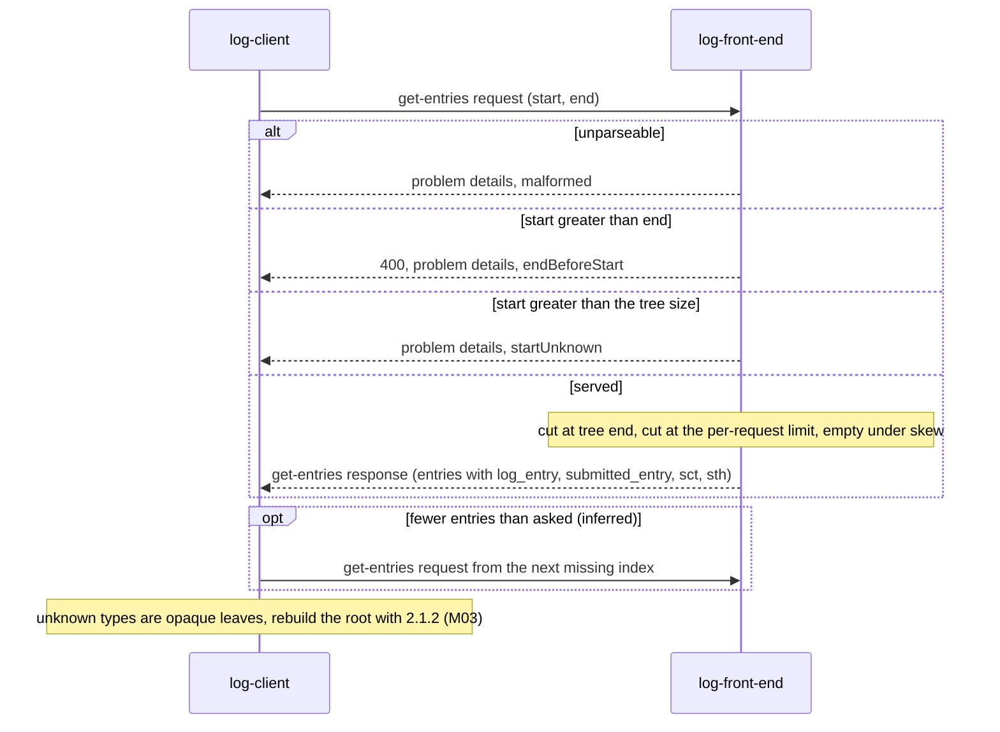

## F11 get-anchors (§5.7)

The accepted trust anchors and, if the log limits chains, the maximum length. Unsigned: TLS is the
only protection (rfc-9162#R-0031).

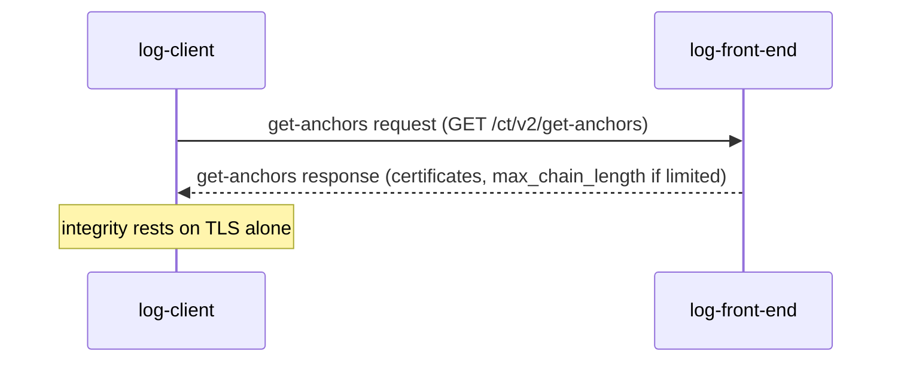

## F12 api-error-handling (§5)

Every message can fail with a 4xx or 5xx whose body should be a problem details object with a
`type` in `urn:ietf:params:trans:error:`. Clients retry 500 and 503 unchanged (after `Retry-After`
if given) and change a request after any 4xx. Other 5xx codes and bodies that are not problem
details have no rule (inferred step).

<!-- q L1302-1305 "If the log is unable" .. "(see Section 3 of [RFC7807]) containing:" -->
> If the log is unable to process a client's request, it MUST return an HTTP response code of 4xx/5xx (see [RFC7231]), and, in place of the responses outlined in the subsections below, the body SHOULD be a JSON problem details object (see Section 3 of [RFC7807]) containing:

<!-- q L1339-1341 "Clients SHOULD treat 500" .. "at a later date." -->
> Clients SHOULD treat 500 Internal Server Error and 503 Service Unavailable responses as transient failures and MAY retry the same request without modification at a later date.

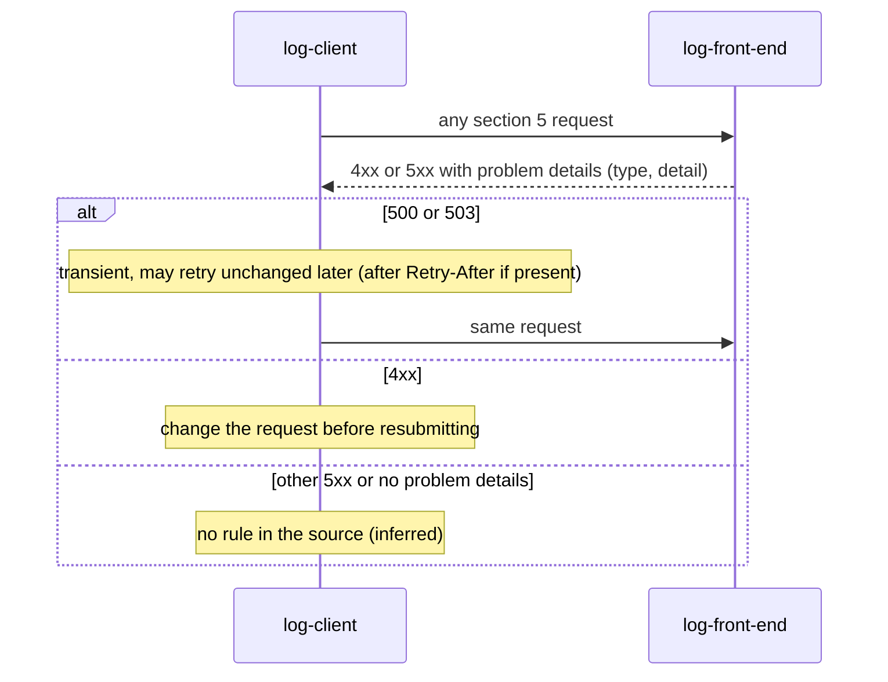

## F13 tls-transparency-info-extension (§6.4, §6.5, §8.1.1)

The client offers `transparency_info` (type 52) empty in ClientHello. A supporting server checks it
is empty, builds a TransItemList with at least one SCT for its certificate (proofs and STHs when it
can get them; minus what the certificate or stapled OCSP response already carries) and sends it in
ServerHello (TLS 1.2 or earlier) or in Certificate or CertificateRequest (TLS 1.3). Never on
resumption: a client receiving it then aborts. The omission rule can leave a list without an SCT
(SD-06), and an empty list cannot be encoded (SD-07). What a server does with non-empty client
extension data is not said (OI-06).

<!-- q L1846-1848 "TLS servers MUST NOT" .. "original session information." -->
> TLS servers MUST NOT process or include this extension when a TLS session is resumed, since session resumption uses the original session information.

<!-- q L1915-1917 "If a TLS server includes" .. "abort the handshake." -->
> If a TLS server includes the transparency_info TLS extension when resuming a TLS session, the TLS client MUST abort the handshake.

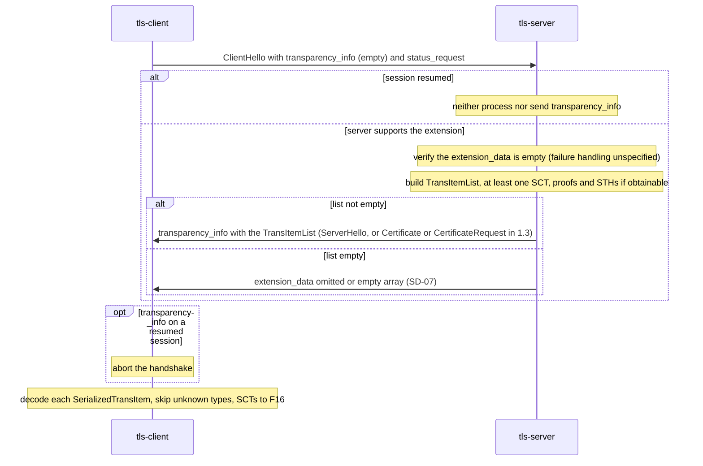

## F14 ocsp-stapling-delivery (§6, §7.1.1)

The CA puts the Transparency Information extension (an OCTET STRING wrapping a TransItemList) in
the `singleExtensions` of a SingleResponse; everything in it is for that certID's certificate or
its precertificate. The server staples the response: in TLS 1.3 inside the `status_request`
extension data, in TLS 1.2 in CertificateStatus. Fetching the OCSP response and the client's
`status_request` are the referenced RFCs' (inferred steps).

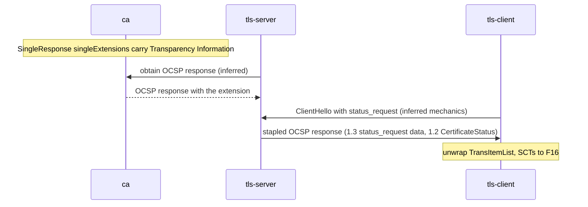

## F15 certificate-embedded-delivery (§6, §7.1.2)

Works with an unmodified server, but what is embedded cannot be refreshed: if clients later stop
trusting the logs named, the remedy is another channel or a reissued certificate.

<!-- q L1732-1741 "CT information can also be encoded" .. "will need to be reissued." -->
> CT information can also be encoded as an extension in the X.509v3 certificate (see Section 7.1.2). This mechanism allows the use of unmodified TLS servers, but the SCTs and inclusion proofs cannot be updated on the fly. Since the logs from which the SCTs and inclusion proofs originated won't necessarily be accepted by TLS clients for the full lifetime of the certificate, there is a risk that TLS clients may subsequently consider the certificate to be noncompliant. In such an event, one of the other two mechanisms will need to be used to deliver CT information, or, if this is not possible, the certificate will need to be reissued.

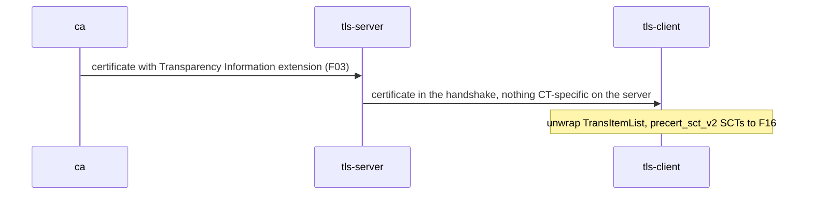

## F16 tls-client-sct-validation (§8.1.2, §8.1.3)

For each SCT the client rebuilds exactly what the log signed: the entry TransItem of the matching
type, whose TBSCertificate is the certificate's own (x509_sct_v2) or the certificate's with the
Transparency Information and v1 SCT extensions removed (precert_sct_v2), with `issuer_key_hash` the
hash of the issuer's public key. Without the log's parameters the SCT cannot be validated and does
not count. State machine M08 (rfc-9162#R-0113).

<!-- q L1960-1963 "If the TLS client does not have" .. "able to validate." -->
> If the TLS client does not have the corresponding log's parameters, it cannot attempt to validate the SCT. When evaluating compliance (see Section 8.1.6), the TLS client will consider only those SCTs that it was able to validate.

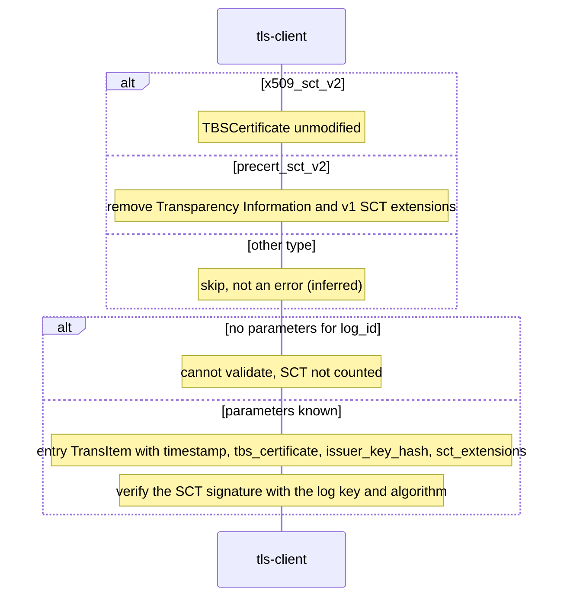

## F17 tls-client-inclusion-and-consistency (§8.1.4, §8.1.5)

With a validated SCT and no proof the client may ask the log (get-proof-by-hash or get-all-by-hash),
at the price of telling the log which server it visited. With a proof and STH it should verify the
proof, then the STH's consistency with one it knows; if its STH predates the SCT it may fetch a
newer STH and a consistency proof. State machine M09.

<!-- q L1975-1979 "Note that fetching inclusion proofs" .. "(see Section 6.4)." -->
> Note that fetching inclusion proofs directly from a log will disclose to the log which TLS server the client has been communicating with. This may be regarded as a significant privacy concern, and so it is preferable for the TLS server to send the inclusion proofs (see Section 6.4).

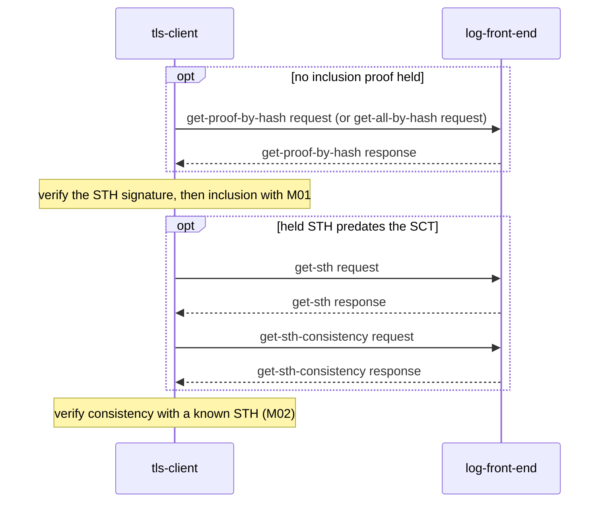

## F18 tls-client-compliance (§8.1.6)

Local policy decides what evidence is enough and what noncompliance costs. The source fixes two
things: compliance is not evaluated unless ClientHello offered both `transparency_info` and
`status_request`, and only validated SCTs count.

<!-- q L2003-2005 "Therefore, a TLS client MUST NOT" .. "in the ClientHello." -->
> Therefore, a TLS client MUST NOT evaluate compliance if it did not include both the transparency_info and status_request TLS extensions in the ClientHello.

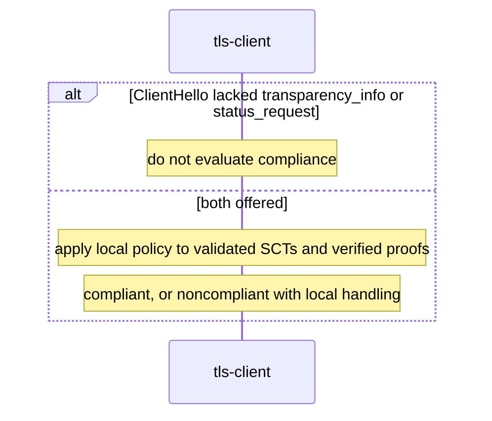

## F19 monitor-inspect-existing (§8.2, first list)

Once per log: fetch and verify the current STH, fetch every entry, check the ones of interest, and
confirm the entries rebuild the STH's root. State machine M10.

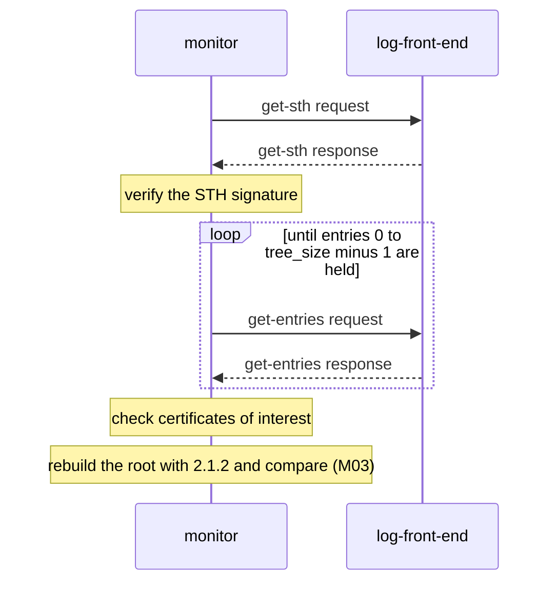

## F20 monitor-inspect-new (§8.2, second list)

Repeated per log: poll the STH until it changes, verify it, fetch the new entries, check them, then
either rebuild the whole tree (a monitor that keeps every entry) or verify a consistency proof from
the previous STH and that the new entries produce its nodes. No procedure is given for that last
check (OI-04), and entries unavailable for an extended period count as misbehaviour.

<!-- q L2042-2045 "Fetch all the new entries" .. "on the part of the log." -->
> Fetch all the new entries in the tree corresponding to the STH (Section 5.6). If they remain unavailable for an extended period, then this should be viewed as misbehavior on the part of the log.

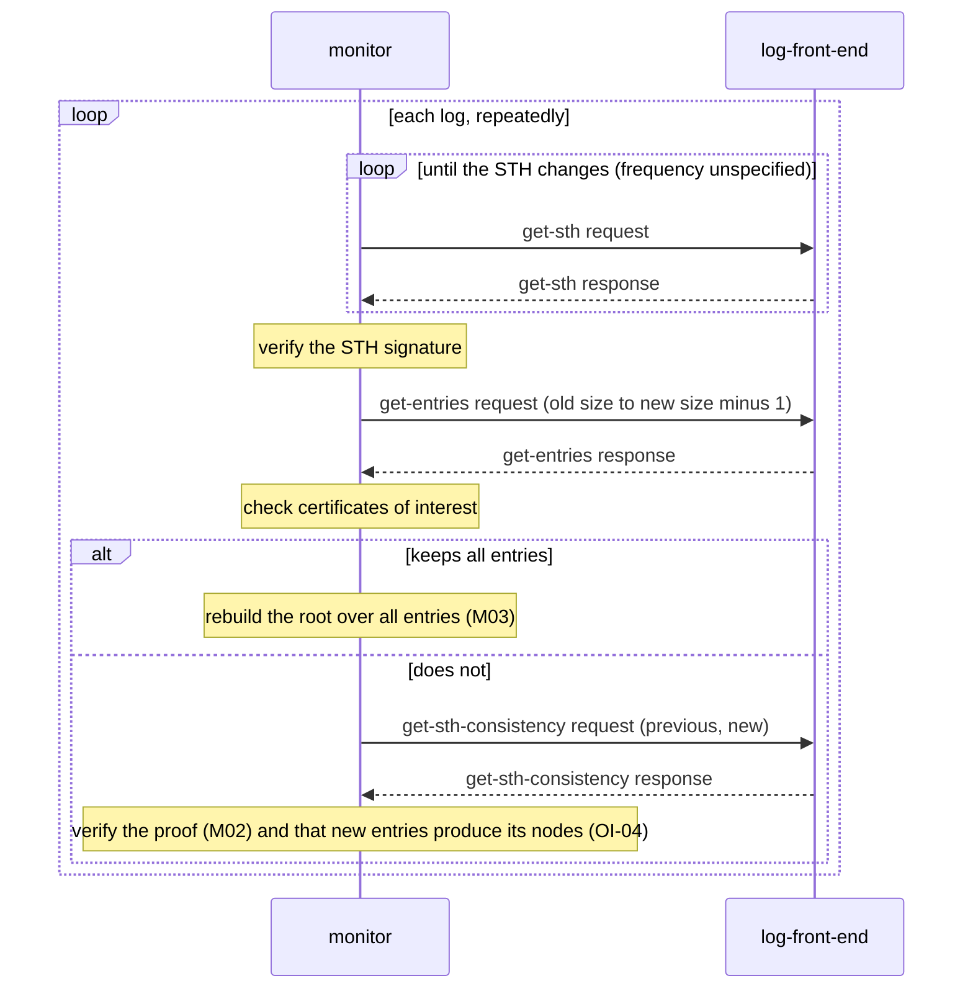

## F21 auditing (§8.3, §11.3)

Four properties: the MMD, the STH Frequency Count, append-only, and a consistent view to everyone.
A monitor audits through consistency proofs and full fetches; a TLS client audits an SCT through an
inclusion proof in an STH dated at least an MMD after it. The consistent-view check needs STHs
shared between parties (gossip), which the source leaves undefined, and the action on a failed
audit is unspecified. State machines M11 and M12.

<!-- q L2101-2106 "A TLS client (Section 8.1) can audit" .. "corresponding to that certificate)." -->
> A TLS client (Section 8.1) can audit by verifying an SCT against any STH dated after the SCT timestamp + the Maximum Merge Delay by requesting a Merkle inclusion proof (Section 5.4). It can also verify that the SCT corresponds to the server certificate it arrived with (i.e., the log entry is that certificate or is a precertificate corresponding to that certificate).

<!-- q L2092-2094 "The action taken by the auditor" .. "proof of the log's misbehavior." -->
> The action taken by the auditor, if an audit fails, is not specified, but note that in general, if an audit fails, the auditor is in possession of signed proof of the log's misbehavior.

```mermaid
sequenceDiagram
  participant A as auditor
  participant F as log-front-end
  Note over A: hold an STH dated at least SCT timestamp plus MMD
  A->>F: get-proof-by-hash request (SCT leaf hash, that STH's size)
  alt proof verifies (M01)
    F-->>A: get-proof-by-hash response
    Note over A: promise kept
  else hashUnknown or failing proof
    F-->>A: problem details or bad proof
    Note over A: retry under skew, else signed proof of an MMD violation (OI-05)
  end
  Note over A: STHs too close together prove a rate violation
  Note over A: a failing consistency proof or root proves an append-only violation
  Note over A: split view needs gossip, not defined
```

## F22 log-shutdown (§4.13, §9)

Announce the freeze out of band; answer submissions with `shutdown`; once the MMD has passed since
the last accepted submission and every pending entry is merged, sign a final STH and publish it as
the Final STH parameter; the key may then be destroyed; keep serving until every logged certificate
has expired or is logged elsewhere. Deprecating an algorithm forces this path and a new log
(rfc-9162#R-0122). Destroying the key collides with §4.10's freshness
rules (SD-08). State machine M04.

<!-- q L1248-1254 "Once MMD from the last accepted submission" .. "can be destroyed." -->
> Once MMD from the last accepted submission has passed and all pending submissions are incorporated, issue a final STH and publish it as one of the log's parameters. Having an STH with a timestamp that is after the MMD has passed from the last SCT issuance allows clients to audit this log regularly without special handling for the final STH. At this point, the log's private key is no longer needed and can be destroyed.

```mermaid
sequenceDiagram
  participant O as log-operator
  participant L as log
  participant F as log-front-end
  participant C as log-client
  O-->>C: the log will be frozen (out of band)
  C->>F: submit-entry request
  F-->>C: problem details, shutdown
  Note over L: wait MMD after the last accepted submission, merge everything pending
  L->>O: final STH, published as the Final STH parameter
  opt destroy the private key
    Note over O: no further STH can be signed (SD-08)
  end
  C->>F: get-entries request (reads continue)
  F-->>C: get-entries response
  Note over L: run until every certificate has expired or is logged elsewhere
```

## F23 to F28: the §2.1 algorithms as local computations

| flow | algorithm | who runs it | machine |
|---|---|---|---|
| F23 merkle-tree-hash | §2.1.1 MTH | log, any client rebuilding a root | (recursive function) |
| F24 verify-tree-head | §2.1.2 | monitor, any client holding every entry | M03 |
| F25 generate-inclusion-proof | §2.1.3.1 PATH | log, for get-proof-by-hash and get-all-by-hash | (recursive function) |
| F26 verify-inclusion-proof | §2.1.3.2 | TLS client, monitor, auditor | M01 |
| F27 generate-consistency-proof | §2.1.4.1 PROOF, SUBPROOF | log, for get-sth-consistency and get-all-by-hash | (recursive function) |
| F28 verify-consistency-proof | §2.1.4.2 | TLS client, monitor, auditor | M02 |

The verifying algorithms are modelled step for step in `state-machine.yaml`, including the
or-fn-is-0 exits of steps 4.b.ii and 6.b.iii, which cannot be reached: the shifting loop is entered
only with fn equal to sn, after sn was found non-zero, and shifting a non-zero number reaches a set
low bit before 0. record.yaml lists erratum 8670 (editorial, Held for Document Update) on the wording
of exactly these two steps (SD-11). Neither verifier checks that the proof's own size fields match
its inputs; that check is added as an inferred step (F26.2, F28.2). §2.1.2 has no result for an
empty tree (SD-12), and §2.1.4.2 is stated only for first smaller than second (SD-01).

<!-- q L459-460 "If LSB(fn) is not set" .. "or fn is 0." -->
> If LSB(fn) is not set, then right-shift both fn and sn equally until either LSB(fn) is set or fn is 0.

<!-- q L541-542 "If consistency_path is an empty array" .. "fail the proof verification." -->
> If consistency_path is an empty array, stop and fail the proof verification.

Executed as printed (scratch simulation, SHA-256, every tree of 1 to 64 leaves): every valid
inclusion and consistency proof is accepted, every tampered one rejected, the fn-is-0 exits are
taken 0 times, and the empty proof for equal sizes is rejected 64 times of 64. The state machines
themselves, interpreted literally, agree with that reference on every case of 1 to 40 leaves.

### F23 merkle-tree-hash (§2.1.1)

```mermaid
sequenceDiagram
  participant L as log
  alt n is 0
    Note over L: MTH is HASH() of the empty string
  else n is 1
    Note over L: leaf hash HASH(0x00 then d0)
  else n greater than 1
    Note over L: k largest power of two below n
    Note over L: HASH(0x01 then MTH of first k then MTH of the rest)
  end
```

### F24 verify-tree-head (§2.1.2, M03)

```mermaid
sequenceDiagram
  participant C as log-client
  participant F as log-front-end
  F-->>C: get-entries response (every entry 0 to tree_size minus 1)
  loop each index i
    Note over C: push leaf hash, merge as many times as i has trailing 1 bits
  end
  Note over C: merge the rest down to one element
  Note over C: compare with root_hash (tree_size 0 undefined, SD-12)
```

### F25 generate-inclusion-proof (§2.1.3.1)

```mermaid
sequenceDiagram
  participant L as log
  participant C as log-client
  Note over L: PATH(m, D_n) for 0 at most m less than n, empty for a single leaf
  Note over L: m below k, path in the left part then MTH of the right part
  Note over L: m at least k, path in the right part then MTH of the left part
  L-->>C: inclusion_proof_v2 (log_id, tree_size, leaf_index, inclusion_path), unsigned
```

### F26 verify-inclusion-proof (§2.1.3.2, M01)

```mermaid
sequenceDiagram
  participant C as log-client
  Note over C: leaf_index at least tree_size fails
  Note over C: fn is leaf_index, sn is tree_size minus 1, r is the leaf hash
  loop each p in inclusion_path
    Note over C: sn is 0 fails, else fold p left or right by the bits of fn and sn
  end
  Note over C: proven only if sn is 0 and r equals root_hash
  Note over C: proof sizes against the STH (inferred, F26.2)
```

### F27 generate-consistency-proof (§2.1.4.1)

```mermaid
sequenceDiagram
  participant L as log
  participant C as log-client
  Note over L: PROOF(m, D_n) is SUBPROOF(m, D_n, true) for 0 less than m less than n
  Note over L: m equals n, empty if the flag is true, else MTH of the subtree
  Note over L: m at most k, recurse left, append MTH of the right part
  Note over L: m greater than k, recurse right with flag false, append MTH of the left part
  L-->>C: consistency_proof_v2 (log_id, tree_size_1, tree_size_2, consistency_path), unsigned
```

### F28 verify-consistency-proof (§2.1.4.2, M02)

```mermaid
sequenceDiagram
  participant C as log-client
  Note over C: empty consistency_path fails (equal sizes, SD-01)
  Note over C: first a power of 2, prepend first_hash
  Note over C: fn is first minus 1, sn is second minus 1, shift while fn is odd
  Note over C: fr and sr start at the first element
  loop each further element c
    Note over C: sn is 0 fails, else fold c into fr and sr, or into sr only
  end
  Note over C: consistent only if fr equals first_hash, sr equals second_hash, sn is 0
```

## Error paths

All fourteen Error Types of §10.2.6 are raised by a named step: `malformed` (every message),
`badSubmission`, `badType`, `badChain`, `badCertificate`, `unknownAnchor`, `shutdown` (submit-entry),
`firstUnknown`, `secondUnknown`, `secondBeforeFirst` (get-sth-consistency), `hashUnknown`,
`treeSizeUnknown` (get-proof-by-hash, get-all-by-hash), `startUnknown`, `endBeforeStart`
(get-entries). Beyond them: HTTP-only failures (F12), rejections with no type (OI-01), local
verification failures that travel nowhere (M01, M02, M03, M05, M08, M10 to M12), the client's
handshake abort on resumption (F13), and audit findings (F21). `protocol.yaml` error_paths maps
each to its steps.

## Source defects and open issues

Full records, with quotations, are in `protocol.yaml` source_defects and open_issues.

| id | defect | where |
|---|---|---|
| SD-01 | equal-size consistency proof must be empty, but §2.1.4.2 fails an empty path and §2.1.4.1 defines no proof for m = n | §5.3 L1468-1470; §2.1.4.2 L535-542; §2.1.4.1 L487-489 |
| SD-02 | submit-entry `type` 1 and 2 are not VersionedTransType values (0x0100, 0x0101); 2 also called precert_sct_v2 | §5.1 L1361-1363, L1433; §4.5 L971-978 |
| SD-03 | `treeSizeUnknown` detail names hash, not tree_size | §5.4 L1535-1536; §10.2.6 L2522-2524 |
| SD-04 | get-all-by-hash: mandatory empty response and `hashUnknown` cover the same request | §5.5 L1577-1579, L1598 |
| SD-05 | `startUnknown` overlaps the empty-array rule; start = tree_size falls between | §5.6 L1650-1652, L1664-1666, L1679-1680 |
| SD-06 | the omission SHOULD can strip every SCT from a TransItemList that MUST hold one | §6.4 L1811-1813; §6.5 L1830-1833 |
| SD-07 | an empty TransItemList is not encodable (lower bound 1), yet may be sent | §6.3 L1796-1800; §6.5 L1836-1837 |
| SD-08 | a frozen log may destroy its key but §4.10 still needs fresh STHs | §4.13 L1248-1259; §4.10 L1151-1159 |
| SD-09 | get-entries nests `sth` in each entry, yet must return it when entries is empty | §5.6 L1613-1628, L1664-1669 |
| SD-10 | §2.1.5 calls the leaf hashes c, d, j non-leaf nodes | §2.1.5 L594-598, L636-646 |
| SD-11 | the or-fn-is-0 exits are unreachable (erratum 8670, editorial) | §2.1.3.2 L459-460; §2.1.4.2 L566-567 |
| SD-12 | §2.1.2 has no result for tree_size 0 | §2.1.2 L366-397; §2.1.1 L331-333 |
| SD-13 | the chain input omits a last element that is itself the anchor | §5.1 L1365-1370, L1404-1407 |

Open issues: OI-01 untyped rejections, OI-02 first = 0, OI-03 the selected STH of get-all-by-hash,
OI-04 checking new entries against a consistency proof, OI-05 when hashUnknown becomes an MMD
violation, OI-06 non-empty client extension data, OI-07 transparency_info in a TLS 1.3
CertificateRequest, OI-08 what counts as the same submission, OI-09 the precertificate TBSCertificate rule
against embedded v1 SCTs (normative.md SD-11), OI-10 one STH per tree_size against idle re-signing
(normative.md SD-12), OI-11 the freeze MUST whose §4.13 actions are SHOULD (normative.md SD-14),
OI-12 what a chain length counts (normative.md SD-17). The ids of normative.md, messages.yaml and design-notes.md for the same defects are
joined by the table at the end of the Source defects section of normative.md.
