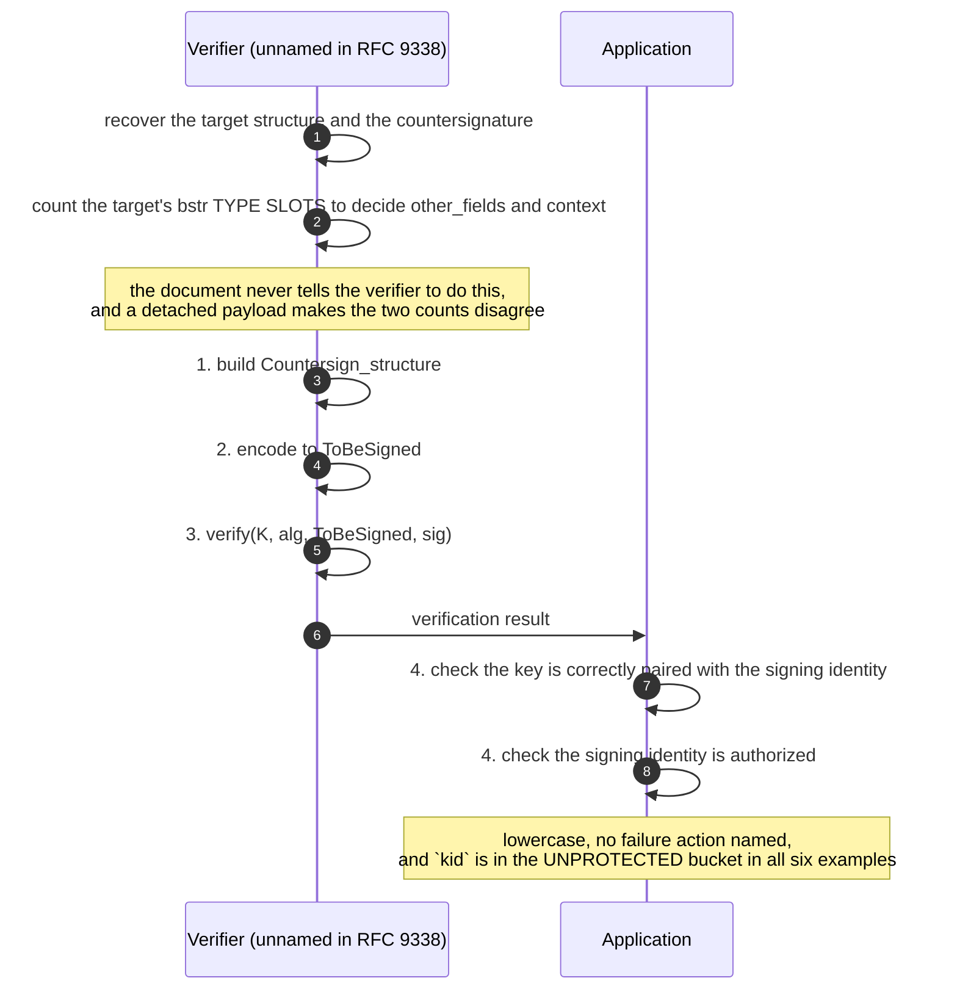
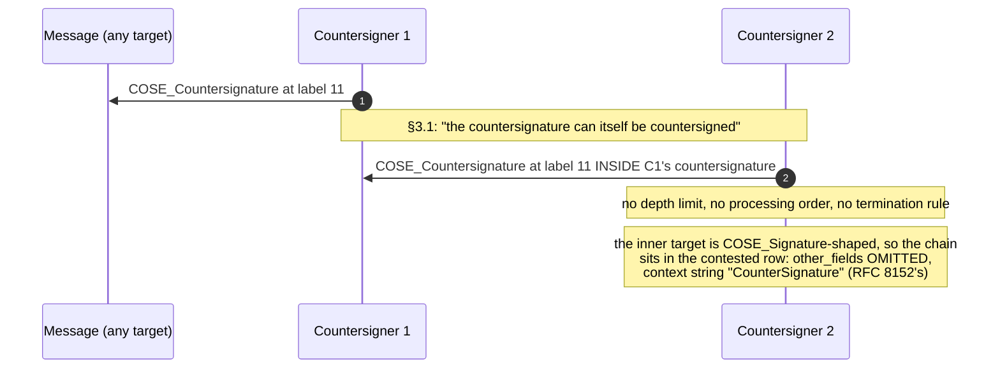
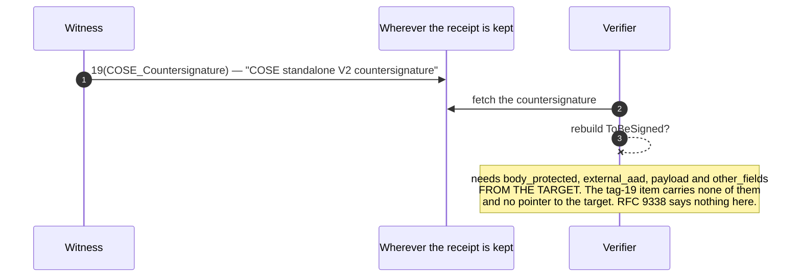

# RFC 9338 — protocol model

**Applicability: APPLICABLE, as two local procedures and no exchange.** The
machine-readable model, with every role, flow, step and error path wired to a
requirement id, is `protocol.yaml`. This file is the diagrams and the reading.

| | |
|---|---|
| **Source** | `.cache/rfc-9338.txt`, 921 lines |
| **Digest** | `3fd3a4b1cb4060070ffcf6104de0c12c6c5bed6cf2329d9019a16f7717365dde` |
| **Roles** | 5, of which **4 are named in the source** and the verifier is not |
| **Flows** | 5 — two numbered procedures, one recursion, one empty, one migration |
| **Error paths** | 6, **none of which has a specified failure action** |

**What the measurement says.** `verifier`, `sender`, `receiver`, `exchange`,
`handshake`, `negotiate`, `response`, `server`, `client`, `role`, `flow`,
`error`, `reject` and `abort` each occur **zero** times in the 921 lines.
`request` occurs once, in the masthead. `fail` occurs once. `protocol` occurs
five times and not once about this document's own protocol. So there is no
exchange here — and `protocol.yaml` is still not a `not_applicable`
declaration, because §3.3 prints two numbered procedures with named inputs, a
named intermediate value and a stated precondition, and §3.1 adds an unbounded
recursion.

---

## F-1 · Compute a countersignature (§3.3)

The precondition is the document's only ordering constraint, and it is
lowercase: the target *"needs to have all of its cryptographic functions
finalized before computing the signature"*.

```mermaid
sequenceDiagram
    autonumber
    participant PP as Primary producer
    participant CS as Countersigner
    participant APP as Application
    PP->>PP: build the target structure (COSE_Sign1 / Mac / Encrypt / ...)
    PP->>PP: finalize every cryptographic function in it
    Note over PP,CS: GUARD (§3.3, lowercase): the target must be finalized first
    PP->>CS: the finalized target structure
    APP->>CS: external_aad (may be absent; defaults to a zero-length bstr)
    CS->>CS: 1. build Countersign_structure
    Note over CS: context is fixed by whether other_fields is present,<br/>which is arithmetic on the TARGET, not a choice
    CS->>CS: 2. encode to ToBeSigned (RFC 8949 §4.2 as narrowed by RFC 9052 §9 — MUST)
    CS->>CS: 3. sign(K, alg, ToBeSigned)
    CS->>PP: 4. place the value at label 11 (full) or label 12 (abbreviated)
    Note over PP: the countersignature lands in the TARGET's UNPROTECTED map,<br/>so the primary signature does not cover it
```

**Step 1 is where the ambiguity lives.** *"populate it with the appropriate
fields"* is the whole of the instruction. For `COSE_Signature`,
`COSE_Encrypt`, `COSE_Encrypt0` and `COSE_recipient` — four of the eight
permitted targets — the target has **no `payload` field** and nothing says
what fills `Countersign_structure.payload`. See `design-notes.md` §3.

---

## F-2 · Verify a countersignature (§3.3)



**The verifier has to re-derive the coverage rule to get step 1 right**, and
the document gives it no instruction to do so. That is the practical form of
the detached-payload hazard: three `bstr` type slots and two wire items for a
detached `COSE_Sign1`, which produce two different `ToBeSigned` values, one
with `other_fields` and one without.

---

## F-3 · Chaining (§3.1)



**A chain of countersignatures is a chain of the weakest case in the
document.** Each link's target is `COSE_Signature`-shaped, so each link gets
two `bstr` slots, no `other_fields` and RFC 8152's context string. `[RFC4998]`
is cited as the use case and is informative.

---

## F-4 · The standalone form — an empty flow, measured (§3.1, §5.1)



Tag 19 exists for a countersignature detached from what it countersigns, and
the document specifies no association, no fetch, no naming and no recipient
behaviour. This is the one place where MD-3's option 5 pays a real price —
`design-notes.md` §7.

---

## F-5 · Migration off labels 7 and 9 (§1, §5.2)

```mermaid
sequenceDiagram
    autonumber
    participant OLD as RFC 8152 sender
    participant NEW as RFC 9338 implementation
    participant IANA as IANA
    IANA->>IANA: add "(Deprecated by RFC 9338)" to the Description of 7 and 9
    Note over IANA: a registry Description edit is the WHOLE deprecation;<br/>no MUST NOT or SHOULD NOT exists against 7 or 9
    NEW->>NEW: emit label 11 / 12 ("will migrate" — lowercase)
    OLD->>NEW: a message carrying label 7
    NEW->>NEW: verify label 7 ("must be supported" — lowercase, not BCP 14)
    Note over NEW: and there is no step that ever STOPS accepting label 7,<br/>so the dual-accept window has no end
```

**The dual-accept window is where the context-string finding bites.** For five
of the eight target structures the version 2 algorithm produces the *same*
signed bytes as version 1, under the *same* context string
`"CounterSignature"`. An implementation that verifies both labels — which §1
tells it to, in lowercase — accepts one byte string under two names and cannot
tell which version produced it.

---

## Error paths — six, none with a failure action

| path | locator | what the document says happens |
|---|---|---|
| form conversion | §3 | *"the converted structure will fail signature validation"* — the only `fail` in the document |
| identity / authorisation checks | §3.3 | the application *"performs the appropriate checks"*; no failure action |
| short authentication tag | §6 | at most 64 bits (AES-MAC) or 32 bits (AES-CCM-16-64-128), against a `MUST` of ≥ 256 |
| shared MAC / encryption key | §6 | *"data origin authentication is not provided"* |
| AEAD key-commitment ambiguity | §3 | *"This situation is not detectable by a countersignature on the encrypted data"* |
| unparseable CDDL | §3.3 | erratum 7338; the document's own tooling path |

Two of these are **unsatisfiable configurations rather than runtime errors**:
`COSE_Mac` with AES-MAC and `COSE_Encrypt` with AES-CCM-16-64-128 cannot meet
§6's 256-bit `MUST` at all, because the ceiling is set by the target and no
countersignature algorithm lifts it.

---

## What is not modelled, and why

**No timestamp flow.** §3 offers the notary analogy and then withdraws its
essential element — *"such a timestamp has not yet been defined for COSE"*. A
countersignature attests existence without time.

**No registration, revocation or key-rollover flow.** The vocabulary is absent
from the source; `state-machine.yaml` carries the counts.

**No transport.** `transport` occurs once, about non-terminals *"not emitted
for transport"*.
