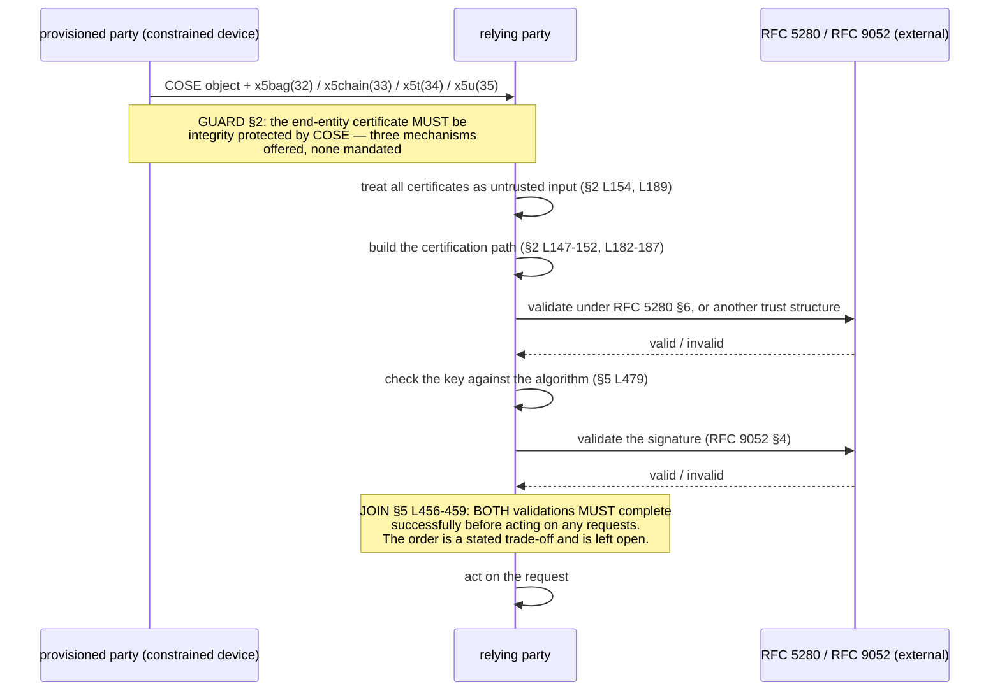
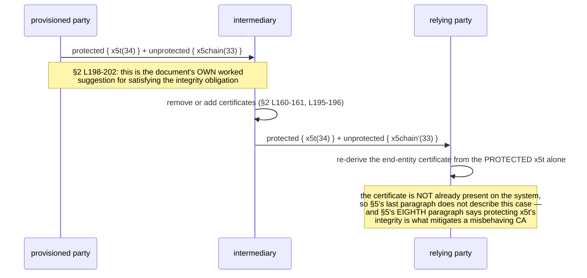

# Protocol model — applicable, and one-sided

**RFC 9360 defines no message of its own, and it is still a protocol
document.** It names four parties with distinct duties, specifies a retrieval
over HTTP or CoAP with the document's only `SHOULD`, admits an **active
intermediary** into its own model twice, and imposes an ordering constraint on
two independent checks. `protocol.yaml` carries the model with every step's
locator and requirement ids; this file carries the diagrams and the
measurement behind the verdict.

## Why applicable, measured

| word | occurrences | where |
|---|---|---|
| `sender` | **13** | all in §3, static-static ECDH |
| `party` | 6 | 116, 118, 148, 150, 184, 186 |
| `recipient` | 4 | 285, 286, 319, 327 |
| "relying party" | 3 | 116, 118, 184 |
| `intermediary` | **2** | 161, 196 |
| `server` | 2 | 271, 272 |
| `retrieve` | 2 | 275, 451 |
| `GET` | 1 | 275 |
| `client` | 1 | 443 |
| **`verifier`** | **0** | — |
| **`verify`** | **0** | — |
| `handshake`, `negotiate`, `negotiation`, `response`, `receiver` | **0** each | — |
| `steps` | **0** | — |
| `step` | 1 | 134, "in a single step" |

**The document has no word for the verifying side.** In a specification whose
entire subject is what a verifier may conclude from a certificate, `verify`
occurs zero times in 614 lines. It says *"the party evaluating the
signature"* (line 148) and *"the relying party"* (lines 116, 118, 184).

## F-1 — relying-party validation

Everything happens on one side. The diagram is drawn with the external
dependencies named rather than as two parties pretending to converse, because
the provisioned party sends once and then has no further role.



**The failure edge is lower case.** §2 lines 134–137: *"If the application
cannot establish trust in the certificate, the public key contained in the
certificate cannot be used for cryptographic operations."* That is the
terminal state of this flow and under §1.1 it binds nobody.

## F-2 — retrieval through `x5u`

```mermaid
sequenceDiagram
    participant R as relying party
    participant S as certificate server
    participant X as RFC 3986 / RFC 5280 (external)

    R->>S: GET <uri from x5u (35) or x5u-sender (-28)>
    Note over R,S: §2 L274-277: if HTTP or CoAP, TLS / DTLS / OSCORE<br/>SHOULD be used — the document's ONLY SHOULD
    S-->>R: application/pkix-cert | application/pkcs7-mime;smime-type="certs-only"<br/>| application/cose-x509 [;usage=chain]
    R->>R: does it chain to an existing trust anchor?
    alt chains
        R->>R: continue at F-1 step 3 (still untrusted input)
    else does not chain
        Note over R: §2 L269-274 MUST NOT trust, unless URI integrity<br/>protection AND server authentication AND the server is<br/>configured as trusted to provide new trust anchors —<br/>or an out-of-band confirmation is received
        R->>R: reject
    end
    R->>X: apply RFC 3986 §7.1 security considerations
```

**And §2 contradicts itself about this GET.** Lines 264–267: *"As the
end-entity certificate is integrity protected by COSE, the URI does not need
to provide any protection."* Lines 269–274 then condition trust on the URI
providing *"integrity protection and server authentication"*. Reconcilable
only by reading the first as being about the end-entity certificate and the
second as being about trust anchors — which the text does not say.

## F-3 — the intermediary, which the document admits itself

This is the flow the record exists for. It is three steps long and §2 states
the capability **twice**, once per certificate-carrying parameter.



The parameter doing the binding is `x5t`, whose `hashAlg` RFC 9360 restricts
to **no subset** of the COSE Algorithms registry — so `[-14, h'…']` (SHA-1,
registered `Filter Only` by `rfc-9054`) is a conforming value in exactly this
position, and nothing on the wire says whether the sender meant to filter or
to bind. `../examples/vectors.yaml` demonstrates the indistinguishability;
`../schema/x5t-hashalg-policy.derived.yaml` is the narrowing that fixes it for
us.

## What no diagram can show

Nine items, listed in `protocol.yaml` under `absent`. The three that matter
most: there is **no error reporting of any kind** — no code, no message, no
obligation to tell the sender anything; there is **no revocation mechanism**,
only §2's observation that *"there still needs to be an entity that is
responsible for handling the possible certificate revocation"* with no
statement of which entity; and there is **no encoding for `external_aad`**,
although putting the end-entity certificate there is offered four times as a
way to satisfy the document's central obligation. Two implementations that
both choose that mechanism do not interoperate.
