# rfc-9580 — protocol model

## Framing: a data format, not a wire protocol

RFC 9580 defines packet formats, not an exchange. In its own words: “This document provides information on the message-exchange packet formats used by OpenPGP to provide encryption, decryption, signing, and key management functions.” (§1) and “It provides formats for encoding and transferring encrypted and/or signed messages. In addition, OpenPGP provides functionality for encoding and transferring keys and certificates, though key storage and management are beyond the scope of this document.” (§2). There is no transport, no handshake, no negotiation and no error message: every object is produced by one role and consumed later by another, store-and-forward, over a channel the document does not name. The only “negotiation” is what the producer reads from the consumer's certificate (Features, preference lists, Key Flags). This protocol artifact is therefore **PARTIAL** by construction; `protocol.yaml` says so in `applicability`.

What the model holds:

1. **Construction flows**: what each role must emit when it encrypts, signs, generates a key and certificate, certifies, introduces, revokes or updates a key. Arrows between roles mean “this object reaches that role by an undefined channel”; such steps carry `status: not-defined` and are drawn dashed.
2. **Consumption flows**: what the receiving role does with each object, with the failure handling the source states (no release of unauthenticated AEAD plaintext, clear errors for malleable ciphertext, rejection of out-of-grammar critical packets, and “ignore, never abort” for bad signatures).
3. **Local algorithms** shared by the flows: packet parsing, message grammar and unwrapping, session-key recovery, v2 and v1 SEIPD decryption, signature hashing and verification, key validity, preference negotiation, cleartext signatures, armor, secret-key unlocking, trust-signature scoping. `normative-procedure` ones are stated as procedures by the source; `composite` ones assemble stated rules into an order the source does not give.

Key discovery, keyservers, trust computation (web of trust), keyring management and user interaction are outside the source; see [What RFC 9580 does not define](#what-rfc-9580-does-not-define).

## Reading `protocol.yaml`

| key | what it holds |
|---|---|
| `applicability`, `framing` | the PARTIAL statement and 5 quoted framing statements |
| `roles` | 12 roles with the source's names for them, locators and quotes |
| `messages_used`, `message_notes` | the 77 message names the steps use: packets with version (and Signature Type ID), §10 sequences, text encodings, and signature subpackets named in `subpackets`; to be reconciled with `messages.yaml` in pass 3 |
| `flows` | 18 flows, 121 steps: `from`, `to`, `message`, `message_alternatives`, `subpackets`, `action`, `basis`, `locator`, `quotes`, `constrained_by`, `on_error`, `on_error_basis`, and where needed `invokes`, `status`, `note` |
| `algorithms` | 13 algorithms, 76 steps: `kind`, `action`, `basis`, `locator`, `quotes`, `constrained_by`, `on_fail`, `on_fail_basis`, `invokes` |
| `error_paths` | 33 error paths: trigger, detecting role, where, outcome, basis |
| `source_defects_and_ambiguities` | 28 entries |
| `not_defined` | 16 things an implementer will not find in RFC 9580 |

- **Quotes.** Every `quotes` item is a contiguous span of `.cache/rfc-9580.txt` with whitespace collapsed and line-end hyphens joined; all were checked mechanically.
- **Requirements.** `constrained_by` cites `rfc-9580#R-NNNN`; 380 distinct requirements are cited, every one present in `requirements.yaml`.
- **Errors.** `on_error_basis` / `on_fail_basis` is stated, inferred or unspecified. Most producer-side steps are `unspecified`: the source states what must be emitted, never what a producer does when it cannot.

## Roles

| role | kind | source's names | locators |
|---|---|---|---|
| `sender` | party | sending OpenPGP implementation, sending implementation, encrypting implementation, message generator | §2.1, §5.2.3.7, §12.2, §13.7 |
| `recipient` | party | receiving OpenPGP implementation, receiving implementation, receiver, decrypting implementation | §2.1, §5.1, §5.1.8 |
| `signer` | party | issuer (of a signature), sending implementation | §2.2, §5.2, §10.3.2.2, §12.3.2 |
| `verifier` | party | receiving implementation, verifying implementation, verifying application, evaluator, receiver of a signature | §2.2, §5.2.1, §5.2.3.7, §6.2.2.3, §13 |
| `keyholder` | party | key owner, owner of this public key, certificate owner, user | §5.2.3.10, §5.2.3.14, §5.12, §10.1.5, §13.9 |
| `certifier` | party | issuer of this certification, non-self certifier, other key owner | §5.2.1.4, §5.2.1.10, §5.12, §10.1.5 |
| `trusted-introducer` | party | valid trusted introducer, meta introducer | §5.2.3.21, §5.2.3.22 |
| `designated-revoker` | party (deprecated) | Revocation Key (deprecated), a key that is authorized to issue revocations | §5.2.3.23, §5.2.1.11, §5.2.1.12, §10.1.5 |
| `preferred-revoker` | party | third party (escrow holder) | §13.9 |
| `key-server` | mentioned | key server, administrator of the key server | §5.2.3.19, §5.2.3.25, §5.2.3.26 |
| `keyring` | store | keyring, local keyring files, keystore | §3.6, §5.10, §13.6 |
| `attacker` | mentioned | attacker, adversary, Mallet, Frank (forger) | §5.2.3.10, §13.7, §13.8, §13.12 |

The source has no single word for the consumer: recipient (decrypts) and verifier (checks signatures and certificates) are usually the same implementation, separated here because their rules differ. The keyholder is the source's own term for the owner of a key; “certificate” means Transferable Public Key only (Appendix B.1). The attacker is not a party but appears because several flows exist only as defences.

## Flows

Solid arrows: the source places an object between two roles. Dashed arrows: the step is `not-defined` or `out-of-band` (the source says the object moves but not how). A note over one role groups its local steps. The tables give the structure (`basis` is the step's basis, `on error` its `on_error_basis`); quotes and requirement ids are in `protocol.yaml`.

### 1. `encrypt-and-sign-message` (§2.1, §5.1, §5.2.3.32, §5.3, §5.13.2, §5.14, §10.3, §10.3.2.1, §12.2, §13.7, §13.10)

*Public-key encryption of a message, optionally signed first: recipient key selection, container and algorithm choice from the recipients' certificates, session key generation, ESK construction, v2 SEIPD encryption, assembly and transfer.* Kind: construction.

The sender's whole job, in the source's order (§2.1), with each choice wired to the rule that binds it. Nothing is negotiated with the recipient: every choice is read from the recipient's certificate. Steps 1 to 4 are selection, 5 to 9 build the plaintext Optionally Padded Message, 10 to 13 encrypt and assemble, 14 and 15 encode and hand over. The v2 SEIPD path (v6 PKESK, v6 SKESK) is the main line; the v1 SEIPD path (v3 PKESK, v4 SKESK) is given as message_alternatives. The source defines no sender-side error reporting: a sender that cannot meet an obligation simply must not produce the object.

Test vectors: Appendix A.8 (X25519, AES-128, OCB, v6 PKESK and v2 SEIPD).

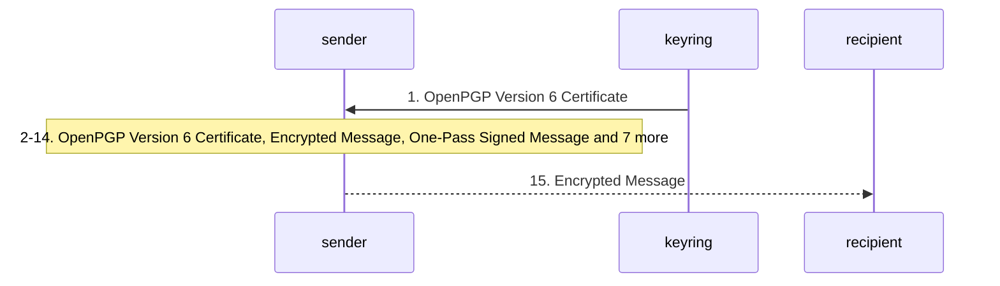

| n | from → to | message | step | basis | locator | on error |
|---|---|---|---|---|---|---|
| 1 | keyring → sender | `OpenPGP Version 6 Certificate` (or `OpenPGP Version 4 Certificate`) | Obtain each recipient's certificate and establish that it is the authentic, currently valid key of that recipient: a v6 key is usable only with a valid Direct Key signature; no User ID self-signature is needed unless the use depends on the User ID. How the certificate is found and authenticated is not defined. Invokes `key-validity-evaluation`. | inferred | §11.5, §5.2.3.10, §2.1 | unspecified |
| 2 | sender → sender | `OpenPGP Version 6 Certificate`; subpackets: Key Flags | In each recipient certificate select the encryption key or keys: a primary key or bound subkey whose Key Flags allow communications (0x04) or storage (0x08) encryption, which is not expired or revoked, and whose algorithm and size may still be used for encryption. | inferred | §5.2.3.29, §10.1.5, §11.5.1, §12.4, §12.6 | unspecified |
| 3 | sender → sender | `OpenPGP Version 6 Certificate`; subpackets: Features | Choose the encryption container. v2 SEIPD when every recipient key advertises it in Features, or every recipient key is v6 with no Features subpacket, or support can otherwise be inferred; otherwise v1 SEIPD may be used. Never SED. The choice fixes the ESK versions (step 10 and 11): one row of Table 26. Invokes `preference-negotiation`. | stated | §13.7, §5.2.3.7, §5.2.3.32, §10.3.2.1 | stated |
| 4 | sender → sender | `OpenPGP Version 6 Certificate`; subpackets: Preferred AEAD Ciphersuites, Preferred Symmetric Ciphers for v1 SEIPD, Preferred Compression Algorithms | Choose the algorithms from the intersection of the recipients' preferences, read from hashed subpackets of the self-signature that applies (the Direct Key signature of a v6 key, or the self-signature of the User ID the key was located by): for v2 SEIPD a (cipher, AEAD mode) pair, with AES-128/OCB implicitly last; for v1 SEIPD a cipher, with AES-128 tacitly last; and a compression algorithm, with Uncompressed tacitly last. Never a cipher outside the recipients' lists, never IDEA, TripleDES or CAST5, never algorithm 0. Invokes `preference-negotiation`. | stated | §5.2.3.14, §5.2.3.15, §5.2.3.17, §5.2.3.10, §12.2, §12.2.1, §12.3.1, §9.3, §13.13, §5.2.3.7 | stated |
| 5 | sender → sender | `Encrypted Message` | Generate a fresh random session key for this message alone, of the size the chosen cipher needs, from a CSPRNG. (The only sanctioned exception is the session-key-reuse reply, flow session-key-reuse-reply.) | stated | §2.1, §13.10 | unspecified |
| 6 | sender → sender | `One-Pass Signed Message` (or `Signed Message`); subpackets: Intended Recipient Fingerprint | If the message is also to be signed, sign first (flow sign-message-inline), so that the signature ends up inside the encryption; include an Intended Recipient Fingerprint subpacket for each recipient primary key, critical in a v6 signature. | stated | §2.1, §5.2.3.36, §13.12, §5.2.3.7 | inferred |
| 7 | sender → sender | `Literal Data Packet` | (Unsigned case; in the signed case step 6 already produced it.) Wrap the content in a Literal Data packet in OpenPGP packet format: format octet b, or u only for text known to be UTF-8; text in UTF-8 with CR LF line endings; empty file name and zero date recommended; t not to be emitted (SHOULD NOT); _CONSOLE not recommended. | stated | §5.9, §5.9.1 | unspecified |
| 8 | sender → sender | `Compressed Data Packet` | Optionally compress the message (the Literal Data packet, or the whole signed message) with an algorithm in the recipients' preferences, framed in OpenPGP packet format; never use algorithm 0 in a Compressed Data packet. | stated | §2.1, §2.3, §5.6, §12.3.1, §12.3.1.1 | unspecified |
| 9 | sender → sender | `Padding Packet` | Optionally append a Padding packet of random octets as the last packet of the Optionally Padded Message that will be encrypted in the v2 SEIPD packet, to hide the plaintext length. How much padding is out of scope. | stated | §5.14, §10.3, §13.11 | unspecified |
| 10 | sender → sender | `Public Key Encrypted Session Key Packet v6` (or `Public Key Encrypted Session Key Packet v3`) | For each selected recipient key build one PKESK: v6 (fingerprint of the key or subkey, or size 0 for an anonymous recipient) before v2 SEIPD, v3 (Key ID, or all zeros) before v1 SEIPD. Encrypt the session key with the key's algorithm: X25519 and X448 by ephemeral ECDH, HKDF and AES key wrap; ECDH per §11.5 with the announced KDF and KEK; RSA with a fresh PKCS#1 encoding per key. A v3 PKESK also carries the cipher ID (encrypted, or in clear for X25519/X448, which then must be AES). No Elgamal v6 PKESK. | stated | §5.1, §5.1.1, §5.1.2, §5.1.3, §5.1.4, §5.1.6, §5.1.7, §5.1.8, §11.5, §3.2, §9.5, §12.1.1 | stated |
| 11 | sender → sender | `Symmetric Key Encrypted Session Key Packet v6` (or `Symmetric Key Encrypted Session Key Packet v4`) | For each passphrase that may also open the message, build one SKESK (see flow passphrase-encryption for the details): v6 with S2K, HKDF-derived KEK and AEAD encryption of the session key before v2 SEIPD; v4 with a salted S2K before v1 SEIPD. Argon2 recommended; never Simple S2K. | stated | §3.7.2, §3.7.2.2, §5.3, §5.3.1, §5.3.2 | unspecified |
| 12 | sender → sender | `Symmetrically Encrypted and Integrity Protected Data Packet v2` (or `Symmetrically Encrypted and Integrity Protected Data Packet v1`) | Encrypt the Optionally Padded Message. v2: generate a 32-octet random salt; HKDF- SHA256 (IKM session key, salt, info = packet type octet, version, cipher, AEAD, chunk size) yields the message key and the nonce prefix; encrypt chunk by chunk (chunk index in the nonce, the five header octets as additional data), each chunk followed by its tag, then a final tag over the empty string with the total plaintext length appended to the additional data; chunk size octet at most 16. v1: CFB with a zero IV over block-size random octets plus two repeated octets, the plaintext, 0xD3 0x14 and the SHA-1 MDC. Partial body lengths are allowed for this packet. | stated | §5.13.1, §5.13.2, §4.2.1.4, §13.10, §12.2.1, §12.9 | unspecified |
| 13 | sender → sender | `Encrypted Message` | Assemble the Encrypted Message: the ESK sequence (all PKESK and SKESK packets, in any order) followed by the SEIPD packet, every packet version from the single Table 26 row chosen in step 3, no critical packet outside the grammar, OpenPGP packet format only. | stated | §10, §10.3, §10.3.2.1, §4.2, §4.2.2 | unspecified |
| 14 | sender → sender | `ASCII Armor` | Optionally armor for a text-only channel: BEGIN PGP MESSAGE header line, no Version header (SHOULD NOT be emitted), base64 in lines of at most 76 characters, no CRC24 footer (an armored message ending in a v2 SEIPD packet must not carry one). | stated | §6, §6.1, §6.2, §6.2.1, §6.2.2.1, §2.4 | unspecified |
| 15 | sender → recipient | `Encrypted Message` (or `ASCII Armor`) | Hand the message to the recipients over any channel. The session key travels in the ESK packets at the front of the message; nothing else is exchanged. *(not-defined)* | stated | §2.1, §2.4 | unspecified |

### 2. `decrypt-and-verify-message` (§2.1, §2.2, §5.1.8, §5.7, §5.9, §5.13, §10.3, §10.3.1, §10.3.2, §12.2, §13.4, §13.5, §13.7)

*Receiving an OpenPGP Message: dearmor, parse, ESK alignment, session key recovery, integrity-checked decryption, unwrapping, decompression, signature verification and release of the literal data.* Kind: consumption.

The recipient's processing, the mirror of encrypt-and-sign-message. The source is explicit about failure here: no release of unauthenticated plaintext from AEAD data, a mandatory clear error for malleable ciphertext, rejection of out-of-grammar critical packets and of overlong lengths, and a forward-compatible rule that a bad signature is ignored, never fatal. The order is the order the layers must be peeled; each layer's own procedure is an algorithm.

Test vectors: Appendix A.8 to A.11 (v2 SEIPD with OCB, EAX, GCM); Appendix A.12 (v4 SKESK with Argon2 and v1 SEIPD).

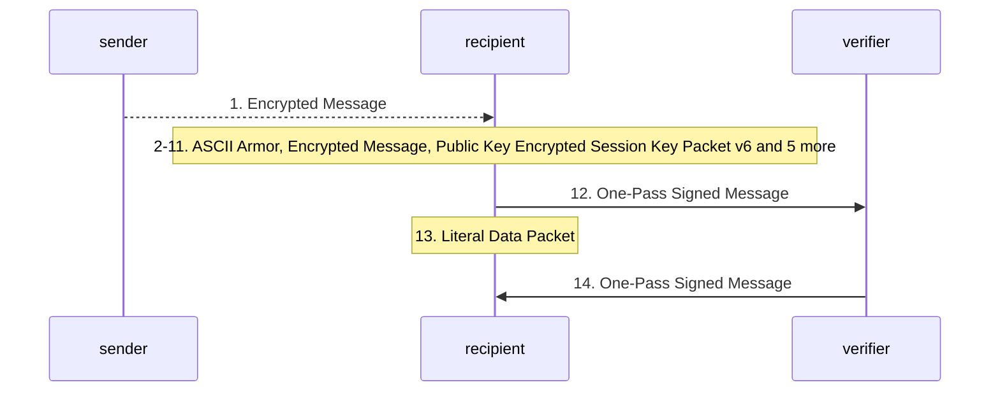

| n | from → to | message | step | basis | locator | on error |
|---|---|---|---|---|---|---|
| 1 | sender → recipient | `Encrypted Message` (or `ASCII Armor`, `Signed Message`, `Compressed Message`, `Literal Message`) | Receive an OpenPGP Message by some channel. It may be encrypted, signed, compressed or bare literal data; the top-level grammar decides. *(not-defined)* | stated | §10.3 | unspecified |
| 2 | recipient → recipient | `ASCII Armor` | If armored, decode the armor: find the header line, skip Armor Headers (unknown keys ignored), base64-decode ignoring whitespace, ignore the CRC24 footer whatever its state. Invokes `armor-decoding`. | stated | §6, §6.1, §6.2 | stated |
| 3 | recipient → recipient | `Encrypted Message` | Parse the octets into packets and check the sequence against the message grammar. An unknown or out-of-grammar critical packet rejects the whole sequence; unknown non-critical packets and Marker packets are skipped. Invokes `packet-stream-parsing`, `message-grammar-parsing`. | stated | §4.1, §4.3, §5.8, §10, §10.3 | stated |
| 4 | recipient → recipient | `Encrypted Message` | Discard every ESK packet whose version does not align with the payload: before a v2 SEIPD keep only v6 PKESK and v6 SKESK; before a v1 SEIPD (or SED) keep only v3 PKESK and v4 SKESK (before a historic SED, Table 26 also lists the v2 PKESK of RFC 2440, which this document does not define). | stated | §10.3.2.1 | unspecified |
| 5 | recipient → recipient | `Public Key Encrypted Session Key Packet v6` (or `Public Key Encrypted Session Key Packet v3`, `Symmetric Key Encrypted Session Key Packet v6`, `Symmetric Key Encrypted Session Key Packet v4`) | Recover the session key: find a PKESK addressed (by fingerprint or Key ID) to a secret key the recipient holds, or for an anonymous PKESK try every available private key; unlock the secret key; decrypt and check the session key. Otherwise try the SKESK packets with a passphrase obtained from the user. Invokes `secret-key-unlock`, `session-key-recovery`. | stated | §2.1, §5.1, §5.1.8, §5.3, §13.5, §3.2, §3.3 | stated |
| 6 | recipient → recipient | `Symmetrically Encrypted and Integrity Protected Data Packet v2` | Decrypt a v2 SEIPD: derive message key and nonce prefix, decrypt and authenticate every chunk, then check the final tag over the total length. Accept chunk size octets 0 to 16. Invokes `seipd-v2-decryption`. | stated | §5.13.2, §13.7 | stated |
| 7 | recipient → recipient | `Symmetrically Encrypted and Integrity Protected Data Packet v1` | Decrypt a v1 SEIPD: CFB with a zero IV using the cipher named by the ESK, then verify the MDC (SHA-1 over prefix, plaintext and 0xD3 0x14) before using any plaintext. Use the quick check, if at all, without exposing timing or error detail. Invokes `seipd-v1-decryption`. | stated | §5.13.1, §13.4, §13.7 | stated |
| 8 | recipient → recipient | `Symmetrically Encrypted Data Packet` | A SED payload (historic data only): reject it and stop, or, if processing it anyway, warn clearly that non-integrity-protected data was processed. *(deprecated)* | stated | §5.7, §10.3.2.1, §13.7 | stated |
| 9 | recipient → recipient | `Encrypted Message` | Warn where the source asks: a cipher outside the keyholder's own preferences (decrypt anyway), a deprecated cipher (IDEA, TripleDES, CAST5), an RSA key under 3072 bits or an Elgamal key used to decrypt. | stated | §12.2, §9.3, §12.4, §12.6 | stated |
| 10 | recipient → recipient | `Optionally Padded Message` | Unwrap: parse the decrypted octets as a new packet stream that ends exactly at the end of the plaintext. v2 SEIPD must yield an Optionally Padded Message, v1 SEIPD (or SED) an OpenPGP Message. Ignore Padding packets. Invokes `message-grammar-parsing`. | stated | §10.3.1, §5.14 | stated |
| 11 | recipient → recipient | `Compressed Data Packet` | Decompress (Uncompressed, ZIP, ZLIB, BZip2), parse the result as an OpenPGP Message, and limit the number of nested compression layers. | stated | §5.6, §9.4, §10.3.1, §13.7, §13.14 | stated |
| 12 | recipient → verifier | `One-Pass Signed Message` (or `Signed Message`); subpackets: Intended Recipient Fingerprint | If the message is signed, verify each signature (flow sign-message-inline gives the structure). A signature carrying Intended Recipient Fingerprint subpackets is valid only if the message was encrypted to one of the listed primary keys or their subkeys. Invokes `signature-verification`. | stated | §2.2, §5.2.3.36, §5.2.5, §10.3 | stated |
| 13 | recipient → recipient | `Literal Data Packet` | Release the literal data: text (u, or legacy t read as UTF-8) has CR LF converted to native line endings; the format octet, file name and date are not covered by any signature and must not be presented or used as authenticated; _CONSOLE is advisory only. | stated | §5.9, §5.9.1 | unspecified |
| 14 | verifier → recipient | `One-Pass Signed Message` | Report the outcome locally: which signatures validated (possibly none), any integrity or deprecation warnings. "No successful signatures" is a normal result. | stated | §5.2.5 | stated |

### 3. `sign-message-inline` (§2.2, §5.2, §5.2.3, §5.2.3.11, §5.2.3.35, §5.2.4, §5.4, §10.3, §10.3.2.2, §12.3.2, §12.7, §13.2)

*Inline signing of a message with the one-pass construction: key and hash choice, salt, One-Pass Signature packet, literal data, hashing, subpackets, Signature packet, bracketing of several signatures.* Kind: construction.

A Signed Message is either Signature then message, or the one-pass form OPS, message, Signature, which lets the signer stream: the OPS announces the hash algorithm, salt and key so the verifier can hash while reading. The signature version is dictated by the key version (v6 key, v6 signature and v6 OPS; v4 key, v4 signature and v3 OPS). The verifier side is algorithm signature-verification.

Test vectors: Appendix A.7 (inline-signed v6 message).

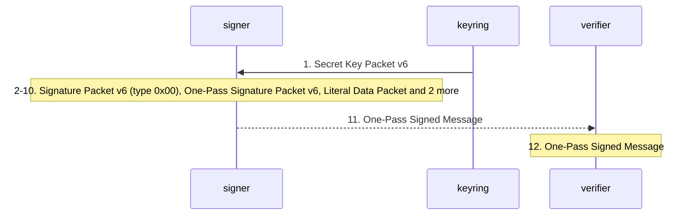

| n | from → to | message | step | basis | locator | on error |
|---|---|---|---|---|---|---|
| 1 | keyring → signer | `Secret Key Packet v6` (or `Secret Subkey Packet v6`); subpackets: Key Flags | Select a signing key: the primary key or a bound signing subkey (with its Primary Key Binding back-signature) that is valid now and whose Key Flags allow signing data (0x02); unlock its secret material. No DSA, no Elgamal signatures, no RSA under 2048 bits (3072 recommended), no Ed25519Legacy in v6. Invokes `key-validity-evaluation`, `secret-key-unlock`. | inferred | §5.2.3.29, §10.1.5, §12.4, §12.5, §12.8, §5.2.3.3.1 | unspecified |
| 2 | signer → signer | `Signature Packet v6 (type 0x00)`; subpackets: Preferred Hash Algorithms | Choose the hash algorithm: the signer's choice, guided by the recipient's Preferred Hash Algorithms where the recipient is known, with SHA2-256 tacitly acceptable; at least the digest size the key algorithm requires (DSA q bits, ECDSA and EdDSALegacy fsize, P-521 512 bits, Ed25519 256, Ed448 512); never MD5, SHA-1 or RIPEMD-160. Invokes `preference-negotiation`. | stated | §12.3.2, §5.2.3.2, §5.2.3.3, §5.2.3.4, §5.2.3.5, §9.5, §13 | unspecified |
| 3 | signer → signer | `Signature Packet v6 (type 0x00)` | Fix the signature version from the key version (v6 for a v6 key, v4 for a v4 key, never v3) and, for v6, draw a new random salt of the size Table 23 gives for the hash (16, 24 or 32 octets). | stated | §5.2, §5.2.3, §10.3.2.2, §13.2, §9.5 | unspecified |
| 4 | signer → signer | `One-Pass Signature Packet v6` (or `One-Pass Signature Packet v3`) | Emit the One-Pass Signature packet: signature type, hash and public-key algorithm, (v6) salt equal to the Signature packet's and the 32-octet signing key fingerprint, (v3) the Key ID, and the nested flag (0 means another OPS for the same data follows). OPS v6 for a v6 signature, OPS v3 for a v4 signature. | stated | §5.4, §10.3.2.2 | unspecified |
| 5 | signer → signer | `Literal Data Packet` (or `Compressed Data Packet`) | Emit the signed content as an OpenPGP Message, normally a Literal Data packet (u allowed when a text signature 0x01 follows), possibly inside a Compressed Data packet. | stated | §5.9, §10.3 | unspecified |
| 6 | signer → signer | `Signature Packet v6 (type 0x00)` (or `Signature Packet v6 (type 0x01)`) | Hash: the salt first (v6), then the document (binary as is; text canonicalised to UTF-8 with CR LF), then the signature fields from the version octet through the hashed subpackets, then the trailer (version, 0xFF, 4-octet length). Invokes `signature-hash-computation`. | stated | §5.2.4, §5.2.1.1, §5.2.1.2 | unspecified |
| 7 | signer → signer | `Signature Packet v6 (type 0x00)`; subpackets: Signature Creation Time, Issuer Fingerprint, Issuer Key ID, Signature Expiration Time, Intended Recipient Fingerprint, Notation Data, Signer's User ID, Policy URI | Fill the hashed subpacket area (part of what step 6 hashes): Signature Creation Time (mandatory, critical recommended), Issuer Fingerprint (recommended in every signature; the version octet equals the signature version), no Issuer Key ID in a signature by a key above v4, optional Signature Expiration Time (critical), Intended Recipient Fingerprint when the message will be encrypted, Notation Data with undefined flags zero and IETF names without @. The unhashed area carries only advisory data. | stated | §5.2.3.6, §5.2.3.11, §5.2.3.12, §5.2.3.18, §5.2.3.24, §5.2.3.35, §5.2.3.36, §13.13 | unspecified |
| 8 | signer → signer | `Signature Packet v6 (type 0x00)` (or `Signature Packet v6 (type 0x01)`, `Signature Packet v4 (type 0x00)`) | Sign the digest and emit the Signature packet after the content: left 16 bits of the digest, (v6) salt, algorithm-specific fields. Ed25519 and Ed448 sign the digest with PureEdDSA (Ed448 with an empty context), RSA uses EMSA-PKCS1-v1_5 with the Table 24 prefix, ECDSA and DSA take the possibly truncated digest. | stated | §5.2.3, §5.2.3.1, §5.2.3.2, §5.2.3.4, §5.2.3.5, §12.1.3, §12.7 | stated |
| 9 | signer → signer | `One-Pass Signed Message` | With several signatures over the same data, nest the OPS packets (nested flag 0 on all but the last) and emit the Signature packets in reverse order, so the first Signature after the data matches the last OPS. | stated | §5.4 | unspecified |
| 10 | signer → signer | `Signed Message` | Alternative form without one-pass: the Signature packet precedes the message. The signer must have hashed the whole content before emitting anything. | inferred | §10.3, §5.4 | unspecified |
| 11 | signer → verifier | `One-Pass Signed Message` (or `Signed Message`, `Encrypted Message`, `ASCII Armor`) | Transfer the signed message, either alone (armored with no CRC24 footer when every Signature packet is v6) or as the plaintext of encrypt-and-sign-message. *(not-defined)* | stated | §2.2, §6.1 | unspecified |
| 12 | verifier → verifier | `One-Pass Signed Message` | The verifier hashes the content as it streams, using the hash algorithm and salt the OPS announced, matches each Signature to its OPS, and verifies. A version mismatch between OPS and Signature invalidates that signature only. Invokes `signature-verification`. | stated | §5.4, §5.2.5, §10.3.2.2 | stated |

### 4. `detached-signature` (§10.4, §5.2.1.1, §5.2.1.2, §5.2.4, §6.1, §6.2.1, §7.3)

*Detached signature: one or more Signature packets stored apart from the data they sign, made and verified over data each side obtains by its own means.* Kind: transfer.

The signature and the data travel separately; the grammar is only "one or more Signature packets", with Marker and Padding packets allowed anywhere. The source recommends a detached signature (or a signed message) over the Cleartext Signature Framework when whitespace is meaningful or the text is large. How the verifier pairs a signature with its data is not defined.

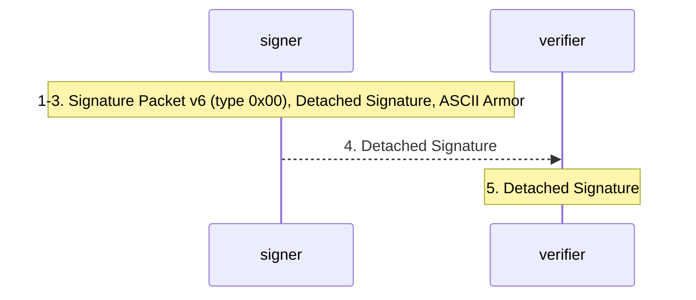

| n | from → to | message | step | basis | locator | on error |
|---|---|---|---|---|---|---|
| 1 | signer → signer | `Signature Packet v6 (type 0x00)` (or `Signature Packet v6 (type 0x01)`) | Select key, hash, version and salt and fill the subpackets as in sign-message-inline steps 1 to 3 and 7; hash the file data directly (binary) or canonicalised (text), then the signature trailer; sign. Invokes `signature-hash-computation`. | stated | §5.2.4, §5.2.1.1, §5.2.1.2, §5.2 | unspecified |
| 2 | signer → signer | `Detached Signature` | Emit the Signature packet (or several, from different keys) as a separate object; Marker and Padding packets may appear anywhere in it. | stated | §10.4 | unspecified |
| 3 | signer → signer | `ASCII Armor` | Optionally armor under BEGIN PGP SIGNATURE; no CRC24 footer when every Signature packet is v6. | stated | §6.1, §6.2.1, §7.3 | unspecified |
| 4 | signer → verifier | `Detached Signature` | Distribute the signature beside the data (for example a program bundle carrying a file and its signature file). Neither the channel nor the pairing of signature and data is defined. *(not-defined)* | stated | §10.4 | unspecified |
| 5 | verifier → verifier | `Detached Signature` | Parse the signature sequence (only Signature packets, plus Marker and Padding), obtain the data, hash it as the Signature Type ID says, and verify each signature. Invokes `signature-verification`. | stated | §10.4, §2.2, §5.2.5, §10 | stated |

### 5. `cleartext-signature` (§7, §7.1, §7.2, §7.3, §6.2.2.3, §5.2.1.2)

*Cleartext Signature Framework: canonicalising, dash-escaping and armoring a text signature so the text stays readable, and the verifier's header and unescaping rules.* Kind: transfer.

A Text Signature (0x01) carried with the text it signs, readable without OpenPGP tools. Not reversible: trailing whitespace is stripped before signing and verifying. The verifier's defences are header-based: only a well-formed Hash header may sit between the BEGIN line and the empty line, and its contents are ignored. The verification procedure is algorithm cleartext-signature-verification.

Test vectors: Appendix A.6 (dash-escaped cleartext with a v6 signature).

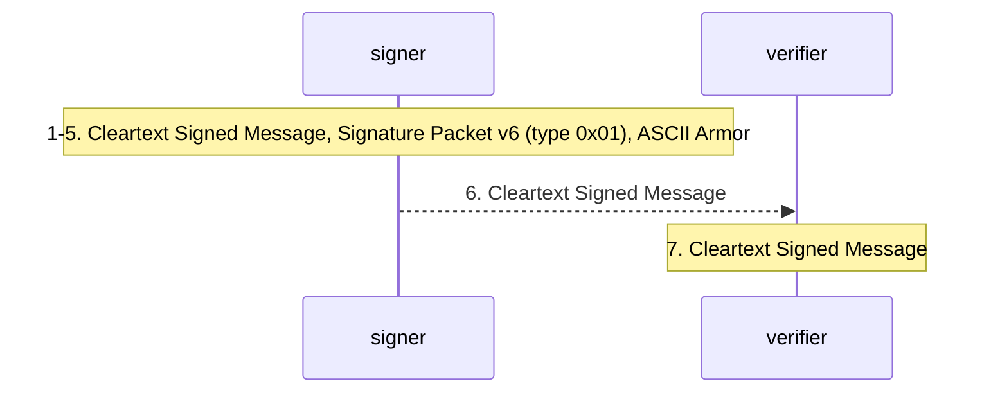

| n | from → to | message | step | basis | locator | on error |
|---|---|---|---|---|---|---|
| 1 | signer → signer | `Cleartext Signed Message` | Decide whether the framework is safe for this text: not for text with meaningful whitespace (for example unified diffs) and not for very large text; use a signed message or a detached signature instead. | stated | §7.3 | stated |
| 2 | signer → signer | `Signature Packet v6 (type 0x01)` | Canonicalise the text: UTF-8, trailing spaces and tabs removed from every line, CR LF line endings, the line ending before the signature not included; compute a Text Signature over it. Invokes `signature-hash-computation`. | stated | §7.1, §5.2.1.2, §5.2.4 | unspecified |
| 3 | signer → signer | `Cleartext Signed Message` | Write the BEGIN PGP SIGNED MESSAGE line; a Hash header only for a v4 signature with a SHA2 digest that a legacy verifier needs; an empty line. | stated | §7.1, §6.2.2.3 | unspecified |
| 4 | signer → signer | `Cleartext Signed Message` | Dash-escape the text: prefix "- " to every line beginning with a dash (MUST), to lines beginning "From " (SHOULD), to any other line (MAY). The digest is over the unescaped text. | stated | §7.2 | unspecified |
| 5 | signer → signer | `ASCII Armor` | Append a line ending and the armored signature(s) under BEGIN PGP SIGNATURE / END PGP SIGNATURE; no CRC24 footer for v6 signatures. | stated | §7.1, §6.1, §6.2.1 | unspecified |
| 6 | signer → verifier | `Cleartext Signed Message` | Transfer the cleartext signed message over a text channel (mail, web page). *(not-defined)* | inferred | §7 | unspecified |
| 7 | verifier → verifier | `Cleartext Signed Message` | Verify: reject the header block unless it holds only well-formed Hash headers (and then ignore them), undo the dash-escaping, canonicalise as the signer did, verify the Text Signature. Invokes `cleartext-signature-verification`. | stated | §7.1, §7.2, §6.2.2.3 | stated |

### 6. `passphrase-encryption` (§2.1, §3.7, §3.7.2, §3.7.2.2, §5.3, §5.3.1, §5.3.2, §13.4)

*Symmetric (passphrase) encryption of a message: shared passphrase out of band, S2K, v6 SKESK with HKDF and AEAD (or v4 SKESK), v2 SEIPD (or v1), and the recipient's session key recovery.* Kind: transfer.

Same container as public-key encryption, with the session key protected by a key derived from a passphrase. The v6 SKESK authenticates the session key with an AEAD tag, so a wrong passphrase is detected cleanly; the v4 SKESK has no integrity check, which is why the v1 SEIPD quick check exists and why it is dangerous. A v4 SKESK may even omit the encrypted session key, in which case the S2K output is the session key.

Test vectors: Appendix A.9 to A.11 (v6 SKESK with EAX, OCB, GCM); Appendix A.12 (v4 SKESK with Argon2).

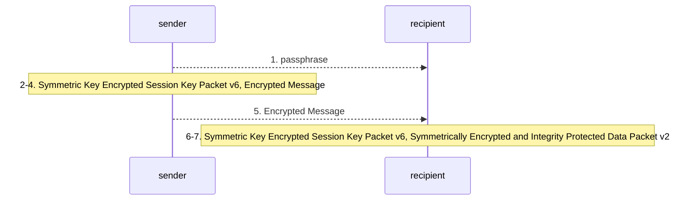

| n | from → to | message | step | basis | locator | on error |
|---|---|---|---|---|---|---|
| 1 | sender → recipient | `passphrase` | Agree a passphrase by some means outside OpenPGP. *(out-of-band)* | inferred | §2.1 | unspecified |
| 2 | sender → sender | `Symmetric Key Encrypted Session Key Packet v6` | Build the S2K Specifier: Argon2 recommended (16-octet salt unique per passphrase, t and p non-zero, encoded m from 3+ceil(log2 p) to 31), Iterated and Salted with a high count otherwise; never Simple; Salted only for high-entropy strings; no MD5, SHA-1 or RIPEMD-160. | stated | §3.7.1, §3.7.1.4, §3.7.2, §9.5 | unspecified |
| 3 | sender → sender | `Symmetric Key Encrypted Session Key Packet v6` (or `Symmetric Key Encrypted Session Key Packet v4`) | v6: KEK = HKDF-SHA256(IKM = S2K output, no salt, info = 0xC3, 6, cipher, AEAD); encrypt the session key with the AEAD mode under a fresh IV, additional data the same four octets, one tag. v4: encrypt cipher ID and session key with the S2K output in CFB with a zero IV (salt required), or omit the encrypted session key and use the S2K output as the session key. | stated | §5.3.1, §5.3.2 | unspecified |
| 4 | sender → sender | `Encrypted Message` | Encrypt and assemble exactly as encrypt-and-sign-message steps 7 to 14 (SKESK v6 with v2 SEIPD, SKESK v4 with v1 SEIPD), possibly mixed with PKESK packets of the same row. | stated | §3.7.2.2, §10.3.2.1 | unspecified |
| 5 | sender → recipient | `Encrypted Message` | Transfer the message. *(not-defined)* | inferred | §2.1 | unspecified |
| 6 | recipient → recipient | `Symmetric Key Encrypted Session Key Packet v6` (or `Symmetric Key Encrypted Session Key Packet v4`) | Ask the user for the passphrase, run the S2K, derive the KEK and decrypt the session key (v6: verify the AEAD tag). For v4 there is no check: a wrong passphrase shows only later, by the v1 SEIPD quick check or MDC. Invokes `session-key-recovery`. | stated | §5.3.1, §5.3.2, §13.4, §9.5 | unspecified |
| 7 | recipient → recipient | `Symmetrically Encrypted and Integrity Protected Data Packet v2` (or `Symmetrically Encrypted and Integrity Protected Data Packet v1`) | Decrypt and unwrap as decrypt-and-verify-message steps 6 to 13. Invokes `seipd-v2-decryption`, `seipd-v1-decryption`. | stated | §5.13, §10.3.1 | stated |

### 7. `key-generation-and-certificate-construction` (§5.2.1.8, §5.2.1.9, §5.2.1.10, §5.2.3.10, §5.5, §10.1, §10.1.1, §10.1.5, §10.2, §12.4 to §12.6, §13.7)

*Generating an OpenPGP v6 key and building its certificate: primary key, secret key protection, Direct Key self-signature, optional User IDs, subkeys with Subkey Binding and Primary Key Binding signatures, padding, export and distribution.* Kind: construction.

The keyholder is the only producer of a certificate's structural signatures. A v6 certificate is Primary Key, Direct Key self-signature(s), optional User IDs with their certifications, Subkeys each followed by Subkey Binding signature(s), optional Padding; the key-wide metadata (flags, expiry, features, preferences) lives in the Direct Key signature. A signing subkey must cross-sign the primary key (the embedded Primary Key Binding signature). v4 differences are noted per step. The source defines the object; how it reaches correspondents is not defined.

Test vectors: Appendix A.3 (v6 certificate: Ed25519 primary, Direct Key signature, X25519 subkey, Subkey Binding); Appendix A.4 and A.5 (the matching Transferable Secret Key, unlocked and locked).

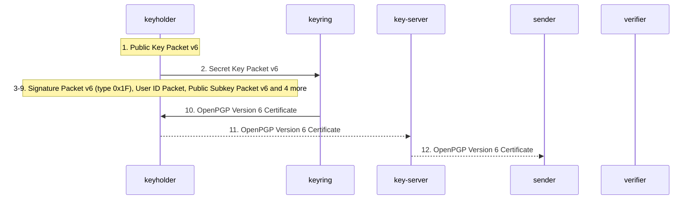

| n | from → to | message | step | basis | locator | on error |
|---|---|---|---|---|---|---|
| 1 | keyholder → keyholder | `Public Key Packet v6` | Generate the primary key as a v6 key with a signature-capable algorithm (Ed25519 is mandatory to implement, Ed448 recommended). Do not generate v4 keys (SHOULD NOT), v3 or v2 keys, RSA keys (SHOULD NOT; never under 3072 bits), DSA, Elgamal, RSA Sign-Only or Encrypt-Only, Elgamal-signature keys, or legacy curves and OIDs in v6. Use a CSPRNG. | stated | §5.5.2, §9.1, §9.2, §10.1.5, §12.4, §12.5, §12.6, §12.8, §13.10, §5.5.5.6.1.1 | unspecified |
| 2 | keyholder → keyring | `Secret Key Packet v6` | Store the secret part in a Secret Key packet: unprotected (usage 0) or, with a passphrase, S2K usage 253 (AEAD, with Argon2 allowed) or 254 (CFB with SHA-1); AEAD recommended for v6. Never 255 (MalleableCFB) in v6, never a bare cipher ID, never Argon2 outside usage 253, only rows of Table 2 marked Generate. Invokes `secret-key-unlock`. | stated | §3.7.2.1, §5.5.3, §13.7, §9.5 | unspecified |
| 3 | keyholder → keyholder | `Signature Packet v6 (type 0x1F)`; subpackets: Signature Creation Time, Issuer Fingerprint, Key Flags, Key Expiration Time, Features, Preferred AEAD Ciphersuites, Preferred Symmetric Ciphers for v1 SEIPD, Preferred Hash Algorithms, Preferred Compression Algorithms, Key Server Preferences, Preferred Key Server | Make the Direct Key self-signature over the primary key (hash: salt, 0x9B, 4-octet length, key body) carrying, in the hashed area, the key-wide metadata: Key Flags (certify 0x01, sign 0x02 as wanted; critical), Key Expiration Time (critical; zero or absent means never), Features (v2 SEIPD 0x08 and v1 SEIPD 0x01), the four preference lists, key server preferences. A v6 key is unusable without it. Invokes `signature-hash-computation`. | stated | §5.2.1.10, §5.2.3.10, §5.2.3.13, §5.2.3.29, §5.2.3.32, §5.2.4, §10.1.1, §5.2.3.7, §5.2.3.11, §5.2.3.25, §5.2.3.35, §12.3.1 | unspecified |
| 4 | keyholder → keyholder | `User ID Packet` (or `User Attribute Packet`, `Signature Packet v6 (type 0x13)`); subpackets: Primary User ID | Optionally add User ID packets (UTF-8, conventionally an RFC 2822 name-addr) and User Attribute packets, each followed by a certification self-signature (0x10 to 0x13, positive 0x13 is the usual) over the primary key and the User ID (0xB4, 4-octet length, the User ID). One may be flagged Primary User ID. For a v4 key this self-signature carries the key-wide metadata instead of a Direct Key signature. | stated | §5.11, §5.12, §5.2.3.10, §5.2.3.27, §5.2.4, §10.1.5 | unspecified |
| 5 | keyholder → keyholder | `Public Subkey Packet v6` (or `Secret Subkey Packet v6`) | Generate subkeys, all v6 under a v6 primary: conventionally an encryption subkey (X25519 mandatory to implement) and optionally signing or authentication subkeys; separate subkeys per operation are good practice. | stated | §5.5.1.2, §10.1.1, §10.1.5, §13, §9.1, §11.5.1 | unspecified |
| 6 | keyholder → keyholder | `Signature Packet v6 (type 0x19)` | For each subkey that can sign: make, with the subkey, a Primary Key Binding signature over the primary key and the subkey (both hashed with 0x9B and their lengths). It will be embedded in the binding signature of step 7. Invokes `signature-hash-computation`. | stated | §5.2.1.9, §5.2.1.8, §5.2.4, §10.1.5 | unspecified |
| 7 | keyholder → keyholder | `Signature Packet v6 (type 0x18)`; subpackets: Key Flags, Key Expiration Time, Embedded Signature | Bind each subkey with a Subkey Binding signature made by the primary key over the primary key and the subkey: Key Flags for the subkey (encrypt 0x04 and/or 0x08, sign 0x02, authenticate 0x20), optional Key Expiration Time counted from the subkey's creation, and for a signing subkey an Embedded Signature holding the 0x19 from step 6. v4: binding signatures should be v4, and must be when the subkey can sign. Invokes `signature-hash-computation`. | stated | §5.2.1.8, §5.2.3.13, §5.2.3.29, §5.2.3.34, §10.1.1, §10.1.3, §10.1.5, §5.2.3.10 | unspecified |
| 8 | keyholder → keyholder | `OpenPGP Version 6 Certificate` (or `OpenPGP Version 4 Certificate`, `Transferable Secret Key`) | Assemble the Transferable Public Key in grammar order: Primary Key, [Revocation Signature...], Direct Key Signature..., [User ID or User Attribute [Certification Revocation...] [Certification...]]..., [Subkey [Subkey Revocation...] Subkey Binding...]..., [Padding]. A Transferable Secret Key is the same with Secret Key and Secret Subkey packets and should keep the self-signatures. | stated | §10.1.1, §10.1.5, §10.2, §10 | unspecified |
| 9 | keyholder → keyholder | `Padding Packet` | Optionally end a v6 certificate that will go over an encrypted channel with a Padding packet, to hide its length. Not on a v4 certificate unless the recipient is known to ignore it. | stated | §5.14, §10.1.5, §13.11 | unspecified |
| 10 | keyring → keyholder | `OpenPGP Version 6 Certificate` | Export: delete local (non-exportable) certifications, emit no Trust packets, keep a sensitive Revocation Key signature back unless it goes to the designated revoker; armor as BEGIN PGP PUBLIC KEY BLOCK (PRIVATE KEY BLOCK for a TSK) with no CRC24 footer for v6. | stated | §5.2.3.19, §5.10, §5.2.3.23, §6.1, §6.2.1, §10.2 | unspecified |
| 11 | keyholder → key-server | `OpenPGP Version 6 Certificate` (or `ASCII Armor`) | Distribute the certificate to correspondents, directly or through a key server or any URI-reachable copy. Several certificates may be concatenated in one transfer. *(not-defined)* | stated | §10.1, §10.1.5, §5.2.3.26 | unspecified |
| 12 | key-server → sender | `OpenPGP Version 6 Certificate` | Correspondents obtain the certificate (and later its updates) and import it (flow certificate-import-and-evaluation). *(not-defined)* | inferred | §5.2.3.26, §5.2.3.10 | unspecified |

### 8. `certificate-import-and-evaluation` (§5.2.3.10, §5.2.3.19, §5.10, §10.1, §10.1.5, §10.2)

*Importing a certificate (or secret key): dearmor and parse against the TPK grammar, trim local certifications and Trust packets, evaluate validity, check imported secret keys' advertised features, store.* Kind: consumption.

What a consumer does with a received Transferable Public Key. The grammar is strict for critical packets and lax for non-critical ones; the validity rules are algorithm key-validity-evaluation. Merging a new copy with a stored one is not defined beyond "the most recent valid self-signature wins".

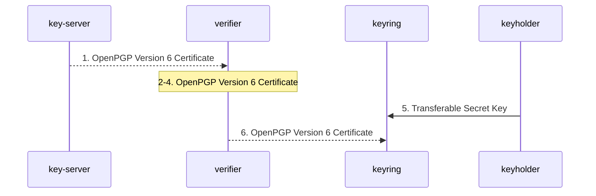

| n | from → to | message | step | basis | locator | on error |
|---|---|---|---|---|---|---|
| 1 | key-server → verifier | `OpenPGP Version 6 Certificate` (or `OpenPGP Version 4 Certificate`, `OpenPGP Version 6 Revocation Certificate`, `Transferable Secret Key`, `ASCII Armor`) | Receive one or more concatenated certificates by any means. *(not-defined)* | inferred | §10.1, §3.6 | unspecified |
| 2 | verifier → verifier | `OpenPGP Version 6 Certificate` | Dearmor and parse against the certificate grammar of the primary key's version: Marker anywhere, a trailing Padding packet accepted and ignored for v6, unknown non-critical packets skipped, Legacy format accepted, Trust packets ignored unless read from a local keyring. Invokes `armor-decoding`, `packet-stream-parsing`. | stated | §10, §10.1.1, §10.1.3, §10.1.5, §4.2, §5.10, §4.3 | stated |
| 3 | verifier → verifier | `OpenPGP Version 6 Certificate`; subpackets: Exportable Certification | Trim local certifications (Exportable Certification 0); a key server always does. | stated | §5.2.3.19 | stated |
| 4 | verifier → verifier | `OpenPGP Version 6 Certificate` | Evaluate the certificate: Direct Key signature, self-signatures, bindings, back-signatures, revocations, expiry, per key and per User ID. Invokes `key-validity-evaluation`. | stated | §5.2.3.10, §10.1 | inferred |
| 5 | keyholder → keyring | `Transferable Secret Key` | On importing a secret key, check that its self-signatures do not advertise features or algorithms the implementation lacks; if they do, warn and offer to make new self-signatures. | stated | §5.2.3.10 | stated |
| 6 | verifier → keyring | `OpenPGP Version 6 Certificate` | Store or merge into the keyring. Where several self-signatures now cover the same object, only the most recent valid one counts. *(not-defined)* | inferred | §3.6, §5.2.3.10 | unspecified |

### 9. `third-party-certification` (§5.2.1.4 to §5.2.1.7, §5.2.3.18, §5.2.3.19, §5.2.3.20, §5.2.3.29, §5.2.4, §10.1.5)

*Certification of a User ID by a third party: identity check out of band, a certification signature over the keyholder's primary key and User ID, its exportability and revocability, return to the keyholder, and use by verifiers.* Kind: construction.

A certifier vouches that a User ID belongs to the key. The four certification types grade the check (generic, persona, casual, positive) but the source declines to give them precise meaning, and most implementations use 0x10. The signature goes back into the keyholder's certificate after the User ID it certifies. How the identity is checked, how the signature reaches the keyholder, and how a verifier weighs it are not defined.

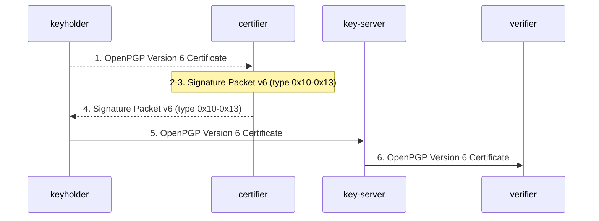

| n | from → to | message | step | basis | locator | on error |
|---|---|---|---|---|---|---|
| 1 | keyholder → certifier | `OpenPGP Version 6 Certificate` | The certifier obtains the keyholder's certificate and checks, by its own means, that the User ID belongs to the key's owner (for example by comparing fingerprints, mechanically where possible). *(out-of-band)* | inferred | §5.2.1.4 to §5.2.1.7, §13.6 | unspecified |
| 2 | certifier → certifier | `Signature Packet v6 (type 0x10-0x13)` | Choose the certification type by the strength of the check: 0x10 no assertion, 0x11 no verification, 0x12 casual, 0x13 substantial. The certifier's own key is expected to carry Key Flag 0x01 (may certify User IDs over other keys). | stated | §5.2.1.4, §5.2.1.5, §5.2.1.6, §5.2.1.7, §5.2.3.29 | unspecified |
| 3 | certifier → certifier | `Signature Packet v6 (type 0x10-0x13)`; subpackets: Signature Creation Time, Issuer Fingerprint, Exportable Certification, Revocable, Signature Expiration Time, Key Flags, Trust Signature, Regular Expression, Policy URI, Notation Data | Build the certification in the certifier's key version over the keyholder's primary key and the User ID (or User Attribute, prefix 0xD1): hashed subpackets Signature Creation Time, Issuer Fingerprint, optionally Exportable Certification 0 (critical) for a local-only certification, Revocable 0 to waive revocation, Signature Expiration Time, Key Flags stating what the certification is for, a Trust Signature (flow trust-signature-introduction), Policy URI. Invokes `signature-hash-computation`. | stated | §5.2.4, §5.2.3.18, §5.2.3.19, §5.2.3.20, §5.2.3.28, §5.2.3.29, §5.2 | unspecified |
| 4 | certifier → keyholder | `Signature Packet v6 (type 0x10-0x13)` | Return the certification to the keyholder (or publish it). The channel is not defined; a local certification is never exported. *(not-defined)* | inferred | §5.2.3.19 | unspecified |
| 5 | keyholder → key-server | `OpenPGP Version 6 Certificate` | The certification takes its place among the Signature packets that follow the User ID it certifies, and the updated certificate is redistributed. | stated | §10.1.5, §10.1.1 | unspecified |
| 6 | key-server → verifier | `OpenPGP Version 6 Certificate` | A verifier that receives the certificate verifies the certification and uses it, by a trust model of its choosing, as evidence that the User ID belongs to the key. A revoked certification no longer counts; a non-revocable one ignores later revocations. Invokes `signature-verification`. | stated | §5.2.1, §5.2.3.20, §5.2.3.31 | stated |

### 10. `trust-signature-introduction` (§5.2.3.21, §5.2.3.22, §8, §5.10)

*Making a key a trusted introducer: a certification with a Trust Signature (level and amount), optionally scoped by a Regular Expression, and the verifier's reading of it.* Kind: construction.

The only trust-delegation mechanism the format carries. A level 1 Trust Signature says "this key is a trusted introducer" with an amount (under 120 partial, 120 or more complete); level n delegates the right to make level n-1 Trust Signatures; a Regular Expression limits the User IDs for which the introducer's certifications count. The source defines the encoding and the meaning of one signature, not how a verifier combines chains, amounts or depths into a validity decision: that is the web of trust, not_defined. Locally kept trust settings go in implementation-defined Trust packets.

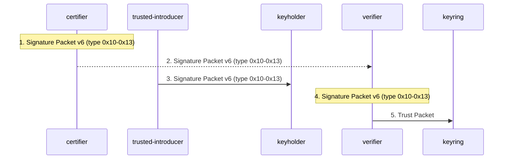

| n | from → to | message | step | basis | locator | on error |
|---|---|---|---|---|---|---|
| 1 | certifier → certifier | `Signature Packet v6 (type 0x10-0x13)` (or `Signature Packet v6 (type 0x1F)`); subpackets: Trust Signature, Regular Expression | Certify the introducer's key (third-party-certification steps 2 to 3) with a Trust Signature subpacket: level (0 ordinary validity, 1 trusted introducer, 2 meta introducer, n trusted for level n-1) and amount (emit 60 partial, 120 complete). To scope it, add a Regular Expression subpacket, null-terminated, critical recommended. | stated | §5.2.3.21, §5.2.3.22 | unspecified |
| 2 | certifier → verifier | `Signature Packet v6 (type 0x10-0x13)` | The trust signature reaches the verifier: typically the verifier's own key is the certifier (its local root), or the signature arrives inside the introducer's certificate. *(not-defined)* | inferred | §5.2.3.21 | unspecified |
| 3 | trusted-introducer → keyholder | `Signature Packet v6 (type 0x10-0x13)` | The introducer certifies other keyholders' User IDs (third-party-certification), and at level 2 or more may itself issue Trust Signatures one level lower. | stated | §5.2.3.21 | unspecified |
| 4 | verifier → verifier | `Signature Packet v6 (type 0x10-0x13)`; subpackets: Trust Signature, Regular Expression | When evaluating a keyholder certified by the introducer, count the introducer's certification only for User IDs matching the Regular Expression of the trust signature, matched over UTF-8 characters with the §8 syntax; strip the null terminator, and reject a subpacket without one (ignore if non-critical, reject the signature if critical). A revoked trust signature no longer counts. Invokes `trust-signature-scoping`. | stated | §5.2.3.22, §8, §5.2.3.31 | stated |
| 5 | verifier → keyring | `Trust Packet` | Record the user's own decisions about which keyholders are trusted introducers in the keyring, in Trust packets of implementation-defined format that are never exported. | stated | §5.10 | unspecified |

### 11. `key-revocation` (§5.2.1.11, §5.2.3.31, §5.2.4, §10.1.2, §10.1.3, §10.1.5)

*Revoking a primary key: Key Revocation signature (0x20) by the key itself with a Reason for Revocation, the v6 revocation certificate, publication, and the verifier's handling of revoked keys and of signatures made before.* Kind: construction.

A key is revoked by a signature from itself (or, deprecated, from a designated revoker, or published from escrow). The reason code matters to verifiers: compromise makes every signature by the key suspect, supersession or retirement leaves earlier signatures valid. A v6 revocation certificate always carries the primary key packet so it verifies on its own.

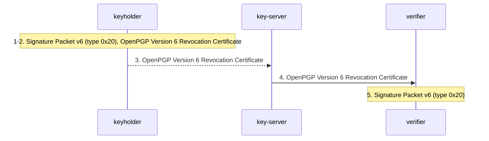

| n | from → to | message | step | basis | locator | on error |
|---|---|---|---|---|---|---|
| 1 | keyholder → keyholder | `Signature Packet v6 (type 0x20)`; subpackets: Reason for Revocation, Signature Creation Time, Issuer Fingerprint | Make a Key Revocation signature with the primary key over the primary key alone, with a Reason for Revocation: 0 none given, 1 superseded, 2 compromised, 3 retired, plus an optional UTF-8 reason string. Invokes `signature-hash-computation`. | stated | §5.2.1.11, §5.2.3.31, §5.2.4 | unspecified |
| 2 | keyholder → keyholder | `OpenPGP Version 6 Revocation Certificate` (or `OpenPGP Version 6 Certificate`) | Package it: inside the full certificate (Revocation Signature right after the Primary Key), or as a revocation certificate, which for v6 is Primary Key plus Revocation Signature (no Direct Key signature needed). A v4 revocation certificate may be the signature alone. | stated | §10.1.1, §10.1.2, §10.1.3 | unspecified |
| 3 | keyholder → key-server | `OpenPGP Version 6 Revocation Certificate` | Publish the revocation. The channel is not defined. *(not-defined)* | inferred | §10.1.2 | unspecified |
| 4 | key-server → verifier | `OpenPGP Version 6 Revocation Certificate` | The verifier verifies the revocation signature and accepts it only if made by the revoked key itself (or a designated revoker). The revoked key is then not to be used. Invokes `signature-verification`, `key-validity-evaluation`. | stated | §5.2.1.11, §10.1.5 | inferred |
| 5 | verifier → verifier | `Signature Packet v6 (type 0x20)`; subpackets: Reason for Revocation | Apply the reason to signatures already made by the key: after compromise treat all of them as suspect; after supersession or retirement keep old signatures valid. | stated | §5.2.3.31 | stated |

### 12. `subkey-revocation` (§5.2.1.12, §5.2.3.10, §5.2.4, §10.1.1, §10.1.5)

*Revoking a subkey: Subkey Revocation signature (0x28) by the primary key.* Kind: construction.

The primary key retires a subkey. The revocation sits after the Subkey packet, before its binding signatures. Revoking the binding signature itself also retires the subkey, but the source names only 0x28 as the subkey revocation type.

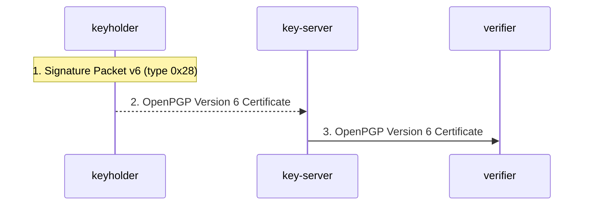

| n | from → to | message | step | basis | locator | on error |
|---|---|---|---|---|---|---|
| 1 | keyholder → keyholder | `Signature Packet v6 (type 0x28)`; subpackets: Reason for Revocation | With the primary key, sign the primary key then the subkey being revoked, with a Reason for Revocation. Invokes `signature-hash-computation`. | stated | §5.2.1.12, §5.2.4, §5.2.3.31 | unspecified |
| 2 | keyholder → key-server | `OpenPGP Version 6 Certificate` | Place it after the Subkey packet ([Subkey [Subkey Revocation Signature...] Subkey Binding Signature...]) and redistribute the certificate. *(not-defined)* | stated | §10.1.1 | unspecified |
| 3 | key-server → verifier | `OpenPGP Version 6 Certificate` | Accept the revocation only from the primary key bound to the subkey (or a designated revoker); the subkey is then not to be used. Invokes `key-validity-evaluation`. | stated | §5.2.1.12, §5.2.3.10 | inferred |

### 13. `certification-revocation` (§5.2.1.13, §5.2.3.10, §5.2.3.20, §5.2.3.31, §5.2.3.33)

*Revoking a certification or a Direct Key signature: Certification Revocation (0x30) by the issuer of the revoked signature, over the same data, later, naming the target.* Kind: construction.

Revokes one earlier certification (0x10 to 0x13) or Direct Key signature (0x1F). The revoker is whoever made the revoked signature: a keyholder revoking its own User ID self-signature retires that name (reason 32); a certifier revoking its certification withdraws its belief in the binding. A signature marked non-revocable ignores later revocations.

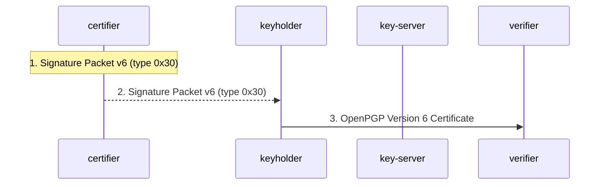

| n | from → to | message | step | basis | locator | on error |
|---|---|---|---|---|---|---|
| 1 | certifier → certifier | `Signature Packet v6 (type 0x30)`; subpackets: Reason for Revocation, Signature Target | With the same key that issued the certification, sign the same data the certification covered (primary key and User ID, or the key for 0x1F), with a creation time later than the certification's; designate the revoked signature with a Signature Target (hash of the target signature, of that signature's hash size); include a Reason for Revocation (32 when a keyholder retires its own User ID). Invokes `signature-hash-computation`. | stated | §5.2.1.13, §5.2.3.31, §5.2.3.33 | unspecified |
| 2 | certifier → keyholder | `Signature Packet v6 (type 0x30)` | The revocation joins the certificate after the User ID ([Certification Revocation Signature...] precede [Certification Signature...]) and is redistributed. *(not-defined)* | stated | §10.1.1 | unspecified |
| 3 | keyholder → verifier | `OpenPGP Version 6 Certificate` | The verifier drops the revoked certification from its validity calculation, unless the revoked signature carries Revocable 0; a revoked User ID self-signature retires the User ID; a revoked Direct Key signature is cancelled. Invokes `key-validity-evaluation`. | stated | §5.2.3.10, §5.2.3.20, §5.2.3.31 | unspecified |

### 14. `designated-revoker-revocation` (§5.2.3.23, §5.2.1.11, §5.2.1.12, §5.2.1.13, §10.1.5, §13.9)

*Deprecated: revocation by a third-party key named in a Revocation Key subpacket on the keyholder's Direct Key self-signature.* Kind: construction. Status: deprecated.

Kept only so that implementations can read historic data. Generating the subpacket is forbidden; the source describes how "some implementations attempt to interpret" it, calls support "uneven and unreliable", and replaces it with escrowed revocation. The subpacket holds a v4 fingerprint, so it cannot name a v6 key.

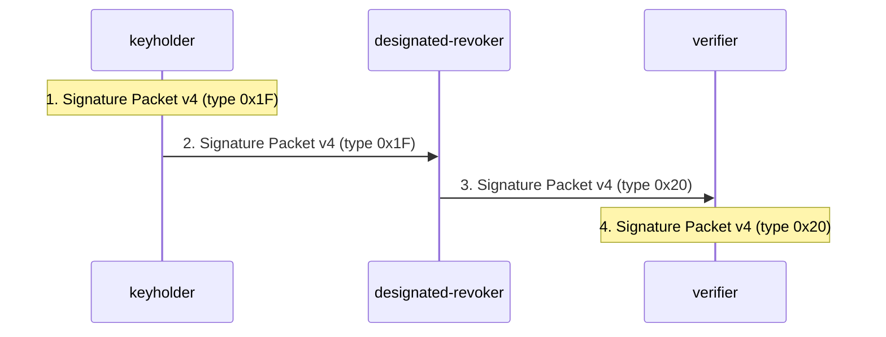

| n | from → to | message | step | basis | locator | on error |
|---|---|---|---|---|---|---|
| 1 | keyholder → keyholder | `Signature Packet v4 (type 0x1F)`; subpackets: Revocation Key (deprecated) | (Historic.) The keyholder's Direct Key self-signature carries a Revocation Key subpacket: class with 0x80 set (0x40 means sensitive), the revoker's public-key algorithm and 20-octet v4 fingerprint. New implementations must not generate it. | stated | §5.2.3.23 | unspecified |
| 2 | keyholder → designated-revoker | `Signature Packet v4 (type 0x1F)` | A sensitive designation is exported only to the designated revoker, or together with a revocation from that revoker. | stated | §5.2.3.23 | unspecified |
| 3 | designated-revoker → verifier | `Signature Packet v4 (type 0x20)` (or `Signature Packet v4 (type 0x28)`, `Signature Packet v4 (type 0x30)`) | The designated revoker signs a revocation of the keyholder's key, subkey or certification with its own key and publishes it. | stated | §5.2.1.11, §5.2.1.12, §5.2.1.13 | unspecified |
| 4 | verifier → verifier | `Signature Packet v4 (type 0x20)` | A verifier that honours the mechanism accepts the revocation if its issuer's fingerprint matches the Revocation Key subpacket of a valid Direct Key self-signature by the top-level key. Invokes `key-validity-evaluation`. | stated | §10.1.5, §5.2.3.23, §13.9, §5.2.1.11 | unspecified |

### 15. `escrowed-revocation` (§13.9)

*Delegating revocation by escrow: the keyholder pre-signs revocations, hands them to a preferred revoker securely, and the revoker publishes one when appropriate.* Kind: out-of-band.

The replacement for the designated revoker. Everything cryptographic is done by the keyholder in advance; the third party only holds and later publishes, so verifiers check an ordinary self-revocation and need no key of the revoker. The secure hand-over and any secret-sharing of the signature are outside the source.

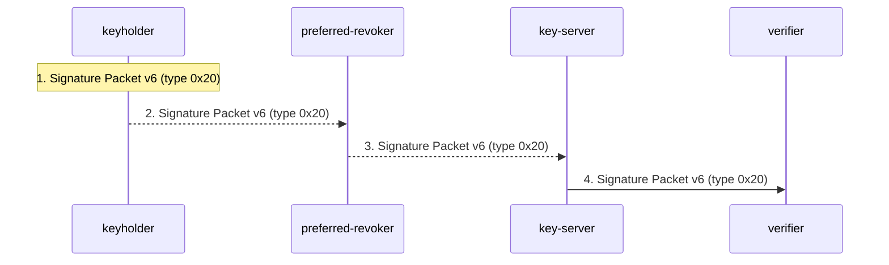

| n | from → to | message | step | basis | locator | on error |
|---|---|---|---|---|---|---|
| 1 | keyholder → keyholder | `Signature Packet v6 (type 0x20)` (or `Signature Packet v6 (type 0x28)`, `Signature Packet v6 (type 0x30)`) | Pre-compute exactly the revocations the keyholder is willing to delegate (key, subkey or certification revocation), with appropriate reasons. | stated | §13.9, §5.2.3.31 | unspecified |
| 2 | keyholder → preferred-revoker | `Signature Packet v6 (type 0x20)` | Hand the signatures over securely, possibly split into shares among several parties. The preferred revoker needs no OpenPGP key if another secure transport exists. *(out-of-band)* | stated | §13.9 | unspecified |
| 3 | preferred-revoker → key-server | `Signature Packet v6 (type 0x20)` | Publish the escrowed revocation when the revoker judges it appropriate. *(not-defined)* | stated | §13.9 | unspecified |
| 4 | key-server → verifier | `Signature Packet v6 (type 0x20)` | Verify it as the keyholder's own revocation (key-revocation step 4); no lookup of the revoker is needed. Invokes `signature-verification`. | stated | §13.9 | inferred |

### 16. `key-expiry-and-preference-update` (§5.2.3.9, §5.2.3.10, §5.2.3.13, §5.2.3.25, §5.2.3.26, §13.13)

*Changing expiry, flags, features or preferences: a new self-signature supersedes the old, the updated certificate is republished, consumers take the most recent valid self-signature.* Kind: construction.

Self-signatures are the certificate's mutable state. To extend or shorten expiry, or to change advertised algorithms, the keyholder issues a new self-signature of the same kind; consumers keep the most recent valid one. Keeping v6 metadata in the Direct Key signature (which must be present) stops an attacker from stripping the signature that sets an expiry or preferences.

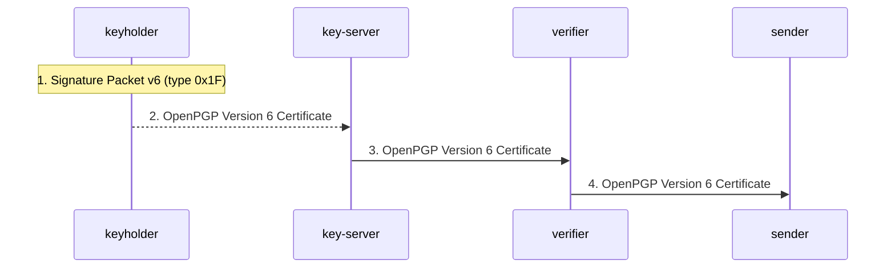

| n | from → to | message | step | basis | locator | on error |
|---|---|---|---|---|---|---|
| 1 | keyholder → keyholder | `Signature Packet v6 (type 0x1F)` (or `Signature Packet v6 (type 0x13)`, `Signature Packet v6 (type 0x18)`); subpackets: Key Expiration Time, Key Flags, Features, Preferred AEAD Ciphersuites | Issue a new self-signature with the changed subpackets: a Direct Key signature for key-wide data of a v6 key, a User ID self-signature for v4 key-wide data or per-User-ID preferences, a Subkey Binding signature for a subkey (expiry counted from the subkey's creation). Invokes `signature-hash-computation`. | stated | §5.2.3.10, §5.2.3.13 | unspecified |
| 2 | keyholder → key-server | `OpenPGP Version 6 Certificate`; subpackets: Key Server Preferences, Preferred Key Server | Publish the updated certificate, to the Preferred Key Server if one is named; the No-modify flag asks the key server to accept changes only from the keyholder or its administrator. *(not-defined)* | stated | §5.2.3.25, §5.2.3.26 | unspecified |
| 3 | key-server → verifier | `OpenPGP Version 6 Certificate` | Consumers refresh the certificate (no User ID self-signature is needed for this) and, per object, keep only the most recent valid self-signature; within one signature the last instance of a repeated hashed subpacket normally wins; preferences found only in the unhashed area are ignored. Invokes `key-validity-evaluation`. | stated | §5.2.3.9, §5.2.3.10, §13.13 | unspecified |
| 4 | verifier → sender | `OpenPGP Version 6 Certificate` | The next encryption to the key (encrypt-and-sign-message steps 2 to 4) uses the new expiry, flags and preferences. | inferred | §5.2.3.10, §12.2 | inferred |

### 17. `session-key-reuse-reply` (§5.13.2, §13.8, §5.2.3.36)

*Replying with session-key reuse: the recipient of a v2 SEIPD message reuses its v6 PKESK packets with a fresh salt to reply to the same set of parties without their certificates.* Kind: transfer.

Possible only with v2 SEIPD, because the message key is derived from the session key and a per-message salt. The source gives no procedure, only hazards: the reply is readable by exactly the original recipient set, so changing that set leaks, and an attacker who removes itself from the visible list still reads the reply. The source notes there is no deployment guidance for any application.

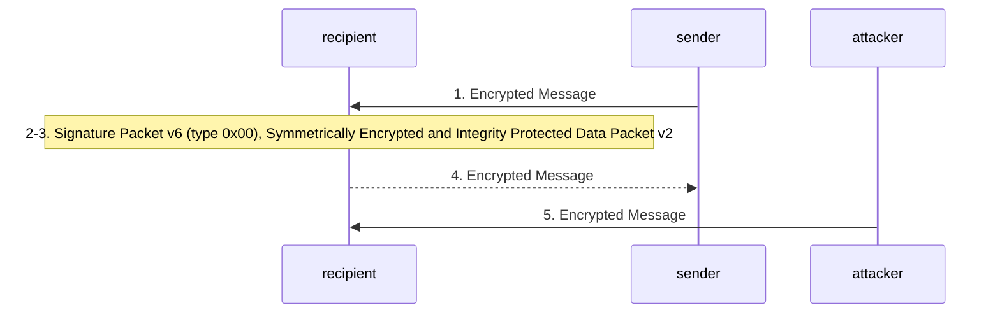

| n | from → to | message | step | basis | locator | on error |
|---|---|---|---|---|---|---|
| 1 | sender → recipient | `Encrypted Message` | A v2 SEIPD message with v6 PKESK packets arrives and is decrypted normally. | stated | §13.8 | stated |
| 2 | recipient → recipient | `Signature Packet v6 (type 0x00)`; subpackets: Intended Recipient Fingerprint | Before reusing, check the recipient set for consistency, using the Intended Recipient Fingerprint subpackets of the original signature, so that a party that removed itself in transit is noticed. | stated | §13.8 | unspecified |
| 3 | recipient → recipient | `Symmetrically Encrypted and Integrity Protected Data Packet v2` | Under the user's control, and only if the reply goes to exactly the original sender and recipients: copy the original v6 PKESK packets, draw a new random salt, derive a new message key from the same session key, encrypt the reply. The same recipient-set safeguard applies when a reuse reply is saved (for example as a draft) and reopened before sending; the feature must not be used silently where the user assumes fresh public-key encryption (for example when a recipient's key is known but expired); and a higher-layer protocol must not carry another, interfering practice of session-key reuse. | stated | §5.13.2, §13.8 | unspecified |
| 4 | recipient → sender | `Encrypted Message` | Send the reply to the sender and all original recipients. Prefer fresh public-key encryption whenever the certificates are available. *(not-defined)* | stated | §13.8 | unspecified |
| 5 | attacker → recipient | `Encrypted Message` | The hazard the checks exist for: a recipient of the original message with network or mailbox access deletes itself from the message before the victim's client receives it; a reuse reply is then readable by it. | stated | §13.8 | stated |

### 18. `third-party-confirmation-and-timestamp` (§5.2.1.3, §5.2.1.14, §5.2.1.15, §5.2.3.33, §5.2.4)

*Signatures over signatures and over nothing: Third-Party Confirmation (0x50), Timestamp (0x40) and Standalone (0x02) signatures.* Kind: construction.

Minor signature types with no defined surrounding flow: a notary-style signature over another Signature packet, a signature meaningful only for its timestamp, and a signature over its own subpackets only. The source gives their hashing and the Signature Target link, not where they are carried or how they are used.

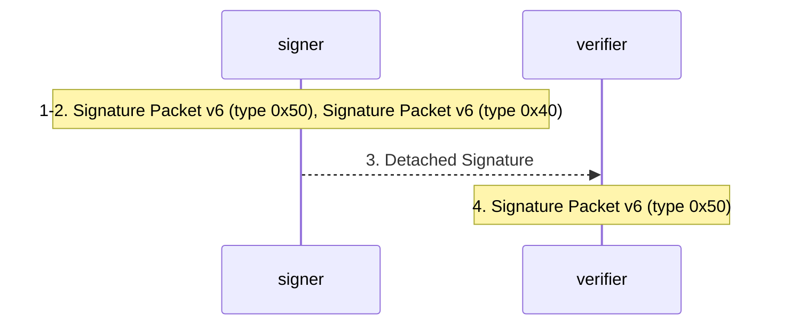

| n | from → to | message | step | basis | locator | on error |
|---|---|---|---|---|---|---|
| 1 | signer → signer | `Signature Packet v6 (type 0x50)`; subpackets: Signature Target | Third-Party Confirmation: hash (salt), 0x88, the 4-octet length and the body of the confirmed Signature packet with its unhashed subpacket area removed and its length set to zero; include a Signature Target identifying the confirmed signature. Invokes `signature-hash-computation`. | stated | §5.2.1.15, §5.2.4, §5.2.3.33 | unspecified |
| 2 | signer → signer | `Signature Packet v6 (type 0x40)` (or `Signature Packet v6 (type 0x02)`) | Timestamp signature: meaningful only for its timestamp (a Signature Target may name the signature it timestamps). Standalone signature: over its own subpackets, computed as over an empty binary document; never v3. | stated | §5.2.1.14, §5.2.1.3, §5.2.3.33 | unspecified |
| 3 | signer → verifier | `Detached Signature` | Carry the signature to verifiers; the source defines no container or exchange for these types. *(not-defined)* | inferred | §10.4 | unspecified |
| 4 | verifier → verifier | `Signature Packet v6 (type 0x50)` | Verify by recomputing the same hash; a v3 Standalone signature is ignored. Invokes `signature-verification`. | stated | §5.2.1.3, §5.2.4 | stated |

## Algorithms

Each flowchart runs the steps in order; a dotted exit is a step whose failure the source (or, where marked, this model) gives an outcome for. The full failure text is the table's `on fail` column and `on_fail` in the YAML; `basis` is the step's own basis and `on-fail basis` that of its failure outcome.

### A1. `packet-stream-parsing` (§3.2, §4.1, §4.2, §4.2.1, §4.2.2, §4.3, §5)

*Splitting an octet stream into packets: header formats, body lengths, criticality, MPI checks.* Status: normative-procedure. Performed by: recipient, verifier.

Inputs: an octet stream (after dearmoring, decryption or decompression). Outputs: a sequence of (Packet Type ID, body) pairs, or a malformed-packet failure.

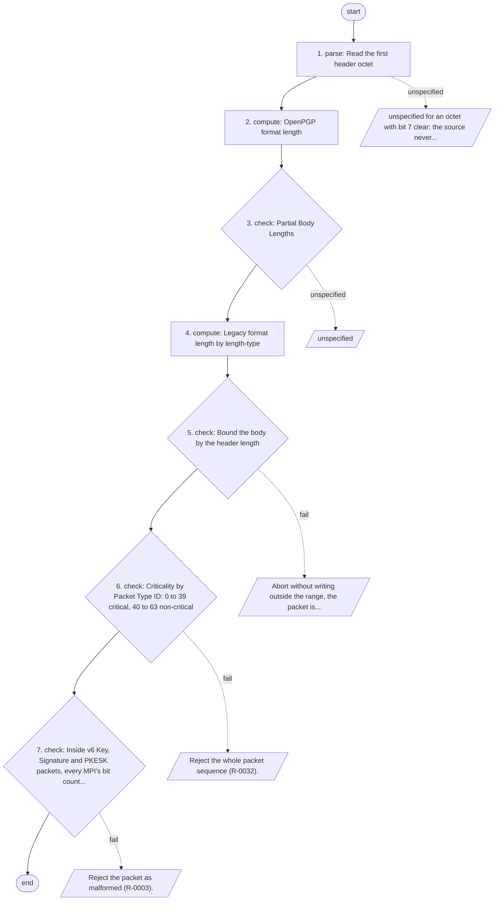

| n | kind | step | basis | locator | on fail | on-fail basis |
|---|---|---|---|---|---|---|
| 1 | parse | Read the first header octet. Bit 7 is always one. Bit 6 one: OpenPGP format, Packet Type ID in bits 5 to 0. Bit 6 zero: Legacy format, Packet Type ID in bits 5 to 2, length-type in bits 1 to 0 (accepted when consuming). | stated | §4.2 | unspecified for an octet with bit 7 clear: the source never says what such a stream is. | unspecified |
| 2 | compute | OpenPGP format length: first octet < 192 is the length; 192 to 223 starts a 2-octet length ((o1 - 192) << 8) + o2 + 192; 255 is followed by a 4-octet length; 224 to 254 is a Partial Body Length 1 << (o1 & 0x1F), followed by that many body octets and another length header. | stated | §4.2.1.1, §4.2.1.2, §4.2.1.3, §4.2.1.4 | n/a | n/a |
| 3 | check | Partial Body Lengths: only on Literal, Compressed or encrypted data packets; the first part at least 512 octets; the last length header a regular one (possibly zero). | stated | §4.2.1.4 | unspecified. These are producer obligations; the source does not say whether a consumer must reject a violation. | unspecified |
| 4 | compute | Legacy format length by length-type: 0 one octet, 1 two octets, 2 four octets, 3 indeterminate (to end of file; may be read for historic data, never generated). | stated | §4.2.2 | n/a | n/a |
| 5 | check | Bound the body by the header length: look for the next packet exactly there; never read outside the range; a subfield length that would extend beyond it makes the packet malformed. | stated | §4.1 | Abort without writing outside the range; the packet is malformed and unusable (R-0021). | stated |
| 6 | check | Criticality by Packet Type ID: 0 to 39 critical, 40 to 63 non-critical. An unknown critical type rejects the whole sequence; an unknown non-critical type is skipped. ID 0 is reserved and never valid. | stated | §4.3, §5 | Reject the whole packet sequence (R-0032). | stated |
| 7 | check | Inside v6 Key, Signature and PKESK packets, every MPI's bit count must equal the position of its most significant non-zero bit; unused bits zero. | stated | §3.2 | Reject the packet as malformed (R-0003). | stated |

### A2. `message-grammar-parsing` (§10, §10.3, §10.3.1, §10.3.2, §5.4, §5.8, §5.14, §13.14)

*Recognising an OpenPGP Message by the §10.3 grammar, with Marker and Padding packets, unwrapping of encrypted and compressed layers, and the version constraints.* Status: normative-procedure. Performed by: recipient, verifier.

Inputs: the packet sequence from packet-stream-parsing. Outputs: a parse tree of nested messages ending in Literal Data, or a sequence rejection.

The grammar (§10.3), verbatim:

- OpenPGP Message: Encrypted Message | Signed Message | Compressed Message | Literal Message.
- Compressed Message: Compressed Data Packet.
- Literal Message: Literal Data Packet.
- ESK: Public Key Encrypted Session Key Packet | Symmetric Key Encrypted Session Key Packet.
- ESK Sequence: ESK | ESK Sequence, ESK.
- Encrypted Data: Symmetrically Encrypted Data Packet | Symmetrically Encrypted and Integrity Protected Data Packet.
- Encrypted Message: Encrypted Data | ESK Sequence, Encrypted Data.
- One-Pass Signed Message: One-Pass Signature Packet, OpenPGP Message, Corresponding Signature Packet.
- Signed Message: Signature Packet, OpenPGP Message | One-Pass Signed Message.
- Optionally Padded Message: OpenPGP Message | OpenPGP Message, Padding Packet.

In addition to these rules, a Marker packet (Section 5.8) can appear anywhere in the sequence.

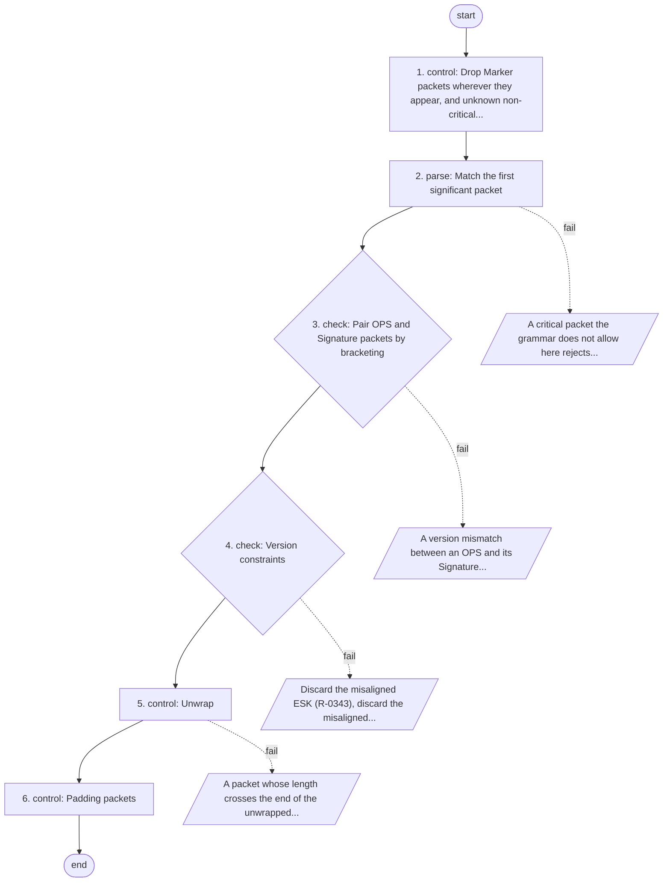

| n | kind | step | basis | locator | on fail | on-fail basis |
|---|---|---|---|---|---|---|
| 1 | control | Drop Marker packets wherever they appear, and unknown non-critical packets. Ignore Trust packets: they belong only to local keyring files and are to be ignored on any other input. | stated | §10, §10.3, §5.8, §5.10 | n/a | n/a |
| 2 | parse | Match the first significant packet. PKESK or SKESK: an ESK Sequence must be followed by one Encrypted Data packet (SEIPD, or historic SED), which ends this level. SEIPD or SED alone: an Encrypted Message without ESKs. Signature: a Signed Message, Signature then an OpenPGP Message. One-Pass Signature: an OPS, a nested OpenPGP Message, then the corresponding Signature. Compressed Data: a Compressed Message. Literal Data: a Literal Message. | stated | §10.3, §10 | A critical packet the grammar does not allow here rejects the sequence (R-0311). | stated |
| 3 | check | Pair OPS and Signature packets by bracketing: with nested OPS packets the first Signature after the content belongs to the last OPS. An OPS with nested flag 0 is followed directly by another OPS over the same content. | stated | §5.4, §10.3.2.2 | A version mismatch between an OPS and its Signature invalidates only that signature (R-0347). A missing corresponding Signature: unspecified. | stated |
| 4 | check | Version constraints: discard ESKs not aligned with the payload version (Table 26); OPS, Signature and key versions per Table 27. | stated | §10.3.2.1, §10.3.2.2 | Discard the misaligned ESK (R-0343); discard the misaligned signature (R-0347). | stated |
| 5 | control | Unwrap: after decryption (seipd-v2-decryption, seipd-v1-decryption) or decompression, parse the resulting octets from step 1 as a new, bounded stream: v2 SEIPD content must be an Optionally Padded Message, v1 SEIPD and SED content an OpenPGP Message, decompressed content an OpenPGP Message. Limit compression depth. Invokes `packet-stream-parsing`. | stated | §10.3.1, §13.14 | A packet whose length crosses the end of the unwrapped stream is malformed and unusable (R-0335). | stated |
| 6 | control | Padding packets: accept one as the last packet inside a v2 SEIPD (Optionally Padded Message), and be able to process (ignore) one anywhere else. | stated | §5.14, §10.3 | n/a | n/a |

### A3. `session-key-recovery` (§5.1, §5.1.1 to §5.1.8, §5.3, §5.3.1, §5.3.2, §11.5, §12.1.2, §13.5)

*Recovering the session key from a PKESK (v6 or v3) or SKESK (v6 or v4), with anonymous recipients, PKCS#1 decoding, X25519/X448 and ECDH unwrapping, and the uniform-error rule.* Status: composite. Performed by: recipient.

Inputs: the aligned ESK packets of an Encrypted Message; the recipient's secret keys, and passphrases from the user. Outputs: the session key and the symmetric cipher ID (from the v3 PKESK or v4 SKESK plaintext, or from the v2 SEIPD header).

```mermaid
flowchart TD
  S([start]) --> N1
  N1["1. select: Choose a PKESK addressed to a key held"]
  N1 --> N2
  N1 -. fail .-> F1[/"Try the next ESK, with none left the message cannot be..."/]
  N2["2. compute: Unlock the matching secret key (secret-key-unlock), then decrypt by..."]
  N2 --> N3
  N2 -. fail .-> F2[/"PKCS1: output 'decryption error' and stop (R-0367)"/]
  N3{"3. check: Parse the plaintext"}
  N3 --> N4
  N3 -. fail .-> F3[/"Uniform error (step 4)."/]
  N4["4. control: Report every PKESK failure, every session-key parsing failure and..."]
  N4 --> N5
  N5["5. compute: SKESK v6"]
  N5 --> N6
  N5 -. unspecified .-> F5[/"Tag failure: wrong passphrase or tampering, reporting..."/]
  N6["6. compute: SKESK v4"]
  N6 --> E([end])
  N6 -. fail .-> F6[/"Undetectable here, a wrong key surfaces at the v1 SEIPD..."/]
```

| n | kind | step | basis | locator | on fail | on-fail basis |
|---|---|---|---|---|---|---|
| 1 | select | Choose a PKESK addressed to a key held: v6 by key version and fingerprint, v3 by Key ID (not assumed unique); an anonymous PKESK (size 0, or all-zero Key ID) is tried against every available private key. | stated | §5.1.1, §5.1.2, §5.1.8, §3.3 | Try the next ESK; with none left the message cannot be decrypted (reporting unspecified). | inferred |
| 2 | compute | Unlock the matching secret key (secret-key-unlock), then decrypt by algorithm: RSA/Elgamal and EME-PKCS1-v1_5 decode; ECDH: S = rV, KDF with the recipient's parameters, AES key unwrap, strip PKCS#5 padding, check the 2-octet checksum; X25519/X448: shared secret, HKDF-SHA256/SHA512 over ephemeral key, recipient key and shared secret ("OpenPGP X25519"/"OpenPGP X448"), AES-128/AES-256 key unwrap. Invokes `secret-key-unlock`. | stated | §5.1.3, §5.1.4, §5.1.5, §5.1.6, §5.1.7, §11.5, §12.1.2 | PKCS#1: output "decryption error" and stop (R-0367). Other algorithms: unspecified beyond the uniform error of step 4. | stated |
| 3 | check | Parse the plaintext: v3 PKESK: cipher ID (in clear for X25519/X448, which must name AES-128/192/256), session key, 2-octet checksum (not for X25519/X448); v6 PKESK: session key (and checksum where the algorithm adds one), its size matching the v2 SEIPD cipher. | stated | §5.1.3, §5.1.6, §5.1.7, §13.5 | Uniform error (step 4). | stated |
| 4 | control | Report every PKESK failure, every session-key parsing failure and every SEIPD integrity failure with one error code, in constant time where timing is observable; padding checks strict and constant time. | stated | §13.5 | n/a | n/a |
| 5 | compute | SKESK v6: S2K over the passphrase, KEK = HKDF-SHA256(S2K output, no salt, info 0xC3, 6, cipher, AEAD); AEAD-decrypt the encrypted session key with the stored IV and additional data equal to info; the tag must verify. | stated | §5.3.2, §9.5 | Tag failure: wrong passphrase or tampering; reporting unspecified. | unspecified |
| 6 | compute | SKESK v4: S2K over the passphrase; if no encrypted session key is present (judged from packet length and S2K size) the S2K output is the session key with the packet's cipher; otherwise CFB-decrypt with a zero IV to get cipher ID and session key. No integrity check exists. | stated | §5.3.1 | Undetectable here; a wrong key surfaces at the v1 SEIPD quick check or MDC. | inferred |

### A4. `seipd-v2-decryption` (§5.13.2, §5.13.3, §5.13.4, §5.13.5, §9.6, §13.7)

*v2 SEIPD (AEAD) decryption: key derivation, chunk loop, final tag, release policy.* Status: normative-procedure. Performed by: recipient.

Inputs: v2 SEIPD packet: version 2, cipher ID, AEAD ID, chunk size octet c, 32-octet salt, ciphertext chunks with tags, final tag; session key. Outputs: the plaintext Optionally Padded Message, or an integrity failure.

```mermaid
flowchart TD
  S([start]) --> N1
  N1{"1. check: Accept chunk size octets 0 to 16"}
  N1 --> N2
  N1 -. unspecified .-> F1[/"unspecified for c > 16 (only acceptance of 0 to 16 is..."/]
  N2["2. compute: HKDF-SHA256 with IKM the session key, salt the packet salt, info the..."]
  N2 --> N3
  N3["3. control: For chunk i = 0, 1, ...: nonce = IV || i (64-bit big-endian)"]
  N3 --> N4
  N3 -. fail .-> F3[/"Tag failure: MUST NOT parse or release decrypted data, MUST..."/]
  N4{"4. check: Verify the final tag"}
  N4 --> N5
  N4 -. fail .-> F4[/"Bad final tag: halt with an error, release nothing (R-0406)"/]
  N5["5. emit: Only now hand the plaintext to message-grammar-parsing..."]
  N5 --> E([end])
```

| n | kind | step | basis | locator | on fail | on-fail basis |
|---|---|---|---|---|---|---|
| 1 | check | Accept chunk size octets 0 to 16; chunk_size = 1 << (c + 6). | stated | §5.13.2 | unspecified for c > 16 (only acceptance of 0 to 16 is required). | unspecified |
| 2 | compute | HKDF-SHA256 with IKM the session key, salt the packet salt, info the packet type octet 0xD2, version, cipher ID, AEAD ID, chunk size octet; take M + N - 64 bits: the leftmost M bits are the message key, the remaining N - 64 bits the IV (N: 128 EAX, 120 OCB, 96 GCM). | stated | §5.13.2, §9.6 | n/a | n/a |
| 3 | control | For chunk i = 0, 1, ...: nonce = IV \|\| i (64-bit big-endian); additional data = the five header octets; decrypt and verify the chunk's 16-octet tag. The last chunk may be short. | stated | §5.13.2, §13.7 | Tag failure: MUST NOT parse or release decrypted data, MUST halt with an error (R-0406). | stated |
| 4 | check | Verify the final tag: AEAD over the empty string with additional data the five header octets plus the 8-octet total plaintext length (the nonce index is the number of chunks, shown only by the test vectors). | stated | §5.13.2, Appendix A.8.4, §13.7 | Bad final tag: halt with an error, release nothing (R-0406). Missing final chunk (truncation): a streaming implementation may have released fully authenticated chunks but must give a clear error at once (R-0408). | stated |
| 5 | emit | Only now hand the plaintext to message-grammar-parsing (non-streaming), or confirm the stream (streaming). | stated | §13.7 | n/a | n/a |

### A5. `seipd-v1-decryption` (§5.13.1, §13.4, §13.7, §12.9)

*v1 SEIPD (CFB with MDC) decryption: prefix, quick check, MDC, release policy.* Status: normative-procedure. Performed by: recipient.

Inputs: v1 SEIPD packet: version 1, CFB ciphertext; session key and cipher ID from the v3 PKESK or v4 SKESK. Outputs: the plaintext OpenPGP Message, or an integrity failure.

```mermaid
flowchart TD
  S([start]) --> N1
  N1["1. compute: Decrypt in CFB mode (segment size = block size) with an all-zero IV,..."]
  N1 --> N2
  N2{"2. check: Quick check (optional)"}
  N2 --> N3
  N2 -. unspecified .-> F2[/"unspecified as a normative outcome, the source only warns..."/]
  N3{"3. check: MDC: plaintext must end with 0xD3 0x14 and 20 octets equal to SHA-1..."}
  N3 --> N4
  N3 -. fail .-> F3[/"Treat as a security problem (R-0231), report it (R-0232),..."/]
  N4["4. emit: Strip prefix and MDC trailer"]
  N4 --> E([end])
```

| n | kind | step | basis | locator | on fail | on-fail basis |
|---|---|---|---|---|---|---|
| 1 | compute | Decrypt in CFB mode (segment size = block size) with an all-zero IV, one context throughout, no resynchronisation. | stated | §5.13.1, §12.9 | n/a | n/a |
| 2 | check | Quick check (optional): the last two prefix octets repeat the two before them. A mismatch means a wrong session key, but exposing its timing or result is an oracle; disabling it prevents the attack; it is pointless when the session key came from a PKESK. | stated | §5.13.1, §13.4 | unspecified as a normative outcome; the source only warns against leaking timing or error information. | unspecified |
| 3 | check | MDC: plaintext must end with 0xD3 0x14 and 20 octets equal to SHA-1 over the prefix, the plaintext and 0xD3 0x14. | stated | §5.13.1, §13.7 | Treat as a security problem (R-0231), report it (R-0232), give a clear integrity error, do not parse or release, halt (R-0405), unless historic data with the user's informed consent (R-0407). | stated |
| 4 | emit | Strip prefix and MDC trailer; hand the plaintext to message-grammar-parsing. | inferred | §5.13.1, §10.3.1 | n/a | n/a |

### A6. `signature-hash-computation` (§5.2.2, §5.2.3.6, §5.2.4, §5.2.4.1, §5.2.1.3, Appendix A.3.1)

*What a signature hashes, by signature version and Signature Type ID.* Status: normative-procedure. Performed by: signer, verifier, keyholder, certifier.

Inputs: the Signature packet's version, type, algorithms, hashed subpackets (and v6 salt); the signed object: document, key(s), User ID or User Attribute, or another signature. Outputs: the digest; its left 16 bits go in the packet.

```mermaid
flowchart TD
  S([start]) --> N1
  N1["1. compute: v6"]
  N1 --> N2
  N2["2. compute: Document types"]
  N2 --> N3
  N3["3. compute: Key types"]
  N3 --> N4
  N4["4. compute: 0x50"]
  N4 --> N5
  N5["5. compute: Trailer"]
  N5 --> N6
  N6["6. emit: Finish the single hash context"]
  N6 --> E([end])
```

| n | kind | step | basis | locator | on fail | on-fail basis |
|---|---|---|---|---|---|---|
| 1 | compute | v6: feed the salt into the hash context before anything else. | stated | §5.2.4 | n/a | n/a |
| 2 | compute | Document types: 0x00 the data as is; 0x01 the data converted to UTF-8 with CR LF line endings; 0x02 nothing (as a zero-length binary document). | stated | §5.2.4, §5.2.1.2, §5.2.1.3 | n/a | n/a |
| 3 | compute | Key types: the key is hashed as 0x99, 2-octet length, key packet body (v4) or 0x9B, 4-octet length, body (v6). 0x1F and 0x20: the primary key only. 0x18 and 0x19: primary key then subkey, same format. 0x28: primary key then the revoked subkey. 0x10 to 0x13 and 0x30: primary key then (v4/v6) 0xB4 or 0xD1, 4-octet length, User ID or User Attribute body (v3: the body without header). | stated | §5.2.4, §5.2.1.13 | n/a | n/a |
| 4 | compute | 0x50: 0x88, 4-octet length, the target Signature packet body with its unhashed area dropped and the unhashed length set to zero. | stated | §5.2.4 | n/a | n/a |
| 5 | compute | Trailer. v4/v6: version, type, public-key algorithm, hash algorithm, hashed subpacket length (2 octets v4, 4 octets v6), hashed subpackets, then version again, 0xFF, and the 4-octet length (mod 2^32) of the hashed signature data. v3: type and 4-octet creation time only (type never 0xFF). | stated | §5.2.4, §5.2.4.1, §5.2.2, §5.2.3.6 | n/a | n/a |
| 6 | emit | Finish the single hash context; the digest is the input to the signature algorithm and its first two octets go in the packet. | stated | §5.2.4 | n/a | n/a |

### A7. `signature-verification` (§5.2.3, §5.2.3.6, §5.2.3.7, §5.2.3.11, §5.2.3.12, §5.2.3.18, §5.2.3.35, §5.2.3.36, §5.2.5, §9.5, §10.3.2.2, §13.13)

*Verifying one Signature packet: well-formedness and version binding, subpacket criticality, issuer key, hash recomputation, quick reject, cryptographic check, algorithm strength, time and context checks, and the ignore-not-abort outcome.* Status: composite. Performed by: verifier.

Inputs: a Signature packet (and its OPS, if one-pass); the signed object; candidate certificates of the issuer; the encryption context, if the signature was inside an encrypted message. Outputs: valid, or ignored for validation (never an abort of the stream).

```mermaid
flowchart TD
  S([start]) --> N1
  N1{"1. check: Well-formedness"}
  N1 --> N2
  N1 -. fail .-> F1[/"Ignore the signature for validation (R-0178), never report..."/]
  N2{"2. check: Subpackets"}
  N2 --> N3
  N2 -. fail .-> F2[/"The signature is in error, hence ignored for validation..."/]
  N3{"3. check: Signature Creation Time must be present in the hashed area"}
  N3 --> N4
  N3 -. unspecified .-> F3[/"unspecified for a missing creation time: R-0101 binds the..."/]
  N4["4. select: Find the issuer key"]
  N4 --> N5
  N4 -. fail .-> F4[/"Version octet mismatch: malformed signature (R-0160),..."/]
  N5{"5. check: The issuer key must be valid for the act at the signature's creation..."}
  N5 --> N6
  N5 -. fail .-> F5[/"inferred: no successful validation"/]
  N6["6. compute: Recompute the digest over the signed object."]
  N6 --> N7
  N7{"7. check: Quick reject"}
  N7 --> N8
  N7 -. fail .-> F7[/"v6: reject the signature (R-0076)."/]
  N8{"8. check: Cryptographic verification with the issuer key's algorithm"}
  N8 --> N9
  N8 -. fail .-> F8[/"The signature is invalid: ignored, never reported valid..."/]
  N9{"9. check: Hash strength"}
  N9 --> N10
  N9 -. fail .-> F9[/"Do not validate (R-0305)."/]
  N10{"10. check: Time"}
  N10 --> N11
  N10 -. fail .-> F10[/"Outside its encrypted context: SHOULD be considered invalid..."/]
  N11["11. emit: Outcome"]
  N11 --> E([end])
```

| n | kind | step | basis | locator | on fail | on-fail basis |
|---|---|---|---|---|---|---|
| 1 | check | Well-formedness: known signature type and version (v3 may be accepted, 0xFF never validated), lengths consistent, hashed area within the packet, salt length equal to Table 23 for the hash (v6), no weak hash, OPS version matching. | stated | §5.2.5, §5.2.1.16, §5.2.3, §5.2 | Ignore the signature for validation (R-0178); never report it valid (R-0179). | stated |
| 2 | check | Subpackets: an unknown subpacket with the critical bit set (in the hashed area) makes the signature in error; unknown non-critical ones are ignored; a critical notation's criticality applies to that notation only. A Regular Expression without its null terminator is rejected (critical: the signature). | stated | §5.2.3.7, §5.2.3.24, §5.2.3.22, §5.2.5 | The signature is in error, hence ignored for validation (R-0080, R-0178). | stated |
| 3 | check | Signature Creation Time must be present in the hashed area. Use hashed subpackets for anything definitive; unhashed ones are advisory and may be ignored when their provenance is unknown. | stated | §5.2.3.11, §5.2.3.8, §13.13 | unspecified for a missing creation time: R-0101 binds the producer; treating the signature as malformed is the inferred reading. | unspecified |
| 4 | select | Find the issuer key: by Issuer Fingerprint (whose version octet must equal the signature version; with a v4 key an Issuer Key ID must equal the fingerprint's low 64 bits), or by Issuer Key ID (not unique; try every candidate), or by the OPS fingerprint or Key ID. The signature version must match the key version (a v6 key signs only v6). | stated | §5.2.3.12, §5.2.3.35, §3.3, §5.2.5, §10.3.2.2 | Version octet mismatch: malformed signature (R-0160), ignored. No key found: no successful validation (inferred). | stated |
| 5 | check | The issuer key must be valid for the act at the signature's creation time: not revoked (or revoked only as superseded or retired, for older signatures), not expired, bound by a valid self-signature and, for a subkey, a binding signature with back-signature for signing. Invokes `key-validity-evaluation`. | inferred | §5.2.3.10, §5.2.3.31, §5.2.1.11, §5.2.1.12, §10.1.5 | inferred: no successful validation. The source states that revoked keys are not to be used but not how a verifier dates the check. | inferred |
| 6 | compute | Recompute the digest over the signed object. Invokes `signature-hash-computation`. | stated | §5.2.4 | n/a | n/a |
| 7 | check | Quick reject: compare the packet's left 16 bits with the digest's first two octets. For v6 a mismatch rejects; for v4 it is an optional shortcut. | stated | §5.2.3.6, §5.2.2 | v6: reject the signature (R-0076). | stated |
| 8 | check | Cryptographic verification with the issuer key's algorithm: Ed25519/Ed448 (PureEdDSA over the digest; Ed448 empty context), ECDSA/DSA (truncated digest), RSA (EMSA-PKCS1-v1_5 with the Table 24 prefix), EdDSALegacy (v4 only). Reject digests smaller than the algorithm requires; no DSA; no RSA under 2048 bits. | stated | §5.2.3.1 to §5.2.3.5, §12.4, §12.5, §12.7 | The signature is invalid: ignored, never reported valid (R-0178, R-0179). | stated |
| 9 | check | Hash strength: never validate a recent signature that depends on MD5, SHA-1 or RIPEMD-160; an old one only if it predates the known weakness and has been in the user's custody. Optionally detect SHA-1 collision inputs. | stated | §9.5, §13.1, §13 | Do not validate (R-0305). | stated |
| 10 | check | Time: the signature has expired if Signature Expiration Time is non-zero and creation time plus it is past. Context: with Intended Recipient Fingerprint subpackets, valid only if decrypted with one of those keys or their subkeys. For mail, optionally require a valid User ID self-signature matching the From: header. | stated | §5.2.3.18, §5.2.3.36, §5.2.3.10, §13.12 | Outside its encrypted context: SHOULD be considered invalid (R-0161). Expired: unspecified beyond the definition of the validity period. | stated |
| 11 | emit | Outcome: valid, or ignored. Never halt the stream or reject other signatures because one is unknown or invalid. | stated | §5.2.5 | n/a | n/a |

### A8. `key-validity-evaluation` (§5.2.1.8 to §5.2.1.13, §5.2.3.10, §5.2.3.13, §5.2.3.29, §5.2.3.31, §10.1, §10.1.5)

*Evaluating a certificate: Direct Key signature, most recent valid self-signatures, revocations, expiry, User ID bindings, subkey bindings with back-signatures, key flags, version and algorithm constraints.* Status: composite. Performed by: verifier, sender.

Inputs: a Transferable Public Key (parsed); an evaluation time. Outputs: per component (primary key, each User ID, each subkey): usable or not, and the effective flags, expiry, features and preferences.

```mermaid
flowchart TD
  S([start]) --> N1
  N1{"1. check: Structure and versions"}
  N1 --> N2
  N1 -. unspecified .-> F1[/"unspecified"/]
  N2{"2. check: Primary key revocation"}
  N2 --> N3
  N2 -. fail .-> F2[/"The key is revoked, the meaning for earlier signatures..."/]
  N3["3. select: Self-signatures"]
  N3 --> N4
  N3 -. fail .-> F3[/"v6 without a valid Direct Key signature: MUST NOT be used..."/]
  N4["4. compute: Expiry"]
  N4 --> N5
  N4 -. unspecified .-> F4[/"An expired key: unspecified beyond the definition (not..."/]
  N5{"5. check: Each User ID: bound if its most recent valid self-signature is not..."}
  N5 --> N6
  N5 -. fail .-> F5[/"The User ID is not bound (inferred)."/]
  N6{"6. check: Each subkey"}
  N6 --> N7
  N6 -. fail .-> F6[/"The subkey is not usable (inferred from R-0052 and the MUST..."/]
  N7["7. compute: Effective use"]
  N7 --> E([end])
```

| n | kind | step | basis | locator | on fail | on-fail basis |
|---|---|---|---|---|---|---|
| 1 | check | Structure and versions: primary key first, signing-capable; v6 subkeys under a v6 primary and v4 under v4; v3 keys without subkeys; ECDH v6 parameters fixed; deprecated curve OIDs and Curve25519Legacy not in v6. | stated | §10.1.1, §10.1.3, §10.1.4, §10.1.5, §9.2, §11.5.1, §5.5.5.6.1.1 | unspecified. The component, or the certificate, is not usable (inferred). | unspecified |
| 2 | check | Primary key revocation: a valid Key Revocation signature by the primary key itself (or a Revocation Key) means the key is not to be used. Invokes `signature-verification`. | stated | §5.2.1.11, §10.1.5 | The key is revoked; the meaning for earlier signatures depends on the reason (R-0149). | stated |
| 3 | select | Self-signatures: verify each (accepted regardless of the primary key's own Key Flags), and for each object keep only the most recent valid one. A v6 key needs a valid Direct Key signature before any use; a v4 key's metadata is conventionally in a User ID self-signature. A Direct Key signature revoked by a valid Certification Revocation (0x30) is cancelled and does not count. Invokes `signature-verification`. | stated | §5.2.3.10, §5.2.1.13 | v6 without a valid Direct Key signature: MUST NOT be used (R-0098). | stated |
| 4 | compute | Expiry: the primary key expires Key Expiration Time seconds after its creation (from the Direct Key or certification self-signature); zero or absent means never. Subpackets in the most recent self-signature apply to the key, User ID or subkey that signature covers. | stated | §5.2.3.13, §5.2.3.10 | An expired key: unspecified beyond the definition (not usable is the inferred reading). | unspecified |
| 5 | check | Each User ID: bound if its most recent valid self-signature is not revoked by a valid Certification Revocation; a revoked self-signature retires the name. Third-party certifications on it are kept for the verifier's own validity calculation, minus revoked ones. | stated | §5.2.3.10, §5.2.1.13, §5.2.3.31, §5.2.3.20 | The User ID is not bound (inferred). | inferred |
| 6 | check | Each subkey: at least one valid Subkey Binding signature by the primary key; a signing-capable subkey also needs the embedded Primary Key Binding signature made by the subkey; not revoked by a Subkey Revocation from the primary key; not expired (Key Expiration Time counted from the subkey's creation). Invokes `signature-verification`. | stated | §5.2.1.8, §5.2.1.12, §5.2.3.13, §10.1.1, §10.1.5, §5.2.3.10 | The subkey is not usable (inferred from R-0052 and the MUST rules). | inferred |
| 7 | compute | Effective use: Key Flags of the most recent binding (Direct Key or Subkey Binding) say what the key may be used for; a flags list shorter than expected has the missing flags zero. Effective preferences and Features come from the hashed area of the applicable self-signature. | stated | §5.2.3.29, §5.2.3.32, §5.2.3.10, §13.13 | n/a | n/a |

### A9. `preference-negotiation` (§5.2.3.7, §5.2.3.14 to §5.2.3.17, §5.2.3.32, §12.2, §12.3, §13.7)

*Choosing algorithms and formats from recipients' advertised Features and preference lists, with the implicit mandatory-to-implement fallbacks.* Status: composite. Performed by: sender, signer.

Inputs: each recipient's effective Features and preference subpackets (key-validity-evaluation step 7). Outputs: container version, cipher (and AEAD mode), compression algorithm, hash algorithm.

```mermaid
flowchart TD
  S([start]) --> N1
  N1["1. select: Container"]
  N1 --> N2
  N2["2. select: Cipher"]
  N2 --> N3
  N3["3. select: Compression"]
  N3 --> N4
  N4["4. select: Hash (when signing for a known recipient)"]
  N4 --> N5
  N5{"5. check: Scope"}
  N5 --> E([end])
```

| n | kind | step | basis | locator | on fail | on-fail basis |
|---|---|---|---|---|---|---|
| 1 | select | Container: v2 SEIPD if every recipient supports it (Features 0x08, or a v6 key without Features, or other inference); else v1 SEIPD. Without Features support, decide from key versions or external inference. | stated | §13.7, §5.2.3.7, §5.2.3.32 | n/a | n/a |
| 2 | select | Cipher: for v2 the first (cipher, AEAD) pair in every recipient's Preferred AEAD Ciphersuites, AES-128/OCB if none; for v1 the first cipher in every recipient's Preferred Symmetric Ciphers, AES-128 if none. A recipient without the subpacket is treated as AES-128 only. | stated | §5.2.3.14, §5.2.3.15, §12.2, §5.2.3.7 | n/a (the intersection is never empty). | stated |
| 3 | select | Compression: an algorithm in every recipient's list, Uncompressed tacitly allowed; the absence of the subpacket means uncompressed preferred (older implementations may assume ZIP). | stated | §5.2.3.17, §12.3.1 | n/a | n/a |
| 4 | select | Hash (when signing for a known recipient): one in the recipient's Preferred Hash Algorithms, SHA2-256 tacitly last, but never a weak one because it is requested. | stated | §5.2.3.16, §12.3.2, §13 | n/a | n/a |
| 5 | check | Scope: read preferences narrowly (the User ID the key was found by, the Primary User ID when found by Key ID, the Direct Key signature for v6) and only from the hashed area. | stated | §5.2.3.10, §13.13 | n/a | n/a |

### A10. `cleartext-signature-verification` (§7.1, §7.2, §6.2.2.3, §5.2.1.2)

*Verifying a Cleartext Signature Framework message.* Status: normative-procedure. Performed by: verifier.

Inputs: a cleartext signed message. Outputs: the signed text and the signature results, or a refusal to validate.

```mermaid
flowchart TD
  S([start]) --> N1
  N1["1. parse: Find the -----BEGIN PGP SIGNED MESSAGE----- line."]
  N1 --> N2
  N1 -. fail .-> F1[/"Not a cleartext signed message (inferred)."/]
  N2{"2. check: Up to the first empty line only well-formed Hash headers may appear"}
  N2 --> N3
  N2 -. fail .-> F2[/"Decline to validate any signature in the message (R-0259,..."/]
  N3["3. parse: Read the text up to the line ending before -----BEGIN PGP..."]
  N3 --> N4
  N3 -. fail .-> F3[/"Warn (R-0274)."/]
  N4["4. compute: Canonicalise"]
  N4 --> N5
  N5{"5. check: Dearmor the signature block and verify each Text Signature over the..."}
  N5 --> E([end])
  N5 -. fail .-> F5[/"As signature-verification."/]
```

| n | kind | step | basis | locator | on fail | on-fail basis |
|---|---|---|---|---|---|---|
| 1 | parse | Find the -----BEGIN PGP SIGNED MESSAGE----- line. | stated | §7.1 | Not a cleartext signed message (inferred). | inferred |
| 2 | check | Up to the first empty line only well-formed Hash headers may appear; ignore their contents and use the hash algorithm in the signature itself. | stated | §7.1, §6.2.2.3 | Decline to validate any signature in the message (R-0259, R-0267). | stated |
| 3 | parse | Read the text up to the line ending before -----BEGIN PGP SIGNATURE-----; undo dash-escaping (strip "- " at line start), warning on "-" followed by any other character. | stated | §7.1, §7.2 | Warn (R-0274). | stated |
| 4 | compute | Canonicalise: remove trailing spaces and tabs from every line, CR LF line endings, drop the final line ending. | stated | §7.1 | n/a | n/a |
| 5 | check | Dearmor the signature block and verify each Text Signature over the canonical text. Invokes `armor-decoding`, `signature-verification`. | stated | §7.1, §5.2.1.2 | As signature-verification. | stated |

### A11. `armor-decoding` (§6, §6.1, §6.2, §6.2.1, §6.2.2, §6.2.3)

*Decoding ASCII Armor: header line, Armor Headers, base64, optional CRC24, tail.* Status: normative-procedure. Performed by: recipient, verifier.

Inputs: armored text. Outputs: the binary OpenPGP object and its kind (from the header line).

```mermaid
flowchart TD
  S([start]) --> N1
  N1["1. parse: Find an Armor Header Line (BEGIN PGP MESSAGE, PUBLIC KEY BLOCK,..."]
  N1 --> N2
  N1 -. unspecified .-> F1[/"unspecified."/]
  N2["2. parse: Read Armor Headers ('Key"]
  N2 --> N3
  N2 -. fail .-> F2[/"Improperly formatted headers: may be treated as corruption,..."/]
  N3["3. compute: Base64-decode the body, ignoring all whitespace."]
  N3 --> N4
  N3 -. unspecified .-> F3[/"unspecified."/]
  N4{"4. check: A line starting with '=' right after the data is the CRC24 footer..."}
  N4 --> N5
  N4 -. fail .-> F4[/"Do not reject (R-0244)."/]
  N5["5. parse: Expect the matching tail line (BEGIN replaced by END)."]
  N5 --> E([end])
  N5 -. unspecified .-> F5[/"unspecified."/]
```

| n | kind | step | basis | locator | on fail | on-fail basis |
|---|---|---|---|---|---|---|
| 1 | parse | Find an Armor Header Line (BEGIN PGP MESSAGE, PUBLIC KEY BLOCK, PRIVATE KEY BLOCK, SIGNATURE) that starts a line and has only whitespace after it. | stated | §6.2.1 | unspecified. | unspecified |
| 2 | parse | Read Armor Headers ("Key: value") until a blank line; ignore unknown keys; treat Comment, Version and Charset as unauthenticated information (Charset may be honoured or ignored). | stated | §6.2.2, §6.2.2.4 | Improperly formatted headers: may be treated as corruption, but SHOULD try to recover (R-0255). | stated |
| 3 | compute | Base64-decode the body, ignoring all whitespace. | stated | §6 | unspecified. | unspecified |
| 4 | check | A line starting with "=" right after the data is the CRC24 footer (generator 0x864CFB, init 0xB704CE); never reject on its presence, absence, malformation or mismatch. | stated | §6.1 | Do not reject (R-0244). | stated |
| 5 | parse | Expect the matching tail line (BEGIN replaced by END). | stated | §6.2.3 | unspecified. | unspecified |

### A12. `secret-key-unlock` (§3.7, §3.7.1, §3.7.2.1, §5.5.3, §9.5, §13.7)

*Unlocking (and, for the producer, protecting) secret key material by S2K usage octet: unprotected, AEAD (253), CFB with SHA-1 (254), MalleableCFB (255), legacy cipher ID.* Status: normative-procedure. Performed by: keyholder, recipient, signer.

Inputs: a Secret Key or Secret Subkey packet; a passphrase, if protected. Outputs: the cleartext algorithm-specific secret key material, or a failure.

```mermaid
flowchart TD
  S([start]) --> N1
  N1{"1. check: Read the S2K usage octet"}
  N1 --> N2
  N1 -. fail .-> F1[/"Reject the packet (as malformed for the Argon2 rule)..."/]
  N2["2. compute: Derive the key from the passphrase with the S2K Specifier"]
  N2 --> N3
  N2 -. unspecified .-> F2[/"unspecified for invalid Argon2 parameters on input."/]
  N3{"3. check: 253"}
  N3 --> N4
  N3 -. fail .-> F3[/"An integrity failure is malleable ciphertext: clear error,..."/]
  N4{"4. check: The cleartext must parse exactly into the algorithm's secret MPIs or..."}
  N4 --> N5
  N4 -. fail .-> F4[/"Reject the secret key material as unusable (R-0197)."/]
  N5["5. emit: Producer side (protecting)"]
  N5 --> E([end])
```

| n | kind | step | basis | locator | on fail | on-fail basis |
|---|---|---|---|---|---|---|
| 1 | check | Read the S2K usage octet: 0 clear, 253 AEAD, 254 CFB, 255 MalleableCFB, other values a cipher ID with MD5 of the passphrase (legacy). For v6, reject 255, cipher IDs and every Generate No row; reject Argon2 with any usage but 253; reject an S2K with MD5, SHA-1 or RIPEMD-160 in a v6 packet. | stated | §3.7.2.1, §5.5.3, §9.5 | Reject the packet (as malformed for the Argon2 rule) (R-0017, R-0018). | stated |
| 2 | compute | Derive the key from the passphrase with the S2K Specifier: Simple, Salted, Iterated and Salted (count = (16 + (c & 15)) << ((c >> 4) + 6) octets hashed), or Argon2id (version 0x13, t, p, m = 2^encoded_m KiB, tag length = key size). | stated | §3.7.1.1, §3.7.1.2, §3.7.1.3, §3.7.1.4 | unspecified for invalid Argon2 parameters on input. | unspecified |
| 3 | check | 253: KEK = HKDF-SHA256(S2K key, no salt, info = packet type octet, version, cipher, AEAD); AEAD-decrypt the secret material with the stored nonce and additional data = packet type octet plus the public key fields; the tag must verify. 254: CFB-decrypt, check the trailing SHA-1 of the plaintext. 255 and cipher IDs: CFB-decrypt, check the 2-octet sum (v3 keys resynchronise per MPI and leave the length prefixes in clear). | stated | §5.5.3, §13.7 | An integrity failure is malleable ciphertext: clear error, no use of the data (R-0405). For 255 and cipher IDs the check is weak and the format is open to corruption attacks (§13.7). | stated |
| 4 | check | The cleartext must parse exactly into the algorithm's secret MPIs or fields: nothing read beyond it, and a length mismatch makes the material unusable. | stated | §5.5.3 | Reject the secret key material as unusable (R-0197). | stated |
| 5 | emit | Producer side (protecting): only Generate Yes rows; AEAD (253) recommended for v6; an S2K Specifier always for passphrase protection. | stated | §3.7.2.1, §5.5.3, §13.7 | n/a | n/a |

### A13. `trust-signature-scoping` (§5.2.3.21, §5.2.3.22, §8)

*Reading one Trust Signature and its Regular Expression: level, amount, User ID matching. Not the web-of-trust computation, which the source does not define.* Status: composite. Performed by: verifier.

Inputs: a valid certification carrying a Trust Signature subpacket, and its Regular Expression subpackets; a later certification made by the introducer, and the User ID it certifies. Outputs: whether the introducer's certification is within the trust extended, at what depth and amount.

```mermaid
flowchart TD
  S([start]) --> N1
  N1["1. parse: Level and amount"]
  N1 --> N2
  N2["2. parse: Regular Expression"]
  N2 --> N3
  N2 -. fail .-> F2[/"Missing terminator: ignore if non-critical, reject the..."/]
  N3{"3. check: Count a certification by the introducer only if the certified User ID..."}
  N3 --> N4
  N3 -. fail .-> F3[/"The certification carries no extended trust."/]
  N4["4. control: Combining levels along a chain, amounts across introducers, several..."]
  N4 --> E([end])
```

| n | kind | step | basis | locator | on fail | on-fail basis |
|---|---|---|---|---|---|---|
| 1 | parse | Level and amount: level 0 is ordinary validity; level n >= 1 makes the key an introducer trusted to issue level n-1 trust signatures; amount < 120 partial, >= 120 complete. | stated | §5.2.3.21 | n/a | n/a |
| 2 | parse | Regular Expression: strip the null terminator (reject the subpacket if missing), compile with the §8 syntax (branches with \|, pieces with * + ?, atoms ( ) . ^ $ \x, ranges [ ] with ^ and -) over Unicode characters. | stated | §5.2.3.22, §8 | Missing terminator: ignore if non-critical, reject the signature if critical (R-0127). | stated |
| 3 | check | Count a certification by the introducer only if the certified User ID matches the expression. | stated | §5.2.3.22 | The certification carries no extended trust. | stated |
| 4 | control | Combining levels along a chain, amounts across introducers, several Regular Expressions, and the result into key validity is left to the implementation. | inferred | §5.2.1, §5.2.3.21 | n/a | n/a |

## Error paths

No error is ever signalled to the producing role: every outcome below is local to the detecting role.

| id | trigger | detected by | outcome | basis | locator |
|---|---|---|---|---|---|
| `unknown-critical-packet` | A packet with an unknown Type ID in 0 to 39 appears in a sequence. | recipient | The whole packet sequence is rejected. | stated | §4.3, §10 |
| `out-of-grammar-critical-packet` | A known critical packet appears where the relevant grammar does not allow it. | recipient | The sequence is rejected with an error. | stated | §10 |
| `unknown-non-critical-packet` | A packet with an unknown Type ID in 40 to 63. | recipient | Ignored; processing continues. | stated | §4.3, §10 |
| `length-overrun` | A subfield length points outside the packet, or a packet length crosses the end of an unwrapped stream. | recipient | Abort without writing outside the range; the packet is malformed and unusable. | stated | §4.1, §10.3.1 |
| `mpi-length-mismatch` | An MPI in a v6 Key, Signature or PKESK packet has a bit count not matching its most significant bit. | recipient | The packet is rejected as malformed. | stated | §3.2 |
| `misaligned-esk` | An ESK packet whose version does not match the payload's row of Table 26. | recipient | The ESK is discarded; the message is processed with the remaining ESKs. | stated | §10.3.2.1 |
| `no-usable-esk` | No ESK yields a session key (no matching key, wrong passphrase, all misaligned). | recipient | The message cannot be decrypted. How this is reported is not specified. | unspecified | §5.1, §5.3, §10.3.2.1 |
| `pkesk-decryption-failure` | PKCS#1 padding error, unwrap failure, bad checksum, invalid cipher ID (v3) or session key size mismatch (v6). | recipient | One error code shared with SEIPD integrity errors, constant time where timing is observable. | stated | §12.1.2, §13.5 |
| `skesk-v6-tag-failure` | The AEAD tag of a v6 SKESK does not verify. | recipient | No session key from this packet; wrong passphrase and tampering are indistinguishable; reporting unspecified. | unspecified | §5.3.2 |
| `aead-chunk-tag-failure` | A v2 SEIPD chunk tag or the final tag does not verify. | recipient | Do not parse or release decrypted data; halt with an error. | stated | §13.7 |
| `aead-truncation` | The final zero-octet chunk (and possibly earlier chunks) is missing. | recipient | A streaming implementation may have released fully authenticated chunks, but must report a clear error as soon as truncation is detected. | stated | §13.7 |
| `mdc-failure` | The v1 SEIPD Modification Detection Code does not match. | recipient | Security problem: clear integrity error, report to the user, no parse or release, halt; release only for known historic data with the user's informed consent. | stated | §5.13.1, §13.7 |
| `sed-payload` | The payload is a Symmetrically Encrypted Data packet. | recipient | Reject and stop (SHOULD); if processed anyway, a clear warning that non-integrity-protected data was processed (MUST). | stated | §5.7, §13.7 |
| `decompression-failure` | A Compressed Data packet inside an encrypted container fails to decompress. | recipient | Treated as malleable ciphertext: clear integrity error, no release, halt (SHOULD). | stated | §13.7 |
| `compression-depth-exceeded` | More nested compression layers than the implementation's limit (for example a compression quine). | recipient | Stop decompressing; what to report is unspecified. | unspecified | §13.14 |
| `secret-key-integrity-failure` | AEAD tag, SHA-1 hash or 2-octet checksum of encrypted secret key material does not match. | keyholder | Malleable ciphertext: clear error; the key material is not used. | stated | §13.7, §5.5.3 |
| `secret-key-malformed` | v6 secret key with a Generate No usage, usage 255 or a cipher ID; Argon2 with usage other than 253; cleartext length not matching the MPIs; weak hash in a v6 S2K. | keyholder | Reject the packet or the key material as malformed or unusable. | stated | §3.7.2.1, §5.5.3, §9.5 |
| `malformed-or-unknown-signature` | Unknown type or version, unsupported version, unknown critical hashed subpacket, wrong lengths, weak hash, salt length mismatch, OPS version mismatch, non-v6 signature by a v6 key, Issuer Fingerprint version mismatch. | verifier | Ignore the signature for validation, never report it valid, continue processing the stream and other signatures. | stated | §5.2.5, §5.2.3.35, §10.3.2.2 |
| `v6-quick-reject` | The left 16 bits stored in a v6 signature differ from the recomputed digest. | verifier | The signature is rejected. | stated | §5.2.3.6 |
| `signature-invalid` | The cryptographic check fails, or the digest is too short for the algorithm. | verifier | Invalid: ignored for validation, not reported as valid. | stated | §5.2.3.3 to §5.2.3.5, §5.2.5 |
| `weak-hash-signature` | A recent signature that depends on MD5, SHA-1 or RIPEMD-160. | verifier | Not validated. | stated | §9.5 |
| `reserved-signature-type` | A signature of type 0xFF. | verifier | Never validated. | stated | §5.2.1.16 |
| `signature-out-of-context` | A signature with Intended Recipient Fingerprint subpackets outside an encryption to one of the listed keys. | verifier | Should be considered invalid. | stated | §5.2.3.36, §13.12 |
| `regex-unterminated` | A Regular Expression subpacket without its trailing null octet. | verifier | Non-critical: the subpacket is ignored. Critical: the signature is rejected. | stated | §5.2.3.22 |
| `v6-key-without-direct-key-signature` | A v6 certificate with no valid Direct Key signature. | verifier | The key must not be used. | stated | §5.2.3.10 |
| `key-or-subkey-revoked` | A valid Key Revocation or Subkey Revocation signature from an authorised key. | verifier | The key or subkey is not to be used; after compromise all its signatures are suspect, after supersession or retirement older ones stay valid. | stated | §5.2.1.11, §5.2.1.12, §5.2.3.31 |
| `subkey-unbound` | A subkey without a valid Subkey Binding signature, or a signing subkey without a valid embedded Primary Key Binding signature. | verifier | The subkey is not usable (inferred from the MUST rules). | inferred | §5.2.1.8, §10.1.5, §10.1.1 |
| `cleartext-bad-headers` | A cleartext signed message with any Armor Header other than a well-formed Hash header before the first empty line, or a non-conformant Hash header. | verifier | Decline to validate any signature in the message. | stated | §7.1, §6.2.2.3 |
| `cleartext-bad-dash-escape` | A line in a cleartext signed message starting with - followed by a character other than a space. | verifier | Warn. | stated | §7.2 |
| `armor-crc-mismatch` | The CRC24 footer is missing, malformed or wrong. | recipient | Not an error: the object must not be rejected. | stated | §6.1 |
| `armor-header-malformed` | Improperly formatted Armor Headers, or unknown header keys. | recipient | May be treated as corruption, but recovery should be attempted; unknown keys are ignored silently. | stated | §6.2.2 |
| `cipher-outside-preferences` | A message is encrypted with a cipher the keyholder does not list (or a deprecated cipher, or with a weak RSA or Elgamal key). | recipient | Decrypt anyway, with a warning to the keyholder (MUST warn for the preference case). | stated | §12.2, §9.3, §12.4, §12.6 |
| `imported-key-advertises-unsupported` | An imported secret key's self-signatures advertise features or algorithms the implementation lacks. | keyholder | Warn and offer to make new self-signatures. | stated | §5.2.3.10 |

## Source defects and ambiguities

- **`padding-vs-grammar`** (contradiction, §5.14, §10, §10.3, §10.4, §5.10). The Padding packet (Type ID 21) is critical. The message grammar admits it only as the last packet of an Optionally Padded Message, which is used only inside v2 SEIPD; §10 says a known but unexpected packet invalidates the entire sequence, while §5.14 says an implementation must be able to process Padding packets anywhere else. A consumer cannot obey both for a Padding packet at the top level of a Signed Message. This model follows §5.14 (ignore). The Trust packet (Type ID 12, also critical) is in the same position: no message grammar admits it, while §5.10 says to ignore it on any input other than a local keyring file; this model ignores it too.
- **`subkey-followed-by-one-signature`** (contradiction, §10.1.5, §10.1.1, §10.1.3). §10.1.5 says each Subkey packet must be followed by one Signature packet, while the v6 and v4 grammars allow several Subkey Revocation signatures and several Subkey Binding signatures, with revocations first.
- **`revocation-issuer-for-subkeys`** (contradiction, §10.1.5, §5.2.1.12). §10.1.5 accepts revocations "issued by the key itself", which for a subkey would be the subkey; §5.2.1.12 accepts subkey revocations only from the top-level key. This model follows §5.2.1.12.
- **`reason-for-revocation-subkey`** (ambiguity, §5.2.3.31). Reason for Revocation is "used only in Key Revocation and Certification Revocation signatures", yet the same paragraph asks for it in all Revocation Signatures, which include Subkey Revocation (0x28). Codes 1 to 3 are labelled for Key Revocation signatures; whether they apply to 0x28 is not stated. Code 0 and an absent subpacket have no stated consequence for earlier signatures.
- **`embedded-signature-in-hash-claim`** (defect, §6.2.2.3). A verifier of a cleartext message is told to defer "to the hash algorithm indicated in the Embedded Signature". A cleartext signature is an armored Signature packet, not an Embedded Signature subpacket; the intended reading is the Signature packet's own hash algorithm field.
- **`sha1-exception-wording`** (defect, §9.5). The SHA-1 exception mentions "computing version 4 key fingerprints for purposes of the MDC". The MDC (§5.13.1) is a SHA-1 hash of the plaintext and involves no fingerprint; the sentence apparently conflates two separate SHA-1 uses (v4 fingerprints and the MDC).
- **`final-tag-nonce-index`** (gap, §5.13.2, Appendix A.8.4). The text gives the nonce for each chunk (IV plus chunk index) but not the index used for the final authentication tag. The test vectors use the number of chunks (one past the last index).
- **`esk-less-seipd`** (gap, §10.3, §5.7). The grammar allows Encrypted Data with no ESK Sequence. For SED the source gives the historic rule (IDEA with an MD5 of the passphrase); for SEIPD it gives no source for the session key or the cipher, so such a message cannot be decrypted by the document alone.
- **`no-aligned-esk-outcome`** (gap, §10.3.2.1). Misaligned ESKs must be discarded, but nothing says what follows when none remain, or whether the message is then in error.
- **`corresponding-signature-undefined`** (gap, §10.3, §5.4). The grammar's "Corresponding Signature Packet" is defined only by the bracketing rule; the source does not say which fields (type, algorithms, key, salt) must agree between an OPS and its Signature, beyond the version and the v6 salt, nor what to do when a corresponding Signature is missing.
- **`critical-subpacket-should-vs-must`** (ambiguity, §5.2.3.7, §5.2.5). §5.2.3.7 says an evaluator SHOULD consider a signature with an unknown critical subpacket in error; §5.2.5 lists an unknown critical subpacket in the hashed area as a malformed signature that MUST be ignored. A critical unknown subpacket in the unhashed area is covered only by the first.
- **`recent-and-old-undefined`** (ambiguity, §9.5). Weak-hash signatures must not be validated if "recent" and may be if "old" and predating the known weakness; neither term is given a date or a test.
- **`most-recent-self-signature-scope`** (ambiguity, §5.2.3.10, §5.2.3.13). "The most recent valid self-signature" is chosen per "object"; the source does not say whether a v6 key's expiry and flags come from the Direct Key signature alone or may be overridden by a newer User ID self-signature, nor what happens when the newest self-signature omits a subpacket an older one had (for example Key Expiration Time).
- **`preference-narrowness-vs-v6`** (ambiguity, §5.2.3.10, §5.2.3.15). Preferences are to be read "as narrowly as possible", via the User ID the key was located by, while v6 keys are told to put preferences in the Direct Key signature. Precedence between Direct Key and User ID preferences for a v6 key is not stated.
- **`key-flags-enforcement`** (gap, §5.2.3.29, §5.2.3.10). Key Flags state what a key "may be used" for, and self-signatures are valid regardless of the primary key's flags. Whether a verifier must reject a data signature, or a sender must refuse to encrypt, when the flags do not allow it is not stated normatively; this model infers it.
- **`revocable-vs-key-revocation`** (ambiguity, §5.2.3.20, §5.2.1.11). A non-revocable signature ignores "any later Revocation Signatures"; the interplay with revocation of the issuing key (which removes the issuer's authority) and the meaning of "later" (creation time or arrival) are not stated.
- **`certification-revocation-earlier-date`** (gap, §5.2.1.13). A certification revocation "should have a later creation date" than the revoked certification; the effect of an earlier one is unspecified.
- **`revocation-key-v4-only`** (gap, §5.2.3.23, §10.1.5). The deprecated Revocation Key subpacket carries a 20-octet v4 fingerprint and cannot designate a v6 key, yet §10.1.5 still names it as a basis for accepting revocations with no version restriction; its use outside Direct Key self-signatures is unspecified.
- **`trust-combination-undefined`** (gap, §5.2.3.21, §5.2.3.22). The meaning of one Trust Signature is given; how depths decrease along a chain, how partial amounts add up, and how several Regular Expressions combine (any or all) are not. Whether the regular expression must match the whole User ID or any substring follows only from the Henry Spencer semantics (unanchored unless ^ and $ are used).
- **`embedded-signature-area`** (gap, §5.2.1.8, §5.2.3.34, §10.1.5). The Primary Key Binding back-signature must be in an Embedded Signature subpacket of the Subkey Binding signature; the source does not say whether in the hashed or the unhashed area, although §13.13 lets an implementation ignore unhashed subpackets of unknown provenance.
- **`quick-check-not-normative`** (ambiguity, §13.4, §5.13.1). The quick check is described as an oracle and disabling it as the fix, but no BCP 14 statement forbids or limits it; "with care" is the only guidance.
- **`single-error-code-lowercase`** (ambiguity, §13.5, §12.1.2). The uniform error code for PKESK and SEIPD failures is lowercase advice ("the simplest solution"), while §12.1.2 points to §13.5 "regarding differences in reporting between a decryption error and a padding error".
- **`features-absent-v4`** (gap, §13.7, §5.2.3.7). A v6 key without Features implies v2 SEIPD support; for a v4 key without Features the source offers only "external inference", and the v1 SEIPD flag's meaning for such a key is not stated.
- **`consumer-partial-length-checks`** (gap, §4.2.1.4). The partial-length rules (first part at least 512 octets, only on data packets, last header not partial) bind generators; whether a consumer must reject violations is not stated.
- **`chunk-size-above-16`** (gap, §5.13.2). Consumers must accept chunk size octets 0 to 16; behaviour for larger values (which no conforming producer emits) is not stated.
- **`intended-recipient-anonymous`** (ambiguity, §5.2.3.36, §5.1.8). Intended Recipient Fingerprint validity depends on "the key it was encrypted to"; with anonymous PKESKs or a SKESK-only message, the verifier knows only which key it used itself, and the rule's application in those cases is not stated.
- **`expired-key-consequence`** (gap, §5.2.3.13, §5.2.3.18). Key and signature expiration times are defined, but the source never states the consequence of expiry (no signing, no encryption, signatures made before expiry still valid) except an example in §13.8 of an expired recipient key.
- **`unknown-packet-versions`** (gap, §5.1, §5.3, §5.5.2, §5.13, §5.2.5). Only a Signature packet of unknown version has a stated consumer rule (ignore it and continue, §5.2.5). For a PKESK, SKESK, Key or SEIPD packet whose version is not one the source defines, nothing says whether the packet is skipped, the key or message is unusable, or the sequence is rejected. An unknown-version ESK cannot align with the payload and so is discarded by the §10.3.2.1 rule (inferred).

## What RFC 9580 does not define

- Any wire protocol, transport, session or error signalling. Objects are produced and consumed; how they travel is not specified. (§1, §2)
- Key storage and management, keyring formats and the merging of certificate copies. (§2, §3.6)
- Key discovery and authentication of a correspondent's certificate: how a sender finds and decides to trust a recipient's key. The ECDH synopsis assumes an "authenticated recipient public key". (§11.5)
- Key server protocols. Key servers appear only through Key Server Preferences, Preferred Key Server (a URI) and the trimming of local certifications. (§5.2.3.19, §5.2.3.25, §5.2.3.26)
- The web of trust: how validity is computed from certifications, trust signature depths and amounts, and regular expressions. Trust packets that record the user's decisions have an implementation-defined format. (§5.2.1, §5.2.3.21, §5.10)
- Identity verification by certifiers, and human fingerprint comparison: the source discourages manual comparison and defers interoperable human verification to another document. (§5.2.1.4 to §5.2.1.7, §13.6)
- How passphrases are agreed or entered; secure hand-over of escrowed revocations; secret sharing of a revocation signature. (§2.1, §13.9)
- Guidance for deploying session-key reuse in any application; the source states none exists. (§13.8)
- Padding size policy against traffic analysis. (§5.14)
- MIME integration (OpenPGP/MIME is RFC 3156) and any email binding, including how the From: header check of §5.2.3.10 is done. (§7, §5.2.3.10)
- Policies for what counts as communications versus storage encryption. (§5.2.3.29)
- Conflict resolution among duplicated or conflicting subpackets beyond "the last one in the hashed section". (§5.2.3.9)
- The decision rules for when keys or signatures count as too weak beyond the stated size and hash limits. (§13)
- Key rotation, renewal and recovery procedures (beyond rewriting self-signatures and revoking). (§5.2.3.10)
- Side-channel countermeasures at the protocol level (limiting failures, time blinding) are suggested, not specified. (§13.3)
- How a detached signature is paired with its data, and where Timestamp, Standalone and Third-Party Confirmation signatures are carried. (§10.4, §5.2.1.3, §5.2.1.14, §5.2.1.15)

## Message names used

Names are the source's; each resolves in `message_notes` and is to be reconciled with `messages.yaml` (written in parallel) in the cross-check pass.

| name | kind | locator |
|---|---|---|
| `OpenPGP Version 6 Certificate` | sequence | §10.1.1, §10.1.5 |
| `OpenPGP Version 4 Certificate` | sequence | §10.1.3, §10.1.5 |
| `Key Flags` | signature-subpacket | §5.2.3.29 |
| `Features` | signature-subpacket | §5.2.3.32 |
| `Preferred AEAD Ciphersuites` | signature-subpacket | §5.2.3.15 |
| `Preferred Symmetric Ciphers for v1 SEIPD` | signature-subpacket | §5.2.3.14 |
| `Preferred Compression Algorithms` | signature-subpacket | §5.2.3.17 |
| `Encrypted Message` | sequence | §10.3, §10.3.2.1 |
| `One-Pass Signed Message` | sequence | §10.3, §5.4 |
| `Signed Message` | sequence | §10.3 |
| `Intended Recipient Fingerprint` | signature-subpacket | §5.2.3.36 |
| `Literal Data Packet` | packet | §5.9 |
| `Compressed Data Packet` | packet | §5.6 |
| `Padding Packet` | packet | §5.14 |
| `Public Key Encrypted Session Key Packet v6` | packet | §5.1.2 |
| `Public Key Encrypted Session Key Packet v3` | packet | §5.1.1 |
| `Symmetric Key Encrypted Session Key Packet v6` | packet | §5.3.2 |
| `Symmetric Key Encrypted Session Key Packet v4` | packet | §5.3.1 |
| `Symmetrically Encrypted and Integrity Protected Data Packet v2` | packet | §5.13.2 |
| `Symmetrically Encrypted and Integrity Protected Data Packet v1` | packet | §5.13.1 |
| `ASCII Armor` | text-encoding | §6.2 |
| `Compressed Message` | sequence | §10.3 |
| `Literal Message` | sequence | §10.3 |
| `Symmetrically Encrypted Data Packet` | packet | §5.7 |
| `Optionally Padded Message` | sequence | §10.3, §10.3.1 |
| `Secret Key Packet v6` | packet | §5.5.1.3, §5.5.3 |
| `Secret Subkey Packet v6` | packet | §5.5.1.4, §5.5.3 |
| `Signature Packet v6 (type 0x00)` | packet | §5.2.3, §5.2.1, Table 4 |
| `Preferred Hash Algorithms` | signature-subpacket | §5.2.3.16 |
| `One-Pass Signature Packet v6` | packet | §5.4 |
| `One-Pass Signature Packet v3` | packet | §5.4 |
| `Signature Packet v6 (type 0x01)` | packet | §5.2.3, §5.2.1, Table 4 |
| `Signature Creation Time` | signature-subpacket | §5.2.3.11 |
| `Issuer Fingerprint` | signature-subpacket | §5.2.3.35 |
| `Issuer Key ID` | signature-subpacket | §5.2.3.12 |
| `Signature Expiration Time` | signature-subpacket | §5.2.3.18 |
| `Notation Data` | signature-subpacket | §5.2.3.24 |
| `Signer's User ID` | signature-subpacket | §5.2.3.30 |
| `Policy URI` | signature-subpacket | §5.2.3.28 |
| `Signature Packet v4 (type 0x00)` | packet | §5.2.3, §5.2.1, Table 4 |
| `Detached Signature` | sequence | §10.4 |
| `Cleartext Signed Message` | text-encoding | §7.1 |
| `passphrase` | out-of-band | §2.1, §3.7 |
| `Public Key Packet v6` | packet | §5.5.1.1, §5.5.2.3 |
| `Signature Packet v6 (type 0x1F)` | packet | §5.2.3, §5.2.1, Table 4 |
| `Key Expiration Time` | signature-subpacket | §5.2.3.13 |
| `Key Server Preferences` | signature-subpacket | §5.2.3.25 |
| `Preferred Key Server` | signature-subpacket | §5.2.3.26 |
| `User ID Packet` | packet | §5.11 |
| `User Attribute Packet` | packet | §5.12 |
| `Signature Packet v6 (type 0x13)` | packet | §5.2.3, §5.2.1, Table 4 |
| `Primary User ID` | signature-subpacket | §5.2.3.27 |
| `Public Subkey Packet v6` | packet | §5.5.1.2, §5.5.2.3 |
| `Signature Packet v6 (type 0x19)` | packet | §5.2.3, §5.2.1, Table 4 |
| `Signature Packet v6 (type 0x18)` | packet | §5.2.3, §5.2.1, Table 4 |
| `Embedded Signature` | signature-subpacket | §5.2.3.34 |
| `Transferable Secret Key` | sequence | §10.2 |
| `OpenPGP Version 6 Revocation Certificate` | sequence | §10.1.2 |
| `Exportable Certification` | signature-subpacket | §5.2.3.19 |
| `Signature Packet v6 (type 0x10-0x13)` | packet | §5.2.3, §5.2.1, Table 4 |
| `Revocable` | signature-subpacket | §5.2.3.20 |
| `Trust Signature` | signature-subpacket | §5.2.3.21 |
| `Regular Expression` | signature-subpacket | §5.2.3.22 |
| `Trust Packet` | packet | §5.10 |
| `Signature Packet v6 (type 0x20)` | packet | §5.2.3, §5.2.1, Table 4 |
| `Reason for Revocation` | signature-subpacket | §5.2.3.31 |
| `Signature Packet v6 (type 0x28)` | packet | §5.2.3, §5.2.1, Table 4 |
| `Signature Packet v6 (type 0x30)` | packet | §5.2.3, §5.2.1, Table 4 |
| `Signature Target` | signature-subpacket | §5.2.3.33 |
| `Signature Packet v4 (type 0x1F)` | packet | §5.2.3, §5.2.1, Table 4 |
| `Revocation Key (deprecated)` | signature-subpacket | §5.2.3.23 |
| `Signature Packet v4 (type 0x20)` | packet | §5.2.3, §5.2.1, Table 4 |
| `Signature Packet v4 (type 0x28)` | packet | §5.2.3, §5.2.1, Table 4 |
| `Signature Packet v4 (type 0x30)` | packet | §5.2.3, §5.2.1, Table 4 |
| `Signature Packet v6 (type 0x50)` | packet | §5.2.3, §5.2.1, Table 4 |
| `Signature Packet v6 (type 0x40)` | packet | §5.2.3, §5.2.1, Table 4 |
| `Signature Packet v6 (type 0x02)` | packet | §5.2.3, §5.2.1, Table 4 |

## Outside the source

- Not part of the extracted text. RFC 9580 obsoletes RFC 4880, RFC 5581 and RFC 6637 (§1). Key server protocols, OpenPGP/MIME (RFC 3156) and any later extensions of OpenPGP are specified elsewhere; none of that is applied here.
