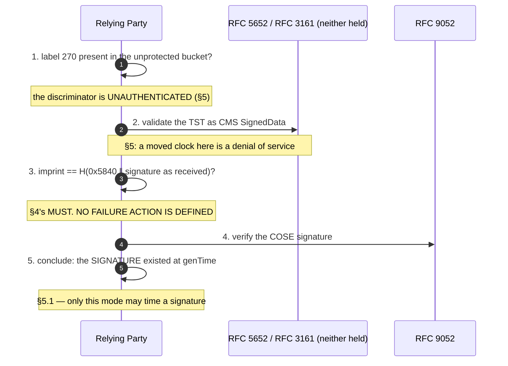
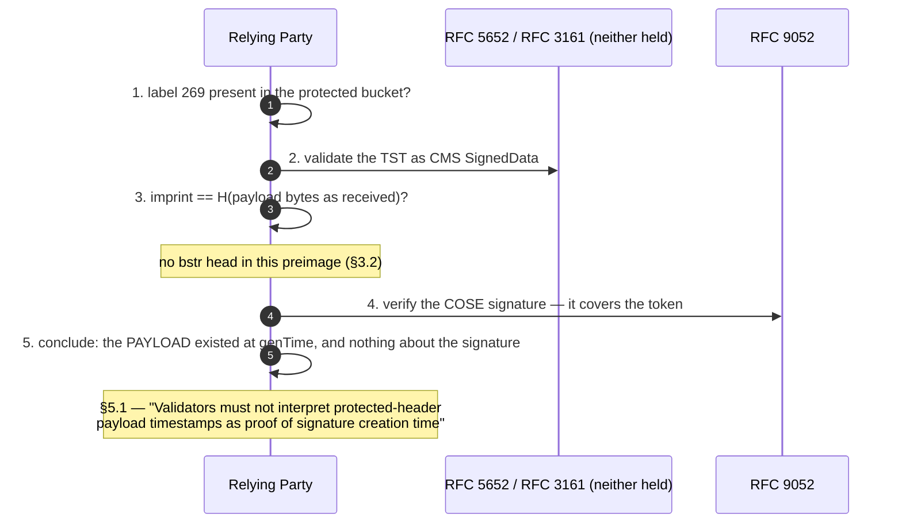

# Two assembly orders and two verification algorithms

RFC 9921 is a **protocol document with no procedure in it**. The exchange is
real and the document draws it twice: over all 1056 lines of
`.cache/rfc-9921.txt`, `TSA` occurs **24** times, `TimeStampReq` and
`TimeStampResp` **2** each, `relying party` **3**, `receiver` **1**, and both
figures show a request crossing to the TSA and a timestamp crossing back. But
`step`, `steps`, `error`, `fail`, `reject`, `invalid`, `discard`, `abort` and
`accept` each occur **zero** times. So the flows below are the document's, and
every step marked `reconstructed` in `protocol.yaml` is this extraction's
reading of §4 plus §5.1 — because **§5.1 asserts that "each mode has its own
separate verification algorithm" and the document writes neither down.**

**The sharpest thing in this model is an absence.** §4 carries the only MUST
addressed to a machine — *the receiver MUST make sure that the MessageImprint
in the embedded timestamp token matches a hash of either the payload,
signature, or signature fields* — and nothing in the document says what a
receiver does when it does not match.

## F1 — CTT assembly (§2.1, §3.1, Appendix A.2)

```mermaid
sequenceDiagram
  autonumber
  participant S as Signer
  participant T as TSA (RFC 3161 — not held)
  S->>S: 1. sign the payload → signature field
  Note over S: the object is now complete and signed
  S->>S: 2. imprint = H(0x58 0x40 ‖ signature)
  Note over S: §3.1.1 — the CBOR head is IN the preimage
  S->>T: 3. TimeStampReq {version, MessageImprint, certReq TRUE}
  Note over S,T: both figures draw a nonce; neither example has one
  T-->>S: 4. TimeStampResp → TimeStampToken (5453 octets)
  S->>S: 5. bstr-wrap into the UNPROTECTED bucket
  Note over S: the object is NOT re-signed (Appendix A.2)
```

## F2 — TTC assembly (§2.2, §3.2, Appendix A.1)

```mermaid
sequenceDiagram
  autonumber
  participant S as Signer / Issuer
  participant T as TSA (RFC 3161 — not held)
  participant X as Transparency Service (§1.1, no messages defined)
  S->>S: 1. imprint = H(datum) — payload bytes only, no bstr head
  S->>T: 2. TimeStampReq {version, MessageImprint, certReq TRUE}
  T-->>S: 3. TimeStampResp → TimeStampToken (5453 octets)
  S->>S: 4. bstr-wrap into the PROTECTED bucket; datum becomes the payload
  S->>S: 5. sign — the token is now inside the signed bytes
  opt §1.1's second use case, no mechanism given
    S->>X: 6. register the signed parts → a "transparent statement"
    Note over S,X: "the TST must be included in the signed statement"
  end
```

## F3 — CTT verification (§4 + §5.1, reconstructed)



## F4 — TTC verification (§4 + §5.1, reconstructed)



## What the diagrams make visible

1. **The mode is chosen by a header label, and in F3 that label is in the
   bucket §5 concedes an attacker can edit.** Step 1 of F3 is a decision taken
   on unauthenticated input, and it selects which of two verification
   algorithms runs.
2. **Steps 2 and 3 of F3 and F4 run an ASN.1/CMS/X.509 parser on
   unauthenticated bytes.** In F3 the token is unprotected; in F4 it is inside
   the signed bytes but §4 puts the imprint check *"As part of the signature
   verification"*, so a receiver that follows the document parses 5453 octets
   of DER before it has a verification result.
3. **The TSA exchange leaves this document entirely.** Both `T` lanes are RFC
   3161's, which this library does not hold, and no transport is named.
4. **F2 step 6 is the reason the TTC mode exists and has no messages.** The
   transparency service is a use case with no specification cited.
