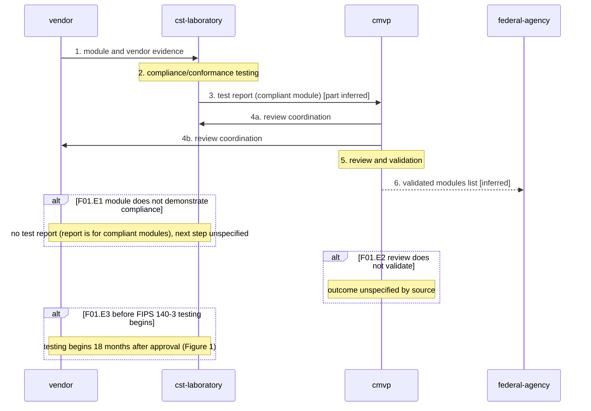
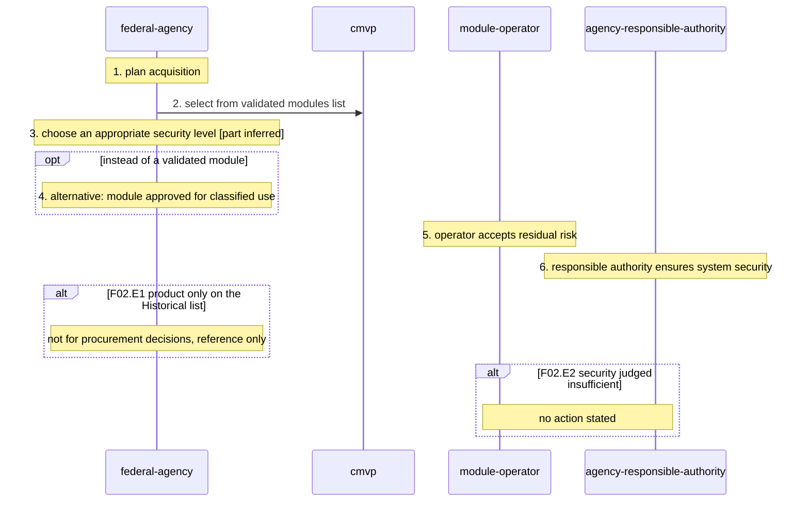
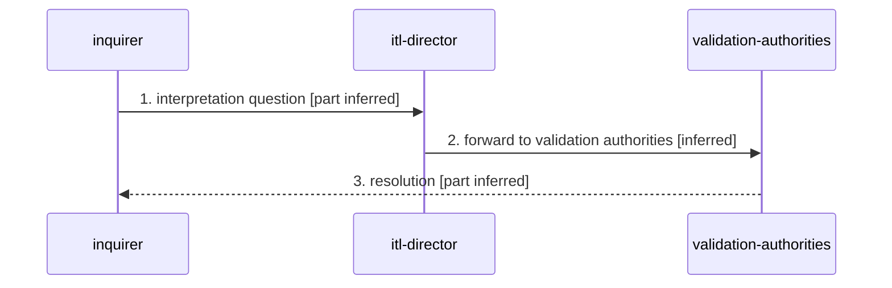
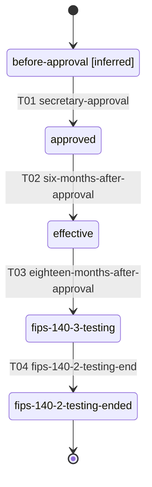
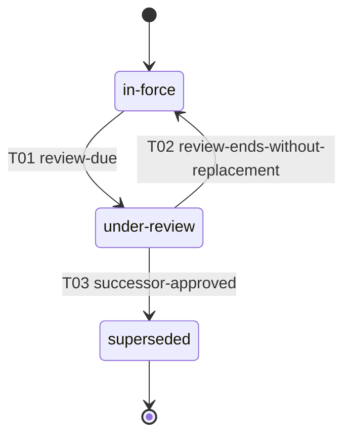
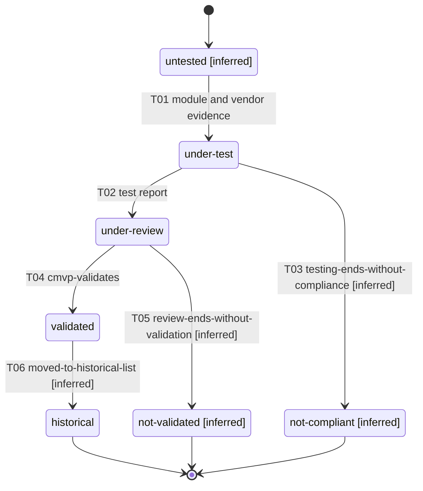

# FIPS 140-3: protocol model

The machine-readable model is `protocol.yaml` (11 roles, 3 flows, 16 steps, 5 error paths, source ambiguities SA-01 to SA-08); the lifecycles are `state-machine.yaml` (M01 to M03). This file is the prose and one sequence diagram per flow. Every quotation below is a marker rendered from `.cache/fips-140-3.txt` by `bin/check-quotes --render`; nothing between the markers was typed. Requirement ids were emitted by script from `requirements.yaml`; C-ids are skeleton candidates of `inferred-candidates.yaml`. Counts in this paragraph were computed by the generator on 2026-11-15.

## What kind of protocol this is

No message format: the standard is an announcement (¶1 to ¶14) wrapped around ISO/IEC 19790 and 24759. But it states who does what to get a module validated and bought, and in what order:

<!-- q L120-121 "In the CMVP," .. "their modules tested." -->
> In the CMVP, vendors of cryptographic modules use independent, accredited Cryptographic and Security Testing (CST) laboratories to have their modules tested.

<!-- q L196-198 "A test report" .. "lab, and CMVP." -->
> A test report for modules demonstrating compliance will be submitted to the CMVP for review and validation. The review process schedule varies, as it is dependent on coordination between the vendor, testing lab, and CMVP.

Validation ends in a status, not a document: the source names no certificate (SA-04).

<!-- q L161-162 "Cryptographic modules that" .. "to this standard." -->
> Cryptographic modules that are validated under the CMVP will be considered as conforming to this standard.

## Reader defect at page edges (fixed in library#137)

Until 63d708e, `bin/_source_text` dropped the first line of every page after the first of this rendering and kept the page numbers (`protocol.yaml` reader_defect). `bin/check-quotes` read through the same function, so it could not see the defect; the generator refused every quotation range that crosses one of those lines, and under the fixed reader every quotation here still checks. The lines: 37, 55, 56, 81, 82, 130, 131, 180, 181, 236, 237, 260, 261, 274, 275, 325, 326, 327, 374, 375, 376, 427.

## Roles

| role | who | source | kind |
|---|---|---|---|
| vendor | A vendor of cryptographic modules | ¶3, ¶12 | stated |
| cst-laboratory | An independent, accredited Cryptographic and Security Testing laboratory | ¶3, ¶12 | stated |
| cmvp | The Cryptographic Module Validation Program, run jointly by NIST and CCCS | ¶3, ¶12, §1 | stated |
| nvlap | The National Voluntary Laboratory Accreditation Program, which accredits the laboratories that perform testing | ¶3 | stated |
| federal-agency | A Federal agency using cryptography-based security systems | ¶3, ¶6, ¶12 | stated |
| module-operator | The operator of a cryptographic module, responsible for the module's security being sufficient and acceptable to the information owner and for residual risk being accepted. | ¶13 | stated |
| agency-responsible-authority | The responsible authority in each agency | ¶13 | stated |
| inquirer | Whoever sends a question about the standard's content and specifications | ¶11 | inferred |
| itl-director | The NIST ITL Director, addressee of interpretation questions (¶11). | ¶11 | stated |
| validation-authorities | The validation authorities at NIST and CCCS, which resolve questions | ¶11, §1 | stated |
| secretary-of-commerce | The approving authority | ¶4, ¶12 | stated |

## Reading the diagrams

Solid arrows carry a work product of `protocol.yaml` work_products; dashed arrows are returns. A note over one role is a local step. `opt` is a permission (may). Each error path is an `alt` block after the main sequence. Labels say [inferred] where the model added the step and [part inferred] where the source does not name a sender, receiver or actor. Of the 16 steps, 14 are stated (4 of them with a party the source does not name) and 2 inferred.

## F01 module-validation (¶3, ¶9, ¶12, §1, §3.4)

A module is tested by an accredited laboratory and validated by the CMVP.

Testing comes first; the report goes to the CMVP only for a module that demonstrated compliance; the CMVP reviews, coordinating with vendor and laboratory, and validates. Who submits the report is not said (SA-01). That validation puts a module on the validated modules list is this model's step 6.

<!-- q L121-123 "National Voluntary Laboratory" .. "module compliance/conformance testing." -->
> National Voluntary Laboratory Accreditation Program (NVLAP) accredited laboratories perform cryptographic module compliance/conformance testing.

<!-- q L304-307 "The testing for" .. "under paragraph 5.2." -->
> The testing for these requirements will be in accordance with ISO/IEC 24759:2017(E), with the modifications, additions or deletions of vendor evidence and testing allowed as a validation authority under paragraph 5.2.

Requirements: fips-140-3#R-0002, fips-140-3#R-0007, fips-140-3#R-0009, fips-140-3#R-0011.

Error paths:

- F01.E1 (step 2, inferred): The module does not demonstrate compliance in testing. Outcome: No test report is submitted for it: the source conditions the report on demonstrating compliance. Correction, retest or notice are unspecified by source.
- F01.E2 (step 5, inferred): The CMVP review does not end in validation. Outcome: unspecified by source
- F01.E3 (step 1, stated): Testing is sought before FIPS 140-3 testing begins. Outcome: FIPS 140-3 testing is not yet available: Figure 1 begins it 18 months after the approval date (state-machine.yaml M01).

## F02 acquisition-and-use (¶6, ¶7, ¶12, ¶13)

Agencies acquire validated modules and remain responsible for their security.

The output of F01 is consumed here. Agencies plan and may buy from the validated list; the Historical list is for reference only:

<!-- q L200-202 "(Note: the CMVP" .. "reference purposes only.)" -->
> (Note: the CMVP Historical list should not be used for procurement decisions. This list is provided for reference purposes only.)

and validation does not discharge the operator or the agency:

<!-- q L241-243 "While the security" .. "module is secure." -->
> While the security requirements specified in this standard are intended to maintain the security provided by a cryptographic module, conformance to this standard is not sufficient to ensure that a particular module is secure.

Requirements: fips-140-3#R-0001, fips-140-3#R-0002, fips-140-3#R-0003, fips-140-3#R-0005, fips-140-3#R-0006, fips-140-3#R-0009, fips-140-3#R-0010, fips-140-3#R-0012.

Error paths:

- F02.E1 (step 2, stated): The product appears only on the CMVP Historical list. Outcome: The Historical list is not to be used for procurement decisions; it is for reference only.
- F02.E2 (step 5, inferred): The operator or the responsible authority judges the security insufficient. Outcome: unspecified by source

## F03 interpretation-request (¶11)

A question about the standard and its resolution.

Addressed to the ITL Director, resolved by the validation authorities; the hand-off and the return address are this model's (SA-06).

<!-- q L190-192 "Resolution of questions" .. "for Cyber Security." -->
> Resolution of questions regarding this standard will be provided by the validation authorities at the National Institute of Standards and Technology and the Canadian Centre for Cyber Security.

Requirements: fips-140-3#R-0008.

## Lifecycles (state-machine.yaml)

M01 is Figure 1 read as a timeline; M02 the review cycle ¶13 promises, with both outcomes taken from §1's history; M03 F01 seen from the module.

<!-- q L194-196 "This standard becomes" .. "FIPS 140-3 testing." -->
> This standard becomes effective six months after approval by the Secretary of Commerce. A minimum transition period of 6 months after approval is provided for testing labs to develop and implement FIPS 140-3 testing.

<!-- q L217-218 -->
> FIPS 140-3 TESTING BEGINS (18 months after approval date)

<!-- q L250-251 "This standard will" .. "updates or replacement." -->
> This standard will be reviewed at least every five years in order to consider necessary updates or replacement.

### M01 fips-140-3-implementation-schedule

Figure 1 and ¶12 as a timeline: approval, effective six months later, FIPS 140-3 testing from eighteen months, then the end of FIPS 140-2 testing. States are read in the figure's top-to-bottom order.

### M02 fips-140-revision-maintenance

¶13 commits FIPS 140-3 to review at least every five years to consider updates or replacement; §1's history shows both outcomes for its predecessors (FIPS 140-2 reviewed after 5 years without consensus to move forward until ISO/IEC 19790:2012; FIPS 140-1 superseded by FIPS 140-2 in 2001; FIPS 140-2 superseded by FIPS 140-3 in its entirety).

### M03 module-validation-status

F01 seen from the module: tested, reported, reviewed, validated; and the two CMVP lists of ¶12 as the states procurement reads (F02).

## Source ambiguities

Recorded for the design notes; each is also in `protocol.yaml` source_ambiguities with its quotations.

- **SA-01** (¶12). The test report is submitted to the CMVP in the passive voice; the source never says whether the laboratory or the vendor submits it. F01 step 3 reads the laboratory.
- **SA-02** (¶12, Figure 1). ¶12 gives laboratories a minimum transition of 6 months after approval to implement FIPS 140-3 testing, while Figure 1 begins FIPS 140-3 testing 18 months after approval. The two agree only if 6 is a floor and 18 the schedule actually set; the source does not say which governs.
- **SA-03** (Figure 1). Figure 1 prints a FIPS 140-2 TESTING ENDS milestone with no interval or date in the text rendering (its timeline bars are graphics the rendering drops). Its place after FIPS 140-3 TESTING BEGINS is read from the figure's top-to-bottom order only.
- **SA-04** (¶3, ¶9, ¶12). The source names no certificate: validation's stated effects are being considered as conforming (¶9) and accepted by agencies (¶3), and ¶12 names a validated modules list and a Historical list without saying how a module enters either.
- **SA-05** (¶3, ¶12). One laboratory role has three names in ¶3 and ¶12 (quoted below): CST laboratories, NVLAP accredited laboratories and testing labs. The CMVP is joint with CCCS, but only the U.S. accreditation program is named.
- **SA-06** (¶11, §1). Questions go to the ITL Director; resolutions come from the validation authorities at NIST and CCCS. Neither the hand-off nor the recipient of the resolution is stated, and ¶11 does not say the validation authorities are the CMVP, which §1 calls a validation authority.
- **SA-07** (¶7). The security level must be chosen to suit the application and environment, but the sentence is passive: it does not say whether the vendor (the level a module is validated to) or the acquiring agency chooses. F02 step 3 reads the agency.
- **SA-08** (§1). §1 says testing follows ISO/IEC 24759:2017(E) with the modifications allowed under paragraph 5.2 without naming the document that paragraph belongs to.

## Not modelled

- Comments on FIPS publications (Foreword) (front matter): A courtesy of the publication series, outside the standard's operation, with no response defined; skeleton candidate C-0001.
- Where to obtain copies (¶14) (¶14): Publication availability, not an exchange.
- The document map of §3.3, §3.4 and Table 1 (which SP modifies which ISO/IEC clause) (§3.3, §3.4): Structure, not an exchange; it fixes what the evidence in F01 step 1 and the testing in step 2 are measured against, and is cited there.
- The module's own operational states (self-tests, error state, approved mode, zeroisation) (§1, §2): FIPS 140-3 adopts ISO/IEC 19790 for them and states none; nist-sp-800-140 models the ones its modified assertions name.
