# NIST SP 800-140 (FIPS 140-3 DTR): protocol model

The machine-readable model is `protocol.yaml` (6 roles, 8 flows, 44 steps, 11 error paths, an index of the 22 modified assertions, source ambiguities SA-01 to SA-13); the lifecycles are `state-machine.yaml` (M01 to M03). This file is the prose and one sequence diagram per flow. Every quotation below is a marker rendered from `.cache/nist-sp-800-140.txt` by `bin/check-quotes --render`; nothing between the markers was typed. Requirement ids were emitted by script from `requirements.yaml`. Counts in this paragraph were computed by the generator on 2026-11-15.

## What kind of protocol this is

A conformance test, not a wire protocol. The vendor gives the laboratory evidence, the tester runs each test procedure, and each procedure's answer must carry what the CMVP asks for:

<!-- q L258-260 "Section 6 of" .. "by testing laboratories." -->
> Section 6 of this document specifies any modifications to the requirements for information that vendors shall provide to testing laboratories and the requirements for testing that shall be used by testing laboratories.

<!-- q L298-300 -->
> In responding to test evidence (TE), a yes/no answer does not provide sufficient assurance. CMVP requires the following information when responding to a documentation, operational testing, or verify/verify by inspection requirement.

Where the document does not modify ISO/IEC 24759, ISO/IEC 24759 governs; four of its twelve areas carry no change at all.

<!-- q L202-203 "Unless otherwise specified" .. "in ISO/IEC 24759." -->
> Unless otherwise specified in this document, the test requirements are specified in ISO/IEC 24759.

## Modified assertions

`protocol.yaml` assertion_index lists each modified assertion with the requirement ids of its statement and of each VE and TE paragraph, assigned by line containment. It accounts for 137 of the 139 skeleton requirements; the other 2 (nist-sp-800-140#R-0001, nist-sp-800-140#R-0002) are §5.1 and §5.2, outside any assertion. Pass 3 added the 72 entries the requirements lane appended later (assertion headings and bullets, NOTEs, split children), so the index holds 209 of the 242 entries; the other 33 are outside any assertion (R-0001, R-0002, R-0140 to R-0162, and the "No change." entries R-0181, R-0196 and R-0237) or are inferred (R-0238 to R-0242; R-0241 carries an assertion, AS06.11, and is left out because it is our reading).

| assertion | area and levels | VEs | TEs | modelled in |
|---|---|---|---|---|
| AS02.15 | Specification, levels 1, 2, 3, 4 | 2 | 5 | F01 |
| AS02.17 | Specification, levels 1, 2, 3, 4 | 2 | 5 | F01 |
| AS02.18 | Specification, levels 1, 2, 3, 4 | 1 | 1 | F01 |
| AS02.20 | Specification, levels 1, 2, 3, 4 | 2 | 2 | F01, M01 |
| AS03.07 | Data output interface, levels 1, 2, 3, 4 | 3 | 3 | F01, M01 |
| AS04.44 | Operator authentication, levels 1, 2, 3, 4 | 1 | 1 | F01 |
| AS04.45 | Operator authentication, levels 2, 3, 4 | 0 | 1 | F02, M03 |
| AS04.54 | Operator authentication, levels 2, 3, 4 | 2 | 3 | F03 |
| AS06.11 | Operational environment, levels 2 | 1 | 3 | F04 |
| AS07.26 | Physical security, levels 3, 4 | 2 | 2 | F01 |
| AS07.77 | Environmental failure protection features, levels 3, 4 | 2 | 1 | F01, M01, M02 |
| AS07.81 | Environmental failure testing procedures, levels 3 | 2 | 1 | F07, M01 |
| AS09.23 | Sensitive security parameter entry and output, levels 3 | 2 | 3 | F08, F01.E1 |
| AS09.28 | Sensitive security parameter zeroisation, levels 1, 2, 3, 4 | 3 | 6 | F05, M02, F01.E1 |
| AS09.29 | Sensitive security parameter zeroisation, levels 1, 2, 3, 4 | 1 | 2 | F05, M02, F01.E1 |
| AS09.30 | Sensitive security parameter zeroisation, levels 2, 3, 4 | 1 | 4 | F05, M02, F01.E1 |
| AS10.01 | Self-tests, levels 1, 2, 3, 4 | 0 | 0 | M01 |
| AS10.02 | Self-tests, levels 1, 2, 3, 4 | 0 | 0 | M01 |
| AS10.07 | Self-tests, levels 1, 2, 3, 4 | 0 | 1 | M01 |
| AS11.13 | Finite state model, levels 1, 2, 3, 4 | 0 | 0 | M03 |
| AS11.29 | Vendor testing, levels 1, 2, 3, 4 | 1 | 2 | F01 |
| AS11.38 | Guidance documents, levels 1, 2, 3, 4 | 1 | 1 | F06, F01 |

## Roles

| role | who | source |
|---|---|---|
| vendor | The module's vendor; supplies the vendor evidence (VE) each modified assertion asks for and answers the tester's requests. | §1, §5.1, §6 |
| cstl | The Cryptographic and Security Testing Laboratory and its tester: performs the test evidence (TE) procedures and reports each TE to the CMVP's information requirements. | §1, §5.1, §6 |
| cmvp | The Cryptographic Module Validation Program, the validation authority that modifies ISO/IEC 24759's TEs and VEs and sets what a TE response must contain. | §6, front matter |
| module | The cryptographic module under test, the other party of every operational test. | §6 |
| operating-system | The operating system of the operational environment, configured by the tester for AS06.11 (Level 2). | §6.6 |
| operator | An operator of the module: enters authentication data and key components, and controls procedural zeroisation. | §6.4, §6.9 |

## Reading the diagrams

Solid arrows carry a work product of `protocol.yaml` work_products; dashed arrows are the module's or vendor's answers. A note over one role is a local step. `opt` and `alt` are the source's conditions. Each error path is an `alt` block after the main sequence. Labels say [inferred] where the model added the step and [part inferred] where the source does not name the receiver. Of the 44 steps, 43 are stated (1 with a receiver the source does not name) and 1 inferred. The flows cite 66 distinct requirement ids.

## F01 evidence-and-test-response (§1, §5.1, §6)

Vendor evidence, test evidence and the response the CMVP requires.

The frame every assertion's VE and TE plug into: the vendor supplies evidence to the laboratory, the tester performs each TE, and each TE is answered with the information the CMVP requires for its kind; ISO/IEC 24759 governs wherever this document does not modify it. Five TEs add a stated loop: where a vendor rationale leaves doubt, the tester requires more information.

Evidence, test, response. A bare yes or no is not an answer, and for five TEs the burden of proof is on the vendor:

<!-- q L846-853 "The burden of" .. "information as needed." -->
> The burden of proof is on the vendor; if there is any uncertainty or ambiguity, the tester shall require the vendor to produce additional information as needed.

Requirements: nist-sp-800-140#R-0001, nist-sp-800-140#R-0093, nist-sp-800-140#R-0094, nist-sp-800-140#R-0101, nist-sp-800-140#R-0102, nist-sp-800-140#R-0109, nist-sp-800-140#R-0110, nist-sp-800-140#R-0114, nist-sp-800-140#R-0115, nist-sp-800-140#R-0120, nist-sp-800-140#R-0121.

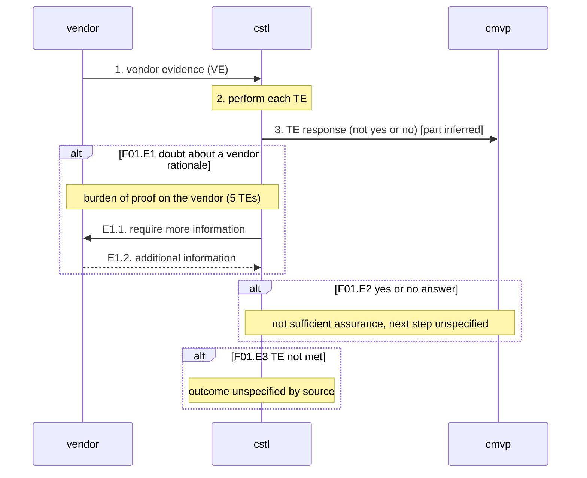

Error paths:

- F01.E1 (step 2, stated): A vendor rationale under TE09.23.04, TE09.28.01, TE09.28.06, TE09.29.02 or TE09.30.01 leaves uncertainty or ambiguity. Outcome: The vendor carries the burden of proof: the tester demands more information from it, then returns to step 2.
- F01.E2 (step 3, stated): A TE is answered yes or no only. Outcome: Insufficient assurance; what the CMVP then does is unspecified by source.
- F01.E3 (step 2, inferred): Evidence is missing or a TE is not met. Outcome: unspecified by source

## F02 uninitialised-module-access-test (§6.4)

TE04.45.02: access before initialisation is denied (AS04.45, Levels 2, 3 and 4).

A module without the authentication data for first access must be controlled by other authorised methods (procedural controls, factory-set or default data) that also initialise authentication. Where procedural controls govern access before initialisation, the tester provokes an error and checks access is denied, assumes the authorised role, and checks other roles are refused before initialisation.

Only where access before initialisation is procedurally controlled:

<!-- q L592-593 -->
> TE04.45.02: If access to the module before initialisation is procedurally controlled, the tester shall initiate an error on an uninitialised module and shall verify that the module denies access.

Requirements: nist-sp-800-140#R-0052, nist-sp-800-140#R-0053, nist-sp-800-140#R-0054, nist-sp-800-140#R-0055.

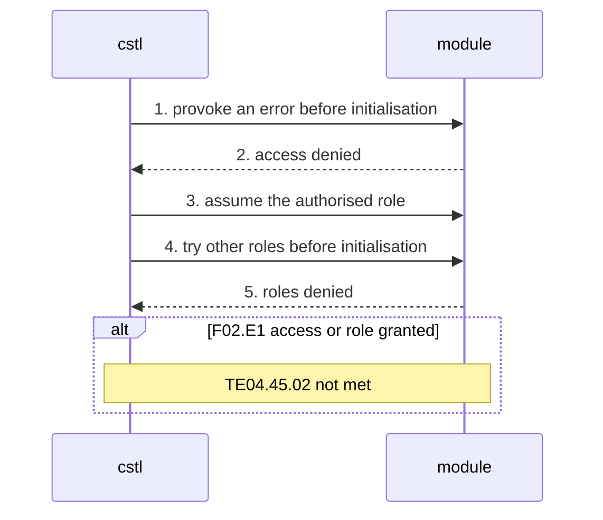

Error paths:

- F02.E1 (step 2, 5, inferred): The module grants access or a role before initialisation. Outcome: TE04.45.02 is not met; what follows is unspecified by source.

## F03 authentication-data-entry-test (§6.4)

AS04.54: authentication feedback is obscured (Levels 2, 3 and 4).

The vendor documents how feedback is obscured and, if offered, how an operator confirms data at entry; the tester checks the documentation, enters authentication data and checks nothing of it is accessible during entry except, optionally, to the operator, and that a confirmation is hidden from everyone else.

<!-- q L604-606 -->
> Feedback of authentication data to an operator shall be obscured during authentication to anyone other than the operator. (e.g. no visible display of characters when entering a password).

Requirements: nist-sp-800-140#R-0056, nist-sp-800-140#R-0057, nist-sp-800-140#R-0058, nist-sp-800-140#R-0059, nist-sp-800-140#R-0060, nist-sp-800-140#R-0061.

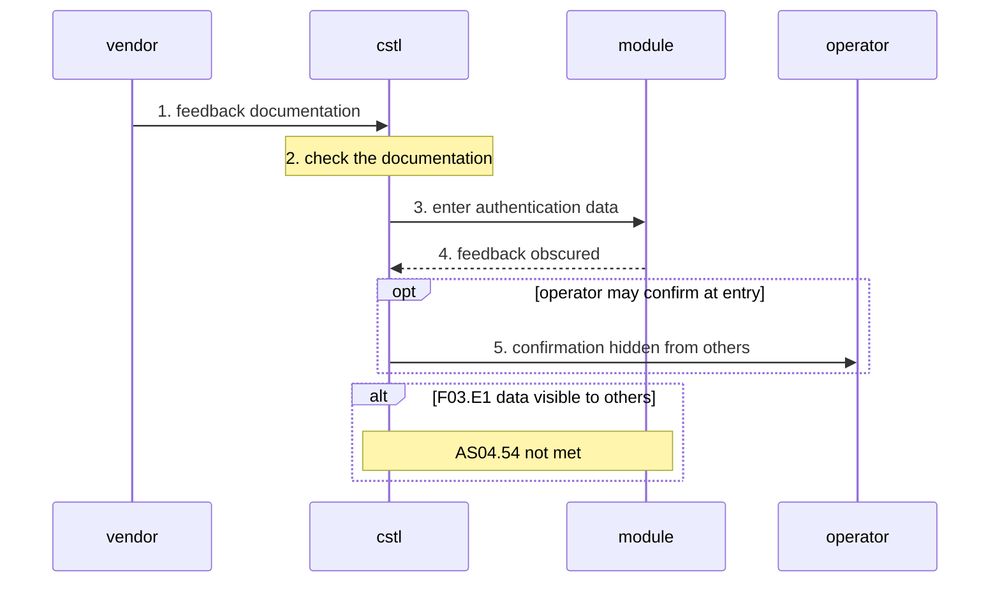

Error paths:

- F03.E1 (step 4, 5, inferred): Authentication data or its confirmation is accessible to someone other than the operator. Outcome: AS04.54 is not met; what follows is unspecified by source.

## F04 operating-system-protection-test (§6.6)

AS06.11: the operating system protects SSPs, control and status data (Level 2).

The vendor documents the operating system's configurable controls; the tester inspects them, configures the operating system, and during a cryptographic process attempts to run, change or read SSPs and control or status data, once with authorised and once with unauthorised access. The expected result of either attempt is not stated (SA-04).

Level 2 only. The attempts are stated, their expected results are not (SA-04):

<!-- q L663-664 -->
> During execution of a cryptographic process, the tester shall attempt to execute, modify or read SSPs, control or status data which the tester has unauthorised access.

Requirements: nist-sp-800-140#R-0062, nist-sp-800-140#R-0063, nist-sp-800-140#R-0064, nist-sp-800-140#R-0065, nist-sp-800-140#R-0066, nist-sp-800-140#R-0067, nist-sp-800-140#R-0068.

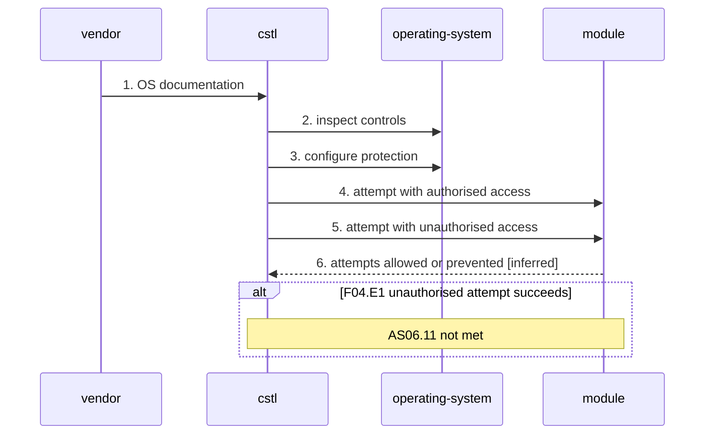

Error paths:

- F04.E1 (step 6, inferred): An unauthorised attempt succeeds. Outcome: AS06.11 is not met; unspecified by source.

## F05 zeroisation-test (§6.9)

AS09.28 to AS09.30: zeroise, then prove nothing is left (TE09.28.x, TE09.30.x).

The vendor documents zeroisation; the tester checks it and every rationale in it, inventories the SSPs (TE09.28.02) or keys (TE09.30.02), issues the zeroise command, checks timing, then tries to use each stored SSP and expects none to be accessible; SSPs left in place must be encrypted with an approved algorithm or protected inside an embedded validated module. TE09.28.x speaks of unprotected SSPs and TE09.30.x of plaintext SSPs (SA-13). Procedural zeroisation is checked separately.

<!-- q L855-858 -->
> TE09.28.02: The tester shall verify which SSPs are present in the module and initiate the zeroise command. Following the completion of the zeroise command, the tester shall attempt to perform cryptographic operations using each of the unprotected SSPs that were stored in the module. The tester shall verify that each unprotected SSP cannot be accessed.

Requirements: nist-sp-800-140#R-0095, nist-sp-800-140#R-0096, nist-sp-800-140#R-0097, nist-sp-800-140#R-0098, nist-sp-800-140#R-0099, nist-sp-800-140#R-0100, nist-sp-800-140#R-0101, nist-sp-800-140#R-0103, nist-sp-800-140#R-0104, nist-sp-800-140#R-0105, nist-sp-800-140#R-0106, nist-sp-800-140#R-0107, nist-sp-800-140#R-0108, nist-sp-800-140#R-0109, nist-sp-800-140#R-0110, nist-sp-800-140#R-0111, nist-sp-800-140#R-0112, nist-sp-800-140#R-0113, nist-sp-800-140#R-0114, nist-sp-800-140#R-0116, nist-sp-800-140#R-0117, nist-sp-800-140#R-0118, nist-sp-800-140#R-0119, nist-sp-800-140#R-0120, nist-sp-800-140#R-0122, nist-sp-800-140#R-0123, nist-sp-800-140#R-0124, nist-sp-800-140#R-0125, nist-sp-800-140#R-0126.

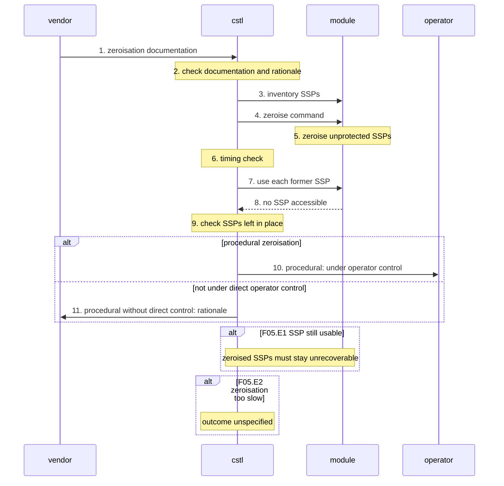

Error paths:

- F05.E1 (step 8, stated): An SSP can still be accessed or used after zeroisation. Outcome: AS09.29 forbids it; what follows a module that fails is unspecified by source.
- F05.E2 (step 6, inferred): Destruction takes long enough to allow a compromise. Outcome: unspecified by source

## F06 cve-disclosure-and-assessment (§6.11)

VE11.38.03 and TE11.38.03: known vulnerabilities (AS11.38, all levels).

A CMVP addition under the guidance-documents assertion: the vendor lists every CVE associated with the module and, per CVE, either assures it is not security relevant or describes its mitigation; the tester checks each is not security relevant or is appropriately mitigated.

<!-- q L1050-1054 -->
> VE11.38.03: The vendor shall list any CVEs associated with the module, and either - provide assurance that they are not security relevant; - or, for any CVE’s that are considered security relevant, the vendor shall describe how they have been mitigated.

Requirements: nist-sp-800-140#R-0137, nist-sp-800-140#R-0138, nist-sp-800-140#R-0139.

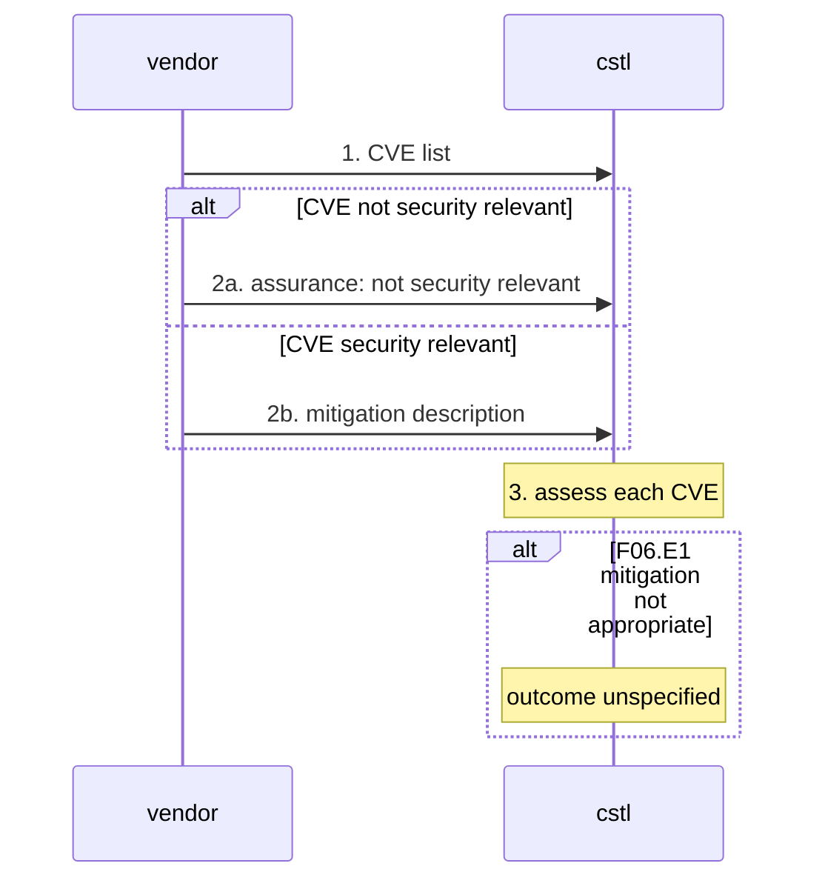

Error paths:

- F06.E1 (step 3, inferred): A security-relevant CVE's mitigation is not appropriate. Outcome: unspecified by source

## F07 environmental-failure-test (§6.7)

AS07.81: environmental failure testing, EFT (Level 3).

Where EFT is chosen for a condition, the module is tested over the ranges AS07.82, AS07.85 and AS07.86 give (not in this document): the temperature is driven from inside the normal range down to where the module shuts down or zeroises and up to where it shuts down, enters an error state or zeroises; the module may instead continue to operate normally. The tester then checks the security policy states the ranges and the outcome.

<!-- q L737-748 -->
> The temperature range to be tested shall be from a temperature within the normal operating temperature range to the lowest (i.e., coldest) temperature that either (1) shutdown the module to prevent further operation or (2) immediately zeroise all unprotected SSPs; and from a temperature within the normal operating temperature range to the highest (i.e., hottest) temperature that either (1) shuts down or goes into an error state or (2) zeroises all unprotected SSPs.

Requirements: nist-sp-800-140#R-0082, nist-sp-800-140#R-0083, nist-sp-800-140#R-0084, nist-sp-800-140#R-0085, nist-sp-800-140#R-0086, nist-sp-800-140#R-0087.

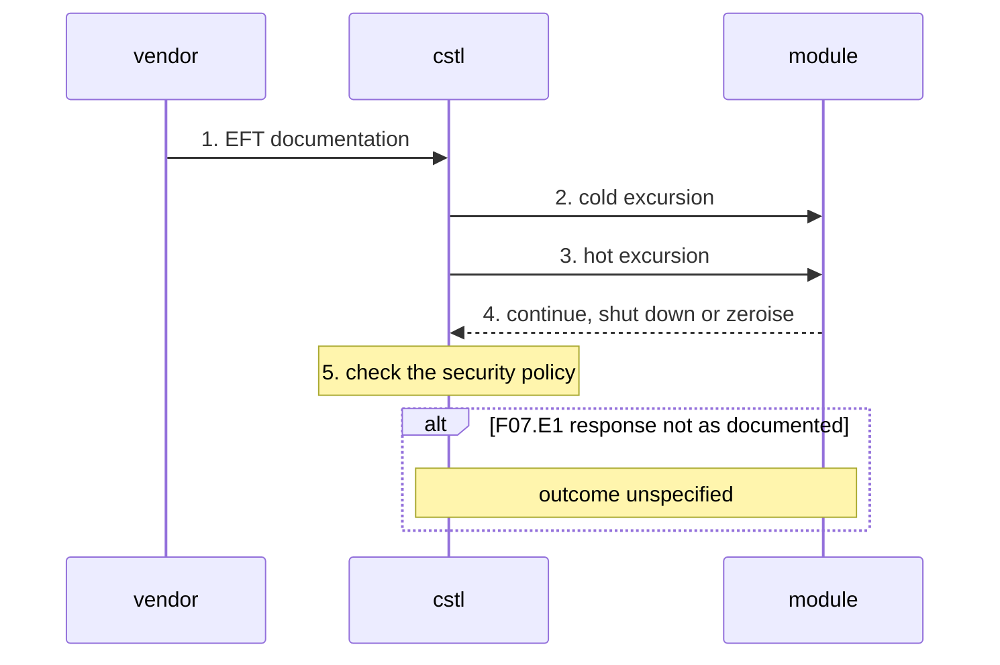

Error paths:

- F07.E1 (step 4, inferred): The module's response is not the documented one. Outcome: unspecified by source

## F08 split-knowledge-component-entry (§6.9)

AS09.23: key components under split knowledge (Level 3).

Under split knowledge each key component is entered or output under its own identity-based operator authentication, and at least two components are needed to reconstruct the key; the vendor documents the component count and why fewer components reveal nothing but the length; the tester checks both and the rationale.

<!-- q L785-788 -->
> {If the module employs split knowledge procedures, the module shall employ separate identity-based operator authentication for entering or outputting each key component,} and at least two key components shall be required to reconstruct the original cryptographic key.

Requirements: nist-sp-800-140#R-0088, nist-sp-800-140#R-0089, nist-sp-800-140#R-0090, nist-sp-800-140#R-0091, nist-sp-800-140#R-0092, nist-sp-800-140#R-0093.

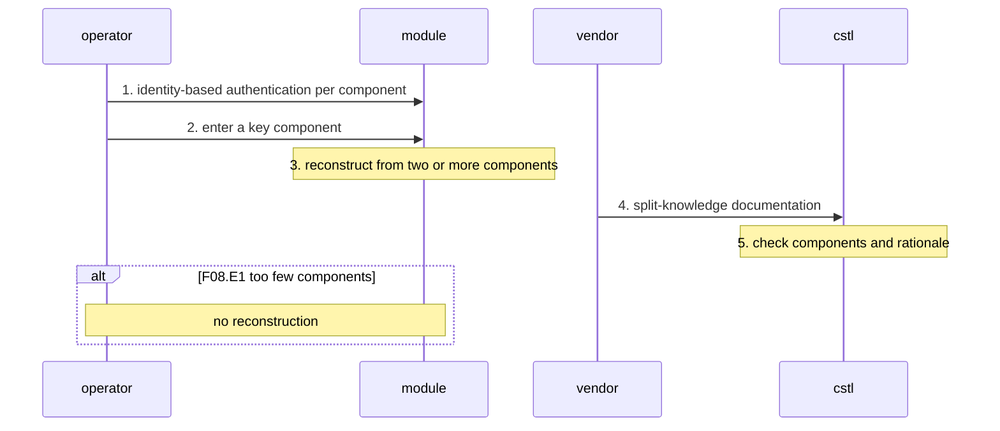

Error paths:

- F08.E1 (step 3, inferred): Fewer components than required are presented. Outcome: The key cannot be reconstructed; any further handling is unspecified by source.

## Lifecycles (state-machine.yaml)

M01 is the subset of the module's states the modified assertions name, M02 one SSP's way to zeroisation, M03 operator access before and after initialisation.

<!-- q L996-997 -->
> If a cryptographic module fails a self-test, the module shall enter an error state {and shall output an error indicator as specified in {ISO/IEC 19790:2012/Cor.1:2015 subclause} 7.3.3}.

<!-- q L1006-1007 -->
> Changing to the Crypto Officer state from any other role other than the Crypto Officer shall be prohibited.

### M01 module-operational-states

AS03.07 names five states with data output inhibited; AS10.07 sends a failed self-test to the error state; AS07.77 (EFP) and AS07.81 (EFT) take an out-of-range module to shutdown or zeroisation, and the hot side of EFT to an error state; AS02.20 defines the approved mode. Entry into the named states and the return to operation are ISO/IEC 19790's and are marked inferred.

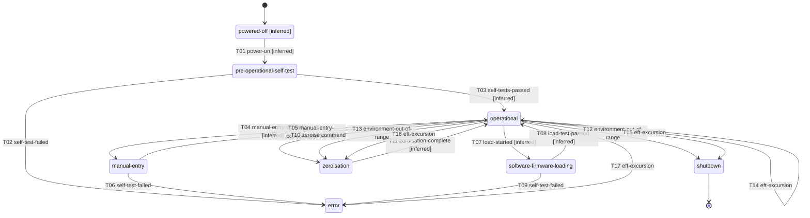

### M02 ssp-zeroisation

An unprotected SSP ends zeroised, by command, procedure, environmental protection or because it is no longer needed, and a zeroised SSP can never come back; SSPs encrypted or held inside an embedded validated module, and SSPs used only to reveal plaintext to authentication proxies, are outside the requirement.

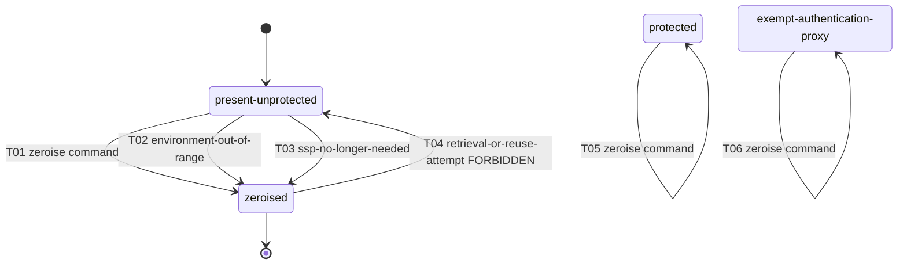

### M03 operator-access

AS04.45 and TE04.45.02 before initialisation: access and other roles denied, only the authorised role under procedural control, which initialises authentication. AS11.13 after: no change to the Crypto Officer state from another role, against privilege escalation.

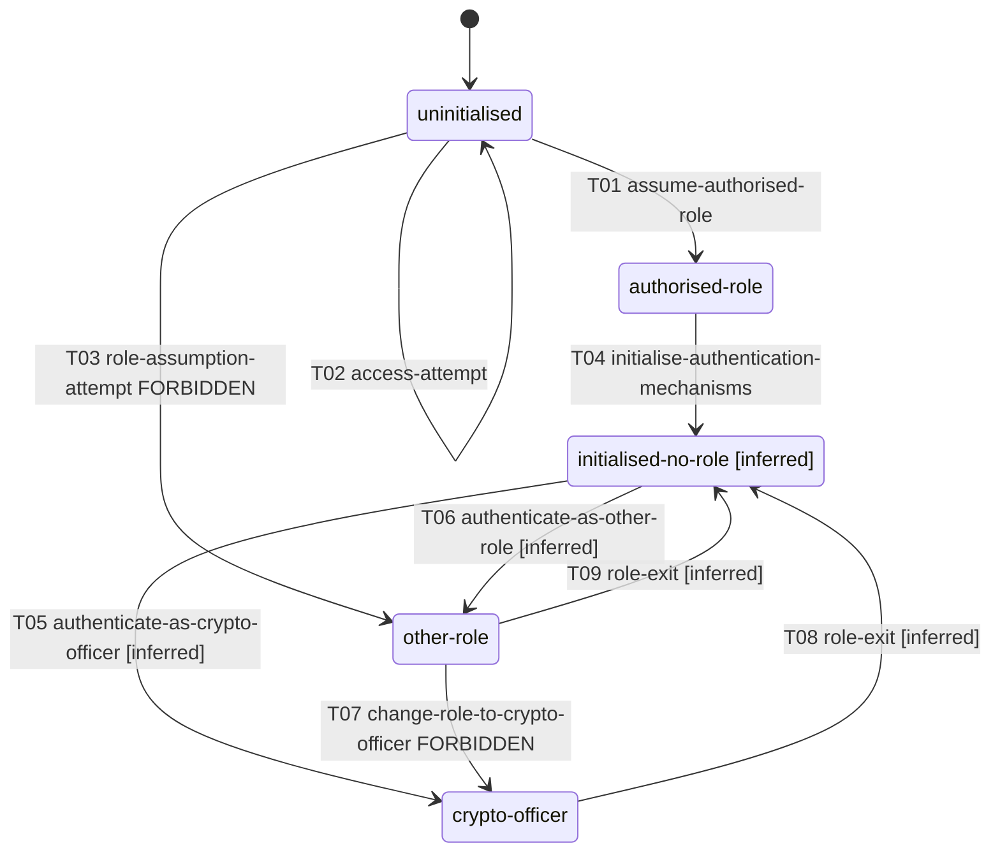

## Source ambiguities

Recorded for the design notes; each is also in `protocol.yaml` source_ambiguities with its quotations.

- **SA-01** (§5.2 and throughout §6). Additions are underlined and deletions struck through, and the text rendering keeps neither, so deleted and added words read together, for example a VE list printing two designators side by side where its range ends (a replaced end, or an end plus an added item: normative.md SD-1), two verbs side by side, plaintext unprotected SSPs, and a pair of adjacent sentences in TE09.23.02. Which word is the CMVP's cannot be told from the text; the PDF's markup decides.
- **SA-02** (§6.9 AS09.28, AS09.30). AS09.28's NOTE 1 says it is tested in AS09.30, and AS09.30's NOTE 1 says it is tested in AS09.28; TE09.28.01 checks the information of VE09.30.01, not VE09.28.01.
- **SA-03** (§6.7 AS07.81, VE07.81.01, VE07.81.02, TE07.81.03). The admissible EFT outcomes differ by sentence: the cold side lists shutdown or zeroise, the hot side adds an error state, VE07.81.01 adds continuing to operate normally, and VE07.81.02 and TE07.81.03 name only shutdown or zeroise. The test ranges are in AS07.82, AS07.85 and AS07.86, which this document does not modify or reproduce.
- **SA-04** (§6.6 TE06.11.02, TE06.11.03). The two procedures say what to attempt and not what result passes; F04 step 6 is inferred.
- **SA-05** (§6.4 TE04.45.02). What initiating an error on an uninitialised module means is not defined, and whether the authorised role is assumed before or after initialisation is not said.
- **SA-06** (§6.10 AS10.01, AS10.02). The closing clause about the approved or non-approved mode can be read as self-tests running whatever the mode or as the module deciding the mode; it is probably an addition whose underline the rendering lost (SA-01). M01 does not let self-tests choose the mode.
- **SA-07** (§6.10 AS10.07, TE10.07.05). The only test procedure under AS10.07 checks who decides pass or fail (AS10.02's subject), not entry into the error state or the error indicator; how the module leaves the error state is not stated here.
- **SA-08** (§6.11 AS11.13). AS11.13 forbids a change into the Crypto Officer state from another role; entering it from no role, and leaving it, are not addressed (M03 marks them inferred).
- **SA-09** (§6.9 VE09.28.03, TE09.28.05, TE09.28.06). TE09.28.05 has the tester confirm the documentation puts the procedure under operator control, while TE09.28.06 accepts a procedural method not under the operator's direct control on a rationale; VE09.28.03 speaks only of the controlled case.
- **SA-10** (§6, §6.7). Binding text the skeleton captured nowhere: the three TE response forms of §6, and AS07.77's two outcome items. Pass 1 quoted them directly for the requirements lane; that lane has since added them as entries (R-0159, R-0160 and R-0161 for the response forms, R-0188 and R-0189 for the outcome items), which pass 3 cites in F01 step 3 and in M01.T12 and M01.T13.
- **SA-11** (§6.9). The burden-of-proof sentence appears in TE09.23.04, TE09.28.01, TE09.28.06, TE09.29.02 and TE09.30.01 only; whether it governs other TEs is not said.
- **SA-12** (front matter). The abstract places the CMVP's authority to modify TEs and VEs in paragraph 5.2 of ISO/IEC 24759; SP 800-140A's abstract places the same authority in paragraph 5.2 of ISO/IEC 19790 (cross-record).
- **SA-13** (§6.9 VE09.28.01, VE09.30.01, TE09.28.02, TE09.30.02). Two parallel zeroisation lists and procedures, one in terms of unprotected SSPs, the other of plaintext SSPs, and TE09.30.02 inventories keys; F05 carries both.

## Not modelled

- How modifications are marked (sequence numbers, underline, strikethrough, No change) (§5.2): Document convention, not an exchange; its consequence for quotations is SA-01.
- Documentation-only checks (AS02.15, AS02.17, AS02.18, AS02.20, AS03.07, AS04.44, AS07.26, AS07.77, AS11.29) (§6.2, §6.3, §6.4, §6.7, §6.11): A VE answered by a TE that reviews documentation or inspects hardware is F01 steps 1 to 3 with that VE and TE; assertion_index lists each one's ids. TE07.26.01's hardness measurement at the two temperatures is an operational test of that shape.
- The CMVP's authority to modify, add or delete TEs and VEs (front matter): Front matter describing how this document came to be; not a step anyone performs in testing.
