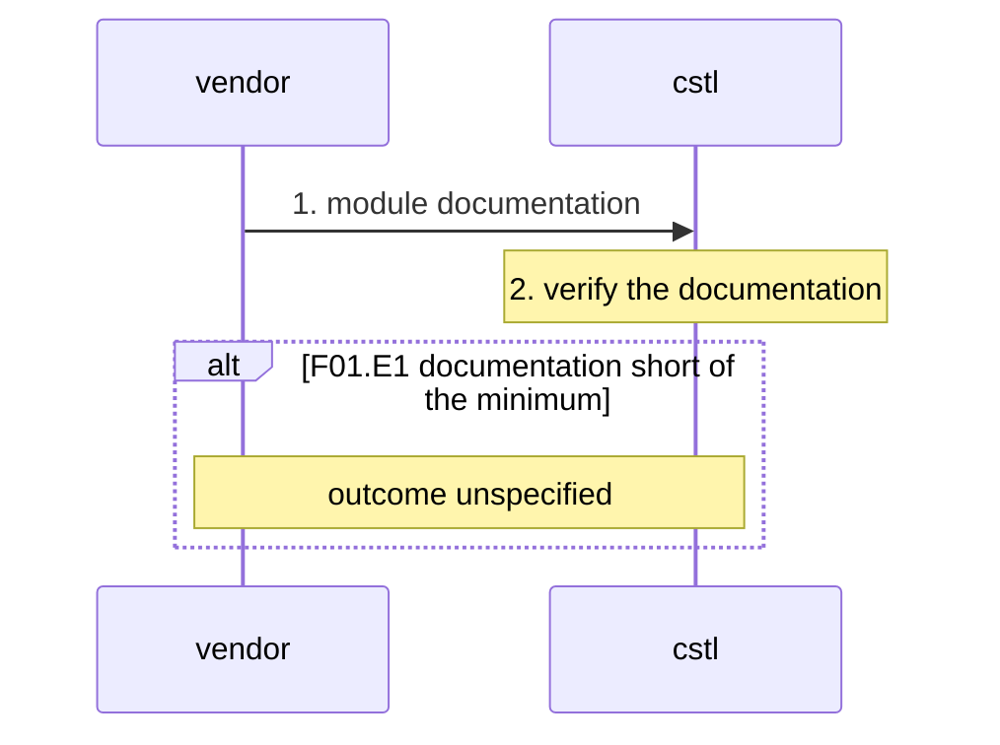

# NIST SP 800-140A (CMVP documentation requirements): protocol model

The machine-readable model is `protocol.yaml` (3 roles, 1 flow, 2 steps, 2 stated and 0 inferred; source ambiguities SA-01 to SA-05). There is no `state-machine.yaml`: the document defines no state or lifecycle; ASA.01 is one documentation requirement (see `protocol.yaml` state_machine_na). Every quotation below is a marker rendered from `.cache/nist-sp-800-140a.txt` by `bin/check-quotes --render`; nothing between the markers was typed. Counts in this paragraph were computed by the generator on 2026-11-15.

## What kind of protocol this is

One documentation hand-off from vendor to laboratory, with the CMVP's additions to ISO/IEC 19790 Annex A:

<!-- q L178-180 "This document specifies" .. "to demonstrate conformity." -->
> This document specifies any additional requirements specified by the Cryptographic Module Validation Program (CMVP) for evidence that vendors provide to a Cryptographic and Security Testing Laboratory (CSTL) to demonstrate conformity.

## Roles

| role | who | source | kind |
|---|---|---|---|
| vendor | Provides the module documentation to the laboratory. | §1, §5.1, §6.1 | stated |
| cstl | The Cryptographic and Security Testing Laboratory; its tester verifies the documentation. | §1, §6.1 | stated |
| cmvp | The validation authority whose additional documentation requirements this document states. | §1 | stated |

## F01 documentation-evidence (§1, §5.1, §6.1)

The vendor's module documentation and the tester's check of it (ASA.01, all levels).

For a module going through an independent verification scheme, the vendor gives the laboratory documentation meeting at least the minimum documentation requirements, and the tester checks that it does. The yardstick, the validation authority requirement and management documentation, is not identified (SA-01).

<!-- q L266-268 -->
> VEA.01.02: The vendor shall provide documentation for a cryptographic module that fulfils but is not limited to the minimum documentation requirements as specified in the validation authority requirement and management documentation.

<!-- q L272-274 -->
> TEA.01.02: The tester shall verify that the vendor provides documentation for a cryptographic module that fulfils but is not limited to the minimum documentation requirements as specified in the validation authority requirement and management documentation.

Requirements: nist-sp-800-140a#R-0001, nist-sp-800-140a#R-0003, nist-sp-800-140a#R-0004, nist-sp-800-140a#R-0005.

Error paths:

- F01.E1 (step 2, inferred): The documentation does not meet the minimum requirements. Outcome: unspecified by source

## Source ambiguities

Recorded for the design notes; each is also in `protocol.yaml` with its quotations.

- **SA-01** (§6.1 VEA.01.02, TEA.01.02). Both measure the documentation against the validation authority requirement and management documentation, which this document neither names nor locates.
- **SA-02** (§5.1, §6.1). The lead-in names ISO/IEC 24759 twice and the first reference is garbled; ISO/IEC 19790 Annex A is probably meant for one of them, as §5.1 has it.
- **SA-03** (front matter). The abstract places the CMVP's authority to modify VEs and TEs in paragraph 5.2 of ISO/IEC 19790; SP 800-140's abstract places it in paragraph 5.2 of ISO/IEC 24759 (cross-record).
- **SA-04** (§6.1 ASA.01). ASA.01 uses braces two ways: the first pair substitutes the annex's name for This annex, the second marks the clause another assertion tests (ISO/IEC 24759 notation).
- **SA-05** (§5.2). The rendering keeps no underline or strikethrough, so whether VEA.01.02 and TEA.01.02 are new or edited ISO/IEC 24759 text cannot be told from it.
