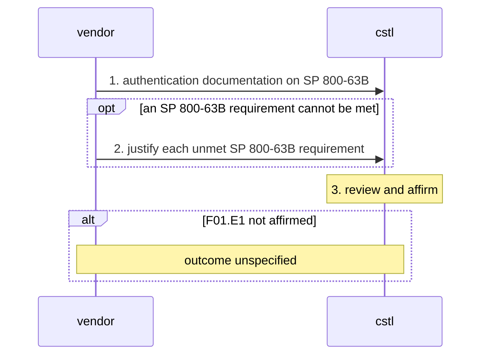
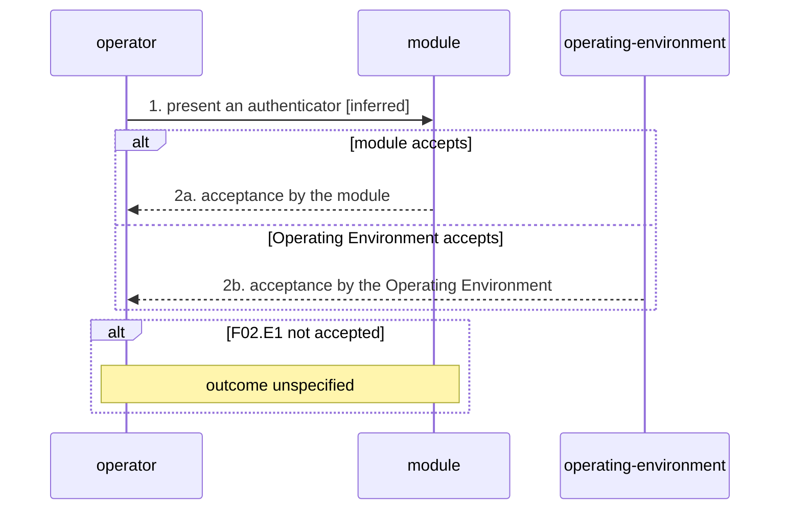

# NIST SP 800-140E (CMVP approved authentication mechanisms): protocol model

The machine-readable model is `protocol.yaml` (5 roles, 2 flows, 6 steps, 5 stated and 1 inferred; source ambiguities SA-01 to SA-07). There is no `state-machine.yaml`: the document states no lifecycle; the authenticator lifecycle is SP 800-63B's (see `protocol.yaml` state_machine_na). Every quotation below is a marker rendered from `.cache/nist-sp-800-140e.txt` by `bin/check-quotes --render`; nothing between the markers was typed. Counts in this paragraph were computed by the generator on 2026-11-15.

## What kind of protocol this is

Two exchanges: evidence for the testers, and the operator's authentication to the module.

<!-- q L283-285 "Except at level" .. "in ISO/IEC 19790." -->
> Except at level 1, operator authentication acceptance is required to be performed by the module or by the Operating Environment as defined in ISO/IEC 19790.

<!-- q L324-326 -->
> Vendors should use SP 800-63B as a framework for authentication requirements and should provide justification whenever SP 800-63B requirements cannot be met. Testers should review and affirm the vendor documentation.

## Roles

| role | who | source | kind |
|---|---|---|---|
| vendor | Frames the module's authentication on SP 800-63B and justifies each departure. | §6.2 | stated |
| cstl | The testers, who review and affirm the vendor documentation. | §6.2 | stated |
| operator | Whoever the authentication mechanisms authenticate. | §6.1 | stated |
| module | The cryptographic module, which may perform authentication acceptance. | §6.2 | stated |
| operating-environment | The Operating Environment as ISO/IEC 19790 defines it, the alternative party for acceptance. | §6.2 | stated |

## F01 authentication-evidence (§6.2)

Vendor documentation on an SP 800-63B frame, reviewed and affirmed by the testers.

The vendor documents the module's authentication using SP 800-63B as the framework, justifying every SP 800-63B requirement it cannot meet; sections 5, 6 and 7 of SP 800-63B are named normative and 8 and 10 informative but to be assessed for each authenticator; the testers review and affirm the documentation.

<!-- q L327-330 -->
> Normative SP 800-63B sections include ● Section 5, Detailed requirements specific to each type of authenticator; ● Section 6, Lifecycle management; ● Section 7, Session Management;

Requirements: nist-sp-800-140e#R-0006, nist-sp-800-140e#R-0007.

Error paths:

- F01.E1 (step 3, inferred): The testers cannot affirm the documentation, or a departure has no justification. Outcome: unspecified by source

## F02 operator-authentication (§6.1, §6.2, Table 1)

Operator authentication with a mechanism Table 1 permits, accepted by the module or its Operating Environment.

No mechanism is approved; Table 1's allowed mechanisms may be used at each security level. Except at level 1, the module or the Operating Environment performs authentication acceptance. Level 1 needs none (it may be implicit) but, if used, should meet level 2 as a minimum. A mechanism also used to set up a module-provided protected communication service must meet the strength requirements of SP 800-140C and 800-140D. The authentication exchange itself is SP 800-63B's, not described here.

<!-- q L304-318 -->
> Level 3 • Memorized Secret; • Look-Up Secret; • Out-of-Band; • Single-Factor One Time Password (OTP) Device; • Multi-Factor OTP Device; • Single-Factor Crypto Software; • Single-Factor Crypto Device; • Multi-Factor Crypto Software; • Multi-Factor Crypto Device

<!-- q L321-322 -->
> Level 4 • Multi-Factor Crypto Software; • Multi-Factor Crypto Device

Table 1 by level (`protocol.yaml` permitted_mechanisms):

| level | permitted | ids |
|---|---|---|
| 1 | none required, may be implicit; if used, at least what level 2 requires | nist-sp-800-140e#R-0004, nist-sp-800-140e#R-0005 |
| 2 | a memorized secret or a level 3 mechanism | none (keyword-less row) |
| 3 | memorized secret, look-up secret, out-of-band, single- or multi-factor OTP device, single- or multi-factor crypto software or device | none (keyword-less row) |
| 4 | multi-factor crypto software or multi-factor crypto device | none (keyword-less row) |

Requirements: nist-sp-800-140e#R-0002, nist-sp-800-140e#R-0003, nist-sp-800-140e#R-0004, nist-sp-800-140e#R-0005.

Error paths:

- F02.E1 (step 2a, 2b, inferred): Authentication is not accepted. Outcome: unspecified by source

## Source ambiguities

Recorded for the design notes; each is also in `protocol.yaml` with its quotations.

- **SA-01** (§5.1, §6.2). §5.1 calls SP 800-63B an informative reference for module authentication; §6.2 then names three of its sections normative.
- **SA-02** (§6.1, §6.2). §6.1 says the document holds all requirements for CMVP-approved authentication mechanisms; §6.2 says none is currently approved and only allowed mechanisms may be used.
- **SA-03** (§1). The scope says the approved SSP generation and establishment methods of this document supersede ISO/IEC 19790 Annex E; this document is about authentication mechanisms, so the sentence reads as carried over from SP 800-140D's scope.
- **SA-04** (title page, §5.2). ISO/IEC 24579 is printed for ISO/IEC 24759 on the inner title page and in §5.2.
- **SA-05** (§3, §4). Rate Limiting, FMR and PAD are defined (§3, §4) and occur nowhere else in the document; whatever obligation they carry comes only through the SP 800-63B sections §6.2 names.
- **SA-06** (§6.2 Table 1). The level 2 row reads memorized secret or a level 3 mechanism, with the row label printed between the cell's lines; and level 1's advice to meet level 2 makes a level 1 mechanism, when present, at least a memorized secret.
- **SA-07** (§6.2). For the requirements lane, as pass 1 found them: the skeleton's requirement for L282-290 carried the page number at L286 and Table 1's caption (the pass-1 reader kept that page number as prose), and Table 1's level 2 to 4 rows and the SP 800-63B section lists were captured neither as requirements nor as candidates. Resolved: 63d708e drops the page number and R-0003 was re-cut without it (its children R-0012 and R-0013 are the two sentences); the rows are R-0026, R-0031 and R-0041, and the section lists R-0044 and R-0048 with their bullets.
