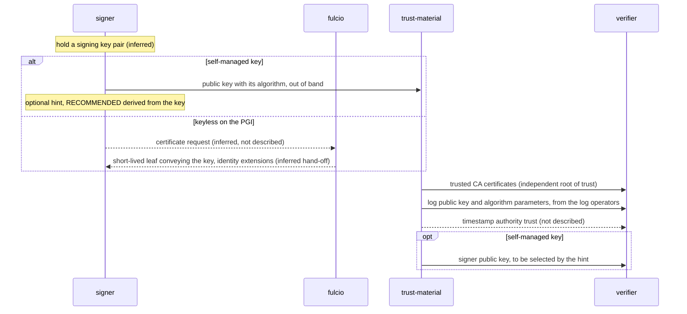
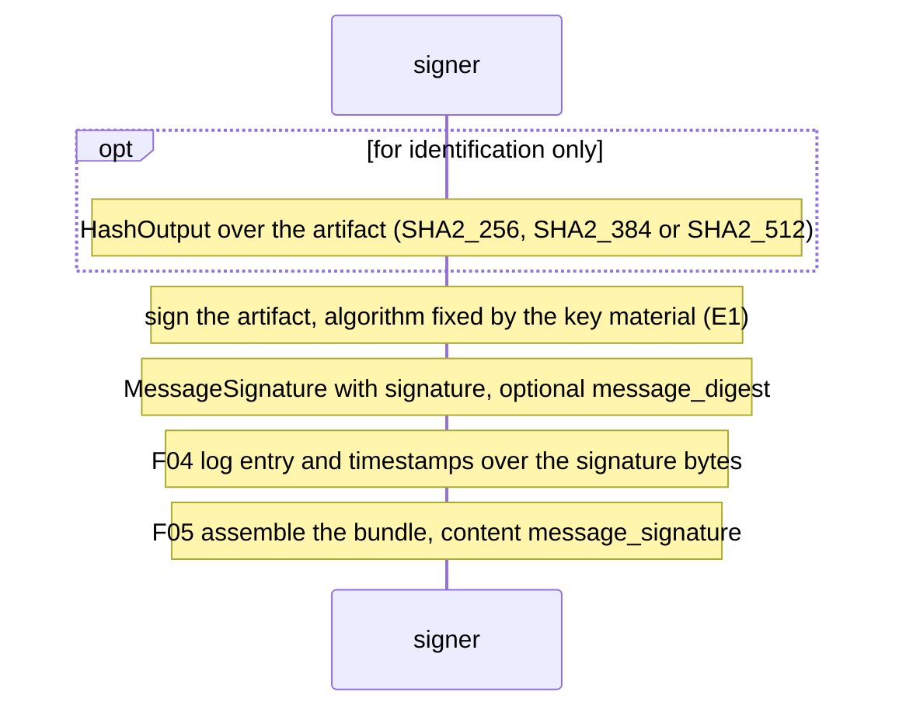
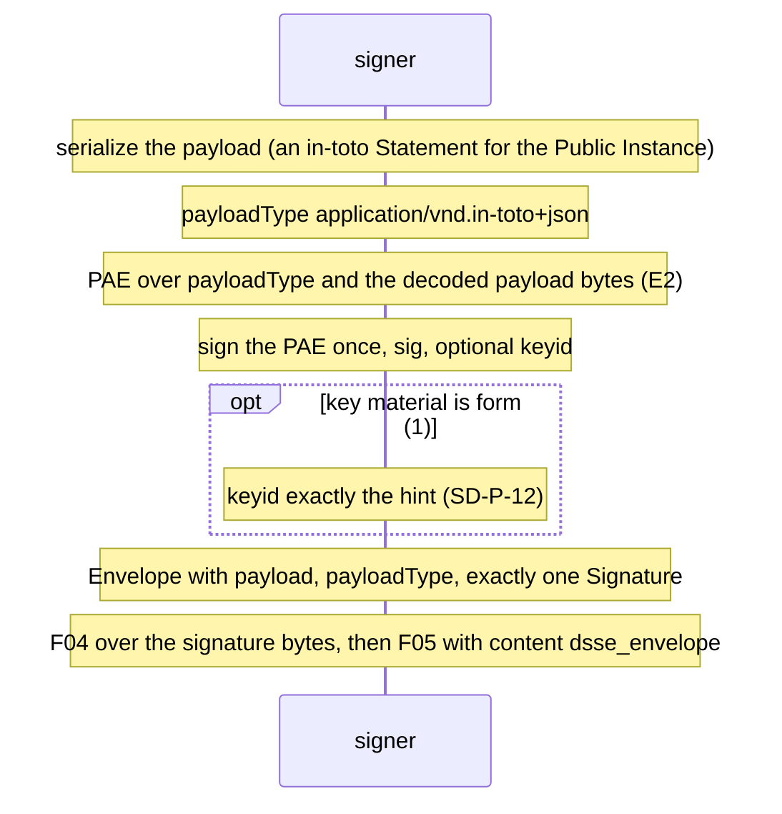
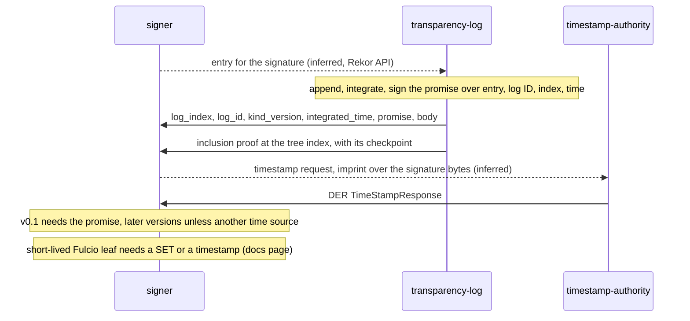
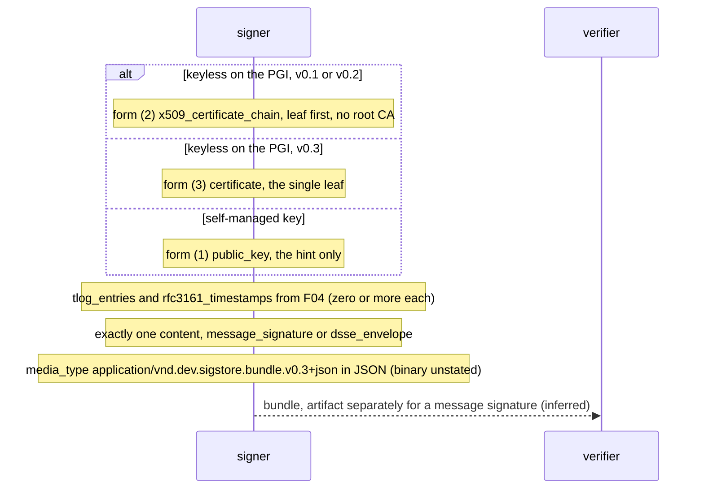
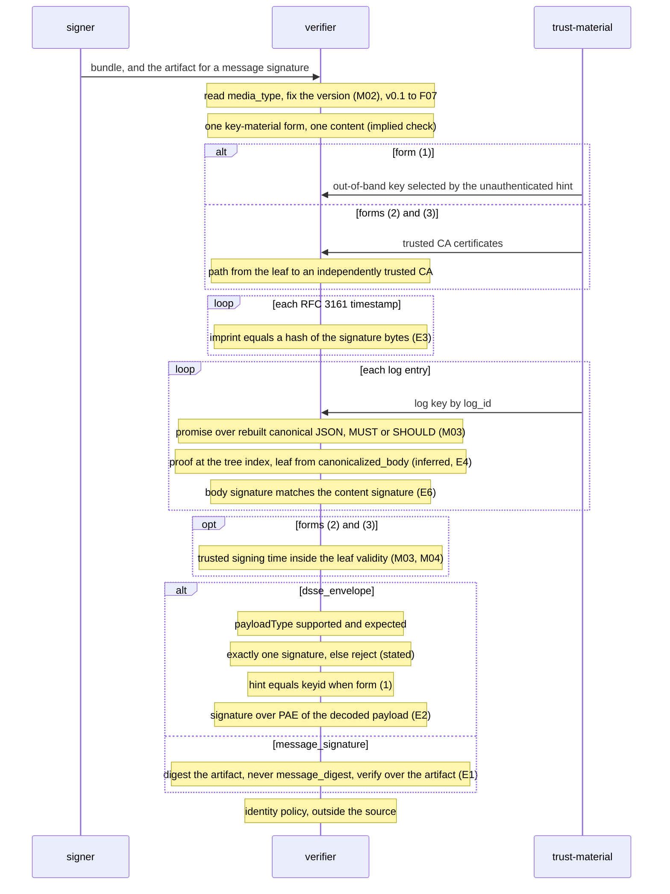
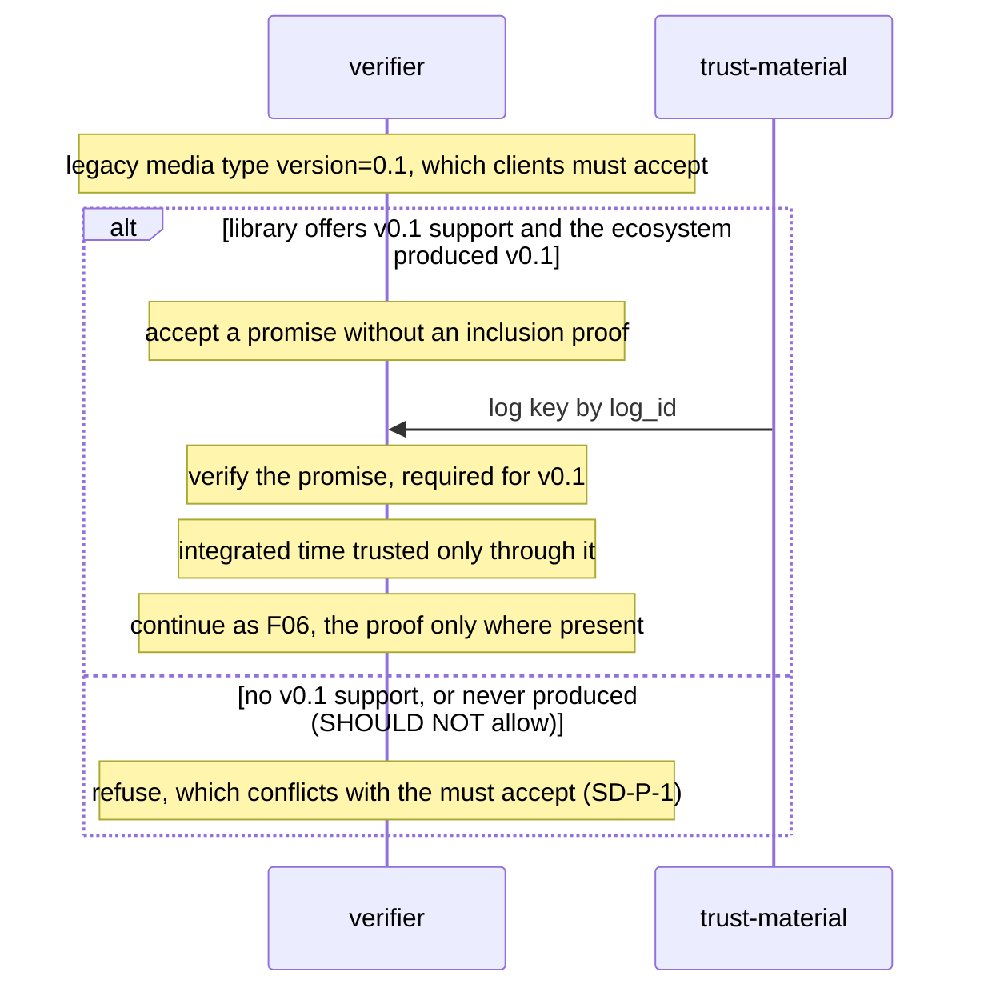
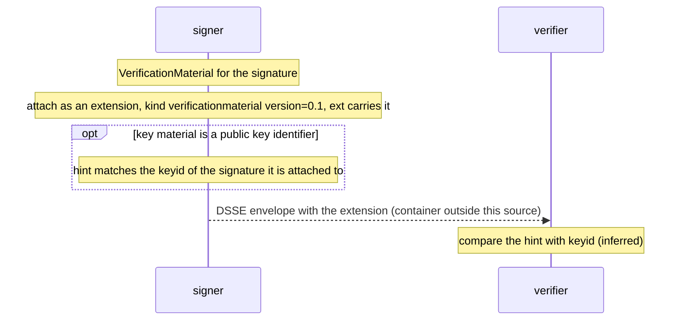

# Sigstore Bundle v0.3: protocol model

`protocol.yaml` is the machine-readable model: 6 roles, 8 flows, 67 steps
(16 of them inferred), 20 error paths, two findings (OF-01, OF-02), seven evidence
items over the source's own examples (E1 to E7), source defects SD-P-1 to SD-P-12 and open issues
OI-01 to OI-08. `state-machine.yaml` holds four machines (M01 to M04) and the evaluation of every guard
set over all its inputs. Every quotation here is a marker rendered from `.cache/sigstore-bundle-0-3.txt`
by `bin/check-quotes --render`, and nothing between the markers was typed. Requirement ids were emitted
by script from `requirements.yaml`, by source lines and a phrase of the text, and every pair was read.

## What kind of protocol this is

The bundle is a data format. Its comments, though, give duties to named parties and imply an
end-to-end model, and its docs page defines it by what it is for:

<!-- q L893-894 -->
> A Sigstore bundle is everything required to verify a signature on an artifact. This is satisfied by the **Verification Material** and signature **Content**.

Read literally that is not true of any form: trust material always comes from outside the bundle,
and with form (1) the key does too. The model has three sides. A **signer** obtains key material,
signs an artifact or a DSSE payload, has the signature logged and timestamped, and assembles the
bundle. A **verifier** later checks the bundle against material it holds independently. The
**transparency log**, **Fulcio** and a **timestamp authority** contribute evidence whose exchanges the
source describes only by their results.

Counted over the 1189 lines as whole words, case-insensitively: exchange, request, send, receive,
server, party, role, error, fail, failure, invalid, step and steps occur 0 times; reject once (L182);
response three times, each Rekor's (the entry built from it, the promise's name in it, its body field); protocol twice,
both to defer to DSSE's. Eight flows: F01 key material, F02 and F03 the two kinds of content, F04 the
log and the timestamps, F05 assembly, F06 verification, F07 the v0.1 path, F08 the DSSE signature
extension. Where the source defers (the Sigstore client spec for the time check, the DSSE protocol,
Rekor, RFC 3161, the trust root) the step is opaque and the deferral is named.

## Roles

| role | who | kind | source |
|---|---|---|---|
| signer | holds the key, signs, obtains log entry and timestamps, assembles the bundle; the source never separates signer from assembler | stated | §1.2 L91, §1.1 L56, §5 L884-885 |
| fulcio | issues the short-lived leaf for keyless signing on the Public Good Instance; issuance not described | stated | §1.2 L104-105, §5.1.1 L898, L904-905 |
| transparency-log | Rekor: appends the entry, signs the promise, returns proof and checkpoint; its key comes from its operators out of band | stated | §4.3 L746, §4.4 L781-788, §4.5 L800-802 |
| timestamp-authority | issues RFC 3161 timestamps over the signature; the source names only its product | inferred | §1.1 L50-56, §3.6 L511 |
| verifier | verifier, Verifiers, client, clients and Client verification libraries: one role | stated | §1.1, §1.2, §1.3, §3.4, §4.2-§4.5 |
| trust-material | trusted CA certificates, out-of-band keys, the log's key: a source of material, not a party | inferred | §1.2 L85, L92-93, §4.4 L787-788, §3.15 L643-644 |

## Reading the diagrams

A solid arrow is a hand-off the source states or implies by what comes back; a dashed arrow is one
the model infers, labelled. A note is a local step. `alt` blocks are the source's alternatives, `opt`
a step that applies only under a condition, `loop` a step done once per timestamp or log entry. Error
paths are drawn where the source names a branch and are listed in full below.

## F01 establish-key-material (§1.2, §3.4, §3.8, §4.4, §5.1.1)

Two ways to sign. With a self-managed key the public key and its algorithm reach verifiers out of
band (sigstore-bundle-0-3#R-0114, sigstore-bundle-0-3#R-0115), the bundle names it only by a hint whose format the two sides
agree (sigstore-bundle-0-3#R-0122), and the key itself is never embedded (sigstore-bundle-0-3#R-0172).

<!-- q L486-487 -->
> When using a key pair, the algorithm MUST be part of the public key, which MUST be communicated out-of-band.

Keyless signing on the Public Good Instance uses a short-lived Fulcio leaf that conveys the signing
key and carries identity extensions (sigstore-bundle-0-3#R-0169); the issuance exchange is not described, so
F01.4 and F01.5 are inferred. The instance decides which forms are open:

<!-- q L104-106 "When used with the Public Good Instance" .. "self-managed keys." -->
> When used with the Public Good Instance (PGI) of Sigstore for "keyless" signing via Fulcio, form (1) MUST NOT be used, regardless of bundle version. Form (1) MAY be used with the PGI for self-managed keys.

The verifier holds, independently of any bundle, the CA certificates it trusts (sigstore-bundle-0-3#R-0008),
each log's key with its algorithm parameters from the log's operators (sigstore-bundle-0-3#R-0149), and for a
self-managed key the signer's public key (sigstore-bundle-0-3#R-0075). What it needs to trust an RFC 3161 timestamp is
never said (SD-P-10), and no imported proto defines a trust root.

## F02 produce-message-signature-bundle (§3.3, §3.4, §5.1.2.1)

The signer may digest the artifact, for identification only (sigstore-bundle-0-3#R-0110,
sigstore-bundle-0-3#R-0179), and signs with the algorithm the key material fixes (sigstore-bundle-0-3#R-0112).
What is signed is worded three ways:

<!-- q L470 -->
> MessageSignature stores the computed signature over a message.

<!-- q L989-990 "It must be one of" .. "for attestations." -->
> It must be one of **Message Signature** over an artifact hash or a **DSSE** envelope for attestations.

<!-- q L994 "This is a computed signature" .. "arifact hash)." -->
> This is a computed signature over a message (typically an arifact hash).

The example shows which reading it follows (E1). Its signature verifies as ECDSA P-256 with SHA-256
over the artifact, with the printed digest as the prehash, and does not verify as a signature over the
32 digest bytes: in the example, over an artifact hash is the algorithm's own hashing of the artifact.
The wording stays open for a signer who reads it otherwise (the requirements lane's SD-R-15). A
verifier digests the artifact itself and never verifies against the bundle's digest:

<!-- q L475-476 -->
> Clients MUST NOT attempt to use this digest to verify the associated signature; it is intended solely for identification.

The signature then goes through F04 and F05 with `message_signature` as the content.

## F03 produce-dsse-bundle (§1.3, §2.1, §2.2, §5.1.2.2)

The payload, for the Public Instance an in-toto Statement with `payloadType`
`application/vnd.in-toto+json` (sigstore-bundle-0-3#R-0181), is signed once over PAE:

<!-- q L240 -->
> PAE(type, payload) = "DSSEv1" + SP + LEN(type) + SP + type + SP + LEN(payload) + SP + payload

The example's signature verifies over PAE of the decoded payload bytes, and not over the base64 text
or the bare payload (E2), as sigstore-bundle-0-3#R-0189 infers. A bundle allows one signature where DSSE allows
several:

<!-- q L176 -->
> DSSE envelopes in a bundle MUST have exactly one signature.

`keyid` is optional in DSSE (sigstore-bundle-0-3#R-0032), but when the key material is a public key identifier
the two hints must be equal, which makes `keyid` mandatory in effect (SD-P-12):

<!-- q L160-163 -->
> If the verification material contains a public key identifier (key hint) and the `content` is a DSSE envelope, the key hints MUST be exactly the same in the verification material and in the DSSE envelope.

## F04 log-and-timestamp (§1.1, §3.5, §3.6, §4.1-§4.5, §5.1.1)

Both kinds of evidence are over the signature. The log appends an entry and returns what a
`TransparencyLogEntry` is built from; submission is not described (F04.1 is inferred), and the
examples' bodies show what was submitted (E6). Two indexes come back: the global one used to query
the log (sigstore-bundle-0-3#R-0151) and the entry's index in its tree (sigstore-bundle-0-3#R-0140). The
proof verifies at the tree index only, with the leaf hash computed over `canonicalized_body` (E4),
which the source never says (SD-P-3):

<!-- q L767-768 -->
> The root hash is available separately in this message, and the leaf hash should be calculated by the client.

The checkpoint carries the tree size and root hash the proof was computed against (E5); the DSSE
example's checkpoint shows the optional data a client must not assume (sigstore-bundle-0-3#R-0135).
Timestamps hash the signature bytes; in the DSSE example the imprint is SHA-256 of the raw signature,
not of its base64 text, the PAE or the payload (E3):

<!-- q L59-60 -->
> Clients MUST verify the hashed message in the message imprint against the signature in the bundle.

Neither kind of evidence is required by the format, but time evidence is required in practice. The
promise's own comment sets the rules, and the docs page adds one for short-lived certificates:

<!-- q L831-837 -->
> The inclusion promise/signed entry timestamp from the log. Required for v0.1 bundles, and MUST be verified. Optional for >= v0.2 bundles if another suitable source of time is present (such as another source of signed time, or the current system time for long-lived certificates). MUST be verified if no other suitable source of time is present, and SHOULD be verified otherwise.

<!-- q L898 "When using short lived Fulcio certificates" .. "validity window." -->
> When using short lived Fulcio certificates where verification may occur after the certificate has expired, bundles must include at least one transparency log's signed entry timestamp or an [RFC3161](https://www.ietf.org/rfc/rfc3161.txt) timestamp to provide proof that signing occurred during the certificates validity window.

Suitable is never defined beyond its two examples, and long-lived has no threshold (SD-P-7). An
integrated time without a promise is not trusted (sigstore-bundle-0-3#R-0062).

## F05 assemble-bundle (§1, §1.2, §1.3, §3.12, §3.15, §5.1.1.1)

One key-material form, chosen by instance and version:

<!-- q L108-112 -->
> When used in a `0.1` or `0.2` bundle with the PGI and "keyless" signing, form (2) MUST be used. When used in a `0.3` bundle with the PGI and "keyless" signing, form (3) MUST be used.

Form (2) carries the leaf first and the rest in issuing order (sigstore-bundle-0-3#R-0005, sigstore-bundle-0-3#R-0006), and
keeps out what a verifier already trusts:

<!-- q L91-93 -->
> Signers MUST NOT include root CA certificates in bundles, and SHOULD NOT include intermediate CA certificates that appear in an independent root of trust (such as the Public Good Instance's trusted root).

Then the log entries and timestamps from F04, exactly one content member (sigstore-bundle-0-3#R-0087,
sigstore-bundle-0-3#R-0183), and the media type. Its value is given for JSON only; a bundle in the protobuf binary
encoding has none (SD-P-2):

<!-- q L145-146 -->
> MUST be application/vnd.dev.sigstore.bundle.v0.3+json when when encoded as JSON.

The source's DSSE example is a v0.3 bundle with form (2), its leaf issued by a mock CA and its log
at localhost:8000, yet it is introduced as from the public infrastructure (SD-P-6). Distribution is
not described (F05.9 is inferred); the artifact of a message signature travels separately.

## F06 verify-bundle (§1.1-§1.3, §2, §3.4, §3.8, §4.2-§4.5, §5.1.1, §5.1.2)

The source orders none of these checks (OF-01); the model orders them by data dependency. The version
comes first because it selects the rules (sigstore-bundle-0-3#R-0191): four media types are accepted, and
v0.1 goes to F07 (M02). Structure checks are implied rather than stated, since the REQUIRED
annotations bind the producer (sigstore-bundle-0-3#R-0184). The key is the out-of-band key the hint selects, or
the leaf's, validated to an independently trusted CA:

<!-- q L95-99 -->
> Verifiers MUST validate the chain carefully to ensure that it chains up to a CA certificate that they independently trust. Verifiers SHOULD handle old or non-complying bundles that have superfluous intermediate and/or root CA certificates by either ignoring them or explicitly considering them untrusted for the purposes of chain building.

Each timestamp's imprint must match the signature (sigstore-bundle-0-3#R-0003); each promise must be verified when
no other suitable time source exists and should be otherwise (sigstore-bundle-0-3#R-0157, sigstore-bundle-0-3#R-0158), the
verifier rebuilding the signed canonical JSON itself (OF-02); each proof is checked although no
sentence requires it (sigstore-bundle-0-3#R-0195); and the body's signature must match the content's:

<!-- q L860-862 -->
> If set, clients MUST verify that the signature referenced in the `canonicalized_body` matches the signature provided in the `Bundle.content`.

Matches is not defined across entry kinds: the hashedrekord body carries the same base64 string as
the bundle, the intoto body the base64 of that text (E6, SD-P-4). Then the time check, deferred to a
Google Doc (SD-P-9):

<!-- q L155-158 -->
> When a signer is identified by a X.509 certificate, a verifier MUST verify that the signature was computed at the time the certificate was valid as described in the Sigstore client spec: "Verification using a Bundle".

The DSSE example's integrated time and timestamp both equal its leaf's notBefore (E7), and the source
does not say whether the window includes its ends (SD-P-5, M04). Last, the content. For a DSSE
envelope the payload type must be supported and expected, the hints must agree where form (1) is
used, and the one stated rejection applies:

<!-- q L172-173 "Verifiers must verify" .. "expected type." -->
> Verifiers must verify that the payload type is a supported and expected type.

<!-- q L182-183 -->
> During verification a client MUST reject an envelope if the number of signatures is not equal to one.

Then the signature over PAE (E2), or, for a message signature, over the artifact the verifier digests
itself (E1). Identity policy over the Fulcio extensions is the client spec's (F06.17).

## F07 verify-v0.1-bundle (§1.2, §1.3, §4.5)

The legacy v0.1 media type is one clients must be able to accept:

<!-- q L147-151 -->
> Clients must to be able to accept media type using the previously defined formats: * application/vnd.dev.sigstore.bundle+json;version=0.1 * application/vnd.dev.sigstore.bundle+json;version=0.2 * application/vnd.dev.sigstore.bundle+json;version=0.3

VerificationMaterial's comment on its log entries makes v0.1 support optional, and discouraged where it was never produced:

<!-- q L125-130 -->
> Client verification libraries MAY provide an option to support v0.1 bundles for backwards compatibility, which may contain an inclusion promise and not an inclusion proof. In this case, the client MUST validate the promise. Verifiers SHOULD NOT allow v0.1 bundles if they're used in an ecosystem which never produced them.

For a v0.1 bundle in an ecosystem that never produced one, or with a library that offers no v0.1
support, both an accepting and a refusing rule apply (SD-P-1; M02 counts the inputs). Where v0.1 is
supported, an entry may carry a promise without a proof (sigstore-bundle-0-3#R-0192), the promise is required
and verified (sigstore-bundle-0-3#R-0154, sigstore-bundle-0-3#R-0155), and keyless PGI bundles carry form (2)
(sigstore-bundle-0-3#R-0013).

## F08 dsse-signature-extension (§1.2)

Outside a bundle, a `VerificationMaterial` may travel as a DSSE signature extension:

<!-- q L69-76 "This message may be embedded" .. "attached to." -->
> This message may be embedded in a DSSE envelope as a signature extension. Specifically, the `ext` field of the extension will expect this message when the signature extension is for Sigstore. This is identified by the `kind` field in the extension, which must be set to application/vnd.dev.sigstore.verificationmaterial;version=0.1 for Sigstore. When used as a DSSE extension, if the `public_key` field is used to indicate the key identifier, it MUST match the `keyid` field of the signature the extension is attached to.

The `envelope.proto` this source copies gives a signature only `sig` and `keyid`, so these protos
cannot express the extension; DSSE's extension container is outside the source (the requirements
lane's SD-R-7). The in-bundle counterpart of the hint rule is sigstore-bundle-0-3#R-0086.

## Error paths

| path | condition | steps | basis |
|---|---|---|---|
| EP-01 | media_type is none of the four values the source names (empty, misspelt, or a v0.1 or v0.2 value in the current spelling, which the source never defines). | F06.2 | unspecified |
| EP-02 | A legacy v0.1 bundle reaches a verifier whose library offers no v0.1 support, or whose ecosystem never produced v0.1 bundles. | F07.2 | stated |
| EP-03 | verification_material is missing, the key material or the content holds no member (or a JSON bundle names two), or another REQUIRED field is unset. | F05.7, F06.3 | unspecified |
| EP-04 | The key-material form does not match version and instance (a keyless PGI v0.3 bundle with form (2), for one). | F05.1, F06.4, F07.5 | unspecified |
| EP-05 | Form (1): no held key matches the hint. | F01.9, F06.5 | unspecified |
| EP-06 | Forms (2) and (3): the leaf does not chain to a CA certificate the verifier independently trusts. | F06.6 | inferred |
| EP-07 | Form (2): the chain carries root or redundant intermediate CA certificates (an old or non-complying bundle). | F05.3, F06.6 | stated |
| EP-08 | An RFC 3161 timestamp's imprint does not match the signature, or its own signature or authority cannot be trusted. | F06.7 | unspecified |
| EP-09 | An inclusion promise does not verify. | F06.8, F07.4 | inferred |
| EP-10 | An entry carries no inclusion promise. | F04.9, F06.8, F07.4 | stated |
| EP-11 | An inclusion proof does not verify, or its checkpoint's signature fails, or the checkpoint's size or root differs from the proof's. | F06.9 | unspecified |
| EP-12 | The signature canonicalized_body references does not match the bundle content's signature. | F06.10 | inferred |
| EP-13 | Forms (2) and (3): no trusted signing time exists, or the trusted time lies outside the leaf's validity. | F04.9, F06.11 | inferred |
| EP-14 | DSSE: payloadType is not a supported and expected type. | F06.12 | inferred |
| EP-15 | DSSE: the envelope holds zero signatures, or more than one. | F03.6, F06.13 | stated |
| EP-16 | DSSE with form (1): the hint and the signature's keyid differ, or keyid is empty or absent. | F03.5, F06.14, F08.4 | inferred |
| EP-17 | The content's signature does not verify with the resolved key. | F06.15, F06.16 | inferred |
| EP-18 | Message signature: the artifact is not provided at verification time. | F06.1, F06.16 | stated |
| EP-19 | The signer has no suitable time evidence for a short-lived certificate (no promise, no timestamp). | F04.9 | inferred |
| EP-20 | VerificationMaterial is to be carried as a DSSE signature extension. | F08.2 | unspecified |

The source states an outcome for 5 of them; the only rejection it names is EP-15. Error,
fail, failure and invalid occur 0 times in the source (SD-P-11).

## Order of checks, and canonicalization by the verifier

**OF-01.** Nothing in the source orders a verifier's checks, and nothing says the signature is to be
verified before the payload is parsed. What the data fixes: the DSSE signature covers PAE over the
decoded payload bytes (E2), so verifying it needs the payload base64-decoded out of the JSON but not
parsed; the payload-type check reads `payloadType` only; a message signature has no payload in the
bundle, the verifier digesting the artifact (sigstore-bundle-0-3#R-0180) and never the bundle's
digest (sigstore-bundle-0-3#R-0038). For DSSE the source defers to the DSSE protocol, linked at master
and not included:

<!-- q L173-175 "This is part of the DSSE" .. "protocol.md>" -->
> This is part of the DSSE protocol which is defined here: <https://github.com/secure-systems-lab/dsse/blob/master/protocol.md>

The library holds DSSE as `secure-systems-lab-dsse`, pinned at 1d3370f; its protocol puts
verification before parsing (that record's `normative.md`, P8). That order is DSSE's, not this
source's. mofn's R-O-05 asks a verifier to verify before decoding and not to canonicalize input as
part of verification; this source neither requires nor forbids verify-before-parse for the content,
and its log-entry checks need `canonicalized_body` decoded (F06.10) and canonical JSON built (OF-02).
Recorded, not decided.

**OF-02.** To verify a promise the verifier builds the signed bytes itself:

<!-- q L852-855 "The verifier is responsible" .. "generated over." -->
> The verifier is responsible for combining the `canonicalized_body`, `log_index`, `log_id`, and `integrated_time` into the payload that the SET's signature is generated over.

<!-- q L863-864 -->
> If not set, clients are responsible for constructing an equivalent payload from other sources to verify the signature.

The field that eases this exists because those bytes cannot always be reproduced
(sigstore-bundle-0-3#R-0163). The canonical form is Rekor's, and no promise is verifiable from the source, which
holds no log key.

## Evidence from the examples

Run over the original bytes of `bundle.md`, with nothing from outside the source, and reproduced
by `protocol-evidence.derived.py` (stdlib and `openssl`; it exits 1 if a result differs from
`protocol.yaml`); each check is paired with the alternative reading it rules out.

| item | question | checks | conclusion |
|---|---|---|---|
| E1 | What a message signature covers | 1 true, 1 false | The signature is over the artifact; the digest is only its prehash. Read as a signature over the 32 digest bytes, which over an artifact hash (L990) allows, it does not verify. |
| E2 | What a DSSE signature covers | 3 true, 2 false | PAE over the decoded payload bytes, as sigstore-bundle-0-3#R-0189 infers; the bundle's DSSE rule of one signature holds. |
| E3 | What an RFC 3161 imprint hashes | 1 true, 3 false | The imprint hashes the raw signature bytes, as sigstore-bundle-0-3#R-0190 infers. genTime is 2023-02-01T00:00:00Z. |
| E4 | What the inclusion proof's leaf is, and which index it uses | 2 true, 2 false | The leaf is the RFC 6962 leaf hash of canonicalized_body, at InclusionProof.log_index, the index in the tree. The source says neither (SD-P-3). |
| E5 | Checkpoints against their proofs | 4 true, 0 false | Size and root agree with the proof in both, as sigstore-bundle-0-3#R-0196 infers; the DSSE checkpoint shows optional data that a client must not assume (L729). |
| E6 | What canonicalized_body references, against the bundle content | 7 true, 1 false | For hashedrekord the referenced signature is the same string; for intoto 0.0.2 it is encoded one more time, so a string comparison fails where a decoded one matches (SD-P-4). |
| E7 | Signing times against the leaves' validity | 3 true, 0 false | Both leaves are valid for 600 seconds. The message-signature example signs 2 seconds into the window; both of the DSSE example's times sit exactly on notBefore, so a verifier that reads the window as open at its start rejects the source's own example (SD-P-5). The DSSE leaf's issuer is O=sigstore.mock, CN=sigstore, and the message-signature leaf's CN=sigstore-intermediate, O=sigstore.dev; neither leaf has a basicConstraints extension and both have keyUsage digitalSignature. |

Not checked, for want of keys in the source: the promises, the checkpoint signatures, the timestamp
response's signature and either leaf's chain to a trust root.

## Source defects

This lane's ids; the verify pass unified them with the other lanes' in `normative.md` (Source defects), and each names its SD-n there.

- **SD-P-1** (SD-4 in `normative.md`; contradiction; §1.2 (L125-130), §1.3 (L147-149)). v0.1: clients must accept the media type, but v0.1 support is optional and should not be allowed where it was never produced.
- **SD-P-2** (SD-5 in `normative.md`; gap; §1 (L41-46), §1.3 (L145-146)). The media type of a bundle in the protobuf binary encoding is not given.
- **SD-P-3** (SD-18 in `normative.md`; gap; §4.3 (L764-768), §4.5 (L847-848)). What the inclusion proof's leaf hash is computed over is not said, and the field it needs is optional.
- **SD-P-4** (SD-25 in `normative.md`; gap; §4.5 (L860-862)). matches, between the body's signature and the content's, is not defined across entry kinds.
- **SD-P-5** (SD-27 in `normative.md`; gap; §1.3 (L155-158), §3.7 (L531), §3.16 (L661-662), §5.1.3.2 (L1088, L1102, L1121)). Whether the certificate's validity window includes its ends is not said, and the source's own example signs at its start.
- **SD-P-6** (SD-13 in `normative.md`; contradiction; §5.1.3 (L1027), §5.1.3.2 (L1079-1137), §1.2 (L111-112)). The DSSE example is introduced as from the public infrastructure but is a mock, and carries form (2) in a v0.3 bundle.
- **SD-P-7** (SD-28 in `normative.md`; gap; §4.5 (L833-837), §5.1.1 (L898)). Suitable and long-lived are undefined, and several time sources are not ranked.
- **SD-P-8** (SD-29 in `normative.md`; gap; §4.5 (L826-827, L836-837)). Distrust of the integrated time is tied to omitting the promise, not to failing to verify it.
- **SD-P-9** (SD-21 in `normative.md`; external dependency; §1.3 (L155-159)). The time check is deferred to an unpinned Google Doc.
- **SD-P-10** (SD-30 in `normative.md`; gap; §1.1 (L59-60), §1.2 (L92-93), §3.15 (L643-645), §4.2 (L730-731)). No trust anchor for timestamps or checkpoints, and no trust root in the protos.
- **SD-P-11** (SD-31 in `normative.md`; gap; whole source). Failure outcomes are almost never stated.
- **SD-P-12** (SD-32 in `normative.md`; tension; §1.3 (L160-163), §2.2 (L260-261)). The key-hint equality makes DSSE's optional keyid mandatory whenever a form (1) hint is set.

## State machines

`state-machine.yaml` weighs four candidates and models each. M01 is a verifier's processing of one
bundle, its order the model's. M02 is version acceptance: over its 20 inputs, the stated transitions
alone leave the current v0.3 spelling and unknown media types uncovered and give a v0.1 bundle two
outcomes (SD-P-1). M03 is the choice of signing-time evidence in three decisions over 360 inputs; it
finds the must and should of the promise overlapping harmlessly for v0.1, a present but unverified
promise that no rule decides (SD-P-8) and several unranked time sources (SD-P-7). M04 places the
signing time in the leaf's validity; no stated rule decides its two ends (SD-P-5).

## Open issues

- **OI-01** (§1.3). What makes a payload type expected: the verifier's policy, never described. For the Public Instance the docs page fixes application/vnd.in-toto+json.
- **OI-02** (§1.2). How a verifier knows a bundle is keyless PGI, which the form rules depend on; presumably by the leaf chaining to the PGI's Fulcio root, which the source does not say.
- **OI-03** (§1.1, §1.2, §4.5). How many log entries and timestamps must verify, and whether one that fails fails the bundle or is only discarded. Both are repeated fields; no threshold appears. Source defect SD-P-7.
- **OI-04** (§4.4, §4.5). Which log index the inclusion promise signs. L852-855 names log_index among TransparencyLogEntry's fields, the global index; the promise's description says only log index (L783). Not checkable here: no log key.
- **OI-05** (§4.5). What the current system time proves for a long-lived certificate: that the certificate is valid at verification, not that the signature was made inside the window, if the key existed before the certificate. The source offers it as a suitable time source without saying what it shows.
- **OI-06** (§5.1.1.1.1). The identity policy a verifier applies to the leaf's Fulcio extensions; the client spec's, outside this source.
- **OI-07** (§1.2). The DSSE signature-extension container: DSSE's, outside this source, and absent from the envelope.proto this source copies.
- **OI-08** (whole source). Revocation of a leaf or an intermediate: never mentioned (revoke, revoked and revocation occur 0 times).

## Out of scope

- The DSSE protocol (its verification steps and order, signature extensions): linked at master (L175), not included. Library record secure-systems-lab-dsse. (§1.3 (L171-185), §1.2 (L69-76))
- The Sigstore client specification, Verification using a Bundle: a Google Doc (L159). (§1.3 (L155-159))
- Rekor: its API, entry kinds (hashedrekord, intoto, dsse) and the canonical JSON its promise signs. (§4.1 (L714-715), §4.4 (L781-790), §4.5 (L800-807, L849-858))
- The checkpoint format (transparency-dev formats, C2SP tlog-checkpoint) and Merkle tree hashing (RFC 6962, RFC 9162; library records rfc-6962 and rfc-9162). (§4.2 (L733-736), §4.3 (L744-777))
- RFC 3161: the request, the response's signature and the authority's trust. (§1.1 (L50-62), §3.6 (L505-516))
- RFC 6962's key-ID derivation for the hint, and its Signed Certificate Timestamp, to which the promise is compared. (§3.8 (L550-552), §4.5 (L805-807))
- Fulcio: certificate issuance and its OID extensions (library record sigstore-fulcio-oids). (§1.2 (L104-105), §3.13 (L610-612), §5.1.1.1.1 (L904))
- The trusted root: the PGI's trusted root and the TUF root of trust are named, not defined. (§1.2 (L92-93), §3.15 (L643-645))
- X.509 path validation (RFC 5280; library record rfc-5280), including revocation, which the source never mentions. (§1.2 (L95-99))
- The in-toto Statement in a DSSE payload (library records in-toto-envelope-v1 and in-toto-attestation-v1). (§5.1.2.2 (L1010))
- Matching a certificate's identity: SubjectAlternativeName (§3.14) is defined but not reachable from Bundle. (§3.13, §3.14 (L600-637))
