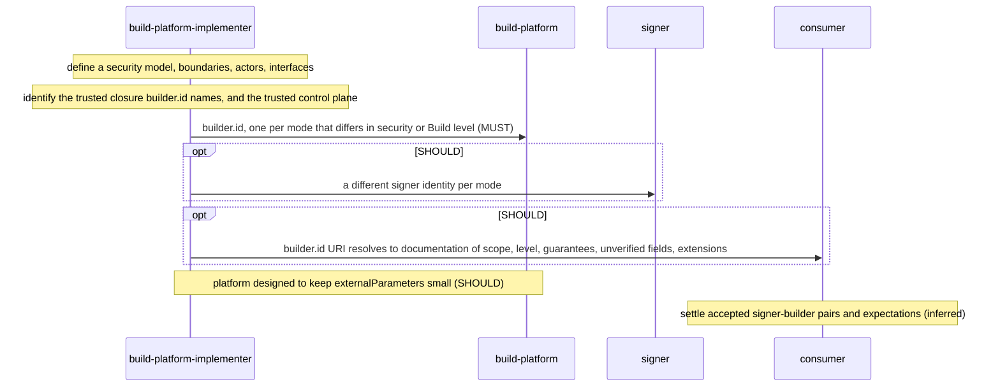
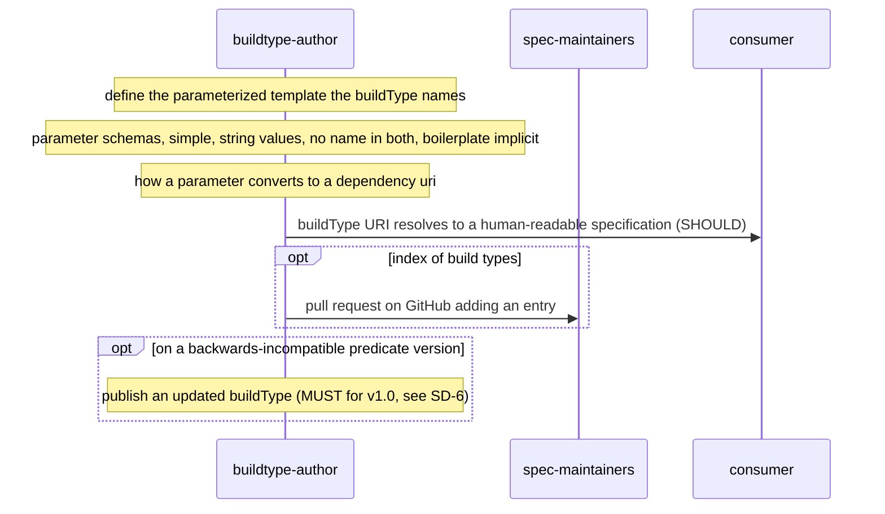
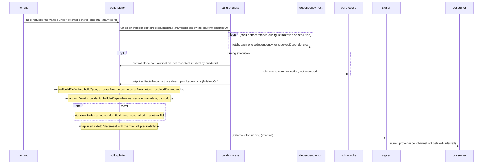
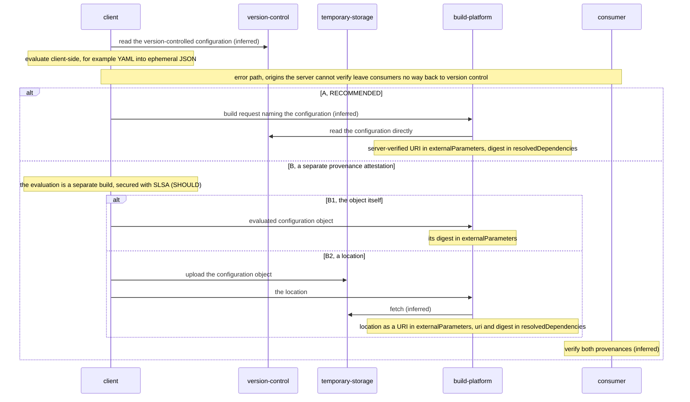
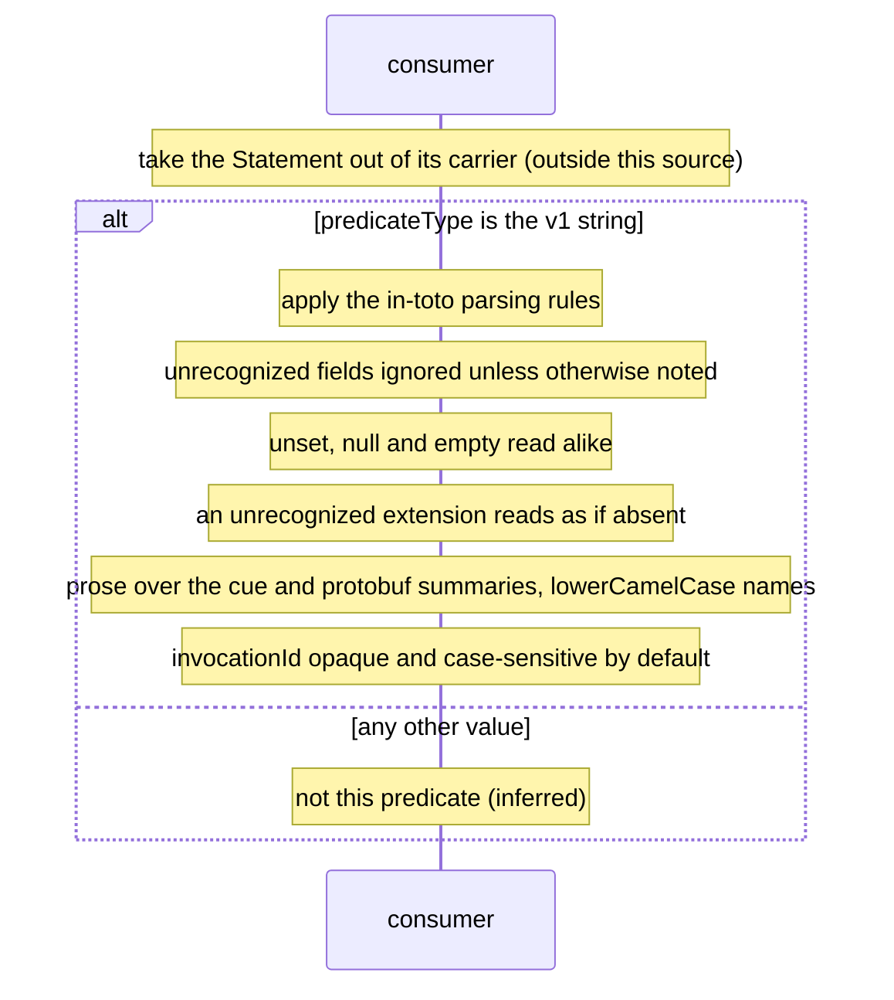
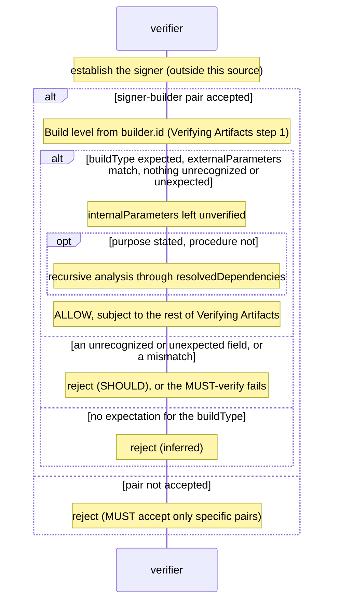
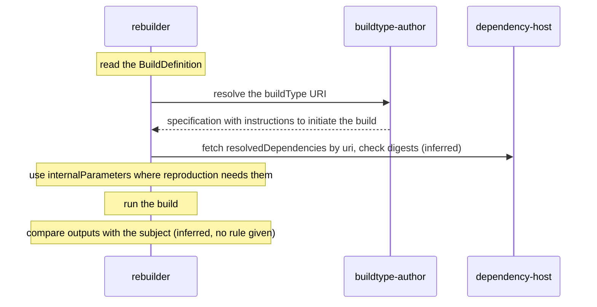
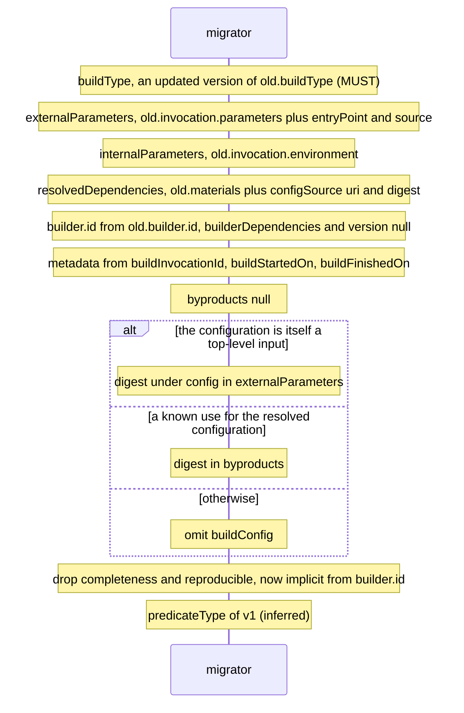
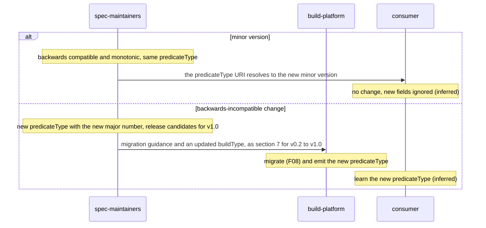

# SLSA Build Provenance v1.2: protocol model

The machine-readable model is `protocol.yaml` (roles, flows F01 to F09, error paths E01 to E13,
source defects SD-4, SD-5 and SD-6 in the canonical numbering of `normative.md`, which pass 1 numbered SD-03, SD-02 and SD-01; open issues OI-01 to OI-12); the lifecycles are
`state-machine.yaml` (M01 to M03). This file is the prose and one sequence diagram per flow. Every
quotation below is a marker rendered from `.cache/slsa-provenance-1-2.txt` by
`bin/check-quotes --render`; nothing between the markers was typed. Requirement ids were emitted
by script from the skeleton ids of `requirements.yaml` and every pair was read back; pass 2 added
the ids the requirements lane appended and regenerated each flow's list from `protocol.yaml`.

## What kind of protocol this is

A data format with a cast. The predicate is one JSON document, but the source says who writes
which part, who reads it, and what each reader must and must not do with what it finds. Nothing
travels over a wire the source defines: there is no request, response, transport, envelope or
signature format, provenance reaches its consumers by means the source never describes, and
verification proper is another page, which §5 only names.

<!-- q L42-43 -->
> Provenance is an attestation that a particular build platform produced a set of software artifacts through execution of the `buildDefinition`.

So the flows fall into setup before any build (F01, F02), the build and what it records (F03, with
the client-side variant F04), what consumers do with the result (F05 parsing, F06 verification, F07
rebuilding), and two that span versions (F08 migration from v0.2, F09 releases).

## Roles

| role | who | source |
|---|---|---|
| build-platform-implementer | designs the platform and its security model | §2 |
| build-platform | the builder: everything trusted to run the build and record provenance, control plane and orchestrator included; the server of §4.3 (same party: this model's reading) | §2, §4.4, §4.5 |
| build-process | the tenant-controlled build (L470's workload, read as the same) | §2, §4.5 |
| build-cache | caches the build may talk to, unrecorded | §2 |
| tenant | starts the build, controls externalParameters | §2, §4.3 |
| client | evaluates configuration before the server sees it | §4.3 |
| version-control | where configuration comes from and is traced back to | §4.3 |
| temporary-storage | where a client may upload evaluated configuration | §4.3 |
| dependency-host | where fetched artifacts come from (role name inferred) | §2, §4.3 |
| signer | signs provenance; distinct from the builder | §4.5 |
| consumer | reads provenance; parsing rules, signer-builder pairs | §1, §3, §4.3, §4.5 |
| verifier | a consumer checking against expectations (relation inferred) | §4.3, §5 |
| rebuilder | the Others of §1 who rebuild | §1, §4.3 |
| buildtype-author | defines and publishes a buildType (role name inferred) | §4.3, §6 |
| spec-maintainers | publish versions, keep the index (role name inferred) | §3, §6, §8 |
| migrator | maps v0.2 provenance onto v1 (role name inferred) | §7 |

One split inside the platform matters for trust: the trusted control plane against the
tenant-controlled build process, whose unverified fields the builder.id documentation is to
list.

<!-- q L463-464 "Any fields that are generated" .. "`subject`." -->
> Any fields that are generated by the tenant-controlled build process and not verified by the trusted control plane, except for the `subject`.

## Reading the diagrams

A solid arrow is an exchange the source names; where it names one without defining its form, the
label says what it carries. A dashed arrow is a reply. A note is a local step. `alt` is the
source's alternatives, `opt` a MAY, a SHOULD or an exchange that need not happen, `loop` a
repetition. Anything this model supplies is labelled inferred. Error paths are drawn where the
source states them and listed in full under Error paths below.

## F01 platform-establishment (§2, §4.3, §4.5)

The implementer models the platform's security first and draws from that model the boundary that
builder.id names. The rule consumers rely on is one id per mode of operation, so that compromising
a weaker mode does not compromise a stronger one; a separate signer identity per mode is only a
SHOULD (OI-12).

<!-- q L453-456 "If a build platform" .. "more secure one." -->
> If a build platform has multiple modes of operations that have differing security attributes or SLSA Build levels, each mode MUST have a different `builder.id` and SHOULD have a different signer identity. This is to minimize the risk that a less secure mode compromises a more secure one.

Behind each builder.id URI sits documentation of what the id covers, including the fields the
control plane does not verify, the subject excepted (OI-05). How consumers learn which
signer-builder pairs to accept is not described; step 7 is inferred. Requirements:

slsa-provenance-1-2#R-0003, slsa-provenance-1-2#R-0004, slsa-provenance-1-2#R-0036,
slsa-provenance-1-2#R-0038, slsa-provenance-1-2#R-0107, slsa-provenance-1-2#R-0109,
slsa-provenance-1-2#R-0110, slsa-provenance-1-2#R-0037, slsa-provenance-1-2#R-0111,
slsa-provenance-1-2#R-0112, slsa-provenance-1-2#R-0113, slsa-provenance-1-2#R-0114,
slsa-provenance-1-2#R-0115, slsa-provenance-1-2#R-0016, slsa-provenance-1-2#R-0039,
slsa-provenance-1-2#R-0017.

## F02 buildtype-definition (§2, §4.3, §6, §7)

The buildType names a parameterized template, often specific to one platform. Its author keeps
the parameters minimal, says how a parameter becomes a dependency uri, and publishes a
human-readable specification at the buildType URI; that document is what a verifier holds
parameters against and what a rebuilder follows. The index of §6 is partial and grows by pull
request. On the v0.2 to v1.0 change the buildType had to be updated, to describe a field that
neither version has (SD-6). Requirements:
slsa-provenance-1-2#R-0055, slsa-provenance-1-2#R-0082, slsa-provenance-1-2#R-0022,
slsa-provenance-1-2#R-0023, slsa-provenance-1-2#R-0027, slsa-provenance-1-2#R-0026,
slsa-provenance-1-2#R-0013, slsa-provenance-1-2#R-0048, slsa-provenance-1-2#R-0134,
slsa-provenance-1-2#R-0135.

<!-- q L283-286 "The URI SHOULD resolve" .. "a complete example." -->
> The URI SHOULD resolve to a human-readable specification that includes: overall description of the build type; schema for `externalParameters` and `internalParameters`; unambiguous instructions for how to initiate the build given this BuildDefinition, and a complete example.

## F03 build-and-provenance-generation (§2, §4.2 to §4.7, front matter)

The main flow. The tenant's inputs become externalParameters, which must be complete at Build L3;
the platform adds internalParameters of its own; everything fetched is a dependency, transitively;
exchanges with the control plane or caches are not recorded and should not shape the build; the
outputs are the subject. The source does not say when the platform records each field, nor which
party computes the subject digests (OI-05), nor what a failed build yields (OI-08). Signing and
delivery are inferred: the source shows signers signing provenance and defines neither.

<!-- q L73-75 "In SLSA, these values are untrusted" .. "verified downstream." -->
> In SLSA, these values are untrusted; they MUST be included in the provenance and MUST be verified downstream.

<!-- q L89-94 "During execution" .. "instead." -->
> During execution, the build process might communicate with the build platform's control plane and/or build caches. This communication is not captured directly in the provenance, but is instead implied by `builder.id` and subject to [SLSA Requirements](requirements.md). Such communication SHOULD NOT influence the definition of the build; if it does, it SHOULD go in `resolvedDependencies` instead.

Requirements:
slsa-provenance-1-2#R-0024, slsa-provenance-1-2#R-0014, slsa-provenance-1-2#R-0015,
slsa-provenance-1-2#R-0057, slsa-provenance-1-2#R-0060, slsa-provenance-1-2#R-0126,
slsa-provenance-1-2#R-0020, slsa-provenance-1-2#R-0063, slsa-provenance-1-2#R-0090,
slsa-provenance-1-2#R-0008, slsa-provenance-1-2#R-0065, slsa-provenance-1-2#R-0068,
slsa-provenance-1-2#R-0128, slsa-provenance-1-2#R-0012, slsa-provenance-1-2#R-0005,
slsa-provenance-1-2#R-0006, slsa-provenance-1-2#R-0007, slsa-provenance-1-2#R-0021,
slsa-provenance-1-2#R-0025, slsa-provenance-1-2#R-0028, slsa-provenance-1-2#R-0011,
slsa-provenance-1-2#R-0032, slsa-provenance-1-2#R-0035, slsa-provenance-1-2#R-0040,
slsa-provenance-1-2#R-0041, slsa-provenance-1-2#R-0042, slsa-provenance-1-2#R-0033,
slsa-provenance-1-2#R-0034, slsa-provenance-1-2#R-0117, slsa-provenance-1-2#R-0043,
slsa-provenance-1-2#R-0044, slsa-provenance-1-2#R-0045, slsa-provenance-1-2#R-0047,
slsa-provenance-1-2#R-0002, slsa-provenance-1-2#R-0051, slsa-provenance-1-2#R-0052.

## F04 client-side-configuration (§4.3, guideline 5 and its footnote)

When the client evaluates configuration before sending it, consumers lose the trail back to
version control unless the server can verify where the configuration came from. That is the
source's own error path, and both its solutions answer it.

<!-- q L374-379 "When build configuration" .. "configuration's origins." -->
> When build configuration is evaluated client-side before being sent to the server, such as transforming version-controlled YAML into ephemeral JSON, some solution is needed to make [verification] practical. Consumers need a way to know what configuration is expected and the usual way to do that is to map it back to version control, but that is not possible if the server cannot verify the configuration's origins.

The RECOMMENDED one moves the read of version control to the server. The other records a digest
and treats the client-side evaluation as a build of its own whose provenance links the digest to
version control, which the footnote splits by what the client sends.

<!-- q L396-401 "If clients send" .. "in `resolvedDependencies`." -->
> If clients send the evaluated configuration object directly to the build server, record the digest directly in `externalParameters`. If clients upload the configuration object to a temporary storage location and send that location to the build server, record the location in `externalParameters` as a URI and record the `uri` and `digest` in `resolvedDependencies`.

Requirements:
slsa-provenance-1-2#R-0159, slsa-provenance-1-2#R-0029, slsa-provenance-1-2#R-0030,
slsa-provenance-1-2#R-0096, slsa-provenance-1-2#R-0031, slsa-provenance-1-2#R-0098,
slsa-provenance-1-2#R-0099.

## F05 consumer-parsing (front matter, §3, §4.1, §4.6, §4.7)

A local procedure in which the predicate type gates everything else. The rules are the in-toto
ones, summarised here, and they are permissive by design: what a reader does not recognize it
ignores, and an empty or null value is an absent one. The field-level outcomes are M02.

<!-- q L105-110 "Consumers MUST" .. "equivalently." -->
> Consumers MUST ignore unrecognized fields unless otherwise noted. - The `predicateType` URI includes the major version number and will always change whenever there is a backwards incompatible change. - Minor version changes are always backwards compatible and "monotonic." Such changes do not update the `predicateType`. - Unset, null, and empty field values MUST be interpreted equivalently.

Two smaller rules matter for a parser: the prose beats §4.1's cue and protobuf summaries where
they disagree, and invocationId is opaque and case-sensitive unless builder.id says otherwise. The
underscore test for extension fields is printed more broadly than it can hold (SD-4).
Requirements:
slsa-provenance-1-2#R-0075, slsa-provenance-1-2#R-0051, slsa-provenance-1-2#R-0070,
slsa-provenance-1-2#R-0071, slsa-provenance-1-2#R-0072, slsa-provenance-1-2#R-0170,
slsa-provenance-1-2#R-0160, slsa-provenance-1-2#R-0009, slsa-provenance-1-2#R-0010,
slsa-provenance-1-2#R-0069, slsa-provenance-1-2#R-0045, slsa-provenance-1-2#R-0046,
slsa-provenance-1-2#R-0129, slsa-provenance-1-2#R-0073, slsa-provenance-1-2#R-0074,
slsa-provenance-1-2#R-0158, slsa-provenance-1-2#R-0124.

## F06 consumer-verification (§1, §2, §4.2, §4.3, §4.5, §4.7, §5)

Most of verification is delegated, but this source fixes the parts that concern the predicate.
Trust runs through builder.id: it is meant to fix the Build level alone and it stands behind the
BuildDefinition, so the signer-builder pair comes first in this model's order. externalParameters
are the untrusted part and must be checked against an expectation, strictly; internalParameters
are trusted with the platform and need not be checked.

<!-- q L496 "Consumers MUST accept" .. "pairs." -->
> Consumers MUST accept only specific signer-builder pairs.

<!-- q L302-303 -->
> Verifiers SHOULD reject unrecognized or unexpected fields within `externalParameters`.

<!-- q L311-313 "There is no need" .. "practical to do so." -->
> There is no need to [verify][Verification] these parameters because the build platform is already trusted, and in many cases it is not practical to do so.

The strict rule meets the permissive one of §3 and §4.7 on a single input, an unrecognized
extension field inside externalParameters (SD-5). Requirements:

slsa-provenance-1-2#R-0039, slsa-provenance-1-2#R-0108, slsa-provenance-1-2#R-0078,
slsa-provenance-1-2#R-0164, slsa-provenance-1-2#R-0017, slsa-provenance-1-2#R-0082,
slsa-provenance-1-2#R-0005, slsa-provenance-1-2#R-0018, slsa-provenance-1-2#R-0166,
slsa-provenance-1-2#R-0006, slsa-provenance-1-2#R-0087, slsa-provenance-1-2#R-0062,
slsa-provenance-1-2#R-0047.

## F07 rebuild (§1, §2, §4.3, §7)

Rebuilding is one of the two purposes §1 gives provenance, and the BuildDefinition is to hold
enough to start the build; the buildType document carries the instructions. There is no rebuild
procedure and no rule for comparing a rebuild with the original, so fetching the dependencies
again and comparing digests with the subject are this model's steps. Requirements:

slsa-provenance-1-2#R-0021, slsa-provenance-1-2#R-0091, slsa-provenance-1-2#R-0013,
slsa-provenance-1-2#R-0064, slsa-provenance-1-2#R-0019, slsa-provenance-1-2#R-0007,
slsa-provenance-1-2#R-0157.

<!-- q L326-328 -->
> The BuildDefinition describes all of the inputs to the build. It SHOULD contain all the information necessary and sufficient to initialize the build and begin execution.

## F08 migration-from-v0.2 (§7)

A field mapping given as pseudocode, every field keeping its meaning unless noted. Three things in
it are not mechanical: the buildType must be updated, toward a field no version defines (SD-6);
buildConfig becomes a digest in one of two places or nothing; and the pseudocode's + and the case of
a v0.2 document without configSource are undefined (OI-07). Requirements:

slsa-provenance-1-2#R-0048, slsa-provenance-1-2#R-0134, slsa-provenance-1-2#R-0135,
slsa-provenance-1-2#R-0049, slsa-provenance-1-2#R-0050, slsa-provenance-1-2#R-0136,
slsa-provenance-1-2#R-0137, slsa-provenance-1-2#R-0138, slsa-provenance-1-2#R-0139,
slsa-provenance-1-2#R-0140, slsa-provenance-1-2#R-0151, slsa-provenance-1-2#R-0141,
slsa-provenance-1-2#R-0142, slsa-provenance-1-2#R-0143, slsa-provenance-1-2#R-0144,
slsa-provenance-1-2#R-0145, slsa-provenance-1-2#R-0146, slsa-provenance-1-2#R-0147,
slsa-provenance-1-2#R-0148, slsa-provenance-1-2#R-0149, slsa-provenance-1-2#R-0150,
slsa-provenance-1-2#R-0152, slsa-provenance-1-2#R-0153, slsa-provenance-1-2#R-0154,
slsa-provenance-1-2#R-0155, slsa-provenance-1-2#R-0156, slsa-provenance-1-2#R-0157,
slsa-provenance-1-2#R-0051.

<!-- q L622-629 "`buildConfig`: No longer inlined" .. "Else omit it." -->
> `buildConfig`: No longer inlined into the provenance. Instead, either: - If the configuration is a top-level input, record its digest in `externalParameters["config"]`. - Else if there is a known use case for knowing the exact resolved build configuration, record its digest in `byproducts`. An example use case might be someone who wishes to parse the configuration to look for bad patterns, such as `curl | bash`. - Else omit it.

## F09 predicate-version-release (front matter, §3, §7, §8)

The predicate type carries the major version only. A minor version changes nothing a document
carries and nothing a consumer must do, because it is compatible by promise and new fields are
ignored by older readers; it also means no document says which minor version it follows (OI-04). A
major version is a new predicate type, a migration and an updated buildType; v1.0 is the one worked
case, and it went through release candidates whose names changed before the final version. The
guarded form is M03. Requirements:

slsa-provenance-1-2#R-0071, slsa-provenance-1-2#R-0072, slsa-provenance-1-2#R-0170,
slsa-provenance-1-2#R-0009, slsa-provenance-1-2#R-0160, slsa-provenance-1-2#R-0070,
slsa-provenance-1-2#R-0132, slsa-provenance-1-2#R-0048, slsa-provenance-1-2#R-0134.

<!-- q L106-109 "The `predicateType` URI includes" .. "the `predicateType`." -->
> The `predicateType` URI includes the major version number and will always change whenever there is a backwards incompatible change. - Minor version changes are always backwards compatible and "monotonic." Such changes do not update the `predicateType`.

<!-- q L20-22 "Always use the above string" .. "this specification." -->
> Always use the above string for `predicateType` rather than what is > in the URL bar. The `predicateType` URI will always resolve to the latest > minor version of this specification.

## Error paths

| id | condition | outcome | basis | where |
|---|---|---|---|---|
| E01 | signer-builder pair not accepted | reject | stated | F06.2, M01.T10 |
| E02 | unrecognized or unexpected member in externalParameters | reject (SHOULD) | stated | F06.5, M01.T14, M02.T03 |
| E03 | externalParameters differ from the expectation | MUST-verify fails; consequence is Verifying Artifacts' | opaque | F06.5, M01.T14 |
| E04 | no expectation for the buildType | cannot verify; reject | inferred | F06.4, M01.T13 |
| E05 | predicateType not the v1 string | not this predicate | inferred | F05.2, M01.T05 |
| E06 | a REQUIRED-for-L1 field unset, null or empty | not Build L1 provenance; consumer outcome unstated | inferred | F03.7, F03.8, M01.T08 |
| E07 | Build level below expectation | Verifying Artifacts | opaque | F06.3, M01.T12 |
| E08 | envelope, signature or another Verifying Artifacts check fails | outside this source | opaque | F06.1, F06.9, M01.T03, M01.T17 |
| E09 | client-evaluated configuration of unverifiable origin | consumers cannot trace it to version control | stated | F04.2 |
| E10 | two differing modes share a builder.id | breach of a MUST; named risk only | stated | F01.3 |
| E11 | an extension alters another field's meaning | breach of a MUST NOT; no detection | inferred | F03.9 |
| E12 | unrecognized extension inside externalParameters, verifier reading | ignore and reject both apply | stated | F05.4, F06.5, M02.T03, M02.T06 |
| E13 | a fetch or the build fails | not described | unspecified | F03.3, F03.6 |

## Source defects

**SD-6. The v1.0 migration's MUST names a field no version has.** The updated buildType must
say how inputArtifacts is to be read, a name that occurs once in the source, in this comment. v1 has
no such field, and §8.2 renames v0.2's materials to resolvedDependencies, so what the MUST asks
for cannot be identified as written; resolvedDependencies is the likeliest referent (this model's
reading).

<!-- q L582-583 "The `buildType` MUST" .. "`inputArtifacts`." -->
> The `buildType` MUST be updated for v1.0 to describe how to // interpret `inputArtifacts`.

<!-- q L651 "`materials` ->" .. "in semantics)" -->
> `materials` -> `resolvedDependencies` (slight change in semantics)

**SD-5. An unrecognized extension field inside externalParameters is both ignored and
rejected.** §4.7 lets extensions into any object and requires an unrecognized one to read exactly
as its absence, on the premise that it is ignored. §4.3 has verifiers reject unrecognized fields
inside externalParameters, the only rule in the source that departs from ignoring them (by
search). So a
verifier following §4.3 rejects the attestation with the field and may accept it without, against
the MUST of §4.7, and deleting the field turns DENY into ALLOW, against the wording of the
monotonic principle. The source does not say which rule yields.

<!-- q L547-550 "In other words" .. "extension field." -->
> In other words, an attestation with an absent extension field MUST be interpreted identically to an attestation with an unrecognized (and thus ignored) extension field.

**SD-4. The underscore rule is false of the Statement's own _type.** §4.7 says standard names
never contain an underscore, which would make any underscored name an extension field. That holds
for every field of §4.2 to §4.6 and fails for _type, a standard attestation field in §4.1's summary,
inside the Statement that any JSON object also covers. Parameter names are the buildType's, and the
source does not say whether the rule binds them.

<!-- q L545-546 "Non-extension field names" .. "underscore." -->
> Non-extension field names never contain an underscore.

<!-- q L126-127 -->
> // Standard attestation fields: "_type": "https://in-toto.io/Statement/v1",

## Open issues

- **OI-01** An empty externalParameters reads as unset (§3), yet the field is REQUIRED for L1
  (§4.3): a build with no external parameters, or a §7 mapping of a v0.2 document without them,
  cannot show it present.
- **OI-02** No consequence is stated for provenance missing a field REQUIRED for L1.
- **OI-03** What a consumer does with a near-miss predicateType, such as a version-specific URL, is
  not stated.
- **OI-04** No field records the minor version; consumers cannot tell v1.0 from v1.2 provenance.
- **OI-05** builder.id's documentation need not say whether the subject is control-plane verified;
  the exception is unexplained.
- **OI-06** §1 recommends this predicate for the SLSA v1.0 requirements, in a v1.2 page, through a
  relative link.
- **OI-07** The §7 pseudocode's + and the case of an absent configSource are undefined.
- **OI-08** Nothing records whether a build succeeded; whether failed builds yield provenance is not
  said.
- **OI-09** §8 goes from v1.0 to v1.2 with no v1.1 entry.
- **OI-10** The model diagram of §2 is an image the rendering does not carry; it is not extracted.
- **OI-11** Whether the v1.0 release candidates used the final predicateType is not said.
- **OI-12** A distinct signer per mode is only a SHOULD; with a shared signer the pair check rests
  on builder.id alone.

## Not defined by the source

Signing, the envelope and signature checking; delivery to consumers; how consumers learn accepted
pairs, expectations and buildType schemas; the verification procedure (Verifying Artifacts),
including how the Build level is read from builder.id; the tenant's build interface and build or
fetch failure; the form of the buildType and builder.id documents; a procedure for recursive
analysis; the Statement's other fields and the full in-toto parsing rules. Each is listed with
its locator in `protocol.yaml` not_defined.

## State machines

`state-machine.yaml` holds three. **M01** provenance-acceptance is F05 and F06 as one guarded
sequence, with what Verifying Artifacts decides as opaque exits. **M02** member-interpretation reads
one member of one object: unset, interpreted, interpreted as an extension, ignored, or rejected; it
is deterministic except on SD-5's input, where two transitions fire. **M03** predicate-type-lineage
follows one predicateType through candidates, minor versions and supersession, with §8's history as
a trace. The build's own phases are not a machine: the source gives them no guard, trigger or error
state, and F03 carries them.

## Coverage

Nine flows, one Mermaid sequence diagram each; block nesting and participant declarations were
checked by script, and no Mermaid parser was run. 21 quotation markers, rendered and checked by
`bin/check-quotes`. 143 requirement-id mentions covering 119 distinct ids, regenerated from
`protocol.yaml` (pass 2: 134 mentions of 118 ids, F09 without a list; pass 3 added F09's, 9 ids;
pass 1: 59 mentions of the 49 skeleton ids R-0002 to R-0050). The prose of this file, `protocol.yaml` and `state-machine.yaml` was swept by
script for undelimited runs of the source: none of six or more words remains outside a quotation.
Pass 2 found two six-word runs in `protocol.yaml` (F05 step 3, and SD-4's title), rewrote both,
and re-ran the sweep.
