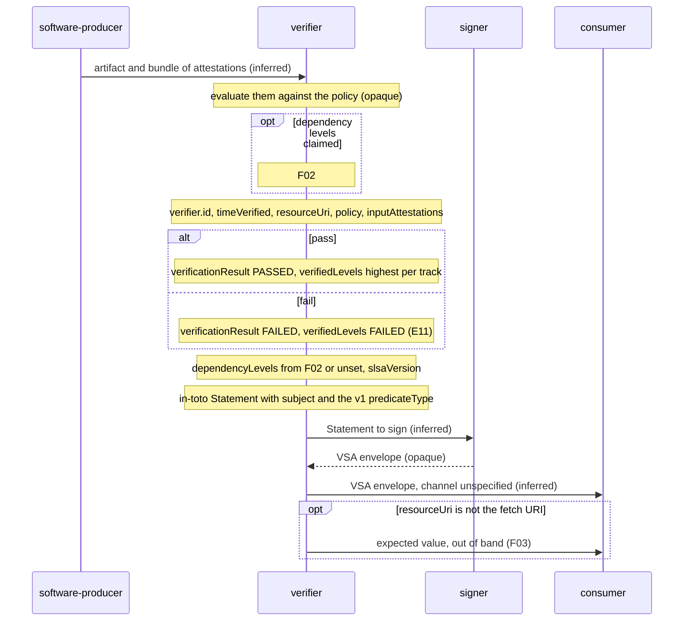
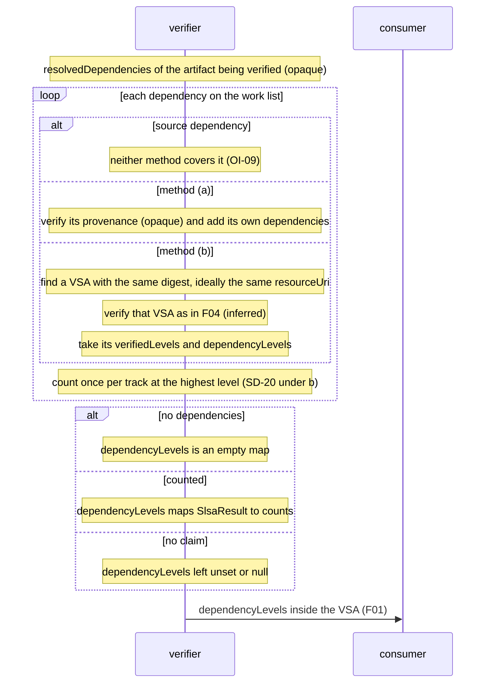
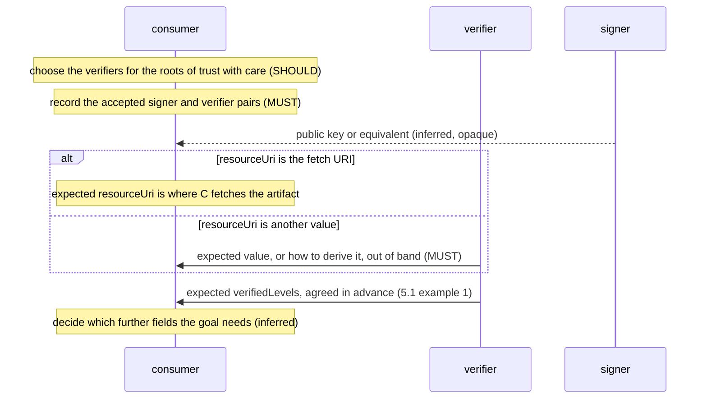
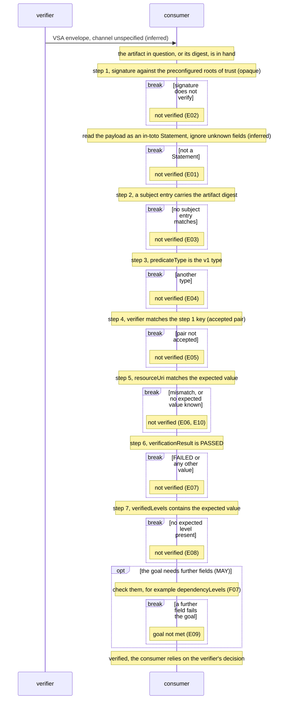
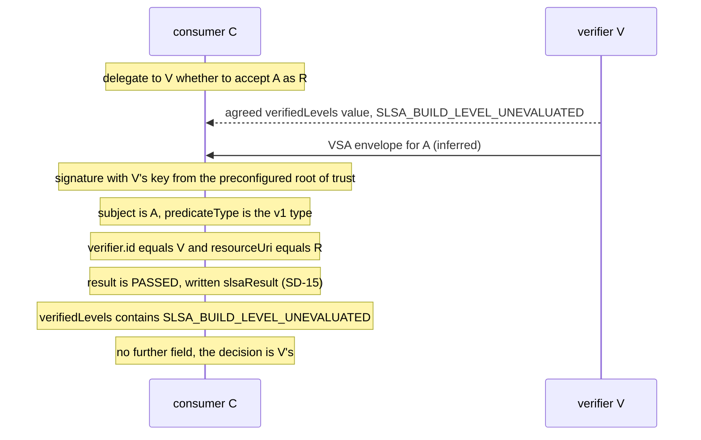
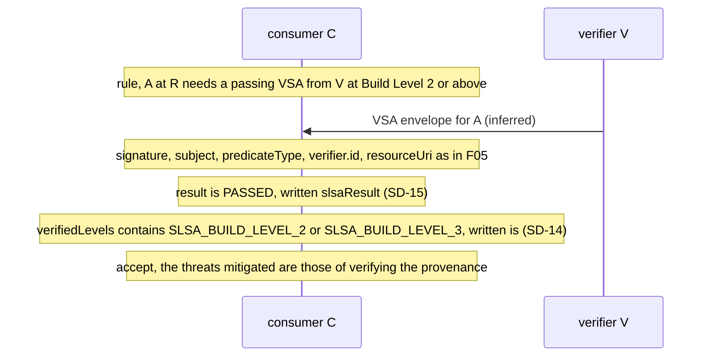
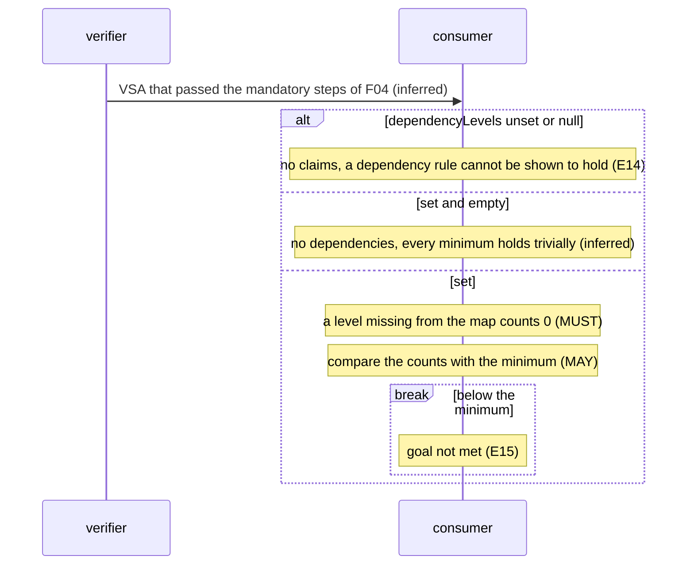
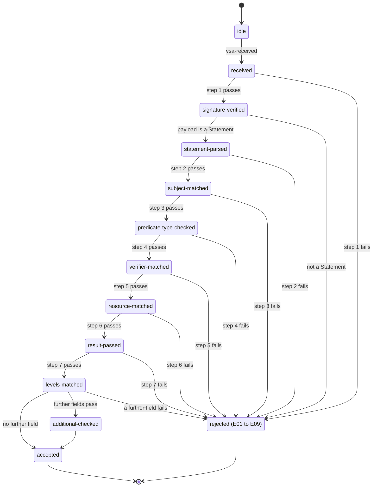

# SLSA VSA v1.2: protocol model

The machine-readable model is `protocol.yaml` (4 roles, 7 flows, 68 steps, 15 error paths, source defects SD-5, SD-14, SD-15 and SD-20 of normative.md's canonical list, open issues OI-01 to OI-12); the lifecycles are
`state-machine.yaml` (M01 to M03). This file is the prose, one sequence diagram per flow, and M01
drawn as a state diagram. Every quotation below is a marker whose words `bin/check-quotes --render`
wrote from `.cache/slsa-vsa-1-2.txt`; nothing between the markers was typed. Requirement ids are
emitted by script from `requirements.yaml`, and every resolved pair was read: pass 1 cited the
skeleton's R-0001 to R-0015, written while the requirements lane was adding the rest, and pass 2
(verify) rewired every flow to the full table, R-0001 to R-0094. Source-defect ids are normative.md's
canonical ones; its crosswalk maps the SD-01 to SD-04 this lane used in pass 1.

## What kind of protocol this is

One message, signed once and read by many. A verifier evaluates an artifact and attestations about
it against a policy and publishes the verdict as an in-toto Statement of predicate type
`https://slsa.dev/verification_summary/v1`. A consumer that trusts the verifier checks the VSA
against its own configuration rather than repeating the evaluation. Delegation is not an object in
this protocol: it is the consumer's choice of whom to trust and how much of the VSA to check, from a
policy of its own (§5.1 example 2) down to the mandatory checks alone (example 1). Nothing travels back to the
verifier, no message reports a failure, and a VSA has no lifecycle after it is issued.

<!-- q L274-276 "We call the process" .. "'verification'." -->
> We call the process of establishing a VSA's authenticity and determining whether it meets the consumer's goals 'verification'.

Signature creation and checking, the roots of trust, provenance verification and the SLSA level
definitions belong to other documents; they appear below only as opaque steps.

## Roles

| role | who | source |
|---|---|---|
| verifier | evaluates the artifact and issues the VSA; also the VSA producer (§5) and VSA issuer (§6) | §2, §3.2, §5, §6 |
| signer | holds the key that signs the envelope; accepted only in configured (signer, verifier) pairs | §3.2, §5 |
| consumer | relies on the VSA; holds roots of trust, accepted pairs and expected values; runs §5 | §1, §2, §5, §5.1 |
| software-producer | named in §1 only, as the party that can keep its build pipeline confidential | §1 |

The source never defines producer. In §5 it means whoever issues the VSA (L277, L284, L295), and this
model reads §3.2's resourceUri duties and §5.1's prenegotiation (L341) the same way (OI-02, SD-21). Users is used for the consumer in §2 and
for the VSA's author in §3.2 and §6 (OI-03, SD-9).

## Reading the diagrams

Solid arrows carry something between roles; dashed arrows are replies. A note is a local step. `alt`
is a branch the source names, `opt` a MAY or an optional step, `loop` the per-dependency iteration,
and `break` a failed check that ends the flow, with its error path id. Inferred steps are labelled
inferred; opaque steps are defined by another document.

Arrow labels are free text; `protocol.yaml` `message_map` joins each label and each step `message` to
its `messages.yaml` entry (VSA Statement MSG-01, VSA predicate MSG-02, VSA envelope MSG-08, policy
MSG-04, dependencyLevels MSG-07) or says it is an input or consumer configuration that the source
does not define as a message.

## F01 vsa-issuance (§2, §3, §3.2, §6)

The verifier's inputs are the artifact, a bundle of attestations and a policy. Where the inputs come
from is not stated (OI-01). The source fixes what the predicate must carry, not the order of work:
an identity that reflects the trust base consumers care about, a required resourceUri that should be
the consumer's fetch URI, the policy by uri and preferably digest, every attestation used if any are
listed, the result, the highest level per track and the dependency counts. A failed evaluation is not
an error of this flow but an outcome: the VSA says FAILED twice, in verificationResult and in
verifiedLevels (E11). Whether a FAILED VSA must be issued is not stated (OI-07). Signing and delivery
are presupposed by §5, never described. Requirements (protocol.yaml constrained_by): slsa-vsa-1-2#R-0002, slsa-vsa-1-2#R-0006, slsa-vsa-1-2#R-0014, slsa-vsa-1-2#R-0016, slsa-vsa-1-2#R-0017, slsa-vsa-1-2#R-0019, slsa-vsa-1-2#R-0021, slsa-vsa-1-2#R-0025, slsa-vsa-1-2#R-0026, slsa-vsa-1-2#R-0027, slsa-vsa-1-2#R-0029, slsa-vsa-1-2#R-0030, slsa-vsa-1-2#R-0031, slsa-vsa-1-2#R-0032, slsa-vsa-1-2#R-0033, slsa-vsa-1-2#R-0034, slsa-vsa-1-2#R-0035, slsa-vsa-1-2#R-0036, slsa-vsa-1-2#R-0037, slsa-vsa-1-2#R-0038, slsa-vsa-1-2#R-0039, slsa-vsa-1-2#R-0040, slsa-vsa-1-2#R-0041, slsa-vsa-1-2#R-0042, slsa-vsa-1-2#R-0043, slsa-vsa-1-2#R-0044, slsa-vsa-1-2#R-0045, slsa-vsa-1-2#R-0046, slsa-vsa-1-2#R-0047, slsa-vsa-1-2#R-0048, slsa-vsa-1-2#R-0049, slsa-vsa-1-2#R-0050, slsa-vsa-1-2#R-0051, slsa-vsa-1-2#R-0052, slsa-vsa-1-2#R-0053, slsa-vsa-1-2#R-0054, slsa-vsa-1-2#R-0055, slsa-vsa-1-2#R-0056, slsa-vsa-1-2#R-0058, slsa-vsa-1-2#R-0060, slsa-vsa-1-2#R-0063, slsa-vsa-1-2#R-0064, slsa-vsa-1-2#R-0065, slsa-vsa-1-2#R-0076, slsa-vsa-1-2#R-0077, slsa-vsa-1-2#R-0078, slsa-vsa-1-2#R-0079, slsa-vsa-1-2#R-0080, slsa-vsa-1-2#R-0081, slsa-vsa-1-2#R-0086, slsa-vsa-1-2#R-0088, slsa-vsa-1-2#R-0089, slsa-vsa-1-2#R-0090, slsa-vsa-1-2#R-0092, slsa-vsa-1-2#R-0093, slsa-vsa-1-2#R-0094.

<!-- q L42-45 "A Verification Summary Attestation (VSA) is" .. "against some `policy`." -->
> A Verification Summary Attestation (VSA) is an attestation that some entity (`verifier`) verified one or more software artifacts (the `subject` of an in-toto attestation [Statement]) by evaluating the artifact and a `bundle` of attestations against some `policy`.

<!-- q L195-197 "Indicates the highest level" .. "policy verification failed." -->
> Indicates the highest level of each track verified for the artifact (and not > its dependencies) and any [verified properties](verified-properties) verified > for the artifact or "FAILED" if policy verification failed.

## F02 dependency-levels (§2, §3.2)

Starting from the resolvedDependencies of the artifact's provenance, the verifier either verifies each
non-source dependency's own provenance and recurses (a), or finds a VSA for the dependency, matched by
digest and preferably by resourceUri, and reuses that VSA's verifiedLevels and dependencyLevels (b).
Each dependency is then counted once per track at its highest level. Method (b) adds up counts,
which carry no identities, so a dependency reached along two paths through dependency VSAs is counted
twice (SD-20): in the diamond A to B and C, B and C to D, the total is 4 for 3 dependencies. The source does not say that
a dependency's VSA must itself be verified before use (inferred here, OI-08), nor what happens to a
dependency that neither method determines, or to a source dependency (OI-09). Requirements (protocol.yaml constrained_by): slsa-vsa-1-2#R-0014, slsa-vsa-1-2#R-0020, slsa-vsa-1-2#R-0058, slsa-vsa-1-2#R-0060, slsa-vsa-1-2#R-0061, slsa-vsa-1-2#R-0062, slsa-vsa-1-2#R-0089.

<!-- q L51-58 "The verifier does this by either a)" .. "`vsa.dependencyLevels`." -->
> The verifier does this by either a) verifying the provenance of each non-source dependency listed in the [resolvedDependencies](build-provenance#resolvedDependencies) of the artifact being verified (recursively) or b) matching the non-source dependency listed in `resolvedDependencies` (`subject.digest` == `resolvedDependencies.digest` and, ideally, `vsa.resourceUri` == `resolvedDependencies.uri`) to a VSA _for that dependency_ and using `vsa.verifiedLevels` and `vsa.dependencyLevels`.

<!-- q L216-219 "Users MUST count each dependency" .. "`SLSA_BUILD_LEVEL_1`." -->
> Users MUST count each dependency only once per SLSA track, at the highest > level verified. For example, if a dependency meets `SLSA_BUILD_LEVEL_2`, > you include it with the count for `SLSA_BUILD_LEVEL_2` but not the count for > `SLSA_BUILD_LEVEL_1`.

## F03 verification-setup (§3.2, §5, §5.1)

Before §5 can run the consumer needs four things, none of them carried by a message the source
defines: roots of trust, the (signer, verifier) pairs it accepts, the expected resourceUri and the
expected verifiedLevels value. Two have a stated source. The expected resourceUri is the fetch URI, or
what the producer communicates out of band when resourceUri is set to something else; without that
communication step 5 cannot pass (E10). The expected verifiedLevels value is agreed in advance in
§5.1 example 1 and follows from the consumer's own rule in example 2. Roots of trust are only said
to be preconfigured, and the pairs only to be accepted. Requirements (protocol.yaml constrained_by): slsa-vsa-1-2#R-0004, slsa-vsa-1-2#R-0006, slsa-vsa-1-2#R-0012, slsa-vsa-1-2#R-0013, slsa-vsa-1-2#R-0074, slsa-vsa-1-2#R-0083, slsa-vsa-1-2#R-0091, slsa-vsa-1-2#R-0094.

<!-- q L161-164 "If the" .. "out-of-band channel." -->
> If the > `resourceUri` is set to some other value, the producer MUST communicate the > expected value, or how to determine the expected value, to consumers through > an out-of-band channel.

<!-- q L316-318 "IMPORTANT: A VSA does not protect" .. "roots of trust." -->
> IMPORTANT: A VSA does not protect against compromise of the verifier, such as by a malicious insider. Instead, VSA consumers SHOULD carefully consider which verifiers they add to their roots of trust.

## F04 vsa-verification (§3.1, §5)

Seven checks are mandatory and one is optional. Each tests the parsed VSA against the artifact in
hand or against F03's configuration, so their order changes which failure is reported first, never
the verdict; the only order the source fixes is step 4 after step 1. The model adds one step the
source omits, reading the payload as a Statement with unknown fields ignored (R-0001), which is what
lets a consumer built for one 1.x version read a VSA of another (inferred). §5 never says what a failed check
leads to; each failure below is the reading that the VSA is not verified. Three gaps sit around the
checks: no step reads the required policy field (OI-06), the subject match is left to in-toto
(OI-04), and nothing about time is checked (OI-11). Requirements (protocol.yaml constrained_by): slsa-vsa-1-2#R-0001, slsa-vsa-1-2#R-0004, slsa-vsa-1-2#R-0006, slsa-vsa-1-2#R-0011, slsa-vsa-1-2#R-0012, slsa-vsa-1-2#R-0024, slsa-vsa-1-2#R-0026, slsa-vsa-1-2#R-0027, slsa-vsa-1-2#R-0054, slsa-vsa-1-2#R-0055, slsa-vsa-1-2#R-0067, slsa-vsa-1-2#R-0068, slsa-vsa-1-2#R-0069, slsa-vsa-1-2#R-0070, slsa-vsa-1-2#R-0071, slsa-vsa-1-2#R-0072, slsa-vsa-1-2#R-0073, slsa-vsa-1-2#R-0074, slsa-vsa-1-2#R-0079, slsa-vsa-1-2#R-0082, slsa-vsa-1-2#R-0083, slsa-vsa-1-2#R-0084, slsa-vsa-1-2#R-0085, slsa-vsa-1-2#R-0091, slsa-vsa-1-2#R-0094.

<!-- q L281 -->
> Verification MUST include the following steps:

<!-- q L283-285 "Verify the signature on the VSA envelope" .. "tampered with." -->
> Verify the signature on the VSA envelope using the preconfigured roots of trust. This step ensures that the VSA was produced by a trusted producer and that it hasn't been tampered with.

<!-- q L287-288 "Verify the statement's `subject`" .. "the intended artifact." -->
> Verify the statement's `subject` matches the digest of the artifact in question. This step ensures that the VSA pertains to the intended artifact.

<!-- q L290-292 "Verify that the `predicateType` is" .. "of the VSA format." -->
> Verify that the `predicateType` is `https://slsa.dev/verification_summary/v1`. This step ensures that the in-toto predicate is using this version of the VSA format.

<!-- q L294-296 "Verify that the `verifier` matches" .. "revealed in step 1." -->
> Verify that the `verifier` matches the public key (or equivalent) used to verify the signature in step 1. This step identifies the VSA producer in cases where their identity is not implicitly revealed in step 1.

<!-- q L298-300 "Verify that the value for `resourceUri`" .. "intended purpose." -->
> Verify that the value for `resourceUri` in the VSA matches the expected value. This step ensures that the consumer is using the VSA for the producer's intended purpose.

<!-- q L302-303 "Verify that the value for `verificationResult`" .. "consumer's purposes." -->
> Verify that the value for `verificationResult` is `PASSED`. This step ensures the artifact is suitable for the consumer's purposes.

<!-- q L305-306 "Verify that `verifiedLevels` contains" .. "consumer's purposes." -->
> Verify that `verifiedLevels` contains the expected value. This step ensures that the artifact is suitable for the consumer's purposes.

<!-- q L308-311 "Verification MAY additionally" .. "meets your goal." -->
> Verification MAY additionally contain the following step: 1. (Optional) Verify additional fields required to determine whether the VSA meets your goal.

Step 7 says contains. Because a VSA lists only the highest level reached in each track, and a level
implies the ones below it, the model reads an expectation of level n as met by any level from n up in
the same track; §5.1 example 2 writes exactly that set out (inferred, M01.T16).

## F05 delegated-decision (§5.1 example 1)

Full delegation, compared in the source to code signing. C leaves the decision on A as R to V; the
expected verifiedLevels value is whatever the two agreed beforehand (here
`SLSA_BUILD_LEVEL_UNEVALUATED`, the value for a track a VSA issuer makes no claim about), and C checks
nothing past the mandatory seven. The bullets map one for one onto F04's steps, so any failed
bullet ends as in F04 (E02 to E08). The example names the result field slsaResult; the field is
verificationResult (SD-15). Requirements (protocol.yaml constrained_by): slsa-vsa-1-2#R-0082, slsa-vsa-1-2#R-0083; the bullets' other statements are rejected candidates, listed in protocol.yaml.

<!-- q L340-343 "Note: This example is analogous" .. "decision to V." -->
> Note: This example is analogous to traditional code signing. The expected value for `verifiedLevels` is arbitrary but prenegotiated by the producer and the consumer. The consumer does not need to check additional fields, as C fully delegates the decision to V.

## F06 resource-policy (§5.1 example 2)

C enforces its own rule: A at R needs a passing VSA from V at Build Level 2 or above. The checks are
F04's mandatory seven with the level check widened to two values. The example writes that check as
is; verifiedLevels is an array and step 7 says contains, and a VSA that also reports a source-track
level would fail a literal is (SD-14). Run on the §4 example VSA (`SLSA_BUILD_LEVEL_3`, with V, R and A taken
from it), M01 accepts under this example's expectations and rejects under example 1's, which expect
`SLSA_BUILD_LEVEL_UNEVALUATED`. Requirements (protocol.yaml constrained_by): slsa-vsa-1-2#R-0082, slsa-vsa-1-2#R-0084; the bullets' other statements are rejected candidates, listed in protocol.yaml.

<!-- q L345-346 -->
> 2. Suppose consumer C wants to enforce the rule "Artifact A at resource R must have a passing VSA from verifier V showing it meets SLSA Build Level 2+."

<!-- q L364-367 "Note: In this example" .. "verifying each SLSA level." -->
> Note: In this example, verifying the VSA mitigates the same threats as verifying the artifact's SLSA provenance. See [Verifying artifacts](/spec/v1.0/verifying-artifacts) for details about which threats are addressed by verifying each SLSA level.

## F07 dependency-policy (§2, §3.2)

A consumer (§2's policy verifier) applies a minimum requirement to the dependencies through the
optional step. The
field reads three ways: unset or null claims nothing, so no rule about dependencies can be shown to
hold (E14); an empty map says there are no dependencies; otherwise each key counts the dependencies at
that level and a level the map leaves out counts zero. A count cannot show that every dependency was
counted, since a dependency verified at no level may just be absent (OI-09); and the map says how many
dependencies are at each level, never which (OI-12). Requirements (protocol.yaml constrained_by): slsa-vsa-1-2#R-0058, slsa-vsa-1-2#R-0059, slsa-vsa-1-2#R-0060, slsa-vsa-1-2#R-0074, slsa-vsa-1-2#R-0087.

<!-- q L209-214 "Map from [SlsaResult]" .. "the artifact's dependencies." -->
> Map from [SlsaResult] to the number of the artifact's _transitive_ dependencies > that were verified at the indicated level. Absence of a given level of > [SlsaResult] MUST be interpreted as reporting _0_ dependencies at that level. > A set but empty `dependencyLevels` object means that the artifact has **no** > dependency at all, while an unset or null `dependencyLevels` means that the > verifier makes no claims about the artifact's dependencies.

## Error paths

Every failing check of §5 has its own path; the source states the check and never the outcome of its
failure, so those paths are inferred. Steps are `protocol.yaml` flow.step references; states are
`state-machine.yaml` states.

| id | name | raised by | steps | state | basis |
|---|---|---|---|---|---|
| E01 | malformed-statement | consumer | F04.3 | M01 rejected-malformed | inferred |
| E02 | signature-not-verified | consumer | F04.2, F05.4, F06.3 | M01 rejected-signature | inferred |
| E03 | subject-mismatch | consumer | F04.4, F05.5, F06.4 | M01 rejected-subject | inferred |
| E04 | predicate-type-mismatch | consumer | F04.5, F05.6, F06.5 | M01 rejected-predicate-type | inferred |
| E05 | verifier-not-accepted | consumer | F04.6, F05.7, F06.6 | M01 rejected-verifier | inferred |
| E06 | resource-uri-mismatch | consumer | F04.7, F05.8, F06.7 | M01 rejected-resource-uri | inferred |
| E07 | result-not-passed | consumer | F04.8, F05.9, F06.8 | M01 rejected-result | inferred |
| E08 | levels-not-expected | consumer | F04.9, F05.10, F06.9 | M01 rejected-levels | inferred |
| E09 | additional-check-failed | consumer | F04.10 | M01 rejected-additional | inferred |
| E10 | expected-resource-uri-unknown | consumer | F03.5, F04.7 | M01 rejected-resource-uri | inferred |
| E11 | policy-verification-failed | verifier | F01.2, F01.9, F01.10 | M02 result-encoded (FAILED) | stated |
| E12 | dependency-vsa-not-matched | verifier | F02.3, F02.4 | M03 undetermined | unspecified |
| E13 | dependency-undetermined | verifier | F02.2 | M03 undetermined | unspecified |
| E14 | dependency-claims-absent | consumer | F07.2 | M01 rejected-additional | inferred |
| E15 | dependency-requirement-unmet | consumer | F07.6 | M01 rejected-additional | inferred |

## Lifecycles

M01 is §5 as a machine; it was run, as written, on the §4 example VSA and on 15 variations of the VSA,
its signature or the consumer's configuration (a scratch interpreter, not committed): each reached
the state predicted for it,
every guard set was exclusive and exhaustive at every state visited, and all 21 transitions were
taken. M02 is one issuance, and has no error state because the source defines no failure of
issuance. M03 is §2's dependency walk; run as written on the diamond it counts 3 with method (a) and 4
with method (b).

The diagram folds M01's nine error states into one; `state-machine.yaml` keeps them apart.

## Source defects

**SD-15** (pass 1: SD-01). Both §5.1 examples check a field the predicate does not have. The 1.2 change history
says the typo was fixed; it survives at L336 and L360.

<!-- q L336 "`slsaResult` is" .. "`PASSED`." -->
> `slsaResult` is `PASSED`.

<!-- q L405-406 "Fixed a typo" .. "as slsaResult." -->
> Fixed a typo where the verificationResult was incorrectly referred to as slsaResult.

**SD-14** (pass 1: SD-02). Example 2 compares the verifiedLevels array with is, where step 7 and example 1 say
contains.

<!-- q L362 "`verifiedLevels` is" .. "`SLSA_BUILD_LEVEL_3`." -->
> `verifiedLevels` is `SLSA_BUILD_LEVEL_2` or `SLSA_BUILD_LEVEL_3`.

**SD-20** (pass 1: SD-03). Method (b) of §2 reuses counts, which carry no identities, so a verifier
using it cannot count a shared dependency once as §3.2 requires. Over every DAG on nodes 0 to n−1
whose edges run from a lower to a higher number, n = 2 to 6 (2^(n(n−1)/2) graphs each, 33,866 in
all; every DAG of up to 6 nodes is isomorphic to one of them), with each dependency VSA counting its
own closure correctly, the sum exceeds the true count in exactly those graphs where two direct
dependencies' closures meet (each closure including the dependency itself), 23,845 of them, and never
falls short; with method (b) at every level, exactly where the part of the graph reachable from the
artifact is not a tree, 25,165. Pass 1's scratch script measured this and called the set every DAG of
2 to 6 nodes; pass 2 replayed it with its own and got the same counts (neither script committed).

<!-- q L57-58 "and using" .. "`vsa.dependencyLevels`." -->
> and using `vsa.verifiedLevels` and `vsa.dependencyLevels`.

**SD-5** (pass 1: SD-04). The (signer, verifier) example speaks of signing provenance; the signed object in this
document is the VSA.

<!-- q L130-133 "For example," .. "verifier." -->
> For example, > "GitHub" can sign provenance for the "GitHub Actions" verifier, and "Google" > can sign provenance for the "Google Cloud Deploy" verifier, but "GitHub" cannot > sign for the "Google Cloud Deploy" verifier.

## Open issues

`protocol.yaml` carries each in full; in short:

- OI-01: how inputs reach the verifier and a VSA reaches the consumer.
- OI-02: producer is undefined, and §1's software producer is not §5's VSA producer.
- OI-03: Users names the consumer in §2 and the VSA's author in §3.2 and §6.
- OI-04: what makes a subject match a digest (§5 step 2).
- OI-05: how the verifier object matches a key (§5 step 4); what an equivalent of a key is.
- OI-06: policy is required, yet no mandatory step reads it.
- OI-07: nothing ties verificationResult to verifiedLevels; issuing a FAILED VSA is not required.
- OI-08: method (b) matches loosely and does not say the matched VSA is itself verified.
- OI-09: no counting rule for undetermined or source dependencies.
- OI-10: most procedures share the steps (L278), yet they are mandatory (L281).
- OI-11: no freshness, expiry or revocation.
- OI-12: counts, not identities; policy verifiers are not defined.

## Not defined by the source

The envelope, signature scheme, key distribution and roots of trust; the SLSA tracks and levels and
how they are evaluated; provenance and its verification; the policy language; how a VSA is moved or
an input attestation fetched; what a consumer does after a failure; and anything that happens to a
VSA after it is issued.
