# ETSI EN 304 223: process flows

The machine-readable model is `protocol.yaml` (roles, work products, flows F01 to F16 with their
error paths, provisions not in any flow, open issues OI-01 to OI-19). The lifecycles are
`state-machine.yaml` (SM01 to SM10). This file is the prose and one sequence diagram per flow.
Every quotation below is a marker rendered from `.cache/etsi-en-304-223.txt` by
`bin/check-quotes --render`; nothing in a blockquote was typed. Requirement ids live in
`protocol.yaml`, where a script emitted them from provision keys.

## What kind of protocol this is

None on the wire. The EN has no transport, encoding or message syntax, and sets no timer, deadline
or retry (retention time and review frequency are only items a Developer documents). It sorts its provisions into five lifecycle phases and gives each principle to stakeholder
roles:

<!-- q L195-196 "The present document separates" .. "secure end of life." -->
> The present document separates principles and requirements into five phases. These are secure design, secure development, secure deployment, secure maintenance and secure end of life.

What passes between the roles is documents, notices, plans, updates and decisions, which
`protocol.yaml` calls work products. A flow below is the order in which the provisions make
those happen. Where the source fixes an order (prior to, post-, during, following, this
information, these updates, a perfect tense) the step is marked stated; everything else is
inferred, and every failure the source does not answer is marked unspecified.

## Roles

| role | who | source |
|---|---|---|
| developer | creates or adapts AI models or systems | Table 4-1 |
| system_operator | embeds, deploys or maintains them, including contracted services | Table 4-1 |
| data_custodian | controls data permissions, integrity and data-use policy | Table 4-1 |
| end_user | employees and consumers using the system | Table 4-1 |
| affected_entity | affected by the system without necessarily using it (OI-01) | Table 4-1 |
| organization | the employer of any stakeholder; trains and encourages reporting | §5.1.1, §5.1.2-5.1 |
| staff | employees, staff members, developers in lower case | §5.1.1, §5.1.2-5.1 |
| external_provider | a provider subject to due diligence | §5.1.2-7 |
| external_risk_owner | an outside party responsible for identified AI security risks | §5.1.3-3 |
| cloud_service_operator | cloud services under contract | §5.2.2-6 |
| api_consumer | external customers or collaborators calling an API | §5.2.2-2 |
| attacker | the adversary of the API example | §5.2.2-2 |
| independent_security_tester | testers independent of Developer and System Operator | §5.2.5-2.1 |
| receiving_entity | the other entity in a transfer or sharing of ownership | §5.5.1-1 |
| reporter | whoever reports a vulnerability or a poisoning attack (inferred) | §5.2.2-4, §5.2.4-2.1 |

Roles are not organizations:

<!-- q L434-436 "A single entity can hold" .. "regulatory regimes." -->
> A single entity can hold multiple stakeholder roles, as defined in the present document, in addition to any responsibilities arising from different regulatory regimes.

## Reading the diagrams

- A solid arrow hands a work product (named as in `protocol.yaml` work_products) to another role.
- Each work product carries a `structure` key in `protocol.yaml` naming the `messages.yaml` structure that holds it, or `none` with a reason.
- A dashed arrow is a response the EN does not define.
- A note over a role is an act of that role alone.
- `opt` is a step that applies only under its provision's condition (Where..., If...).
- `alt` is a branch; every error and exception outcome is listed under error_paths in `protocol.yaml`.
- `loop` is a stated re-entry; `par` joins steps the source gives without an order.
- Numbers are the step numbers of `protocol.yaml`; parenthesised keys are provisions. Inferred,
  purpose and presupposed carry the meanings of the `protocol.yaml` conventions.

## F01. Deciding whether to create an AI system (§5.1.2)

The assessment is part of the decision, so it comes first. The Data Custodian joins the
requirements work when it sits in the Developer's organization. The EN gives no criterion for
deciding not to create (F01-E2).

<!-- q L545-547 "As part of deciding" .. "mitigation strategies." -->
> As part of deciding whether to create an AI system, a System Operator and/or Developer shall conduct a thorough assessment that includes determining and documenting the business requirements and/or problem they are seeking to address, along with associated AI security risks and mitigation strategies.

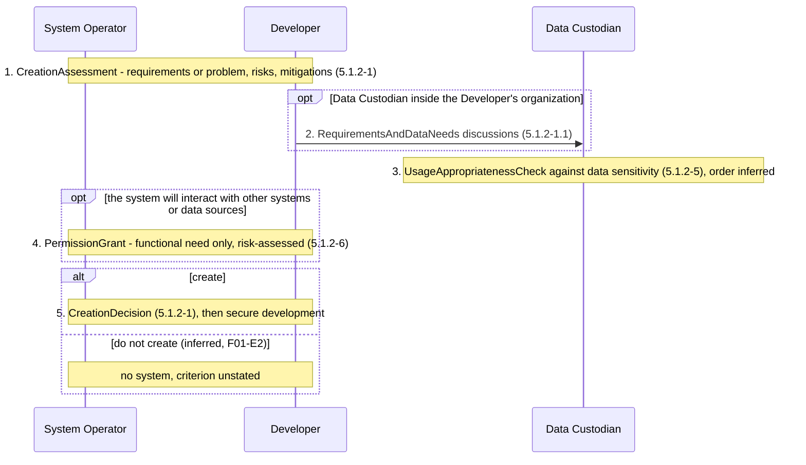

## F02. Threat modelling and risk treatment (§5.1.3, §5.1.4-1, §5.1.4-3)

Developers and System Operators analyse threats; System Operators apply controls to what the
analysis found. The process re-runs on review, on any new or changed setting at any stage, and as
continuous review finds change.

<!-- q L594-595 "The threat modelling and risk management process" .. "of the AI lifecycle." -->
> The threat modelling and risk management process shall be conducted to address any security risks that arise when a new setting or configuration option is implemented or updated at any stage of the AI lifecycle.

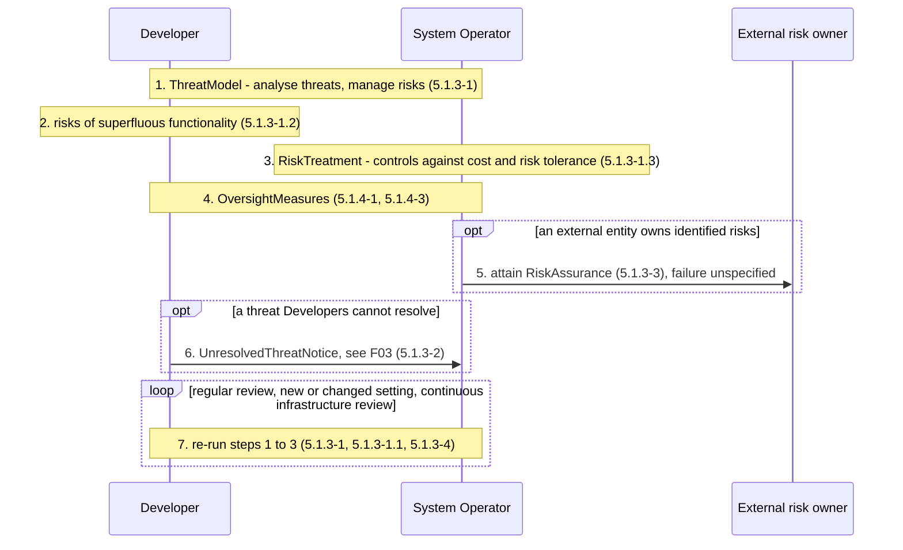

## F03. Communicating threats Developers cannot resolve (§5.1.3-2)

A two-hop relay. The first sentence is passive, so neither who identifies the threat nor who
sends it is named (OI-08); Developers is this model's reading.

<!-- q L604-607 "Where AI security threats" .. "monitor these threats." -->
> Where AI security threats are identified that cannot be resolved by Developers, this shall be communicated to System Operators so they can threat model their systems. System Operators shall communicate this information to End-users, so they are made aware of these threats. This communication should include detailed descriptions of the risks, potential impacts, and recommended actions to address or monitor these threats.

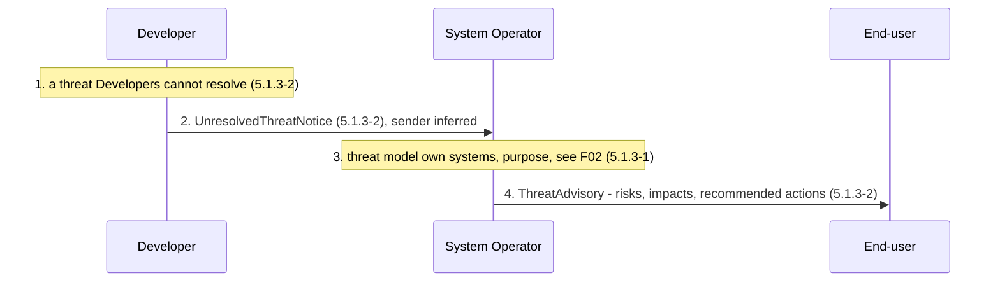

## F04. Data Custodian controls: specified, built in, verified (§5.1.4-4)

Only the verification is asked for; specifying and building the controls are presupposed.

<!-- q L631-632 "Developers should verify" .. "into the system." -->
> Developers should verify that the security controls specified by the Data Custodian have been built into the system.

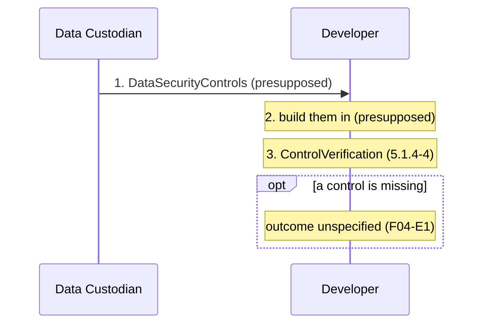

## F05. External components, models and providers (§5.1.2-4, §5.1.2-7, §5.2.2-6, §5.2.3, §5.2.4-1.2)

Due diligence precedes use. No rejection outcome is ever stated; instead a component that is not
well-documented or secured may be used on three conditions (F05-E1):

<!-- q L716-718 "System Operators that choose" .. "for said component)." -->
> System Operators that choose to use or adapt any models, or components, which are not well-documented or secured shall be able to justify their decision to use such models or components through documentation (for example if there was no other supplier for said component).

<!-- q L720-721 "In this case" .. "such models or components." -->
> In this case, Developers and System Operators shall have mitigating controls and undertake a risk assessment linked to such models or components.

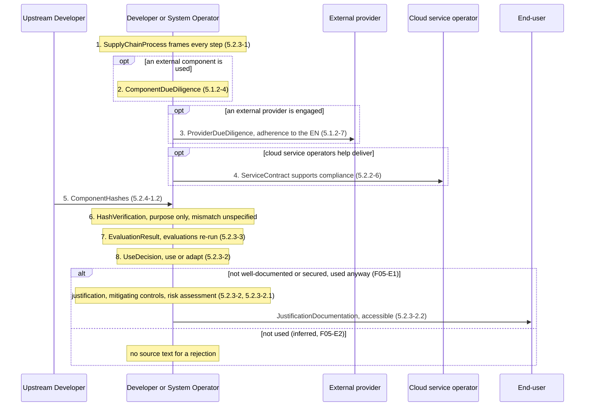

## F06. Security testing, release and pre-deployment testing (§5.2.5)

Release and deployment each follow a test. Neither test has a pass criterion or a stated
consequence of failure (OI-09).

<!-- q L766-767 "Developers shall ensure that all models" .. "security assessment process." -->
> Developers shall ensure that all models, applications and systems that are released to System Operators and/or End-users have been tested as part of a security assessment process.

<!-- q L769-770 "System Operators shall conduct testing" .. "from Developers." -->
> System Operators shall conduct testing prior to the system being deployed with support from Developers.

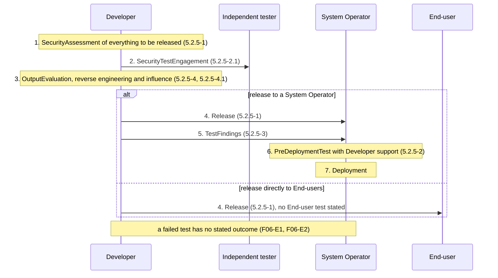

## F07. Information to System Operators and End-users (§5.2.4-1, §5.2.4-3, §5.3.1-1 to §5.3.1-2.1, §5.1.4-5)

Two hand-offs are ordered by the text itself when the Developer is an external entity: its input
precedes the System Operator's notice and guidance. Nothing is timed against deployment.

<!-- q L797-799 "System Operators shall convey" .. "to System Operators." -->
> System Operators shall convey to End-users in an accessible way where and how their data will be used, accessed and stored (for example, if it is used for model retraining, or reviewed by employees or partners). If the Developer is an external entity, they shall provide this information to System Operators.

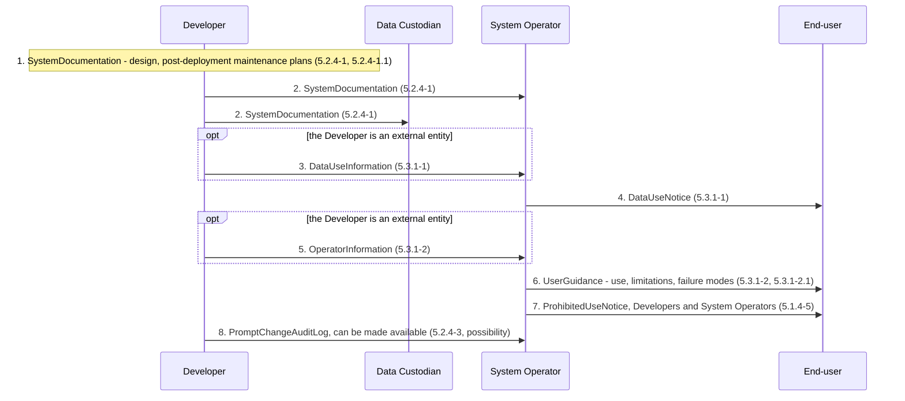

## F08. Security updates, patches and model changes (§5.4.1, §5.3.1-2.2, §5.2.3-3, §5.2.3-4, §5.2.1-4.1, §5.2.4-3)

Developers provide and notify, System Operators deliver; a model update is announced first. Where
no update can be provided the contingency applies, and no notice to anyone is stated (OI-17).

<!-- q L823-824 "Developers shall provide security updates" .. "patches to End-users." -->
> Developers shall provide security updates and patches, where possible, and notify System Operators of the security updates. System Operators shall deliver these updates and patches to End-users.

<!-- q L826-827 "Developers shall have mechanisms" .. "cannot be provided for AI systems." -->
> Developers shall have mechanisms and contingency plans to mitigate security risks, particularly in instances where updates cannot be provided for AI systems.

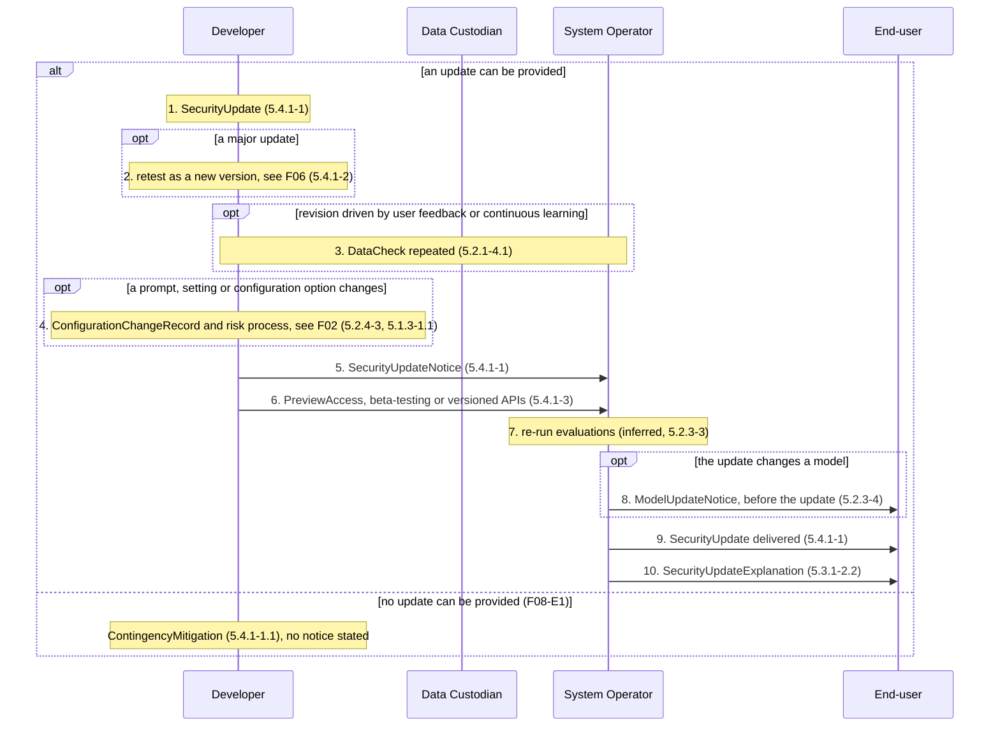

## F09. Logging, monitoring and detection (§5.4.2)

The EN says what monitoring should find, never what to do when it finds it; step 5 and its three
branches are inferred.

<!-- q L850-852 "System Operators should analyse their logs" .. "poisoning)." -->
> System Operators should analyse their logs to ensure that AI models continue to produce desired outputs and to detect anomalies, security breaches, or unexpected behaviour over time (such as due to data drift or data poisoning).

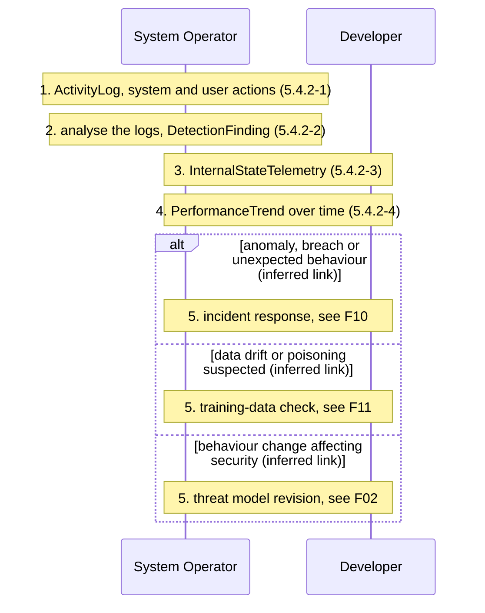

## F10. Incident preparation, support and recovery (§5.1.2-3, §5.2.1-3, §5.2.2-5, §5.3.1-3, §5.4.2-1)

Preparation is stated; of the response only support during and after the incident is. The
support covers Affected Entities, but the agreed process covers End-users only (OI-02).

<!-- q L811-813 "Developers and System Operators should support" .. "contracts with End-users." -->
> Developers and System Operators should support End-users and Affected Entities during and following a cyber security incident to contain and mitigate the impacts of an incident. The process for undertaking this should be documented and agreed in contracts with End-users.

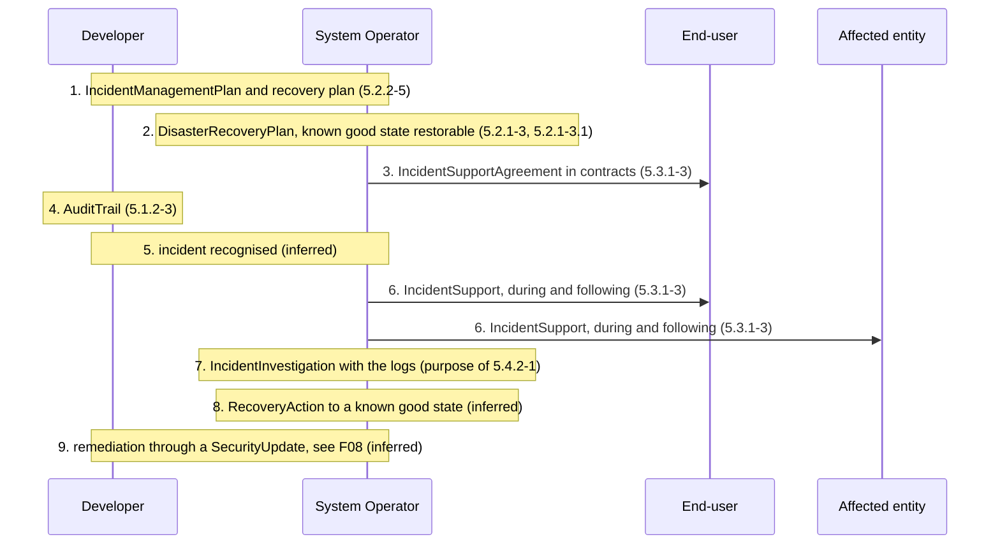

## F11. Training-data provenance and a reported poisoning attack (§5.2.4-2, §5.2.4-2.1)

The record is written in advance because poisoning is expected to surface late:

<!-- q L749-750 "As discovery of poisoned data" .. "used in the model." -->
> As discovery of poisoned data is likely to occur after training (if at all), Developers shall document how they obtained the public training data, where it came from and how that data is used in the model.

and it exists so that a report can be checked:

<!-- q L753-754 "This will allow Developers to identify" .. "in their data sets." -->
> This will allow Developers to identify whether a reported data poisoning attack was in their data sets.

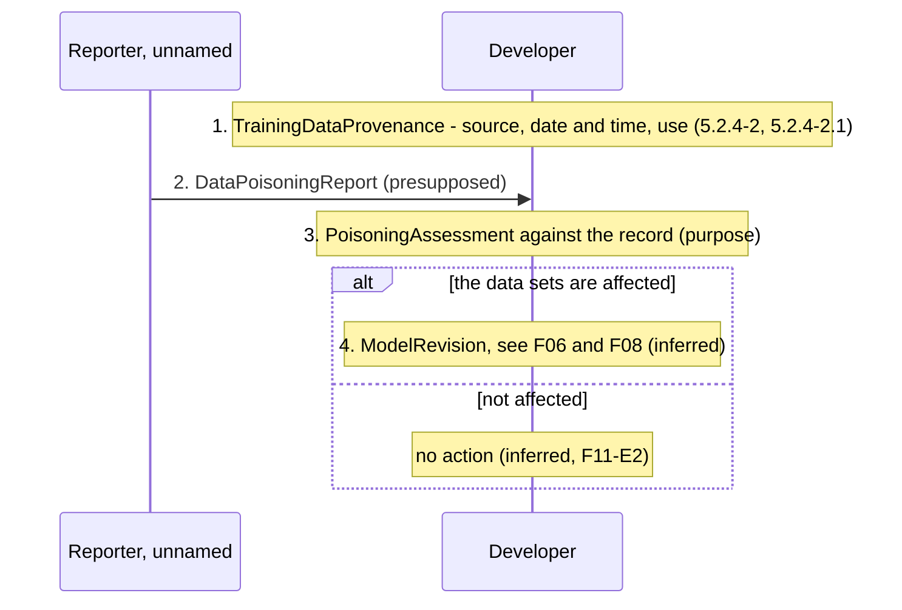

## F12. Vulnerability disclosure and internal risk reporting (§5.2.2-4, §5.1.2-5.1)

A published policy and encouragement to report are all the EN states; the report itself and its
handling are inferred.

<!-- q L692-693 "Developers and System Operators shall implement and publish" .. "disclosure policy." -->
> Developers and System Operators shall implement and publish a clear and accessible vulnerability disclosure policy.

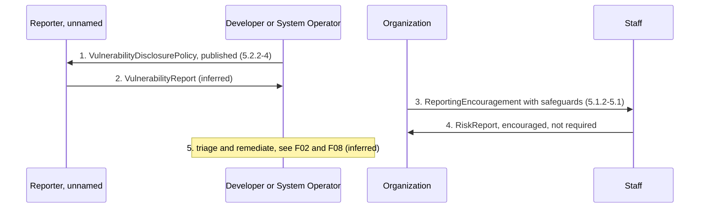

## F13. AI security awareness and training (§5.1.1)

<!-- q L521-522 "Organizations' cyber security training programme" .. "threats emerge." -->
> Organizations' cyber security training programme shall include AI security content which shall be regularly reviewed and updated, such as if new substantial AI-related security threats emerge.

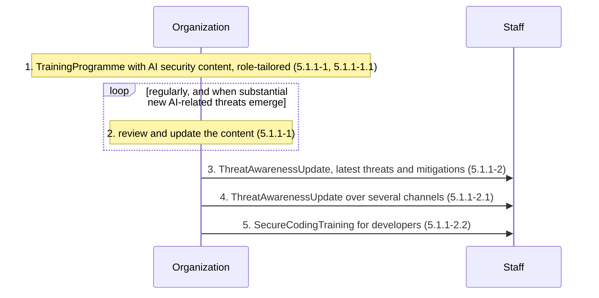

## F14. Transferring or sharing ownership of training data or a model (§5.5.1-1)

Three acts joined by and, with no order; disposal sits oddly with sharing (OI-03).

<!-- q L865-867 "If a Developer or System Operator decides to transfer" .. "to another." -->
> If a Developer or System Operator decides to transfer or share ownership of training data and/or a model to another entity they shall involve Data Custodians and securely dispose of these assets. This will protect AI against security issues that can transfer from one AI system instantiation to another.

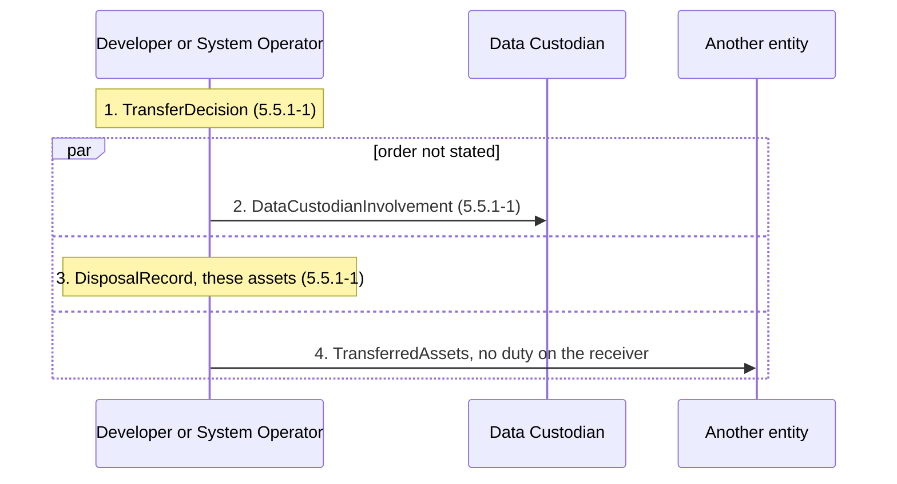

## F15. Decommissioning a model or system (§5.5.1-2)

<!-- q L869-870 "If a Developer or System Operators decides" .. "configuration details." -->
> If a Developer or System Operators decides to decommission a model and/or system, they shall involve Data Custodians and securely delete applicable data and configuration details.

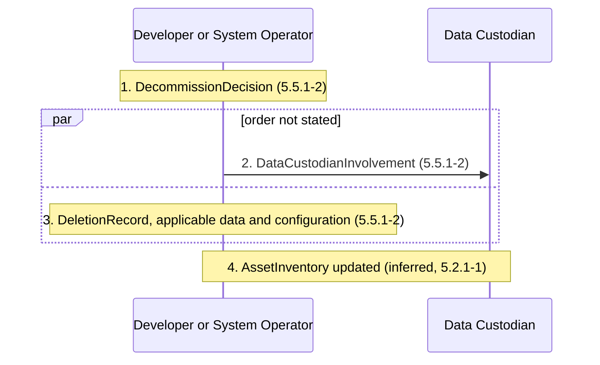

## F16. Offering an API to external parties (§5.2.2-1, §5.2.2-2)

The one outward-facing interaction the EN implies, given only through its example:

<!-- q L683-685 "If a Developer offers an API" .. "poison a model." -->
> If a Developer offers an API to external customers or collaborators, they shall apply controls that mitigate attacks on the AI system via the API. For example, placing limits on model access rate to limit an attacker's ability to reverse engineer or overwhelm defences to rapidly poison a model.

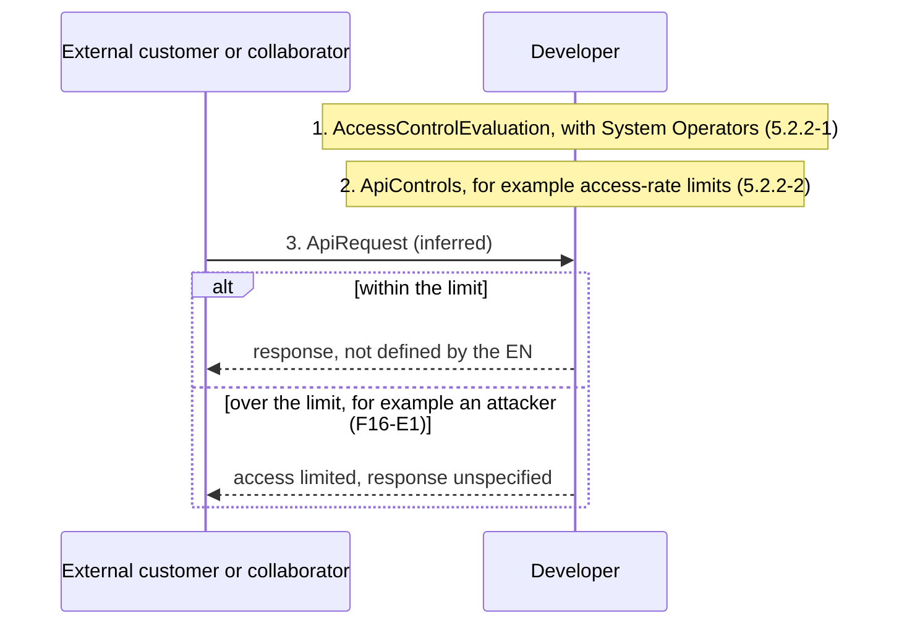

## Lifecycles

`state-machine.yaml` holds SM01 ai-system-lifecycle, SM02 model-version, SM03 training-data,
SM04 prompt-and-configuration, SM05 security-update, SM06 cyber-security-incident, SM07
external-component, SM08 end-of-life, SM09 threat-model and SM10 training-content, and lists the
candidate lifecycles the source does not support, with the reason for each (vulnerability, plans,
documentation, API access, human oversight, End-user communications, provider relationship,
asset inventory).

## Open issues

The source questions this model raises are OI-01 to OI-19 in `protocol.yaml`, each with its
quotation: Affected entities definition (OI-01); support without contract (OI-02); dispose while
sharing (OI-03); Principle 10 has no applicability line (OI-04); non-Table 4-1 actors (OI-05);
who assesses creation (OI-06); trained-on tense in design (OI-07); passive threat relay (OI-08);
test without pass criterion (OI-09); antecedent of these updates (OI-10); before or after a
configuration change (OI-11); the above requirements (OI-12); which evaluations (OI-13); System
Operators or Developers choose (OI-14); major undefined (OI-15); re-check triggers (OI-16); no
notice without an update (OI-17); dangling cross-references (OI-18); the voluntary Code (OI-19).
