# Secure by Demand: OT priority considerations — procurement and product flows

The machine-readable model is `protocol.yaml` (roles, work products, flows F01 to F13 with
their error paths, the twelve elements of F01, provisions not in any flow, open issues
OI-01 to OI-08). The lifecycles are `state-machine.yaml` (SM01 to SM09). This file is the
prose and one sequence diagram per flow. Every quotation below is a marker rendered from
`.cache/cisa-secure-by-demand-ot-2025.txt` by `bin/check-quotes --render`; nothing in a
blockquote was typed. Requirement ids live in `protocol.yaml`, where a script emitted them.

## What kind of protocol this is

None on the wire. The guide is written for buyers:

<!-- q L228-230 "This document is intended to help owners and operators" .. "hereafter.)" -->
> This document is intended to help owners and operators purchase OT products, particularly industrial automation and control system products, with priority secure by design elements. (Owners and operators purchasing products are referred to as “buyers” hereafter.)

and its one central instruction is a selection rule:

<!-- q L84-85 "When procuring products" .. "security elements:" -->
> When procuring products, OT owners and operators should select products from manufacturers who prioritize the following security elements:

Everything else is twelve elements, each with selection criteria and questions to ask the
manufacturer. F01 is that exchange. F02 to F13 are the operational exchanges the elements
describe as what a good product or manufacturer does; the guide states them as things to
seek, so their basis in `protocol.yaml` is mostly `sought` or `question`, not an obligation
on the manufacturer (OI-08).

## Roles

| role | who | source |
|---|---|---|
| buyer | OT owners and operators purchasing products | Introduction |
| operator | the same organization operating the product | Summary, elements |
| manufacturer | the product's maker (vendor and manufacturer used alike) | Introduction |
| ot_product | the product, whose behaviour most elements state | Summary |
| threat_actor | adversaries targeting specific OT products | Summary |
| security_tool | where logs are aggregated | Logging |
| incident_responder | network defenders and incident responders | Logging |
| peer_device | the other end of machine-to-machine traffic | Secure Communications |
| supervisory_control | engineering workstations, SCADA, HMI | Strong Authentication |
| jump_host | a host that adds MFA | Strong Authentication |
| legacy_device | existing components | Secure by Default |
| reporter | whoever reports a vulnerability (inferred) | Vulnerability Management |
| cve_program | the CVE Program | Vulnerability Management |
| users_public | users and the wider public | Vulnerability Management |
| organization | an organization reporting or asking for guidance | Contact Information, Resources |
| reporting_authority | CISA, FBI, NSA, MS-ISAC, national centres | Contact Information |
| agency | Sector Risk Management Agency, CISA | Resources |

## Reading the diagrams

- A solid arrow hands a work product (named as in `protocol.yaml` work_products) to another role.
- A note over a role is an act of that role alone.
- `opt` is a step that applies only under its condition, or an error path with its outcome
  and kind (stated, inferred, unspecified).
- Numbers are the step numbers of `protocol.yaml`; (inferred) marks this model's own step.

## F01. Selecting an OT product (Summary; Considerations for OT Product Selection; the twelve elements)

The exchange the whole guide is about. The guide is addressed to the buyer and gives it questions to put to the manufacturer for each of twelve elements; the elements are not in priority order and no threshold decides the outcome (F01-E2).

<!-- q L84-85 "When procuring products" .. "security elements:" -->
> When procuring products, OT owners and operators should select products from manufacturers who prioritize the following security elements:

<!-- q L269-270 "The following sections provide buyers" .. "these considerations matter." -->
> The following sections provide buyers with guidance on questions to ask manufacturers, considerations for the OT context, and why these considerations matter.

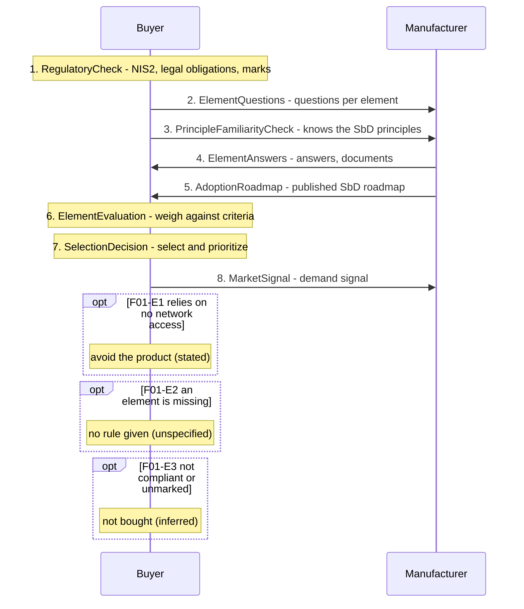

## F02. Controlling configuration changes and recovering (Configuration Management; Summary element 6)

Configuration control and recovery are asked of the product and its manufacturer; the guide states the goal (identify unauthorized changes swiftly, recover after an incident) and the means, not a procedure.

<!-- q L314-315 "Owners and operators must be able to recover" .. "on the OT network." -->
> Owners and operators must be able to recover from incidents in which a threat actor establishes a foothold or wipes a component on the OT network.

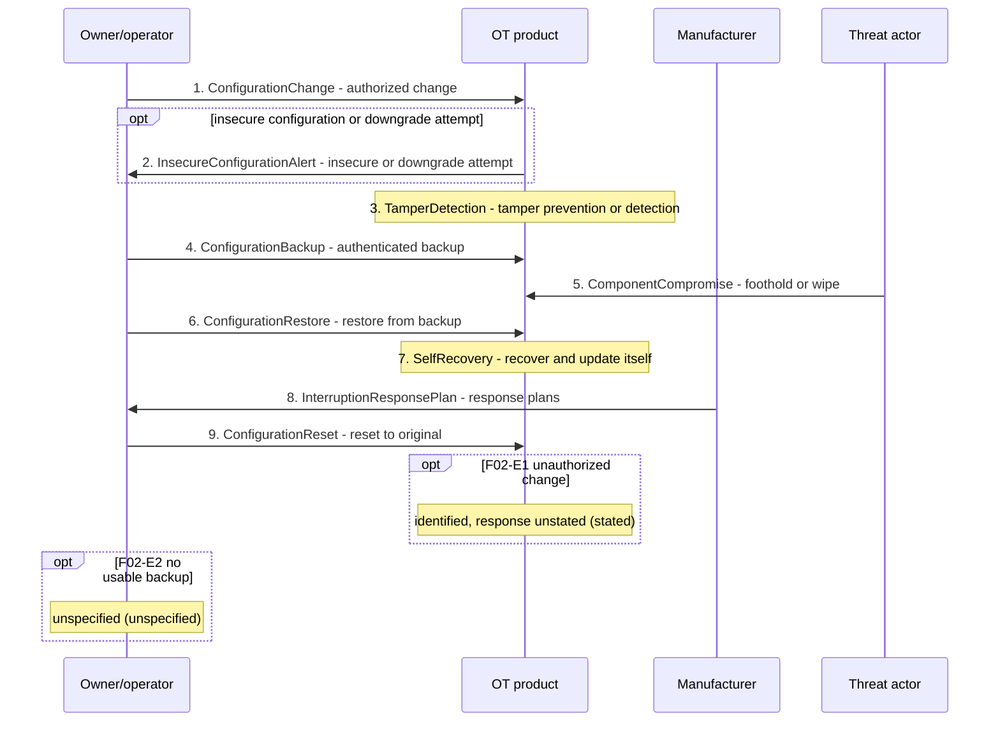

## F03. Logging and evidence of intrusion (Logging in the Baseline Product)

Logging names both the minimum event types and the fields every event record should carry.

<!-- q L362-363 "All event records should include" .. "event description." -->
> All event records should include a timestamp, source address and port, affected account details, correlation identifier, and event description.

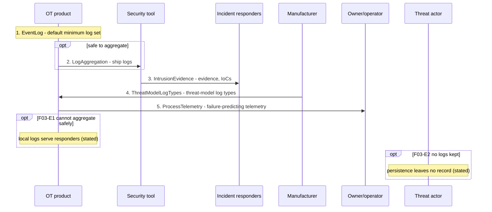

## F04. Data leaving the OT network and two-way connections (Protection of Data)

Remote access is shaped as push by default and a two-way connection only with the operator's approval; the approval check in the product also limits the damage of a segmentation mistake.

<!-- q L476-477 "If two-way connections are required," .. "to establish a connection." -->
> If two-way connections are required, buyers should seek out products that require an operator’s approval to establish a connection.

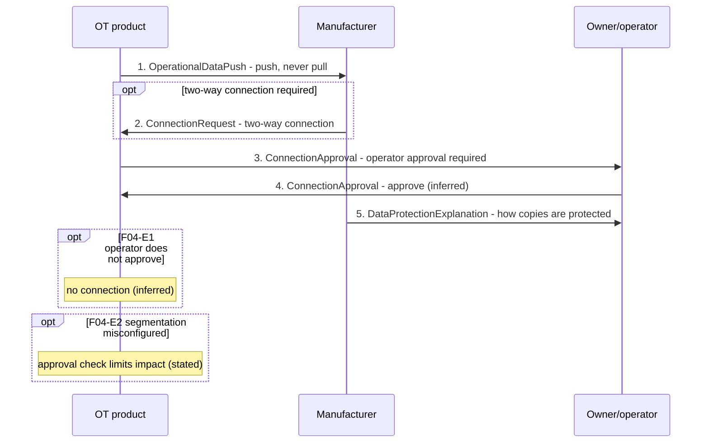

## F05. Authenticated device communication and certificates (Secure Communications; Summary element 7)

The element's design rule is that certificate failure must be visible and must not stop a critical process.

<!-- q L111-112 "fail loudly" .. "continue." -->
> fail loudly (e.g., when a certificate expires) but allows critical processes to continue.

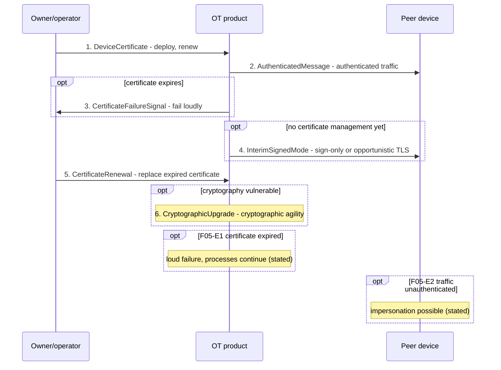

## F06. Handling commands on a hostile network (Secure Controls; Summary element 8)

Secure Controls asks the component itself to judge commands in context, because third-party tools see only traffic.

<!-- q L630-632 "If the intended system architecture" .. "the anomalous behavior." -->
> If the intended system architecture or specification is broken or does not follow the operational context, then a component may be able to ignore or respond to the anomalous behavior.

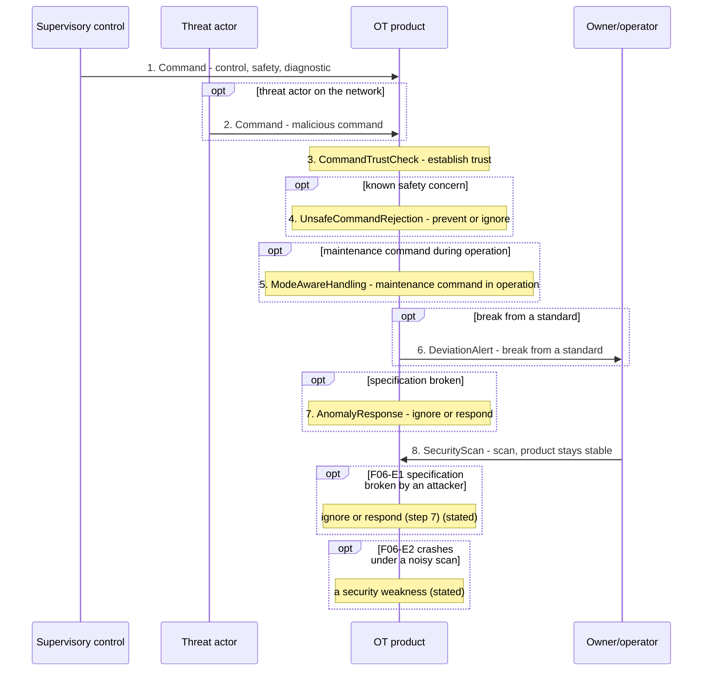

## F07. Authenticating changes to safety-critical equipment (Strong Authentication; Summary element 9)

The baseline is MFA at supervisory control, not on every sensor; the guide says outright that not every component needs MFA in the near term.

<!-- q L695-698 "Not every tiny sensor" .. "SCADA, HMI)." -->
> Not every tiny sensor or cheap component necessarily needs to support MFA in the near term, but baseline versions of industrial automation control systems should support MFA from supervisory control (e.g., engineering workstations, SCADA, HMI).

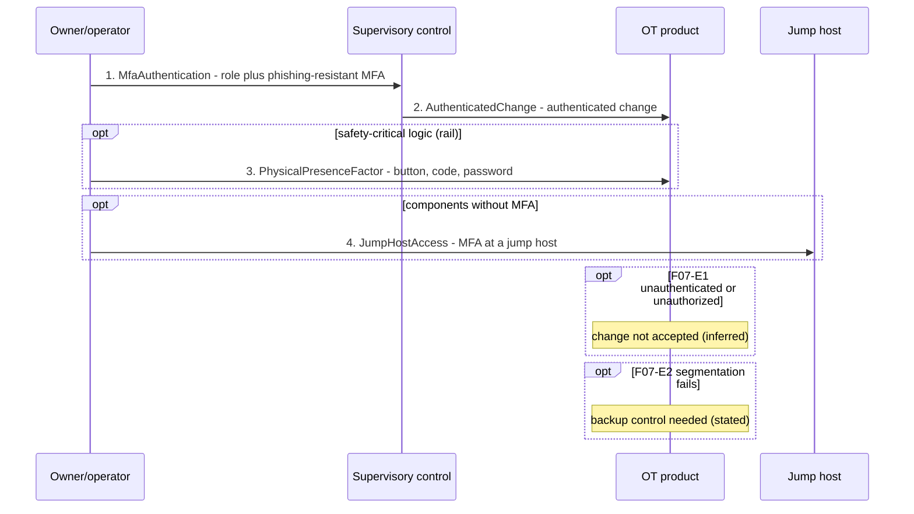

## F08. Vulnerability reporting, handling and disclosure (Vulnerability Management; Summary element 11)

The guide's most protocol-like element: it names the parties (reporter, manufacturer, CVE Program, users and the public) and the artifacts that pass between them, but no order; for the process it points to the CVE Program and ISO/IEC 29147 and 30111.

<!-- q L766-768 "A mature vulnerability handling process" .. "the following elements:" -->
> A mature vulnerability handling process is based on the CVE Program and established international standards, mainly ISO/IEC 29147 and ISO/IEC 30111, complies with all application legislation (such as the EU’s Cyber Resilience Act), and should contain at least the following elements:

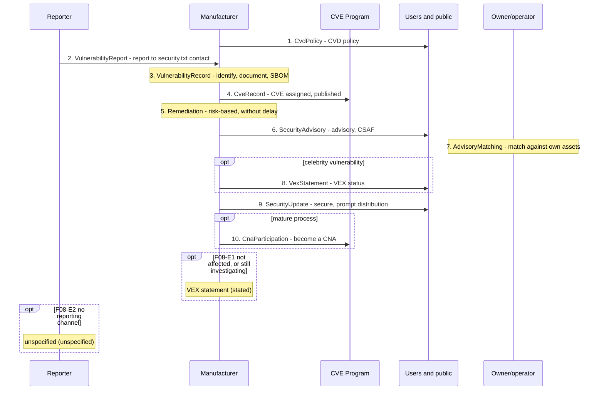

## F09. Testing, delivering and applying a patch (Upgrade and Patch Tooling; Threat Modeling)

Three properties the guide asks for: resilience (tested patches, automatic recovery), verification (authenticity, secure channel) and transparency (information, free updates, support period).

<!-- q L852 "For verification, buyers should be able to reliably determine" .. "of an update." -->
> For verification, buyers should be able to reliably determine the authenticity of an update.

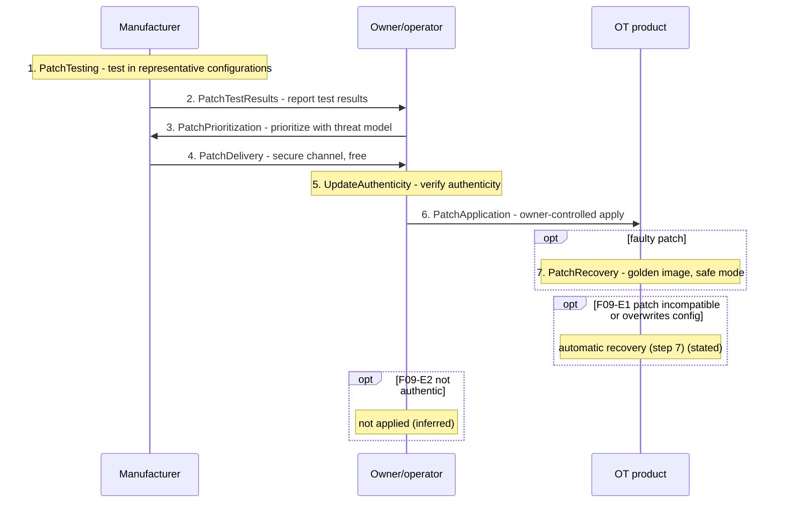

## F10. Support period, operating system end of life and retirement (Upgrade and Patch Tooling; Summary elements 11 and 12)

Transparency about the support period is what lets the operator plan; without it the guide predicts years of running a high-risk product.

<!-- q L860-861 "During the support period," .. "made available." -->
> During the support period, a buyer can expect that security vulnerabilities in their products will be handled and security updates will be made available.

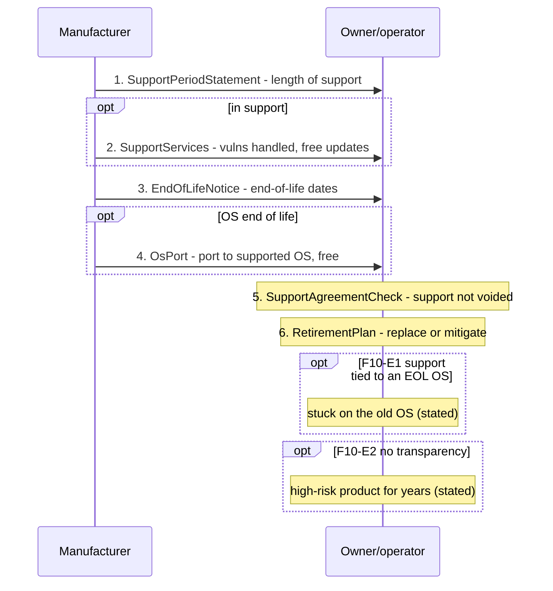

## F11. Reporting incidents to authorities (Contact Information)

The guide's own reporting channels, with the incident details to include when available.

<!-- q L890-893 "When available, please include" .. "contact." -->
> When available, please include the following information regarding the incident: date, time, and location of the incident; type of activity; number of people affected; type of equipment used for the activity; the name of the submitting company or organization; and a designated point of contact.

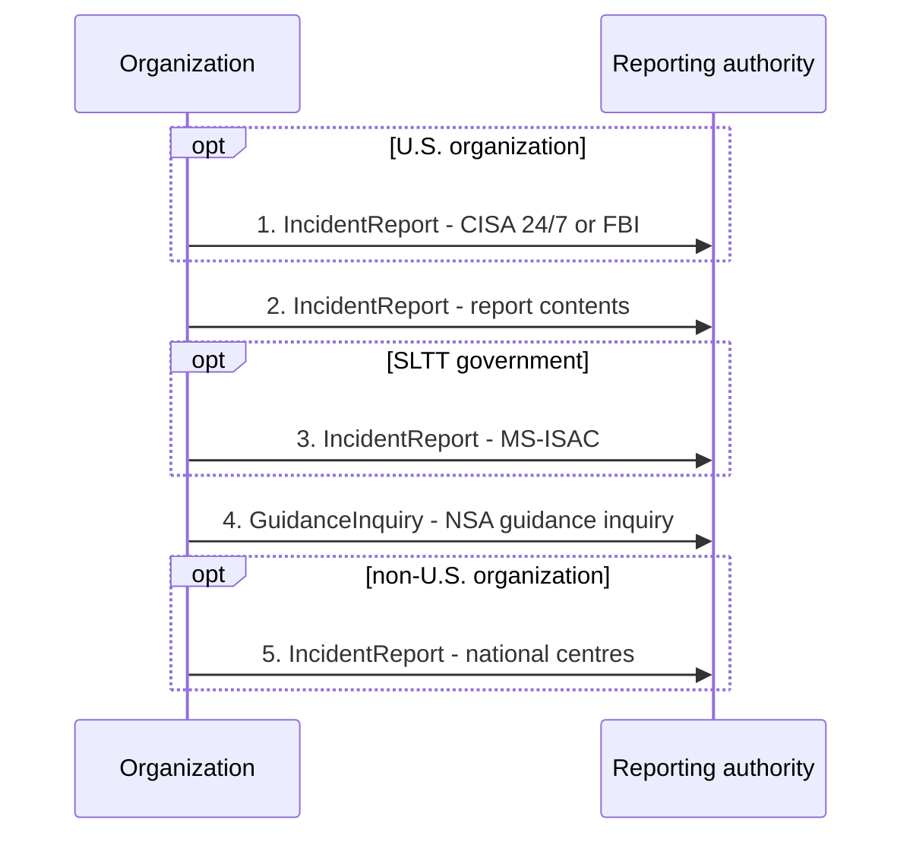

## F12. Asking agencies for guidance (Resources; Ownership; Vulnerability Management)

Requests for help the guide points to; it defines no response.

<!-- q L881-882 "For further guidance, reach out" .. "SecureByDesignOT@cisa.dhs.gov." -->
> For further guidance, reach out to the appropriate Sector Risk Management Agency or SecureByDesignOT@cisa.dhs.gov.

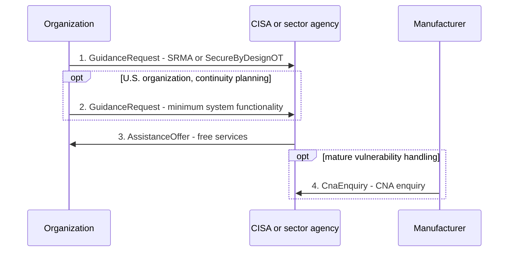

## F13. Secure by default alongside legacy devices (Secure by Default)

Backwards compatibility usually ships security disabled; the guide asks instead for security first with negotiated downgrades.

<!-- q L530-531 "seek manufacturers that develop backwards" .. "when necessary." -->
> seek manufacturers that develop backwards compatibility operating models that prioritize security features with negotiated downgrades when necessary.

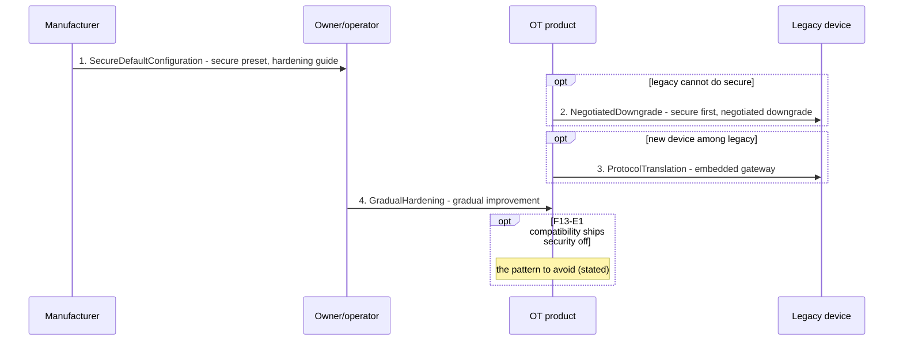

## Lifecycles

`state-machine.yaml` holds the lifecycles the guide states or implies: SM01 a candidate
product, SM02 product support, SM03 a vulnerability, SM04 device communication, SM05 the
product configuration, SM06 operating mode for commands, SM07 business continuity, SM08 a
patch on site, SM09 remote connectivity. No flow or lifecycle has a timer, deadline or
duration; the guide's only dates besides its own publication date are footnote 5's, for EU
instruments: the Radio Equipment Directive's Delegated Regulation applying from 1 August 2025 and
the Cyber Resilience Act in force since December 10, 2024.
