# Protocol model — Verifiable Credential Data Integrity 1.0

FX-1 pass 1, protocol and state-machine agent, from the source only. Machine-readable model: `protocol.yaml` (roles, 19 flows, error inventory, 21 source defects); lifecycles: `state-machine.yaml`. Every quotation below is a `<!-- q -->` marker whose words `bin/check-quotes --render` wrote from the cached .txt; the prose around them is this file's own.

## What kind of protocol this is

This document defines a data format (the proof and its properties) and local algorithms that two kinds of party run on their own: a proof creator adding proofs (§4.2, §4.3) and a verifier checking them (§4.4, §4.5) and the document's contexts (§4.6). It defines no request, response, transport or session between them. Protocol is not N/A all the same: the algorithms call across a fixed interface into a cryptosuite instance (§3), the verifier dereferences contexts and the security vocabulary (§2.4, the one HTTP exchange the text describes) and verification methods (§2.1, §5.9), domain and challenge only make sense as values passed from verifier to creator (§2.1), and Appendix A walks a three-party chain. So every flow is either a party's local processing with its calls into the cryptosuite and external resources, or a multi-party sequence whose deliveries the source does not define and this file marks inferred.

The document's own one-paragraph statement of the receiving side, which every verifier flow here elaborates:

<!-- q L541 -->
> When software needs to use information that was transmitted to it using a mechanism described by this specification, it performs the following steps:

## Roles

| role | kind | what it does here |
|---|---|---|
| `proof-creator` | party | The entity, and the application software acting for it, that secures a document: arranges it, picks contexts and cryptosuites, and adds one or more proofs (§4.1 first list, §4.2, §4.3). Supplies nonce, domain and challenge values through proof options. |
| `verifier` | party | The one role the document defines in §1.4. Receives a secured document, runs Verify Proof or Verify Proof Sets and Chains, then Context Validation, and supplies the expected proof purpose, domain and challenge. |
| `holder-or-intermediary` | party | Any party that receives a secured document and passes it on: may drop members of a proof set (Appendix A, non-normative) or, as a transmitting application, compact the document to what a receiver asks for (§2.4.1). Named only in those two places; holder is the VC Data Model role (§2.6). |
| `conforming-processor` | software | The implementation of the §4 algorithms used by either party. The document's own conformance class for software; obliged to produce errors on non-conforming input. |
| `cryptosuite-instance` | software component | The struct a cryptosuite instantiation algorithm returns; carries createProof and verifyProof, which the §4 algorithms call. All transformation, hashing, proof serialization and proof verification happens behind this interface. |
| `cryptosuite-specification` | document (conformance class) | A conforming cryptographic suite specification. Runtime-inert here: it is the target of the §3 authoring requirements and defines the instantiation algorithm and both interface algorithms. No flow sends it anything. |
| `vc-extensions` | external document | The Verifiable Credential Extensions document, where instantiation algorithms should be listed and may be discovered. |
| `context-source` | external resource | Wherever a JSON-LD context or the security vocabulary comes from: a local pinned copy, a cache, or the network (w3id.org with HTTP content negotiation). |
| `cid-document-source` | external resource | Wherever the controlled identifier document holding a verification method comes from. Some verification methods (did:key) need no fetch. Retrieval is defined by Controlled Identifiers v1.0, not here. |
| `controller` | entity | Controller of a verification method; for a credential or presentation, expected to be the issuer or holder. Does nothing in any flow; it is what the binding checks establish. |
| `error-consumer` | party | Another library or system that receives errors, over an HTTP interface or otherwise. Only the error encoding is defined; no request or exchange is. |
| `context-and-document-authors` | author (no runtime flow) | Authors of JSON-LD contexts, vocabularies and documents, addressed by advice and one SHOULD on cacheability; listed so the SHOULD has an actor. |

Conventions: arrows `->>` are calls inside one party's software, `--)` are deliveries between parties, which the source never defines and which are therefore always inferred. Step numbers in the diagrams are the source's own (the HTML ordered-list positions, nested lists as 3.2), and `0` is the invocation. Locators: § and the .txt heading number, then step n (asserted against the HTML ordered lists) or ¶n, the n-th non-blank .txt line of the section body (one per HTML block, an example's code counted once). Non-normative material (notes, examples, §1 to §1.2, Appendix A) is labelled where it is used.

## F01 Processing model, securing side

`secure-processing-model` · §4.1 · local-processing · run by proof-creator

The four things software does to make information tamper-evident, ending in Add Proof or Add Proof Set/Chain. Delivery of the result is not in the source.

<!-- q L536 -->
> The processing model used by a conforming processor and its application-specific software is described in this section. When software is to ensure information is tamper-evident, it performs the following steps:

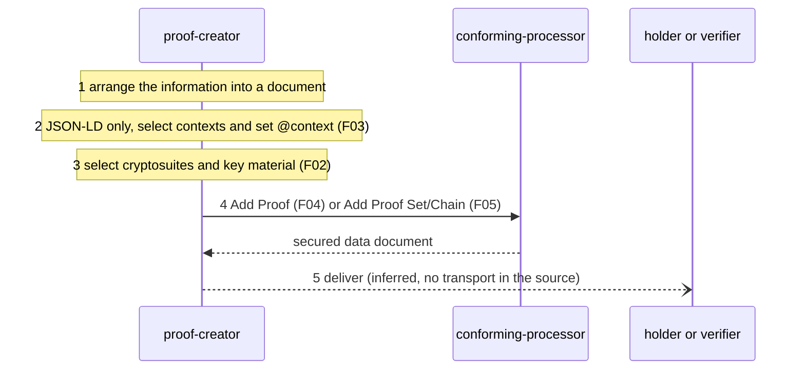

Inferred steps:

- seq 5 (§4.1 ¶6) — Deliver the secured document to a holder or verifier. The source defines no transport, request or delivery. The quoted sentence is the only mention of transmission and it is about the receiving side.

## F02 Obtaining a cryptosuite instance

`cryptosuite-instantiation` · §3, §2.1 · local-processing · run by proof-creator, verifier

A cryptosuite specification defines an instantiation algorithm from options to an instance; the instance offers createProof and verifyProof. How an instance reaches an algorithm is left to the implementation; how a verifier picks the instance for a given proof is not stated.

<!-- q L498 "The specification MUST define" .. "(struct cryptosuite)." -->
> The specification MUST define a data integrity cryptographic suite instantiation algorithm that accepts a set of options (map options) and returns a cryptosuite instance (struct cryptosuite).

<!-- q L507 "If an error is produced" .. "fail." -->
> If an error is produced, the verification process failed to complete. An error, such as a network error, does not mean that a future attempt at verification would fail.

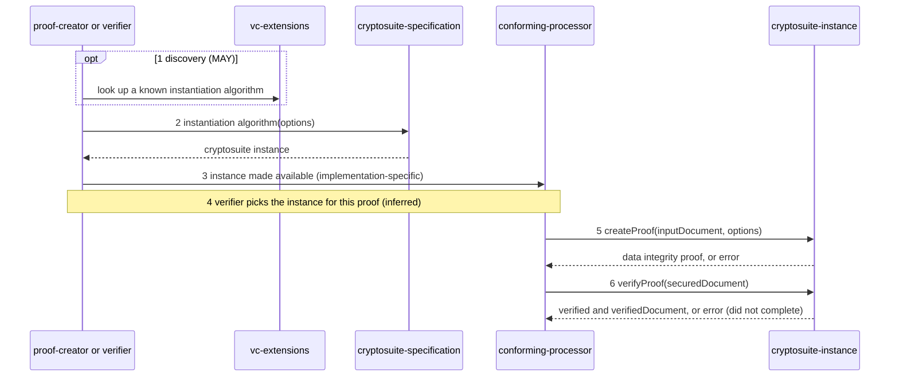

Error paths (every other step: on_error unspecified by source):

- seq 5 (§3 ¶11 (createProof)) — An error is a possible output of createProof; §4.2 step 1 says what the caller does with it. *(stated)*
- seq 6 (§3 ¶13 (verifyProof)) — Error output means the process did not complete, and a retry may succeed; §4.4 step 8 does not say what the caller does with it (F08 seq 9). *(stated)*

Inferred steps:

- seq 4 (§2.1 ¶12 (cryptosuite)) — A verifier selects the instance matching the proof it is about to check, presumably by proof.type and proof.cryptosuite. §4.4 takes a cryptosuite instance as input and never checks it against the proof; §2.1 only says the cryptosuite identifier can be used to verify the proof.

## F03 Context injection when securing

`context-injection` · §2.4.2, §4.2 · local-processing · run by proof-creator

Before a proof is created the securing implementation makes sure the Data Integrity terms are mapped, or deliberately omits @context and with it any extension.

<!-- q L445 -->
> When an application is securing a document, if an @context property is not provided in the document or the Data Integrity terms used in the document are not mapped by existing values in the @context property, implementations SHOULD inject or append an @context property with a value of https://w3id.org/security/data-integrity/v2 or one or more contexts with at least the same declarations, such as the Verifiable Credential Data Model v2.0 context (https://www.w3.org/ns/credentials/v2).

<!-- q L446 -->
> Implementations that do not intend to use JSON-LD processing MAY choose to not include an @context declaration at the top-level of the document. However, if an @context declaration is not included, extensions (such as the addition of new properties) related to this specification or corresponding cryptosuites MUST NOT be made.

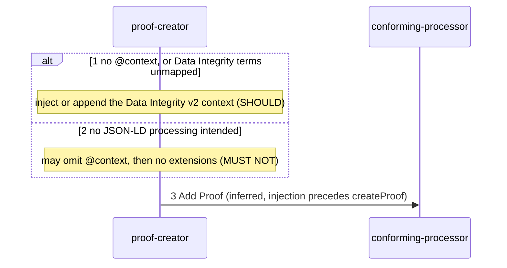

Inferred steps:

- seq 3 (§4.2 ¶2) — Hand the document to Add Proof; the injected context must be in place before createProof transforms the document. §2.4.2 says when securing but not at which step; anything added after createProof would not be covered by the proof, so it has to precede §4.2 step 1.

## F04 Add Proof

`add-proof` · §4.2 · local-processing · run by proof-creator

Calls createProof, checks the proof carries the three required properties and the requested domain and challenge, and attaches it as the document's proof.

<!-- q L550 -->
> Let proof be the result of calling the createProof algorithm specified in cryptosuite.createProof with inputDocument and options passed as a parameters. If the algorithm produces an error, the error MUST be propagated and SHOULD convey the error type.

<!-- q L551 -->
> If one or more of the proof.type, proof.verificationMethod, and proof.proofPurpose values is not set, an error MUST be raised and SHOULD convey an error type of PROOF_GENERATION_ERROR.

<!-- q L552 -->
> If options has a non-null domain item, it MUST be equal to proof.domain or an error MUST be raised and SHOULD convey an error type of PROOF_GENERATION_ERROR.

<!-- q L553 -->
> If options has a non-null challenge item, it MUST be equal to proof.challenge or an error MUST be raised and SHOULD convey an error type of PROOF_GENERATION_ERROR.

<!-- q L555 -->
> Set securedDataDocument.proof to the value of proof.

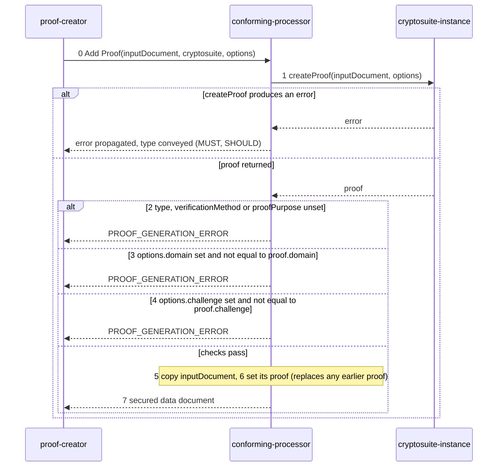

Error paths (every other step: on_error unspecified by source):

- seq 1 (§4.2 step 1) — The cryptosuite's error is propagated, conveying its type; this algorithm ends with an error output. *(stated)*
- seq 2 (§4.2 step 2) `PROOF_GENERATION_ERROR` — Raise an error, conveying PROOF_GENERATION_ERROR; output is an error. *(stated)*
- seq 3 (§4.2 step 3) `PROOF_GENERATION_ERROR` — Raise an error, conveying PROOF_GENERATION_ERROR. *(stated)*
- seq 4 (§4.2 step 4) `PROOF_GENERATION_ERROR` — Raise an error, conveying PROOF_GENERATION_ERROR. *(stated)*

## F05 Add Proof Set/Chain

`add-proof-set-chain` · §4.3 · local-processing · run by proof-creator

Adds one proof to an existing proof or set. With options.previousProof the new proof is computed over the document plus the named earlier proofs (a chain link); without it, over the document plus an empty proof list (a set member). The result's proof is always a list.

<!-- q L564 -->
> If options has a previousProof item that is a string, add the element from allProofs with an id attribute matching previousProof to matchingProofs. If a proof with id equal to previousProof does not exist in allProofs, an error MUST be raised and SHOULD convey an error type of PROOF_GENERATION_ERROR.

<!-- q L565 -->
> If options has a previousProof item that is an array, add each element from allProofs with an id attribute that matches an element of that array. If any element of previousProof list has an id attribute that does not match the id attribute of any element of allProofs, an error MUST be raised and SHOULD convey an error type of PROOF_GENERATION_ERROR.

<!-- q L566 -->
> Set inputDocument.proof to matchingProofs.

<!-- q L569 -->
> Run steps 1 through 6 of the algorithm in section 4.2 Add Proof, passing inputDocument, suite, and options. If no exceptions are raised, append the generated proof value to the allProofs; otherwise, raise the exception.

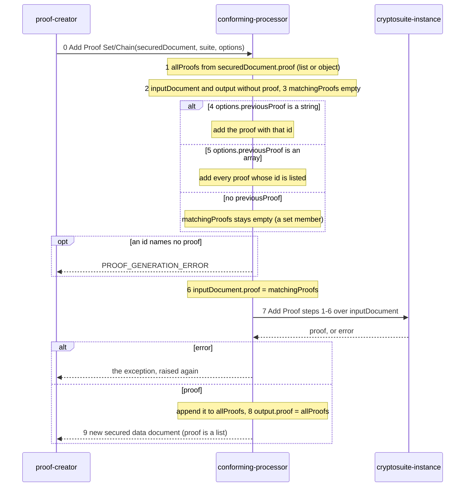

Error paths (every other step: on_error unspecified by source):

- seq 4 (§4.3 step 4) `PROOF_GENERATION_ERROR` — No proof with that id: raise an error, conveying PROOF_GENERATION_ERROR. *(stated)*
- seq 5 (§4.3 step 5) `PROOF_GENERATION_ERROR` — A listed value matching no proof id: raise an error, conveying PROOF_GENERATION_ERROR. *(stated)*
- seq 7 (§4.3 step 7) — Any exception from §4.2 steps 1-6 is raised again. *(stated)*

## F06 Lossless JSON-LD transformation

`json-ld-transformation-guard` · §2.4.3, §5.6 · local-processing · run by proof-creator, verifier

Applies wherever an implementation runs JSON-LD processing (RDF canonicalization) inside createProof or verifyProof: dropped data is an error, the base URL is null, poisoned datasets halt.

<!-- q L452 -->
> Implementations that use JSON-LD processing, such as RDF Dataset Canonicalization [RDF-CANON], MUST throw an error, which SHOULD be DATA_LOSS_DETECTION_ERROR, when data is dropped by a JSON-LD processor, such as when an undefined term is detected in an input document.

<!-- q L453 "When deserializing" .. "null." -->
> When deserializing to RDF, implementations MUST ensure that the base URL is set to null.

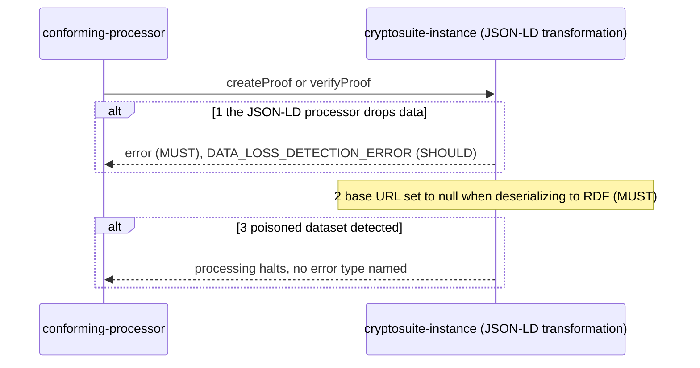

Error paths (every other step: on_error unspecified by source):

- seq 1 (§2.4.3 ¶3) `DATA_LOSS_DETECTION_ERROR` — Throw an error, preferably DATA_LOSS_DETECTION_ERROR; the code is not in §4.7 (D-09). *(stated)*
- seq 3 (§5.6 ¶4) — Processing halts; the source names no error type. PROOF_TRANSFORMATION_ERROR is the only §4.7 code for the transformation process, but nothing links the two. *(inferred)*

## F07 Processing model, receiving side

`receive-processing-model` · §4.1, §5.7 · receive-processing · run by verifier

Transform, validate against a schema, verify, validate contexts, then act only on what the library returned as verified.

<!-- q L435 "Context validation MUST" .. "Chains." -->
> Context validation MUST be run after running the applicable algorithm in either Section 4.4 Verify Proof or Section 4.5 Verify Proof Sets and Chains.

<!-- q L734 -->
> Implementers and developers are urged to not trust information that contains a data integrity proof unless the proof has been verified and the verified data is provided in a return value from a software library that has confirmed that all data returned has been successfully protected.

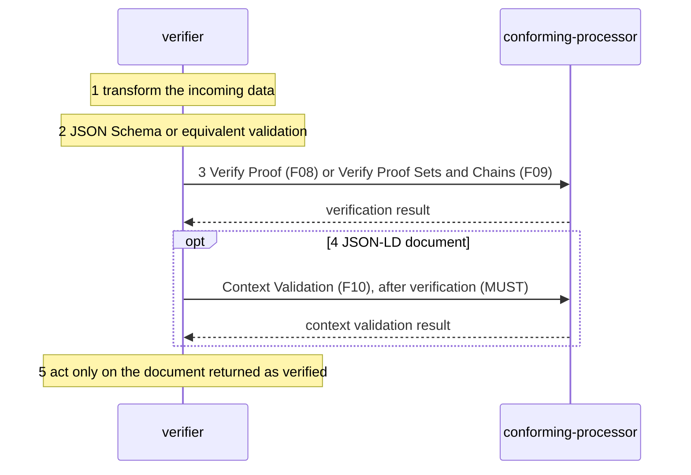

Error paths (every other step: on_error unspecified by source):

- seq 2 (§4.1 second list step 2) — The source states no outcome for a schema failure. Reading: reject; §1.3's error obligation reaches it only where the failure makes the document non-conforming. *(inferred)*

## F08 Verify Proof

`verify-proof` · §4.4 · receive-processing · run by verifier

Parses the bytes, requires a single proof object with type, verificationMethod and proofPurpose, checks the optional expected purpose, domain and challenge, hands the whole document to verifyProof and returns its verdict with the input media type.

<!-- q L599 -->
> When a step says "an error MUST be raised", it means that a verification result MUST be returned with a verified value of false and a non-empty errors list.

<!-- q L601 -->
> If either securedDocument is not a map or securedDocument.proof is not a map, an error MUST be raised and SHOULD convey an error type of PARSING_ERROR.

<!-- q L603 -->
> If one or more of proof.type, proof.verificationMethod, and proof.proofPurpose does not exist, an error MUST be raised and SHOULD convey an error type of PROOF_VERIFICATION_ERROR.

<!-- q L605 -->
> If domain was given, and it does not contain the same strings as proof.domain (treating a single string as a set containing just that string), an error MUST be raised and SHOULD convey an error type of INVALID_DOMAIN_ERROR.

<!-- q L606 -->
> If challenge was given, and it does not match proof.challenge, an error MUST be raised and SHOULD convey an error type of INVALID_CHALLENGE_ERROR.

<!-- q L607 -->
> Let cryptosuiteVerificationResult be the result of running the cryptosuite.verifyProof algorithm with securedDocument provided as input.

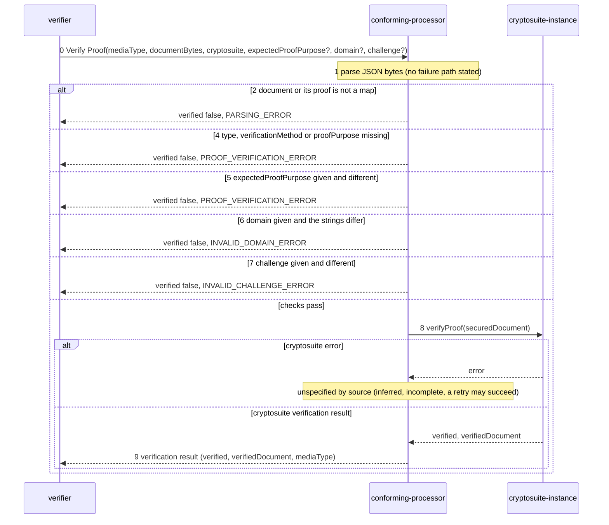

Error paths (every other step: on_error unspecified by source):

- seq 2 (§4.4 step 2) `PARSING_ERROR` — Return verified false with a non-empty errors list, conveying PARSING_ERROR. A proof list (set or chain) ends here. *(stated)*
- seq 4 (§4.4 step 4) `PROOF_VERIFICATION_ERROR` — Return verified false with errors, conveying PROOF_VERIFICATION_ERROR. *(stated)*
- seq 5 (§4.4 step 5) `PROOF_VERIFICATION_ERROR` — Return verified false with errors, conveying PROOF_VERIFICATION_ERROR. *(stated)*
- seq 6 (§4.4 step 6) `INVALID_DOMAIN_ERROR` — Return verified false with errors, conveying INVALID_DOMAIN_ERROR. *(stated)*
- seq 7 (§4.4 step 7) `INVALID_CHALLENGE_ERROR` — Return verified false with errors, conveying INVALID_CHALLENGE_ERROR. *(stated)*
- seq 9 (§4.4 step 8) — §4.4 does not say what to do when verifyProof produces an error; §3 says the process did not complete and a later attempt may succeed. Reading: return no verdict (an incomplete outcome), distinct from verified false. *(inferred)*

## F09 Verify Proof Sets and Chains

`verify-proof-sets-and-chains` · §4.5 · receive-processing · run by verifier

Verifies every proof in the list, each over the document plus the proofs its previousProof names, then folds the per-proof results into one combined result. Modelled as printed; the defects listed below make the printed algorithm unimplementable without repair.

<!-- q L624 -->
> If proof contains a previousProof attribute and the value of that attribute is a string, add the element from allProofs with an id attribute value matching the value of previousProof to matchingProofs. If a proof with id value equal to the value of previousProof does not exist in allProofs, an error MUST be raised and SHOULD convey an error type of PROOF_VERIFICATION_ERROR. If the previousProof attribute is a list, add each element from allProofs with an id attribute value that matches the value of an element of that list. If any element of previousProof list has an id attribute value that does not match the id attribute value of any element of allProofs, an error MUST be raised and SHOULD convey an error type of PROOF_VERIFICATION_ERROR.

<!-- q L625 -->
> Let inputDocument be a copy of securedDocument with the proof value removed and then set inputDocument.proof to matchingProofs.

<!-- q L628 -->
> Run steps 4 through 8 of the algorithm in section 4.4 Verify Proof on inputDocument; if no exceptions are raised, append cryptosuiteVerificationResult to verificationResults.

<!-- q L630 -->
> Let combinedVerificationResult be an empty struct. Set combinedVerificationResult.status to true, combinedVerificationResult.document to null, and combinedVerificationResult.mediaType to null.

<!-- q L632 -->
> If cryptosuiteVerificationResult.verified is false, set combinedVerificationResult.verified to false.

<!-- q L634 -->
> If combinedVerificationResult.status is false, set combinedVerificationResult.document to null and combinedVerificationResult.mediaType to null.

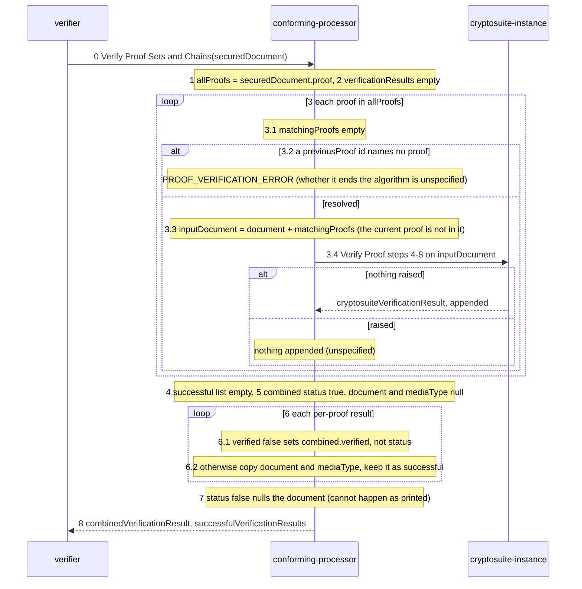

Error paths (every other step: on_error unspecified by source):

- seq 5 (§4.5 step 3.2) `PROOF_VERIFICATION_ERROR` — An unresolved id raises an error conveying PROOF_VERIFICATION_ERROR. Whether that ends the whole algorithm or only this proof is unspecified: the definition of raising an error is §4.4's, not this section's. *(stated)*
- seq 7 (§4.5 step 3.4) — Unspecified: a proof whose steps raise is simply not appended, so its failure never reaches the combined result (D-04). *(unspecified)*

Defects bearing on this flow: D-01, D-02, D-03, D-04, D-05, D-21 (see *Source defects*).

## F10 Context Validation

`context-validation` · §4.6 · receive-processing · run by verifier

Accepts the document only if its @context equals the known list, no subtree carries its own @context and every referenced context matches a known value or hash; otherwise recompacts to the known context, or fails.

<!-- q L652 -->
> If contextValue does not deeply equal knownContext, any subtree in result.validatedDocument contains an @context property, or any URI in contextValue dereferences to a JSON-LD Context file that does not match a known good value or cryptographic hash, then perform the applicable action:

<!-- q L653 -->
> If recompact is true, set result.validatedDocument to the result of running the JSON-LD Compaction Algorithm with the inputDocument and knownContext as inputs. If the compaction fails, add at least one error to result.errors.

<!-- q L655 -->
> If result.errors is empty, set result.validated to true; otherwise, set result.validated to false, and remove the document property from result.

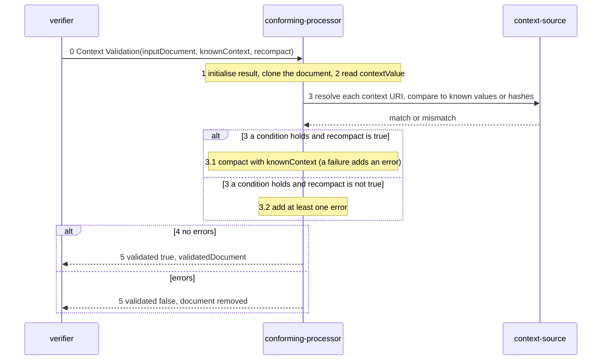

Error paths (every other step: on_error unspecified by source):

- seq 4 (§4.6 step 3.1) — Compaction failure adds at least one error. *(stated)*
- seq 5 (§4.6 step 3.2) — The error is the outcome; no code is named. *(stated)*

## F11 Resolving contexts and the security vocabulary

`context-and-vocabulary-resolution` · §2.4, §5.14, §4.6 · exchange · run by proof-creator, verifier

Three context URLs and the vocabulary are pinned by hash and treated as already resolved; the vocabulary URL is content-negotiated; application contexts may come from the network in development and should be cached permanently in production.

<!-- q L406 -->
> Implementations that perform JSON-LD processing MUST treat the following JSON-LD context URLs as already resolved, where the resolved document matches the corresponding hash values below:

<!-- q L429 -->
> Implementations MAY load application-specific JSON-LD context files from the network during development, but SHOULD permanently cache JSON-LD context files used by conforming secured documents in production settings, to increase their security and privacy characteristics. Goals of processing speed MAY be achieved through caching approaches such as those described above or functionally equivalent mechanisms.

<!-- q L780 -->
> When it is not possible to use cached information, such as when a specific HTTP URL-based instance of a verification method is encountered for the first time, implementers are cautioned to use defensive measures to mitigate denial-of-service attacks during any process that might fetch a resource from the network.

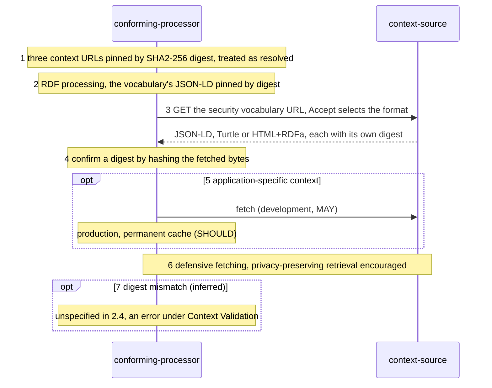

Error paths (every other step: on_error unspecified by source):

- seq 7 (§4.6 ¶14) — Unspecified in §2.4; under §4.6 a mismatching context is an error unless recompaction succeeds (F10). *(inferred)*

Inferred steps:

- seq 7 (§4.6 ¶14) — A retrieved context whose bytes do not match the pinned or known hash. §2.4 says to treat the URLs as resolved where the document matches; it never says what happens on mismatch. The only consequence the source states is §4.6 step 3's error.

## F12 Retrieving and binding the verification method

`verification-method-retrieval` · §2.1, §5.9, §5.10, §2.6 · out-of-scope · run by verifier

The proof's verificationMethod URL locates public key material in a controlled identifier document. The retrieval algorithm, the binding check and verification relationship validation are Controlled Identifiers v1.0 §3.3's. This document states why they matter, not how they run, and never says which component runs them.

<!-- q L749 -->
> Implementers ensure that a verification method is bound to a particular controller by going from the definition of the verification method to the controlled identifier document, and then ensuring that the controlled identifier document also contains a reference to the verification method. This process is described in the algorithm for retrieving a verification method.

<!-- q L753 -->
> When an implementation is verifying a proof, it is imperative that it verify not only that the verification method used to generate the proof is listed in the controlled identifier document, but also that it was intended to be used to generate the proof that is being verified. This process is known as "verification relationship validation".

<!-- q L754 -->
> The process of validating a verification relationship is outlined in Section 3.3 Retrieve Verification Method of the Controlled Identifiers v1.0 specification.

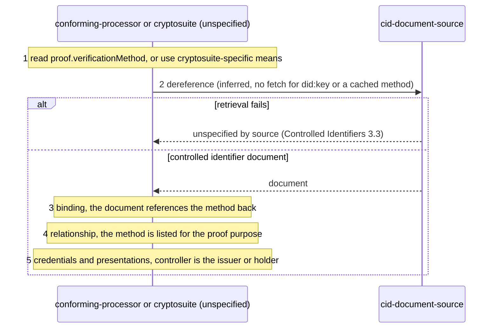

Error paths (every other step: on_error unspecified by source):

- seq 6 (§5.10 ¶2) — unspecified by source (Controlled Identifiers v1.0 §3.3) *(unspecified)*

Inferred steps:

- seq 2 (§2.1 ¶10 (verificationMethod)) — Dereference the URL to the controlled identifier document, unless the method needs no fetch (did:key). No step of this document dereferences anything; the act is implied by the location the URL points to and by §5.14's network concern.
- seq 6 (§5.10 ¶2) — Retrieval or binding fails. The failure path belongs to Controlled Identifiers v1.0, which this record does not hold; no error code for it is in §4.7.

## F13 Checks the verifier owes that §4.4 does not perform

`verifier-checks-outside-the-algorithm` · §2.6, §2.1, §5.11, §5.10 · receive-processing · run by verifier

Validity period, domain use, proof purpose and chain dependency are stated as verifier obligations in prose or property definitions, but only purpose, domain and challenge appear in §4.4, and only when the caller passes them.

<!-- q L485 "When verifying a proof" .. "between created and expires )." -->
> When verifying a proof, it is important to ensure that the time of interest (which might be the current time or any other time) is within the validity period for the proof (that is, between created and expires ).

<!-- q L759 -->
> When an implementation is verifying a proof, it is imperative that it verify that the proof purpose match the intended use.

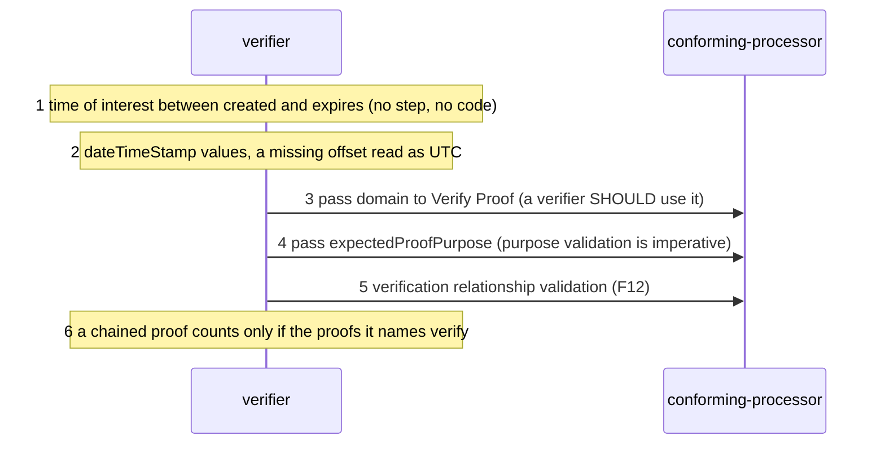

Error paths (every other step: on_error unspecified by source):

- seq 1 (§2.6 ¶3) — No error code exists for an expired or not-yet-valid proof; the outcome is unspecified. *(unspecified)*

## F14 Domain and challenge

`domain-and-challenge-exchange` · §2.1, §4.1, §4.4 · exchange · run by verifier, proof-creator

The nearest the source comes to an exchange between parties: the verifier's domain and a one-time challenge reach the proof creator, who binds them into the proof; the verifier checks them. The source names no message carrying either value.

<!-- q L219 "The specification of the domain parameter" .. "known to the creator of the proof." -->
> The specification of the domain parameter is useful in challenge-response protocols where the verifier is operating from within a security domain known to the creator of the proof.

<!-- q L221 "The value is used once" .. "mitigate replay attacks." -->
> The value is used once for a particular domain and window of time. This value is used to mitigate replay attacks.

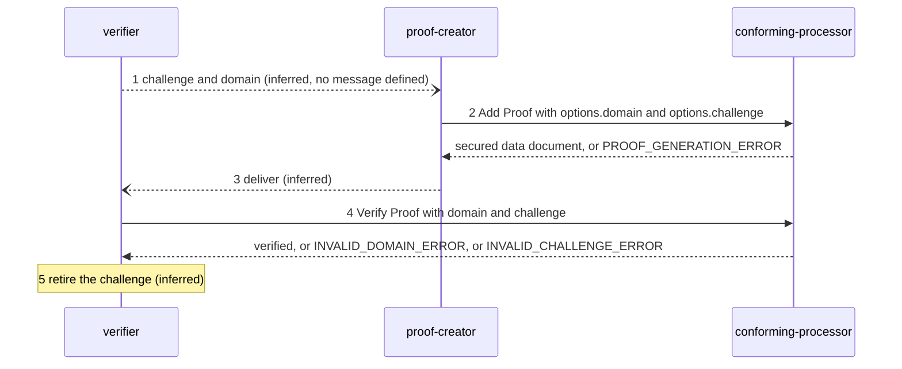

Error paths (every other step: on_error unspecified by source):

- seq 2 (§2.1 ¶20 (challenge)) `PROOF_GENERATION_ERROR` — F04 steps 3-4 raise PROOF_GENERATION_ERROR if createProof did not carry them over. *(stated)*
- seq 4 (§4.4 step 6-7) `INVALID_DOMAIN_ERROR, INVALID_CHALLENGE_ERROR` — Verified false with INVALID_DOMAIN_ERROR or INVALID_CHALLENGE_ERROR. *(stated)*

Inferred steps:

- seq 1 (§2.1 ¶18 (domain)) — Send a challenge, with the verifier's security domain. The source says domain is useful in challenge-response protocols and that a challenge is used once per domain and time window; it defines no request carrying them.
- seq 3 (§4.1 ¶6) — Deliver the secured document. No delivery is defined anywhere in the source.
- seq 5 (§2.1 ¶20 (challenge)) — Retire the challenge so it cannot be accepted twice in that domain and window. Single use is stated as a property of the value; no step records use and no error code covers a replayed challenge (INVALID_CHALLENGE_ERROR is defined as a mismatch).

## F15 A proof chain built by three signatories

`proof-chain-across-parties` · Appendix A, §6.3 · exchange · run by proof-creator, verifier · **non-normative (Appendix A)**

Appendix A's approval chain: each signatory verifies what it received, then adds a proof whose previousProof names the last one. Delivery between them is not defined.

<!-- q L916 "If verification is successful" .. "this:" -->
> If verification is successful, the CEO signs, producing a proof over the document which includes urn:proof-1 and urn:proof-2. The final proof chain looks like this:

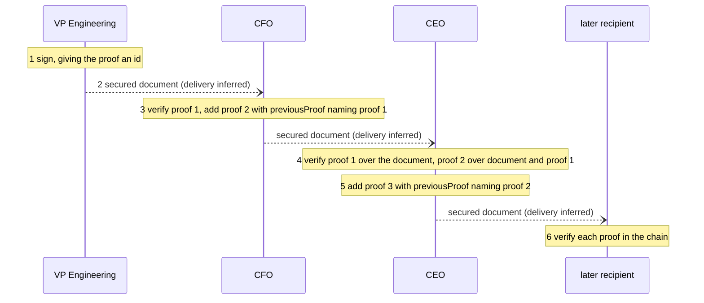

Inferred steps:

- seq 2 (Appendix A ¶14) — Pass the document on. The appendix says the CFO receives the document; how is not said.

## F16 Dropping a member of a proof set

`proof-set-member-removal` · Appendix A · exchange · run by holder-or-intermediary, verifier · **non-normative (Appendix A)**

Set members each cover only the document, so an intermediary can remove one and the rest still verify; a chain is the remedy.

<!-- q L871 "A" .. "will still verify." -->
> A holder or any other intermediary receiving a secured data document containing a proof set is able to remove any of the proof values within the set prior to passing it on to another entity and the secured data document will still verify.

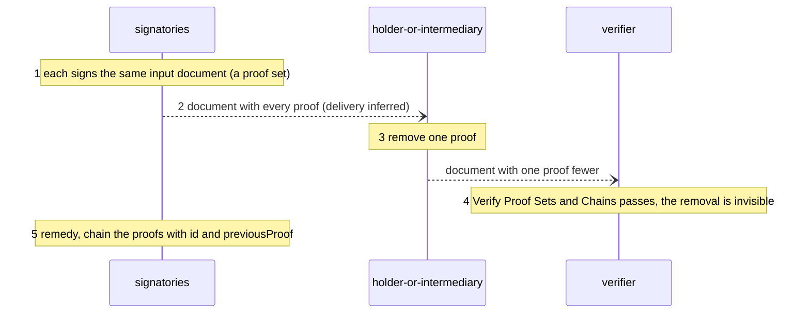

Inferred steps:

- seq 2 (Appendix A ¶10) — The document reaches a holder or intermediary. Delivery is not defined.

## F17 Sender compacts to the receiver's context

`recompaction-for-receiver` · §2.4.1 · exchange · run by holder-or-intermediary, verifier

An alternative to §4.6: the transmitter compacts the document to exactly what the receiver asks for, dropping sender-specific contexts; valid if the cryptosuite still verifies it.

<!-- q L440 "As long as the cryptography suite's" .. "omitted context." -->
> As long as the cryptography suite's verification algorithm provides a successful verification result, such transformations are valid and would result in full URLs for terms that were previously compacted by the omitted context.

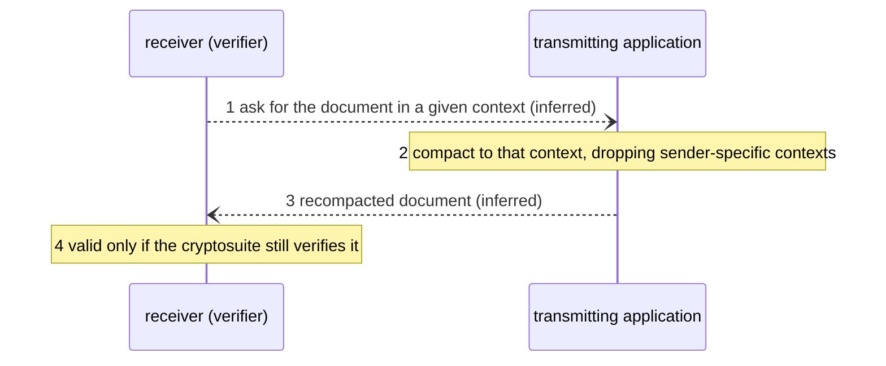

Inferred steps:

- seq 1 (§2.4.1 ¶6) — Ask for the document in a given context, e.g. in a presentation request. The source names such a protocol only as an example and defines no message.
- seq 3 (§2.4.1 ¶6) — Send the compacted document. Delivery is not defined.

## F18 Integrity of linked resources

`resource-integrity` · §2.3 · local-processing · run by proof-creator, verifier

A document may pin a linked resource with digestMultibase; the source defines the property but no comparison step and no error.

<!-- q L388 -->
> To enable confirmation that a resource referenced by a conforming secured document has not changed since the document was secured, an implementer MAY include a property named digestMultibase in any object that includes an id property. If present, the digestMultibase value MUST be a single string value, or an list of string values, each of which is a Multibase-encoded Multihash value.

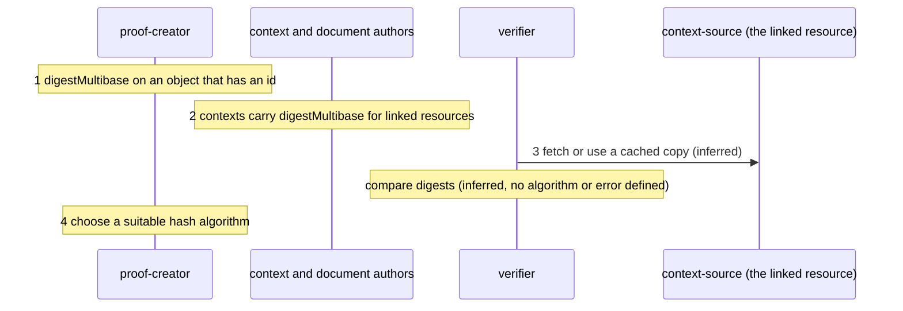

Inferred steps:

- seq 3 (§2.3 ¶1) — Fetch or look up the resource and compare its digest. The goal is stated; no algorithm, error code or outcome is.

## F19 Conveying errors

`error-reporting` · §1.3, §4.7, §4.4 · local-decision · run by conforming-processor

Errors are conveyed with codes; exposed over HTTP they should be RFC 9457 ProblemDetails whose type URL is the security namespace plus the code.

<!-- q L662 -->
> When exposing these errors through an HTTP interface, implementers SHOULD use [RFC9457] to encode the error data structure as a ProblemDetails map. If [RFC9457] is used:

<!-- q L663 -->
> The type value of the error object MUST be a URL that starts with the value https://w3id.org/security# and ends with the value in the section listed below.

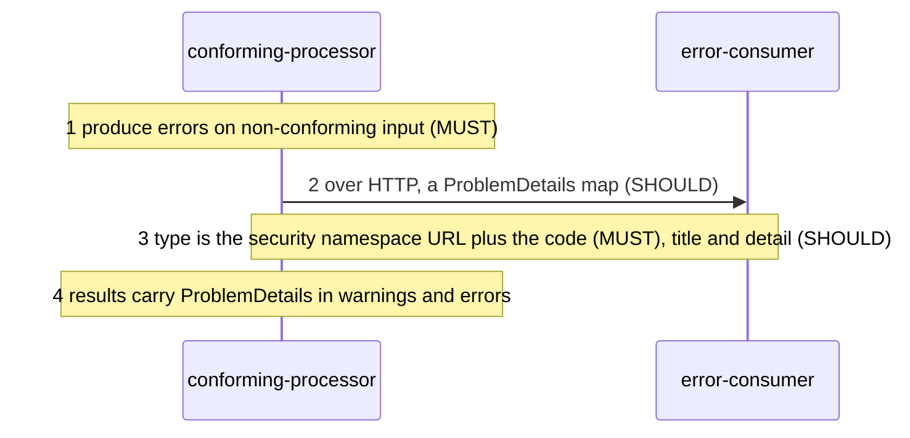

Inferred steps:

- seq 4 (§4.4 ¶22 (warnings)) — Results carry ProblemDetails lists in warnings and errors whatever the interface. The verification and context validation result structs define warnings and errors as lists of ProblemDetails; §4.7's SHOULD is only about HTTP.

## Errors

| code | defined | raised at | note |
|---|---|---|---|
| `PROOF_GENERATION_ERROR` | §4.7 | §4.2 step 2; §4.2 step 3; §4.2 step 4; §4.3 step 4; §4.3 step 5 |  |
| `PROOF_VERIFICATION_ERROR` | §4.7 | §4.4 step 4; §4.4 step 5; §4.5 step 3.2 | Its description points to §4.4 only, though §4.5 raises it. |
| `PROOF_TRANSFORMATION_ERROR` | §4.7 | no step of this document raises it | Defined for the transformation process; no algorithm here raises it. Left to cryptosuites (§4.7 ¶1). |
| `INVALID_DOMAIN_ERROR` | §4.7 | §4.4 step 6 |  |
| `INVALID_CHALLENGE_ERROR` | §4.7 | §4.4 step 7 |  |
| `PARSING_ERROR` | not in §4.7; the HTML links it to the VC Data Model 2.0 anchor | §4.4 step 2 |  |
| `DATA_LOSS_DETECTION_ERROR` | nowhere in this document (a code span, no link) | §2.4.3 ¶3 |  |

What raising an error means differs by algorithm, which is the root of D-04:

- **§4.4** — Raising an error returns a verification result with verified false and a non-empty errors list; it is a value, not an exception.
- **§4.2** — The output is a secured data document or an error.
- **§4.3** — Errors raised in steps 4, 5 and 7, but the output clause names no error (D-12); step 7 re-raises.
- **§4.5** — No definition of its own; step 3.4 speaks of exceptions, which §4.4's definition does not produce (D-04).
- **§4.6** — Errors accumulate in result.errors; any error makes validated false.
- **§3** — A cryptosuite error means the process did not complete and is not a negative verdict; a retry may succeed.
- **Appendix B** — Numeric error codes were removed before REC (non-normative history).

<!-- q L599 -->
> When a step says "an error MUST be raised", it means that a verification result MUST be returned with a verified value of false and a non-empty errors list.

## Source defects and tensions

Kept as the source prints them; the flows and machines model the printed text and name the defect where it bites. Ids are shared with `protocol.yaml` and `state-machine.yaml`.

### D-01 — §4.5 step 5; §4.5 step 6.1; §4.5 step 7 (source defect)

The combined result is initialised with status, the failure branch sets verified, and step 7 tests status. Nothing ever sets status to false, so step 7 never fires and a failed proof leaves status true beside verified false.

Consequence: An implementation reading status accepts a chain with a failing proof; one reading verified gets a document from the last successful proof even when another failed, because step 7 does not null it.

<!-- q L630 -->
> Let combinedVerificationResult be an empty struct. Set combinedVerificationResult.status to true, combinedVerificationResult.document to null, and combinedVerificationResult.mediaType to null.

<!-- q L632 -->
> If cryptosuiteVerificationResult.verified is false, set combinedVerificationResult.verified to false.

<!-- q L634 -->
> If combinedVerificationResult.status is false, set combinedVerificationResult.document to null and combinedVerificationResult.mediaType to null.

### D-02 — §4.5 step 6.2; §3 ¶13 (verifyProof) (source defect)

Reads mediaType from a cryptosuite verification result, which §3 defines with verified and verifiedDocument only; §4.5 takes no mediaType input either.

<!-- q L633 -->
> Otherwise, set combinedVerificationResult.document to cryptosuiteVerificationResult.verifiedDocument, set combinedVerificationResult.mediaType to cryptosuiteVerificationResult.mediaType, and append cryptosuiteVerificationResult to successfulVerificationResults.

<!-- q L502 "The" .. "items:" -->
> The cryptosuite verification result is a struct that contains the following items:

### D-03 — §4.5 step 3.3; §4.5 step 3.4; §4.4 step 8; §4 ¶1 (source defect)

Steps 4-8 of §4.4 are run on inputDocument, whose proof is matchingProofs: the proof under iteration is never placed in it, so step 8 hands verifyProof a document carrying only the earlier proofs, or an empty proof list for a proof with no previousProof, which §4 does not call a secured data document. The same steps read cryptosuite, expectedProofPurpose, domain and challenge, none of which §4.5 takes.

Consequence: Not implementable as printed. An implementation must pass the current proof separately (or as the document's proof, with matchingProofs bound alongside) and choose a cryptosuite per proof; both are inferred repairs.

<!-- q L625 -->
> Let inputDocument be a copy of securedDocument with the proof value removed and then set inputDocument.proof to matchingProofs.

<!-- q L628 -->
> Run steps 4 through 8 of the algorithm in section 4.4 Verify Proof on inputDocument; if no exceptions are raised, append cryptosuiteVerificationResult to verificationResults.

<!-- q L607 -->
> Let cryptosuiteVerificationResult be the result of running the cryptosuite.verifyProof algorithm with securedDocument provided as input.

<!-- q L531 "A secured" .. "values." -->
> A secured data document is a map that contains one or more proof values.

### D-04 — §4.4 ¶25; §4.5 step 3.4 (source defect)

§4.4 defines raising an error as returning a result; §4.5 step 3.4 appends a result only if no exception is raised and says nothing otherwise. A proof that fails steps 4-7, or whose previousProof does not resolve, contributes nothing to verificationResults.

Consequence: Fail-open reading: the combined result can be true while a proof failed its checks.

<!-- q L599 -->
> When a step says "an error MUST be raised", it means that a verification result MUST be returned with a verified value of false and a non-empty errors list.

<!-- q L628 -->
> Run steps 4 through 8 of the algorithm in section 4.4 Verify Proof on inputDocument; if no exceptions are raised, append cryptosuiteVerificationResult to verificationResults.

### D-05 — §4.5 step 1; §4.3 step 1 (gap)

Assumes securedDocument.proof is a list; a single proof object is not handled (§4.3 step 1 handles both).

<!-- q L620 -->
> Set allProofs to securedDocument.proof.

<!-- q L561 -->
> Let proof be set to securedDocument.proof. Let allProofs be an empty list. If proof is a list, copy all the elements of proof to allProofs. If proof is an object add a copy of that object to allProofs.

### D-06 — §4.4 ¶20 (mediaType); §4.4 step 9 (source defect)

The result definition says verifiedDocument and mediaType are null when verified is false; step 9 copies the input mediaType unconditionally.

<!-- q L594 -->
> Null, if verified is false; otherwise, a media type, which MAY include parameters

<!-- q L614 -->
> mediaType

### D-07 — §4.6 step 4; §4.6 ¶6 (validatedDocument) (source defect)

Removes a document property that the result does not have; its item is validatedDocument, which the definition says is null, not absent, when validated is false.

<!-- q L655 -->
> If result.errors is empty, set result.validated to true; otherwise, set result.validated to false, and remove the document property from result.

<!-- q L644 -->
> Null, if validated is false; otherwise, an input document

### D-08 — §4.6 step 1 (source defect)

compactionContext is initialised and never used.

<!-- q L650 -->
> Set result.validated to false, result.warnings to an empty list, result.errors to an empty list, compactionContext to an empty list; and clone inputDocument to result.validatedDocument.

### D-09 — §4.7 ¶3; §4.4 step 2; §2.4.3 ¶3 (source defect)

PARSING_ERROR and DATA_LOSS_DETECTION_ERROR are conveyed by normative steps but not listed in §4.7, so §4.7's type-URL rule yields no URL for them; PARSING_ERROR's link points into the VC Data Model instead. PROOF_TRANSFORMATION_ERROR is listed and raised by nothing here.

<!-- q L663 -->
> The type value of the error object MUST be a URL that starts with the value https://w3id.org/security# and ends with the value in the section listed below.

<!-- q L601 -->
> If either securedDocument is not a map or securedDocument.proof is not a map, an error MUST be raised and SHOULD convey an error type of PARSING_ERROR.

<!-- q L452 -->
> Implementations that use JSON-LD processing, such as RDF Dataset Canonicalization [RDF-CANON], MUST throw an error, which SHOULD be DATA_LOSS_DETECTION_ERROR, when data is dropped by a JSON-LD processor, such as when an undefined term is detected in an input document.

### D-10 — §4.3 step 5; §4.5 step 3.2 (wording)

Both algorithms speak of an element of the previousProof list having an id attribute; the elements are strings. Read as: a listed value that matches no proof's id.

<!-- q L565 "If any" .. "PROOF_GENERATION_ERROR." -->
> If any element of previousProof list has an id attribute that does not match the id attribute of any element of allProofs, an error MUST be raised and SHOULD convey an error type of PROOF_GENERATION_ERROR.

<!-- q L624 "If any" .. "PROOF_VERIFICATION_ERROR." -->
> If any element of previousProof list has an id attribute value that does not match the id attribute value of any element of allProofs, an error MUST be raised and SHOULD convey an error type of PROOF_VERIFICATION_ERROR.

### D-11 — §4.3 step 7; Appendix B ¶11 (gap)

Nothing in this document sets the new proof's previousProof from options.previousProof; only the non-normative history says additional proof options end up in the generated proof. If createProof does not copy it, the proof is signed over the earlier proofs but names none; under any repair of D-03, §4.5 then verifies it over an empty list and it fails (closed).

<!-- q L569 -->
> Run steps 1 through 6 of the algorithm in section 4.2 Add Proof, passing inputDocument, suite, and options. If no exceptions are raised, append the generated proof value to the allProofs; otherwise, raise the exception.

<!-- q L952 -->
> Ensure that the created proof option is not required and additional proof options are included in the generated proof.

### D-12 — §4.3 ¶1 (wording)

The output clause names only a secured data document, though steps 4, 5 and 7 raise errors.

<!-- q L560 "Output" .. "(map)." -->
> Output is a new secured data document (map).

### D-13 — §4 ¶1; §4.2 step 6 (tension)

An input document may already carry a proof, and §4.2 step 6 overwrites the proof property, dropping it. §4.3 is the algorithm that keeps earlier proofs; nothing says §4.2 must not be used on such a document.

<!-- q L531 "An input" .. "values." -->
> An input document is an map that has not yet had the current proof added to it, but it MAY contain a proof value that was added to it by a previous process. A secured data document is a map that contains one or more proof values.

<!-- q L555 -->
> Set securedDataDocument.proof to the value of proof.

### D-14 — Appendix A ¶16; Appendix A ¶17; §4.3 step 4 (tension (non-normative))

The prose says the CEO's proof is over the document including both earlier proofs; Example 14 names only urn:proof-2 in previousProof, and §4.3 binds only the proofs named. The first proof is covered transitively, through the second proof's own value, not directly.

<!-- q L916 "If" .. "urn:proof-2." -->
> If verification is successful, the CEO signs, producing a proof over the document which includes urn:proof-1 and urn:proof-2.

<!-- q L933 -->
> "previousProof": "urn:proof-2",

<!-- q L564 "If" .. "matchingProofs." -->
> If options has a previousProof item that is a string, add the element from allProofs with an id attribute matching previousProof to matchingProofs.

### D-15 — §2.6 ¶3 (gap)

No step of §4.4 or §4.5 checks created or expires, and §4.7 has no code for an expired proof, while §2.6 says verifying a proof includes the validity-period check.

Consequence: An implementation that follows the algorithm exactly accepts an expired proof.

<!-- q L485 "When" .. ")." -->
> When verifying a proof, it is important to ensure that the time of interest (which might be the current time or any other time) is within the validity period for the proof (that is, between created and expires ).

### D-16 — §5.11 ¶1; §2.1 ¶18 (domain); §4.4 step 5 (tension)

Proof purpose validation is called imperative and the domain check a SHOULD for verifiers, but §4.4 runs both only when the optional inputs are supplied; omitting them skips the checks silently.

<!-- q L759 -->
> When an implementation is verifying a proof, it is imperative that it verify that the proof purpose match the intended use.

<!-- q L219 "A verifier" .. "operating." -->
> A verifier SHOULD use the value to ensure that the proof was intended to be used in the security domain in which the verifier is operating.

<!-- q L604 -->
> If expectedProofPurpose was given, and it does not match proof.proofPurpose, an error MUST be raised and SHOULD convey an error type of PROOF_VERIFICATION_ERROR.

### D-17 — §2.4.1 ¶1; §2.4.1 ¶2 (tension)

Context validation must run after verification, and the next paragraph allows a different ordering of the steps with the same protections; whether that relaxes the MUST or only orders §4.6's own steps is not said.

<!-- q L435 "Context validation" .. "Chains." -->
> Context validation MUST be run after running the applicable algorithm in either Section 4.4 Verify Proof or Section 4.5 Verify Proof Sets and Chains.

<!-- q L436 -->
> While the algorithm described in Section 4.6 Context Validation provides one way of checking context values, and one optional way of safely processing unknown context values, implementers MAY use alternative approaches, or a different ordering of the steps, that provide the same protections.

### D-18 — §4.4 step 1 (gap)

No failure path for step 1 if the bytes are not JSON; step 2 only tests the parsed value. The mediaType input is used only in the returned result.

<!-- q L600 -->
> Let securedDocument be the result of running parse JSON bytes to an Infra value on documentBytes.

### D-19 — §2.1 ¶4 (id) (gap)

Proof ids are never required to be unique, and the steps add the element with a matching id; with duplicates, which proof is bound is unspecified.

<!-- q L205 "An" .. "(urn:uuid:6a1676b8-b51f-11ed-937b-d76685a20ff5)." -->
> An optional identifier for the proof, which MUST be a URL [URL], such as a UUID as a URN (urn:uuid:6a1676b8-b51f-11ed-937b-d76685a20ff5).

### D-20 — §4.2 step 3; §4.4 step 6 (gap)

domain may be a string or a set; §4.2 tests equality without defining it for that mix, and §4.4 compares as sets, so a creator check and a verifier check can disagree.

<!-- q L552 -->
> If options has a non-null domain item, it MUST be equal to proof.domain or an error MUST be raised and SHOULD convey an error type of PROOF_GENERATION_ERROR.

<!-- q L605 -->
> If domain was given, and it does not contain the same strings as proof.domain (treating a single string as a set containing just that string), an error MUST be raised and SHOULD convey an error type of INVALID_DOMAIN_ERROR.

### D-21 — §4.5 step 5 (gap)

With an empty proof list (or every proof dropped by D-04) the loop of step 6 never runs and the combined status stays true with a null document.

<!-- q L630 -->
> Let combinedVerificationResult be an empty struct. Set combinedVerificationResult.status to true, combinedVerificationResult.document to null, and combinedVerificationResult.mediaType to null.

## Not modelled here

- The message structures themselves (fields, types, encodings) are `messages.yaml`'s; this file names them by the source's terms and leaves the join to pass 3.
- Transport, delivery, sessions and acknowledgements: the source defines none.
- The cryptosuite algorithms behind createProof and verifyProof, and the Controlled Identifiers retrieval algorithm: other documents.
- Credential validation (validFrom, validUntil, credentialStatus): the VC Data Model's.

