# Verifiable Credentials Data Model v2.0 — protocol model

The machine-readable model is `protocol.yaml`; this file is its reading copy, with one Mermaid sequence diagram per flow. Every quotation below is a `<!-- q -->` marker whose words `bin/check-quotes --render` wrote from the cached rendering; nothing quoted was typed. In the diagrams a solid arrow is a step the source states and a dashed arrow one this model infers; notes give stated or inferred error outcomes; the on_error of every step is in the step tables.

## What the source defines, and what it does not

The VC Data Model defines a data model, two media types and one verification algorithm. It defines no protocol: no request, response, session, transport binding, acknowledgement or error message passes between issuer, holder and verifier, and its own words say the roles only suggest interfaces and protocols for standardization (FR-01). The artifact is not N/A because the source does specify (a) three roles and a registry with the flows between them, in prose (§1.2, §2, §3.3, §5.1); (b) what each role must put in what it produces (§4, §5); (c) the hand-off to securing mechanisms in both directions (§4.12, §5.13); (d) the §7.1 algorithm a conforming verifier must run, with its error vocabulary (§7.2); and (e) one HTTP retrieval with an error rule (§5.3). Every flow below is one party building an object, an undefined delivery, and the receiver processing it alone; every on_error is local to the role that meets the failure, since nothing travels back. Status, refresh, registry, validation and the content of securing are delegated; where this file supplies a step the source does not state, the step is marked inferred with the reason.

**FR-01.** Three roles exchange credentials: the issuer gives a credential to the holder, the holder presents to the verifier. The ecosystem is described, not specified as a protocol. (Abstract, §1.2)

<!-- q L44 "a three-" .. "ers." -->
> a three-party ecosystem for the exchange of these credentials that is composed of issuers, holders, and verifiers.

<!-- q L205 "The sepa" .. "ion." -->
> The separation of roles suggests likely interfaces and protocols for standardization.

**FR-02.** Verification (authentic and current) precedes validation (business rules); validation is outside the specification. (§1.1, §2)

<!-- q L200 "Instead," .. "hem." -->
> Instead, upon establishing the authenticity and currency of a verifiable credential or verifiable presentation, a verifier validates the included claims using their own business rules before relying on them.

<!-- q L268 "However," .. "ion." -->
> However, the means for such validation vary widely and are outside the scope of this specification.

**FR-03.** Verification is defined to include the status check when status is present; the §7.1 algorithm does not perform one (tension T-07). (§2, §7.1)

<!-- q L276 "This inc" .. "eds." -->
> This includes checking that the credential or presentation conforms to the specification, the securing mechanism is satisfied, and, if present, the status check succeeds.

**FR-04.** The only algorithm the source makes mandatory for a verifier is §7.1; everything it calls into (verifyProof) is defined by a securing mechanism specification. (§7.1, §5.13)

<!-- q L3358 "This sec" .. "ion." -->
> This section contains an algorithm that conforming verifier implementations MUST run when verifying a verifiable credential or a verifiable presentation.

<!-- q L3368 "The veri" .. "ons." -->
> The verifyProof function MUST implement the interface described in 5.13 Securing Mechanism Specifications.

**FR-05.** Transport, challenge binding and presentation request are left to securing mechanisms, transport protocols and verifier policy. (§4.13)

<!-- q L2467 "Details " .. "ies." -->
> Details for accomplishing this depend on the securing mechanism, the transport protocol, and verifier policies.

**FR-06.** Status, trust in issuers and validation conformance are explicitly out of scope. (§4.10, §5.1, Appendix A)

<!-- q L2340 "Defining" .. "ion." -->
> Defining the data model, formats, and protocols for status schemes is out of the scope of this specification.

<!-- q L2618 "How veri" .. "ion." -->
> How verifiers decide which issuers to trust, and for what data or purposes, is out of scope for this recommendation.

<!-- q L4017 "While th" .. "ons," -->
> While this specification does not provide conformance criteria for the process of the validation of verifiable credentials or verifiable presentations,

## Roles

| role | kind | defined in | conformance class |
|---|---|---|---|
| issuer | party | §1.2, §2 | conforming issuer implementation (§1.3) |
| holder | party | §1.2, §2 | none: the source defines no holder conformance class (§1.3 names issuer and verifier implementations only) |
| verifier | party | §1.2, §2 | conforming verifier implementation (§1.3) |
| subject | entity | §1.2, §2 | none |
| verifiable-data-registry | system | §1.2, §2 | none |
| credential-repository | software | §2 | none |
| conforming-issuer-implementation | conformance-class | §1.3 | itself |
| conforming-verifier-implementation | conformance-class | §1.3, §7.1 | itself |
| securing-mechanism | component | §4.12, §5.13, §7.1 | securing mechanism specification (§5.13 obligations on its authors) |
| refresh-service | service | §5.4 | none |
| status-information-source | service | §4.10 | credential status specification (§4.10 obligation on its authors) |
| related-resource-host | service | §5.3 | none |
| specification-author | design-time | §4.10, §5.2, §5.7, §5.11, §5.13 | per specification kind |

Role definitions as printed (§1.2):

<!-- q L209 "A role a" .. "ple," -->
> A role an entity can perform by asserting claims about one or more subjects, creating a verifiable credential from these claims, and transmitting the verifiable credential to a holder. For example,

<!-- q L207 "A role a" .. "holders" -->
> A role an entity might perform by possessing one or more verifiable credentials and generating verifiable presentations from them. A holder is often, but not always, a subject of the verifiable credentials they are holding. Holders store their credentials in credential repositories. Example holders

<!-- q L213 "A role a" .. "iers" -->
> A role an entity performs by receiving one or more verifiable credentials, optionally inside a verifiable presentation for processing. Example verifiers

<!-- q L211 -->
> A thing about which claims are made. Example subjects include human beings, animals, and things.

<!-- q L215 "A role a" .. "als." -->
> A role a system might perform by mediating the creation and verification of identifiers, verification material, and other relevant data, such as verifiable credential schemas, revocation registries, and so on, which might require using verifiable credentials.

## Flows

| flow | kind | source status | steps | inferred |
|---|---|---|---|---|
| [F01 issuance](#f01-issuance) | creation-and-delivery | mixed | 14 | 1 |
| [F02 embedded-securing](#f02-embedded-securing) | hand-off | mixed | 6 | 0 |
| [F03 enveloping-securing](#f03-enveloping-securing) | hand-off | mixed | 8 | 1 |
| [F04 presentation-request](#f04-presentation-request) | exchange | mixed | 3 | 1 |
| [F05 presentation](#f05-presentation) | creation-and-delivery | mixed | 9 | 1 |
| [F06 derived-presentation](#f06-derived-presentation) | creation-and-delivery | normative | 5 | 1 |
| [F07 counterparty-presentation](#f07-counterparty-presentation) | creation-and-delivery | non-normative | 2 | 1 |
| [F08 media-type-determination](#f08-media-type-determination) | receive-processing | non-normative | 4 | 0 |
| [F09 verification](#f09-verification) | receive-processing | mixed | 12 | 2 |
| [F10 context-processing](#f10-context-processing) | receive-processing | mixed | 6 | 0 |
| [F11 related-resource-integrity](#f11-related-resource-integrity) | exchange | normative | 3 | 0 |
| [F12 validation](#f12-validation) | local-decision | mixed | 10 | 1 |
| [F13 status-check](#f13-status-check) | exchange | mixed | 5 | 1 |
| [F14 refresh](#f14-refresh) | exchange | mixed | 6 | 1 |
| [F15 terms-of-use](#f15-terms-of-use) | local-decision | mixed | 3 | 0 |
| [F16 evidence](#f16-evidence) | creation-and-delivery | mixed | 3 | 0 |
| [F17 registry-publication-and-resolution](#f17-registry-publication-and-resolution) | exchange | mixed | 4 | 1 |
| [F18 compatibility-transformation](#f18-compatibility-transformation) | local-processing | mixed | 2 | 0 |
| [F19 balance-check-token](#f19-balance-check-token) | exchange | non-normative | 4 | 1 |

### F01 issuance

**Issuer creates, secures and transmits a verifiable credential to a holder.** §1.2, §1.3, §2, §4.1-§4.12, §5.2-§5.6, §6.1; creation-and-delivery; source mixed.

The issuer side of the ecosystem. The source specifies the document the issuer produces (required and optional properties, contexts, securing, media type) and says the issuer transmits it to a holder; it defines no transmission, acknowledgement or error message. Every on_error on the producing side is unspecified: a defect in what the issuer produces surfaces only when a conforming verifier implementation checks the document (F09). The holder's verification on receipt is this model's.

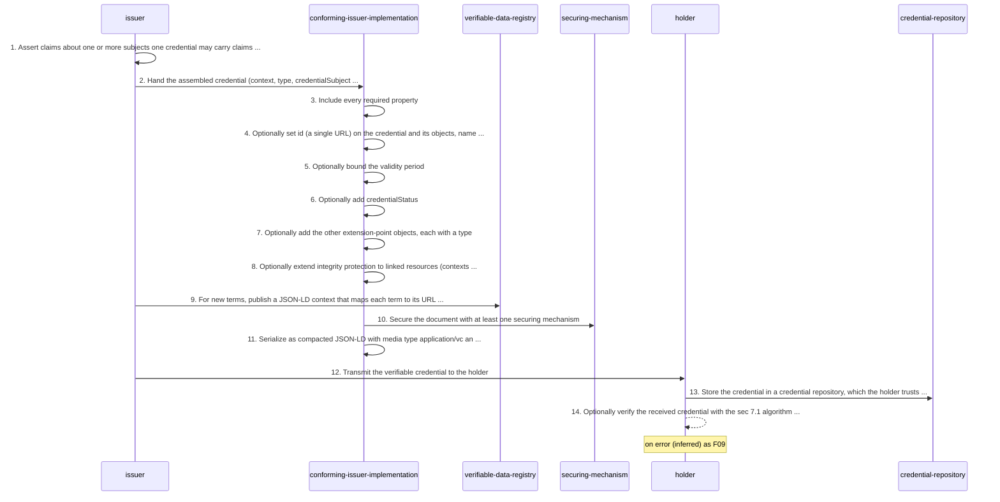

| n | from → to | message | basis | on_error |
|---|---|---|---|---|
| 1 | issuer → issuer | credential | stated | unspecified by source (§2) |
| 2 | issuer → conforming-issuer-implementation | credential | stated | unspecified by source (§4.1) |
| 3 | conforming-issuer-implementation → conforming-issuer-implementation | verifiable credential (application/vc) | stated | unspecified by source (§1.3: no issuer-side error is defined; the omission makes a non-conforming document, which a conforming verifier implementation must report, F09 step 8) |
| 4 | conforming-issuer-implementation → conforming-issuer-implementation | verifiable credential (application/vc) | stated | unspecified by source (§4.4, §4.5, §4.6) |
| 5 | conforming-issuer-implementation → conforming-issuer-implementation | verifiable credential (application/vc) | stated | unspecified by source (§4.9, §5.8) |
| 6 | conforming-issuer-implementation → conforming-issuer-implementation | credentialStatus object | stated | unspecified by source (§4.10) |
| 7 | conforming-issuer-implementation → conforming-issuer-implementation | credentialSchema object | stated | unspecified by source (§4.11, §5.4, §5.5, §5.6) |
| 8 | conforming-issuer-implementation → conforming-issuer-implementation | relatedResource object | stated | unspecified by source (§5.3) |
| 9 | issuer → verifiable-data-registry | JSON-LD context | stated | unspecified by source (§5.2: developers might meet errors when contexts cannot be retrieved; no error is defined for the publisher) |
| 10 | conforming-issuer-implementation → securing-mechanism | verifiable credential (application/vc) | stated | delegated to the securing mechanism (F02, F03); the source defines no securing failure |
| 11 | conforming-issuer-implementation → conforming-issuer-implementation | verifiable credential (application/vc) | stated | unspecified by source (§1.3, §6.1, §6.2, Appendix C.1) |
| 12 | issuer → holder | verifiable credential (application/vc) | stated | unspecified by source (§1.2, §2: transmission is named, no protocol, acknowledgement or failure is defined) |
| 13 | holder → credential-repository | verifiable credential (application/vc) | stated | unspecified by source (§1.2, §5.1) |
| 14 | holder → holder | verifiable credential (application/vc) | inferred | as F09 |

Source, one quotation per step (all of them are in `protocol.yaml`):

Step 1 (§2, normative):

<!-- q L254 -->
> A role an entity can perform by asserting claims about one or more subjects, creating a verifiable credential from these claims, and transmitting the verifiable credential to a holder.

Step 2 (§4.1, non-normative (section)):

<!-- q L338 "Once a d" .. "per." -->
> Once a developer has added a number of these property-value combinations, the modified object can be sent to a conforming issuer implementation, and a verifiable credential will be created for the developer.

Step 3 (§1.3, normative):

<!-- q L229 "A confor" .. "t produces" -->
> A conforming issuer implementation produces conforming documents, MUST include all required properties in the conforming documents it produces

Step 4 (§4.4, normative):

<!-- q L421 "The id p" .. "ion." -->
> The id property allows for expressing statements about specific things in the verifiable credential and is set by an issuer when expressing objects in a verifiable credential or a holder when expressing objects in a verifiable presentation.

Step 5 (§4.9, normative):

<!-- q L2030 "If prese" .. "ast." -->
> If present, the value of the validFrom property MUST be a [XMLSCHEMA11-2] dateTimeStamp string value representing the date and time the credential becomes valid, which could be a date and time in the future or the past.

Step 6 (§4.10, normative):

<!-- q L2271 -->
> This specification defines the credentialStatus property for discovering information related to the status of a verifiable credential, such as whether it is suspended or revoked.

Step 7 (§4.11, normative):

<!-- q L2349 -->
> This specification defines the following property for expressing a data schema, which an issuer can include in the verifiable credentials that it issues:

Step 8 (§5.3, normative):

<!-- q L2881 -->
> To extend integrity protection to a related resource, an issuer of a verifiable credential MAY include the relatedResource property:

Step 9 (§5.2, normative):

<!-- q L2839 "After th" .. "ial." -->
> After this JSON-LD context is created, the developer publishes it somewhere so it is accessible to verifiers who will be processing the verifiable credential.

Step 10 (§1.3, normative):

<!-- q L229 "and MUST" .. "sms." -->
> and MUST secure the conforming documents it produces using a securing mechanism described in Section 4.12 Securing Mechanisms.

Step 11 (§6.1, normative):

<!-- q L3257 "JSON-LD c" .. "ype." -->
> JSON-LD compacted document form MUST be used for all representations of the data model using the application/vc or application/vp media type.

Step 12 (§2, normative):

<!-- q L254 -->
> A role an entity can perform by asserting claims about one or more subjects, creating a verifiable credential from these claims, and transmitting the verifiable credential to a holder.

Step 13 (§1.2, non-normative (section)):

<!-- q L207 "Holders " .. "ies." -->
> Holders store their credentials in credential repositories.

Step 14 (§7.1, normative):

<!-- q L3358 "This sec" .. "ion." -->
> This section contains an algorithm that conforming verifier implementations MUST run when verifying a verifiable credential or a verifiable presentation.

### F02 embedded-securing

**Hand-off to an embedded-proof securing mechanism (Data Integrity) and back.** §4.12, §5.13, §7.1; hand-off; source mixed.

What the data model requires of an embedded proof and of its verification hand-off. The proof algorithms are the securing mechanism's (VC Data Integrity); this flow stops at the interface. The producer is the issuer for a credential and the holder for a presentation.

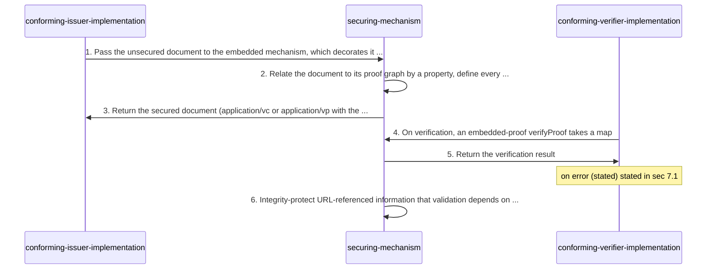

| n | from → to | message | basis | on_error |
|---|---|---|---|---|
| 1 | conforming-issuer-implementation → securing-mechanism | verifiable credential (application/vc) | stated | delegated to the securing mechanism specification |
| 2 | securing-mechanism → securing-mechanism | embedded proof (proof property) | stated | delegated to the securing mechanism specification |
| 3 | securing-mechanism → conforming-issuer-implementation | embedded proof (proof property) | stated | delegated to the securing mechanism specification |
| 4 | conforming-verifier-implementation → securing-mechanism | verification input (inputMediaType, inputData) | stated | unspecified by source (§7.1 step 1.2: a parse failure has no branch; see E-04) |
| 5 | securing-mechanism → conforming-verifier-implementation | verifyProof result (verified, verifiedDocument, mediaType) | stated | stated in §7.1: a false status becomes CRYPTOGRAPHIC_SECURITY_ERROR (F09 step 4) |
| 6 | securing-mechanism → securing-mechanism | relatedResource object | stated | unspecified by source (§5.13) |

Source, one quotation per step (all of them are in `protocol.yaml`):

Step 1 (§4.12, normative):

<!-- q L2392 "An embed" .. "del." -->
> An embedded proof is a mechanism where the proof is included in the serialization of the data model.

Step 2 (§5.13, normative):

<!-- q L3227 "A securi" .. "aph." -->
> A securing mechanism specification that creates a new type of embedded proof MUST specify a property that relates the verifiable credential or verifiable presentation to a proof graph.

Step 3 (§4.12, normative):

<!-- q L2422 "This res" .. "ems." -->
> This results in a verifiable credential that is easy to manage in modern programming environments and database systems.

Step 4 (§7.1, normative):

<!-- q L3369 "If the verifyProof function expects a m" .. "ata." -->
> If the verifyProof function expects a map, provide inputMediaType and the result of parse JSON bytes to an Infra value given inputData.

Step 5 (§5.13, normative):

<!-- q L3219 "Securing" .. "res." -->
> Securing mechanism specifications MUST provide a verification algorithm that returns the information in the conforming document that has been secured, in isolation, without including any securing mechanism information, such as proof or JOSE/COSE header parameters and signatures.

Step 6 (§5.13, normative):

<!-- q L3226 "Securing" .. "ion." -->
> Securing mechanism specifications SHOULD provide integrity protection for any information referenced by a URL that is critical to validation.

### F03 enveloping-securing

**Hand-off to an enveloping securing mechanism (JOSE, COSE, SD-JWT), and enveloped objects in presentations.** §4.12, §4.13, §5.13, §7.1, Appendix C; hand-off; source mixed.

An enveloping proof wraps a serialization; the envelope's media type and byte layout are the mechanism's (VC-JOSE-COSE). The data model adds the two Enveloped types that carry an envelope inside a presentation as a data: URL. The source never says how a verifier verifies an enveloped credential found inside a verified presentation (step 7, inferred).

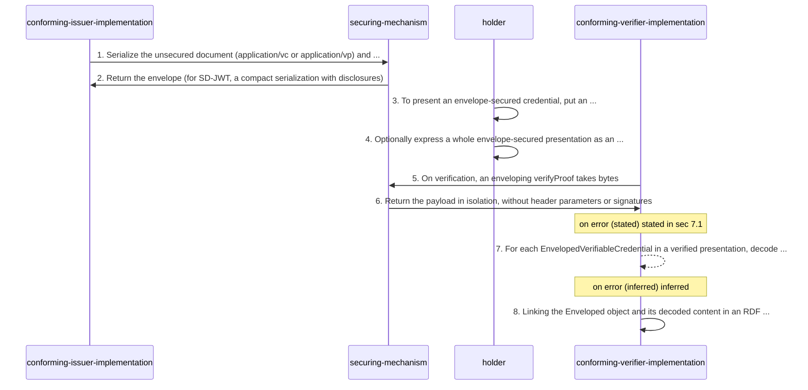

| n | from → to | message | basis | on_error |
|---|---|---|---|---|
| 1 | conforming-issuer-implementation → securing-mechanism | verifiable credential (application/vc) | stated | delegated to the securing mechanism specification |
| 2 | securing-mechanism → conforming-issuer-implementation | enveloping proof (secured serialization) | stated | delegated to the securing mechanism specification |
| 3 | holder → holder | EnvelopedVerifiableCredential | stated | unspecified by source (§4.13 (Enveloped Verifiable Credentials)) |
| 4 | holder → holder | EnvelopedVerifiablePresentation | stated | unspecified by source (§4.13 (Enveloped Verifiable Presentations)) |
| 5 | conforming-verifier-implementation → securing-mechanism | verification input (inputMediaType, inputData) | stated | unspecified by source (§7.1 step 1.2) |
| 6 | securing-mechanism → conforming-verifier-implementation | verifyProof result (verified, verifiedDocument, mediaType) | stated | stated in §7.1: a false status becomes CRYPTOGRAPHIC_SECURITY_ERROR (F09 step 4) |
| 7 | conforming-verifier-implementation → conforming-verifier-implementation | EnvelopedVerifiableCredential | inferred | inferred: the enveloped credential's own §7.1 result (status false with its errors) applies to it; what that means for the presentation is unspecified by source |
| 8 | conforming-verifier-implementation → conforming-verifier-implementation | EnvelopedVerifiableCredential | stated | unspecified by source (§4.13) |

Source, one quotation per step (all of them are in `protocol.yaml`):

Step 1 (§4.12, normative):

<!-- q L2391 "An envel" .. "del." -->
> An enveloping proof wraps a serialization of this data model.

Step 2 (§4.12, normative):

<!-- q L2462 -->
> The enveloping proof above secures the original credential by encapsulating the original data in a digital signature envelope, resulting in a verifiable credential that can be processed using tooling that understands the SD-JWT format.

Step 3 (§4.13, normative):

<!-- q L2495 "This can" .. "ial." -->
> This can be accomplished by associating the verifiableCredential property with an object that has a type of EnvelopedVerifiableCredential.

Step 4 (§4.13, normative):

<!-- q L2519 "This can" .. "ion." -->
> This can be accomplished by using an object that has a type of EnvelopedVerifiablePresentation.

Step 5 (§7.1, normative):

<!-- q L3369 "If the v" .. "thm." -->
> If the verifyProof function expects a byte sequence, provide inputMediaType and inputData to the algorithm.

Step 6 (§5.13, normative):

<!-- q L3219 "Securing" .. "res." -->
> Securing mechanism specifications MUST provide a verification algorithm that returns the information in the conforming document that has been secured, in isolation, without including any securing mechanism information, such as proof or JOSE/COSE header parameters and signatures.

Step 7 (§4.13, normative):

<!-- q L2475 "These ob" .. "ism." -->
> These objects are called verifiable credential graphs and MUST express information that is secured using a securing mechanism.

Step 8 (§4.13, non-normative (note)):

<!-- q L2515 "The desi" .. "ent." -->
> The desire and mechanisms for doing so are use case dependent and will, thus, be implementation dependent.

### F04 presentation-request

**Verifier asks a holder for credentials (described, not specified).** Appendix A.1, §4.13, §8.2, §8.9, §9.5.2; exchange; source mixed.

The nearest the source comes to a request/response. Every sentence is non-normative except the SHOULD that presentations be bound to a verifier's challenge, and no request structure, challenge property or refusal message is defined.

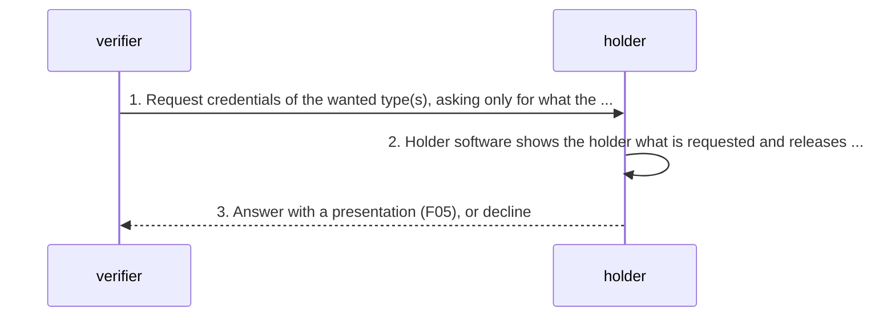

| n | from → to | message | basis | on_error |
|---|---|---|---|---|
| 1 | verifier → holder | presentation request (not defined) | stated | unspecified by source (Appendix A.1: no request format, no error for an unsatisfiable request) |
| 2 | holder → holder | presentation request (not defined) | stated | unspecified by source (§8.2, §8.9) |
| 3 | holder → verifier | verifiable presentation (application/vp) | inferred | unspecified by source (no refusal or error response is defined) |

Source, one quotation per step (all of them are in `protocol.yaml`):

Step 1 (Appendix A.1, non-normative (section)):

<!-- q L4022 "When a v" .. "ive." -->
> When a verifier requests one or more verifiable credentials from a holder, they can specify the type of credential(s) that they would like to receive.

Step 2 (§8.2, non-normative (section)):

<!-- q L3416 -->
> A holder's user agent (holder software), such as a digital wallet, is expected to only divulge information to a verifier when the holder consents to releasing that information.

Step 3 (§1.1, non-normative (section)):

<!-- q L197 -->
> Holders of verifiable credentials can generate verifiable presentations and then share these verifiable presentations with verifiers to prove they possess verifiable credentials with specific characteristics.

### F05 presentation

**Holder builds, secures and transmits a verifiable presentation.** §3.3, §4.13, §5.4, §5.5, §8.10; creation-and-delivery; source mixed.

The holder side. The presentation's properties are normative; challenge binding is a SHOULD whose mechanics are delegated; the transmission is named and not defined. A holder may also present credentials directly without a presentation.

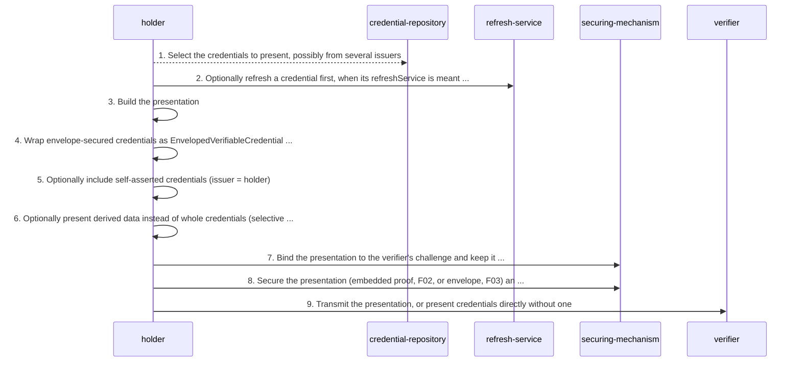

| n | from → to | message | basis | on_error |
|---|---|---|---|---|
| 1 | holder → credential-repository | verifiable credential (application/vc) | inferred | unspecified by source (§3.3, §4.13) |
| 2 | holder → refresh-service | refresh request (type-defined; example POSTs the credential) | stated | unspecified by source (§5.4) |
| 3 | holder → holder | verifiable presentation (application/vp) | stated | unspecified by source (§4.13: a violation makes a non-conforming document; see E-10) |
| 4 | holder → holder | EnvelopedVerifiableCredential | stated | unspecified by source (§4.13 (Enveloped Verifiable Credentials)) |
| 5 | holder → holder | verifiable credential (application/vc) | stated | unspecified by source (§4.13 (Presentations Including Holder Claims)) |
| 6 | holder → holder | derived credential and derived proof | stated | unspecified by source (§4.13 (Presentations Using Derived Credentials)) |
| 7 | holder → securing-mechanism | verifiable presentation (application/vp) | stated | unspecified by source (§4.13: delegated to the securing mechanism, transport and verifier policy) |
| 8 | holder → securing-mechanism | verifiable presentation (application/vp) | stated | delegated to the securing mechanism specification |
| 9 | holder → verifier | verifiable presentation (application/vp) | stated | unspecified by source (§1.1, §3.3: no transport, acknowledgement or failure is defined) |

Source, one quotation per step (all of them are in `protocol.yaml`):

Step 1 (§4.13, normative):

<!-- q L2466 -->
> Verifiable presentations MAY be used to aggregate information from multiple verifiable credentials.

Step 2 (§5.4, normative):

<!-- q L2923 "In the l" .. "ier." -->
> In the latter case, this enables the holder to refresh the verifiable credential before creating a verifiable presentation to share with a verifier.

Step 3 (§4.3, normative):

<!-- q L391 "Verifiab" .. "rty." -->
> Verifiable credentials and verifiable presentations MUST include a @context property.

Step 4 (§4.13, normative):

<!-- q L2495 "It is po" .. "SE]." -->
> It is possible for a verifiable presentation to include one or more verifiable credentials that have been secured using a securing mechanism that "envelopes" the payload, such as Securing Verifiable Credentials using JOSE and COSE [VC-JOSE-COSE].

Step 5 (§4.13, normative):

<!-- q L2541 "A holder" .. "ves." -->
> A holder MAY use the verifiableCredential property in a verifiable presentation to include verifiable credentials from any issuer, including themselves.

Step 6 (§4.13, normative):

<!-- q L2534 -->
> Some selective disclosure schemes can share a subset of claims derived from a verifiable credential.

Step 7 (§4.13, normative):

<!-- q L2467 "Verifiab" .. "ier." -->
> Verifiable presentations SHOULD be extremely short-lived and bound to a challenge provided by a verifier.

Step 8 (§1.3, normative):

<!-- q L228 "A conforming document MUST be s" .. "sms." -->
> A conforming document MUST be secured by at least one securing mechanism as described in Section 4.12 Securing Mechanisms.

Step 9 (§1.1, non-normative (section)):

<!-- q L197 -->
> Holders of verifiable credentials can generate verifiable presentations and then share these verifiable presentations with verifiers to prove they possess verifiable credentials with specific characteristics.

### F06 derived-presentation

**Zero-knowledge and selective-disclosure presentation of derived data.** §4.13 (Presentations Using Derived Credentials), §5.7; creation-and-delivery; source normative.

Described by example; the mechanics belong to the ZKP securing mechanism (for example Data Integrity BBS). The one normative statement binds mechanism authors.

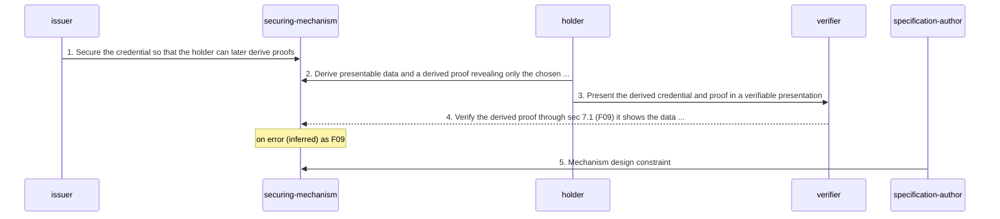

| n | from → to | message | basis | on_error |
|---|---|---|---|---|
| 1 | issuer → securing-mechanism | embedded proof (proof property) | stated | unspecified by source (§5.7) |
| 2 | holder → securing-mechanism | derived credential and derived proof | stated | unspecified by source (§4.13, §5.7) |
| 3 | holder → verifier | verifiable presentation (application/vp) | stated | unspecified by source (§5.7) |
| 4 | verifier → securing-mechanism | verification input (inputMediaType, inputData) | inferred | as F09 |
| 5 | specification-author → securing-mechanism | derived credential and derived proof | stated | not a runtime error: a constraint on mechanism specifications |

Source, one quotation per step (all of them are in `protocol.yaml`):

Step 1 (§5.7, normative):

<!-- q L3083 -->
> We note that in most instances, for the holder to make use of zero knowledge mechanisms with verifiable credentials, the issuer is required to secure the verifiable credential in a manner that supports these capabilities.

Step 2 (§4.13, normative):

<!-- q L2533 "In these" .. "uer." -->
> In these schemes, a verifiable credential might be used to derive presentable data, which is cryptographically asserted such that a verifier can trust the value if they trust the issuer.

Step 3 (§5.7, normative):

<!-- q L3160 -->
> The verifiable presentation above includes a verifiable credential that contains an unlinkable subset of the information from the previous example and a derived proof that the verifier can use to verify that the information originated from the expected issuer and is bound to this particular exchange of information.

Step 4 (§5.7, normative):

<!-- q L3160 -->
> The verifiable presentation above includes a verifiable credential that contains an unlinkable subset of the information from the previous example and a derived proof that the verifier can use to verify that the information originated from the expected issuer and is bound to this particular exchange of information.

Step 5 (§5.7, normative):

<!-- q L3081 -->
> Specification authors that create securing mechanisms MUST NOT design them in such a way that they leak information that would enable the verifier to correlate a holder across multiple verifiable presentations to different verifiers.

### F07 counterparty-presentation

**Issuer or verifier presents to the holder to identify itself.** §3.3; creation-and-delivery; source non-normative.

A role reversal the source allows in a note: before handing over sensitive information the holder may want assurance about the other party, which then presents to the holder.

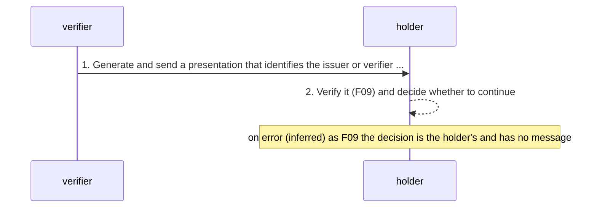

| n | from → to | message | basis | on_error |
|---|---|---|---|---|
| 1 | verifier → holder | verifiable presentation (application/vp) | stated | unspecified by source (§3.3) |
| 2 | holder → holder | verification result (status, document, mediaType, controller, controlledIdentifierDocument, warnings, errors) | inferred | as F09; the decision is the holder's and has no message |

Source, one quotation per step (all of them are in `protocol.yaml`):

Step 1 (§3.3, non-normative (note)):

<!-- q L328 "While a " .. "ion." -->
> While a holder is typically expected to generate presentations, an issuer or verifier might generate a presentation to identify itself to a holder. This might occur if the holder needs higher assurance from the issuer or verifier before handing over sensitive information as part of a verifiable presentation.

Step 2 (§3.3, non-normative (note)):

<!-- q L328 "While a " .. "ion." -->
> While a holder is typically expected to generate presentations, an issuer or verifier might generate a presentation to identify itself to a holder. This might occur if the holder needs higher assurance from the issuer or verifier before handing over sensitive information as part of a verifiable presentation.

### F08 media-type-determination

**Receiver recovers application/vc or application/vp from a lower-precision label.** §6.2 (Media Type Precision); receive-processing; source non-normative.

Non-normative. Feeds inputMediaType to §7.1 (F09) when the transport labelled the payload application/json or application/ld+json. Applies to JSON payloads (embedded proofs); an envelope's media type is the mechanism's.

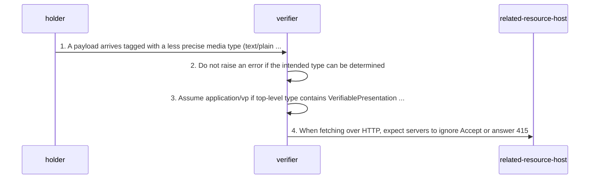

| n | from → to | message | basis | on_error |
|---|---|---|---|---|
| 1 | holder → verifier | verifiable presentation (application/vp) | stated | unspecified by source (§6.2) |
| 2 | verifier → verifier | verifiable presentation (application/vp) | stated | unspecified by source (§6.2: what follows a payload that is not JSON or whose first context differs is not said) |
| 3 | verifier → verifier | verifiable presentation (application/vp) | stated | unspecified by source (§6.2) |
| 4 | verifier → related-resource-host | retrieved related resource (HTTP response) | stated | unspecified by source (§6.2: warned of, no handling defined) |

Source, one quotation per step (all of them are in `protocol.yaml`):

Step 1 (§6.2, non-normative (section)):

<!-- q L3321 "At times" .. "ons." -->
> At times, developers or systems might use lower precision media types to convey verifiable credentials or verifiable presentations.

Step 2 (§6.2, non-normative (section)):

<!-- q L3325 "Implemen" .. "col." -->
> Implementers are urged to not raise errors when it is possible to determine the intended media type from a payload, provided that the media type used is acceptable in the given protocol.

Step 3 (§6.2, non-normative (section)):

<!-- q L3328 "Assume a" .. "ent." -->
> Assume an application/vp media type if the JSON document contains a top-level type property containing a VerifiablePresentation element.

Step 4 (§6.2, non-normative (section)):

<!-- q L3331 "Implemen" .. "ype." -->
> Implementers are warned that HTTP servers might ignore the accept header and return another content type, or return an error code such as 415 Unsupported Media Type.

### F09 verification

**The §7.1 verification algorithm, and the verifier duties the source states outside it.** §7.1, §7.2, §1.3, §5.3, Appendix B.1; receive-processing; source mixed.

Steps 1.1, 1.2, 1.3, 2 and 3 are §7.1 exactly as printed, numbered by their HTML list position. Step 0 (inputs) is this model's. X1 is the ordering licence that follows the algorithm. X2-X5 are normative verifier duties the algorithm does not place: required-property checks and errors (§1.3), contexts (Appendix B.1), related resources (§5.3), and the credentials inside a presentation (inferred). X6 hands to validation.

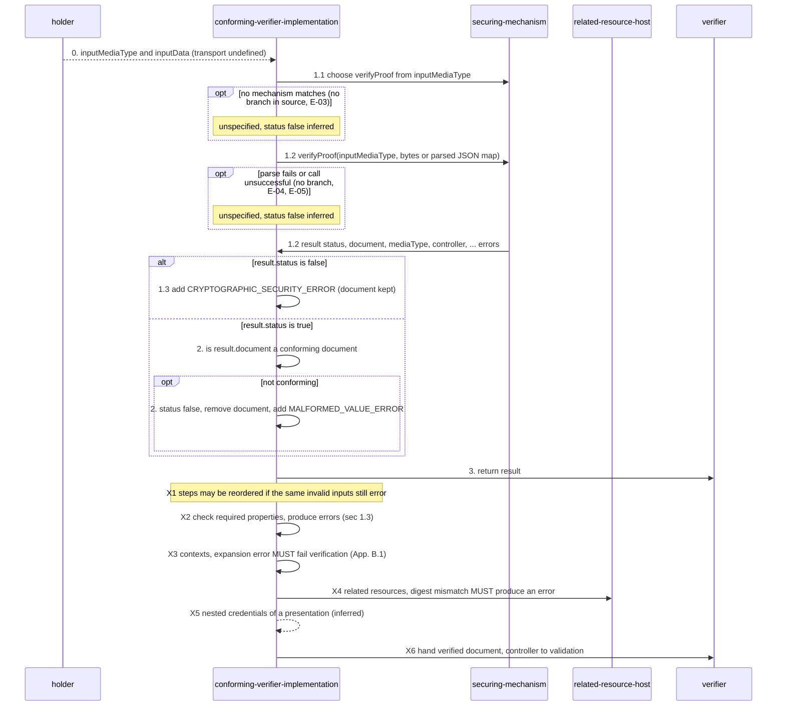

| n | from → to | message | basis | on_error |
|---|---|---|---|---|
| 0 | holder → conforming-verifier-implementation | verification input (inputMediaType, inputData) | inferred | unspecified by source (§7.1: an absent or unknown media type has no branch; see E-03) |
| 1.1 | conforming-verifier-implementation → securing-mechanism | verification input (inputMediaType, inputData) | stated | unspecified by source (§7.1 step 1.1: no outcome when no mechanism matches; E-03) |
| 1.2 | conforming-verifier-implementation → securing-mechanism | verification input (inputMediaType, inputData) | stated | unspecified by source (§7.1 step 1.2: a JSON parse failure (E-04) and an unsuccessful call (E-05) have no branch) |
| 1.3 | conforming-verifier-implementation → conforming-verifier-implementation | ProblemDetails | stated | stated: CRYPTOGRAPHIC_SECURITY_ERROR in result.errors, status stays false, result.document is NOT removed (E-01, tension T-10) |
| 2 | conforming-verifier-implementation → conforming-verifier-implementation | verification result (status, document, mediaType, controller, controlledIdentifierDocument, warnings, errors) | stated | stated: status false, document removed, at least one MALFORMED_VALUE_ERROR (E-02) |
| 3 | conforming-verifier-implementation → verifier | verification result (status, document, mediaType, controller, controlledIdentifierDocument, warnings, errors) | stated | stated: the caller receives status false with the errors added in steps 1.3 or 2 |
| X1 | conforming-verifier-implementation → conforming-verifier-implementation | verification result (status, document, mediaType, controller, controlledIdentifierDocument, warnings, errors) | stated | unspecified by source (§7.1) |
| X2 | conforming-verifier-implementation → conforming-verifier-implementation | ProblemDetails | stated | stated as a duty to produce errors; which ProblemDetails type is not said (MALFORMED_VALUE_ERROR when the check runs as §7.1 step 2) (E-10) |
| X3 | conforming-verifier-implementation → conforming-verifier-implementation | JSON-LD context | stated | stated: verification failure (E-06); no ProblemDetails type and no §7.1 step carry it |
| X4 | conforming-verifier-implementation → related-resource-host | relatedResource object | stated | stated: an error (E-08); type unnamed |
| X5 | conforming-verifier-implementation → conforming-verifier-implementation | EnvelopedVerifiableCredential | inferred | inferred: a nested credential that fails its own verification is unverified; whether the presentation then fails is unspecified by source |
| X6 | conforming-verifier-implementation → verifier | verification result (status, document, mediaType, controller, controlledIdentifierDocument, warnings, errors) | stated | unspecified by source (Appendix A.3, Appendix A.7) |

Source, one quotation per step (all of them are in `protocol.yaml`):

Step 0 (§7.1, normative):

<!-- q L3358 "This alg" .. "ing:" -->
> This algorithm takes a media type (string inputMediaType) and secured data (byte sequence inputData) and returns a map that contains the following:

Step 1.1 (§7.1, normative):

<!-- q L3367 -->
> Ensure that the securing mechanism has properly protected the conforming document by performing the following steps:

Step 1.2 (§7.1, normative):

<!-- q L3369 "If the v" .. "thm." -->
> If the verifyProof function expects a byte sequence, provide inputMediaType and inputData to the algorithm.

Step 1.3 (§7.1, normative):

<!-- q L3370 -->
> If result.status is set to false, add a CRYPTOGRAPHIC_SECURITY_ERROR to result.errors.

Step 2 (§7.1, normative):

<!-- q L3371 "If resul" .. "ent." -->
> If result.status is set to true, ensure that result.document is a conforming document.

Step 3 (§7.1, normative):

<!-- q L3372 -->
> Return result.

Step X1 (§7.1, normative):

<!-- q L3373 "The step" .. "uts." -->
> The steps for verifying the state of the securing mechanism and verifying that the input document is a conforming document MAY be performed in a different order than that provided above as long as the implementation returns errors for the same invalid inputs.

Step X2 (§1.3, normative):

<!-- q L230 "MUST che" .. "ted." -->
> MUST check that each required property satisfies the normative requirements for that property, and MUST produce errors when non-conforming documents are detected.

Step X3 (Appendix B.1, normative):

<!-- q L4103 "Implemen" .. "ved;" -->
> Implementations MUST treat the base context value, located at https://www.w3.org/ns/credentials/v2, as already retrieved;

Step X4 (§5.3, normative):

<!-- q L2895 "If the d" .. "ror." -->
> If the digest provided by the issuer does not match the digest computed for the retrieved resource, the conforming verifier implementation MUST produce an error.

Step X5 (§5.13, normative):

<!-- q L3229 -->
> The securing mechanism MUST secure all graphs in the verifiable credential or the verifiable presentation, except for any proof graphs securing the verifiable credential or the verifiable presentation itself.

Step X6 (Appendix A.3, non-normative (section)):

<!-- q L4037 "Metadata" .. "ion." -->
> Metadata related to the issuer property is available to the verifier through the verification algorithm as defined in Section 7.1 Verification.

### F10 context-processing

**Context handling on the consuming side: base context, other contexts, expansion errors.** §4.3, §5.2, §6.1, §6.3, Appendix B.1, Appendix B.2; receive-processing; source mixed.

What a consumer does with @context before it trusts any term. The base context is never fetched; its digest is printed (and matches the fetched file, see source.contexts). Expansion errors are a verification failure by a MUST that no §7.1 step carries.

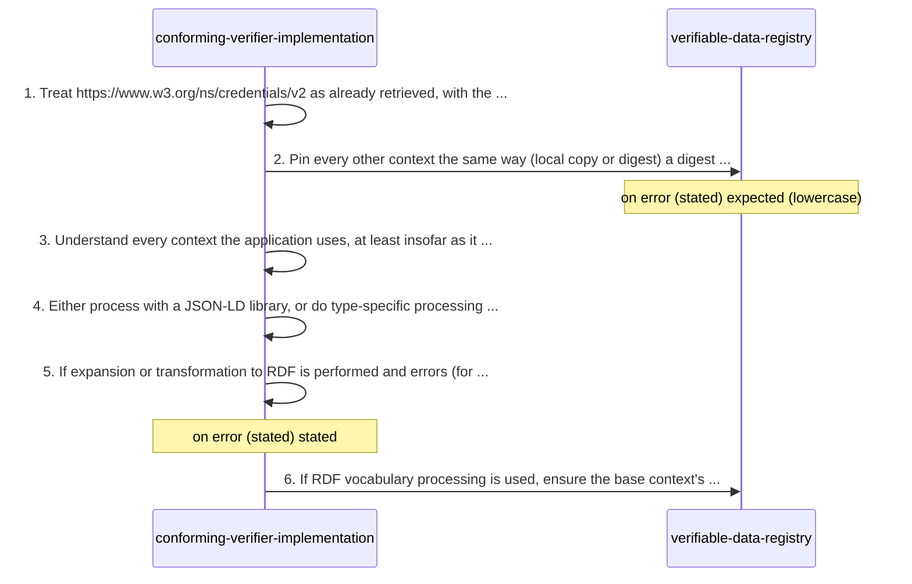

| n | from → to | message | basis | on_error |
|---|---|---|---|---|
| 1 | conforming-verifier-implementation → conforming-verifier-implementation | JSON-LD context | stated | unspecified by source (Appendix B.1) |
| 2 | conforming-verifier-implementation → verifiable-data-registry | JSON-LD context | stated | expected (lowercase): an error on a hash mismatch (Appendix B.1); no type named (E-07) |
| 3 | conforming-verifier-implementation → conforming-verifier-implementation | JSON-LD context | stated | unspecified by source (§4.3) |
| 4 | conforming-verifier-implementation → conforming-verifier-implementation | JSON-LD context | stated | unspecified by source (§6.3) |
| 5 | conforming-verifier-implementation → conforming-verifier-implementation | JSON-LD context | stated | stated: verification failure (E-06) |
| 6 | conforming-verifier-implementation → verifiable-data-registry | JSON-LD context | stated | unspecified by source (Appendix B.2) |

Source, one quotation per step (all of them are in `protocol.yaml`):

Step 1 (Appendix B.1, normative):

<!-- q L4103 "Implemen" .. "ile:" -->
> Implementations MUST treat the base context value, located at https://www.w3.org/ns/credentials/v2, as already retrieved; the following value is the hexadecimal encoded SHA2-256 digest value of the base context file:

Step 2 (Appendix B.1, normative):

<!-- q L4104 "It is st" .. "ity." -->
> It is strongly advised that all JSON-LD Context URLs used by an application use the same mechanism, or a functionally equivalent mechanism, to ensure end-to-end security.

Step 3 (§4.3, normative):

<!-- q L391 "Applicat" .. "ion." -->
> Application developers MUST understand every JSON-LD context used by their application, at least to the extent that it affects the meaning of the terms used by their application.

Step 4 (§6.3, non-normative (section)):

<!-- q L3346 -->
> Ensure that all values associated with a @context property are in the expected order, the contents of the context files match known good cryptographic hashes for each file, and domain experts have deemed that the contents are appropriate for the intended use case.

Step 5 (Appendix B.1, normative):

<!-- q L4105 "If such " .. "ure." -->
> If such operations are performed and result in an error, the verifiable credential or verifiable presentation MUST result in a verification failure.

Step 6 (Appendix B.2, normative):

<!-- q L4115 "Implemen" .. "ive." -->
> Implementations that depend on RDF vocabulary processing MUST ensure that the following vocabulary URLs used in the base context ultimately resolve to the following files when loading the JSON-LD serializations, which are normative.

### F11 related-resource-integrity

**Retrieving a related resource and checking its digest.** §5.3; exchange; source normative.

The one place the source specifies an HTTP retrieval and an error on its result. The issuer side is F01 step 8.

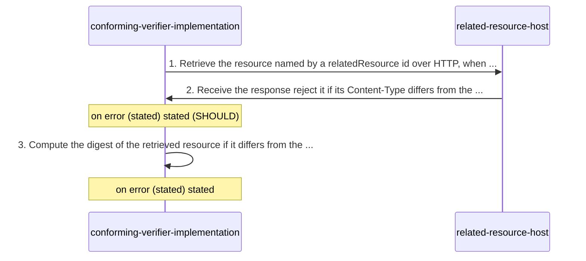

| n | from → to | message | basis | on_error |
|---|---|---|---|---|
| 1 | conforming-verifier-implementation → related-resource-host | retrieved related resource (HTTP response) | stated | unspecified by source (§5.3: retrieval failure and non-HTTP URLs are not addressed) |
| 2 | related-resource-host → conforming-verifier-implementation | retrieved related resource (HTTP response) | stated | stated (SHOULD): reject the response (E-09) |
| 3 | conforming-verifier-implementation → conforming-verifier-implementation | relatedResource object | stated | stated: an error (E-08); no ProblemDetails type is named |

Source, one quotation per step (all of them are in `protocol.yaml`):

Step 1 (§5.3, normative):

<!-- q L2890 -->
> If a mediaType is listed, implementations that retrieve the resource identified by the id property using HTTP Semantics SHOULD:

Step 2 (§5.3, normative):

<!-- q L2892 -->
> reject the response if it includes a Content-Type HTTP Header with a different media type.

Step 3 (§5.3, normative):

<!-- q L2895 "A confor" .. "rce." -->
> A conforming verifier implementation that makes use of a resource based on the id of a relatedResource object inside a conforming document with a corresponding cryptographic digest appearing in a relatedResource object value MUST compute the digest of the retrieved resource.

### F12 validation

**Validation: the verifier's business rules after verification.** §1.1, §2, Appendix A, §8.11, §9.9.2; local-decision; source mixed.

Wholly non-normative and explicitly outside the specification's conformance. The checks are those Appendix A says verifiers are expected to make; the order is free and no output, status or error signal is defined. Steps are this file's ordering.

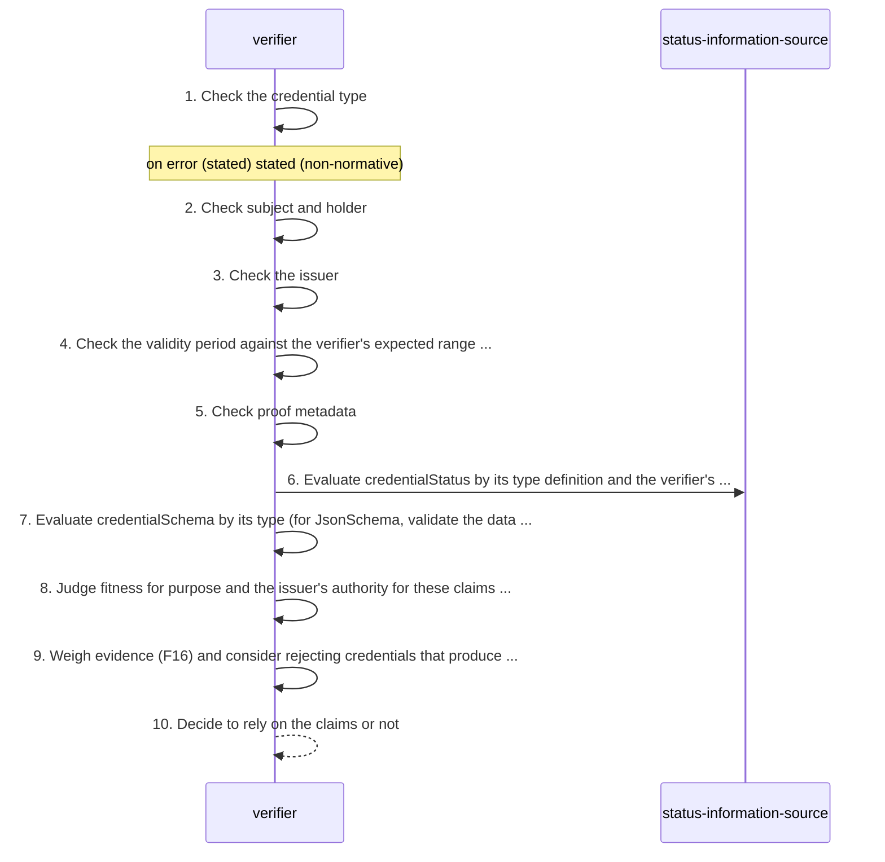

| n | from → to | message | basis | on_error |
|---|---|---|---|---|
| 1 | verifier → verifier | verifiable credential (application/vc) | stated | stated (non-normative): validation fails; no signal defined (E-11) |
| 2 | verifier → verifier | verifiable presentation (application/vp) | stated | unspecified by source (Appendix A.2, Appendix A.4) |
| 3 | verifier → verifier | verification result (status, document, mediaType, controller, controlledIdentifierDocument, warnings, errors) | stated | unspecified by source (Appendix A.3, §5.1) |
| 4 | verifier → verifier | verifiable credential (application/vc) | stated | unspecified by source (Appendix A.5, Appendix A.7) |
| 5 | verifier → verifier | controlled identifier document | stated | unspecified by source (Appendix A.6) |
| 6 | verifier → status-information-source | credentialStatus object | stated | unspecified by source (Appendix A.8) |
| 7 | verifier → verifier | credentialSchema object | stated | unspecified by source (Appendix A.9, §4.11) |
| 8 | verifier → verifier | verifiable credential (application/vc) | stated | unspecified by source (Appendix A.10, §9.9.2) |
| 9 | verifier → verifier | evidence object | stated | unspecified by source (§5.6, §8.11) |
| 10 | verifier → verifier | verifiable credential (application/vc) | inferred | unspecified by source (Appendix A: no output or error is defined for validation) |

Source, one quotation per step (all of them are in `protocol.yaml`):

Step 1 (Appendix A.1, non-normative (section)):

<!-- q L4024 "A verifi" .. "ion." -->
> A verifier's validation of a verifiable credential will fail when mandatory claims are not included, and any claim that is not associated with the specific type will be ignored. In other words, a verifier will perform input validation on the verifiable credential it receives and will reject malformed input based on the credential type specification.

Step 2 (Appendix A.2, non-normative (section)):

<!-- q L4029 "If the h" .. "ion." -->
> If the holder is also the subject, then the verifier could authenticate the holder if they have verification metadata related to the holder. The verifier could then authenticate the holder using a signature generated by the holder contained in the verifiable presentation.

Step 3 (Appendix A.3, non-normative (section)):

<!-- q L4037 "This met" .. "der." -->
> This metadata includes identification of the verified controller of the verification method used by the securing mechanism to secure each verifiable credential or verifiable presentation, of which the controller is typically the respective issuer or holder.

Step 4 (Appendix A.5, non-normative (section)):

<!-- q L4057 "For exam" .. "ure." -->
> For example, a verifier can check that the start of the validity period for a verifiable credential is not in the future.

Step 5 (Appendix A.6, non-normative (section)):

<!-- q L4067 "Acceptab" .. "ble." -->
> Acceptably recent metadata regarding the verification material associated with the signature is available.

Step 6 (Appendix A.8, non-normative (section)):

<!-- q L4080 "If the c" .. "ria." -->
> If the credentialStatus property is available, the status of a verifiable credential is expected to be evaluated by the verifier according to the credentialStatus type definition for the verifiable credential and the verifier's own status evaluation criteria.

Step 7 (Appendix A.9, non-normative (section)):

<!-- q L4085 "If the c" .. "ria." -->
> If the credentialSchema property is available, the schema of a verifiable credential is expected to be evaluated by the verifier according to the credentialSchema type definition for the verifiable credential and the verifier's own schema evaluation criteria.

Step 8 (Appendix A.10, non-normative (section)):

<!-- q L4090 "Fitness " .. "ose." -->
> Fitness for purpose is about whether the custom properties in the verifiable credential are appropriate for the verifier's purpose.

Step 9 (§5.6, normative):

<!-- q L3015 "This cou" .. "ial." -->
> This could be used by the verifier to establish the confidence with which it relies on the claims in the verifiable credential.

Step 10 (§1.1, non-normative (section)):

<!-- q L200 "Such rel" .. "ies." -->
> Such reliance only occurs after evaluating the issuer, the proof, the subject, and the claims against one or more verifier policies.

### F13 status-check

**Checking credential status through credentialStatus.** §4.10, Appendix A.8, §8.7, §8.11, §8.14; exchange; source mixed.

The data model fixes only the entry shape and a privacy constraint on status schemes. Format, protocol, status values and conflict resolution are delegated or out of scope; the retrieval step is this model's.

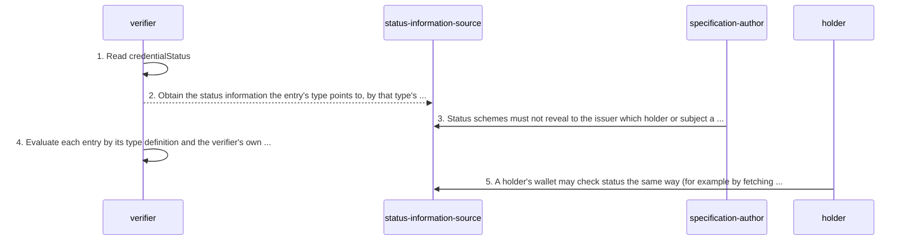

| n | from → to | message | basis | on_error |
|---|---|---|---|---|
| 1 | verifier → verifier | credentialStatus object | stated | unspecified by source (§4.10) |
| 2 | verifier → status-information-source | status information (external) | inferred | unspecified by source (§4.10: unreachable or unknown status information is not addressed) |
| 3 | specification-author → status-information-source | status information (external) | stated | not a runtime error: a constraint on status specifications |
| 4 | verifier → verifier | status information (external) | stated | unspecified by source (§4.10: conflict reconciliation is out of scope; E-13) |
| 5 | holder → status-information-source | status information (external) | stated | unspecified by source (§8.7) |

Source, one quotation per step (all of them are in `protocol.yaml`):

Step 1 (§4.10, normative):

<!-- q L2272 "If prese" .. "cts." -->
> If present, the value associated with the credentialStatus property is a single object or a set of one or more objects.

Step 2 (§4.10, normative):

<!-- q L2277 "The valu" .. "URL." -->
> The value will provide enough information to determine the current status of the credential and whether machine-readable information will be retrievable from the URL.

Step 3 (§4.10, normative):

<!-- q L2341 "Credenti" .. "ect." -->
> Credential status specifications MUST NOT enable tracking of individuals, such as an issuer being notified (either directly or indirectly) when a verifier is interested in a specific holder or subject.

Step 4 (Appendix A.8, non-normative (section)):

<!-- q L4080 "If the c" .. "ria." -->
> If the credentialStatus property is available, the status of a verifiable credential is expected to be evaluated by the verifier according to the credentialStatus type definition for the verifiable credential and the verifier's own status evaluation criteria.

Step 5 (§8.7, non-normative (section)):

<!-- q L3465 -->
> A holder using a digital wallet can reduce the chances that they will be tracked by a 3rd party when accessing external links within a verifiable credential stored in their digital wallet. For example, a digital wallet might fetch and render linked images, or it might check the validity of a verifiable credential by fetching an externally linked revocation list.

### F14 refresh

**Refreshing a credential through refreshService.** §5.4, Appendix B.2, §8.18; exchange; source mixed.

The source defines where the refreshService object may be placed, its shape and when it is expected to be used; request and response belong to the refresh service type (Example 27's type takes a POST of the credential). The placement rule contradicts itself and the base context (T-12).

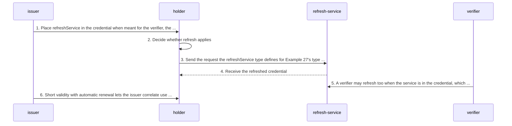

| n | from → to | message | basis | on_error |
|---|---|---|---|---|
| 1 | issuer → holder | refreshService object | stated | unspecified by source (§5.4) |
| 2 | holder → holder | refreshService object | stated | unspecified by source (§5.4) |
| 3 | holder → refresh-service | refresh request (type-defined; example POSTs the credential) | stated | unspecified by source (§5.4: no request, response or failure is defined) |
| 4 | refresh-service → holder | verifiable credential (application/vc) | inferred | unspecified by source (§5.4) |
| 5 | verifier → refresh-service | refresh request (type-defined; example POSTs the credential) | stated | unspecified by source (§5.4) |
| 6 | issuer → holder | refreshService object | stated | unspecified by source (§8.18) |

Source, one quotation per step (all of them are in `protocol.yaml`):

Step 1 (§5.4, normative):

<!-- q L2923 "The issu" .. "nly." -->
> The issuer can include the refresh service as an element inside the verifiable credential if it is intended for either the verifier or the holder (or both), or inside the verifiable presentation if it is intended for the holder only.

Step 2 (§5.4, normative):

<!-- q L2924 "The refr" .. "ion." -->
> The refresh service is only expected to be used when either the credential has expired or the issuer does not publish credential status information.

Step 3 (§5.4, normative):

<!-- q L2926 "The valu" .. "ial." -->
> The value of the refreshService property MUST be one or more refresh services that provides enough information to the recipient's software such that the recipient can refresh the verifiable credential.

Step 4 (§5.4, normative):

<!-- q L2922 "It is us" .. "ial." -->
> It is useful for systems to enable the manual or automatic refresh of an expired verifiable credential.

Step 5 (§5.4, non-normative (note)):

<!-- q L2951 -->
> Placing a refreshService property in a verifiable credential so that it is available to verifiers can remove control and consent from the holder and allow the verifiable credential to be issued directly to the verifier, thereby bypassing the holder.

Step 6 (§8.18, non-normative (section)):

<!-- q L3788 "Issuers " .. "tic." -->
> Issuers can defeat this protection however, by making their verifiable credentials short lived and renewal automatic.

### F15 terms-of-use

**Terms of use placed by issuer or holder and weighed by the recipient.** §5.5, §9.9.1, Appendix A.10; local-decision; source mixed.

No exchange: the policy travels inside the credential or presentation and the recipient decides. The only stated consequence of not adhering is liability.

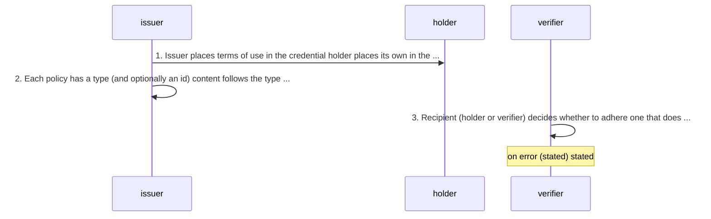

| n | from → to | message | basis | on_error |
|---|---|---|---|---|
| 1 | issuer → holder | termsOfUse object | stated | unspecified by source (§5.5) |
| 2 | issuer → issuer | termsOfUse object | stated | unspecified by source (§5.5) |
| 3 | verifier → verifier | termsOfUse object | stated | stated: liability, not a protocol error (§5.5); enforcement after presentation is out of scope (§9.9.1) |

Source, one quotation per step (all of them are in `protocol.yaml`):

Step 1 (§5.5, normative):

<!-- q L2955 "Terms of" .. "ion." -->
> Terms of use can be used by an issuer or a holder to communicate the terms under which a verifiable credential or verifiable presentation was issued. The issuer places their terms of use inside the verifiable credential. The holder places their terms of use inside a verifiable presentation.

Step 2 (§5.5, normative):

<!-- q L2961 "Each ter" .. " id." -->
> Each termsOfUse value MUST specify its type, for example, TrustFrameworkPolicy, and MAY specify its instance id.

Step 3 (§5.5, normative):

<!-- q L2961 "If the r" .. "use." -->
> If the recipient (a holder or verifier) is not willing to adhere to the specified terms of use, then they do so on their own responsibility and might incur legal liability if they violate the stated terms of use.

### F16 evidence

**Evidence collected before issuance and weighed by the verifier.** §5.6; creation-and-delivery; source mixed.

The issuer records supporting information it checked before issuing; the verifier uses it to set its confidence. No exchange with the subject is specified.

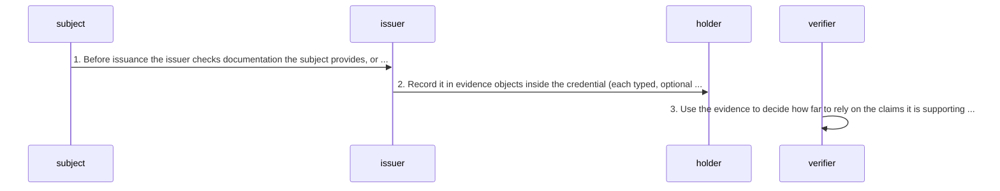

| n | from → to | message | basis | on_error |
|---|---|---|---|---|
| 1 | subject → issuer | evidence object | stated | unspecified by source (§5.6: how evidence is gathered is out of band) |
| 2 | issuer → holder | evidence object | stated | unspecified by source (§5.6) |
| 3 | verifier → verifier | evidence object | stated | unspecified by source (§5.6) |

Source, one quotation per step (all of them are in `protocol.yaml`):

Step 1 (§5.6, normative):

<!-- q L3015 "For exam" .. "ial." -->
> For example, an issuer could check physical documentation provided by the subject or perform a set of background checks before issuing the credential.

Step 2 (§5.6, normative):

<!-- q L3018 "If prese" .. "cts." -->
> If present, the value of the evidence property MUST be either a single object or a set of one or more objects.

Step 3 (§5.6, normative):

<!-- q L3015 "Evidence" .. "ial." -->
> Evidence can be included by an issuer to provide the verifier with additional supporting information in a verifiable credential.

### F17 registry-publication-and-resolution

**Publishing to and resolving from a verifiable data registry.** §1.2, §4.7, §4.13, §5.1, §7.1, Appendix A.3, Appendix A.4; exchange; source mixed.

Named everywhere, specified nowhere. The source says what is published and what a dereferenced URL ideally yields; the publication, resolution and key-discovery mechanics belong to the securing mechanism and identifier specifications.

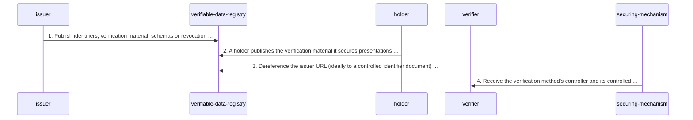

| n | from → to | message | basis | on_error |
|---|---|---|---|---|
| 1 | issuer → verifiable-data-registry | verifiable data registry entry (identifiers, verification material, schemas, revocation registries) | stated | unspecified by source (§1.2: no registry interface is defined) |
| 2 | holder → verifiable-data-registry | verifiable data registry entry (identifiers, verification material, schemas, revocation registries) | stated | unspecified by source (Appendix A.4) |
| 3 | verifier → verifiable-data-registry | controlled identifier document | inferred | unspecified by source (§4.7: a URL that does not dereference is permitted, MAY in §4.4) |
| 4 | securing-mechanism → verifier | verification result (status, document, mediaType, controller, controlledIdentifierDocument, warnings, errors) | stated | unspecified by source (§7.1) |

Source, one quotation per step (all of them are in `protocol.yaml`):

Step 1 (§1.2, non-normative (section)):

<!-- q L215 "A role a" .. "als." -->
> A role a system might perform by mediating the creation and verification of identifiers, verification material, and other relevant data, such as verifiable credential schemas, revocation registries, and so on, which might require using verifiable credentials.

Step 2 (Appendix A.4, non-normative (section)):

<!-- q L4044 "For exam" .. "ons." -->
> For example, a holder can publish information containing the verification material used to secure verifiable presentations.

Step 3 (§4.7, normative):

<!-- q L1282 "It is RE" .. "ial." -->
> It is RECOMMENDED that the URL be one which, if dereferenced, results in a controlled identifier document, as defined in the Controlled Identifiers v1.0 specification, about the issuer that can be used to verify the information expressed in the credential.

Step 4 (§7.1, normative):

<!-- q L3362 -->
> a controller of the verification method associated with the securing mechanism (string controller)

### F18 compatibility-transformation

**Transforming another credential format into a conforming document.** §5.11; local-processing; source mixed.

A transformation specification's obligations (JWT, CWT, mDL, AnonCreds and the like). The transformer is whatever implements that specification; the result must be a conforming, secured document.

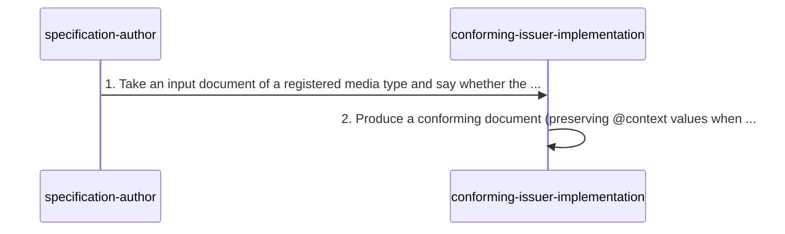

| n | from → to | message | basis | on_error |
|---|---|---|---|---|
| 1 | specification-author → conforming-issuer-implementation | transformation input document | stated | unspecified by source (§5.11) |
| 2 | conforming-issuer-implementation → conforming-issuer-implementation | verifiable credential (application/vc) | stated | unspecified by source (§5.11: no failure of a transformation is defined) |

Source, one quotation per step (all of them are in `protocol.yaml`):

Step 1 (§5.11, normative):

<!-- q L3200 -->
> MUST identify whether the transformation to this data model is one-way-only or round-trippable.

Step 2 (§5.11, normative):

<!-- q L3201 -->
> MUST preserve the @context values when performing round-trippable transformation.

### F19 balance-check-token

**Illustrative: a tokenised balance check that returns to the issuer.** §8.16; exchange; source non-normative.

Non-normative example in the privacy considerations, kept because it is the only flow in the source where a verifier hands a presentation back to the issuer. Everything here is the example's.

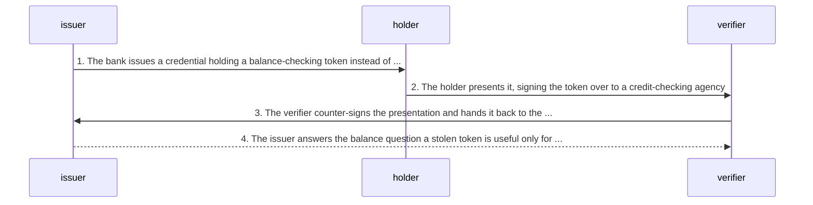

| n | from → to | message | basis | on_error |
|---|---|---|---|---|
| 1 | issuer → holder | verifiable credential (application/vc) | stated | unspecified by source (§8.16) |
| 2 | holder → verifier | verifiable presentation (application/vp) | stated | unspecified by source (§8.16) |
| 3 | verifier → issuer | verifiable presentation (application/vp) | stated | unspecified by source (§8.16: illustrative only) |
| 4 | issuer → verifier | verifiable credential (application/vc) | inferred | unspecified by source (§8.16) |

Source, one quotation per step (all of them are in `protocol.yaml`):

Step 1 (§8.16, non-normative (section)):

<!-- q L3773 "In this " .. "der." -->
> In this case, the bank could issue a verifiable credential containing a balance checking token to a holder.

Step 2 (§8.16, non-normative (section)):

<!-- q L3773 "The hold" .. "ure." -->
> The holder would then include the verifiable credential in a verifiable presentation and bind the token to a credit checking agency using a digital signature.

Step 3 (§8.16, non-normative (section)):

<!-- q L3773 "The veri" .. "lly." -->
> The verifier could then wrap the verifiable presentation in their digital signature and hand it back to the issuer to check the account balance dynamically.

Step 4 (§8.16, non-normative (section)):

<!-- q L3774 "Also, gi" .. "tes." -->
> Also, given the validity period of the counter-signature, the attacker gains access to the token for only a few minutes.

## Error paths

| id | trigger | detected by | outcome | basis |
|---|---|---|---|---|
| E-01 | verifyProof returns result.status false. | conforming-verifier-implementation | A CRYPTOGRAPHIC_SECURITY_ERROR is added to result.errors and result is returned with status false (step 3). result.document is not removed (T-10). | stated |
| E-02 | result.status is true but result.document is not a conforming document. | conforming-verifier-implementation | status set to false, document removed, at least one MALFORMED_VALUE_ERROR added; other warnings and errors MAY be added; result returned. | stated |
| E-03 | No securing mechanism can be determined for inputMediaType (or no media type is known). | conforming-verifier-implementation | unspecified by source. Inferred: status false with an implementation-chosen error, which §7.1 permits. | inferred |
| E-04 | verifyProof expects a map and inputData does not parse as JSON. | conforming-verifier-implementation | unspecified by source. Inferred: status false with a PARSING_ERROR, the §7.2 type for it, which no step names. | inferred |
| E-05 | The call to verifyProof is not successful (throws, or returns without the expected properties). | conforming-verifier-implementation | unspecified by source: step 1.2 only says what result holds if the call was successful, and step 1.3 then reads result.status. Inferred: status false with an implementation-chosen error. | inferred |
| E-06 | JSON-LD expansion or transformation to RDF of the document fails. | conforming-verifier-implementation | Verification fails (MUST). No ProblemDetails type is named and no §7.1 step performs it (T-05). | stated |
| E-07 | A context or other pinned resource does not match its expected hash. | conforming-verifier-implementation | Implementations are expected (lowercase, non-binding) to throw errors; errata may explain a change. | stated |
| E-08 | The digest of a retrieved related resource differs from the digest in relatedResource. | conforming-verifier-implementation | The conforming verifier implementation MUST produce an error; no type is named. | stated |
| E-09 | An HTTP response for a related resource carries a Content-Type other than the listed mediaType. | conforming-verifier-implementation | The response SHOULD be rejected. | stated |
| E-10 | A required property violates its normative requirements, or any §4-§6 MUST is broken (for example validFrom later than validUntil, a string in verifiableCredential, a self-asserted credential without a holder property). | conforming-verifier-implementation | The verifier MUST produce errors. Run as §7.1 step 2 the result is status false with MALFORMED_VALUE_ERROR; the source does not say which type otherwise. | stated |
| E-11 | A credential of the requested type lacks mandatory claims or is malformed for its type. | verifier | Validation fails and the input is rejected (non-normative); no signal is defined. | stated |
| E-12 | The validity period is not acceptable (validFrom in the future, validUntil in the past). | verifier | unspecified by source: Appendix A gives the checks as examples and no outcome; a conforming verifier may even ignore the optional validity properties (T-30). Inferred: validation rejects. | inferred |
| E-13 | Status shows the credential revoked, suspended or otherwise unacceptable, or status entries conflict. | verifier | unspecified by source: the meaning of a status value is the type's; reconciling conflicts is the verifier's business logic and out of scope. | unspecified |
| E-14 | A presentation is replayed (challenge reused, or outside its validity window). | verifier | unspecified by source: the verifier enforces challenge uniqueness (non-normative) but no outcome or error is defined, and the data model has no challenge or presentation-validity property (T-21, T-22). | unspecified |
| E-15 | A refresh request fails or returns nothing usable. | holder | unspecified by source. | unspecified |
| E-16 | The recipient will not adhere to the terms of use. | verifier | Not an error: the recipient acts on its own responsibility and may incur legal liability. | stated |
| E-17 | A credential would produce privacy violations during verification (for example a per-credential revocation list). | verifier | Verifiers are urged to consider rejecting it (non-normative); no signal. | stated |
| E-18 | A credential arrives with no securing mechanism at all. | conforming-verifier-implementation | It is not a conforming document and is not verifiable. Which branch catches it is unspecified: inferred, no verifyProof is found for an application/vc payload without a proof (E-03), or the conformance check fails (E-02). | inferred |
| E-19 | A payload arrives labelled with a lower-precision media type. | verifier | Implementers are urged not to raise errors when the intended media type can be determined (non-normative). | stated |
| E-20 | An HTTP server ignores Accept or answers 415. | verifier | Warned of; no handling defined. | unspecified |

## Source defects and tensions

**T-01 (tension, §5.13, §7.1 steps 1.2-2).** §7.1 requires verifyProof to implement the §5.13 interface, whose result items are named verified and verifiedDocument; §7.1 then reads result.status and result.document. A literal implementation of §5.13 has no status for step 1.3 to test.

<!-- q L3220 -->
> boolean verified

<!-- q L3222 -->
> map verifiedDocument

<!-- q L3369 "If the c" .. "ies." -->
> If the call was successful, result will contain the status, document, mediaType, controller, controlledIdentifierDocument, warnings, and errors properties.

<!-- q L3370 -->
> If result.status is set to false, add a CRYPTOGRAPHIC_SECURITY_ERROR to result.errors.

**T-02 (tension, §5.13, §7.1 step 1.2).** §5.13 obliges a mechanism to return at least verified, verifiedDocument and mediaType; §7.1 asserts that a successful call yields seven properties, including controller, controlledIdentifierDocument, warnings and errors, which no requirement obliges a mechanism to supply.

<!-- q L3219 "The veri" .. "ems:" -->
> The verification algorithm returns a verification result with at least the following items:

<!-- q L3369 "If the c" .. "ies." -->
> If the call was successful, result will contain the status, document, mediaType, controller, controlledIdentifierDocument, warnings, and errors properties.

**T-03 (gap, §7.1 steps 1.1-1.2).** The algorithm has no branch for: no mechanism matching inputMediaType, inputData that does not parse as JSON, or an unsuccessful verifyProof call. Step 1.3 then reads a result that may not exist.

<!-- q L3368 "Set the " .. "ism." -->
> Set the verifyProof function by using the inputMediaType and the Securing Mechanisms section of the Verifiable Credential Extensions document, or other mechanisms known to the implementation, to determine the cryptographic suite to use when verifying the securing mechanism.

<!-- q L3369 "If the c" .. "ies." -->
> If the call was successful, result will contain the status, document, mediaType, controller, controlledIdentifierDocument, warnings, and errors properties.

**T-04 (gap, §7.2).** PARSING_ERROR and RANGE_ERROR are defined but no algorithm or requirement in the source ever produces them; only CRYPTOGRAPHIC_SECURITY_ERROR and MALFORMED_VALUE_ERROR are referenced (each with a back-link to §7.1).

<!-- q L3386 -->
> There was an error while parsing input.

<!-- q L3392 -->
> A provided value is outside of the expected range of an associated value, such as a given index value for an array being larger than the current size of the array.

**T-05 (gap, Appendix B.1, §5.3, §7.1).** Two verifier MUSTs outside §7.1 have no step in the algorithm and no ProblemDetails type: expansion errors must make verification fail, and a related-resource digest mismatch must produce an error. Where they run relative to §7.1, and how their failure reaches result, is not said.

<!-- q L4105 "If such " .. "ure." -->
> If such operations are performed and result in an error, the verifiable credential or verifiable presentation MUST result in a verification failure.

<!-- q L2895 "If the d" .. "ror." -->
> If the digest provided by the issuer does not match the digest computed for the retrieved resource, the conforming verifier implementation MUST produce an error.

**T-06 (tension, §1.3).** The verifier conformance clause requires verification as described in §4.12, which describes the two classes of securing mechanism and no verification procedure; the procedure is §7.1 and the interface §5.13.

<!-- q L230 "MUST per" .. "isms" -->
> MUST perform verification on a conforming document as described in Section 4.12 Securing Mechanisms

**T-07 (tension, §2, §7.1, §4.10, Appendix A.8).** Is status checking verification or validation? The definition of verification includes a successful status check when status is present; §7.1 performs none; Appendix A.8 lists status under validation; §4.10 calls reconciling conflicting entries part of validation.

<!-- q L276 "This inc" .. "eds." -->
> This includes checking that the credential or presentation conforms to the specification, the securing mechanism is satisfied, and, if present, the status check succeeds.

<!-- q L2339 "Reconcil" .. "ion." -->
> Reconciling such conflicts is a part of the validation process, hence part of the verifier's business logic, and therefore out of scope for this specification.

<!-- q L4080 "If the c" .. "ria." -->
> If the credentialStatus property is available, the status of a verifiable credential is expected to be evaluated by the verifier according to the credentialStatus type definition for the verifiable credential and the verifier's own status evaluation criteria.

**T-08 (gap, §7.1, §4.13, §5.13).** §7.1 verifies one inputData. Nothing says whether verifying a presentation verifies the credentials it carries, embedded or enveloped. An embedded presentation proof secures the credential graphs, which is integrity under the holder's key, not each issuer's authorship.

<!-- q L3229 -->
> The securing mechanism MUST secure all graphs in the verifiable credential or the verifiable presentation, except for any proof graphs securing the verifiable credential or the verifiable presentation itself.

<!-- q L2467 "Unless a" .. "als." -->
> Unless additional requirements are defined by the particular securing mechanism or embedding protocol, a verifier cannot generally assume that the verifiable presentation correlates with the presented verifiable credentials.

**T-09 (gap, §7.1, Appendix A.3).** §7.1 returns the controller of the verification method but no normative step compares it with the issuer property (or the holder property of a presentation); only non-normative Appendix A.3 says it is typically the issuer or holder. Binding issuer to key is left to validation.

<!-- q L3362 -->
> a controller of the verification method associated with the securing mechanism (string controller)

<!-- q L4037 "This met" .. "der." -->
> This metadata includes identification of the verified controller of the verification method used by the securing mechanism to secure each verifiable credential or verifiable presentation, of which the controller is typically the respective issuer or holder.

**T-10 (gap, §7.1 steps 1.3, 2, 3).** On the cryptographic failure branch the document stays in result; only the conformance failure branch removes it. The returned map is described as containing a conforming document, which is untrue after step 2 fails and unchecked after step 1.3 fails.

<!-- q L3370 -->
> If result.status is set to false, add a CRYPTOGRAPHIC_SECURITY_ERROR to result.errors.

<!-- q L3371 "If it is" .. "ors." -->
> If it is not, set result.status to false, remove the document property from result, and add at least one MALFORMED_VALUE_ERROR to result.errors.

<!-- q L3360 -->
> a conforming document (map document)

**T-11 (ambiguity, §1.3, §9.5.1-§9.5.3, §9.9.1-§9.9.2, §11.1-§11.2, Appendix C.1-C.2).** Normative status of subsections of sections marked non-normative. Pass 1 read the class of the innermost enclosing section and found §1.3 unmarked. It is not: its tag is `<section id="conformance" class="normative">`, one of the four section tags in the HTML whose id attribute precedes its class (the others are the abstract, the status section and the references, none of them normative or informative), and the pass-1 script did not read it (pass 2, verify, re-measured all 125 section tags of the HTML). What remains is the subsections with no normative or informative class of their own inside sections marked informative: §9.5.1 to §9.5.3, §9.9.1 and §9.9.2, §11.1 and Appendix C.1 and C.2 (no class), and §11.2 (class `substantive`, a change marker). §1.3 ¶1 (L226) makes the sections marked as non-normative non-normative and everything else normative. This record reads a section as marked by its nearest enclosing section that carries either class, as the HTML nests them and as ReSpec prints "This section is non-normative." once, under the marked section's heading (§11 at L3924, not under §11.1 or §11.2). So those subsections are non-normative, which is what requirements.yaml does (R-0118 to R-0123 withdrawn) and what every step label here says. The literal reading, under which §11.1's MUST statements would bind, is not taken.

<!-- q L226 -->
> As well as sections marked as non-normative, all authoring guidelines, diagrams, examples, and notes in this specification are non-normative. Everything else in this specification is normative.

**T-12 (tension, §5.4, Appendix B.1).** Refresh placement contradicts itself and the base context. The issuer may put refreshService inside the verifiable presentation when it is meant for the holder, yet the holder, not the issuer, creates presentations; that case is said to let the holder refresh before creating a presentation, which already exists; and the base context's VerifiablePresentation scoped context defines no refreshService term.

Evidence: credentials_v2.jsonld fetched 2026-11-07 from https://www.w3.org/ns/credentials/v2, 10131 bytes, sha256 59955ced6697d61e03f2b2556febe5308ab16842846f5b586d7f1f7adec92734 (equal to the digest Appendix B.1 prints): /@context/VerifiablePresentation/@context (file lines 91-120) defines holder, id, proof, termsOfUse, type and verifiableCredential; refreshService is defined only under /@context/VerifiableCredential/@context (lines 22-87). Checked by script.

<!-- q L2923 "The issu" .. "nly." -->
> The issuer can include the refresh service as an element inside the verifiable credential if it is intended for either the verifier or the holder (or both), or inside the verifiable presentation if it is intended for the holder only.

<!-- q L2923 "In the l" .. "ier." -->
> In the latter case, this enables the holder to refresh the verifiable credential before creating a verifiable presentation to share with a verifier.

<!-- q L317 "A verifi" .. "ata." -->
> A verifiable presentation is created by a holder, can express data from multiple verifiable credentials, and can contain arbitrary additional data.

**T-13 (defect, §4.2, §4.10).** §4.2's property list names the property status, defined in §4.10; §4.10 defines credentialStatus, and Example 12's caption also says status property. An implementer working from §4.2 looks for the wrong key.

Evidence: HTML: the §4.2 definition list carries a dt element whose text is status, linked to #status. Checked in the .bin.

<!-- q L375 -->
> status

<!-- q L376 -->
> Defined in Section 4.10 Status.

<!-- q L2271 -->
> This specification defines the credentialStatus property for discovering information related to the status of a verifiable credential, such as whether it is suspended or revoked.

<!-- q L2278 -->
> Example 12: Use of the status property

**T-14 (defect, Appendix B.2).** The RefreshService base class is said to be placed into a credentialRefresh property; the property is refreshService (§5.4) and the base context defines no credentialRefresh.

Evidence: credentials_v2.jsonld fetched 2026-11-07 from https://www.w3.org/ns/credentials/v2, 10131 bytes, sha256 59955ced6697d61e03f2b2556febe5308ab16842846f5b586d7f1f7adec92734 (equal to the digest Appendix B.1 prints): no key credentialRefresh anywhere in the file. Checked by script.

<!-- q L4132 "Serves a" .. "rty." -->
> Serves as a superclass for specific refresh service types that are placed into the credentialRefresh property.

**T-15 (defect, §5.8).** The time-zone example writes validUtil for validUntil.

<!-- q L3170 "A given " .. "lid." -->
> A given verifiable credential that had a validUtil value of 2024-07-12T12:00:00-07:00, might be re-issued to have a validFrom value of 2024-07-12T12:00:00-08:00, which would create a gap of an hour where the verifiable credential would not be valid.

**T-16 (defect, §5.6).** The evidence note's first sentence is garbled: its comparison has no second term.

<!-- q L3072 "The evid" .. "sed." -->
> The evidence property provides information that is different from and information to the securing mechanism used.

**T-17 (defect, §1.2).** The registry definition's last sentence has no verb.

<!-- q L215 "Often, m" .. "tem." -->
> Often, more than one type of verifiable data registry used in an ecosystem.

**T-18 (defect, §3.1).** A sentence repeats its own clause.

<!-- q L300 "More inf" .. "aph." -->
> More information is expected to be added to the graph in order to be able to trust claims, more information is expected to be added to the graph.

**T-19 (defect, §5.1).** Integrity-protected publication is secured using with a key.

<!-- q L2609 "When ent" .. "key." -->
> When entities publish metadata about themselves, the publication can be integrity-protected by being secured using with the entity's private key.

**T-20 (defect, §4.13 (Enveloped Verifiable Credentials)).** The RDF note under Enveloped Verifiable Credentials names a presentation as what the id value carries; the object described there envelopes a credential.

<!-- q L2515 "It is po" .. "RDF." -->
> It is possible that an implementer might want to process the object described in this section and the enveloped presentation expressed by the id value in an RDF environment and create linkages between the objects that are relevant to RDF.

**T-21 (gap, §4.13, §9.5.2).** Presentations SHOULD be bound to a verifier's challenge, but the data model defines no challenge property and no request carrying one; the base context defines challenge (and domain) only inside DataIntegrityProof, so binding exists only through a securing mechanism.

Evidence: credentials_v2.jsonld fetched 2026-11-07 from https://www.w3.org/ns/credentials/v2, 10131 bytes, sha256 59955ced6697d61e03f2b2556febe5308ab16842846f5b586d7f1f7adec92734 (equal to the digest Appendix B.1 prints): challenge at /@context/DataIntegrityProof/@context/challenge (line 212), domain at line 221; no challenge elsewhere. Checked by script.

<!-- q L2467 "Verifiab" .. "ier." -->
> Verifiable presentations SHOULD be extremely short-lived and bound to a challenge provided by a verifier.

<!-- q L2467 "Details " .. "ies." -->
> Details for accomplishing this depend on the securing mechanism, the transport protocol, and verifier policies.

**T-22 (gap, §9.5.2, §4.9, §4.13).** Replay defence names a validity period for the presentation, but validFrom and validUntil are defined for credentials only; the base context's VerifiablePresentation scope has neither, so a presentation's window can come only from its securing mechanism (for example Data Integrity expires).

Evidence: credentials_v2.jsonld fetched 2026-11-07 from https://www.w3.org/ns/credentials/v2, 10131 bytes, sha256 59955ced6697d61e03f2b2556febe5308ab16842846f5b586d7f1f7adec92734 (equal to the digest Appendix B.1 prints): validFrom and validUntil only under /@context/VerifiableCredential/@context; expires under /@context/DataIntegrityProof/@context (line 222). Checked by script.

<!-- q L3855 -->
> A validity period, limiting the window during which the verifiable presentation is valid.

<!-- q L2027 -->
> This specification defines the validFrom property to help an issuer to express the date and time when a credential becomes valid and the validUntil property to express the date and time when a credential ceases to be valid.

**T-23 (tension, §5.1, §1.3, §9.4).** The trust model accepts a credential transmitted in a way that establishes the issuer and integrity, without a securing mechanism; conformance requires every conforming document to be secured, and unsigned credentials are called not verifiable.

<!-- q L2608 -->
> A credential is transmitted in a way that clearly establishes that the issuer generated the credential, and that the credential was not tampered with in transit nor storage. This expectation could be weakened, depending on the risk assessment by the verifier.

<!-- q L228 "A conforming document MUST be s" .. "sms." -->
> A conforming document MUST be secured by at least one securing mechanism as described in Section 4.12 Securing Mechanisms.

<!-- q L3839 "Implemen" .. "ted." -->
> Implementers ought to be aware that these credential types are not verifiable because the authorship either is unknown or cannot be trusted.

**T-24 (gap, §4.9, Appendix A.5, Appendix A.7).** Validity evaluation is underspecified. Without either bound a credential is valid indefinitely and assumed valid from its creation, but that rule is a note, and the data model has no creation-time property. The clock compared against is never named. Boundary inclusion follows only from two remarks inside the normative definitions (validFrom is the earliest, validUntil the latest point at which the information is valid). Appendix A.5 is titled Issuance Date but describes validFrom.

<!-- q L2267 "If valid" .. "ely." -->
> If validFrom and validUntil are not present, the verifiable credential validity period is considered valid indefinitely.

<!-- q L2267 "In such " .. "ted." -->
> In such cases, the verifiable credential is assumed to be valid from the time the verifiable credential was created.

<!-- q L2030 "Note tha" .. "lid." -->
> Note that this value represents the earliest point in time at which the information associated with the credentialSubject property becomes valid.

<!-- q L2032 "Note tha" .. "lid." -->
> Note that this value represents the latest point in time at which the information associated with the credentialSubject property is valid.

<!-- q L4057 "The vali" .. "ier." -->
> The validFrom is expected to be within an expected range for the verifier.

**T-25 (tension, §5.3, Appendix B.1, Appendix B.2).** sha384 SHOULD be the minimum hash strength, yet the specification pins its own base context and vocabularies with SHA2-256 and Example 26 uses SHA2-256.

<!-- q L2896 "At the t" .. "ers." -->
> At the time of this writing sha384 SHOULD be considered the minimum strength hash algorithm for use by implementers.

<!-- q L4103 "the foll" .. "ile:" -->
> the following value is the hexadecimal encoded SHA2-256 digest value of the base context file:

<!-- q L2910 -->
> Example 26: Use of the digestMultibase property (base64-url-nopad-encoded SHA2-256)

**T-26 (defect, §5.5).** The terms-of-use consequence sentence gives its verb phrase no antecedent (a recipient not willing to adhere is said to act on its own responsibility in doing so), and calls a presentation issued.

<!-- q L2961 "If the r" .. "use." -->
> If the recipient (a holder or verifier) is not willing to adhere to the specified terms of use, then they do so on their own responsibility and might incur legal liability if they violate the stated terms of use.

<!-- q L2961 "The valu" .. "ion." -->
> The value of the termsOfUse property MUST specify one or more terms of use policies under which the creator issued the credential or presentation.

**T-27 (gap, §5.4).** Refresh defines no request, response or result: whether the refreshed credential is new (id, validity), replaces the old one, or can be refused is not said.

<!-- q L2926 "The prec" .. "ion." -->
> The precise content of each refresh service is determined by the specific refreshService type definition.

**T-28 (gap, Appendix A.1, §8.9).** Requests are mentioned (by type, minimal) and never specified: no request structure, no refusal.

<!-- q L4022 "When a v" .. "ive." -->
> When a verifier requests one or more verifiable credentials from a holder, they can specify the type of credential(s) that they would like to receive.

**T-29 (gap, §4.10).** The status lifecycle is entirely delegated: formats, protocols and values (revoked, suspended, withdrawn for cause) belong to status type definitions.

<!-- q L2340 "Defining" .. "ion." -->
> Defining the data model, formats, and protocols for status schemes is out of the scope of this specification.

**T-30 (tension, §1.3, §2).** Conforming verifiers may ignore optional properties. credentialStatus, validFrom, validUntil and relatedResource are optional, so a conforming verifier need check neither expiry nor status, although the definition of verification includes the status check. Consistent with Appendix A being non-normative, and the reason every validity and status transition in state-machine.yaml is validation, not verification.

<!-- q L231 "Optional" .. "ons." -->
> Optional properties MAY be ignored by conforming issuer implementations and conforming verifier implementations.

<!-- q L276 "This inc" .. "eds." -->
> This includes checking that the credential or presentation conforms to the specification, the securing mechanism is satisfied, and, if present, the status check succeeds.

**T-31 (gap, §5.3).** digestSRI and digestMultibase each carry one or more digests, and an object may carry both; which of them must match the retrieved resource (any, all, the strongest) is not said.

<!-- q L2887 "One or m" .. "ute." -->
> One or more cryptographic digests, as defined by the hash-expression ABNF grammar defined in the Subresource Integrity specification, Section 3.5: The integrity attribute.

<!-- q L2889 -->
> Each object associated with relatedResource MUST contain at least a digestSRI or a digestMultibase value.

## Not defined by the source

- Any transport, session, acknowledgement or error response for issuance (issuer to holder) or presentation (holder to verifier).
- A presentation request: its structure, the types or claims asked for, a challenge or domain, a refusal.
- A challenge property or any presentation validity property; binding is delegated to securing mechanisms (T-21, T-22).
- A holder conformance class.
- How inputMediaType is obtained before §7.1, and what follows when it is missing or unknown.
- Error types or §7.1 placement for: no securing mechanism, unparseable input, an unsuccessful verifyProof call, an expansion error, a related-resource digest mismatch (T-03, T-05).
- Whether and how credentials inside a presentation are verified (T-08), and how controller is bound to issuer or holder (T-09).
- Status: formats, protocols, values, retrieval, failure and conflict resolution (T-29).
- Refresh: request, response, the refreshed credential's identity and the fate of the old one (T-27).
- Verifiable data registry interfaces: publication, resolution, key discovery; identifier (DID, controlled identifier) resolution.
- Validation: conformance, ordering, outputs and error signals; how verifiers choose issuers to trust.
- Key lifecycle (rotation, suspension, revocation of issuer or holder keys); §9.2 refers to NIST SP 800-57.
- Authorization (§5.9) and enforcement of terms of use after presentation (§9.9.1).
- The derivation and verification algorithms of zero-knowledge and selective-disclosure presentations (delegated, for example to Data Integrity BBS).

## Coverage

13 roles. 19 flows (5 creation-and-delivery, 6 exchange, 2 hand-off, 2 local-decision, 1 local-processing, 3 receive-processing; source status 14 mixed, 3 non-normative, 2 normative) with 109 steps, 13 of them inferred; on_error_basis inferred 5, stated 14, unspecified 90. 26 message-vocabulary entries, 26 used by steps. 20 error paths (inferred 5, stated 11, unspecified 4). 31 source defects and tensions (1 ambiguity, 9 defect, 13 gap, 8 tension). 14 not_defined items. 400 quote items in this file, every one cut by script and checked by bin/check-quotes. Pass 1 counted 263 selector matches and 173 quote joins resolving to 244 distinct requirement ids (155 of the 201 stated keyword entries); pass 2 (verify) removed the 4 selectors that had matched the withdrawn R-0118 to R-0121 from F01 step 4 and recounted from the objects: 259 selector matches, 56 further ids added by quote joins, 240 distinct ids, 151 of the 201 stated keyword entries, 0 selectors unresolved. With state-machine.yaml: 247 of the 298 requirements.yaml entries cited by one or both files, 34 more covered through a split parent or child that is cited; the 17 not cited are listed under requirements_not_cited with the reason (pass 2 added the four withdrawn entries). Wired against requirements.yaml sha256 c74ae28dbde0e32766f1f688206dd3904227de75a782d2cf0ac67324570a7f41; pass 2 changed the text of R-0012 and R-0015 and one testable_reason (sha256 fa47abc43358b1c89597d0c2b8fd9b54df6a609133478a3104e274a6472de505), no id, and no join here resolved to either text. 25 quote labels relabelled by pass 2 (T-11). Counted by script, 2026-11-07; any later edit owes a recount.

protocol.md carries quotation markers only; 1 YAML quotes whose boundary falls next to a double quote mark cannot be selected by a marker and appear in protocol.yaml only.
