# w3c-vc-jose-cose — protocol model

FX-1 pass 1 (extract), protocol and state-machine agent, effort max, from the source only: the W3C Recommendation of 15 May 2025 (`.cache/w3c-vc-jose-cose.bin`, sha256 `6c70cf8d7de9d8a3ff28a743fea9d569a67a402111c3245fdafbaa2ad6709af9`), quoted from its plain-text rendering `.cache/w3c-vc-jose-cose.txt`. The data is in `protocol.yaml` and `state-machine.yaml`; this file is their prose companion, generated from them in this pass, so each statement here repeats the entry it summarises. A later edit to either owes the same edit to the other.

## Framing: an enveloping profile with no exchange of its own

The document secures documents of another specification by wrapping them. “The Verifiable Credentials Data Model v2.0 describes the approach taken by this specification to secure JSON and CBOR claims by applying an enveloping proof.” (§1.1.2) There are three envelopes (a JWS, an SD-JWT, a COSE_Sign1), each for a credential and a presentation, so six media types. For the JWS and COSE routes the payload is the credential or presentation JSON as it stands; the SD-JWT route converts a credential into an SD-JWT payload on issuance and back on verification.

It defines no exchange. There is no request, response, session, transport binding, acknowledgement or error message between issuer, holder and verifier, and the only mention of moving a secured object is the condition attached to optional encryption: “To encrypt a secured verifiable credential when transmitting over an insecure channel, implementers MAY use JSON Web Encryption (JWE) [RFC7516] by nesting the secured verifiable credential as the plaintext payload of a JWE, per the description of Nested JWTs in [RFC7519].” (§3.1.1) So every flow is one party building an object, a delivery the source does not define, and the receiving party processing it alone. Every `on_error` is local to the role that meets the failure; nothing travels back.

The roles are the VC Data Model's, by link: issuer, holder and verifier are never defined here (§2 defines four terms, none a role). The conformance classes of §1.1.1 are per mechanism and per side, an issuer implementation and a verifier implementation for each of JWS, SD-JWT and COSE. There is no holder class, and each presentation section assigns securing the presentation to the issuer implementation; that the holder is the party doing it is this model's reading, marked inferred wherever it is used (`issuer-class-secures-presentations`).

On the receiving side, keys are found first and outside the algorithms: “This specification might be used with many different key discovery protocols. Therefore, discovery of verification keys is described in 4. Key Discovery, and is assumed to have succeeded prior to beginning the verification process.” (§5) Each of §5.1, §5.2 and §5.3 then delegates the cryptographic work to the specification of its envelope and maps the outcome onto three outputs, run by whoever receives the object: “Upon receipt of the verifiable credential or presentation secured as a JWT [RFC7519], the holder or verifier follows this algorithm:” (§5.1) Validation is a separate, recommended stage: “After verification has succeeded, additional validation checks SHOULD be performed as described in Section 5.4 Validation” (§5) (the source sentence has no full stop).

The one dependency between parties the source states is a holder key bound into a credential: “Use of a proof-of-possession key provided by the Holder to the Issuer to establish a cryptographic binding to the Holder in the Verifiable Credential that is verifiable by the Verifier in the Verifiable Presentation is RECOMMENDED.” (§4.1.3) It defines no message for providing the key and no way of proving possession in a JWS or COSE presentation (`key-binding`, `possession-proof-undefined`).

## Reading `protocol.yaml` and `state-machine.yaml`

| key | what it holds |
|---|---|
| `source`, `applicability`, `conventions` | digests, what kind of protocol this is, and the rules for quoting, step numbers, basis, ids, messages and roles |
| `framing` | 6 statements of what kind of document this is, each quoted |
| `roles` | 14 roles: 3 parties, 6 conformance classes, and 5 others (channel, component, mentioned) |
| `message_names_used` | the 32 `messages.yaml` entries the steps use, with how often |
| `flows` | 17 flows, 113 steps (41 inferred). Kinds: creation-and-delivery 6, exchange 1, local-decision 2, out-of-scope 1, receive-processing 7. on_error_basis: stated 18, unspecified 94, inferred 1 |
| `error_paths` | 21 failures, each with its trigger, the role that meets it, the flow steps, and the outcome as stated or as unspecified |
| `source_defects_and_tensions` | 33 entries, recorded and not repaired |
| `not_defined` | 14 things an implementer will not find in this document |
| `state-machine.yaml` | 6 machines, 53 states, 66 transitions (39 inferred), 21 triggers, 13 source tensions, 7 not modelled |

In the §5 flows a step number is a position in the source's ordered lists (2.3 is the third item of the list inside item 2). The HTML prints no numbers and the `.txt` rendering drops the nesting, so these are list positions, the same ones `normative.md` uses. Everywhere else the step numbers are this model's. A step's `kind` is `stated` or `inferred`; an inferred step says why in `inferred_reason`. `unspecified by source` in an `on_error` means the source names the operation and says nothing about its failure, which is the commonest case here.

## Roles

| role | kind | source names | locators |
|---|---|---|---|
| `issuer` | party | Issuers, Issuer, issuer, issuers | §1.1.2.1, §3.2.1, §4, §4.1.1, §4.1.3 |
| `holder` | party | Holders, Holder, holder, holders | §1.1.2.1, §4, §4.1.3, §4.2, §5.1, §5.2, §5.3 |
| `verifier` | party | Verifiers, Verifier, verifier, verifiers | §1.1.2.1, §4, §4.1, §4.1.3, §5, §5.4 |
| `subject` | mentioned | subject | §1.1.2, §4.1.1 |
| `jws-issuer-implementation` | conformance-class | — | §1.1.1 |
| `jws-verifier-implementation` | conformance-class | — | §1.1.1 |
| `sd-jwt-issuer-implementation` | conformance-class | — | §1.1.1 |
| `sd-jwt-verifier-implementation` | conformance-class | — | §1.1.1 |
| `cose-issuer-implementation` | conformance-class | — | §1.1.1 |
| `cose-verifier-implementation` | conformance-class | — | §1.1.1 |
| `implementer` | mentioned | implementers, Implementers, Implementations | §1.1.2.2, §3.1.1, §3.2.1, §3.1.2, §3.2.2 |
| `insecure-channel` | channel | an insecure channel | §3.1.1, §3.1.2, §3.2.1, §3.2.2, §3.3.1, §3.3.2 |
| `json-parser` | component | JSON parser, JSON parsers | §7.2 |
| `user` | mentioned | users, the user's asymmetric private and symmetric secret keys | §7.1, §7.2 |

Issuer, holder and verifier are linked to the VC Data Model's definitions. `subject`, `implementer` and `user` take no step; the six conformance classes are named on the steps they bind (`conformance_class`). `json-parser` appears only in §7.2, which the source marks non-normative.

## Flows

Each arrow is one `protocol.yaml` step in order, labelled with the step number, the `messages.yaml` id of its message, and a short form of its action. A self-arrow is local processing. `opt` blocks are step conditions; in the three algorithms, `alt` and `else` are the success and failure branches of steps 2 and 3. A label ending `[inferred]` is a step the source does not state. Delivery through `insecure-channel` is drawn as two arrows. Mermaid reads a semicolon as a line break, so labels use none.

### `media-type-labelling`

Choosing the securing mechanism and the media type that labels the secured object. Sections: §1.1.2, §3, §3.3. Run by whoever secures a credential (the issuer) or a presentation (the holder, by this model's reading). The source states no rule for choosing among JOSE, SD-JWT and COSE: COSE is a MAY and the other two have no keyword of their own. The media type rules are general and bind the label wherever it is carried (typ, cty, a data URL, a transport header), which the source does not enumerate. Steps name the issuer; a holder securing a presentation applies the same rules.

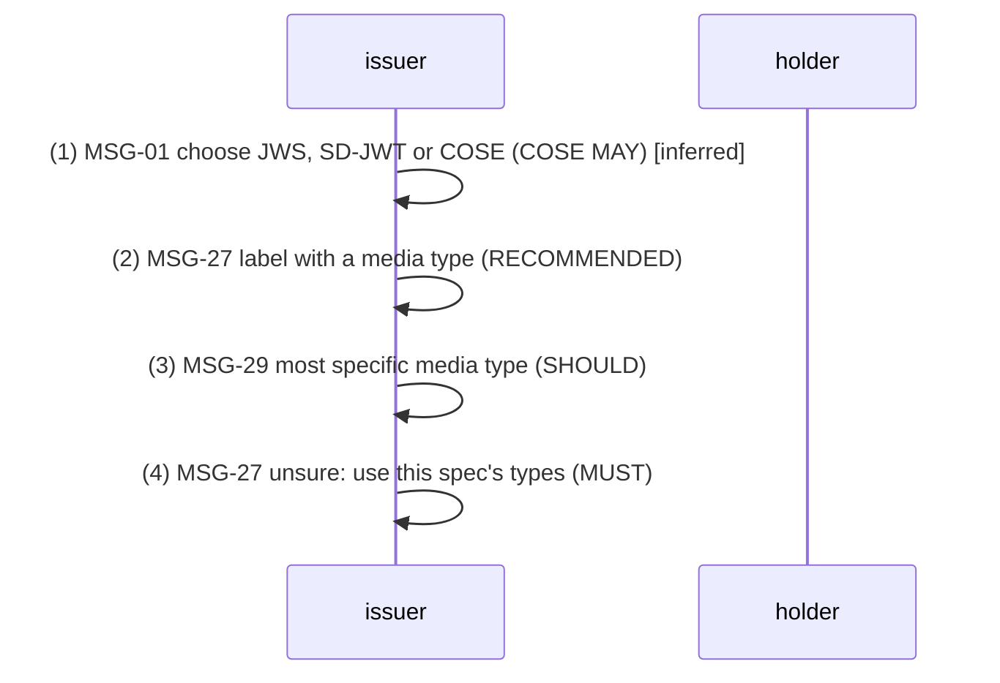

### `jose-credential-securing`

Securing a credential as a JWS (application/vc+jwt) and handing it to the holder. Sections: §3.1.1, §3.1.2, §1.1.2.1, §4.1.1, §4.1.2, §4.2. The issuer signs the credential JSON, unencoded, as a JWS payload. typ and cty are SHOULDs; kid is a MUST only in the DID URL case and the URL-issuer-without-iss case of §4.2, whose requirements apply when controlled identifier documents are used. Encryption is a MAY. Delivery is not specified. The holder may verify on receipt with §5.1.

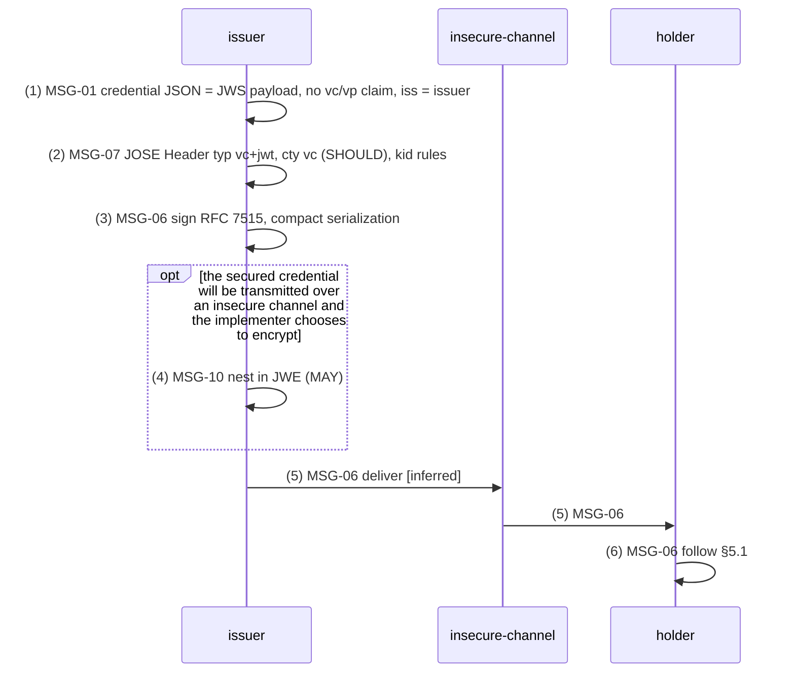

### `sd-jwt-credential-securing`

Securing a credential as an SD-JWT (application/vc+sd-jwt) and handing it to the holder. Sections: §3.2.1, §3.2.2, §1.1.2.2, §4.1.1, §4.2. Unlike the JWS and COSE routes, the payload is not the credential as it stands: the issuer converts the credential (the input JWT Claims Set) into an SD-JWT payload with digests and disclosures, per the SD-JWT draft. Properties needed for validation SHOULD stay disclosed.

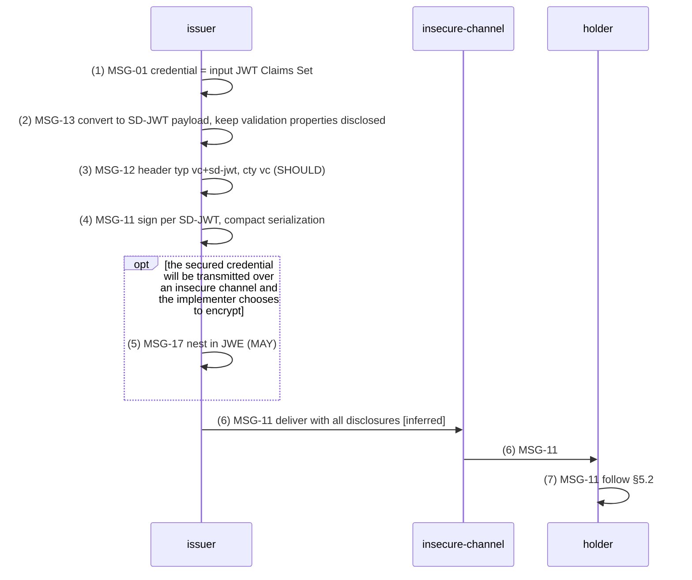

### `cose-credential-securing`

Securing a credential as a COSE_Sign1 (application/vc+cose) and handing it to the holder. Sections: §3.3, §3.3.1, §3.3.3, §4.1.1, §4.2. COSE_Sign1 over the credential as it stands. typ (16) and content type (3) are SHOULDs; CWT claims MAY ride in a header parameter. §1.1.2 says the credential is encoded as CBOR under COSE, while §3.3.1 makes it the unencoded payload and every encoded example carries JSON text (tension cose-payload-json-or-cbor).

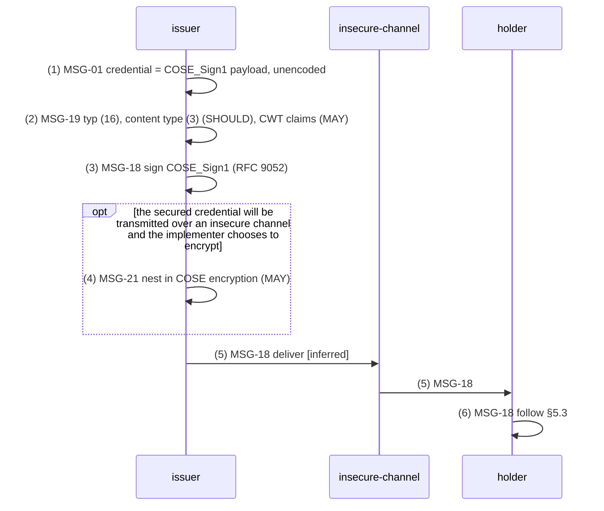

### `key-binding`

Binding a holder key into a credential and proving it in a presentation (cnf). Sections: §4.1.3, §1.1.2.2. The only dependency between parties the source states: a proof-of-possession key provided by the holder to the issuer, bound into the credential, and verifiable by the verifier in the presentation (RECOMMENDED). The source defines no message for providing the key, does not say in this sentence that cnf carries it (the sentence sits under the cnf heading), and describes no proof step for vp+jwt or vp+cose. For SD-JWT the KB-JWT is the part §1.1.2.2 names.

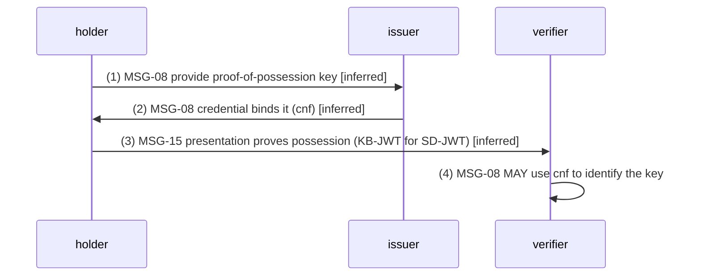

### `credential-enveloping`

Putting secured credentials (and presentations) inside a presentation. Sections: §3.1.2, §3.2.2, §3.3.1, §3.3.2, §8.4. The three presentation sections state the same three MUSTs: a credential inside a presentation is secured, it is an EnvelopedVerifiableCredential, and a presentation inside a presentation is an EnvelopedVerifiablePresentation. Only the COSE section says how the secured bytes are carried (base64 per RFC 2397, the data URL scheme); for JWS and SD-JWT only the examples show a data URL. Whether the enveloped credential must use the same mechanism as the presentation is not settled (tension mixed-mechanisms-in-presentation).

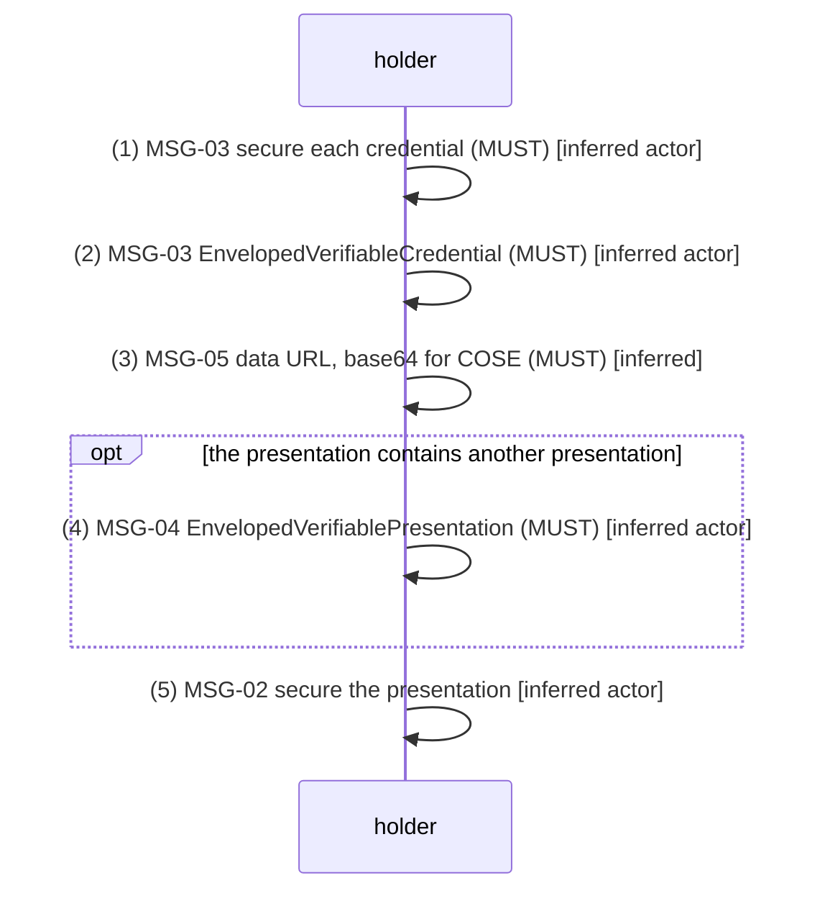

### `jose-presentation-securing`

Securing a presentation as a JWS (application/vp+jwt) and handing it to the verifier. Sections: §3.1.2, §1.1.2.1, §4.1.1, §4.2. The credential route of jose-credential-securing with vp values, the holder's kid rule of §4.2, and delivery to a verifier.

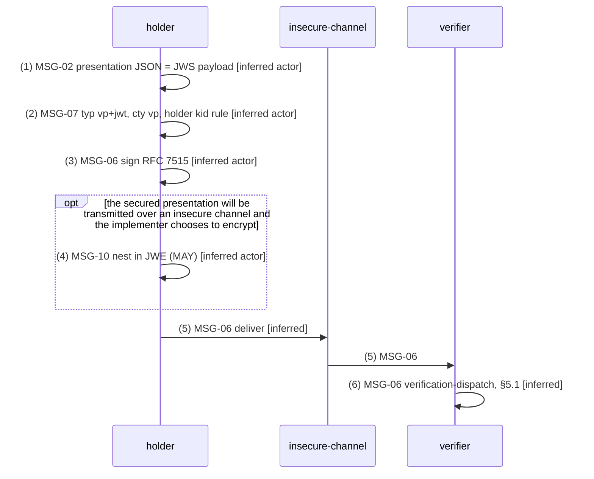

### `sd-jwt-presentation-securing`

Securing a presentation as an SD-JWT (application/vp+sd-jwt) and handing it to the verifier. Sections: §3.2.2, §1.1.2.1, §4.1.1, §4.2, §5.2. Here the presentation is the unencoded SD-JWT payload, with no conversion stated, where the credential route converts (tension sd-jwt-presentation-conversion). No §5 algorithm takes vp+sd-jwt, so the last step has no algorithm to invoke (defect sd-jwt-presentation-no-algorithm).

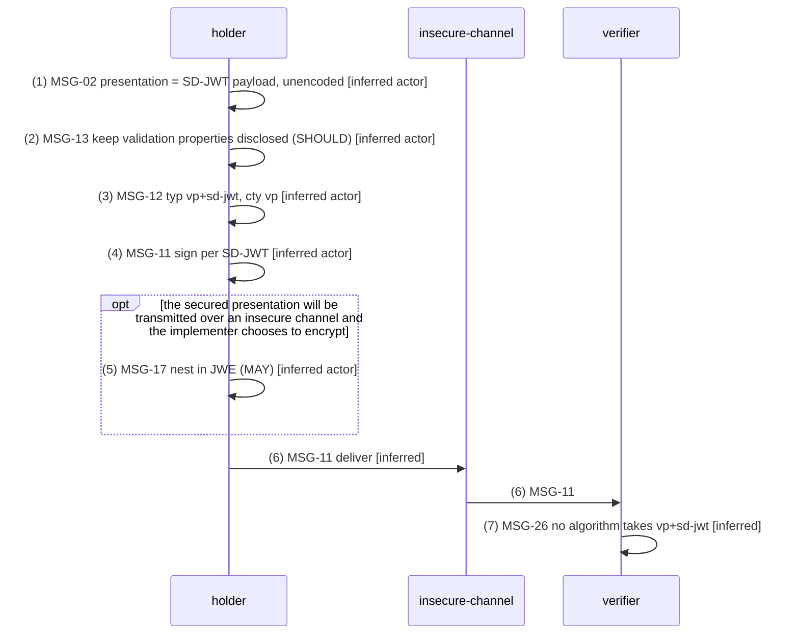

### `cose-presentation-securing`

Securing a presentation as a COSE_Sign1 (application/vp+cose) and handing it to the verifier. Sections: §3.3.2, §3.3.3, §4.1.1, §4.2. The credential route of cose-credential-securing with vp values, the holder's kid rule, and delivery to a verifier.

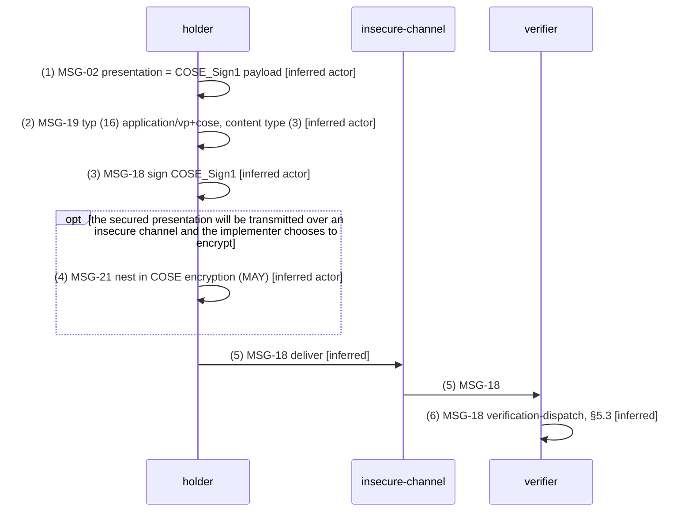

### `sd-jwt-selective-disclosure`

Presenting an SD-JWT credential with chosen disclosures and an optional KB-JWT. Sections: §1.1.2, §1.1.2.2, §8.4. The capability that motivates SD-JWT, described in §1.1.2 and left to the SD-JWT draft. The source never describes the holder choosing disclosures or adding a KB-JWT, and never says which media type labels the result; its only instance, Example 22, labels a credential's SD-JWT with four of six disclosures and a KB-JWT as application/vp+sd-jwt (tension two-meanings-of-sd-jwt-presentation).

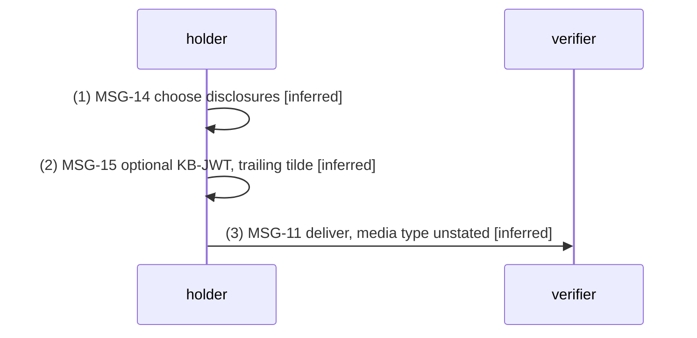

### `key-discovery-header-hints`

Finding the verification key from kid, iss and cnf. Sections: §4, §4.1, §4.1.1, §4.1.2, §4.1.3, §5. Runs before any §5 algorithm, which assumes it succeeded. kid is a hint, iss obtains a JSON Web Key, cnf MAY identify a proof-of-possession key; every use is permissive (can, MAY) and none is ordered. The discovered key is not an input of any §5 algorithm. The SHOULD to minimize processing of untrusted data during key discovery sits against hints that live in the protected header and the payload (tension key-discovery-reads-untrusted-data).

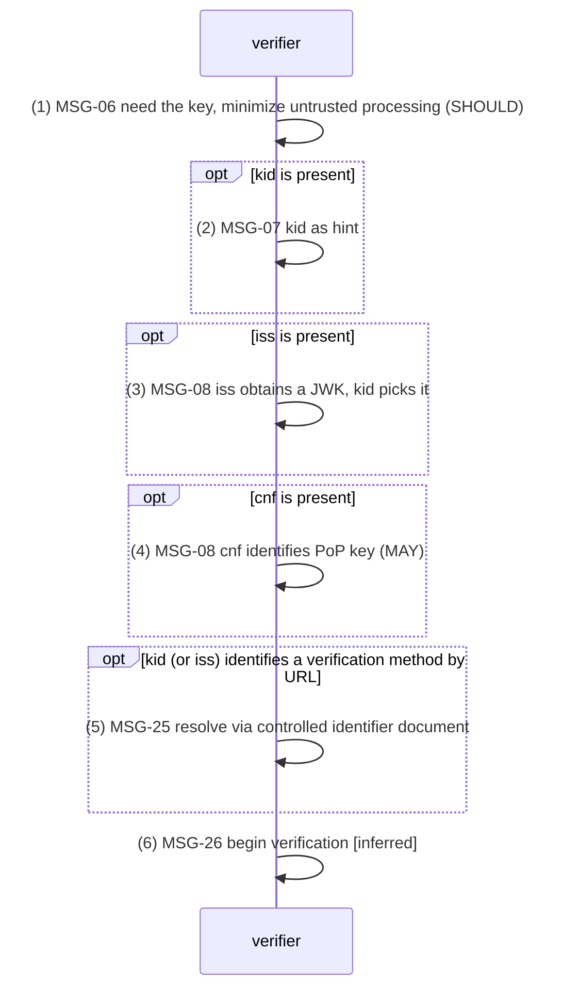

### `key-discovery-controlled-identifier-document`

Obtaining the key from a verification method in a controlled identifier document. Sections: §4.2. The document constrains the shape of the verification method (JsonWebKey, publicKeyJwk) and the kid that points at it, and states that there is no standard way to retrieve the key. Who publishes the controlled identifier document and how it is fetched are not said. No step has a stated failure outcome.

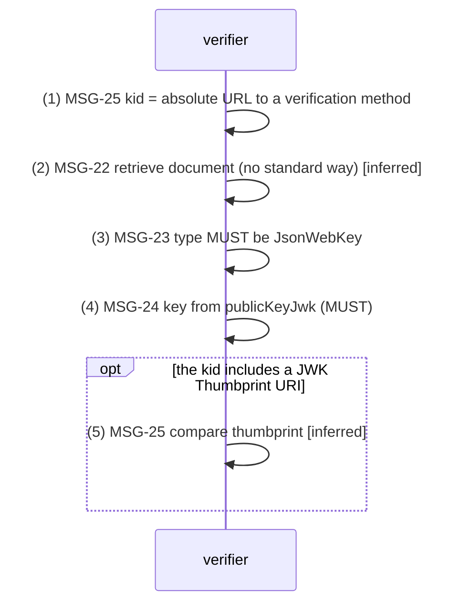

### `verification-dispatch`

Receiving a secured object, choosing the §5 algorithm, and what follows it. Sections: §5, §5.1, §5.2, §5.3, §3.1.2, §3.2.2, §3.3.2. The glue the source leaves out. Each algorithm declares its inputMediaType; nothing says how a receiver learns the media type, decrypts a nested JWE or COSE encryption object first, chooses the algorithm, or verifies the credentials enveloped in a verified presentation. Those steps are here so the stated ones can be placed, and every one is marked inferred.

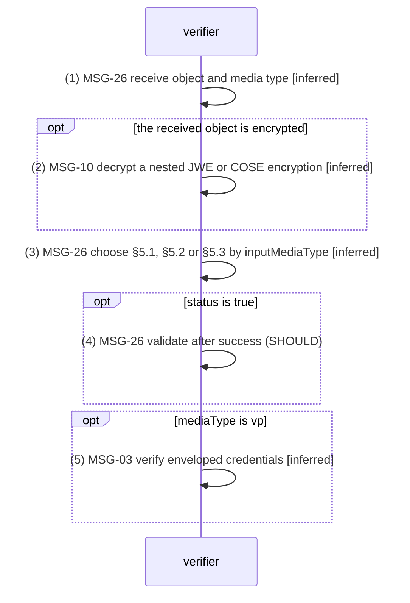

### `jose-verification`

Verifying a credential or presentation secured with JOSE (§5.1). Sections: §5.1, §5, §3.1.1, §3.1.2, §1.1.2.1. Delegates everything to Validating a JWT and maps the outcome to status, mediaType and document. The input document is called the verifiable credential although vp+jwt is an input. Step 2.2 gives no rule for vc against vp. Rejection of an alg none JWT is a separate MUST of §1.1.2.1.

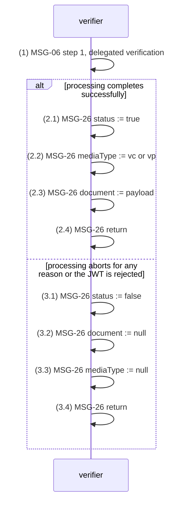

### `sd-jwt-verification`

Verifying a credential secured with SD-JWT (§5.2). Sections: §5.2, §5, §3.2.1, §3.2.2. Delegates to the SD-JWT draft, then converts the payload back into the JWT Claims Set. Admits vc+sd-jwt only and sets mediaType to vc only, so a vp+sd-jwt has no algorithm. Unlike §5.1 and §5.3, step 2.3 is a transformation that can itself fail, after status is already true.

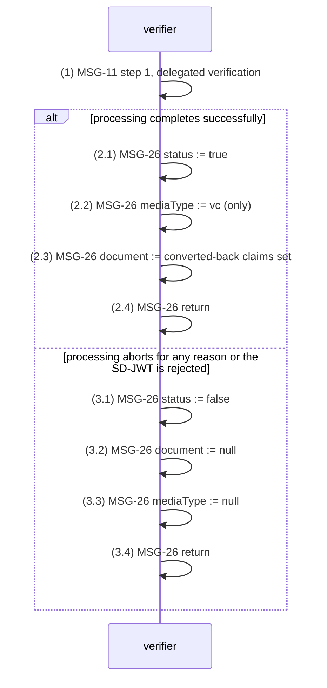

### `cose-verification`

Verifying a credential or presentation secured with COSE (§5.3). Sections: §5.3, §5, §3.3.1, §3.3.2, §3.3.3. Delegates to the COSE_Sign1 verification of RFC 9052. Its failure branch has no rejection clause (only aborts for any reason), unlike §5.1 and §5.2.

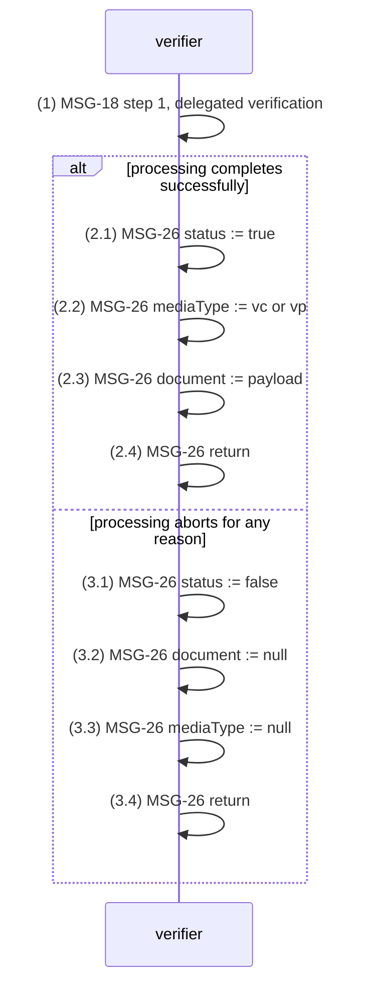

### `validation`

Validation after a successful verification (§5.4). Sections: §5.4, §5, §3.3.3. Five paragraphs, no numbered steps, no inputs or outputs of its own: n here is this model's ordering by paragraph and sentence. Entered by a SHOULD (R-0076), it holds six MUSTs, two SHOULDs and a MAY. None states what follows a failed check, and the §5 outputs are already set when it runs, so a failed validation has no stated effect on status. The order of the checks is the paragraph order; the source does not prescribe one.

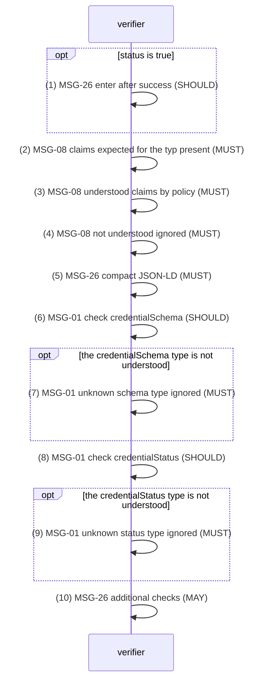

## The §5 algorithms as printed

Each block reproduces the source lines of `.cache/w3c-vc-jose-cose.txt` unchanged, one line per HTML list item or paragraph. The numbers in front of the algorithm steps are not in the source: they are the positions of the items in the HTML ordered lists, added here as `protocol.yaml` uses them.

§5 (lines 856 to 862):

```
This specification might be used with many different key discovery protocols. Therefore, discovery of verification keys is described in 4. Key Discovery, and is assumed to have succeeded prior to beginning the verification process.
As a general rule, verifiers SHOULD strive to minimize the processing of untrusted data. This includes minimizing any processing of the protected header, unprotected header, or payload as part of the key discovery procedures.
After verification has succeeded, additional validation checks SHOULD be performed as described in Section 5.4 Validation
The outputs for the following algorithms are:
status: a boolean indicating the result of verification, true for success and false for failure.
document: a document conforming to the [VC-DATA-MODEL-2.0]
mediaType: vc or vp
```

§5.1 (lines 866 to 880):

```
The inputs for this algorithm are:
inputMediaType: vc+jwt or vp+jwt
inputDocument: the verifiable credential secured as a JWT [RFC7519]
Upon receipt of the verifiable credential or presentation secured as a JWT [RFC7519], the holder or verifier follows this algorithm:
1. Follow the algorithm defined in Validating a JWT [RFC7519].
2. If processing completes successfully:
   2.1 Set status to true
   2.2 Set mediaType to vc or vp
   2.3 Set document to the decoded JWS payload.
   2.4 Return
3. If processing aborts for any reason or the JWT is rejected:
   3.1 Set status to false
   3.2 Set document to null
   3.3 Set mediaType to null
   3.4 Return
```

§5.2 (lines 884 to 898):

```
The inputs for this algorithm are:
inputMediaType: vc+sd-jwt
inputDocument: the verifiable credential secured with [SD-JWT]
Upon receipt of the verifiable credential or presentation secured with [SD-JWT], the holder or verifier follows this algorithm:
1. Follow the algorithms defined in SD-JWT for verification of the SD-JWT.
2. If processing completes successfully:
   2.1 Set status to true
   2.2 Set mediaType to vc
   2.3 Convert the SD-JWT payload back into the JWT Claims Set by reversing the process in [SD-JWT]. Set document to the JWT Claims Set. (For examples of the transition from JWT Claims Set to SD-JWT payload, please see SD-JWT examples).
   2.4 Return
3. If processing aborts for any reason or the SD-JWT is rejected:
   3.1 Set status to false
   3.2 Set document to null
   3.3 Set mediaType to null
   3.4 Return
```

§5.3 (lines 902 to 916):

```
The inputs for this algorithm are:
inputMediaType: vc+cose or vp+cose
inputDocument: the verifiable credential or verifiable presentation secured with CBOR Object Signing and Encryption (COSE): Structures and Process
Upon receipt of the verifiable credential or presentation secured with [RFC9052], the holder or verifier follows this algorithm:
1. Follow the algorithm defined in CBOR Object Signing and Encryption (COSE): Structures and Process [RFC9052] under the Signing and Verification Process for COSE_Sign1.
2. If processing completes successfully:
   2.1 Set status to true
   2.2 Set mediaType to vc or vp
   2.3 Set document to the decoded COSE_Sign1 payload.
   2.4 Return
3. If processing aborts for any reason:
   3.1 Set status to false
   3.2 Set document to null
   3.3 Set mediaType to null
   3.4 Return
```

§5.4 (lines 920 to 924; paragraphs, not steps):

```
All claims expected for the typ MUST be present. All claims that are understood MUST be evaluated according the verifier's validation policies. All claims that are not understood MUST be ignored.
The verified document returned from verification MUST be a well-formed compact JSON-LD document, as described in Verifiable Credentials Data Model v2.0.
Schema extension mechanisms such as credentialSchema SHOULD be checked. If the extension mechanism type is not understood, this property MUST be ignored.
Status extension mechanisms such as credentialStatus SHOULD be checked. If the extension mechanism type is not understood, this property MUST be ignored.
Based on the validation policy of the verifier, the type of credentials, and the type of securing mechanism, additional validation checks MAY be applied. For example, dependencies between multiple credentials, ordering or timing information associated with multiple credentials, and/or multiple presentations could cause an otherwise valid credential or presentation to be considered invalid.
```

Read against each other, the three algorithms differ in three places: §5.2 admits only `vc+sd-jwt` and sets `mediaType` to `vc` alone; §5.2 alone converts the payload in its success branch (step 2.3), after `status` is already true; and §5.3 alone has no rejection clause in step 3. All three share three gaps: no input carries the key, no step of the success branch has a way out to the failure branch, and the declared output domains leave out the `null` every failure branch sets. §5.1 and §5.3 also give step 2.2 no rule for `vc` against `vp`.

## Where the algorithms disagree with §3

Each entry is the `protocol.yaml` entry of the same id, with its first quotation.

- **`sd-jwt-presentation-no-algorithm`** (defect, §5.2, §3.2.2, §6.1.4). The heading and the receipt sentence of §5.2 cover a presentation, but its only input media type is vc+sd-jwt, its input document is a credential, and step 2.2 sets mediaType to vc. §3.2.2 recommends vp+sd-jwt as the typ of an SD-JWT presentation and §6.1.4 registers application/vp+sd-jwt. No algorithm verifies one. “inputMediaType: vc+sd-jwt” (§5.2)
- **`sd-jwt-presentation-conversion`** (tension, §3.2.1, §3.2.2, §5.2). A credential is converted into an SD-JWT payload; a presentation is the SD-JWT payload as it stands. §5.2 converts back in both cases (if it took presentations at all). “The unsecured verifiable credential is the input JWT Claims Set.” (§3.2.1)
- **`cose-payload-json-or-cbor`** (tension, §1.1.2, §3.3.1, §5.3, §5.4). §1.1.2 says that under COSE the credential is encoded as a CBOR data structure; §3.3.1 makes it the unencoded payload; every COSE_Sign1 example carries JSON text as the payload (7 of 7 decoded payloads begin with the octet 7b); §5.3 step 2.3 decodes the payload without saying how; §5.4 requires compact JSON-LD. “When using COSE, the Verifiable Credential or Presentation is encoded as a CBOR data structure.” (§1.1.2)
- **`verifier-classes-point-at-section-3`** (tension, §1.1.1, §3.1.1, §5.1). Each verifier conformance class verifies as described in Section 3.x, whose verifier statements are to use RFC 7515, SD-JWT or COSE_Sign1 (and, for JWS and SD-JWT, to support the compact serialization); no conformance class mentions the §5 algorithms. §5.1 then follows Validating a JWT (RFC 7519) where §3.1.1 requires RFC 7515. “A conforming JWS verifier implementation verifies conforming JWS documents as described in Section 3.1 With JOSE.” (§1.1.1)
- **`sd-jwt-verifier-verifies-jws-documents`** (defect, §3.2.1, §3.2.2, §1.1.1). The SD-JWT verifier MUSTs speak of conforming JWS documents; §1.1.1 has the SD-JWT verifier verify conforming SD-JWT documents. “A conforming SD-JWT verifier implementation MUST use [SD-JWT] to verify conforming JWS documents that use this media type.” (§3.2.1)
- **`typ-expected-claims-undefined`** (gap, §5.4, §3.1.1, §3.2.1, §3.3.1). The presence check is keyed on typ, but no section says which claims a typ value expects, typ is itself only a SHOULD, and no step of §5.1 to §5.3 reads typ or cty. In the source's examples it is never the registered value: of the 18 compact JWS and SD-JWT objects printed in the 26 example blocks (KB-JWT excluded), 16 have a protected header of alg and kid only and 2 carry typ vp+ld+json+sd-jwt or vc+ld+json+sd-jwt, the form Appendix A reports was changed; all 7 COSE_Sign1 protected headers are the map with label 1 alone. “All claims expected for the typ MUST be present.” (§5.4)
- **`enveloped-credentials-not-verified`** (gap, §3.1.2, §3.2.2, §3.3.2, §5). Credentials in presentations MUST be secured, but §5 verifies one inputDocument and returns it whole; no step extracts, decodes or verifies an enveloped credential, and no output reports on one. “Credentials in verifiable presentations MUST be secured. These credentials are secured using SD-JWT in this case.” (§3.2.2)
- **`mixed-mechanisms-in-presentation`** (tension, §3.1.2, §3.2.2, §3.3.2, Examples 8, 9, 20, 23). Each presentation section follows its MUST with a sentence, without a keyword, saying the enclosed credentials are secured with the presentation's own mechanism. The source's COSE presentations envelope SD-JWT instead: Example 8 one credential whose id holds data:application/vc+sd-jwt URLs (two, joined by a semicolon), Example 9 a data:application/vp+sd-jwt presentation, Example 23 one credential whose id holds data:application/vc-ld+sd-jwt URLs (a media type this document does not register); and Example 20's COSE presentation envelopes three credentials, secured as vc+cose, vc+jwt and vc+sd-jwt. A verifier cannot tell from the source whether to reject a presentation that mixes mechanisms. “Credentials in verifiable presentations MUST be secured. These credentials are secured using COSE in this case.” (§3.3.2)
- **`encryption-without-receive-step`** (gap, §3.1.1, §3.2.1, §3.3.1, §5, §6.1). Encryption by nesting is a MAY on the producing side in all six securing sections, but no sentence says which media type labels the encrypted object, and no step of §5.2 or §5.3 decrypts; §5.1 reaches nested JWTs only through Validating a JWT. “To encrypt a secured verifiable credential when transmitting over an insecure channel, implementers MAY use JSON Web Encryption (JWE) [RFC7516] by nesting the secured verifiable credential as the plaintext payload of a JWE, per the instructions in Section 11.2 of [SD-JWT].” (§3.2.1)
- **`alg-none-outside-algorithm`** (gap, §1.1.2.1, §5.1). Every party MUST ignore a JWT Claims Set with no integrity protection, and the alg none setting communicates exactly that. §5.1 delegates to Validating a JWT and never mentions it, so whether an unsecured JWT ends in step 3 or is ignored before §5.1 runs is not said. “Issuers, Holders, and Verifiers MUST ignore all JWT Claims Sets that have no integrity protection.” (§1.1.2.1)
- **`jose-header-section-non-normative`** (tension, §3.1.3, §3.3.3). §3.1.3 is marked non-normative yet carries six keywords; §3.3.3, its COSE twin, is normative. For JOSE the registry advice, the nbf advice and the ignore rule for header parameters therefore bind nothing, while for COSE they bind. “This section is non-normative.” (§3.1.3)
- **`ignore-versus-crit`** (tension, §3.3.3, §3.1.3, §5.4). Header parameters and claims that are not understood MUST be ignored, with no exception for a parameter listed as critical. For JWS, RFC 7515 makes such a JWS invalid. §3.1.3, which carries the JOSE twin of the rule, is non-normative, so for JOSE header parameters the conflict is with advice; for COSE (§3.3.3, normative) the same question arises under RFC 9052's crit parameter, which this pass did not check (no cached copy). “Additional members may be present as header parameters and claims. If they are not understood, they MUST be ignored.” (§3.3.3)

## Other source defects and tensions

Recorded in `protocol.yaml` under `source_defects_and_tensions`, never repaired.

- **`credential-only-input-document`** (defect, §5.1, §5.2). §5.1 admits vp+jwt as inputMediaType but names only a credential as inputDocument; §5.2 names only a credential. §5.3 names both.
- **`vc-or-vp-unchosen`** (gap, §5.1 step 2.2, §5.3 step 2.2). Step 2.2 sets mediaType to vc or vp with no rule: not from inputMediaType, not from typ, cty or the document's type.
- **`output-domains-exclude-null`** (defect, §5, §5.1 to §5.3 step 3). The outputs are declared as a document conforming to the data model and vc or vp; every failure branch sets both to null.
- **`cose-failure-branch-asymmetric`** (defect, §5.3 step 3). The COSE failure branch is taken when processing aborts; §5.1 and §5.2 add an explicit rejection. Whether a COSE_Sign1 that RFC 9052 processing rejects without aborting reaches step 3 is not said.
- **`sd-jwt-status-before-conversion`** (gap, §5.2 steps 2.1 to 2.3). Step 2.1 sets status to true before step 2.3 converts the payload back into the JWT Claims Set. A conversion that fails has no branch: the algorithm is already in the success branch.
- **`key-not-an-input`** (gap, §5, §5.1 to §5.3). Key discovery is assumed to have succeeded, but the algorithms' inputs are inputMediaType and inputDocument only: the key reaches step 1 by no stated input, and no algorithm has a branch for a missing key.
- **`key-discovery-reads-untrusted-data`** (tension, §5, §4.1.2, §4.1.3). Verifiers SHOULD minimize processing of the protected header, the unprotected header and the payload during key discovery, yet every hint §4.1 offers lives there: kid in a header, iss and cnf in a header or in the JWT claims, which are the payload.
- **`validation-entered-by-should`** (tension, §5, §5.4). Validation is a SHOULD, yet it holds six MUSTs that bind the receiver (claims expected for the typ, evaluation of understood claims, ignoring claims and extension types not understood, compact JSON-LD). A verifier that skips it, as the SHOULD permits, never meets them.
- **`validation-has-no-output`** (gap, §5, §5.4). The §5 outputs are set by §5.1 to §5.3 before validation starts, and §5.4 sets nothing. A failed validation cannot change status, and nothing else carries it; §5.4 itself only says a credential could be considered invalid.
- **`no-mapping-versus-sd-jwt-conversion`** (tension, §3, §3.2.1, §5.2). The benefit claimed for the approach is payloads conforming to the data model without any mapping or transformation; the SD-JWT route transforms the credential on securing and transforms it back on verification.
- **`issuer-class-secures-presentations`** (tension, §1.1.1, §3.1.2, §3.2.2, §3.3.2, §4, §4.2, §5). Securing a presentation is assigned to the conforming issuer implementation of each mechanism; there is no holder conformance class. Yet holders have verification keys (§4), the holder's kid is constrained (§4.2), and the holder runs the verification algorithms. This model has the holder secure presentations as the issuer-implementation class, marked inferred.
- **`enveloping-encoding-only-for-cose`** (gap, §3.3.1, §3.1.2, §3.2.2, §3.3.2). Only a COSE-secured credential has a stated encoding inside a presentation (base64 per RFC 2397). For JWS and SD-JWT credentials, and for every EnvelopedVerifiablePresentation, the carriage is shown only by examples.
- **`two-meanings-of-sd-jwt-presentation`** (tension, §3.2.2, §8.4). In §3.2.2 an SD-JWT presentation is a presentation document secured as an SD-JWT (Examples 5 and 6). Example 22, titled an SD-JWT Verifiable Presentation and carried as data:application/vp+sd-jwt, is instead a credential's SD-JWT presented with a KB-JWT: its issuer-signed JWT is byte-identical to Example 21's (header typ vc+ld+json+sd-jwt), with 4 of Example 21's 6 disclosures. The same media type names two different objects.
- **`trailing-tilde`** (ambiguity, §1.1.2.2, §8.4). The trailing-tilde rule is a lowercase must, so not BCP 14, and is stated only for the case without a KB-JWT. Example 22 has a KB-JWT and still ends with a tilde (seven tilde-separated parts, the last empty), so a parser that keys on the trailing tilde reads its KB-JWT as a disclosure.
- **`kid-hint-cites-rfc7515-for-cose`** (defect, §4.1.1). A kid in the COSE Header is a hint for a verification process as defined in RFC7515, linked to RFC 7515 Section 4.1.4. COSE_Sign1 verification is RFC 9052's.
- **`jose-only-wording-in-key-discovery`** (defect, §4.1, §4.1.2). §4.1 introduces JOSE header parameters and JWT claims only, though §4.1.1 to §4.1.3 each also cover the COSE Header; and only a kid in the JOSE Header is said to distinguish the key that iss obtains.
- **`cid-retrieval-undefined`** (gap, §4.2). The source states that no standard way exists to retrieve a JWK from a DID URL or a controlled identifier document, and names no other.
- **`key-discovery-examples`** (defect, §4.2, §8.1). Examples 11 and 13 are identical and leave the kid string unterminated, so neither is JSON. Example 12, the holder, has the id https://university.example/issuers/565049, the issuer id of Example 10, so Example 13's holder kid points into the issuer's document. Example 17 lists a verification method of type JsonWebKey2020 where R-0070 requires JsonWebKey.
- **`unpinned-delegations`** (defect, §5.2, §5.3, §3.2.1, §3.3.3, Appendix C.1). The algorithms delegate to texts that are not pinned: §5.2 step 1 links section 8 of the SD-JWT Internet-Draft at an unversioned URL, and §3.2.1 its section 6.1; §5.3 step 1 names the COSE_Sign1 process without a section and links RFC 9052 as a whole; §3.3.3 relies on I-D.ietf-cose-cwt-claims-in-headers, linked at draft -10 and absent from both reference lists.
- **`serialization-rules-in-presentation-sections`** (ambiguity, §3.1.2, §3.2.2). The JWS and SD-JWT serialization rules close the presentation sections; whether they govern credentials too is not said. This model applies them to both.
- **`possession-proof-undefined`** (gap, §4.1.3, §1.1.2.2). The holder binding is RECOMMENDED and verifiable by the verifier in the presentation, but the source says neither how the key is provided nor how possession is shown. For SD-JWT a KB-JWT is named as an optional part and never tied to cnf; for vp+jwt and vp+cose nothing is named.

## State machines

The verifier side of §5 as machines; the source defines no issuer or holder lifecycle. A holder that verifies runs the same machines. Each diagram is generated from `state-machine.yaml`: a label is the transition number and its trigger, with `(inferred)` where the source does not state the transition.

| machine | renders | states | transitions (inferred) | terminal states |
|---|---|---|---|---|
| M01 `verification-dispatch` | §5, §5.1, §5.2, §5.3, §3.1.2, §3.2.2, §3.3.2 | 15 | 21 (19) | validation-complete, validation-skipped, considered-invalid, verification-failed, no-algorithm, decryption-failed |
| M02 `jose-verification` | §5.1, §5 | 7 | 7 (1) | returned-success, returned-failure, ignored-no-integrity |
| M03 `sd-jwt-verification` | §5.2, §5 | 7 | 7 (1) | returned-success, returned-failure, ignored-no-integrity |
| M04 `cose-verification` | §5.3, §5 | 6 | 5 (0) | returned-success, returned-failure |
| M05 `validation` | §5.4, §5, §3.3.3 | 8 | 11 (9) | validated, considered-invalid |
| M06 `key-discovery` | §4, §4.1, §4.1.1, §4.1.2, §4.1.3, §4.2, §5 | 10 | 15 (9) | key-obtained, key-not-found, verification-method-unusable |

### M01 `verification-dispatch`

The receiving lifecycle around the three algorithms: optional decryption, choice of algorithm, validation, and the enveloped content of a presentation. The source states the input domains, the SHOULD to validate and the possibility that validation finds a credential invalid; everything else here is marked inferred.

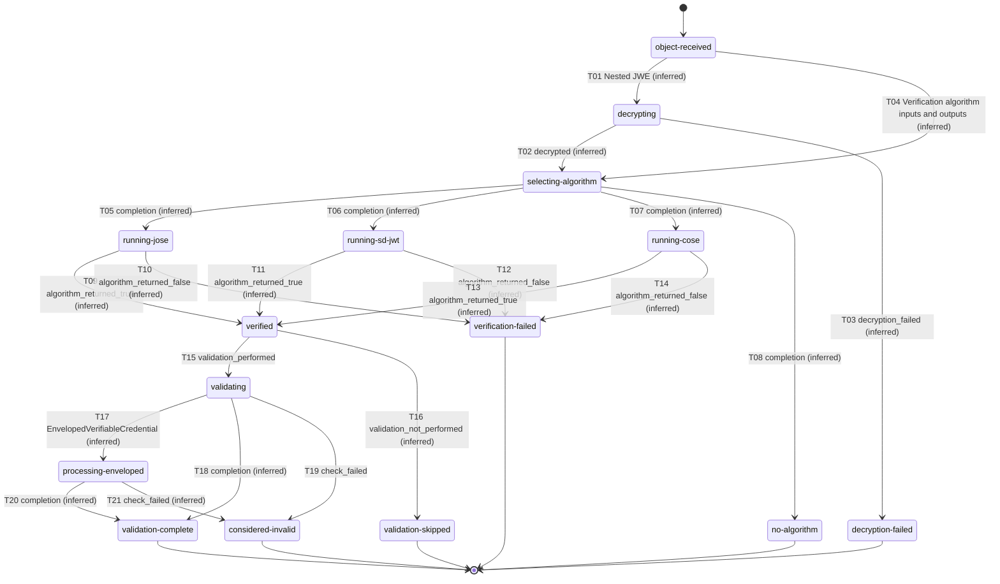

### M02 `jose-verification`

The algorithm of §5.1 as printed: one delegated verification and two branches that set the three outputs.

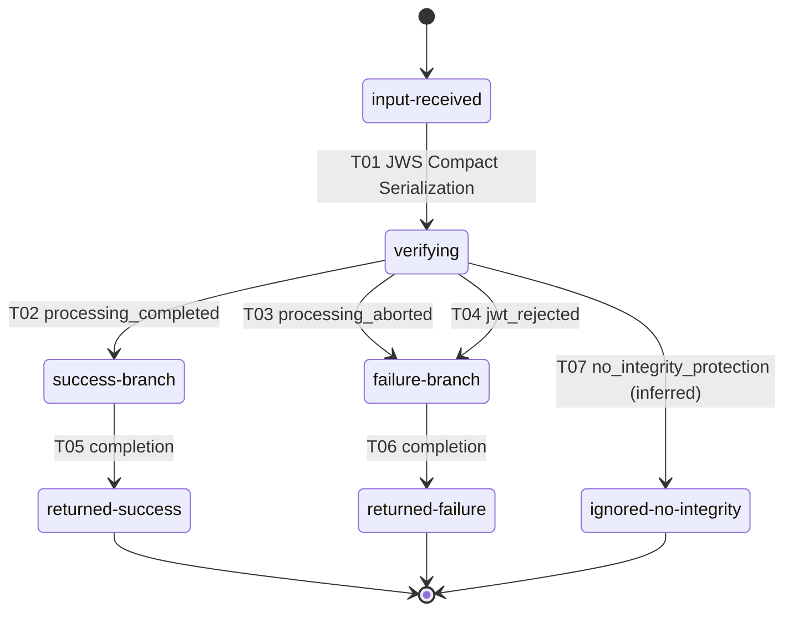

### M03 `sd-jwt-verification`

The algorithm of §5.2 as printed: one delegated verification and two branches that set the three outputs.

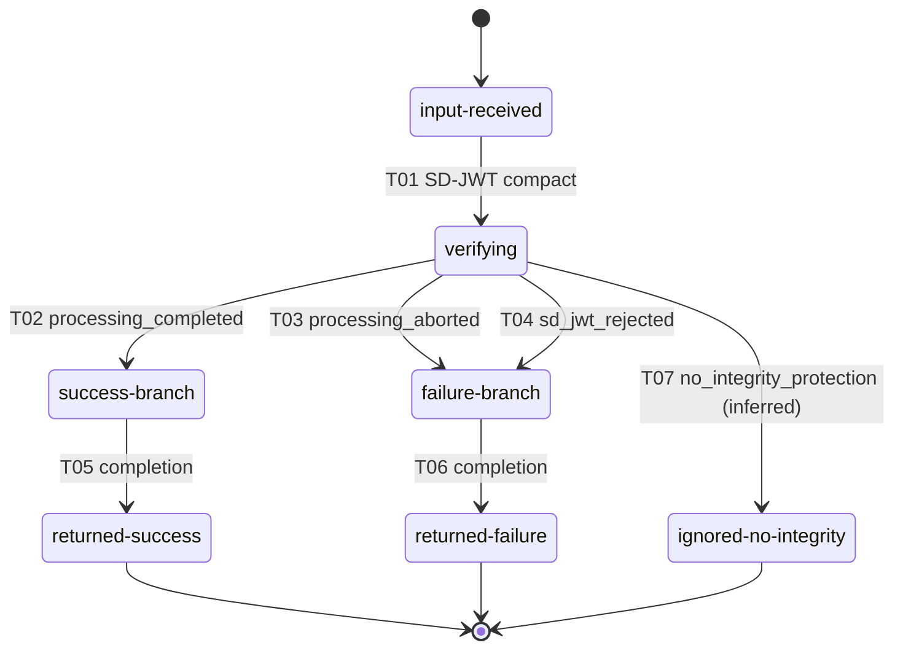

### M04 `cose-verification`

The algorithm of §5.3 as printed: one delegated verification and two branches that set the three outputs.

```mermaid
stateDiagram-v2
  state "input-received" as input_received
  state "verifying" as verifying
  state "success-branch" as success_branch
  state "returned-success" as returned_success
  state "failure-branch" as failure_branch
  state "returned-failure" as returned_failure
  [*] --> input_received
  input_received --> verifying: T01 COSE_Sign1
  verifying --> success_branch: T02 processing_completed
  verifying --> failure_branch: T03 processing_aborted
  success_branch --> returned_success: T04 completion
  failure_branch --> returned_failure: T05 completion
  returned_success --> [*]
  returned_failure --> [*]
```

### M05 `validation`

The checks of §5.4 after a successful verification. Entered by a SHOULD; holds six MUSTs, two SHOULDs and a MAY; produces no output the source defines.

```mermaid
stateDiagram-v2
  state "document-verified" as document_verified
  state "checking-claims" as checking_claims
  state "checking-json-ld" as checking_json_ld
  state "checking-schema" as checking_schema
  state "checking-status" as checking_status
  state "additional-checks" as additional_checks
  state "validated" as validated
  state "considered-invalid" as considered_invalid
  [*] --> document_verified
  document_verified --> checking_claims: T01 validation_performed
  checking_claims --> checking_json_ld: T02 completion (inferred)
  checking_claims --> considered_invalid: T03 check_failed (inferred)
  checking_json_ld --> checking_schema: T04 completion (inferred)
  checking_json_ld --> considered_invalid: T05 check_failed (inferred)
  checking_schema --> checking_status: T06 completion (inferred)
  checking_schema --> considered_invalid: T07 check_failed (inferred)
  checking_status --> additional_checks: T08 completion (inferred)
  checking_status --> considered_invalid: T09 check_failed (inferred)
  additional_checks --> validated: T10 completion (inferred)
  additional_checks --> considered_invalid: T11 check_failed
  validated --> [*]
  considered_invalid --> [*]
```

### M06 `key-discovery`

Finding the key before any §5 algorithm runs. The hints are permissive (can, MAY), unordered and may coexist; this machine follows one hint per run.

```mermaid
stateDiagram-v2
  state "key-needed" as key_needed
  state "reading-hints" as reading_hints
  state "following-kid" as following_kid
  state "following-iss" as following_iss
  state "identifying-pop-key" as identifying_pop_key
  state "retrieving-document" as retrieving_document
  state "checking-verification-method" as checking_verification_method
  state "key-obtained" as key_obtained
  state "key-not-found" as key_not_found
  state "verification-method-unusable" as verification_method_unusable
  [*] --> key_needed
  key_needed --> reading_hints: T01 JWS Compact Serialization
  reading_hints --> following_kid: T02 completion
  reading_hints --> following_iss: T03 completion
  reading_hints --> identifying_pop_key: T04 completion
  reading_hints --> key_not_found: T05 key_not_obtained (inferred)
  following_kid --> retrieving_document: T06 completion (inferred)
  following_kid --> key_obtained: T07 key_found (inferred)
  following_kid --> key_not_found: T08 key_not_obtained (inferred)
  following_iss --> key_obtained: T09 key_found
  following_iss --> key_not_found: T10 key_not_obtained (inferred)
  identifying_pop_key --> key_obtained: T11 key_found (inferred)
  retrieving_document --> checking_verification_method: T12 completion (inferred)
  retrieving_document --> key_not_found: T13 key_not_obtained (inferred)
  checking_verification_method --> key_obtained: T14 key_found
  checking_verification_method --> verification_method_unusable: T15 completion (inferred)
  key_obtained --> [*]
  key_not_found --> [*]
  verification_method_unusable --> [*]
```

## Not defined by this document

- Any exchange between issuer, holder and verifier: request, response, session, acknowledgement, error message or delivery of a credential or presentation.
- How a receiver learns the media type of a secured object, and how it chooses among §5.1, §5.2 and §5.3.
- A verification algorithm for application/vp+sd-jwt.
- How the key found by §4 reaches the §5 algorithms, and what happens when no key is found.
- A standard way to retrieve a JWK from a DID URL or a controlled identifier document (stated as absent by §4.2), and who publishes the document.
- Decryption of a nested JWE or encrypted COSE object on receipt, and a media type for one.
- Verification of credentials and presentations enveloped in a verified presentation.
- How a holder provides a proof-of-possession key to an issuer, and how possession is shown in vp+jwt or vp+cose.
- Which claims a typ value expects (R-0077).
- Any output, status or error signal of the §5.4 validation.
- What a receiver does with a document that breaks a producer-side rule: vc or vp claims present, iss not matching issuer, a missing or non-URL kid, a verification method that is not a JsonWebKey.
- The status (revocation, suspension) and schema mechanisms behind credentialStatus and credentialSchema, beyond SHOULD be checked.
- How a holder chooses disclosures and creates a KB-JWT (the SD-JWT draft).
- Any key lifecycle: rotation, expiry or revocation of issuer or holder keys.
